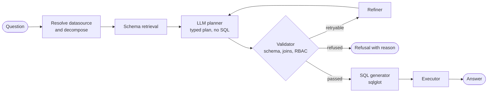

# NL2SQL Engine

Ask a database questions in English. The model writes a typed query plan, never
SQL text; the plan is checked against the real schema and the caller's role
before any SQL is generated.

**Live demo: <https://nl2sql.codewithnk.com>** — bring your own model
key, nothing to install. [What you will see](#what-to-expect).

[](https://github.com/nadeem4/nl2sql/actions/workflows/test.yml)
[](https://pypi.org/project/nl2sql-engine/)
[](LICENSE)

## Try it in your browser

**<https://nl2sql.codewithnk.com>** — the playground on three sample
databases, nothing to install.

[](https://nl2sql.codewithnk.com)

**Bring your own key.** The server holds none. You paste yours into the page —
one per provider — it stays in that browser tab, travels with the question that
needs it, is used in memory for that question and dropped: never stored, never
logged, never written to a trace. Settings also puts each of the six
model-using steps on a provider and model of its own, so the planner can be on
Claude while the rest stays on OpenAI. The sample databases are opened
read-only, and questions are rate limited per visitor and capped per session.
How it is built: [Hosted demo](docs/deployment/hosted-demo.md).

Prefer it on your own machine? [Quickstart](#quickstart-run-it-locally).


## Contents

- [Try it in your browser](#try-it-in-your-browser)
- [How it works](#how-it-works)
- [Latest benchmark results](#latest-benchmark-results)
- [Quickstart: run it locally](#quickstart-run-it-locally)
- [Screenshots](#screenshots)
- [CLI reference](#cli-reference)
- [REST API](#rest-api)
- [Python SDK](#python-sdk)
- [Configuration](#configuration)
- [Security and what is sent to the model](#security-and-what-is-sent-to-the-model)
- [Evaluation and quality](#evaluation-and-quality)
- [Project status, limitations and roadmap](#project-status-limitations-and-roadmap)
- [Contributing and license](#contributing-and-license)

## How it works

- The question is checked for answerability and routed to one of the registered
  databases, then split into sub-queries; the decomposer also builds the
  execution DAG that says which sub-queries can run together and how their
  results combine.
- Each sub-query gets the part of the schema it needs (vector search over an
  index of tables, columns and relationships, or the whole schema when it is
  small).
- The model returns a **typed plan** (a Pydantic `PlanModel`: tables, joins,
  select items, filters), never a SQL string. It may only name a function from
  an allow-list, and it writes date work portably — `DATE_PART`/`DATE_TRUNC`
  over a fixed set of units — which each adapter renders in its own dialect.
- The **logical validator** resolves every table and column against the schema,
  checks joins against the declared foreign keys, checks every table against
  the caller's role (RBAC), and builds the query tree the generator would build,
  so a plan whose tables cannot be joined is caught here, where the planner can
  still be asked to fix it. A refused plan never becomes SQL.
- Only a plan that passes reaches the **generator**, which renders SQL
  deterministically with `sqlglot`. The executor runs it and the answer writer
  summarises the rows.
- A retryable validation failure goes back to the planner through a refiner, up
  to `SQL_AGENT_MAX_RETRIES` (default 3). A security refusal is final.



That is the shape of a run; the full pipeline is **15 steps**, six of them
decided by a model, and the playground's Pipeline page lists them all. The
first, matching the question to a verified query a data team wrote
([curated answers](docs/configuration/curated.md)), runs only when
`curated.yaml` is configured; the second only when a run is given its plan.

Architecture detail: [System Architecture](docs/architecture/overview.md),
[Pipeline](docs/architecture/pipeline.md),
[Agent Nodes](docs/architecture/nodes/index.md),
[Determinism](docs/architecture/determinism.md).

## Latest benchmark results

Generated by `nl2sql eval publish` from the records in
[`benchmarks/`](benchmarks/README.md). Every run, with models, tokens, latency
and determinism: [docs/benchmarks.md](docs/benchmarks.md).

<!-- BENCHMARKS:START -->
### Mode full: English questions answered correctly

The real model end to end on the Chinook suite. Accuracy is execution accuracy, the measure 0.6's tier 2 published: the strict share whose rows match the expected rows exactly, or that are refused where the case expects a refusal (`result_match` and `outcome`; no other scorer counts). Lenient allows extra and reordered columns and date labels; faithfulness is the share of written answers whose numbers and names come from the rows.

| Config | Database | Date (UTC) | Commit | Accuracy (strict) | Accuracy (lenient) | Faithfulness | $/question | Δ vs previous |
| --- | --- | --- | --- | --- | --- | --- | --- | --- |
| gpt-5.4 | chinook | 2026-09-23 | de42c40 | 79.1% [64.8-88.6] | 79.1% | 86.8% | $0.0194 | new series (suite changed) |

### Retrieval recall

The share of each answerable case's needed tables and columns that schema retrieval sends the planner, and the share of cases routing ranks the right datasource first and shortlists every one the case needs, with no LLM involved.

| Database | Date (UTC) | Commit | Table recall | Column recall | Routing top-1 / shortlist | Δ vs previous |
| --- | --- | --- | --- | --- | --- | --- |
| chinook | 2026-10-15 | a33c8ce | 97.9% | 76.5% | 100.0% / 100.0% | tables +0.0 pp, columns +0.0 pp |
| chinook+support+webanalytics | 2026-10-15 | a33c8ce | - | - | 97.4% / 98.7% | first run |

Full history: [docs/benchmarks.md](docs/benchmarks.md)
<!-- BENCHMARKS:END -->

## Quickstart: run it locally

Requires Python 3.12 or newer.

```bash
pip install "nl2sql-engine[demo]"
nl2sql demo
```

> The `demo` command, the `[demo]` extra and most of what this README describes
> are on `main` and arrive on PyPI with 0.2.0 (at the time of writing the latest
> release is 0.1.2). If `pip install "nl2sql-engine[demo]"` warns that the
> extra does not exist, install from a clone:
> `pip install -e packages/sdk -e "packages/nl2sql[demo]"`
> (add `-e packages/api` for the REST server).

### What to expect

1. **No questions at the terminal.** `nl2sql demo` does not prompt. It looks
   for a model key (the order is below) and says which mode it chose:
   **Live mode** with the provider, or replay mode when it finds none.
2. **A project folder and an index.** It writes `./nl2sql-demo` with
   `nl2sql init --demo` (an `nl2sql.yaml` and one file per section), copies in
   three SQLite databases -- Chinook (a music store), `support` (a help desk)
   and `webanalytics` (website traffic) -- and indexes their schemas on your
   machine. The first run downloads a ~79 MB embedding model; no key is needed
   for that.
3. **A local page.** It prints `Playground ready at http://127.0.0.1:8765/` and
   opens that address in your browser (`--no-browser` skips it, `--port`
   changes it). Ctrl+C stops it.
4. **No key yet?** Paste an OpenAI or Anthropic key into the **Settings** page
   (an OpenRouter one works too); the running demo switches to live without a
   restart.
5. **Ask.** Pick one of twenty guided questions or type your own, as `admin`,
   `analyst` or `viewer`. A run shows the answer first, then the **plan** the
   model wrote, the **checks** it passed or failed, the **SQL** the code
   generated, the **rows**, and cost and time. **Debug** opens every step's
   model calls, prompts and responses; **Pipeline** lists all 13 steps and
   which five a model decides.

The live demo above is the same playground with the key entry first.

`nl2sql demo` writes a demo project into `./nl2sql-demo` (the same files
`nl2sql init --demo` writes), copies in three SQLite databases and indexes their schemas on your machine, serves the
playground on <http://127.0.0.1:8765/> and opens your browser. The databases
are the [Chinook](THIRD_PARTY_NOTICES.md) sample database (11 tables, real
foreign keys), `support`, a help desk (4 tables), and `webanalytics`, website
traffic (5 tables); the last two are synthetic, generated by this repository
from a fixed seed, and share Chinook's customer identities. All three declare
their foreign keys. Indexing needs no API key; the first run downloads a ~79 MB
ONNX embedding model.

**Answering a question needs a model.** The demo looks for one in this order:

1. `--api-key KEY` (saved to the project's `.env`, next to its `nl2sql.yaml`,
   so later runs stay live)
2. `OPENAI_API_KEY`, `OPENROUTER_API_KEY` or `ANTHROPIC_API_KEY` in the environment
3. a key already saved in the project's `.env`
4. an Ollama daemon on `localhost:11434`
5. replay mode

The provider follows the key's shape: `sk-ant-...` is Anthropic, `sk-or-...` is
OpenRouter, anything else is OpenAI. Claude needs the extra:
`pip install "nl2sql-engine[demo,anthropic]"`. You can also start without a key
and paste one into the playground's **Settings** page, which switches the
running demo to live mode without a restart and picks a model per step.

**Without a key**, the demo runs in replay mode, which answers only from
recorded model responses. None ship with the engine, so the console and the page
say "replay mode has no recorded answers" and a question gets "No recorded
answer for this question. Add an API key to ask it live." The schema, the index
and the Retrieval inspector still work. `nl2sql demo --record` (with an OpenAI,
OpenRouter or Anthropic key) records the guided questions into the project's
`recordings.json`, and later key-free runs of that folder replay them.

In the playground, pick one of the twenty guided questions -- twelve on
Chinook, four on `support`, four on `webanalytics` -- or type one, and choose a
role: `admin` and `analyst` can read the customer tables, `viewer` cannot, so
asking as `viewer` about customers shows the validator refusing the plan before
any SQL exists. The rail's **Showing** switcher reads any of the three schemas,
and follows the guided question you click. With three databases registered,
every question is routed first: the resolver picks the one it is about, a step
a single-database demo never reached, and the run says which one answered. A
question that spans two of them is not answerable yet -- each sub-query is
planned against one datasource, so the engine cannot join across databases, and
the shared customer identities are groundwork for when it can.

While a question runs, **Ask** becomes **Stop**: it cancels the request, and
the run stops before its next step or model call (the one in flight finishes).
The same is available to SDK callers as `cancellation_token=` on
`engine.run_query` (`nl2sql.CancellationToken`).

The playground has no login. It binds to `127.0.0.1` by default; Settings,
Rebuild, the Retrieval inspector and answer ratings are off on any other
address unless you pass `--allow-settings`. Full guide:
[Demo](docs/getting_started/demo.md).

`nl2sql demo --hosted` is a third state: the public demo
[above](#try-it-in-your-browser), which you can run yourself. The server holds
no API key, each visitor pastes their own into the page, one per provider, and
a visitor without one can still click a guided question and watch a recorded
run of it, labelled **Recorded run**; any other question asks for a key. Saving settings,
Rebuild, answer ratings and `--record` are refused there, and the sample
databases are opened read-only. Two limits keep the pace, both in process and
both best-effort: 6 questions a minute keyed by client address
(`--questions-per-minute`) and 30 a session keyed by a random cookie
(`--questions-per-session`). `deploy/huggingface/` is that demo as a
Hugging Face Space, deployed by every release at the version just published to
PyPI. See
[Hosted demo](docs/deployment/hosted-demo.md).

## Screenshots

Captured from the playground on the demo project, asking about Chinook, with
recorded model responses (so token counts are placeholders).

**An answer:** the question, the plan the model wrote, the validator's checks,
the generated SQL and the rows.


**Debug:** LLM calls, tokens and time per node in execution order. Open a node
to see what it read and returned, the retrieval it ran, and each prompt and raw
model response.


**Pipeline:** every step of a run in order, with the six a model decides
marked and the deterministic ones left quiet. Before a question it shows the
model each step is set to use; after one, the model that answered, that step's
tokens and its time.


**Settings:** save an API key per provider and choose a provider and model for
each LLM step. Written to the demo project's `.env` and `llm.yaml`.


**Retrieval inspector:** run the engine's vector search for any text against the
live index, with k, lambda, entry types and datasource as knobs, and see what
MMR picked and what it dropped. No LLM call.


**Feedback:** rate an answer right or wrong, with an optional note. Stored in the
project with the question, role and SQL, never the rows;
`nl2sql feedback stats` reports the rates.


## CLI reference

Global options: `--config PATH` names the `nl2sql.yaml` every command reads
(without it, `NL2SQL_CONFIG`, then `./nl2sql.yaml`), and `--version` prints the
installed version. The `.env` next to that `nl2sql.yaml` is loaded first;
variables already exported in your shell win over the file. Paths inside the
config are relative to `nl2sql.yaml`, so a command works from any folder. Every
command has `--help`.

| Command | Purpose | Key options |
| --- | --- | --- |
| `nl2sql demo` | Write (`init --demo`), check, index and serve the three-database playground | `--dir` (default `nl2sql-demo`), `--host` (default `127.0.0.1`), `--port` (default 8765), `--no-browser`, `--api-key`, `--record`, `--allow-settings`, `--hosted`, `--questions-per-minute` (default 6), `--questions-per-session` (default 30) |
| `nl2sql init [DIR]` | Write a new config into `DIR` (default `.`): `nl2sql.yaml` plus one file per section, checked with `load_config`. Never writes a key and never overwrites a file without `--force` | `--demo` (the three sample databases, their roles, verified queries, sample questions and settings), `--provider` (`openai`, `anthropic` or `openrouter`; default `openai`), `--force` |
| `nl2sql run "QUESTION"` | Ask a question and print the plan, checks, SQL, rows and answer | `--role` (default `admin`), `--no-exec` (plan and validate only), `--ds-id`, `--verbose`/`-v`, `--show-perf` |
| `nl2sql index` | Index datasource schemas into the index of the configured embedding model, one datasource at a time | `--datasource`/`-d ID` (repeatable), `--curated-only` (re-index only the verified queries of the `curated` section, keeping the schema entries; no model call), `--enrich` (ask the `indexing_enrichment` LLM for descriptions the database lacks; spends tokens, off by default) |
| `nl2sql index prune` | Drop the index of every other embedding model (and 0.5's collection); the current one is kept | |
| `nl2sql config check` | Check the whole config without starting the engine: every file, include and `${env:...}`, and every component it names (installed, right interface version, drivers present). Problems are printed by file; each secret is reported present or missing, never printed. Exits 0, or 1 on any problem. Writes nothing under `storage.path` | `--connect` (also connect to every datasource; one that fails is a problem) |
| `nl2sql doctor` | Check Python, installed drivers and provider keys, then build the configured engine and print `engine.check()`: each datasource, each agent's key, the index | |
| `nl2sql list-adapters` | List the installed datasource adapters | |
| `nl2sql install NAME` | pip-install the driver extra for an adapter (`postgres`, `mysql`, `mssql`, `duckdb`, `sqlite`: the `connection.type` names), after a confirmation | |
| `nl2sql policy validate` | Check the config's policies against its datasources | |
| `nl2sql curated validate` | Check the `curated` section (verified queries): ids, params, read-only SQL in each datasource's dialect, tables against the index; exits 1 on any error | |
| `nl2sql curated test` | Run every verified query once against its database, read-only, with each param's default or example bound; reports pass/fail per query and exits 1 on any failure | |
| `nl2sql curated proposals export` | Write thumbs-up generated answers as proposed verified queries, in the `curated` section's shape, for review; never writes a file of the config | `--out PATH` (default: print to stdout) |
| `nl2sql trace show TARGET` | Print a run trace's timeline: nodes, attempts, durations, tokens, errors | a trace file, or a trace id in the trace store (`storage.traces`) |
| `nl2sql trace replay TARGET` | Re-run a traced question on its recorded LLM responses, with no model calls | |
| `nl2sql cache clear` | Empty the plan cache in `<storage.path>/state.db`; schema snapshots are kept | |
| `nl2sql storage purge` | Delete traces and results older than their store's `max_age_days` (14 and 7 days by default); `nl2sql-api` does this at startup and once a day | |
| `nl2sql feedback list` | Playground ratings, newest first | `--limit` (default 50) |
| `nl2sql feedback stats` | Ratings plus guardrail rates: refusals, refiner retries, validator rejections, errors, plan-cache hits | `--json`, `--traces DIR` |
| `nl2sql feedback export --good` | Write thumbs-up runs as draft eval cases to a separate suite file for review | `--out` (default `feedback_gold_drafts.yaml`) |
| `nl2sql feedback clear` | Delete every rating | `--yes` |
| `nl2sql eval run` | Run the eval suites in one mode (`full`: the model, priced and capped; `plans`: the gold plans on a fake LLM; `retrieval`: no model) and, with `--baseline`, gate the run against a report, a record or a `benchmarks/` folder. Exits 1 on a regression, 2 on a usage error or a baseline it cannot compare, 3 at the cost cap; mode full refuses to run when `CI` is set | `--mode`, `--suite`, `--llm` (preset, file or `NAME=`), `--cases`, `--passes`, `--max-cost`, `--baseline`, `--out` (default `eval_<mode>.json` next to `nl2sql.yaml`) |
| `nl2sql eval regenerate PATH` | Write a suite's expected rows: each approved case's SQL through its datasource's adapter; exits 1 when a case's SQL failed | |
| `nl2sql eval publish [REPORT ...]` | Record each report `eval run` wrote under `benchmarks/`, then rebuild `docs/benchmarks.md` and the results block above; run from the repo root | `--note`, `--from DIR` |

The `nl2sql eval` group is the whole command; `nl2sql eval --help` lists its
subcommands. Evals also run from Python, with `engine.evals`
([Evals](docs/evals/index.md)).

Examples, from the demo folder (`cd nl2sql-demo`, so `./nl2sql.yaml` is the
config; from anywhere else, add `--config nl2sql-demo/nl2sql.yaml`):

```bash
nl2sql run "How many customers do we have, by country?"
nl2sql run --role viewer "Who are the top 5 customers by total spend?"   # refused
nl2sql run --no-exec "Which artist has the most albums?"                 # plan only
nl2sql feedback stats
```

`run` and `index` call `engine.check()` before they start: a
datasource marked `required: true` that cannot connect stops them with the
report (exit 1); any other datasource that fails is printed and left out.

`run` exits 1 when the run ends with an ERROR or CRITICAL error (a refusal
included). More: [Demo guide](docs/getting_started/demo.md),
[Debugging a Run](docs/observability/debugging.md),
[Feedback and Signals](docs/observability/feedback.md),
[Evaluation](docs/testing/evaluation-dataset.md).

## REST API

The `nl2sql-api` package serves the engine over HTTP with FastAPI. At startup
it loads the `.env` next to `nl2sql.yaml` (never overriding a variable already
set), builds one engine with `NL2SQL.from_config()` (`NL2SQL_CONFIG`, else
`./nl2sql.yaml`) and calls `engine.check()` before it accepts a request: a
`required` datasource that cannot connect stops it from starting.

```bash
pip install nl2sql-api
cd nl2sql-demo                               # ./nl2sql.yaml is the config
nl2sql-api --host 127.0.0.1 --port 8000
# or: NL2SQL_CONFIG=nl2sql-demo/nl2sql.yaml uvicorn nl2sql_api.main:app --port 8000
```

Its own settings are the `api` section of `nl2sql.yaml`, which the engine
ignores:

```yaml
# api.yaml (included from nl2sql.yaml as  api: { file: api.yaml })
role: admin                     # one static role for every request
cors_origins: []                # browser origins allowed to call the API
```

Full interactive docs at `http://localhost:8000/docs` (Swagger UI), with ReDoc
at `/redoc` and the schema at `/openapi.json`. Browser access from other origins
is off unless listed in `api.cors_origins`.

The API does not authenticate callers itself, and it never takes the RBAC role
from the request body. The role comes from one of these settings, first match
wins:

| Setting | Role source |
| --- | --- |
| `api.role_header: X-NL2SQL-Role` | A header set by a trusted proxy that authenticates the caller. Comma-separated values are several roles. |
| `api.role: admin` | One static role for every request. |
| `api.trust_body_role: true` | Dev only: `user_context` in the body. Any client can pick any role, so the server logs a warning at startup. |

With none of them, `/api/v1/query`, `/api/v1/query/stream` and the result routes answer HTTP 401.

The routes that change the process (`POST /api/v1/datasource`, `DELETE /api/v1/datasource/{id}`,
`PUT /api/v1/settings/llm`, `POST /api/v1/index/{id}`, `POST /api/v1/index-all`, `DELETE /api/v1/index`)
also need a role listed in `policies.admin_roles` (default `[admin]`), else HTTP 403. With no
role setting at all they answer loopback clients only.

| Method | Path | Purpose |
| --- | --- | --- |
| `POST` | `/api/v1/query` | Ask a question; returns the plan, checks, SQL, a row sample, the result manifest, answer, errors and usage |
| `POST` | `/api/v1/query/stream` | The same run as Server-Sent Events: each step as it starts and ends, the result manifest, the answer as it is written, then the `/query` response |
| `GET` | `/api/v1/query/{request_id}/results/{result_id}` | One page of a run's saved result (`offset`, `limit` up to 1,000) |
| `GET` | `/api/v1/query/{request_id}/results/{result_id}.csv` | The whole of a run's saved result as CSV, streamed |
| `GET` | `/api/v1/health` | Liveness check |
| `GET` | `/api/v1/ready` | Readiness check (does not yet check datasources, the LLM or the index) |
| `POST` | `/api/v1/datasource` | Register a datasource in the running process; `config` has the shape of one `datasources` entry (`id`, `type`, `connection`, ...) |
| `GET` | `/api/v1/datasource` | List the datasources: type, description, status (`ready`, `failed`, `unchecked`), capabilities, masked connection |
| `GET` | `/api/v1/datasource/{datasource_id}` | One datasource, as the list shows it |
| `DELETE` | `/api/v1/datasource/{datasource_id}` | Take a datasource out of the running process |
| `PUT` | `/api/v1/settings/llm` | Replace the whole `llm` section in the running process (the body is the section as JSON; a bad one is a 422) |
| `GET` | `/api/v1/llm` | Each agent and the model it runs on |
| `GET` | `/api/v1/llm/{agent}` | One agent's model |
| `POST` | `/api/v1/index/{datasource_id}` | Index one datasource's schema |
| `POST` | `/api/v1/index-all` | Index every configured datasource |
| `DELETE` | `/api/v1/index` | Clear the vector store |
| `GET` | `/api/v1/index/status` | Index health: status, entries by type, embedding model and problems per datasource |

```bash
curl -X POST http://localhost:8000/api/v1/query \
  -H "Content-Type: application/json" \
  -d '{"natural_language": "How many customers are there?"}'
```

The response has `status`, `sub_queries`, `final_answer`, `errors`, `warnings`,
`reasoning`, `timings`, `usage`, `artifact_refs`, `trace_id` and `trace_path`.
Each sub-query carries `id`, `intent`, `datasource_id`, `schema_version`,
`plan`, `validation`, `sql`, `rows`, `status`, `retry_count` and `plan_source`.
`rows` is a capped sample with the true total; the full result set lives in
artifact storage, addressed by `artifact_refs`. A pipeline failure, a refusal
included, comes back as HTTP 200 with `status: "error"` and the reason in
`errors`. Reference: [REST API](docs/api/rest/index.md).

## Python SDK

```python
from nl2sql import NL2SQL, UserContext

engine = NL2SQL.demo()               # the bundled databases; reads OPENAI_API_KEY (or another provider's key)
engine.index.build()                 # once: builds the index under .nl2sql-demo/
# Your own config instead:  engine = NL2SQL.from_config("nl2sql.yaml")
result = engine.run_query(
    "How many customers are there?",
    user_context=UserContext(roles=["admin"]),
)

print(result.status)                  # "success", "error", "plan_only", or "" if nothing ran
for sq in result.sub_queries:
    print(sq.sql)
    print([c.name for c in sq.validation if c.passed])
    print(sq.rows.rows[:5] if sq.rows else "plan only")
print(result.final_answer["summary"] if result.final_answer else result.errors)
```

Building an engine never connects; `engine.check()` connects to each
datasource and reports, and `with NL2SQL.from_config(...) as engine:` closes it.
`run_query` also takes `datasource_id` and
`execute=False` (plan and validate only). Pass a `user_context` with a role: with
none the call currently raises a validation error, and a role the policy does
not know is refused. `QueryResult` carries per sub-query the plan, checks, SQL,
a capped row sample with the true total, status and retry count, and per run
the status, errors, warnings, per-node timings, `usage` (LLM calls and tokens,
and cost when `llm.prices` covers the model) and `trace_path`. Asking the same question
again reuses the validated plan from the plan cache (`sq.plan_source == "cache"`),
still validated for the caller's role.

Everything else on `NL2SQL` is a namespace: `engine.datasources` (list, get,
add, remove, schema, test), `engine.index` (build, health, clear, inspect,
inspect_defaults), `engine.llm` (list, get, providers, replace),
`engine.policies` (roles, allows, allowed, validate), `engine.curated`
(validate, test), `engine.results` (manifest, page, csv), `engine.feedback`
(record, list, stats, export, clear), `engine.traces` (get, replay) and
`engine.evals` (load, run, regenerate, scorers); `engine.about()` describes the engine and each step of a
run. The CLI, the playground and `nl2sql-api` use nothing else. See
[the public facade](docs/api/core/public-facade.md) and
[`examples/`](examples/).

## Configuration

One config, `nl2sql.yaml`, which `nl2sql init` writes with each section in its
own file ([Configuration](docs/configuration/system.md)):

| Section | What it holds |
| --- | --- |
| `datasources` (`datasources/`, one file each) | Datasources and connections: PostgreSQL, MySQL, SQL Server, SQLite, DuckDB ([Datasources](docs/configuration/datasources.md)) |
| `llm` (`llm.yaml`) | The provider and model, and optional per-node agents ([LLM](docs/configuration/llm.md)) |
| `embeddings` (`embeddings.yaml`) | The embedder the index is built with; `local` needs no key ([Embeddings](docs/configuration/embeddings.md)) |
| `policies` (`policies.yaml`) | Roles: allowed datasources and `datasource.schema.table` entries, `admin_roles` ([Policies](docs/configuration/policies.md)) |
| `storage` (`storage.yaml`) | Where the index, `state.db`, traces and results live ([Storage](docs/configuration/storage.md)) |
| `curated` (optional) | Verified queries; present means curated answers are on ([Curated answers](docs/configuration/curated.md)) |
| `secrets` (optional) | Secret providers for `${provider:key}` references ([Secrets](docs/configuration/secrets.md)) |
| `settings` (optional) | Tuning knobs, every one with a default ([Settings](docs/configuration/settings.md)) |
| `api` (optional) | `nl2sql-api`'s role source and CORS origins ([API](docs/configuration/api.md)) |

```bash
nl2sql init                                   # writes nl2sql.yaml and its files here
# edit datasources/example.yaml, then:
nl2sql index
nl2sql run "How many customers are there?"
```

**LLM providers.** `openai` (default model `gpt-5.4`), `anthropic` (Claude,
`pip install "nl2sql-engine[anthropic]"`, `claude-opus-5` with
`temperature: null`), `openrouter` (OpenAI-compatible gateway, default
`anthropic/claude-sonnet-4.5`) and `ollama` (local; small models often cannot
fill the recursive plan schema). Those defaults are what `nl2sql init` and
`nl2sql demo` write. Each of the six model-using steps can have its own
provider and model under `agents`: `curated_matcher`, `datasource_resolver`, `decomposer`,
`ast_planner`, `refiner` and `answer_synthesizer`, plus `indexing_enrichment`
for optional schema descriptions during indexing (off unless you run
`nl2sql index --enrich`).

**Environment variables.** Two kinds are read directly: `NL2SQL_CONFIG` (the
`nl2sql.yaml` to read) and the provider keys `OPENAI_API_KEY`, `ANTHROPIC_API_KEY` and `OPENROUTER_API_KEY`
(the fallback when the config names no key). Anything else from the
environment is written in the YAML as `${env:VAR}`, for example
`path: "${env:NL2SQL_DATA_DIR}"`. The 0.4 variables and where each one went:
[System configuration](docs/configuration/system.md).

## Security and what is sent to the model

- **What reaches the LLM provider:** the question; the schema the planner needs
  (table and column names, types, keys, relationships, descriptions); **sample
  column values** for tables the role may read; and the **result rows**, which
  the answer writer summarises. With `settings.traces.mode` on, run traces store prompts,
  responses and sample rows on disk.
- **RBAC is strict.** A plan that touches a table the role may not read is
  refused before any SQL exists, never answered from the tables the role can
  see. Sample values and statistics of forbidden tables are stripped from the
  prompt and the trace. An unknown role grants nothing. There is no column
  masking and no row-level security.
- **Read-only is a database setting, not something the executor checks.** The
  plan type only allows `SELECT` and the generator only builds one, but the
  executor does not inspect the SQL. A SQLite datasource is always opened
  read-only at the driver level (SQLite's `mode=ro` URI), so a write is refused
  by SQLite itself. No other dialect opens read-only yet, so on PostgreSQL, MySQL, SQL Server
  or DuckDB, **give the engine a read-only database user.**
- **No authentication** in the CLI, playground or REST API. The CLI and
  playground take the role from the caller. The REST API takes it from a trusted
  proxy header or a static setting, never from the body unless a dev flag is
  on; put your own auth in the proxy and derive the role from it.
- `settings.pipeline.timeout_s` bounds how long the caller waits, not how long the work
  runs; the graph runs in-process with no sandbox.

Details: [Security Model](docs/security/model.md),
[Execution Isolation](docs/execution/isolation.md).

## Evaluation and quality

- **`engine.evals`:** suites of cases in `evals.yaml`, scored by registered
  scorers (`result_match`, `outcome`, `retrieval_recall`, `faithfulness`,
  `routing`), in three modes.
- **The Chinook suite:** 47 cases (43 answerable, 4 deliberately not) with
  expected results per role, including refusals. A case may carry reviewed
  `alt_sql` alternatives, so a second correct way to answer it scores as
  correct; gold data is never edited to make a run pass.
- **Mode plans** (no key, runs in CI): the hand-written plans through the
  validator, generator and executor with a fake LLM, so a failure is a bug in
  code, not the model.
- **Mode full** (real model, costs money): end to end per config, with accuracy,
  answerability precision and recall, cost, latency, determinism and answer
  faithfulness (a deterministic check, no second model, that every number and
  name in the written answer comes from the rows). Accuracy is scored twice:
  **strict**, where the rows must match the gold answer exactly, and
  **lenient**, which allows extra and reordered columns and date labels. Each
  is published with a 95% Wilson interval, because 47 questions cannot separate
  small differences. Stops before spend could pass `max_cost_usd`. With curated
  answers on, a case a verified query answered also runs on the generated
  path, so `accuracy_generated` measures the model alone.
- **Mode retrieval** (no key): the share of each case's needed tables and
  columns that schema retrieval sends the planner, and where routing sends it.
- **Feedback:** playground ratings and guardrail rates via `nl2sql feedback stats`;
  `feedback export --good` drafts new eval cases for review.

Recorded runs are published with `nl2sql eval publish` to the
block above and [docs/benchmarks.md](docs/benchmarks.md). Details:
[Evals](docs/evals/index.md), [the Chinook suite](docs/testing/evaluation-dataset.md),
[Feedback and Signals](docs/observability/feedback.md).

## Project status, limitations and roadmap

The engine is at **0.1.x**. `nl2sql-sdk`, `nl2sql-engine` and
`nl2sql-api` share one version and are released together
([Releasing](docs/development/releasing.md)). Unreleased changes are on `main`;
see the [changelog](CHANGELOG.md) for what is released.

Known limitations:

- Every question needs an LLM; only indexing is key-free. The key-free demo
  answers nothing until you record answers or add a key.
- Small local models often fail to produce a valid plan.
- A question cannot span two databases: every sub-query is planned against one
  datasource, so the demo's three cannot be joined, however much their data
  lines up.
- There is no conversation: each question is answered on its own, with no memory
  of the last one, so "and by country?" is not a follow-up.
- Read-only is enforced by SQLite when a datasource asks for it, and by nothing
  else (see above), so a database user that can only read is still the real
  control. `max_bytes` is not enforced; `row_limit` is, in the generated SQL.
- The hosted demo's rate limits are best-effort: they live in one process, and
  the per-session cap hangs on a cookie the visitor can clear.
- The model's output is not reproducible; determinism is structural (fixed
  topology, validation before generation, plan cache) ([Determinism](docs/architecture/determinism.md)).
- No distributed tracing: OpenTelemetry metrics only, off by default. Audit
  events are emitted only by the CLI.
- The REST API does not authenticate callers: it takes the role from a trusted
  proxy header or a static setting. `run_query` without a `user_context` raises
  instead of refusing.

Roadmap: using the engine on your own database (bring-your-own-database setup
beyond the bundled demo databases) is planned. `nl2sql init` and the adapters
exist, but the guided connect-scan-review flow arrives in a later release.

## Contributing and license

See [CONTRIBUTING.md](CONTRIBUTING.md) for local setup and test markers
(`pytest -m "not integration and not realdb"` runs without a database or key).
[`CLAUDE.md`](CLAUDE.md) is the short form of the rules a change has to keep —
package boundaries, no dialect outside an adapter, validation before
generation — and most of them are enforced, not just written down:
`packages/nl2sql/tests/architecture/test_boundaries.py` parses the tree and
fails with the rule's own name. The reasoning behind each is in
[Invariants](docs/architecture/invariants.md).

Repository layout: `packages/nl2sql` (engine, CLI, adapters),
`packages/api` (REST API), `packages/sdk` (the SDK: the adapter contract),
`web/playground` (the playground's React source), `docs/` (MkDocs site),
`benchmarks/` (recorded benchmark runs), `examples/`.

MIT licensed ([LICENSE](LICENSE)). The Chinook sample database and other
third-party material: [THIRD_PARTY_NOTICES.md](THIRD_PARTY_NOTICES.md).
