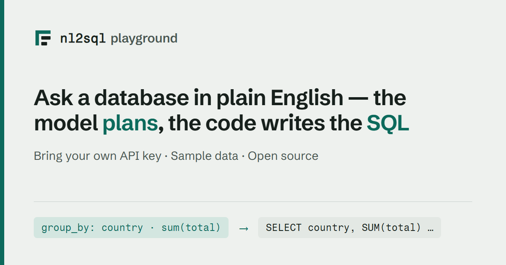
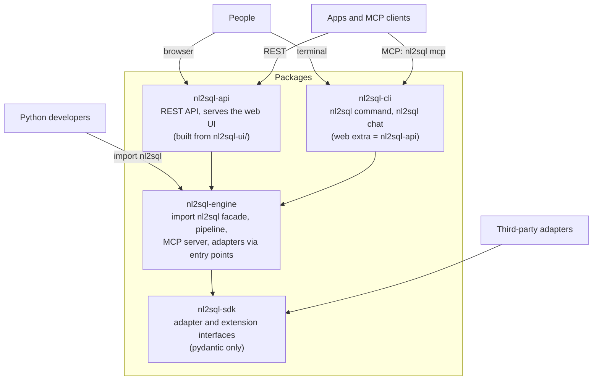

# NL2SQL Engine

Ask a database questions in English. The model writes a typed query plan, never
SQL text; the plan is checked against the real schema and the caller's role
before any SQL is generated. Every answer shows the plan, the checks it passed,
the SQL and the rows.

[](https://github.com/nadeem4/nl2sql/actions/workflows/test.yml)
[](https://pypi.org/project/nl2sql-engine/)
[](LICENSE)

**Live demo: <https://nl2sql.codewithnk.com>**, on three sample databases.
Bring your own model key; nothing to install.

[](https://nl2sql.codewithnk.com)

## How the packages fit together



| Package | Import | PyPI | What it is |
| --- | --- | --- | --- |
| `packages/sdk` | `nl2sql_sdk` | `nl2sql-sdk` | The interfaces an extension implements. Depends on pydantic only. |
| `packages/nl2sql` | `nl2sql` | `nl2sql-engine` | The facade, the pipeline, the built-in adapters and the MCP server. |
| `packages/api` | `nl2sql_api` | `nl2sql-api` | The REST API and the web app. |
| `nl2sql-cli` | `nl2sql_cli` | `nl2sql-cli` | The `nl2sql` command and the `nl2sql chat` terminal app. |

The web app's source is `nl2sql-ui/`. The four packages share one version and
are released together. Other folders: `docs/` (the MkDocs site), `benchmarks/`
(recorded benchmark runs), `examples/`, `deploy/` and `testbed/`.

## Quickstart

Requires Python 3.12 or newer.

```bash
pip install "nl2sql-cli[web]"
nl2sql demo
```

`nl2sql demo` writes a project folder (`./nl2sql-demo`) with three sample
databases, indexes them on your machine, starts the web app on
<http://127.0.0.1:8765/> and opens your browser. With a model key in the
environment (`OPENAI_API_KEY`, `OPENROUTER_API_KEY` or `ANTHROPIC_API_KEY`) it
answers live; without one it replays recorded answers and says so, and you can
paste a key into Settings. The first run downloads a ~79 MB embedding model.
Full guide: [Demo](https://nadeem4.github.io/nl2sql/latest/get-started/demo/).

From a clone: `pip install -e packages/sdk -e packages/nl2sql -e packages/api -e "nl2sql-cli[web]"`.

In Python:

```python
from nl2sql import NL2SQL, UserContext

engine = NL2SQL.demo()                 # the bundled databases
engine.index.build()                   # once
result = engine.run_query("How many customers are there?",
                          user_context=UserContext(roles=["admin"]))
print(result.final_answer["summary"] if result.final_answer else result.errors)
```

## Documentation

The docs live at <https://nadeem4.github.io/nl2sql/>; in this repository they are under [`docs/`](docs/index.md).

| Section | What is in it |
| --- | --- |
| [Get started](docs/get-started/index.md) | Install from PyPI, Docker or source; the demo; the MCP server; `nl2sql launch` for your own database |
| [Use it](docs/apps/web.md) | The web and terminal apps, conversations, charts, dashboards, evals |
| [Configure](docs/configuration/system.md) | `nl2sql.yaml`, datasources, LLMs, policies, secrets, curated answers, the schema |
| [Deploy and operate](docs/deployment/architecture.md) | Docker, Compose, Kubernetes, the hosted demo, security, observability |
| [Extend](docs/extend/index.md) | Adapters, chunk types, the planner, execution backends |
| [Reference](docs/reference/cli.md) | The [CLI](docs/reference/cli.md), the [Python](docs/api/index.md) and [REST](docs/api/rest/routes.md) APIs, [limitations](docs/reference/limitations.md), the glossary |
| [How it works](docs/how-it-works/overview.md) | The pipeline, determinism, failure handling, invariants |
| [Contribute](docs/contribute/index.md) | Tests, the test bed, releasing |
| [Releases](docs/releases/index.md) and [Benchmarks](docs/benchmarks.md) | What changed, and how accurate it is |

## Latest benchmark results

Generated by `nl2sql eval publish` from the records in [`benchmarks/`](benchmarks/README.md). Every run, with models, tokens, latency and determinism: [Benchmarks](docs/benchmarks.md).

<!-- BENCHMARKS:START -->
### Mode full: English questions answered correctly

The real model end to end on the Chinook suite. Accuracy is execution accuracy, the measure 0.6's tier 2 published: the strict share whose rows match the expected rows exactly, or that are refused where the case expects a refusal (`result_match` and `outcome`; no other scorer counts). Lenient allows extra and reordered columns and date labels; faithfulness is the share of written answers whose numbers and names come from the rows.

| Config | Database | Date (UTC) | Commit | Accuracy (strict) | Accuracy (lenient) | Faithfulness | $/question | Δ vs previous |
| --- | --- | --- | --- | --- | --- | --- | --- | --- |
| gpt-5.4 | chinook | 2026-09-23 | de42c40 | 79.1% [64.8-88.6] | 79.1% | 86.8% | $0.0194 | new series (suite changed) |

### Retrieval recall

The share of each answerable case's needed tables and columns that schema retrieval sends the planner, and the share of cases routing ranks the right datasource first and shortlists every one the case needs, with no LLM involved.

| Database | Date (UTC) | Commit | Table recall | Column recall | Routing top-1 / shortlist | Δ vs previous |
| --- | --- | --- | --- | --- | --- | --- |
| chinook | 2026-11-03 | c6ac88e | 99.2% | 91.2% | 100.0% / 100.0% | new series (suite changed) |
| chinook+support+webanalytics | 2026-10-15 | baaae0c | - | - | 97.4% / 98.7% | new series (suite changed) |
| pagila | 2026-11-03 | c6ac88e | 85.5% | 68.2% | 100.0% / 100.0% | new series (suite changed) |

Full history: [docs/benchmarks.md](docs/benchmarks.md)
<!-- BENCHMARKS:END -->

## Contributing, security and license

[CONTRIBUTING.md](CONTRIBUTING.md) covers local setup and test markers
(`pytest -m "not integration and not realdb"` runs without a database or key).
[`CLAUDE.md`](CLAUDE.md) is the short form of the rules a change has to keep:
package boundaries, no dialect outside an adapter, validation before generation.
Most are enforced by `packages/nl2sql/tests/architecture/test_boundaries.py`;
the reasoning is in [Invariants](docs/how-it-works/invariants.md).

Report a vulnerability privately, as [SECURITY.md](SECURITY.md) describes. This
project follows a [Code of Conduct](CODE_OF_CONDUCT.md).

MIT licensed ([LICENSE](LICENSE)). The Chinook sample database and other
third-party material: [THIRD_PARTY_NOTICES.md](THIRD_PARTY_NOTICES.md).
