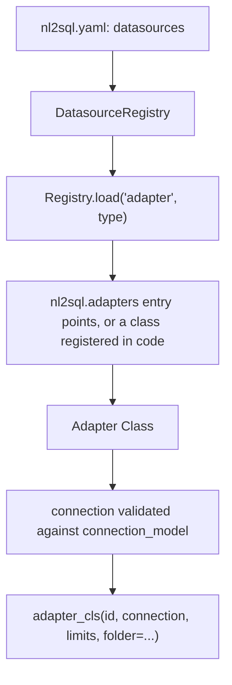
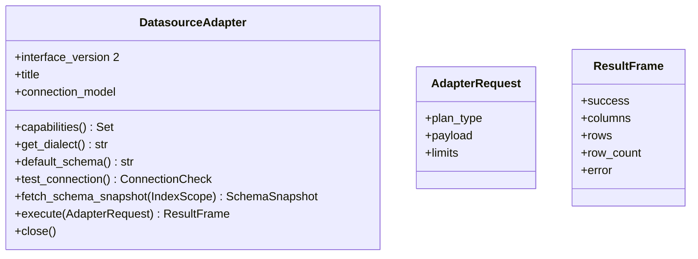

# Plugin / Adapter Architecture

Adapters integrate NL2SQL with external datasources. Each adapter implements a **protocol contract**, is found by name in the **registry** (`nl2sql.registry`, built from Python entry points), and is registered in the `DatasourceRegistry`.

## Discovery and registration



## Core adapter contract



See `sdk.md` for the authoritative adapter interface reference and required fields/methods.

## Capability-driven routing

Adapters expose capabilities (`supports_sql`, `supports_bound_parameters`, `enforces_read_only`, `enforces_timeout`). The registry reads them once, at registration, and `DatasourceRegistry.supports(datasource_id, *capabilities)` is the one check every consumer asks. It fails closed: an unknown datasource, or an adapter whose `capabilities()` is missing or raises, supports nothing. These capabilities drive:

- **Subgraph selection** (`resolve_subgraph()` in routing).
- **Executor selection** (`ExecutorNode._supports_sql()` and `SqlExecutorService.validate_request()`, gating the SQL executor).

```mermaid
flowchart TD
    Adapter[DatasourceAdapter] --> Caps["capabilities(), read once"]
    Caps --> Check["DatasourceRegistry.supports() (fails closed)"]
    Check --> Exec[ExecutorNode capability gate]
    Check --> Subgraph[resolve_subgraph()]
    Exec --> Service[SqlExecutorService]
    Subgraph --> Graph[Subgraph Selection]
```

## Multi-datasource routing

The control graph can resolve multiple datasources for a single user query. `DecomposerNode` produces sub-queries scoped to individual datasources. Each sub-query is then routed to a subgraph that matches its adapter capabilities.

## Extensibility model

To add a new adapter:

1. Implement `DatasourceAdapter` (or extend a base adapter), with a `connection_model`.
2. Publish the adapter class as an `nl2sql.adapters` entry point, or register it in code (see [Adding a New Adapter](../extensions/add-adapter.md)).
3. Configure the datasource in the `datasources` section of `nl2sql.yaml`, with `type:` set to the adapter's name.

## Source references

- Adapter protocol: `packages/sdk/src/nl2sql_sdk/protocols.py`
- Registry: `packages/nl2sql/src/nl2sql/registry.py`
- Datasource registry: `packages/nl2sql/src/nl2sql/datasources/registry.py`
- Example adapter: `packages/nl2sql/src/nl2sql/adapters/sqlalchemy_base/adapter.py`
