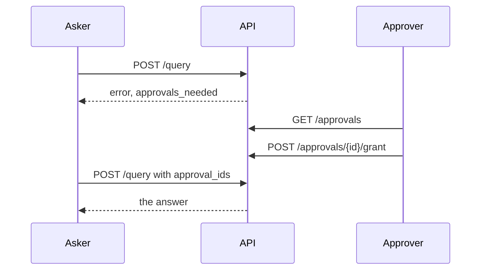

# Approvals API

When a [hook](../../configuration/hooks.md) holds a run for approval, the run ends with `status: "error"`, an
`approvals_needed` entry, and a stored request. An approver (a caller holding one of the roles the hook names) grants or
denies it; the asker then re-asks the same question with `approval_ids`. Source:
`packages/api/src/nl2sql_api/routes/approvals.py`.

## Endpoints

### `GET /api/v1/approvals`

The requests the caller asked, plus those their roles may decide. `status` (`pending` by default, `granted` or
`denied`; anything else is a `422`) filters them. Each is an `ApprovalRecord`: the request (its `question`, `sql`,
`reason`, `hook` and the `approver_roles` who may decide), its `status`, and when and by whom it was decided. Who
granted it, with the roles they held, is the engine's record and is not returned. Each record also has `own`: `true`
when the caller asked it (same tenant, same `user_id`), set by the server so a page never compares ids; `grant` and
`deny` return it the same way. `own` says nothing about who may decide: the engine answers that on the call.

### `POST /api/v1/approvals/{request_id}/grant`

Grant the request, as the caller. A caller holding none of the approver roles gets `403` `FORBIDDEN`; an unknown id, or
another tenant's request, is a `404`. Returns the updated `ApprovalRecord`.

### `POST /api/v1/approvals/{request_id}/deny`

Deny it. The optional body `{"reason": "..."}` is kept on the record. Same `403` and `404` as grant.

### Retrying

`POST /api/v1/query` with `{"question": ..., "approval_ids": ["<request_id>"]}`, the same question, as the same asker.
An id that is unknown, pending, denied, or another asker's ends the run with an `APPROVAL_NOT_GRANTED` error in the
result (`HTTP 200`, `status: "error"`), and the pipeline does not run. See [the query API](query.md).

## Tests

`packages/api/tests/test_approvals_routes.py` covers the list scoping, a grant by an approver and the asker's retry,
the `APPROVAL_NOT_GRANTED` ending, a denial with and without a reason, and the `403` and `404` cases, over the real
facade.
