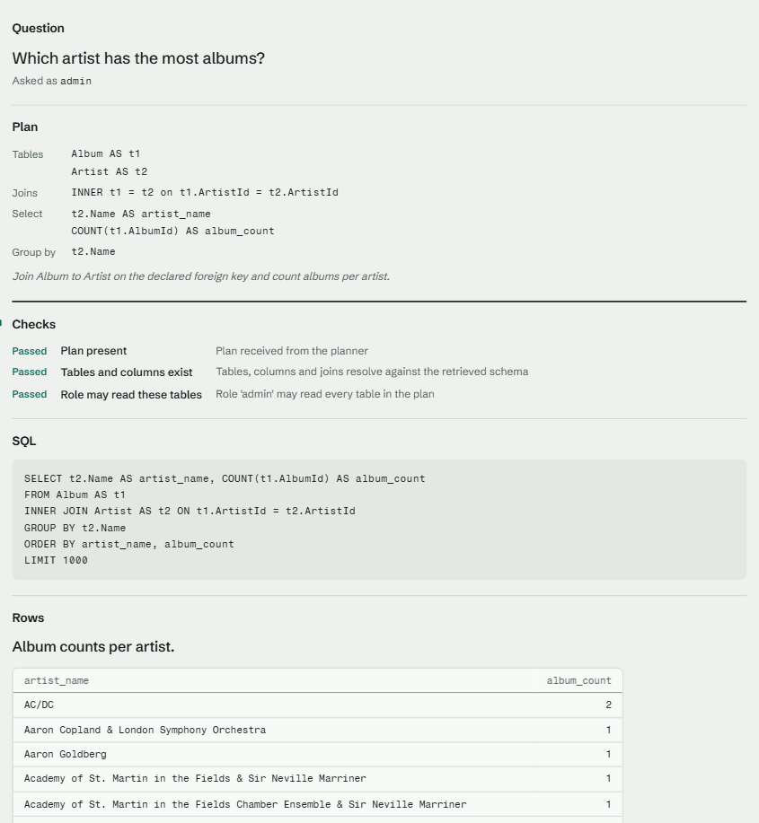
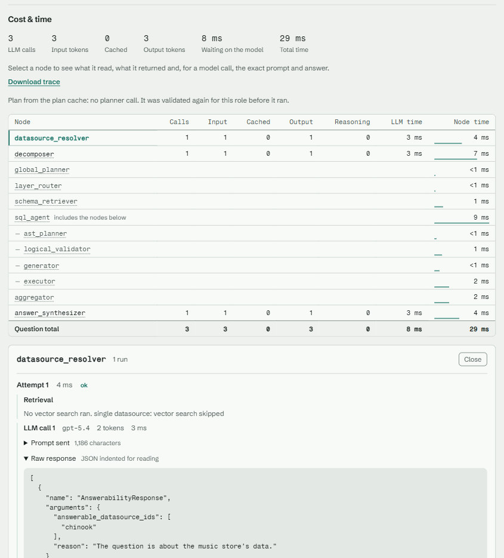
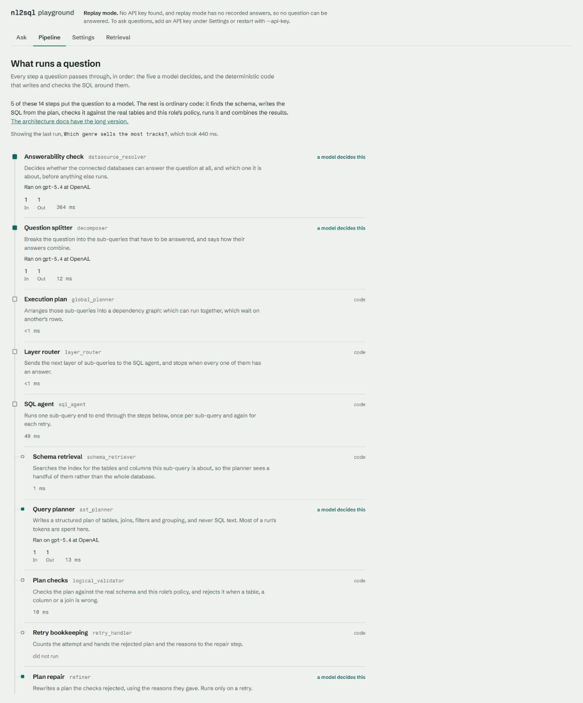
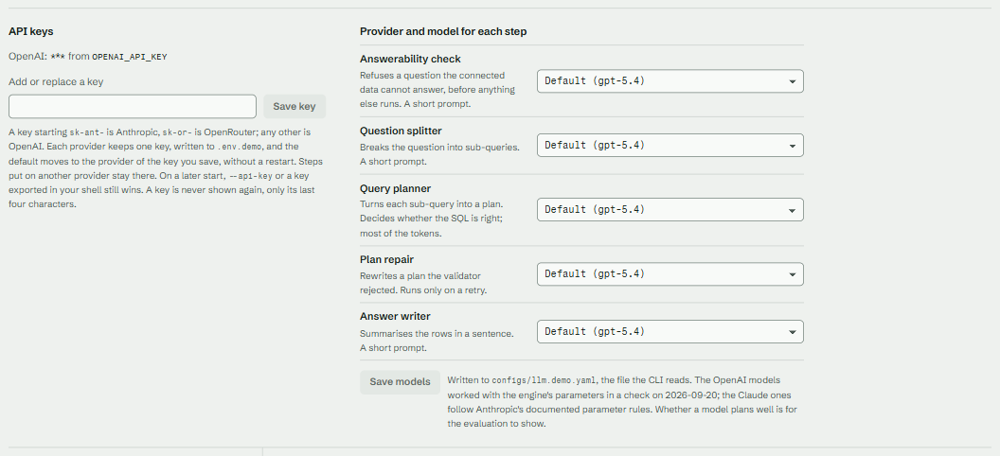
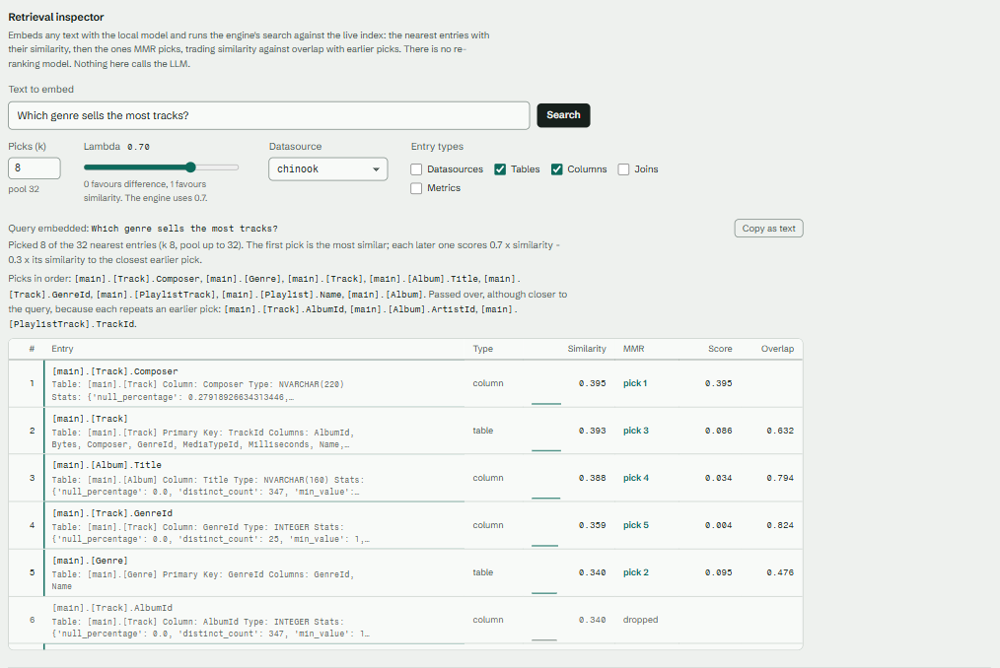
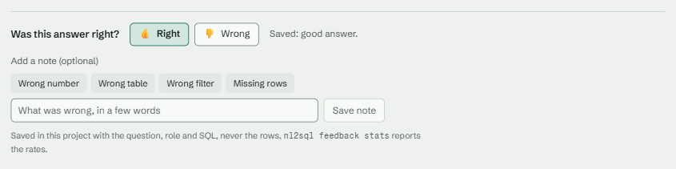

# Web app

The web app is the browser front end of NL2SQL. It lives in `nl2sql-ui/` at the
repository root, is built into the API package, and talks to nothing but the
[REST API](../api/index.md) through `nl2sql-ui/src/api/http.js`. Anything the
page can do, an SDK or REST caller can do the same way.

Pages are reached by hash route: `#/chat`, `#/approvals`, `#/settings`,
`#/retrieval`, `#/pipeline`, `#/evals`. A route nobody serves opens Home.

## Chat

`#/chat` (and `#/chat/<conversation id>`) is a [conversation](../conversations/index.md)
with the model-led chat. The model decides which steps to take; the page shows
what it did.

**The list and the transcript.** The left column lists your conversations
(`GET /conversations`), with **New conversation** and a delete button on each.
The transcript shows one block per stored turn. A new conversation starts on the
first question, so the address bar names it from then on and a reload comes back
to the same place. A new conversation also offers the datasource's starter
questions and, with more than one datasource, a choice of which one to ask.

**A turn streams.** A question is sent to `POST /conversations/{id}/turns/stream`.
While it runs, the page shows the run spine (the pipeline stations lit as each
one finishes) and the answer text as it arrives. The rows appear with the stored
turn, not before. The last
event carries the stored turn, which replaces the live view, so what stays on
the page is exactly what the server saved. **Stop** cancels the stream; during a tool or retry call, which cannot be
cancelled from the page, the button reads **Working** and is disabled. A second
turn sent while one is running is refused by the server with 409, and the page
says so.

**What an answered turn shows.** The answer text and the rows come first. Below
them, in this order:

- warnings about the result (truncated rows, withheld columns, and so on);
- **Why this answer**, a fold with the sections of the explanation (how the
  question was read, which tables and curated answers were used, what the
  planner chose; the planner's note is marked as the model's own words);
- **SQL** and **Plan**, the typed plan and the query it produced;
- **Trace and cost**, the run's stations, timings and token use;
- **Did this answer it?**, a light bar with **Yes** and **Not quite**. **Yes**
  keeps the answer in **My answers** (`POST /answers`; the server also rates the
  run up) and says so, adding "sent for review" only when a proposal was filed.
  A full **My answers** (100), a save racing another ("try again") and an answer
  that cannot be kept are shown in place. **Not quite** rates the run down and
  opens a note and a corrected SQL that **Send for review** files
  (`POST /feedback`, `POST /feedback/correct`). A one-line hint explains both
  until the first click; that it was seen is a browser-local flag only.

**Only the last turn is live.** A clarification pick answers the conversation's
pending question, and **Run it now** re-runs the last question, so those buttons
show on the last turn only. Earlier turns keep their text. If you open another
conversation while a turn is running, its result is added to the conversation it
was sent for, not to the one on screen.

**Clarification.** When the model needs a decision, the turn shows its question
and an option for each reading. **Use this reading** sends `{choice: option id}`
as the next turn. **Remember this meaning** also files the pick, with an
optional term, as a proposal for review (`POST /knowledge/choices`).

**Approvals.** When a plan needs approval, the turn lists what is waiting. Once
every request is granted, **Run it now** calls `POST /conversations/{id}/retry`
with the approval ids. **Check again** reads the requests' state; a denied request says so and the turn stays stopped.

**More with this answer.** Buttons under a turn run the conversation's tools
(`GET /chat-tools`, `POST /conversations/{id}/tools/{name}`): **Chart**,
**Diagram**, **Report**, and **Pin to dashboard** when the conversation belongs
to a dashboard. A tool the model offers in its reply gets a button too. Tool
arguments use 1-based `turn` and `step` numbers. **Report** calls
`POST /conversations/{id}/tools/report`, which stores the report as a turn output
(the markdown is in `output.body`); the `GET /conversations/{id}/report` download
is not used by the page.

## Approvals

`#/approvals` lists the requests waiting for a decision (`GET /approvals?status=pending`),
each with the question, who asked, the plan, the SQL it would run and why it
stopped. **Grant** and **Deny** call the matching routes. The list also holds requests you
asked yourself; those show no buttons, since only an approver may decide them,
and the nav count leaves them out. The server marks them (`own` on each
record), so the page compares no ids; it never decides who may approve, and the
server refuses a decision that is not yours, with its reason shown.

## Charts, diagrams, reports

A chat answer can carry outputs. Each is drawn from data the API already holds, by the renderer for its kind
(`src/outputs/Output.jsx` picks it from the `ToolOutput`). A body the page cannot read is shown as text, never dropped.

| Output | What you see |
|---|---|
| Chart | A line, bar, big number or table from the engine's [`ChartSpec`](../charts/index.md), drawn as SVG sized to its card. Bars run horizontally so long labels stay readable. A **Table** switch shows the rows behind the chart, the takeaway sits under it, and a note says when only the first rows are drawn. **Download Vega-Lite** saves the same chart as a Vega-Lite file (not offered for a table). |
| Diagram | A [Mermaid](../charts/diagrams.md) diagram. The library loads on the first diagram only, in its own file, and follows the page theme (light or dark). **Source** shows the text. |
| Report | The Markdown the report tool wrote: headings, paragraphs, lists, tables, code and collapsible sections. Links open in a new tab; raw HTML is never rendered. **Download .md** saves the text. |
| Rows | The result table, paged from `/results/{trace_id}/{result_id}`, with **CSV** download. |

Charts use up to four series colours and then a neutral grey; every chart with two or more series has a legend, and
each mark has a hover title with its full value. The series colours keep 3:1 contrast against the card in both themes
(`src/outputs/palette.test.js`). Downloads are fetched with the page's own request headers, so they work with the
same keys and identity as every other call.

## Dashboards and workspaces

The **Dashboards** page (`#/dashboards`, and `#/dashboards/{id}` for one dashboard) shows whole dashboards, which
the chat builds as drafts and a person pins into a workspace. It calls the [dashboards and workspaces
routes](../api/rest/dashboards.md) and never a model.

- **Workspaces** are listed on the left: create, rename, and delete (an empty one only; the server's sentence is shown
  otherwise). The chosen workspace lists its saved dashboards; **Drafts** lists those not yet pinned.
- **Opening** a dashboard only reads: each chart appears with its stored result and how old it is ("Refreshed 10 min
  ago"). The charts the server reports as due are then refreshed one at a time. **Refresh** re-runs every chart.
- **Charts** are drawn with the same chart card as the chat. A chart that cannot show says why: *needs fixing* (what
  broke, with **Remove this chart**), *denied* (you may not read its data), *needs approval* (the reason, a link to
  Approvals, and **Run again**: it names the request, then runs the chart with it once it is granted, or says it is still
  waiting), or no rows.
- **Filters** apply values to every chart: a list of a column's values for an `in` filter, two ends for a `between`
  filter. **Apply** shows the filtered result and stores nothing; **Clear** brings back the stored results
  (it opens the dashboard again). A chart a filter does not reach is marked "Not filtered". The header's age is that of
  the oldest result shown.
- **Schedule** sets how often the dashboard refreshes itself, or stops it. An interval under the server's minimum is
  refused with its own sentence.
- **Edit** turns on, per chart: rename, chart type (automatic, line, bar, big number, table; the chart runs once so the new type shows), move earlier or later,
  wider or narrower, taller or shorter, and remove. It also renames the dashboard, **moves** it to another workspace
  (or **pins** a draft into one; with no workspace yet, **Pin** makes "General"), removes a filter, and deletes the dashboard. The grid has four columns; charts are
  packed in order, so an arrangement never overlaps. What data a chart shows is changed in chat, not here.
- **Generate a starter dashboard** (at the top of the page) builds one for a datasource from what the project already knows, with no model and no key. Pick the datasource, and optionally a title, the workspace to save into (the chosen one by default) and how many charts. Progress shows as "tile 3 of 8" and can be cancelled; when it is saved the new dashboard opens. Only one job per person runs at a time: the form locks while the start request is in flight, a job already running (after a reload, say) comes back with its progress and Cancel, and leaving the page stops following it without opening anything.
- **Build a dashboard** (a fold under Generate, which stays) makes a dashboard from questions you choose. Four steps: **Sources** (Curated, My saved answers, Tell us what matters; mix them), **What to ask** (chips from `GET /dashboard-builder/options`: curated questions, your saved answers, and for the model source the metrics, breakdowns and period, plus a line in your own words; at most 3 new questions are written), **Review** (`POST /dashboard-builder/proposals`: tick, untick or reword each chart, and optionally set the title, the workspace and a date column) and **Build** (`POST /jobs/dashboard-build`, shown as "tile 3 of 8" and cancellable). A question that could not be answered is listed as "Couldn't answer ..." with the reason, and you open the dashboard from there; with none skipped it opens by itself. "Tell us what matters" needs a model key: on the hosted demo without one it is disabled with a note pointing to Settings, and a missing key from the server reads the same way. The other two sources call no model.

**My answers.** A fold at the top of the Dashboards page lists the answers you kept
with **Yes** in chat (`GET /answers`): the question, its datasource and the day it
was kept. **Run** answers the saved plan again as you (`POST /answers/{id}/run`):
your data scope, hooks and approvals apply, and no model is called; the rows show
in the usual result table. An answer the schema has outgrown says it needs fixing,
and one waiting for an approval offers **Run again** once it is granted.
**Delete** forgets it (`DELETE /answers/{id}`). The list is yours alone.

## Connect and review

**Connect** (`#/connect`) adds a datasource to the running server.

1. Pick a type. The form is built from that adapter's own connection schema, so a third-party adapter gets a form with no change to the app. An adapter that is not installed shows its install hint.
2. Fill in the connection. Secret fields are password inputs: type an `${env:NAME}` reference, not the secret itself. Less common settings sit under Advanced.
3. **Test connection** reports Connected, or the stage that failed (configuration, driver, network, sign-in, database, permissions) with the reason and the fix.
4. **Add** registers the datasource. Tick "Save to the project config" to write it to `nl2sql.yaml`. Where the config is read-only (the Docker image), the datasource is added but not saved: it works until the server restarts, and you add it to the mounted config to keep it.
5. After Add the page offers **Index**, **Profile** (optionally drafting descriptions with the model, under a spending cap you set) and **Suggest starter questions**, which are filed as proposals for review. Each job shows its progress and can be cancelled.

Removing a datasource asks first. Once a datasource is added, secrets typed into the form are cleared. Connect needs an administrator. `GET /meta` says whether you are one (`caller.admin`), so on the hosted demo, and for anyone who is not an administrator, the page says it is off instead of showing a form. If `/meta` is unavailable the page asks the server, and a 403 from it turns the page off the same way.

**Knowledge** (`#/knowledge`) shows, for one datasource:

- **What the engine knows:** terms, rules, joins, tables and columns. Tables and columns are marked with where their description or role came from (a knowledge file, the database, or derived). Any problems found while loading, and the schema.
- **Waiting for review** (administrators; the page does not ask for these unless `/meta` says you are one, and a 403 still hides them): the proposals from profiling and starter questions, grouped by kind. Each shows everything accepting would write (a role, a unit, code values, text), and the counts and checks that back it, never rows of data. Accept or reject one or many; "Edit and accept" lets you change a proposal's text first. Accepting writes to the knowledge files; the page names the files and shows any proposal the server refused and why.
- **Drift** (administrators): **Check for drift** compares each live database with its index and lists what changed (tables, columns, types, foreign keys) and what the change may break: verified queries, glossary items, policy rules and preferred tables. To bring a drifted index up to date, run `nl2sql index`.

## Evals

**Evals** (`#/evals`) runs the suites named in `evals.suites` on the server and shows the report. It is for administrators: a report holds every role's cases, plans and SQL, so `GET /meta` (`caller.admin`) decides whether the page is listed: until `/meta` names the caller, or when it names none, the page is not listed. A caller who opens it anyway is told it is off.

1. Pick a **mode**. *Plans only* and *Retrieval only* call no model. *Full* asks every case end to end, spends money, and needs a **cost cap** in dollars (the run stops when its model calls reach it).
2. Tick the suites to run (all by default; each shows how many of its cases are approved).
3. **Run** starts `POST /jobs/eval`. The job shows its progress and can be cancelled.

The report shows, for each configuration: accuracy with its interval, the generated path's accuracy, cost, latency (p50 and p95) and planner retries; accuracy by source (curated or generated) and the pass, fail, error and skip counts by role; and every case that did not pass, with its question, the reason each scorer gave and its SQL. A run that stopped at its cost cap, or was cancelled, says so, and a model call with no known price is counted so the cost reads as a floor.

## Settings

**Settings** (`#/settings`) holds up to four cards, depending on the server and on who you are.

- **API key** and **Model for each step** appear when the server lets a request bring its own model (`api.request_llm`, which `GET /meta` reports). The key and the choices stay in this browser tab (`sessionStorage`) and travel as headers with each question; nothing is written on the server. A step put on a provider needs a key for it in the same tab, or the question is refused. The providers, their models and the steps come from `GET /llm/providers` and `GET /llm`.
- **The server's model** (administrators) edits the default model and the model of each step, and saves with `PATCH /settings/llm`, which sends only the models you changed. Everything else in the server's `llm` section (`base_url`, `headers`, `prices`, temperatures, a key held in a custom variable) stays as it was; where a step's provider changes, its key and `base_url` are cleared and the new provider's standard key variable is used. A provider whose key the server does not have is labelled "(no key)". The change is in memory and in this server process only, so with more than one worker a save reaches just the one that answered; `llm.yaml` is read again on a restart. The page no longer warns about models that ignore temperature 0, because `GET /llm/providers` does not say which they are.
- **API keys for this server** (administrators) lists the keys the server issues, and creates one from a user id, roles, an optional tenant and an optional label (`POST /api-keys`). The new key's token is shown once and never again. **Revoke** ends a key (`DELETE /api-keys/{id}`).

A caller who is not an administrator, on a server that does not take a key with a question, sees that there is nothing to set.

## Home, Pipeline and Retrieval

**Home** says what the engine does (the five steps a question travels, a clip of each page) and, while the project has
nothing to ask yet, shows the **start screen** above that story. `GET /meta` decides it with `start`:

| `start` | When | What Home shows |
|---|---|---|
| `choose` | The served project has no datasource and the caller is an administrator | Two cards. **Try the demo** (administrators) runs `POST /jobs/demo`, shows its progress, then opens Chat on a sample question. **Connect your database** opens the Connect page. Anyone else gets no `start` at all. |
| `hosted` | The hosted demo | **Ask a sample question** opens Chat. **Connect your database** only explains: the hosted server connects nothing, so it shows the steps to run nl2sql yourself (install and `nl2sql demo`, or Docker Compose) and links the [self-hosting guide](../deployment/compose.md). No route is called. |
| `null` | A datasource exists | No start screen. |

**Try a sample question** asks the first guided question that has a recorded answer, so it works without a key. The
guided questions and the recordings come from each datasource in `GET /meta` (`sample_questions`, `recorded`); the
recording's model is `recorded_with`.

**Pipeline** (`#/pipeline`) lists every step of a run from `GET /about`, and marks which a model decides. A page answers
from recordings (it says so on each model step) when the visitor is on the hosted demo with no key, or when every model
step in `/about` runs on the `replay` provider.

**Retrieval** (`#/retrieval`) searches the live index with no model and no key: `GET /index/inspect` gives the defaults
(k, lambda, the entry types) and `POST /index/inspect` runs one search as the caller, so it shows only what the caller's
scope reaches. The datasource list comes from `/meta`. With no datasource it says there is nothing to search yet.

**Hosted first run.** A hosted visitor without a key sees the guided questions replay recorded runs. A question with no
recording comes back as a `REPLAY_MISS` error, and Chat then points to Settings to add a key. Chat labels a recorded answer **Recorded run** when every model call in its usage reports no token count and names the recording's model.

## Source map

| Path | What it holds |
| --- | --- |
| `src/api/chat.js` | Every conversation, approval, feedback and trace call |
| `src/chat/spine.js` | Folds stream events into the live run spine |
| `src/chat/turns.js` | Reads a stored turn: answer, steps, pending questions, tool buttons |
| `src/pages/Chat.jsx` | The page: list, transcript, composer, streaming |
| `src/pages/Approvals.jsx` | The approvals queue |
| `src/api/evals.js`, `src/pages/Evals.jsx`, `src/evals/report.js` | Run a suite and read the report |
| `src/api/settings.js`, `src/pages/Settings.jsx`, `src/lib/settings.js` | The tab's keys and models, the server's model, API keys |

## Screenshots

Captured from the playground on the demo project, asking about Chinook, with
recorded model responses (so token counts are placeholders).

**An answer:** the question, the plan the model wrote, the validator's checks,
the generated SQL and the rows.

**Debug:** LLM calls, tokens and time per node in execution order. Open a node
to see what it read and returned, the retrieval it ran, and each prompt and raw
model response.

**Pipeline:** every step of a run in order, with the seven a model decides
marked and the deterministic ones left quiet. Before a question it shows the
model each step is set to use; after one, the model that answered, that step's
tokens and its time.

**Settings:** save an API key per provider and choose a provider and model for
each LLM step. Written to the demo project's `.env` and `llm.yaml`.

**Retrieval inspector:** run the engine's vector search for any text against the
live index, with k, lambda, entry types and datasource as knobs, and see what
MMR picked and what it dropped, as the role you chose, so entries it may not
read are not shown. No LLM call.

**Feedback:** rate an answer right or wrong, with an optional note. Stored in the
project with the question, role and SQL, never the rows;
`nl2sql feedback stats` reports the rates.

