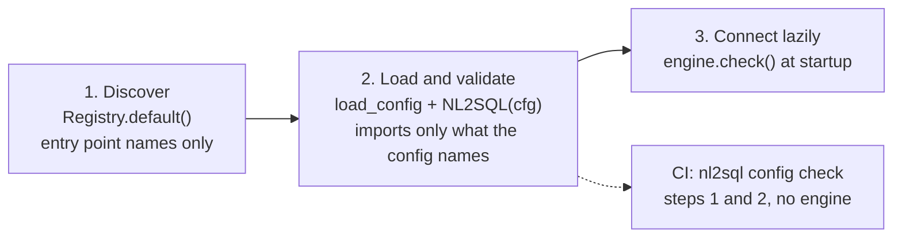
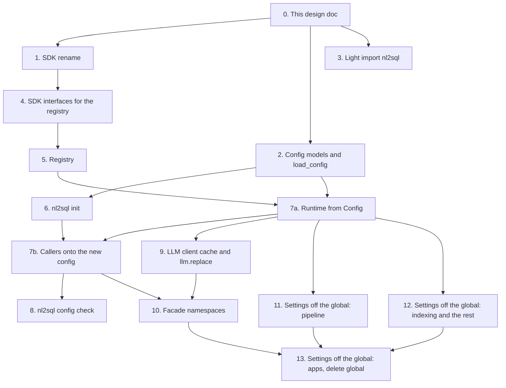

# Configuration v2 and the extension registry (Phase 1 design)

!!! note "Status: design, not built"
    This page is the design for Phase 1 of the redesign, which ships as
    release 0.5. Nothing on it is built yet. Each pull request in
    [the PR plan](#11-pr-plan) updates this page and the reference pages it
    touches. Until then, the [Configuration](../configuration/system.md)
    pages describe how 0.4 works.

## Principles

**There are no users yet, so nothing we change can break anyone.** This
design aims to be correct, not compatible:

- **No compatibility code.** There are no old names, aliases, shims,
  deprecation warnings or legacy code paths kept for compatibility. 0.5 reads
  only the new config. There is no `nl2sql config migrate` command, only
  [a mapping table](#3-environment-variables) in the docs.
- **The right shape, not the smallest diff.** Where today's shape is wrong,
  this page gives the right one and deletes the old. That covers the facade,
  the `settings` global, the config models, the CLI flags, the internals the
  playground and the API reach into, and the names of methods, fields and
  environment variables.
- **No over-engineering.** Ship only what the product needs in 0.5. Anything
  that can wait for a later phase does.
- **Per-engine config, passed explicitly.** The fresh review suggested
  building today's process-global `settings` from the new config and leaving
  the 43 modules that read it alone. That was a compromise to keep the change
  small. Judged on correctness, the right design is an engine that owns its
  config and passes it down, with no process-global settings, so two engines
  in one process never share anything. Phase 1 gets there in
  [staged pull requests](#8-process-globals), and each one stays green.

## Owner decisions

The owner answered the six questions this design left open. Each one is
written into the section it affects:

| # | Decision | Where |
|---|---|---|
| 1 | **`nl2sql-api` settings go in an `api:` section** of `nl2sql.yaml`, typed by an `Api` model. The engine ignores it, and `nl2sql-api` reads `engine.config.api`. The `NL2SQL_API_*` variables are removed. | [`api`](#api-api) |
| 2 | **Only the entry points load `.env`.** The CLI, `nl2sql-api` and the demo load the `.env` next to `nl2sql.yaml` without overriding variables that are already set. The library never reads `.env` and never writes `os.environ`. | [Environment variables](#3-environment-variables) |
| 3 | **The constructor never connects.** The entry points call `engine.check()`, and `required: true` is enforced there. | [Lifecycle](#lifecycle) |
| 4 | **The S3 and ADLS result backends are deleted now.** The Phase 2 results-store interface brings remote stores back. | [`storage`](#storage-storage-path-only) |
| 5 | **`nl2sql setup` is removed in 0.5.** `nl2sql init` replaces it, and the guided flow comes in Phase 4. | [CLI](#cli) |
| 6 | **The LLM can be replaced at runtime.** `engine.llm.replace(LLM(...))` and an admin-only `PUT /api/v1/settings/llm` do it. The swap is atomic and logged, LLM clients are cached per engine, and the plan cache key includes the planner's model. | [Replacing the LLM at runtime](#replacing-the-llm-at-runtime) |

Two rules from earlier decisions apply throughout:

- **Every component works the same way:** a small interface, the built-ins
  we ship, plugin packages people install, and their own code registered in
  memory.
- **The engine is the product.** The CLI, `nl2sql-api` and the playground are
  consumers. Anything one of them needs that another caller could also need
  becomes an engine method.

## 1. Goals and non-goals

### What ships in 0.5

| Goal | What it means |
|---|---|
| **One typed config** | `nl2sql.yaml` and its split files build one `Config` object. Building it in code gives exactly the same object. |
| **A short list of environment variables** | Only `NL2SQL_CONFIG`, `NL2SQL_LOG_LEVEL` and the provider key variables are read directly. Everything else is written in the YAML, as `${env:VAR}` where it should come from the environment. |
| **A registry, as a value** | `Registry.default()` maps names to code for adapters, LLM providers, embeddings providers and secret providers. Plugins add names through entry points, and your own code adds them with `add_*` or a decorator. |
| **A defined loading order** | Discover names, eagerly load and validate what the config uses, connect lazily, and report readiness with `engine.check()`. |
| **A light import** | `import nl2sql` loads no database driver, chromadb, onnxruntime, textual or opentelemetry. A test enforces this. |
| **A clean facade** | `run_query` and `stream_query` at the top level, and everything else in noun namespaces. `engine.context`, the duplicate methods and the sub-API classes are removed. |
| **A runtime LLM switch** | `engine.llm.replace()` and `PUT /api/v1/settings/llm` swap the LLM atomically and log who changed what. LLM clients are cached per engine. |
| **No process globals** | Settings, the embeddings cache and the secret manager belong to one engine, and nothing writes `os.environ`. Two engines can run in one process. |
| **The SDK renamed** | `nl2sql-adapter-sdk` becomes `nl2sql-sdk` (`nl2sql_sdk`). It holds the adapter and secrets interfaces. |
| **CLI on one flag** | A single `--config`, plus `nl2sql init` and `nl2sql config check`. |

### Later phases

| Later | Phase |
|---|---|
| Typed connection models per adapter, `IndexScope`, `test_connection` stages, the public SQLAlchemy base, the conformance kit | 2 (SDK v2) |
| `openai_compatible` and `azure_openai` providers, structured-output fallback, the price table owned by `llm/` | 2 |
| `storage.index`, `storage.state`, `storage.traces`, `storage.results` and their store interfaces (`nl2sql.stores`), pgvector and Postgres state | 2 |
| Policies with `allow`/`deny` globs, `deny_columns`, one `Scope` object, and the `PolicyCheck` interface (`nl2sql.policy_checks`) | 2 |
| The event bus, hooks and observers (`nl2sql.hooks`, `nl2sql.observers`), OpenTelemetry as an optional extra | 3 |
| Evals as a product (`engine.evals`, `evals.yaml`, scorers via `nl2sql.scorers`) | 3 |
| The guided setup flow (connect, scan, draft, review), Connect a database in both apps, the web app served by `nl2sql-api`, the replay provider, the Textual app | 4 |
| `glossary.yaml` and knowledge sources (`nl2sql.knowledge_sources`), routing signals | 5 |

## 2. The config files

!!! note "Built: the models and `load_config` (PR 2)"
    The models, `load_config`, `ConfigError`, `load_env_file` and the
    `nl2sql.testing.config.make_config` test helper are in `nl2sql.config`.
    Nothing reads them yet: the engine is moved onto them in PR 7a, and they
    are exported from `nl2sql` from then on. Until PR 7b this section stays the
    reference. Building them settled these details:

    - In `Settings`, the `schema` group is the attribute `schema_` in Python,
      because `schema` would shadow a pydantic method. The YAML key is
      `schema`.
    - `Policies.allow_all()` (the shorthand) and the `allow_all` field share a
      name: the shorthand answers on the class, the field on an instance.
      `default_role` must name one of the `roles`.
    - A secret provider's own keys (everything but `id` and `type`) keep their
      references, like a datasource's `connection`, until the provider's
      `config_model` (PR 4) says which of them are secrets.
    - Outside secret fields and `connection`, only `${env:...}` resolves at
      load. Another provider's reference there is an error that names the
      field.
    - `datasources` is required in code as well as in the file; `[]` is
      enough.

### The table of contents

`nl2sql.yaml` is short. `nl2sql init` writes it with each section in its own
file:

```yaml
# nl2sql.yaml
version: 2
datasources: { file: datasources/ }      # a folder, one file per datasource
llm:         { file: llm.yaml }
embeddings:  { file: embeddings.yaml }
policies:    { file: policies.yaml }
storage:     { file: storage.yaml }
curated:     { file: curated.yaml }      # optional
secrets:     { file: secrets.yaml }      # optional
settings:    { file: settings.yaml }     # optional
api:         { file: api.yaml }          # optional, read by nl2sql-api only
```

A small project can write every section inline instead. This file builds the
same `Config` as the split layout above:

```yaml
version: 2
datasources:
  - id: shop
    type: sqlite
    connection: { database: shop.db }
llm:        { provider: anthropic, model: claude-sonnet-5-5 }
embeddings: { provider: local }
policies:   { allow_all: true }
storage:    { path: .nl2sql }
```

| Section | Required | Pydantic class | Notes |
|---|---|---|---|
| `version` | yes | `Literal[2]` | Anything else, or a missing `version`, is an error that links to the [mapping table](#3-environment-variables). |
| `datasources` | yes | `list[Datasource]` | May be an empty list. The apps add datasources at runtime. |
| `llm` | yes | `LLM` | Flat: the keys are the `LLM` fields. |
| `embeddings` | yes | `Embeddings` | `{provider: local}` is a complete section. |
| `policies` | yes | `Policies` | `{allow_all: true}` is a complete section. |
| `storage` | yes | `Storage` | `{path: .nl2sql}` is a complete section. |
| `curated` | no | `Curated` | Absent means curated answers are off. |
| `secrets` | no | `Secrets` | The `env` provider is always available without it. |
| `settings` | no | `Settings` | Tuning knobs. Every field has a default. |
| `api` | no | `Api` | `nl2sql-api`'s own settings. The engine validates it and never reads it. |

The five required sections are explicit choices. There is no hidden default
for where data lives, which embedder runs, or who may read what. Each one fits
on one line, and `nl2sql init` writes all five.

`glossary` and `evals` are not Phase 1 sections. The root model forbids
unknown keys, so writing one in 0.5 is an error.

### `file:` includes

| Rule | Detail |
|---|---|
| **Shape** | A section is either inline, or exactly `{file: <path>}` with no other keys. |
| **Relative paths** | The path is relative to `nl2sql.yaml`, not to the working directory. |
| **One level** | Only `nl2sql.yaml` may include. An included file holds the section's body and cannot include anything itself, so there are no chains and no cycles. |
| **No `version`** | Only `nl2sql.yaml` has `version:`. |
| **Datasource folder** | `datasources: {file: datasources/}` names a folder. Every `*.yaml` in it, sorted by name and not recursive, holds one datasource. `id` may be left out and defaults to the file name without `.yaml`. If it is given, it must equal the file name, so the owner of `sales.yaml` owns the `sales` datasource. |
| **Datasource file** | `datasources: {file: datasources.yaml}` names a file whose body is the list. |
| **No interpolation in paths** | `file:` values are literal. `${...}` there is an error. |
| **Each file once** | Including the same file twice is an error. |

Each team can then own its own database's file:

```yaml
# datasources/sales.yaml   (id defaults to "sales")
type: postgres
description: Orders, customers and revenue for the EU shop.
connection:
  host: db.internal
  database: sales
  user: nl2sql
  password: "${env:SALES_DB_PASSWORD}"
limits: { row_limit: 1000, timeout_ms: 8000 }
preferred_tables: [public.revenue_daily]
domains: [revenue, customers, orders]
sample_questions:
  - What was revenue by region last quarter?
  - Which customers placed the most orders this year?
```

### `${provider:key}` interpolation

The grammar is today's: `${env:SALES_DB_PASSWORD}`, `${vault:db/sales#password}`.
The first part is a secret provider's `id`. `env` is built in and always
available.

| Rule | Detail |
|---|---|
| **Whole value only** | A reference is the entire string. `"postgres://${env:U}@db"` is an error. There is no default syntax (`${env:X:-y}`). |
| **Secrets resolve late** | Fields of type `Secret` (every `api_key`, the secret providers' credentials) and every value under a datasource's `connection` hold the reference, not the value. They are resolved when the component is built, so `engine.config`, logs and errors never contain a plaintext secret. |
| **Everything else resolves at load** | Any other field, for example `storage.path: "${env:NL2SQL_DATA_DIR}"`, is resolved by `load_config`. A missing variable is a load error that names the field. |
| **Inside `secrets:`** | Only `${env:...}` is allowed, because one provider cannot depend on another. |

### Strict keys and "did you mean"

Every model sets `extra="forbid"` and `frozen=True`. An unknown key is an
error, and it suggests the closest known key (`difflib.get_close_matches`,
cutoff 0.6). The same applies to names the registry resolves (`type:`,
`provider:`), where the suggestion comes from the installed names.

### Error messages

`load_config` and `NL2SQL(...)` collect every problem before raising one
`ConfigError`. They do not stop at the first one.

```text
nl2sql.yaml has 3 problems:

  datasources/sales.yaml → preferd_tables
    Unknown key. Did you mean 'preferred_tables'?

  llm.yaml → provider
    'antropic' is not an installed LLM provider. Did you mean 'anthropic'?
    Installed: anthropic, ollama, openai, openrouter.

  datasources/sales.yaml → type: postgres
    The postgres adapter needs the module 'psycopg2', which is not installed.
    Fix: pip install "nl2sql-engine[postgres]"
```

The rules:
- Each problem gives the file, then the path inside it (`file → a.b[2].c`).
- What is wrong is said in one sentence, followed by a `Fix:` line when the
  fix is known.
- A secret is shown as its reference (`${env:SALES_DB_PASSWORD}`), never as
  its value.
- A 0.4 file gets one specific message: "`configs/datasources.yaml` is a 0.4
  config file (`version: 1`). 0.5 reads `nl2sql.yaml`: see
  architecture/configuration_v2."

### The sections

All classes live in `nl2sql.config` and are exported from `nl2sql`. Field
names are the YAML keys.

#### `datasources`: `Datasource`

| Field | Type | Default | Was (0.4) |
|---|---|---|---|
| `id` | `str` | the file name in a folder, otherwise required | `id` |
| `type` | `str` | required, unless `adapter` is given | `connection.type` |
| `description` | `str \| None` | `None` | `description` |
| `connection` | `dict[str, Any]` | `{}` | `connection` without `type`. It is validated by the adapter. Typed models per adapter arrive in Phase 2. |
| `limits` | `Limits` | `Limits()` | `options.row_limit`, `options.statement_timeout_ms`, `options.max_bytes` and the top-level fold |
| `preferred_tables` | `list[str]` | `[]` | `preferred_tables` |
| `sample_questions` | `list[str]` | `[]` | `sample_questions.yaml`, keyed by datasource |
| `domains` | `list[str]` | `[]` | new: a routing hint written by people. The domains generated at indexing are separate and stored with the index. Routing does not read it yet (a later phase). |
| `required` | `bool` | `False` | new: `engine.check()` fails if this datasource cannot connect |
| `adapter` | adapter object | `None` | new: pass a built adapter instead of `type` (code only) |

`Limits` has `row_limit: int | None`, `timeout_ms: int | None` and
`max_bytes: int | None`. The `options:` bag and the rule that "the lower of
the two wins" are removed, so there is one place to set each limit.

#### `llm`: `LLM` (flat)

```yaml
# llm.yaml
provider: anthropic
model: claude-sonnet-5-5
temperature: 0
# api_key is optional: without it the provider's standard variable
# (ANTHROPIC_API_KEY) is read. Write it to use another name:
# api_key: "${env:TEAM_ANTHROPIC_KEY}"
agents:
  ast_planner:         { model: claude-opus-5-5 }
  answer_synthesizer:  { provider: openai, model: gpt-5.4 }
  indexing_enrichment: { model: claude-haiku-5 }
prices:
  my-finetune: { input: 0.2, cached_input: 0.1, output: 0.6 }
```

| Field | Type | Default | Was (0.4) |
|---|---|---|---|
| `provider` | `str \| None` | required, unless `model` is an object | `default.provider` |
| `model` | `str \| BaseChatModel` | required | `default.model` |
| `temperature` | `float \| None` | `0.0` | `default.temperature` (`null` still means "send none") |
| `api_key` | `Secret \| None` | `None`, which means the preset variable | `default.api_key` |
| `base_url` | `str \| None` | `None` | `default.base_url` |
| `agents` | `dict[AgentName, AgentLLM]` | `{}` | `agents` |
| `prices` | `dict[str, Price]` | `{}` | `LLM_PRICES` (JSON in an env var) |

`AgentLLM` has the same five fields as the top level (`provider`, `model`,
`temperature`, `api_key`, `base_url`), all optional. An agent takes each field
it sets and inherits the rest. Inheritance is decided by which fields were
set (`model_fields_set`), so `temperature: null` on an agent still means
"send none". `AgentName` is a closed set of the node names:
`curated_matcher`, `datasource_resolver`, `decomposer`, `ast_planner`,
`refiner`, `answer_synthesizer` and `indexing_enrichment`. The concatenated
0.4 keys (`astplanner`, `answersynthesizer`) and the `name:` field are gone,
along with the `LLM_AGENTS` mapping between the two spellings. `Price` has
`input`, `output`, and optionally `cached_input` and `cache_write`, as
`LLM_PRICES` does today.

#### `embeddings`: `Embeddings`

| Field | Type | Default | Was (0.4) |
|---|---|---|---|
| `provider` | `str \| None` | required, unless `instance` is given | `EMBEDDING_PROVIDER` (default was `openai`) |
| `model` | `str \| None` | the provider's default | `EMBEDDING_MODEL` |
| `api_key` | `Secret \| None` | the provider's standard variable | `OPENAI_API_KEY` via `Settings` |
| `instance` | LangChain `Embeddings` object | `None` | new (code only) |

#### `policies`: `Policies`

The semantics are today's, written in YAML instead of JSON. `allow_all`,
`default_role` and `admin_roles` are the small additions that the one-line
section and the move of `NL2SQL_API_ADMIN_ROLES` need.

```yaml
# policies.yaml
default_role: viewer
admin_roles: [admin]
refusal_names_tables: false
roles:
  admin:
    description: Every table in every database
    allowed_datasources: ["*"]
    allowed_tables: ["*"]
  analyst:
    description: Sales, except the audit schema
    allowed_datasources: [sales]
    allowed_tables: ["sales.public.*"]
```

| Field | Type | Default | Was (0.4) |
|---|---|---|---|
| `allow_all` | `bool` | `False` | new: every caller may read everything (local and dev use). It cannot be combined with `default_role` or `roles`. |
| `default_role` | `str \| None` | `None` | new: the role used when the entry point gives none. Without it, no role means a refusal, as today. |
| `admin_roles` | `list[str]` | `["admin"]` | `NL2SQL_API_ADMIN_ROLES` |
| `refusal_names_tables` | `bool` | `False` | `RBAC_REFUSAL_NAMES_TABLES` |
| `roles` | `dict[str, Role]` | `{}` | `roles` in `policies.json` |

`Role` has `description`, `allowed_datasources` and `allowed_tables`, with
today's meaning and pattern rules. The redundant `role:` field, which repeated
the key, is removed. `Policies.allow_all()` is the code shorthand. The
`allow`/`deny` globs replace these names in Phase 2, once rather than twice.

#### `storage`: `Storage` (`path` only)

```yaml
# storage.yaml
path: .nl2sql          # or "${env:NL2SQL_DATA_DIR}" in Docker
```

| Field | Type | Default |
|---|---|---|
| `path` | `Path` | required. Relative to `nl2sql.yaml` in a file, and to the working directory in code. |

Today's stores move under it:

| Store | 0.4 location and variable | 0.5 location |
|---|---|---|
| Vector index (chroma) | `./chroma_db` (`VECTOR_STORE`), collection `nl2sql_store` (`VECTOR_STORE_COLLECTION`) | `<path>/index/`. The collection name becomes an internal constant. |
| Schema snapshots, plan cache, feedback | `data/schema_store.db` (`SCHEMA_STORE_PATH`) | `<path>/state.db` |
| Run traces | `traces/` (`TRACE_DIR`) | `<path>/traces/` |
| Result files | `./artifacts` (`RESULT_ARTIFACT_BASE_URI`) | `<path>/results/` |

The S3 and ADLS result backends (`RESULT_ARTIFACT_BACKEND=s3|adls` and their
settings) are deleted in 0.5 (owner decision 4). They were untested and
unreachable from the new config. The Phase 2 results-store interface brings
remote stores back as built-ins or plugins.

In Phase 2, `index`, `state`, `traces` and `results` become optional
sub-blocks, each with a `type`. A config with only `path` stays valid.

#### `secrets`: `Secrets`

```yaml
# secrets.yaml
providers:
  - id: vault
    type: hashicorp
    url: https://vault.internal:8200
    token: "${env:VAULT_TOKEN}"
```

`providers: list[SecretProviderConfig]`. `type` is resolved through the
registry (`env`, `aws`, `azure` and `hashicorp` are built in; 0.4's `hashi` is
renamed), and each provider validates its own block with its `config_model`.
The id `env` is reserved. A provider that fails to configure fails startup and
names `secrets.providers[i]`, instead of being logged and swallowed (bug B10).
The fallbacks to `VAULT_ADDR`, `VAULT_TOKEN` and `AZURE_KEYVAULT_URL` are
removed: write the field, with `${env:...}` if the value comes from the
environment.

#### `curated`: `Curated`

The body is today's `curated.yaml` without `version`:
`datasources: {<id>: {verified_queries: [...], metrics: [...]}}`. If the
section is present, curated answers are on. If it is absent, they are off.
That replaces `CURATED_ENABLED`, and the eval tier that runs without curated
answers builds its engine from `cfg.model_copy(update={"curated": None})`.

#### `settings`: `Settings`

These are the tuning knobs that were environment variables. Every field has a
default, so the section is optional.

```yaml
# settings.yaml (every value shown is the default)
tenant_id: default_tenant
pipeline:
  timeout_s: 60
  plan_cache: true
  strict_columns: true
  today: null                 # pin the run date: 2013-12-31
  retries: { max: 3, base_delay_s: 1.0, max_delay_s: 10.0, jitter_s: 0.5 }
retrieval:
  full_snapshot_max_tables: 15
results:
  row_limit: 100000
  fetch_batch_size: 10000
  preview_rows: 20
traces:
  mode: on_failure            # off | on_failure | always
  sample_rows: 50
  max_field_chars: 20000
schema:
  max_versions: 3
  version_mismatch: warn      # warn | fail | ignore
curated:
  match_top_k: 5
  match_floor: 0.6
feedback:
  enabled: true
observability:
  exporter: none              # none | console | otlp
  otlp_endpoint: null
```

Each group is its own frozen model (`PipelineSettings`, `RetrySettings`,
`RetrievalSettings`, `ResultSettings`, `TraceSettings`, `SchemaSettings`,
`CuratedSettings`, `FeedbackSettings`, `ObservabilitySettings`), with today's
validation (for example `match_floor` between 0 and 1).

#### `api`: `Api`

These are `nl2sql-api`'s own settings (owner decision 1). The class lives in
`nl2sql.config`, so the file gets the same strict validation, `${env:}` rules
and `nl2sql config check` as every other section. The engine never reads it,
and `nl2sql-api` reads `engine.config.api`. Without the section, `nl2sql-api`
uses the defaults: no role source, so admin routes answer on loopback only, as
today.

```yaml
# api.yaml
role_header: X-NL2SQL-Role      # a header a trusted proxy sets on every request
role: null                      # or one static role for every request
trust_body_role: false          # accept "role" in the request body (dev only)
cors_origins: [https://app.example.com]
```

| Field | Type | Default | Was (0.4) |
|---|---|---|---|
| `role_header` | `str \| None` | `None` | `NL2SQL_API_ROLE_HEADER` |
| `role` | `str \| None` | `None` | `NL2SQL_API_ROLE` |
| `trust_body_role` | `bool` | `False` | `NL2SQL_API_TRUST_BODY_ROLE` |
| `cors_origins` | `list[str]` | `[]` | `NL2SQL_API_CORS_ORIGINS` (comma-separated) |

The admin role list is a policy, so it lives in `policies.admin_roles`, not
here.

### Frozen, except datasources and the LLM

`Config` and every section are frozen. Code changes a config by copying it:

```python
cfg = load_config("nl2sql.yaml")
cfg = cfg.with_datasource(Datasource(id="shop", type="sqlite", connection={"database": "shop.db"}))
cfg = cfg.model_copy(update={"settings": cfg.settings.model_copy(update={"tenant_id": "acme"})})
```

Once an engine is built, two sections can still change:
- **`datasources`**, through `engine.datasources.add()` and `remove()`;
- **`llm`**, through `engine.llm.replace()` (see
  [Replacing the LLM at runtime](#replacing-the-llm-at-runtime)).

Each call swaps in a new `Config` atomically, under a lock, so `engine.config`
always matches what the engine runs. Nothing is written to disk. A restart
returns to the files, and persisting a change is the calling app's job.
Every other section is fixed for the engine's lifetime.

## 3. Environment variables

### The allow-list

| Variable | Read by | Purpose |
|---|---|---|
| `NL2SQL_CONFIG` | `nl2sql.config` (`load_config` with no path) | Path to `nl2sql.yaml`. Without it, `./nl2sql.yaml`. |
| `NL2SQL_LOG_LEVEL` | `configure_logging()` | The log level when the caller passes none. |
| `OPENAI_API_KEY`, `ANTHROPIC_API_KEY`, `OPENROUTER_API_KEY` | `nl2sql/llm/` only, through `PROVIDER_PRESETS` | Fallback when `llm.api_key` (or an agent's, or `embeddings.api_key`) is not set. |

Anything else from the environment is written explicitly in the YAML:
`path: "${env:NL2SQL_DATA_DIR}"`. There are no generic
`NL2SQL__SECTION__KEY` overrides. Two other kinds of reads stay because they
are not configuration: the trace redactor scans `os.environ` for values to
mask, and `nl2sql benchmark` checks `CI`. Third-party libraries such as boto3
and the OpenTelemetry SDK still read their own standard variables.

### `.env` files

Only the entry points load `.env` (owner decision 2):
- The CLI, `nl2sql-api` and the demo load the `.env` next to `nl2sql.yaml`
  into the process environment at startup.
- Variables that are already set win. The file never overrides them.
- The library never reads a `.env` file and never writes `os.environ`. A
  Python caller who wants a `.env` calls `python-dotenv` before
  `NL2SQL.from_config()`.

This replaces 0.4's three ways in: pydantic-settings reading `.env`, the
`ENV`/`APP_ENV` lookup of `.env.<name>`, and `ENV_FILE_PATH`. Loading lives in
one helper, `nl2sql.config.load_env_file(config_path)`. Only the entry points
call it, and the boundary test allows `load_dotenv` there and nowhere else.

### Every 0.4 variable, and where it goes

The 48 `Settings` fields (`common/settings.py`):

| 0.4 variable | 0.5 location |
|---|---|
| `OPENAI_API_KEY` | `llm.api_key` / `embeddings.api_key`, or the allow-listed fallback |
| `VECTOR_STORE` | `storage.path` (index in `<path>/index/`) |
| `VECTOR_STORE_COLLECTION` | removed (internal constant) |
| `LLM_CONFIG` | `llm:` in `nl2sql.yaml` |
| `DATASOURCE_CONFIG` | `datasources:` in `nl2sql.yaml` |
| `SECRETS_CONFIG` | `secrets:` in `nl2sql.yaml` |
| `EMBEDDING_MODEL` | `embeddings.model` |
| `EMBEDDING_PROVIDER` | `embeddings.provider` |
| `TENANT_ID` | `settings.tenant_id` |
| `SAMPLE_QUESTIONS` (alias `ROUTING_EXAMPLES`) | `datasources[].sample_questions` |
| `POLICIES_CONFIG` | `policies:` in `nl2sql.yaml` |
| `CURATED_CONFIG` | `curated:` in `nl2sql.yaml` |
| `CURATED_ENABLED` | removed: the `curated` section is present or absent |
| `CURATED_MATCH_TOP_K` | `settings.curated.match_top_k` |
| `CURATED_MATCH_FLOOR` | `settings.curated.match_floor` |
| `GLOBAL_TIMEOUT_SEC` | `settings.pipeline.timeout_s` |
| `RESULT_ARTIFACT_BACKEND` | removed: results are local under `storage.path`, and the S3/ADLS backends are deleted (owner decision 4) |
| `RESULT_ARTIFACT_BASE_URI` | `storage.path` (`<path>/results/`) |
| `RESULT_ARTIFACT_PATH_TEMPLATE` | removed: a fixed layout under `<path>/results/` |
| `RESULT_ARTIFACT_S3_BUCKET` | removed with the backend (owner decision 4) |
| `RESULT_ARTIFACT_S3_PREFIX` | removed with the backend (owner decision 4) |
| `RESULT_ARTIFACT_ADLS_ACCOUNT` | removed with the backend (owner decision 4) |
| `RESULT_ARTIFACT_ADLS_CONTAINER` | removed with the backend (owner decision 4) |
| `RESULT_ARTIFACT_ADLS_CONNECTION_STRING` | removed with the backend (owner decision 4) |
| `SCHEMA_STORE_BACKEND` | removed: SQLite at `<path>/state.db` (tests use a temporary `storage.path`) |
| `SCHEMA_STORE_PATH` | `storage.path` (`<path>/state.db`) |
| `SCHEMA_STORE_MAX_VERSIONS` | `settings.schema.max_versions` |
| `SCHEMA_VERSION_MISMATCH_POLICY` | `settings.schema.version_mismatch` |
| `PLAN_CACHE_ENABLED` | `settings.pipeline.plan_cache` |
| `FEEDBACK_ENABLED` | `settings.feedback.enabled` |
| `SCHEMA_RETRIEVAL_FULL_SNAPSHOT_MAX_TABLES` | `settings.retrieval.full_snapshot_max_tables` |
| `LOGICAL_VALIDATOR_STRICT_COLUMNS` | `settings.pipeline.strict_columns` |
| `RBAC_REFUSAL_NAMES_TABLES` | `policies.refusal_names_tables` |
| `SQL_AGENT_MAX_RETRIES` | `settings.pipeline.retries.max` |
| `SQL_AGENT_RETRY_BASE_DELAY_SEC` | `settings.pipeline.retries.base_delay_s` |
| `SQL_AGENT_RETRY_MAX_DELAY_SEC` | `settings.pipeline.retries.max_delay_s` |
| `SQL_AGENT_RETRY_JITTER_SEC` | `settings.pipeline.retries.jitter_s` |
| `LLM_PRICES` | `llm.prices` |
| `TRACE_MODE` | `settings.traces.mode` |
| `TRACE_DIR` | `storage.path` (`<path>/traces/`) |
| `RESULT_ROW_LIMIT` | `settings.results.row_limit` |
| `RESULT_FETCH_BATCH_SIZE` | `settings.results.fetch_batch_size` |
| `ANSWER_PREVIEW_ROWS` | `settings.results.preview_rows` |
| `TRACE_SAMPLE_ROWS` | `settings.traces.sample_rows` |
| `TRACE_MAX_FIELD_CHARS` | `settings.traces.max_field_chars` |
| `NL2SQL_TODAY` | `settings.pipeline.today` |
| `OBSERVABILITY_EXPORTER` | `settings.observability.exporter` |
| `OTEL_EXPORTER_OTLP_ENDPOINT` | `settings.observability.otlp_endpoint` |

The variables read outside `Settings`:

| 0.4 variable | Read in | 0.5 |
|---|---|---|
| `ENV`, `APP_ENV`, `ENV_FILE_PATH` | `settings.py`, `env_hint.py`, written by `context.py` and `cli/main.py` | removed, with the `--env`/`--env-file` flags and the `.env.<name>` lookup. The entry points load the `.env` next to `nl2sql.yaml` ([`.env` files](#env-files)). |
| `NL2SQL_API_ADMIN_ROLES` | `nl2sql_api/auth.py` | `policies.admin_roles` |
| `NL2SQL_API_ROLE_HEADER`, `NL2SQL_API_ROLE`, `NL2SQL_API_TRUST_BODY_ROLE`, `NL2SQL_API_CORS_ORIGINS` | `nl2sql_api/auth.py`, `main.py` | `api.role_header`, `api.role`, `api.trust_body_role`, `api.cors_origins` |
| `NL2SQL_DEMO_HOSTED` | `cli/demo/playground/hosted.py` | `nl2sql demo --hosted` (the flag already exists) |
| `NL2SQL_DEMO_QUESTIONS_PER_MINUTE`, `NL2SQL_DEMO_QUESTIONS_PER_SESSION` | `hosted.py` | `nl2sql demo --questions-per-minute N --questions-per-session N` |
| `VAULT_ADDR`, `VAULT_TOKEN` | `secrets/providers/hashi.py` | `secrets.providers[].url` / `.token` |
| `AZURE_KEYVAULT_URL` | `secrets/providers/azure.py` | `secrets.providers[].vault_url` |
| `CURATED_CONFIG` (second read) | `cli/commands/curated.py` | removed |
| `OPENAI_API_KEY`, `ANTHROPIC_API_KEY`, `OPENROUTER_API_KEY` | `llm/registry.py`, `indexing/embeddings.py`, the demo and doctor commands | kept, read in `nl2sql/llm/` only. `indexing/embeddings.py` stops reading the variable itself. |
| `CI` | `cli/commands/benchmark.py` | kept: CI detection, not configuration |

## 4. Creating the engine

Every way builds the same `Config`. Names in it are resolved through a
`Registry`, and the default registry is used when none is passed.

**1. From the file.** This is the common case.

```python
from nl2sql import NL2SQL

engine = NL2SQL.from_config("nl2sql.yaml")   # path=None → NL2SQL_CONFIG → ./nl2sql.yaml
```

**2. From the file, with your own components.**

```python
from nl2sql import NL2SQL, Registry
from nl2sql_sdk.sqlalchemy import SQLAlchemyAdapter   # Phase 2; in 0.5, any class implementing the adapter protocol

registry = Registry.default()

@registry.adapter("snowflake")
class SnowflakeAdapter(SQLAlchemyAdapter): ...

engine = NL2SQL.from_config("nl2sql.yaml", registry=registry)   # YAML can now say type: snowflake
```

**3. In code, by name.**

```python
from nl2sql import NL2SQL, Config, Datasource, LLM, Embeddings, Policies, Storage

engine = NL2SQL(Config(
    datasources=[Datasource(id="sales", type="postgres",
                            connection={"host": "db", "database": "sales", "user": "nl2sql",
                                        "password": "${env:SALES_DB_PASSWORD}"})],
    llm=LLM(provider="anthropic", model="claude-sonnet-5-5"),
    embeddings=Embeddings(provider="local"),
    policies=Policies.allow_all(),
    storage=Storage(path=".nl2sql"),
))
```

**4. In code, passing objects.** This needs no names and no registry.

```python
engine = NL2SQL(Config(
    datasources=[Datasource(id="dw", adapter=SnowflakeAdapter(...))],
    llm=LLM(model=ChatOpenAI(base_url="http://localhost:8000/v1", model="qwen3")),
    embeddings=Embeddings(instance=MyEmbeddings()),
    policies=Policies.allow_all(),
    storage=Storage(path=".nl2sql"),
))
```

`Policies(check=...)` and `Storage(index=...)` objects arrive with their
interfaces in Phase 2.

**5. Mixed: load the file, then change it in code.**

```python
from nl2sql import NL2SQL, load_config, Datasource

cfg = load_config("nl2sql.yaml")
cfg = cfg.with_datasource(Datasource(id="shop", type="sqlite", connection={"database": "shop.db"}))
engine = NL2SQL(cfg)
```

**6. The demo, ready-made.**

```python
engine = NL2SQL.demo()                                   # bundled sample databases
engine = NL2SQL.demo(llm=LLM(provider="openai", model="gpt-5.4"), path=".nl2sql-demo")
```

`NL2SQL.demo()` builds the demo `Config` in code. The datasources are the
three bundled SQLite files, opened read-only from the installed package, along
with the demo policies (admin, analyst, viewer) and the demo curated file.
`storage.path` defaults to `./.nl2sql-demo`. Without `llm`, it uses the first
provider whose key variable is set, and raises an error naming the variables
when none is. `nl2sql demo` passes its own `LLM` (for example one pointed at
the local replay server).

### Lifecycle

```python
with NL2SQL.from_config("nl2sql.yaml") as engine:
    report = engine.check()
    if not report.ok:
        print(report)          # per-datasource stage and fix, LLM keys, index status
    result = engine.run_query("Top 5 customers by revenue")
# close() ran: pools disposed, stores closed
```

| Method | What it does |
|---|---|
| `NL2SQL(config, *, registry=None)` | Loads and validates: resolves every name, imports only those components, checks interface versions and driver modules, builds the secret manager, adapters (not connected), LLM clients (no call) and stores. Raises one `ConfigError` with every problem. **It never connects** to a datasource or calls a model (owner decision 3). |
| `NL2SQL.from_config(path=None, *, registry=None)` | `NL2SQL(load_config(path), registry=registry)`. |
| `engine.check() -> CheckReport` | Connects to each datasource and records `ready` or `failed(stage, reason, fix)`. A failed datasource is marked unavailable and left out of routing. It also checks that every agent's API key resolves (no model call) and reports the index status (`index.health()`). It raises `EngineNotReady` if a `required: true` datasource fails, or if datasources are configured and none is ready. It is safe to call again. |
| `engine.close()` | Disposes adapter pools and closes the state store and the vector store client. The engine cannot be used afterwards. Calling it twice is fine. |
| `__enter__` / `__exit__` | `with` support. `__exit__` calls `close()`. |
| `engine.config` | The current frozen `Config`. Secrets appear as references only. It changes only through `datasources.add`/`remove` and `llm.replace`. |

**Startup policy belongs to the entry points.** The CLI, `nl2sql-api` (in its
lifespan, before it accepts requests) and the playground call
`engine.check()` straight after construction. They refuse to start on
`EngineNotReady`, and they start degraded, printing the report, when an
optional datasource fails. A Python caller decides for itself. Without
`check()`, a broken datasource fails the first query that targets it, with its
reason. Building an engine therefore stays cheap and has no side effects for
tests, `nl2sql config check` and notebooks.

### What can change after creation

Only two things, and each goes through one method:

```python
engine.datasources.add(Datasource(id="hr", type="postgres", connection={...}))   # Connect a database
engine.datasources.remove("hr")
engine.llm.replace(LLM(provider="openai", model="gpt-5.4",
                       agents={"ast_planner": AgentLLM(model="gpt-5.5")}))      # switch models
```

### Replacing the LLM at runtime

Owner decision 6 keeps a runtime model switch. Changing the model by hand is
something both the playground and an operator need.

**The entry points**

| Caller | How |
|---|---|
| Python | `engine.llm.replace(llm: LLM, *, by: UserContext \| None = None) -> LLMChange` |
| `nl2sql-api` | `PUT /api/v1/settings/llm`, admin only (`require_admin`). The body is the `llm` section as JSON, the same shape as `llm.yaml`. It replaces `POST /llm`. It returns the `LLMChange` with no keys. |
| Playground | The settings panel calls `engine.llm.replace(...)`. |

**Validation.** The new section is validated exactly like `llm.yaml`. The
same `LLM` model runs with `extra="forbid"` and "did you mean", the provider
names are resolved through the engine's registry (checking interface version
and `find_spec`), and every agent's key reference is resolved. A request that
fails changes nothing and returns the same `ConfigError` text, as HTTP 422
from the API. No model is called during validation.

**The swap is atomic.**
- The runtime holds one immutable `LLMSet`, which maps each agent to its
  client and resolved settings.
- `replace` builds the new `LLMSet` completely, then swaps one reference
  under the engine's lock, along with `engine.config` (`llm` is replaced, and
  nothing else changes).
- A run reads the reference once, when it starts. In-flight runs finish on the
  old set, and every run that starts after the swap uses the new one. No run
  ever mixes the two.

**It is not persisted.** The file on disk is not rewritten, so a restart
returns to `llm.yaml`. Saving the change explicitly is out of scope for 0.5.
The playground already writes its own `llm.yaml` for the next start, and keeps
doing so as a separate step after `replace` succeeds.

**Every swap is logged.** One INFO log line, and one audit record through the
engine's `event_logger`. That stub becomes the audit observer, and the record
becomes the `llm.changed` event, when the Phase 3 event bus lands. The record
holds:
- who: `by.user_id` and `by.roles` when known, otherwise the entry point
  (`api`, `playground`, `python`);
- each agent whose effective provider or model changed, as old and new;
- never a key, a key reference or a header value.

```text
INFO nl2sql.llm: LLM replaced by user=u42 roles=[admin] via api:
  default: openai/gpt-5.4 -> anthropic/claude-sonnet-5-5;
  ast_planner: openai/gpt-5.4 -> anthropic/claude-opus-5-5
```

**Clients are cached per engine.** `LLMClientCache` is owned by the runtime
and is not a global. It also serves initial construction.
- **The key** is the agent's resolved client settings: provider, model,
  `base_url`, temperature, and every other client field the agent model has
  (Phase 2 adds `max_tokens`, `timeout_s`, `max_retries`, `seed` and
  `headers`, and the key covers them automatically because it is built from
  the model's fields).
- **Secrets are resolved but never stored in the key.** The resolved API key
  (and any secret header) enters the key only as a SHA-256 digest, and the
  key's string form, used in logs and debugging, prints the digest prefix
  only.
- **Sharing.** Agents whose settings are equal share one client, so seven
  agents on one model build one client. Swapping back to an earlier LLM
  reuses the cached clients instead of building new ones.
- **Bounded.** An LRU of 16 entries. A client evicted from the cache is
  closed (its HTTP client's `close()`) once no `LLMSet` refers to it any more,
  so an in-flight run on the old set is never cut off. `engine.close()`
  closes them all.

**The plan cache key includes the planner's model.** Today the key is the
normalised intent and run date, the datasource and the schema version
(`pipeline/plan_cache.py`). It gains the `ast_planner` agent's effective
`provider` and `model`, so after a swap a plan written by another model is
never served. Entries from the old model stay in the cache, and swapping back
hits them again.

## 5. The registry

### What it is

A YAML file holds only text. When it says `type: postgres` or
`provider: anthropic`, something has to turn that name into code. The
`Registry` is that lookup table. It is a value that you pass to the engine,
not a global, so two engines (or two tests) never see each other's
registrations.

```python
class Registry:
    @classmethod
    def default(cls) -> "Registry": ...   # built-ins + installed plugins: entry point names only, no imports
    @classmethod
    def empty(cls) -> "Registry": ...     # nothing; for tests and allow-lists

    # chosen kinds in Phase 1: one name per slot
    def add_adapter(self, name: str, cls: type, *, replace: bool = False) -> None: ...
    def add_llm(self, name: str, provider: LLMProvider, *, replace: bool = False) -> None: ...
    def add_embeddings(self, name: str, provider: EmbeddingsProvider, *, replace: bool = False) -> None: ...
    def add_secrets(self, name: str, cls: type, *, replace: bool = False) -> None: ...

    # the same, as decorators
    def adapter(self, name: str): ...
    def llm(self, name: str): ...
    def embeddings(self, name: str): ...
    def secrets(self, name: str): ...

    def names(self, kind: Kind) -> list[str]: ...   # for errors, `nl2sql list-adapters`, the apps
```

| Rule | Detail |
|---|---|
| **Names only** | `default()` lists entry points and imports none of them. A name is imported when an engine's config uses it. |
| **No hidden global** | `default()` builds a new value each call. Only the scan of installed entry points, which is plain data, may be cached. |
| **Clashes** | `add_*` with a name already present raises, unless `replace=True`. Two installed packages declaring the same name raise when that name is used, naming both packages. |
| **Objects skip the registry** | A `Datasource(adapter=...)`, `LLM(model=<object>)` or `Embeddings(instance=...)` is used as given. |
| **Validation order** | `load_config` checks only shape: `type` is a string. Names are resolved by `NL2SQL(...)` and by `nl2sql config check`, against the registry passed in. That is why registering on your own registry before building the engine is enough. |

### Kinds

| Kind | Entry point group | Interface lives in | Chosen or attached | Phase |
|---|---|---|---|---|
| adapter | `nl2sql.adapters` (exists) | `nl2sql_sdk` | chosen, one per datasource | **1** |
| llm | `nl2sql.llms` | `nl2sql.llm` (engine) | chosen, one per agent | **1** |
| embeddings | `nl2sql.embeddings` | `nl2sql.embeddings` (engine) | chosen, one | **1** |
| secrets | `nl2sql.secrets` | `nl2sql_sdk` | chosen, one per `secrets.providers` entry | **1** |
| store | `nl2sql.stores` | `nl2sql_sdk` | chosen, one per store slot | 2 |
| policy check | `nl2sql.policy_checks` | `nl2sql_sdk` | chosen, one | 2 |
| hook | `nl2sql.hooks` | engine | attached, many | 3 |
| observer | `nl2sql.observers` | engine | attached, many | 3 |
| scorer | `nl2sql.scorers` | engine | attached, many | 3 |
| knowledge source | `nl2sql.knowledge_sources` | engine | attached, many | 5 |

`add_store`, `add_policy_check`, `add_hook`, `add_observer`, `add_scorer` and
`add_knowledge_source`, and their decorators, are added with their kinds. The
interfaces split by dependency: the ones that need only pydantic and the
standard library go in the SDK, and the ones built on LangChain stay in the
engine.

The built-ins register through the same groups, in
`packages/nl2sql/pyproject.toml`:

```toml
[project.entry-points."nl2sql.adapters"]
sqlite   = "nl2sql.adapters.sqlite.adapter:SqliteAdapter"
postgres = "nl2sql.adapters.postgres.adapter:PostgresAdapter"
# mysql, mssql, duckdb as today

[project.entry-points."nl2sql.llms"]
openai     = "nl2sql.llm.providers:OPENAI"
anthropic  = "nl2sql.llm.providers:ANTHROPIC"
openrouter = "nl2sql.llm.providers:OPENROUTER"
ollama     = "nl2sql.llm.providers:OLLAMA"

[project.entry-points."nl2sql.embeddings"]
local  = "nl2sql.embeddings.local:LOCAL"
openai = "nl2sql.embeddings.openai:OPENAI"

[project.entry-points."nl2sql.secrets"]
env       = "nl2sql.secrets.providers.env:EnvSecretProvider"
aws       = "nl2sql.secrets.providers.aws:AwsSecretProvider"
azure     = "nl2sql.secrets.providers.azure:AzureSecretProvider"
hashicorp = "nl2sql.secrets.providers.hashi:HashiCorpSecretProvider"
```

### Interfaces and versions

!!! note "Built: the two SDK interfaces"
    PR 4 built the adapter and secret provider rows below: the attributes on
    `DatasourceAdapterProtocol` and the five built-in adapters, and
    `nl2sql_sdk.secrets.SecretProvider` with the four built-in providers.
    A provider's `config_model` covers its block apart from `id` and `type`.
    Until the registry (PR 5), `nl2sql/secrets/factory.py` maps the four
    built-in `type` names to their classes.

Each Phase 1 interface carries `interface_version: ClassVar[int]`. The engine
accepts exactly the version it was built for, and anything else is a load
error: "`nl2sql-snowflake` implements adapter interface 0; this engine needs
1". There are no minor versions and no window for old ones. Optional
capabilities stay separate `runtime_checkable` protocols, as
`StreamingAdapterProtocol` is today.

| Interface | Phase 1 shape |
|---|---|
| Adapter (`nl2sql_sdk`) | Today's `DatasourceAdapterProtocol`, plus `interface_version = 1`, `driver_modules: tuple[str, ...]` (checked with `importlib.util.find_spec` before construction) and `install_hint: str`. SDK v2 (Phase 2) raises it to 2. |
| Secret provider (`nl2sql_sdk`) | `interface_version = 1`, `config_model: type[BaseModel]` (its `secrets.providers[]` block, `extra="forbid"`), `from_config(cfg) -> Self`, `get_secret(key) -> str \| None`. It moves from `nl2sql/secrets/interfaces.py`. |
| LLM provider (`nl2sql.llm`) | `interface_version = 1`, `label`, `api_key_env: str \| None`, `requires: tuple[str, ...]`, `install_hint`, and `create(agent: ResolvedAgent) -> BaseChatModel`. The four built-ins are made from `PROVIDER_PRESETS`, which stays the one table of key variables. |
| Embeddings provider (`nl2sql.embeddings`) | `interface_version = 1`, `default_model`, `requires`, `install_hint`, and `create(cfg: Embeddings) -> Embeddings` (LangChain). |

## 6. Loading



| Step | When | What happens | Fails with |
|---|---|---|---|
| **1. Discover** | `Registry.default()` | Lists entry point names in the four Phase 1 groups. Imports nothing and takes milliseconds. | nothing |
| **2a. Load** | `load_config(path)` | Reads YAML, applies includes, resolves non-secret references, validates the models (`extra="forbid"`, "did you mean"). Pure: no network, no database, no files written. | `ConfigError` listing every problem |
| **2b. Validate components** | `NL2SQL(cfg, registry)` | For each name the config uses: imports it, checks `interface_version`, checks `driver_modules`/`requires` with `find_spec` (reporting `install_hint` if one is missing), and validates its own block (`config_model`). Builds the secret manager, adapters (not connected), LLM clients (no call), the embedder and the local stores under `storage.path`. | `ConfigError` listing every problem, before any question is asked |
| **3. Connect** | first use, and `engine.check()` | Opens database connections. A datasource that fails is marked unavailable and the engine runs degraded, unless the datasource is `required: true` or none are ready. | `EngineNotReady` from `check()`, or the datasource's reason on a query that targets it |
| **CI** | `nl2sql config check` | Steps 1, 2a and 2b without creating any store files. `--connect` also runs step 3. Exit code 0 or 1. | the same errors, printed by file |

The CLI, `nl2sql-api` (in its lifespan) and the playground call
`engine.check()` straight after building the engine, and enforce `required`
there. The constructor never connects (owner decision 3).

### The import-time rule

`import nl2sql` must not import `chromadb`, `onnxruntime`, any database
driver (`sqlalchemy`, `psycopg2`, `psycopg`, `pymysql`, `pyodbc`, `pymssql`,
`duckdb`, `duckdb_engine`), `textual` or `opentelemetry`. `load_config` and
`Registry.default()` must not either. Today `import nl2sql` loads chromadb,
duckdb, opentelemetry, langgraph, langchain_openai and polars, and takes
about 2 seconds warm.

How Phase 1 gets there:
- `nl2sql/__init__.py` imports only `nl2sql.config` (pydantic models),
  `nl2sql.registry` and the `NL2SQL` class. Everything else that it exports
  (result types, `QueryEvent`, `CancellationToken`) goes through the module's
  `__getattr__`, which is the pattern it already uses for `BenchmarkAPI`.
- The facade module imports the runtime inside `NL2SQL.__init__`, not at the
  top of the module.
- The runtime modules import their heavy libraries where they are used, as
  the adapters already do.

How tests enforce it, in `tests/architecture/test_boundaries.py`, using the
existing `_run` subprocess helper:

```python
FORBIDDEN_AT_IMPORT = ("chromadb", "onnxruntime", "sqlalchemy", "psycopg2", "psycopg", "pymysql",
                       "pyodbc", "pymssql", "duckdb", "duckdb_engine", "textual", "opentelemetry")

@pytest.mark.parametrize("statement", ["import nl2sql",
                                       "from nl2sql import load_config, Registry; Registry.default()"])
def test_importing_nl2sql_loads_no_heavy_library(statement):
    loaded = _run(f"import sys; {statement}; "
                  f"print(sorted({{m.split('.')[0] for m in sys.modules}} & set({FORBIDDEN_AT_IMPORT!r})))")
    assert loaded == "[]", f"{statement} loaded {loaded}. The rule is in {RULES}."

def test_import_nl2sql_stays_within_its_time_budget():
    # cumulative microseconds for the top-level package, from -X importtime, best of 3
    assert best_of_three_import_us("nl2sql") < 500_000
```

The budget test reads the cumulative figure that `python -X importtime`
reports for `nl2sql`. That figure measures imports only, so it is far less
noisy than wall-clock time. The rule is added to `invariants.md`.

## 7. The facade

### The new shape

```python
engine.run_query(question, *, datasource_id=None, execute=True, user_context=None, cancellation_token=None)
engine.stream_query(question, *, datasource_id=None, execute=True, user_context=None, cancellation_token=None)
engine.check(); engine.close(); engine.config; engine.about()

engine.datasources   # list, get, add, remove, schema, test
engine.index         # build, health, clear, inspect
engine.llm           # list, get, providers, replace
engine.policies      # roles, allows, allowed, validate
engine.curated       # validate, test
engine.results       # manifest, page, csv
engine.feedback      # record, list, stats, export, clear
engine.traces        # get, replay
engine.benchmark     # unchanged in Phase 1 (lazy); becomes engine.evals in Phase 3
```

`engine.about()` returns the engine version, the pipeline steps with each
step's agent and model (today's `describe_pipeline` plus `engine_info`), so
the playground stops importing `nl2sql.pipeline.steps` and
`nl2sql.tracing.trace`.

### Every 0.4 public method, and its new home

| 0.4 | 0.5 |
|---|---|
| `NL2SQL(ds_config_path, secrets_config_path, llm_config_path, vector_store_path, policies_config_path, env, env_file)` | `NL2SQL(config, *, registry=None)`, `NL2SQL.from_config(path)`, `NL2SQL.demo()` |
| `engine.context` | removed |
| `engine.query` (`QueryAPI`) | removed; `run_query`/`stream_query` are top level only |
| `run_query(natural_language, ...)` | `run_query(question, ...)` |
| `stream_query(natural_language, ...)` | `stream_query(question, ...)` |
| `get_result_manifest(request_id, tenant_id)` | `results.manifest(run_id, tenant_id=None)` |
| `get_result_page(request_id, result_id, offset, limit, tenant_id)` | `results.page(run_id, result_id, offset=0, limit=100, tenant_id=None)` |
| `export_result_csv(request_id, result_id, tenant_id)` | `results.csv(run_id, result_id, tenant_id=None)` |
| `add_datasource(config)`, `datasource.add_datasource(config)` | `datasources.add(Datasource)` |
| `add_datasource_from_config(path)`, `datasource.add_datasource_from_config(path)` | removed: `for ds in load_config(path).datasources: engine.datasources.add(ds)` |
| `list_datasources()`, `datasource.list_datasources()` | `datasources.list() -> list[DatasourceInfo]` (id, type, description, status, capabilities) |
| `list_unavailable_datasources()` | `datasources.list()`, `status == "failed"` |
| `get_datasource_capabilities(id)`, `datasource.get_capabilities(id)` | `datasources.get(id).capabilities` |
| `datasource.get_datasource_details(id)` | `datasources.get(id)` (connection masked) |
| `datasource.validate_connection(id)` | `datasources.test(id) -> DatasourceStatus` |
| `datasource.get_adapter(id)` | removed |
| — | `datasources.remove(id)`, `datasources.schema(id)` |
| `get_schema(id)` | `datasources.schema(id)` |
| `configure_llm(config)`, `llm.configure_llm(config)` | `llm.replace(LLM)`: the whole `llm` section at once, validated, atomic and logged ([Replacing the LLM at runtime](#replacing-the-llm-at-runtime)) |
| `configure_llm_from_config(path)`, `llm.configure_llm_from_config(path)` | `llm.replace(load_config(path).llm)` |
| `reload_llm_config(path)` | `llm.replace(load_config(path).llm)` |
| `list_llms()`, `llm.list_llms()` | `llm.list()` (agent → provider, model, inherited or set) |
| `get_llm(name)`, `llm.get_llm(name)` | `llm.get(agent)` |
| — | `llm.providers()` (installed providers, label, key variable, key present); the playground stops importing `PROVIDER_PRESETS` |
| `index_datasource(id, enrich)`, `indexing.index_datasource(id, enrich)` | `index.build([id], enrich=False)` |
| `index_all_datasources(enrich)`, `indexing.index_all_datasources(enrich)` | `index.build(enrich=False)` |
| `rebuild_index(datasource_ids, enrich, full, on_progress, switch_guard)` | `index.build(datasource_ids=None, *, full=False, curated_only=False, enrich=False, on_progress=None, switch_guard=None)` |
| `clear_index()`, `indexing.clear_index()` | `index.clear()` |
| `index_health()` | `index.health()` |
| `inspect_retrieval(query, k, lambda_mult, types, datasource_id)` | `index.inspect(query, ...)` |
| `check_permissions(user, ds, table, schema)`, `auth.check_permissions(...)` | `policies.allows(user_context, datasource_id, table, schema=None)` |
| `get_allowed_resources(user)`, `auth.get_allowed_resources(user)` | `policies.allowed(user_context)` |
| `policy.validate_policies(policies_path, datasources_path, secrets_path)` | `policies.validate()`, against the engine's own config |
| — | `policies.roles()` (replaces `engine.context.policies_cfg.roles` in the playground) |
| `curated.validate(...)`, `curated.test(...)` | `curated.validate()`, `curated.test()`, with no path arguments |
| `get_current_settings()`, `settings.get_current_settings()` | `engine.config` |
| `get_setting(key)`, `settings.get_setting(key)` | `engine.config.settings.<group>.<field>` |
| `validate_configuration()`, `settings.validate_configuration()` | removed (it was a no-op); use `check()` |
| `engine.benchmark` (`run_matrix`, `run_tier1`, `run_retrieval`, `tier2_configs`, `run_tier2`) | unchanged |
| exports `QueryAPI`, `DatasourceAPI`, `LLM_API`, `IndexingAPI`, `AuthAPI`, `SettingsAPI`, `PolicyAPI`, `CuratedAPI` | removed from `nl2sql`. The namespace classes are internal. |
| — | new exports: `Config`, `load_config`, `ConfigError`, `Registry`, `Datasource`, `Limits`, `LLM`, `AgentLLM`, `Embeddings`, `Policies`, `Role`, `Storage`, `Secrets`, `Curated`, `Settings`, `CheckReport`, `EngineNotReady` |

The namespaces that are new (`feedback`, `traces`, `results`) exist because
their data now lives under `storage.path` in the engine's config. A caller
that built `FeedbackStore(settings.schema_store_path)` or read
`settings.trace_dir` has no global to read any more, so the engine has to
expose them.

### Impact on the consumers

| Consumer | Today | What Phase 1 changes |
|---|---|---|
| **`nl2sql-api`** | `NL2SQL()` in the lifespan; `engine.get_setting("observability_exporter")`; flat methods; `POST /llm` calls `configure_llm`; role and CORS settings from `NL2SQL_API_*` | `NL2SQL.from_config()` (reads `NL2SQL_CONFIG`), then `engine.check()`. Uses `engine.config.settings.observability.exporter` and the namespaces. **`POST /llm` becomes `PUT /api/v1/settings/llm`** (admin only), calling `engine.llm.replace()`. Admin roles come from `engine.config.policies.admin_roles`. The role header, static role, body-role trust and CORS origins come from `engine.config.api`. The lifespan loads the `.env` next to `nl2sql.yaml` before building the engine. The `nl2sql-engine` pin becomes `~=0.5.0` (bug B17). |
| **The CLI** | Builds `NL2SQLContext` directly in `run`, `index`, `trace replay`, `setup`, `cli/common/indexing.py`; reads `settings.*` paths | Every command builds `NL2SQL.from_config(ctx.config_path)` and uses the facade. `run_pipeline` and `run_indexing` take the engine. `NL2SQLContext` is no longer importable from the CLI. |
| **The playground** (`cli/demo/`) | `NL2SQL()`, `engine.context.policies_cfg`, `reload_llm_config`, `FeedbackStore(settings.schema_store_path)`, `settings.trace_dir`, `settings.feedback_enabled`, `describe_pipeline`, `engine_info`, `PROVIDER_PRESETS`; writes keys into `os.environ` | Builds from the demo folder's `nl2sql.yaml`. Uses `policies.roles()`, `feedback.*`, `traces.get()`, `about()` and `llm.providers()`. **Switching the model calls `engine.llm.replace(new_llm)`** in place of `reload_llm_config`. It still writes `llm.yaml` for the next start, and a key typed in the panel goes into the new `LLM` as a value and into the demo folder's `.env`, never into `os.environ`. `use_request_llms` (hosted per-request keys) and `run_record` stay internal imports until Phase 4, when the web app moves onto `nl2sql-api`. |

The boundary test `test_the_playground_never_touches_the_engine_context`
becomes stricter: the playground and `nl2sql_api` may not import
`nl2sql.common.settings` (which is deleted anyway), `nl2sql.context`,
`nl2sql.configs`, `nl2sql.feedback`, `nl2sql.pipeline` or `nl2sql.tracing`.

## 8. Process globals

### What is global today

| Global | Where | Why it breaks two engines |
|---|---|---|
| `settings` singleton | `common/settings.py:355`, imported by 43 modules | One set of values per process. `reload_settings()` mutates it in place. |
| In-place `settings` edits around a run | `evaluation/tier1.py:133`, `tier2.py:494`, `retrieval_recall.py:154`, `tracing/replay.py:297` | They save, change and restore the global, which races with any other thread running a query. |
| `EmbeddingService._instance` | `indexing/embeddings.py:116` | One embedder per process, keyed only by the provider name. |
| `secret_manager` | `secrets/__init__.py:12`, used by `api/policy_api.py` | One set of resolved secrets per process. |
| `os.environ` writes | `context.py:50-52`, `cli/main.py:91-93`, `cli/commands/demo.py` (keys, `ENV`, `PLAN_CACHE_ENABLED`), `cli/commands/setup.py`, `cli/demo/manager.py`, `cli/demo/playground/settings.py` | Config travels through the environment, so it is shared by every engine in the process and leaks into child processes. |

Logging handlers and the OpenTelemetry provider are global by nature. Only
the application entry point configures them, and that does not change in
Phase 1. OpenTelemetry moves in Phase 3.

### The target

- **The runtime owns its settings.** The engine builds one internal `Runtime`,
  which replaces `NL2SQLContext`, from its `Config`. Every node, store and
  service already receives that context object, so `ctx.settings` (the
  `Settings` model) is the carrier. A module that has no context takes the
  value it needs as a parameter: `run_date(today)` instead of reading
  `settings.today`.
- **The embedder belongs to the runtime.** It is built once from
  `cfg.embeddings` by the registry. `EmbeddingService` and its class cache are
  deleted.
- **The secret manager belongs to the runtime.** It is built from
  `cfg.secrets`, and the module-level `secret_manager` is deleted.
- **No `os.environ` writes.** Keys and options travel in the `Config`.
- **Runs that need different settings build a derived config.** Evaluation and
  trace replay build an engine (or runtime) from
  `cfg.model_copy(update=...)` instead of editing a global and restoring it.

### Staging it

Each step is one green PR, and no release happens in between:

1. **The switch PR (7a in the plan)** introduces `Runtime.from_config(cfg)`.
   For the length of the migration only, it also copies `cfg.settings` into
   the old `settings` object, so modules not yet moved still read correct
   values. A ratchet test in `test_boundaries.py` lists the modules still
   allowed to import `nl2sql.common.settings`, and that list may only shrink.
2. **Three migration PRs** move folders onto `ctx.settings` and remove them
   from the ratchet list:
   - the pipeline nodes, `execution` and `aggregation`;
   - `indexing` (with the embedder), `secrets`, `services`, `tracing`,
     `evaluation` and `feedback`;
   - the CLI, the playground and `nl2sql-api`.
3. **The last migration PR** deletes `common/settings.py`, `env_hint.py`, the
   copy step and the ratchet list. It then adds two permanent tests:
   - **No environment writes or stray reads.** No module under `nl2sql/` or
     `nl2sql_api/` assigns to `os.environ`, calls `os.putenv` or
     `load_dotenv`. `os.environ` and `os.getenv` reads are allowed only in
     `nl2sql/config/` (for `NL2SQL_CONFIG`), `nl2sql/llm/` (provider keys),
     the `env` secret provider, `configure_logging` (for `NL2SQL_LOG_LEVEL`),
     the trace redactor and `nl2sql benchmark` (for `CI`).
   - **Two engines in one process.** This test is written in the switch PR,
     marked `xfail(strict=True)`, and flipped to a normal test here:

```python
def test_two_engines_in_one_process_keep_their_own_config(tmp_path, fake_llm):
    env_before = dict(os.environ)
    a = NL2SQL(demo_config(tmp_path / "a", row_limit=5, plan_cache=False, llm=fake_llm.config("a")))
    b = NL2SQL(demo_config(tmp_path / "b", row_limit=50, plan_cache=True, llm=fake_llm.config("b")))
    with a, b:
        a.index.build(); b.index.build()
        ra = a.run_query("List every track", user_context=ADMIN)
        rb = b.run_query("List every track", user_context=ADMIN)
    assert ra.rows_returned == 5 and rb.rows_returned == 50          # each engine's own settings
    assert (tmp_path / "a" / "index").exists() and (tmp_path / "b" / "index").exists()
    assert fake_llm.requests_for("a") and fake_llm.requests_for("b")  # each engine's own LLM
    assert a._runtime.embedder is not b._runtime.embedder
    assert dict(os.environ) == env_before                            # nothing written
```

## 9. The SDK rename: `nl2sql-sdk`

!!! note "Built"
    The rename is built (PR 1), and so is the `secrets` module (PR 4).

| What | 0.4 | 0.5 |
|---|---|---|
| Distribution | `nl2sql-adapter-sdk` | `nl2sql-sdk` (free on PyPI on 2026-10-13) |
| Import package | `nl2sql_adapter_sdk` | `nl2sql_sdk` |
| Folder | `packages/adapter-sdk/` | `packages/sdk/` |
| Modules | `capabilities`, `contracts`, `protocols`, `schema` | the same four, plus `secrets` (the `SecretProvider` protocol). The `stores` and `policy` modules come in Phase 2. Everything is re-exported from `nl2sql_sdk`. |
| Dependencies | `pydantic>=2.0` | unchanged: pydantic and the standard library only |
| Engine dependency | `nl2sql-adapter-sdk~=0.1` | `nl2sql-sdk~=0.5.0`: the engine's own version as a compatible release, on a line release-please bumps |
| Entry points | `nl2sql.adapters` | unchanged. Entry point groups name the engine's extension points, not the SDK package. |

What has to change:

| File | Change |
|---|---|
| `packages/sdk/pyproject.toml` | `name = "nl2sql-sdk"`, `include = ["nl2sql_sdk*"]`, description "Interfaces for nl2sql extensions: adapters and secret providers" |
| `packages/nl2sql/pyproject.toml` | the dependency; every `nl2sql_adapter_sdk` import in the engine (67 files, mechanical) |
| `release-please-config.json` | `extra-files` path `packages/sdk/pyproject.toml`. The version stays in lockstep with the other two packages, so the first `nl2sql-sdk` release is 0.5.0. |
| `.github/workflows/publish_pypi.yaml` | the build loop path; the smoke install `dist/nl2sql_sdk-*.whl`; the matrix entry `package: nl2sql-sdk`, `stem: nl2sql_sdk`; `environment: pypi-nl2sql-sdk` |
| `.github/workflows/test.yml` | `pip install -e packages/sdk` (twice) and the wheel smoke test |
| `packages/api/Dockerfile` | `COPY ./packages/sdk` and install it |
| `tests/architecture/test_boundaries.py` | `SDK` path, the allowed set, `ADAPTER_LIBRARIES` |
| Docs | `adapters/sdk.md`, `adapters/development.md`, `adapters/architecture.md`, `adapters/index.md`, `adapters/sqlalchemy.md`, `extensions/add-adapter.md`, `architecture/invariants.md`, `development/releasing.md`, `CLAUDE.md`, `CONTRIBUTING.md`, `README.md`, `packages/sdk/README.md` |

**Before the first 0.5 release, the owner must do two things by hand.** These
are not code:
- on PyPI, add a pending trusted publisher for the new project `nl2sql-sdk`
  (workflow `publish_pypi.yaml`, environment `pypi-nl2sql-sdk`);
- on GitHub, create the environment `pypi-nl2sql-sdk`.

Without them, the SDK leg of the release fails. Because the matrix is
`fail-fast: false`, the other two packages would still publish against an
SDK that is not on PyPI, so `docs/development/releasing.md` gets this as a
checklist item. `nl2sql-adapter-sdk` is simply not published again. With no
users, yanking it adds nothing.

## 10. CLI, demo, Docker and docs

### CLI

!!! note "Built: `nl2sql init` (PR 6)"
    `nl2sql init` is in the CLI, and `setup` stays until PR 7b. The engine
    writes the files: `nl2sql.config.init_project(folder, demo=, provider=,
    force=)` returns the paths it wrote, after loading them with
    `load_config`. `nl2sql.config.demo_config(llm=, path=, data_dir=)` builds
    the demo `Config` that `NL2SQL.demo()` (PR 7a) uses, and `init --demo`
    writes that same config out, so the two cannot drift. Building it settled
    these details:

    - The demo's datasources, roles, sample questions and verified queries
      moved from `nl2sql.cli.demo` to `nl2sql.datasets` (`chinook`,
      `support`, `webanalytics`, `demo`), in the `nl2sql.yaml` shape, so the
      engine can build the demo without importing the CLI.
    - `--provider` accepts the providers with a default model (`openai`,
      `anthropic`, `openrouter`). `llm.yaml` gets that model and the
      provider's default temperature (none for Anthropic).
    - If any file `init` would write exists, it names them all and writes
      nothing. `.gitignore` is never overwritten: the missing lines are
      appended.
    - A demo datasource's `database` is written as `data/<name>.sqlite`,
      relative to `nl2sql.yaml`. `load_config` keeps `connection` as
      written, so the runtime (PR 7a) has to resolve a relative SQLite path
      against the config's folder, as it does `storage.path`.
      `demo_config()` points at the packaged files instead.

| Change | Detail |
|---|---|
| **One global `--config PATH`** | On the app callback, before the subcommand: `nl2sql --config prod/nl2sql.yaml index`. Without it, `NL2SQL_CONFIG`, then `./nl2sql.yaml`. |
| **`.env` and startup** | Before building the engine, the CLI loads the `.env` next to the chosen `nl2sql.yaml` without overriding variables already set. Commands that query or index call `engine.check()` and stop on `EngineNotReady`. |
| **Flags removed** | `--env`, `--env-file`, and every per-command path flag: `--config` (meaning the datasource file), `--secrets-config`, `--llm-config`, `--policies-config`, `--vector-store`, and `curated`'s and `policy`'s `--curated`, `--config`, `--secrets` and `--policies`. |
| **`nl2sql init [DIR] [--demo] [--provider NAME] [--force]`** | Non-interactive. Writes the split layout below into `DIR` (default `.`), validates it with `load_config` and prints the next steps. It refuses to overwrite a file without `--force`. `--provider` (default `openai`) picks the `llm.yaml` provider and its default model. |
| **`nl2sql config check [--connect]`** | [Loading](#6-loading), step "CI". It prints problems grouped by file and exits 0 or 1. |
| **`nl2sql setup` removed** | `init` replaces it, including `setup --demo` (owner decision 5). The guided flow (connect, scan, draft, review) comes in Phase 4. |
| **`nl2sql doctor`** | Reports Python, installed packages and extras, and provider keys present. Config problems are `config check`'s job. |
| **`nl2sql list-adapters`** | Reads `Registry.default().names("adapter")` and marks each installed or missing its driver. |

What `nl2sql init` writes (with `--demo` shown in comments):

```text
nl2sql.yaml            # the table of contents
datasources/
  example.yaml         # a commented sqlite example   (--demo: chinook.yaml, support.yaml, webanalytics.yaml)
llm.yaml               # provider + model; no key, the standard variable is the fallback
embeddings.yaml        # provider: local
policies.yaml          # allow_all: true              (--demo: admin, analyst, viewer roles)
storage.yaml           # path: .nl2sql
curated.yaml           # --demo only: the demo verified queries
data/                  # --demo only: the three bundled SQLite files, copied
.gitignore             # .nl2sql/ and .env
```

### Demo and playground

- `nl2sql demo` runs `init --demo` into `nl2sql-demo/` the first time, builds
  the index if `check()` reports it missing, then serves the playground on
  `NL2SQL.from_config("nl2sql-demo/nl2sql.yaml")`.
- A key the demo is given is written to `nl2sql-demo/.env` (it was
  `.env.demo`) and passed into the `LLM` it builds. Nothing goes into
  `os.environ`.
- Replay mode keeps its local fake server. The demo points the config at it
  with `LLM(provider="openai", base_url="http://127.0.0.1:<port>/v1", api_key="replay")`
  instead of setting `OPENAI_API_KEY=replay`.
- `PLAN_CACHE_ENABLED=false` in hosted mode becomes
  `settings.pipeline.plan_cache: false` in the hosted demo's config.
- `CLAUDE.md`'s rule "never read `nl2sql-demo*/` or any `.env`" stays as it
  is. Only its mention of `.env.demo` changes.

### Hosted demo and Docker

| File | Change |
|---|---|
| `deploy/huggingface/Dockerfile` | `nl2sql init --demo /app/demo` replaces `setup --demo`. `ENV NL2SQL_CONFIG=/app/demo/nl2sql.yaml`. The index is built with `nl2sql index`. The `NL2SQL_DEMO_*` variables go, and `CMD` passes `--hosted --questions-per-minute 6 --questions-per-session 30`. |
| `deploy/huggingface/docker-compose.yml`, `README.md` | the same variables and flags |
| `.github/workflows/publish_space.yml` | any `setup --demo` or old-variable reference in the smoke steps |
| `packages/api/Dockerfile` | `packages/sdk`; `ENV NL2SQL_CONFIG=/etc/nl2sql/nl2sql.yaml`. The docs show mounting a config folder there and a data volume for `storage.path`. |

### Docs to rewrite

| Page(s) | Change |
|---|---|
| `configuration/system.md` | Rewritten: `nl2sql.yaml`, includes, interpolation, errors, the env allow-list and the old-to-new table. |
| `configuration/datasources.md`, `llm.md`, `policies.md`, `secrets.md`, `curated.md` | One page per section, with the new shapes. |
| new `configuration/storage.md`, `configuration/settings.md`, `configuration/embeddings.md` | The new sections. |
| `getting_started/*.md`, `index.md`, `README.md`, `packages/nl2sql/README.md` | `nl2sql init`, `--config`, `from_config`. |
| `api/core/*.md`, `api/index.md` | The new facade. `settings.md` is replaced by a page on `engine.config` and `check()`. |
| `api/rest/llm.md`, `api/rest/datasource.md` | `PUT /api/v1/settings/llm` replaces `POST /llm`; the datasource body uses the `Datasource` shape. |
| `deployment/docker.md`, `deployment/kubernetes.md`, `deployment/architecture.md`, `deployment/hosted-demo.md` | `NL2SQL_CONFIG`, mounted config, flags. |
| `development/index.md`, `extensions/add-adapter.md` | The registry, entry point groups and interface versions. |
| `architecture/invariants.md` | The import-time rule, the env allow-list, no process globals, the SDK name. |
| `observability/debugging.md`, `observability/feedback.md`, `storage/artifact-store.md`, `schema/store.md`, `security/model.md`, `security/multi-tenant.md`, `testing/architecture.md`, and the node pages that name a setting | Each variable becomes its config path. |
| `CONTRIBUTING.md`, `CLAUDE.md` | SDK name, `config check` in the checks. |

## 11. PR plan

Each PR is written test-first and updates the docs it affects. "Depends on"
means the PR must be merged first. At most four PRs are open at once.



| # | PR | Depends on | Tests first | Docs |
|---|---|---|---|---|
| 1 | **SDK rename to `nl2sql-sdk`.** A mechanical move of `packages/adapter-sdk` to `packages/sdk` and of the imports; pyproject, release-please, `publish_pypi.yaml`, `test.yml`, the API Dockerfile. | — | Boundary tests point at `nl2sql_sdk`. The wheel smoke test installs `nl2sql_sdk-*.whl`. A test asserts no file imports `nl2sql_adapter_sdk`. | adapter pages, invariants, releasing (the PyPI checklist), CLAUDE.md, CONTRIBUTING, READMEs |
| 2 | **Config models and `load_config`.** `nl2sql/config/`: every section class including `Api`, `file:` includes (file and folder), interpolation rules, `extra="forbid"` with "did you mean", frozen models with `with_datasource`, `ConfigError` formatting, the 0.4-file message, `load_env_file()`, and a `make_config()` test helper. Not yet wired into the engine. | — | One test per rule in section 2, for example `test_unknown_key_suggests_closest`, `test_folder_include_defaults_id_to_file_stem`, `test_secret_fields_keep_the_reference`, `test_missing_env_in_storage_path_names_the_field`, `test_reference_inside_a_string_is_an_error`, `test_version_1_file_points_to_the_mapping`, `test_api_section_rejects_unknown_keys`, `test_env_file_never_overrides_a_set_variable`. | This page's section 2 stays the reference until 7b. |
| 3 | **A light `import nl2sql`.** A lazy `__init__` through `__getattr__`, and the facade imports the runtime inside the constructor. | — | `test_importing_nl2sql_loads_no_heavy_library`, `test_import_nl2sql_stays_within_its_time_budget` | invariants.md: the import rule |
| 4 | **SDK interfaces for the registry.** `interface_version`, `driver_modules` and `install_hint` on the adapter protocol and the five built-ins; `SecretProvider` with `config_model`/`from_config` moves into `nl2sql_sdk.secrets`; built-in secret providers adopt it, `hashi` is renamed `hashicorp`, and the env-var fallbacks are removed. | 1 | Every built-in adapter declares version 1 and its driver modules; the SDK still imports only pydantic and the standard library; a secret provider rejects an unknown key. | `adapters/sdk.md`, `configuration/secrets.md` |
| 5 | **The registry.** `nl2sql/registry.py`: `default()`, `empty()`, `add_*`, decorators, `names()`; the entry point groups `nl2sql.llms`, `nl2sql.embeddings` and `nl2sql.secrets` with the built-ins declared in pyproject; `LLMProvider` and `EmbeddingsProvider` built from `PROVIDER_PRESETS`; load-time checks (version, `find_spec`, clashes, "did you mean"). `discover_adapters()` is deleted. | 4 | `test_default_registry_imports_no_plugin`, `test_two_registries_do_not_share_registrations`, `test_wrong_interface_version_is_rejected_with_package_name`, `test_missing_driver_reports_install_hint`, `test_duplicate_entry_point_names_both_packages`, `test_decorator_registers_on_that_registry_only` | `development/index.md`, `extensions/add-adapter.md` (registration) |
| 6 | **`nl2sql init`.** Writes the split layout (and `--demo`), validated by `load_config`. It does not remove `setup` yet. | 2 | `init` output loads cleanly; `--demo` output equals `NL2SQL.demo()`'s config apart from paths; `--force` is needed to overwrite; no key is ever written into YAML. | `getting_started/*` sections on `init` (marked "0.5") |
| 7a | **Runtime from Config.** `Runtime.from_config(cfg, registry)` replaces `NL2SQLContext`. Adds `NL2SQL(cfg)`, `from_config`, `demo()`, `check()` (the constructor never connects), `close()`, the context manager, `required:`, sample questions read from `Datasource`, and the per-engine embedder and secret manager. Results go to `<path>/results/`, and the S3/ADLS backends and their settings are deleted. The old path constructor is reduced to a private `_legacy_config(paths)` used only by the CLI, the API and the playground, and deleted in 7b. The ratchet test and the strict-xfail two-engines test are added. | 2, 5 | `test_constructor_never_connects`, `test_check_reports_failed_datasource_and_runs_degraded`, `test_required_datasource_failure_raises_in_check`, `test_close_disposes_pools_and_is_idempotent`, `test_datasource_added_in_code_keeps_its_description` (B9), `test_secret_provider_failure_fails_startup` (B10), `test_demo_builds_from_bundled_files`, `test_embedder_is_per_engine` | `api/core/public-facade.md` (constructors, `check`, `close`), `storage/artifact-store.md` |
| 7b | **Callers onto the new config.** The CLI gets a global `--config` and loses the path and env flags; the CLI, `nl2sql-api` and the demo load the `.env` next to `nl2sql.yaml`; each entry point calls `check()` at startup; `nl2sql demo` and the playground use `init --demo` and `from_config`; `nl2sql-api` reads `engine.config.api` and `policies.admin_roles`, and the `NL2SQL_API_*` variables go; the hosted Dockerfile and the API Dockerfile change. Deleted: `setup`, `ConfigManager`, `configs/*.py` file envelopes, `sample_questions.py`, `_legacy_config`, and the repo's `configs/*.demo.*` (replaced by `init --demo`). | 6, 7a | CLI tests run every command with `--config`; `test_no_module_imports_nl2sql_configs`; `test_api_reads_role_source_from_config`; `test_entry_points_refuse_to_start_when_a_required_datasource_fails`; the playground's and API's tests build from a `make_config` folder; the Docker image test. | `configuration/*` rewritten (with `api` and `.env`), `getting_started/*`, `deployment/*`, the old-to-new table published in `configuration/system.md` |
| 8 | **`nl2sql config check`.** | 7b | Exit codes; problems grouped by file; `--connect` reports a failed datasource; no files are created under `storage.path`. | `configuration/system.md`, `CONTRIBUTING.md` (CI) |
| 9 | **LLM client cache and `llm.replace`.** `LLMClientCache` (per engine, LRU 16, keys with hashed secrets, evicted clients closed once unused), used for construction too; the immutable `LLMSet`, read once per run; `engine.llm.replace()` with validation, the atomic swap, the INFO line and the audit record; the planner's provider and model in the plan cache key. | 7a | `test_agents_with_equal_settings_share_one_client`, `test_swapping_back_reuses_cached_clients`, `test_cache_key_never_contains_the_key`, `test_evicted_client_is_closed_after_its_last_run`, `test_in_flight_run_finishes_on_the_old_llm`, `test_invalid_replacement_changes_nothing`, `test_replace_logs_old_and_new_models_without_keys`, `test_plan_from_another_model_is_never_served` | `configuration/llm.md` (runtime replacement), `architecture/determinism.md` (plan cache key) |
| 10 | **Facade namespaces.** The new shape in section 7; the duplicate methods, sub-API exports, `context`, `get_adapter` and `SettingsAPI` deleted; `POST /llm` becomes the admin-only `PUT /api/v1/settings/llm`; the playground's model switch calls `llm.replace`; the API, CLI and playground move onto the namespaces; the stricter boundary test. | 7b, 9 | One test per namespace method in the table; `test_nl2sql_exports_exactly_the_public_surface` (a fixed list, so semver has a test); `test_put_settings_llm_requires_admin`; `test_put_settings_llm_returns_422_with_the_config_error`; the boundary test for the playground and API imports. | `api/core/*`, `api/rest/*` (`llm.md` rewritten for `PUT /settings/llm`), `api/index.md` |
| 11 | **Settings off the global: pipeline.** Nodes, `execution` and `aggregation` read `ctx.settings`; `run_date(today)`. | 7a | The ratchet list shrinks; node tests pass settings through the runtime and never monkeypatch the global. | node pages that name a setting |
| 12 | **Settings off the global: indexing and the rest.** `indexing`, `secrets`, `services`, `tracing`, `evaluation` and `feedback`. Evaluation and replay build derived configs instead of editing the global. | 7a | The ratchet list shrinks; `test_tier2_runs_without_touching_another_engine`; `test_replay_pins_the_date_in_its_own_runtime`. | `testing/architecture.md`, `observability/debugging.md` |
| 13 | **Settings off the global: apps, then delete it.** The CLI, playground and API move off it. `common/settings.py`, `env_hint.py` and the copy step are deleted, and every `os.environ` write goes. | 10, 11, 12 | The two-engines test flips from xfail to pass; `test_no_module_writes_the_environment`; `test_environment_reads_only_from_the_allow_list`; `test_only_entry_points_load_dotenv`. | invariants.md (no process globals, the env allow-list, `.env` loading) |

The waves, with at most four PRs at once:

| Wave | PRs |
|---|---|
| 1 | 1, 2, 3 |
| 2 | 4, 6 |
| 3 | 5 |
| 4 | 7a |
| 5 | 7b, 9, 11, 12 |
| 6 | 8, 10 |
| 7 | 13 |

PR 7a is the largest. Its production diff is the runtime and the facade
constructors. Its test diff is mostly fixtures switching to the `make_config`
helper from PR 2, which is why that helper ships early. `_legacy_config` lives
for exactly one PR (7a to 7b) so that each PR stays green. It is never
released.

Until PR 10 lands, `POST /llm` keeps calling the old `configure_llm`, which
7a points at the runtime's LLM set. PR 10 deletes both and adds
`PUT /api/v1/settings/llm` on top of `llm.replace` from PR 9.

## 12. Open questions

None are open. The owner answered the six questions this design raised, and
each answer is now written into its section (see
[Owner decisions](#owner-decisions)). Saving a runtime LLM change back to
`llm.yaml` is out of scope for 0.5. It will be raised again if the
playground's own write of `llm.yaml` proves not to be enough.
