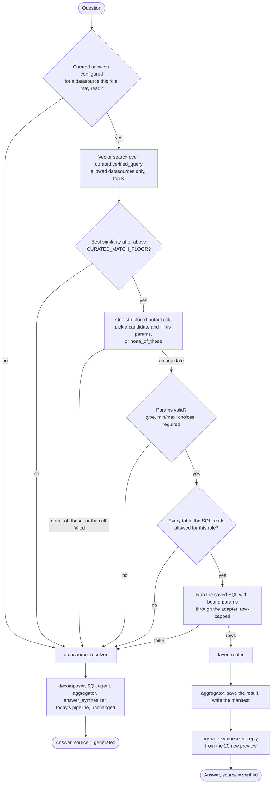

# Curated Answers (design)

!!! note "Status: partly built"
    The config and its checks (PR 1), indexing and candidates (PR 2),
    matching and running verified queries (PR 3), and preferred tables (PR 5)
    are built; see [Curated answers](../configuration/curated.md) and
    [Datasources](../configuration/datasources.md#preferred-tables) for how to
    use them. The playground badge, the demo file, `nl2sql curated test` and
    feedback proposals are not built yet. Each pull request in
    [Implementation plan](#implementation-plan) updates this page and the
    reference docs it touches.

## Goal

Before the model plans a query, check whether the business has already
provided a trusted answer to the question. If it has, run that answer and say
so. If it has not, run today's pipeline unchanged.

Curated answers come in three kinds:

| Kind | What the data team writes | Where | This milestone |
| --- | --- | --- | --- |
| **Verified queries** | A SQL query with typed parameters, and the questions it answers | `configs/curated.yaml` | Built |
| **Preferred tables** | Views or tables the planner should reach for first | `datasources.yaml`, `preferred_tables:` | Built |
| **Business metrics** | A named expression (`revenue = SUM(...)`) the planner refers to by name | `configs/curated.yaml`, `metrics:` | Designed only, [deferred](#business-metrics-deferred) |

A thumbs-up on a generated answer becomes a *proposal* for a verified query,
which a person reviews and commits. Nothing ever writes `curated.yaml` but a
person.

## Who does what

- **The data team** writes the configuration. They know SQL, they keep config
  in git, and they review changes like code. They run
  `nl2sql curated validate` and `nl2sql curated test` in CI.
- **The person asking** never sees the configuration. They ask a question and
  get an answer; when a verified query produced it, the answer is labelled
  *Verified* with the query's id.
- **The engine** loads and validates the file at startup, indexes the
  questions with `nl2sql index`, and matches each question against them at
  run time.

## Configuration

### `configs/curated.yaml`

It follows the pattern of every other config file: a path setting with an
environment alias (`CURATED_CONFIG`, default `configs/curated.yaml`), a
pydantic file model in `nl2sql/configs/curated.py`, and a loader on
`ConfigManager` (`load_curated()`), next to `load_datasources()` and
`load_policies()`.

The file is optional. When the default path does not exist the feature is off
and the pipeline is exactly today's. One file covers every datasource, keyed
by datasource id, the way `sample_questions.yaml` is.

```yaml
datasources:
  chinook:
    verified_queries:
      - id: top_customers_by_revenue
        description: "Customers ranked by invoiced revenue in a calendar year"
        questions:
          - "Who are our top {n} customers by revenue in {year}?"
          - "Best {n} customers in {year}"
        params:
          n:    { type: int, default: 10, min: 1, max: 100 }
          year: { type: int, min: 2000, max: 2100, example: 2012 }
        sql: |
          SELECT c.CustomerId,
                 c.FirstName || ' ' || c.LastName AS customer,
                 c.Country,
                 ROUND(SUM(il.UnitPrice * il.Quantity), 2) AS revenue
          FROM Customer c
          JOIN Invoice i      ON i.CustomerId = c.CustomerId
          JOIN InvoiceLine il ON il.InvoiceId = i.InvoiceId
          WHERE CAST(strftime('%Y', i.InvoiceDate) AS INTEGER) = :year
          GROUP BY c.CustomerId, customer, c.Country
          ORDER BY revenue DESC, c.CustomerId
          LIMIT :n
    metrics:            # designed only; deferred
      - name: revenue
        description: "Invoiced revenue, before refunds"
        expression: "SUM(InvoiceLine.UnitPrice * InvoiceLine.Quantity)"
        table: InvoiceLine
```

The models, all `extra="forbid"` so a misspelt key is an error rather than a
silently ignored one:

- `CuratedFileConfig`: `version: int = 1`, `datasources: Dict[str, CuratedDatasource]`.
- `CuratedDatasource`: `verified_queries: List[VerifiedQuery]`, `metrics: List[MetricDefinition]`
  (parsed and validated so the format is fixed now, but not used until metrics are built).
- `VerifiedQuery`: `id` (a slug, unique within its datasource), `description`,
  `questions` (at least one), `params: Dict[str, ParamSpec]`, `sql`.
- `ParamSpec`: `type` (`int`, `float`, `string`, `date`), optional `default`,
  `min`/`max` (numbers and dates), `choices` (strings), and `example`.

`example` is a refinement of the agreed design: it is the value used to fill a
placeholder before embedding and to run `nl2sql curated test` when a parameter
has no default (`year` above). Without it a required parameter is embedded as
its own name ("... in year").

### Verified queries are SQL

A verified query is written as SQL in the dialect of its datasource, not in
the engine's internal plan format. The data team already has this SQL; asking
them to translate it into `PlanModel` JSON would make the feature unusable.

This does not weaken *the model emits a typed plan, never SQL*: no model wrote
this SQL. A person wrote it, reviewed it and committed it. The model's only
part is to pick a query by id and supply parameter values, and those values
are always **bound parameters** (`:name`, SQLAlchemy's named style, which every
adapter's driver translates), never interpolated into the text. A value cannot
change the shape of the query.

Nor does it break *no dialect-specific SQL outside `nl2sql/adapters/`*. That
rule is about engine code, and `curated.yaml` is data the operator owns, like
`datasources.yaml`. The engine never inspects the SQL by dialect name: it
parses it with sqlglot using whatever `adapter.get_dialect()` returns.

### Preferred tables

Preferred tables are not in `curated.yaml`. They are one optional list on a
datasource in `datasources.yaml`, because they describe the datasource and not
an answer:

```yaml
datasources:
  - id: chinook
    connection: { ... }
    preferred_tables: [v_customer_revenue, v_monthly_sales]
```

`DatasourceConfig` (`nl2sql/datasources/models.py`) gains
`preferred_tables: List[str] = []`. The package never creates a view: the data
team creates them in their own database, and `nl2sql index` picks them up as
it picks up any table (every built-in adapter snapshots views; see
[Views in snapshots](#open-questions)). A name is the bare table name or
`schema.table`, case ignored. One that is not in the indexed schema is a
warning in `nl2sql doctor` and the index status, not an error.

At question time a preferred table is ranked first:

- When the schema is small enough to be passed whole
  (`SCHEMA_RETRIEVAL_FULL_SNAPSHOT_MAX_TABLES`, 15 by default, which covers
  every demo database), the schema retriever lists preferred tables first and
  marks them *preferred* (`"preferred":true`) in the planner's schema block,
  and planner instruction 14 says to plan against a preferred table when it
  answers the question.
- Otherwise `VectorStore.retrieve_schema_context()` results are re-ordered so
  any preferred table it found comes first, and a preferred table it missed is
  added when its similarity is within 0.05 (`PREFERRED_MARGIN`) of the least
  similar table picked.

Nothing about RBAC changes: a preferred table the role may not read is
withheld exactly like any other (`SchemaRetrieverNode._withhold_unreadable`).

## Validation

The file is checked at three moments, each catching what it can.

**At startup**, `NL2SQLContext.__init__` calls `ConfigManager.load_curated()`
after the datasources load. A broken file fails startup loudly, as a broken
`datasources.yaml` does. These checks need no database and no index:

- the YAML parses and matches the models;
- every datasource key is a configured datasource;
- query ids are unique within a datasource;
- every `{placeholder}` in a question is a declared param, and every declared
  param appears in at least one question;
- the SQL parses with sqlglot in the datasource's dialect, is exactly one
  statement, and is read-only (see [Guards](#the-same-guards-as-generated-sql));
- the `:name` placeholders in the SQL (`exp.Placeholder` nodes) are exactly the
  declared params;
- defaults, examples, `min`/`max` and `choices` agree with the declared type.

A refinement of the agreed design: when `CURATED_CONFIG` is *set* and the file
it names does not exist, startup fails rather than turning the feature off. A
typo should not silently turn verified answers off in production. When the
setting is left at its default and the default file is absent, the feature is
off.

**`nl2sql curated validate`** runs the startup checks plus the ones that need
the index: every table the SQL reads (`exp.Table` nodes, minus CTE names)
exists in the datasource's latest indexed schema
(`schema_store.get_latest_snapshot(datasource_id)`). It prints a report table
and exits non-zero on any error, modelled on `nl2sql policy validate`
(`cli/commands/policy.py`). Like that command it calls a facade class,
`CuratedAPI` (`nl2sql/api/curated_api.py`, exported from `nl2sql`), so the CLI
holds no logic an SDK or REST caller would also need.

**`nl2sql curated test`** runs each verified query once against its database,
with every param at its default or example value, through the same guarded
execution path the pipeline uses, reading at most a few rows. A column renamed
in the database then fails CI instead of failing a user. It runs as the
operator, with no role, as `nl2sql index` does.

## Indexing

`nl2sql index` embeds each phrasing of each verified query as an entry of a
new chunk type, `curated.verified_query`, in the existing vector store. The
model is `VerifiedQueryChunk(BaseChunk)` in `nl2sql/indexing/models.py`, beside
`TableChunk` and the others.

- **Text.** The phrasing with every placeholder filled by its example or
  default (`{n}` → `10`, `{year}` → `2012`), because a raw `{n}` embeds poorly.
  The description is embedded as one more entry of the same query.
- **Metadata.** `{id, type: "curated.verified_query", datasource_id, query_id, schema_version}`,
  and the `build_id` every entry gets. The agreed design called the key
  `datasource`; it is `datasource_id`, the key every other chunk, the
  active-build filter and index health already use.
- **Ids.** Deterministic, as `BaseChunk` requires:
  `curated.verified_query:<datasource_id>:<query_id>:<n>`.

The entries must be written **in the same build as the datasource's schema
entries.** `VectorStore.refresh_schema_chunks()` replaces every entry of a
datasource whose `build_id` is not the new one, so curated entries written on
their own would be deleted by the next schema re-index, or would delete it.
`IndexingOrchestrator.index_datasource()` therefore appends the curated chunks
(built by a small `CuratedChunkBuilder`) to the schema chunks before calling
`refresh_schema_chunks()`.

Changing `curated.yaml` does **not** need a schema re-index (a change from the
agreed design; see [Re-index cost](#open-questions)).
`nl2sql index --curated-only` writes a new build per datasource through the
same write, switch and delete as any other, except that the active build's
schema entries are copied into it with their stored vectors
(`VectorStore.refresh_curated_chunks()`): no schema read, no enrichment call,
and only the verified queries are embedded.

**Staleness.** At the switch, `refresh_schema_chunks()` also records
`curated_hash:<datasource_id>` in the collection metadata, next to
`build:<datasource_id>` and `built_at:<datasource_id>`: a SHA-256 of that
datasource's section of `curated.yaml`, as canonical JSON. `IndexHealth`
(`nl2sql/indexing/health.py`) compares it with the file as it is now and
reports "curated.yaml changed for 'chinook' since it was indexed; run
`nl2sql index --curated-only --datasource chinook`". `nl2sql doctor` and the
facade's `index_health()` show it. Only the verified queries are hashed:
metrics are not indexed yet, so editing one asks for nothing.
It is a warning, not a failure: the stale entries still point at queries that
exist, and the matcher re-reads every query from the loaded file, never from
the index. A query id that is in the index but no longer in the file is
skipped. `IndexHealth` gains a `warnings` list for this; `problems` stays the
list that makes `ok` false.

## Matching at question time

### Where the step goes

A new node, `curated_matcher` (`nl2sql/pipeline/nodes/curated_matcher/`),
becomes the graph's entry point, ahead of `datasource_resolver`:



Running it before the resolver, rather than between the resolver and the
decomposer, means a verified answer also skips the resolver's answerability
call: a verified answer costs two model calls (the match and the reply)
instead of four or more. The matcher does the one thing from the resolver it
needs itself: it limits the search to datasources the role may read,
`rbac.get_allowed_datasources(user_context)`, before searching, so
*Datasource access is RBAC-gated* holds on this path too and the model only
ever sees candidates from readable datasources. When the caller pinned a
datasource (`GraphState.datasource_id`), only that one is searched.

When it does not answer, the matcher returns nothing but its own trace record
and the run continues at `datasource_resolver` as if it were not there. When
the run is plan-only (`execute=False`) the matcher is skipped.

A refinement made in PR 3: the node is added to the graph only when curated
answers are on (`CURATED_ENABLED`, a loaded file with at least one verified
query) and the run executes. Otherwise `datasource_resolver` stays the entry
point, so with no curated file the graph, the trace and the answer are exactly
what they were before, rather than gaining a node that does nothing. The
first diamond above is therefore decided once when the graph is built
("configured") and again at run time ("this role may read",
`not_configured`).

On a match, the node fills the state the way a one-sub-query generated run
leaves it, so nothing downstream needs a second code path: a
`DecomposerResponse` with one `SubQuery` (its intent is the question), the
`ExecutionDAG` from `build_execution_dag()`, the `artifact_refs` entry, and a
`SubgraphOutput` with `plan_source="verified"`, the SQL, `row_cap`,
`truncated` and its checks as `ValidationCheck`s. It then routes to
`layer_router`, which finds the scan already done and sends the run to
`aggregator`. The aggregator saves the result and writes the run's manifest
(the 0.3.0 result saving and paging), and `answer_synthesizer` writes the
reply from the preview, as today.

### The steps

1. **Candidates.** `VectorStore.retrieve_verified_query_candidates(query, datasource_ids, k)`
   searches entries of type `curated.verified_query` in the active builds of
   the allowed datasources. It is a plain similarity search, not MMR: several
   phrasings of one query are exactly what should match, so the pool is
   fetched at `k × phrasings`, de-duplicated by `(datasource_id, query_id)`
   keeping each query's best cosine similarity, and cut to
   `CURATED_MATCH_TOP_K` (5). The search is recorded with the same record
   `mmr_search()` writes, so the trace and the playground's retrieval view can
   show it. If no allowed datasource has a verified query, there is no search
   and no embedding call.
2. **Floor.** If the best similarity is below `CURATED_MATCH_FLOOR` (0.6), the
   run falls back with no model call.
3. **Choice.** One structured-output call, through the existing
   `structured(llm, schema)` in `nl2sql/llm/wires/`, which every provider and
   keyless replay already support. The prompt presents the candidates like
   tools: a qualified id (`chinook.top_customers_by_revenue`, since ids are
   unique only within a datasource), the description, and each param with its
   type, bounds, choices and default; plus the option `none_of_these`. The
   model is told to pick a candidate only when it answers the whole question
   as asked, and otherwise to pick `none_of_these`. The schema is fixed, so
   its name on the wire is fixed:

    ```python
    class ParamValue(BaseModel):
        name: str
        value: str          # typed and checked by code, step 4

    class VerifiedQueryChoice(BaseModel):
        """Pick the verified query that answers the question, or none_of_these."""
        query_id: str       # a candidate id, or "none_of_these"
        params: List[ParamValue] = Field(default_factory=list)
        reason: str = ""
    ```

    Params are a list of name/value strings rather than a per-query schema so
    that one schema serves every candidate set (a dynamic schema would change
    the tool on the wire from run to run, which replay keys on) and so no
    provider's strict-schema rules about open objects apply. The prompt puts
    the question after a `User Query:` line, a marker `extract_question()` in
    `nl2sql/llm/replay.py` already recognises, so a recording can key this
    call on the question like the decomposer's. The node's model is configured
    like any other step's: `LLM_AGENTS` in `nl2sql/llm/providers.py` gains
    `"curated_matcher": "curatedmatcher"`, and `PIPELINE_STEPS` in
    `nl2sql/pipeline/steps.py` gains the step.

    The model never sees every verified query, only the top K for this
    question, and never sees the SQL.
4. **Params.** Code, not the model, decides whether the values are usable:
   an unknown name, a value that does not parse as the declared type, a
   number or date outside `min`/`max`, a string outside `choices`, or a
   required param (no default) left empty all fall back. A param the model
   left out takes its default.
5. **Access.** Every table the SQL reads (sqlglot `exp.Table` nodes, CTE names
   excluded) must pass `table_allowed(allowed_tables, datasource_id, table)`,
   the function the logical validator and executor already use. If one does
   not, the run falls back, and the normal pipeline then enforces RBAC as it
   always does. The user is not told a verified query exists that they may
   not use.
6. **Run.** The saved SQL runs with the bound params through
   `SqlExecutorService` and the adapter, the result is saved to the artifact
   store, and the run continues at `layer_router` as described above. If
   execution fails, the run falls back with a warning; the failure is in the
   trace for the data team, and `nl2sql curated test` is how they catch it
   before a user does.

Every fallback has a reason code in the matcher's trace record:
`not_configured`, `no_candidates`, `below_floor`, `none_of_these`,
`model_failed`, `unknown_query`, `param_invalid`, `param_missing`,
`policy_denied`, `capability_missing`, `execution_failed`. A fallback is never
an error of the run.

### Worked examples

All on the demo's Chinook database, with the query in [the example above](#configscuratedyaml).

**(a) A match.** "Who were our top 5 customers in 2012?" as `analyst`.
The best candidate is `top_customers_by_revenue` (the phrasing "Best 10
customers in 2012" is close), above the floor. The model picks it with
`n=5, year=2012`. Both are ints within bounds; `Customer`, `Invoice` and
`InvoiceLine` are allowed for `analyst`. The SQL runs with
`{"year": 2012, "n": 5}` bound and returns Richard Cunningham (25.84),
João Fernandes (24.77), Fernanda Ramos (24.75), Joakim Johansson (24.75) and
Mark Taylor (22.77). The answer carries
`source = {type: "verified", id: "top_customers_by_revenue", params: {n: 5, year: 2012}}`.

**(b) A near miss.** "Top 5 customers by number of tracks bought in 2012."
The same query is the best candidate and clears the floor, but it ranks by
revenue, not by tracks. The model sees the description and picks another
candidate that does rank by tracks if one exists, or `none_of_these`. With
`none_of_these` the run continues at the resolver and the answer is
generated, `source = {type: "generated"}`.

**(c) A missing or out-of-range value.** "Who are our top customers by
revenue?" matches, but `year` has no default and the question gives none: the
model leaves it empty and the run falls back (`param_missing`). Asking the
user "which year?" belongs to the later Conversation milestone. "Top 500
customers in 2012" matches with `n=500`, beyond `max: 100`, and falls back
(`param_invalid`); the generated pipeline then answers it under its own row
limit.

**(d) No access.** The same question as (a), asked as `viewer`, whose policy
allows no `Customer`, `Invoice` or `InvoiceLine`. The candidate is found and
chosen, the access check refuses `Invoice`, the run falls back
(`policy_denied`), and the logical validator refuses the generated plan with
the usual `SECURITY_VIOLATION`. The refusal is the same one `viewer` gets
today.

### v1 limitation: one question, one query

Matching runs once, on the whole question. A question with two parts ("top
customers in 2012 and how many tickets did they open") is either not matched
or matched to `none_of_these`, because the prompt asks for a query that
answers the whole question, so it falls back to the generated pipeline.
Matching each decomposed sub-query against verified queries is a later step.

## The same guards as generated SQL

Verified SQL runs through the guards generated SQL runs through, plus one
generated SQL does not need:

- **Read-only.** Generated SQL is read-only by construction (`PlanModel.query_type`
  is `Literal["READ"]`). Human SQL is checked instead: exactly one statement
  (`sqlglot.parse` returns one), its root is a query (`exp.Query`: a `SELECT`,
  a set operation, or a `WITH` around one), and no node anywhere in the tree
  is a write or DDL (`Insert`, `Update`, `Delete`, `Merge`, `Create`, `Drop`,
  `Alter`, `Command`). This is checked at load and again before running. The
  datasource's own read-only connection (for SQLite `options.read_only`) and
  database grants stay the backstop, as they are for generated SQL.
- **RBAC.** Every table read must be allowed for the asker (step 5 above). A
  view is checked by its own name, as policies name it; what the view reads
  underneath is the database's grant to decide.
- **Row limit.** The row ceiling is the one the generator uses:
  `min(adapter.row_limit or RESULT_ROW_LIMIT, RESULT_ROW_LIMIT)`. Rather than
  rewrite a person's SQL to add a `LIMIT` (which would mean rendering their
  placeholders back through sqlglot in every dialect), the executor stops
  reading the stream at the ceiling. `ExecutorRequest` gains `max_rows`; the
  executor's `_Stream` stops after that many rows and the result is flagged
  `truncated` exactly as a capped generated result is. A query whose own
  `LIMIT :n` is lower is never cut. This is a refinement of the agreed design,
  which named the guard but not the mechanism.
- **Result saving and paging.** The result is written with
  `artifact_store.write_batches()` and the manifest by the aggregator, so
  paging (`get_result_page`) and CSV export (`export_result_csv`) work for a
  verified answer as for any other.
- **Time.** The run is inside `run_with_graph()`'s `GLOBAL_TIMEOUT_SEC` like
  every node, and the datasource's `statement_timeout_ms` applies.

## Bound parameters through the adapter

The SDK already has a place for them: `AdapterRequest.parameters`
(`nl2sql_adapter_sdk/contracts.py`, "Optional parameter bindings"). But no
adapter reads it. `SqlAlchemyAdapter.execute_sql()` and `execute_batches()`
call `conn.execute(text(sql))` and drop it, and `SqlExecutorService` never
sets it. Sending parameterised SQL to an adapter that ignores the parameters
would fail at best, so it must not be sent at all. The change, inside the
package boundaries:

- **SDK** (pydantic and the standard library only, unchanged in that
  respect): a new capability, `DatasourceCapability.SUPPORTS_BOUND_PARAMETERS`,
  and a docstring on `AdapterRequest.parameters` saying values are bound by
  name to `:name` placeholders and never interpolated.
- **SQLAlchemy base adapter**: `execute()` and `execute_batches()` pass
  `request.parameters` to `conn.execute(text(sql), parameters)` when there are
  any, and `capabilities()` declares the new capability. Every built-in
  adapter (SQLite, Postgres, MySQL, SQL Server, DuckDB) inherits both. With
  no parameters the call is byte-for-byte today's, so generated SQL is
  unaffected.
- **Engine**: `ExecutorRequest` gains `parameters` and `max_rows`;
  `SqlExecutorService.execute()` copies `parameters` into the
  `AdapterRequest`. The matcher checks
  `ds_registry.supports(ds_id, DatasourceCapability.SUPPORTS_BOUND_PARAMETERS)`
  before choosing a query with params, and falls back
  (`capability_missing`) when an adapter cannot bind; it fails closed, as
  `SUPPORTS_SQL` does. A third-party adapter opts in by binding and declaring
  the capability. `nl2sql curated validate` warns about a datasource whose
  adapter cannot bind.

sqlglot parses `:name` as `exp.Placeholder` in the SQLite, Postgres, MySQL,
DuckDB and T-SQL dialects, which is what validation reads the placeholders
from.

## Provenance

Every answer says where it came from:

- `QueryResult` (`nl2sql/api/query_api.py`) gains
  `source: AnswerSource`, `{type: "verified", id, datasource_id, params}` or
  `{type: "generated"}`. The REST API's response model, `QueryResponse`,
  subclasses `QueryResult`, so `POST /query` and the final event of `POST /query/stream` carry it with
  no change to `nl2sql-api` beyond its docs.
- `SubQueryResult.plan_source` and `SubgraphOutput.plan_source` gain the
  value `"verified"`, next to `"llm"` and `"cache"`.
- The trace records the matcher as a node: the candidates with their
  similarities, the floor, the model's choice and reason, the params after
  checking, and the fallback reason code if it fell back.
- The playground shows a badge on the answer, "Verified · top_customers_by_revenue",
  in the same place and style as the plan-cache chip in `web/playground/src/Panes.jsx`,
  with the params on hover. A generated answer shows no badge.

## Feedback proposals

A thumbs-up on a generated answer is already stored, one row per run, in the
`feedback` table (`nl2sql/feedback/store.py`), with the question, role, status
and SQL. That row is the proposal; nothing new is stored and nothing writes
`curated.yaml`.

`nl2sql curated proposals export --out configs/curated.proposals.yaml` turns
thumbs-up runs into draft verified queries in `curated.yaml`'s shape: an id
(`proposal_<trace id prefix>`), the question as the description and the one
phrasing, no params, and the run's SQL, under a header telling the reviewer
to replace literals with `:params`, drop the row-cap `LIMIT` the generator
added, and move the entry into `curated.yaml`. It is modelled on
`nl2sql feedback export --good` (`feedback/drafts.py`), and like it skips runs
with no SQL or more than one statement, refuses to write over `curated.yaml`
itself, and lives in `nl2sql.feedback` (opt-in, imported lazily by the
command). Runs whose answer was already verified are skipped.

Two refinements of the agreed design. First, there is no separate "approved"
state: the person reviewing the exported drafts and committing them is the
approval, as for gold drafts. Second, the feedback row does not record the
datasource or the answer's source today, so the `feedback` table gains two
nullable columns, `datasource_ids` and `source`, written by
`feedback/record.py`'s `run_record()`.

`curated.yaml` stays the single source of truth, in git. Neither the REST API
nor the playground ever writes it.

## Demo

`nl2sql demo` writes `configs/curated.demo.yaml`, beside
`sample_questions.demo.yaml`, with a few Chinook verified queries
(`top_customers_by_revenue`, revenue by year, best-selling genre), and the
generated `.env.demo` gains `CURATED_CONFIG=configs/curated{suffix}.yaml`
(`cli/generators/env/templates.py`). The queries are data in
`cli/demo/chinook.py`, written by `DemoManager._write_common_artifacts()`.

The keyless demo replays recorded model answers, keyed on the structured-output
name and the question. The matcher's call is a new name
(`VerifiedQueryChoice`), so the recordings in `cli/demo/recordings/chinook.json`
have no answer for it until they are re-recorded. Until then a replay miss on
the matcher falls back (`model_failed`) and the demo still answers, generated.
**Re-recording needs the owner's API key and the owner's go-ahead**; it is a
step the owner runs (`python scripts/record_demo_answers.py`, which drives
`nl2sql demo --record`), not something a pull request can do.

## Settings

| Setting | Env | Default | Meaning |
| --- | --- | --- | --- |
| `curated_config_path` | `CURATED_CONFIG` | `configs/curated.yaml` | The curated answers file. Absent at the default path: the feature is off. Set and absent: startup fails. |
| `curated_enabled` | `CURATED_ENABLED` | `true` | Turns matching off without removing the file. Validation commands still run. |
| `curated_match_floor` | `CURATED_MATCH_FLOOR` | `0.6` | Cosine similarity the best candidate must reach before the model is asked. |
| `curated_match_top_k` | `CURATED_MATCH_TOP_K` | `5` | Candidates shown to the model. |

The floor is a similarity in the configured embedding model's space, and
models spread their scores differently. PR 2 calibrated it on the local ONNX
model (`all-MiniLM-L6-v2`) with five Chinook verified queries (the example
above, revenue by year, best-selling genre, tracks per artist, revenue by
country) and the best candidate's similarity for 24 questions:

| Questions | Best similarity |
| --- | --- |
| 12 that a verified query answers, reworded | 11 between 0.713 and 0.963; "biggest spenders last year" 0.479, and to the wrong query |
| 6 near misses ("top customers by number of tracks", "albums per artist", "revenue by month") | 0.582 to 0.813 |
| 6 unrelated ("list all playlists", "media types", the weather) | 0.123 to 0.438; "Which tracks have no composer?" 0.681 |

0.6 keeps every match the embeddings can make with a margin above 0.1, and
drops five of six unrelated questions with no model call. Near misses mostly
clear it, as they should: telling a near miss from a match is the model's
choice (`none_of_these`), not the floor's. A question with no phrasing close
to it, like "biggest spenders", is not rescued by any floor; another phrasing
in `curated.yaml` is the fix. Calibration with OpenAI's embeddings is still
open: it needs the owner's key.

## Invariants this touches

No invariant is weakened. PR 3 made these changes in
[`invariants.md`](invariants.md), each with its enforcement point:

- New: **Verified SQL is human-authored, read-only and parameter-bound.** The
  model picks a verified query by id and supplies values; it never writes or
  edits its SQL, and values are bound, never interpolated. Enforced in the
  curated config model, the read-only check and the matcher.
- **SQL Generation Enforces a Row Limit Cap** extends to verified SQL, through
  the executor's `max_rows`.
- **Datasource Access Is RBAC-Gated** gains the matcher as an enforcement
  point.
- [`determinism.md`](determinism.md)'s "the AST is checked ... before any SQL
  exists, on every path" becomes "on every generated path"; a verified path
  has no AST, and its checks are the matcher's.

`invariants.md` was not edited in the design PR, because its sections name
enforcement points and none existed then; PR 3 added them.

## Deferred and out of scope

### Business metrics (deferred)

The format is fixed in this milestone (`metrics:` in `curated.yaml`, parsed
and validated), but nothing uses it yet. The sketch:

- Each metric is indexed as the existing, so far unused, `schema.metric`
  chunk (`MetricChunk` in `nl2sql/indexing/models.py`), so schema retrieval
  returns the metrics a sub-query is about.
- The planner refers to a metric by name: a new `Expr` kind `metric` with a
  `metric_name`, which, like `func_name`, is model text, so the logical
  validator must check it against the datasource's metrics before anything
  else reads it.
- The validator also requires the metric's `table` in the plan and allowed for
  the role; the generator parses `expression` with sqlglot in the adapter's
  dialect and splices the expression tree in place of the reference.

This is the hardest part of the feature, which is why it waits. A metric is
an aggregate, so it cannot be nested in another aggregate or used in a
`WHERE`; its table must be joined at the right grain or the sum fans out
across a one-to-many join; and the decomposer already has a `MetricSpec`
(`SubQuery.metrics`) with a different meaning, so the names need sorting out
first. Every rule the generator would need, the validator has to enforce
first, so the planner gets a retry rather than a dead end.

### Also out of scope

- **An MCP server** exposing `ask`, plus one tool per verified query. The typed
  params are already a tool's input schema, so this is close to free once
  verified queries exist.
- **Per-sub-query matching**, so one part of a multi-part question can be
  verified and the rest generated.
- **Asking a follow-up question** for a missing value, instead of falling
  back; that is the Conversation milestone.

## Implementation plan

Six pull requests for verified queries and preferred tables, each written
test first and each updating its docs in the same PR (this page,
`configuration/`, the node catalog, the CLI and REST references).

**1. Config, loader and `nl2sql curated validate`.**
`nl2sql/configs/curated.py`, `ConfigManager.load_curated()`, the
`CURATED_CONFIG` and `CURATED_ENABLED` settings, the startup load in
`NL2SQLContext`, the read-only and placeholder checks, `CuratedAPI.validate()`
and `cli/commands/curated.py`. New page `docs/configuration/curated.md`; the
settings table in `configuration/system.md`.
Tests: `tests/unit/test_curated_config.py` (models, unique ids,
placeholder and param agreement, defaults against types),
`tests/unit/test_curated_sql_checks.py` (one statement, read-only, writes and
DDL refused, CTEs, placeholders read in every built-in dialect),
`tests/unit/test_cli_curated_validate.py` (report and exit codes, a table
missing from the indexed schema), and a startup test that a broken file fails
`NL2SQLContext`.

**2. Indexing, staleness and candidates.**
`VerifiedQueryChunk`, `CuratedChunkBuilder`, the orchestrator writing curated
chunks in the datasource's build, `curated_hash:<id>` in the collection
metadata, `IndexHealth.warnings`, the `doctor` line,
`VectorStore.retrieve_verified_query_candidates()` and
`CURATED_MATCH_TOP_K`; calibrating `CURATED_MATCH_FLOOR` (the setting lands
here, its use in PR 3); `nl2sql index --curated-only`.
Tests: `tests/unit/test_curated_chunks.py` (placeholder filling, ids,
metadata), `tests/unit/test_vector_store_curated.py` (same build as schema, a
schema re-index keeps them, active-build and datasource filters, de-dup by
query, the curated-only refresh), `tests/unit/test_index_health_curated.py`
(hash changed is a warning and `ok` stays true),
`tests/unit/test_index_curated_refresh.py` (a curated-only refresh reads no
schema, makes no model call and keeps the schema entries).

**3. The matcher and execution.**
The `curated_matcher` node and its prompt, `VerifiedQueryChoice`, param
checks, the access check, `SUPPORTS_BOUND_PARAMETERS` in the SDK, parameters
in the SQLAlchemy base adapter, `ExecutorRequest.parameters` and `max_rows`,
the graph's new entry point and route, `CURATED_MATCH_FLOOR`, `source` on
`QueryResult`, `plan_source="verified"`, `LLM_AGENTS` and `PIPELINE_STEPS`,
the trace record, and the invariant edits above.
Tests: `tests/unit/test_curated_params.py`, `tests/unit/test_curated_matcher.py`
(each fallback reason), `tests/sqlalchemy_base/test_bound_parameters.py`
(values bound, never interpolated: a value of `1; DROP TABLE x` is a value),
`tests/unit/test_sql_executor_max_rows.py`, an entry in
`tests/architecture/test_boundaries.py` if the SDK change needs one,
`tests/unit/test_pipeline_steps.py` (already fails until the step is listed),
and `tests/e2e/test_curated_fake_llm.py`, worked examples (a) to (d) end to
end against Chinook with `FakeLLMServer` rules keyed on `VerifiedQueryChoice`,
plus a run with no curated file whose graph and answer match today's.

**4. Playground badge, demo file and `nl2sql curated test`.**
The badge in `web/playground/src/`, `curated.demo.yaml` written by the demo,
`CURATED_CONFIG` in the env template, `CuratedAPI.test()` and the command.
Tests: a vitest case beside `results.test.js` for the badge,
`tests/e2e/test_playground_curated_fake_llm.py`, `tests/unit/test_cli_curated_test.py`
(a renamed column fails), and the demo setup test for the new file. The owner
then re-records the demo answers.

**5. Preferred tables.**
`DatasourceConfig.preferred_tables`, the ordering in the schema retriever for
both the full-snapshot and the retrieval paths, planner instruction 14, views
in the SQLAlchemy base adapter's snapshot, and the index health warning for a
preferred table that is not indexed.
Tests: `tests/unit/test_schema_retriever_preferred.py` (ordering, the
*preferred* marker, an unreadable preferred table still withheld),
`tests/unit/test_datasource_preferred_tables.py` (config, registry, warning)
and `tests/adapters/unit/test_snapshot_views.py` (SQLite and DuckDB).

**6. Feedback proposals.**
The two feedback columns, `nl2sql.feedback.proposals`, and
`nl2sql curated proposals export`.
Tests: `tests/unit/test_curated_proposals.py` (shape, skips, refusal to write
over `curated.yaml`), and a store migration test for the new columns.

**Gold data.** No existing gold entry changes. Tier 1 runs hand-written plans
through the code nodes, and a verified answer has no plan, so tier 1 runs with
curated answers off (it sets no `CURATED_CONFIG`, and PR 3 makes that explicit
in `evaluation/tier1.py`) and needs no new entries. The verified path's own
end-to-end check is the fake-LLM test in PR 3. Measuring how often real
questions hit a verified query belongs to a later tier 2 run, with new entries
added beside the existing ones, never in place of them.

## Open questions

- **The floor.** Is one global `CURATED_MATCH_FLOOR` enough, or does each
  embedding model need its own default? Measured on the local model in PR 2
  (0.6, see [Settings](#settings)); OpenAI's embeddings are not measured yet.
- **Views in snapshots.** Resolved in PR 5: no built-in adapter did. All five
  (SQLite, PostgreSQL, MySQL, SQL Server, DuckDB) snapshot through the
  SQLAlchemy base, which read only `get_table_names()`. It now reads
  `get_view_names()` too, and a driver that cannot list views logs a warning
  and keeps its tables. PostgreSQL materialized views are still not read.
- **Re-index cost.** Resolved in PR 2: a `curated.yaml` change must not cost
  a schema re-read or an enrichment model call. `nl2sql index --curated-only`
  copies the active build's schema entries, with their stored vectors, into a
  new build beside freshly embedded verified queries and switches to it. A
  flag rather than detecting "only `curated.yaml` changed" on a plain
  `nl2sql index`, because knowing whether the schema changed means reading it.
- **The synthesizer's context.** Resolved in PR 3: on a verified answer the
  answer synthesizer is given the query's qualified id and description, in a
  *Verified Query* section added to its prompt, so it can say "invoiced
  revenue, before refunds" rather than guess what the numbers mean. A
  generated answer's prompt is unchanged.
