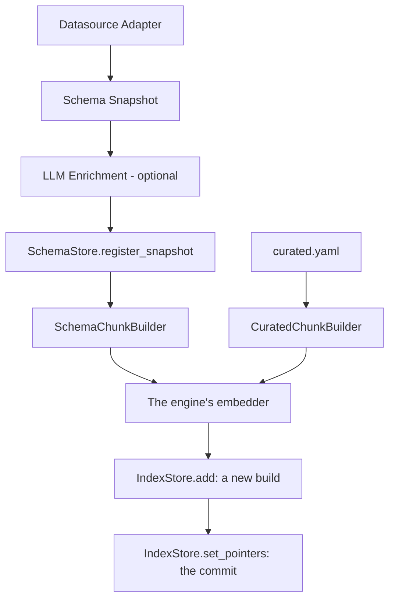
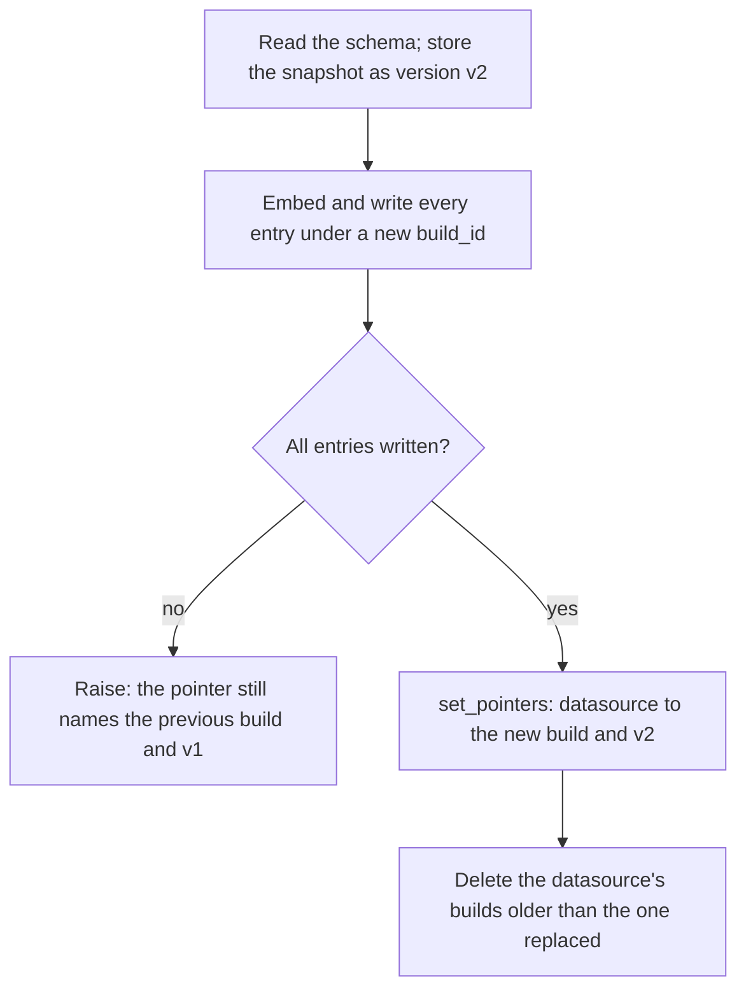

# Indexing, Chunking, and Retrieval Architecture

This document describes **current indexing behavior** as implemented in code. Indexing transforms **schema snapshots** into **typed chunks** that the engine embeds and writes to the **index store** (`storage.index`, the built-in `chroma` store by default; see [Storage](../configuration/storage.md)). Retrieval uses these entries as candidates and then resolves authoritative schema details from `SchemaStore` (see `../schema/store.md` for schema contracts and store behavior).

## Indexing flow



The adapter reads only what the datasource's [`index` scope](../configuration/datasources.md#index)
wants, so an excluded schema costs no query. The built-in adapters reflect
each schema once, take row counts from the catalog's estimates (counting rows
only where the database keeps none, and only under `profile: stats`), profile
each column on its own by type, and keep text values only with
`index.sample_values` (off by default; the demo turns it on). A column, row
count or table the database cannot read is indexed without it rather than
failing the datasource's index, and is an `IndexIssue` on the snapshot: the
build returns the issues in the datasource's stats under `issues`, and
`nl2sql index` prints them (see
[Reading a schema](../adapters/sqlalchemy.md#reading-a-schema)).

## What is indexed today

Schema-derived chunks, and the verified queries of [`curated.yaml`](../configuration/curated.md)
when the file exists. There is no symbolic index, behavioral index, or other
catalog in the current implementation.

## Chunk types and contracts

Chunk types are defined in `nl2sql.indexing.models`:

- **DatasourceChunk** (`schema.datasource`): datasource description, domains, and example questions. The description is the one the datasource was registered with (`description:` in the datasources config, or the `description` of a `Datasource` passed to `engine.datasources.add`); the orchestrator reads it from the datasource registry, falling back to the datasources file only when the registry has none. It lives in the config rather than the database, so the orchestrator writes it into the snapshot's metadata, where it takes precedence over any description the adapter or enrichment produced. Example questions come from the `SAMPLE_QUESTIONS` file.
- **TableChunk** (`schema.table`): table name, PKs, column list, FK summaries, row counts.
- **ColumnChunk** (`schema.column`): column type, stats, synonyms, PII flags.
- **RelationshipChunk** (`schema.relationship`): FK relationships, columns, cardinality.
- **MetricChunk** (`schema.metric`): defined but **not emitted** by `SchemaChunkBuilder`.
- **VerifiedQueryChunk** (`curated.verified_query`): one phrasing of a verified
  query, or its description, built by `CuratedChunkBuilder`
  (`nl2sql.indexing.curated`). Each `{placeholder}` is filled with the param's
  `example`, else its `default`, else its own name, because a raw `{n}` embeds
  poorly: "Best {n} customers in {year}" is embedded as "Best 10 customers in
  2012". Metadata: `id`, `type`, `datasource_id`, `query_id`, `schema_version`.
  Ids: `curated.verified_query:<datasource_id>:<query_id>:<n>`, the phrasings in
  order, then the description. The SQL is never indexed.

Chunk models live in `nl2sql.indexing.models` and are Pydantic models. IDs are deterministic and include `schema_version`.

## Verified queries

Verified query entries are written **in the same build as the datasource's
schema entries**: `IndexingOrchestrator.index_datasource()` appends them to the
schema chunks before it writes the build. A build replaces every entry of its
datasource, so curated entries written on their own would be deleted by the
next schema re-index.

The build's pointer also records `curated_hash`, a SHA-256 of that datasource's verified queries
as canonical JSON (metrics are left out; nothing indexes them yet). Index
health compares it with the file as it is now (see [Index health](#index-health)).

**Changing `curated.yaml` does not re-read the schema.**
`nl2sql index --curated-only` (`engine.index.build(curated_only=True)`,
`IndexingOrchestrator.refresh_curated()`) writes a new build for each datasource
the usual way, except that the live build's schema entries are **copied**
into it with their stored vectors, and the pointer keeps its schema version:
no schema read, no snapshot registered, no enrichment model call, and only the
verified queries are embedded. The switch and the clean-up are the ones
described below, so the refresh is just as safe. It needs the datasource to
have been indexed once; otherwise that datasource fails with a message saying
to run `nl2sql index`. `--curated-only` cannot be combined with `--enrich`.

`Retriever.retrieve_verified_query_candidates(question, datasource_ids, k)`
returns the verified queries a question most resembles. It is a plain
similarity search, not MMR, because several phrasings of one query are exactly
what should match: it reads the live builds of the given datasources only,
fetches `k × 10` entries, keeps each query's best phrasing (by cosine
similarity), and returns the best `k` (`CURATED_MATCH_TOP_K`, 5), each with its
`score` and the phrasing that won. With no verified query entry among those
datasources it returns nothing without embedding the question. Given an
`explain` list, it appends a record shaped like the MMR one below. Nothing in
the pipeline calls it yet; the matcher that will is described in
[Curated Answers (design)](curated_answers.md).

## Chunk → index mapping (actual)

The engine embeds each chunk with its own embedder and hands the index store an
`Entry` (`nl2sql_sdk.stores`):

- `Entry.text` = `chunk.get_page_content()`
- `Entry.vector` = the embedder's vector for that text
- `Entry.metadata` = `chunk.get_metadata()`, with empty values left out, plus
  `build_id`. An entry holds scalars only, so a relationship's `from_columns`
  and `to_columns` are stored comma-joined; the retriever splits them again.

The store never embeds and never depends on LangChain. `build_id` is stripped
from retrieved entries, because the resolver prints a datasource entry's
metadata into the decomposer prompt.

## One namespace per embedding model

Entries live in a **namespace** per embedding model:
`nl2sql__<model slug>__<dimension>`, for example
`nl2sql__local-all-minilm-l6-v2__384` (the slug is the provider and model,
lower case; `Runtime.namespace`). Every datasource of one model shares its
namespace; the `chroma` store keeps one collection per namespace.

- **Changing the embedding model opens a new, empty namespace.** Health reports
  `missing` with "run `nl2sql index`", and `nl2sql index` fills it. Nothing
  refuses the change, and no special rebuild is needed.
- **Switching back finds the old namespace still built.**
- `nl2sql index prune` (`engine.index.prune()`) drops every namespace but the
  current one, including 0.5's `nl2sql_store` collection, which this version
  never reads.

## The build pointer is the commit

Re-indexing never deletes anything first. Each datasource is built on its own
(`IndexingOrchestrator`):



- Each datasource's `BuildPointer` names its live `build_id` and the
  `schema_version` the build was made from, with `built_at` and `curated_hash`.
  **Switching the pointer is the commit.** A snapshot stored by a build that
  then fails is referenced by no pointer, so no reader ever sees it: readers
  resolve "live" through the pointer, never through the state store's newest
  snapshot (bug B5). The failed build's entries are deleted by the next build
  of that datasource.
- **A run pins the pointers.** A run reads the pointers once, when it starts
  (`Runtime.pin_index()`, called by `run_with_graph`), as it pins its LLM set.
  The resolver, the schema retriever, the curated matcher and the decomposer's
  context all use that build and that schema version. A build keeps the build
  it replaces and deletes only older ones, so a run in flight never loses its
  entries, and nothing has to hold questions back around the switch.
- **Other datasources are never read, deleted or rewritten** by a datasource's
  build. `nl2sql index --datasource X` rebuilds only X; `nl2sql index` rebuilds
  each configured datasource in turn, and a failure keeps that datasource's
  previous build live and exits `1`.
- `nl2sql.indexing.rebuild.rebuild_index`, behind `engine.index.build`, is the
  one entry point for `nl2sql index`, the demo's startup repair, the
  playground's Rebuild and the REST index routes. Its `on_datasource` callback
  gets an `IndexProgress` per datasource (`started`, then `done` with the entry
  counts or `failed` with the reason): `nl2sql index` prints a line from it.
- `engine.datasources.schema()`, `engine.curated.validate()` and the benchmark's
  database identity read the snapshot the live pointer names too.

## Index health

`nl2sql.indexing.health` judges the index of the configured embedding model by
its **contents**, never by whether a folder exists (the demo once had a
`data/vector_store_demo` folder holding 0 entries). Only the builds the
pointers name are counted. Status, worst first: `missing` (the model has no
namespace yet: never indexed, or the model changed), `empty` (no live
entries), `stale` (a configured datasource has no live build, or its build's
snapshot is gone from the state store), `ok`. It reports entry counts by type,
the schema version each live build was made from (`index_version`), when each
was built, the embedding model and the namespace. `warnings` never change the
status: a datasource whose `curated.yaml` section has changed since it was
indexed (its pointer's `curated_hash` differs from the file's) gets
"curated.yaml changed for 'chinook' since it was indexed; run `nl2sql index
--curated-only --datasource chinook`". Questions keep working meanwhile; the
stale entries still name queries that exist. A `preferred_tables` entry missing
from the datasource's live snapshot is a warning too. `nl2sql doctor` prints it
under **Index**, `nl2sql demo` rebuilds at startup when it is not `ok`, and the
playground and `GET /api/v1/index/status` show it (through
`engine.index.health()`), the playground with a Rebuild button.

## Chunking strategy (as implemented)

Chunking is aligned to planning intent:

- **Routing** uses datasource-level chunks.
- **Schema context** uses table/metric chunks.
- **Planning context** uses columns and relationships for specific tables.

If retrieval returns no candidates, the retriever falls back to full schema enumeration.

## Retrieval pipeline (staged, code-accurate)

```mermaid
flowchart TD
    SubQuery --> SemQuery[_build_semantic_query]
    SemQuery --> L1[retrieve_schema_context (tables/metrics)]
    L1 -->|no tables| L2[retrieve_column_candidates]
    L2 --> L3[retrieve_planning_context (columns/relationships)]
    L3 --> Snapshot[SchemaStore.get_snapshot]
    Snapshot --> Tables[relevant_tables for planner]
```

### Stages

1. **Schema context**: retrieves table/metric chunks.
2. **Column candidates**: fallback to column chunks when no table matches.
3. **Planning context**: retrieves columns/relationships for the selected tables.
4. **Authoritative resolution**: resolves tables/columns from `SchemaStore` snapshot.

## Authoritative vs semantic sources

- **Semantic candidates** come from the index store (vector search over entries).
- **Authoritative schema** is resolved from `SchemaStore` snapshots.
- Index content is **never** treated as authoritative.

## Metadata propagation

- `datasource_id` and `schema_version` are included in **all** chunk metadata.
- `TableChunk` includes `primary_key`, `columns`, `row_count`, and FK summaries.
- `ColumnChunk` includes `dtype`, `pii`, `description`, and stats when available.
- `RelationshipChunk` includes join column pairs and cardinality.

Metadata is consumed by `SchemaRetrieverNode` to construct `Table` objects for planning and by `LogicalValidatorNode` to validate joins and filters.

## Versioning and determinism

- Schema snapshots are fingerprinted and versioned (`YYYYMMDDhhmmss_<fp8>`).
- Chunk IDs embed `schema_version` for deterministic indexing.
- Retrieval uses the `SubQuery.schema_version` when available; otherwise the version the run's pinned pointer names.
- MMR ranking may introduce non-determinism in ordering for similar scores.

## Retrieval: MMR, not a re-ranking model

Every vector search in the engine is one maximal marginal relevance (MMR)
search over the current namespace's live builds, which hold every
datasource (the demo's three databases: 3 datasource, 20 table, 121 column and
18 relationship entries, 162 in all, of which Chinook is 87). There is **no
re-ranking model**. What is sometimes called
re-ranking is this:

1. Embed the query text with the engine's embedder (the local
   `all-MiniLM-L6-v2` costs nothing per query).
2. Fetch the pool: the `fetch_k = 4 * k` entries nearest to it, filtered by
   entry type, datasource and live build (`IndexStore.query` with a `Filter`).
3. Pick `k` of them one at a time, in the engine, on the vectors the store
   returned. The first pick is the entry most similar to
   the query (cosine similarity). Every later pick is the pool entry with the
   highest
   `0.7 * similarity(entry, query) - 0.3 * max similarity(entry, earlier picks)`,
   so an entry that nearly repeats an earlier pick loses to a less similar one
   that adds something. `lambda_mult = 0.7` is the weight on similarity.

The documents come back in pool order (nearest first), not pick order.

| Caller | Search | Entry types | k | Pool |
| --- | --- | --- | --- | --- |
| `DatasourceResolverNode` | `datasources` | datasource | 5 | 20 |
| `SchemaRetrieverNode` | `tables` | table, metric | 8 | 32 |
| `SchemaRetrieverNode`, when `tables` finds nothing | `columns` | column | 8 | 32 |
| `SchemaRetrieverNode`, over the tables found | `planning` | column, relationship | 12 | 48 |

The schema retriever runs none of these when the schema has
`SCHEMA_RETRIEVAL_FULL_SNAPSHOT_MAX_TABLES` tables or fewer (15 by default, so
each of the demo's three schemas, at 11, 4 and 5 tables, is always sent whole);
the resolver runs none when the request names a `datasource_id` or only one
datasource is registered. The demo is no longer such a case: with three
datasources registered, the resolver searches on every question.

A datasource's `preferred_tables` change the order but not the searches: on
either path they come first, and on the retrieval path a preferred table the
`tables` search scored within 0.05 of its least similar pick is added (see
[SchemaRetrieverNode](nodes/schema_retriever_node.md#preferred-tables)).

`Retriever.mmr` in `nl2sql.indexing.retrieval` is the one implementation: it
asks the index store for the pool with its vectors, runs MMR in numpy, and
returns the documents with a record of the search (the query, the pool with
similarity, the store's distance and type, the
picks in order with the score each won with, and what was dropped). The record
comes from numbers MMR computes anyway, so it costs no second search. Nodes put
it in their run trace (see [Debugging a run](../observability/debugging.md#retrieval)),
and the playground's Retrieval inspector (`engine.index.inspect`) runs the same
search for any text, with k, lambda, entry types and datasource exposed. That
inspector is the tool for chunking experiments: change the chunks, rebuild,
search the same text, and diff the **Copy as text** output.

The resolver's `datasources` search is exact: instead of the store's nearest-neighbour
query it reads every live `schema.datasource` entry (`IndexStore.get`), scores it by cosine similarity and
takes the nearest. There is one such entry per datasource among hundreds of
others, and an approximate (HNSW) search under a filter that selective can
return fewer entries than exist, which dropped a datasource from a question's
candidates now and then. The other searches stay approximate.

## Tenant isolation (current state)

Tenant scoping is **not implemented** in indexing:

- No `tenant_id` field exists in chunk metadata.
- Vector store queries do not filter by tenant.
- Schema store is global.

## Failure modes and fallbacks

Current failure behaviors:

- Vector store retrieval wrapped by `VECTOR_BREAKER`; failures fast‑fail.
- Vector retrieval errors in `SchemaRetrieverNode` return empty results with warnings.
- If no candidates are found, the retriever falls back to full schema snapshot.
- Enrichment is opt-in: `engine.index.build`, `rebuild_index`,
  `IndexingOrchestrator` and `nl2sql index` all default to
  `enrich=False`; pass `enrich=True` (or `nl2sql index --enrich`) to spend
  tokens on it. It only fills blanks: a table or column comment read from the
  database is never overwritten.
- Enrichment failures return the original snapshot without enrichment, and
  never fail indexing. `enrich_schema_snapshot` resolves its own LLM inside the
  guard, so a missing API key, an unreachable endpoint and a failed call all
  degrade the same way. A missing/unusable LLM logs at `INFO`; any other
  failure (a 401, a timeout) logs one `WARNING` line with the reason and no
  stack trace (the trace is logged at `DEBUG`).
- A changed embedding model reads its own, empty namespace: health says
  `missing` and `nl2sql index` builds it. Nothing is refused.
- When the resolver finds no datasource and the index is empty, its
  `SCHEMA_RETRIEVAL_FAILED` error says so and names `nl2sql index`, instead of
  "No datasource candidates resolved."
- A failed rebuild leaves the previous build and schema version live (see above).

## Performance characteristics (current)

- Embedding uses the engine's own embedder, built from its `embeddings`
  section: OpenAI or OpenAI-compatible embeddings, or the local ONNX
  `all-MiniLM-L6-v2` model with `provider: local`.
- Vector search is MMR (`lambda_mult=0.7`, `fetch_k = 4*k`); see
  [Retrieval](#retrieval-mmr-not-a-re-ranking-model).
- No caching or sharding layers are implemented.
- Index refresh re-embeds every entry of the datasource being re-indexed; other
  datasources are untouched. `nl2sql index --curated-only` embeds only the
  verified queries and copies the schema entries' stored vectors.

## Observability hooks

- `VECTOR_BREAKER` logs breaker state changes.
- Indexing and retrieval log errors; no metrics are emitted in indexing code.

## Source references

- Chunk models: `packages/nl2sql/src/nl2sql/indexing/models.py`
- Chunk builder: `packages/nl2sql/src/nl2sql/indexing/chunk_builder.py`
- Verified query entries and their hash: `packages/nl2sql/src/nl2sql/indexing/curated.py`
- Retrieval and MMR: `packages/nl2sql/src/nl2sql/indexing/retrieval.py`
- The `chroma` index store: `packages/nl2sql/src/nl2sql/storage/chroma.py`
- The store interfaces: `packages/sdk/src/nl2sql_sdk/stores.py`
- Schema retriever: `packages/nl2sql/src/nl2sql/pipeline/nodes/schema_retriever/node.py`
- Indexing orchestrator: `packages/nl2sql/src/nl2sql/indexing/orchestrator.py`
- Index health: `packages/nl2sql/src/nl2sql/indexing/health.py`
- The local embedder: `packages/nl2sql/src/nl2sql/embeddings/local.py`
