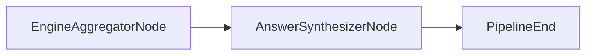

# AnswerSynthesizerNode

## Overview

- Summarizes aggregated results into a user‑facing response using an LLM.
- Exists to convert structured results into human‑readable output.
- Sits after `EngineAggregatorNode` at the end of the control graph.
- Class: `AnswerSynthesizerNode`
- Source: `packages/nl2sql/src/nl2sql/pipeline/nodes/answer_synthesizer/node.py`

---

## Responsibilities

- Send the model a preview of each result, never the whole of it: the first `settings.results.preview_rows` rows (20), the total row count, the column names and a `partial` flag.
- Say when a result was cut at the row limit, whatever the model wrote.
- Include unmapped sub‑queries in the response context.
- Invoke LLM with structured output schema.

---

## Position in Execution Graph

Upstream:
- `EngineAggregatorNode`, after a generated run or a verified one (the [curated matcher](curated_matcher_node.md) ran the query)

Downstream:
- Graph end.

Trigger conditions:
- Executed after aggregation succeeds. When the aggregator fails (`AGGREGATOR_FAILED`), `aggregator_route` ends the run instead, so this node never spends a model call on an empty result.



---

## Inputs

From `GraphState`:

- `user_query` (required)
- `aggregator_response.terminal_results` (required): the first rows of each terminal result
- `aggregator_response.computed_artifacts`: the saved result behind each, for its row count and columns
- `decomposer_response.unmapped_subqueries` (optional)
- `subgraph_outputs[<id>].truncated` / `.row_cap`: whether a sub-query's result reached its row limit, and at how many rows.
- `verified_match` (optional): set when a verified query answered. Its qualified id and its `description` (the data team's words for what the query returns, e.g. "invoiced revenue, before refunds") are added to the prompt as a *Verified Query* section, and the model is told to describe the numbers that way. A generated answer's prompt has no such section and is exactly what it was.
- `warnings`: the `VALUE_NOT_FOUND` warnings ("There is no Genre with Name 'Polka'.") from sub-queries whose filter named a value that does not exist (see [ExecutorNode](executor_node.md#an-empty-results-filter-values)). An `ERROR`-severity one is not used: a retry replaced that attempt.

Validation performed:

- If no aggregated result is available, emits `INVALID_STATE`.

---

## Outputs

Mutations to `GraphState`:

- `answer_synthesizer_response` (`AnswerSynthesizerResponse`): `final_answer` is the model's `AggregatedResponse` (`summary`, `format_type`, `content`, `warnings`) plus `truncated`, True when a result was cut at the row limit.
- `reasoning` summary
- `errors` on failure

Side effects:

- LLM invocation.

---

## Internal Flow (Step-by-Step)

1. Resolve aggregated result from `aggregator_response`.
2. If missing, emit `INVALID_STATE` error and stop.
3. Build the result preview (`result_preview()`): for each terminal result, its first `settings.results.preview_rows` rows, `row_count`, `columns` and `partial` (true when rows were left out). The rows are the aggregator's `terminal_results`, already cut to the preview; `row_count` and `columns` come from the saved combined result in `computed_artifacts`, so they describe the whole result. Serialize it to JSON.
4. Build the *Result Limit* note: one line per sub-query whose result reached its row limit ("The result was cut at 10,000 rows, the row limit, so it is incomplete. Narrow the question ..."), or `None`.
5. Serialize unmapped sub‑queries to JSON.
6. Invoke LLM chain with structured output. The prompt's *Data Notes* lists the missing values and asks the answer to say the value does not exist instead of reporting the empty result as a finding. When the run was started by `stream_query` (`configurable.stream_answer`), the chain is `streaming_structured`: the same request with the provider asked to stream, so the run's `RunEvents` callback publishes each piece of the tool call as an `answer.delta` event. The answer it returns is the unstreamed chain's ([Streaming a run](../../api/core/query.md#streaming-a-run)).
7. Append each missing-value note and each result-limit note to the answer's `warnings`, whatever the model wrote, set `final_answer.truncated`, and return `AnswerSynthesizerResponse`.
8. On exception, emit `AGGREGATOR_FAILED`.

### The model sees a preview, not the result

The user sees the full result as a table; the model's job is to write about it,
not to copy it. So the prompt carries a preview, and its instructions say:

- every number the answer states comes from the preview rows or from `row_count`;
- when the preview is `partial`, do not total, average, rank or count over rows it cannot see;
- do not reproduce the result: say the full result is in the table, and use `format_type` `"table"` only for a few preview rows.

The prompt's size no longer grows with the result, which is what let the row cap
rise from 1,000 to a resource ceiling (`settings.results.row_limit`, 100,000).

### A result cut at the row limit

The generator bounds each sub-query's SQL at its row limit. A result that comes
back with that many rows may have been cut, so the subgraph wrapper marks it
`truncated` (`SubgraphOutput`, `QueryResult.sub_queries[].truncated`,
`QueryResult.truncated`). The prompt's *Result Limit* section tells the model
the result was cut at N rows and asks it to say so and to suggest narrowing the
question; the node adds the same note to `warnings` itself, so a cut result is
never presented as complete even when the model leaves it out. A plan's own
top-N (`LIMIT 5`) is the answer, not a cut, and is never flagged.

---

## Contracts & Interfaces

Implements a LangGraph node callable:

```
def __call__(self, state: GraphState) -> Dict[str, Any]
```

Key contracts:

- `AggregatedResponse`
- `AnswerSynthesizerResponse`

---

## Determinism Guarantees

- Non‑deterministic unless LLM configured deterministically.

---

## Error Handling

Emits `PipelineError` with:

- `INVALID_STATE` (no aggregated result)
- `AGGREGATOR_FAILED` (LLM failure), or a `PROVIDER_*` error when the provider refused the call (see [provider failures](../../observability/error-handling.md#provider-failures))

Logs failures via `logger.error`.

---

## Retry + Idempotency

- No internal retry logic.
- Idempotency depends on LLM determinism.

---

## Performance Characteristics

- LLM call dominates latency and cost.
- The prompt holds at most `settings.results.preview_rows` rows per terminal result, whatever the result's size. The whole result is still held in memory by the aggregator.

---

## Observability

- Logger: `answer_synthesizer`
- Adds reasoning summary to state.

---

## Configuration

- LLM configuration for agent name `answer_synthesizer` via `llm.yaml`.
- `settings.results.preview_rows` (default `20`): rows of each result the model sees.
- `settings.results.row_limit` (default `100000`): the row ceiling a result is cut at; see [the system settings](../../configuration/system.md).
- Both are read from the engine's runtime (`ctx.settings`) when the node is built, so two engines in one process each use their own.

---

## Extension Points

- Modify `ANSWER_SYNTHESIZER_PROMPT`.
- Replace node in `build_graph()` for custom synthesis.

---

## Known Limitations

- No deterministic summarization guarantees without LLM configuration.
- No fallback response when LLM fails.

---

## Related Code

- `packages/nl2sql/src/nl2sql/pipeline/nodes/answer_synthesizer/node.py`
