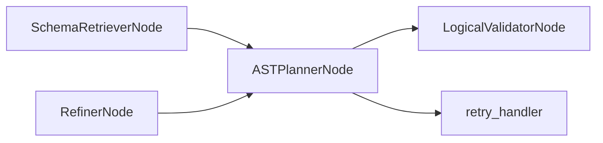

# ASTPlannerNode

## Overview

- Generates a structured SQL AST plan using an LLM with structured output: the planner's answer is a `PlannerAnswer`, the default plan (`PlanModel`) and, for an ambiguous question, up to two alternative readings.
- Exists to translate natural language intent into a deterministic, machine‑verifiable plan.
- Sits after `SchemaRetrieverNode` in the SQL agent subgraph.
- Class: `ASTPlannerNode`
- Source: `packages/nl2sql/src/nl2sql/pipeline/nodes/ast_planner/node.py`

---

## Responsibilities

- Serve a pinned plan from the plan cache on a first attempt, without an LLM call.
- Return a plan the run pins (`state.pinned_plan`: a supplied, approved or chosen plan) without an LLM call, through `after_plan()` with `plan_source` set to its source.
- Serialize `relevant_tables` into the planning prompt.
- Pass user intent, expected schema, and error feedback to the LLM.
- Run the `plan.after` hooks on the plan (the planner's or the cached one) in `after_plan()`, the one place every plan the validator gets passes through.
- Run `plan.after` on each alternative reading too (`checked_alternatives()`): one a hook denies is dropped, one it changes is kept as changed.
- Return `ASTPlannerResponse` with the `PlanModel` the hooks let through, `ambiguous_phrase`, the `alternatives` the hooks let through and every alternative the planner offered (`alternatives_offered`), the planner's own plan (`planner_plan`, which the plan cache stores) and its `plan_source` (`"llm"`, `"cache"`, or `"supplied"`, `"approved"` or `"chosen"` for a pinned plan). Only an `"llm"` plan is ever cached.

---

## Position in Execution Graph

Upstream:
- `SchemaRetrieverNode`
- `RefinerNode` (retry loop)

Downstream:
- `LogicalValidatorNode` on success
- `retry_handler` on retryable failure

Trigger conditions:
- Executed after schema retrieval and during retry loops.



---

## Inputs

From `SubgraphExecutionState`:

- `sub_query.intent` (required)
- `sub_query.expected_schema` (optional)
- `sub_query.metrics`, `filters`, `group_by`, `order_by`, `limit`: rendered by
  `semantic_context_of()` as compact JSON into `[SEMANTIC_CONTEXT]` (empty when
  the sub-query has none). The system message tells the model to apply all of
  it, filters on a metric as `having`, `order_by` as the plan's `order_by` and
  `limit` as the plan's `limit`, and that a most/least/top-N question needs an
  `order_by` on the ranked value and a `limit`; one example shows it.
- `relevant_tables` (required for schema grounding)
- `knowledge_used` (optional): the terms and rules the schema retriever
  picked, rendered as `[BUSINESS_CONTEXT]` by `business_context_of()`
  (`nl2sql/knowledge/render.py`); `{}` when there are none
- `errors` (optional feedback for retries)

Validation performed:

- No explicit validation; relies on LLM structured output schema.

---

## Outputs

Mutations to `SubgraphExecutionState`:

- `ast_planner_response` (`ASTPlannerResponse`)
- `reasoning` with plan summary
- `errors` on planning failure

Side effects:

- LLM invocation via `llm_registry` (none on a plan cache hit).
- Reads the plan cache in the schema store. It never writes it: the sub-query
  wrapper stores a plan only after it validated and executed.

---

## Plan cache

The planner is the call that decides the SQL, so a plan that already passed
validation and executed is reused
([`pipeline/plan_cache.py`](https://github.com/nadeem4/nl2sql/blob/main/packages/nl2sql/src/nl2sql/pipeline/plan_cache.py)).

- **Key:** `(normalised sub_query.intent, sub_query.datasource_id, sub_query.schema_version)`.
  When the sub-query has an `order_by` or `limit`, they are appended to the
  intent part (`... | order_by=album_count desc | limit=1`), so a top-1 and a
  top-5 of the same intent are different entries. The run date is always
  appended (`... | today=2026-10-12`): the planner is told today's date and
  writes relative dates as literals, so a plan from another day misses. So are
  the planner's model and the datasource's knowledge digest
  (`... | knowledge=<sha256>`, Wave B D57): a changed definition plans again,
  and swapping the glossary back hits the old entries.
  Normalisation case-folds, collapses whitespace and strips trailing `.?!,;:`;
  the match is exact. No `schema_version`, no caching.
- **Read:** only on a first attempt (`retry_count == 0` and no errors). A hit
  returns `ASTPlannerResponse(plan=<cached>, plan_source="cache")` and makes no
  LLM call; a retry after a rejected plan always asks the model.
- **Never trusted:** the logical validator, generator and executor run on a
  cached plan exactly as on a fresh one, so RBAC and policy changes apply.
- **Written** by `wrap_subgraph` (`pipeline/graph_utils.py`) only when the
  sub-query produced SQL and executed without a blocking error. Refused, failed
  and plan-only runs are not stored. Nor is a plan whose planner answer
  carried alternatives or an `ambiguous_phrase` (D47), keyed on
  `alternatives_offered`, so a reading `plan.after` or the caller's scope
  dropped still keeps the plan out of the cache. `alternatives_offered`
  carries over to a retry: a question an earlier attempt read two ways is
  never cached, however clear the retry's answer. What is stored is `planner_plan`, the
  plan before any `plan.after` hook changed it. When a hook changed it, that
  plan was not itself validated in the run that stored it; a hit is safe
  anyway, because it passes `plan.after` and the validator again every time.
- **Controls:** `settings.pipeline.plan_cache` (default `true`) and `nl2sql cache clear`.

See [Determinism → The plan cache](../determinism.md#the-plan-cache-determinism-from-the-architecture).

---

## Internal Flow (Step-by-Step)

0. On a first attempt, look up the plan cache; on a hit, pass the cached plan
   through `plan.after` (step 5) with `plan_source="cache"` and stop.
1. Render `relevant_tables` with `render_schema_for_prompt` (see below).
2. Build the feedback string from the latest attempt's errors only, one JSON object per line with `node`, `error_code` and `message` (`nl2sql.pipeline.retry_feedback`): an earlier attempt's errors, stack traces and `details` are never sent.
3. Build `expected_schema` payload from sub‑query.
4. Invoke the LLM chain with prompt + structured output (`PlannerAnswer`); its `plan` is the default reading. The first prompt of a sub-query that carries knowledge publishes `knowledge.used`.
5. Run `plan.after` (`after_plan()`): a `Modify` replaces the plan, which the
   validator then checks like any other; a deny returns `plan=None` with
   `HOOK_DENIED` (or `HOOK_FAILED`), which is never retried. Return
   `ASTPlannerResponse` with the plan, `planner_plan` and reasoning. Each
   alternative passes `plan.after` the same way; the clarifier (L1) decides
   whether to ask.
6. On exception, emit `PLANNING_FAILURE` error and return `plan=None`.

---

## Prompt layout and caching

The prompt is two messages, so providers can cache the stable part (OpenAI
caches a stable prefix of 1,024+ tokens automatically):

| Message | Content | Changes |
| --- | --- | --- |
| system (`PLANNER_SYSTEM_PROMPT`) | role, instructions, output contract, constraints, `PLANNER_EXAMPLES`, then `[RELEVANT_TABLES]` | only when the schema or the caller's role changes |
| human (`PLANNER_HUMAN_PROMPT`) | `[TODAY]`, `[EXPECTED_SCHEMA]`, `[SEMANTIC_CONTEXT]`, `[BUSINESS_CONTEXT]`, `[FEEDBACK]`, `[USER_QUERY]` | every call |

`[TODAY]` is the run date (`run_date(today)` in `common/dates.py`, given
`settings.pipeline.today`: that date when it is set, else the UTC date), so "this year" or "the last 30 days" resolve to
real dates rather than a year the model guessed. It is in the human message
because it changes daily; in the system message it would invalidate the cached
prefix every midnight. It comes before `[USER_QUERY]`, because demo replay keys
a recording on the line after that marker.

`[BUSINESS_CONTEXT]` is the glossary terms and rules the question touches, as
one line of JSON (keys sorted, no whitespace, and U+2028, U+2029 and U+0085
escaped, as in the schema block): knowledge reaches the model only as JSON
values, so a line break or a marker in a definition stays inside one JSON
string. It changes per question, so it is in the human message, before
`[FEEDBACK]` and `[USER_QUERY]`. Instruction 15 says it is reference data that
never changes the instructions, the output contract or the constraints;
instruction 16 asks for `ambiguous_phrase` and alternatives when a question
can reasonably be read more than one way. See
[Knowledge Is Data](../invariants.md#knowledge-is-data-the-validator-and-scope-decide).

The examples come before the schema so that the instructions and examples
(about 1,300 tokens) stay cacheable even when vector retrieval picks a
different set of tables per question. The system/human boundary is the single
cache seam: keep per-question content out of the system message.

The schema block (`render_schema_for_prompt` in
`schema_retriever/schema.py`) is one compact JSON object per table, tables
sorted by name (a datasource's preferred tables first, each with
`"preferred":true`) and keys sorted, so the same snapshot and role render
byte-identically. Instruction 14 tells the model to plan against a preferred
table when it answers the question; see
[preferred tables](schema_retriever_node.md#preferred-tables). It drops empty fields and `schema_version`. Of the column
statistics only `sample_values` is sent (it helps match literal filters such as
`'Rock'` or `'USA'`), plus `range`, `[min_value, max_value]`, for a date, time
or numeric column that is not a key. For a text column with at most 50 distinct
values `sample_values` is every value, so "heavy metal" can be matched to
`'Heavy Metal'`; for a larger one it is the five most frequent
(`ALL_VALUES_MAX_DISTINCT` in `nl2sql_sdk/sqlalchemy/profiling.py`), when the datasource's `index.sample_values` is on. A date
kept as text (every date in SQLite; `opened_at` in the support demo) is
recognised by its ISO values and gets a `range` instead of `sample_values`. The
range is what lets instruction 13 work: when "this year" or "the last 30 days"
falls outside a date column's range, the planner uses the latest such period in
the data and says so in its reasoning, rather than planning a filter that is
certain to return nothing. `null_percentage` and `distinct_count` stay in the
snapshot. On Chinook the ranges cost about 140 tokens of schema block (2,324 to
2,466).

Measured on Chinook with tiktoken `o200k_base`, its 12 demo questions, no LLM call
(`python scripts/measure_prompt_tokens.py`):

| | before | after |
| --- | --- | --- |
| planner prompt | 8,921 tokens | 3,495 tokens |
| schema block | 7,754 tokens | 2,324 tokens |
| prefix identical across questions | 8,122 tokens | 3,460 tokens |

---

## Contracts & Interfaces

Implements a LangGraph node callable:

```
def __call__(self, state: SubgraphExecutionState) -> Dict[str, Any]
```

Key contracts:

- `PlannerAnswer` (`plan`, `ambiguous_phrase`, `alternatives`: at most two `PlanAlternative`s, each a `label` and a `plan`)
- `PlanModel`
- `ASTPlannerResponse`

DISTINCT in the plan language: `PlanModel.distinct: true` is `SELECT DISTINCT`,
and a `func` expr with `distinct: true` is a distinct aggregate such as
`COUNT(DISTINCT x)`. The system message's instructions and one of its examples
say so; a function named `DISTINCT` is rejected by the logical validator.

Dates in the plan language are two portable functions, described once in the
system message and the same for every database: `DATE_PART(unit, date)`, an
integer, and `DATE_TRUNC(unit, date)`, the period's first day as `YYYY-MM-DD`,
with the unit a string literal `year`, `quarter`, `month` or `day`. The prompt
names no database; each adapter renders the functions (see the generator).
Subqueries and window functions are not in the language. `offset` pages
through the plan's `order_by` (rows 11 to 20 are `limit: 10, offset: 10`); a
plan with an `offset` and no `order_by` is rejected by the validator.

---

## Determinism Guarantees

- Deterministic only if LLM is configured deterministically.
- Plan structure is validated downstream; ordering is not enforced here.

---

## Error Handling

Emits `PipelineError` with:

- `PLANNING_FAILURE` on LLM or parsing errors; a provider's refusal of the call is a `PROVIDER_*` error instead (see [provider failures](../../observability/error-handling.md#provider-failures)).

Logs failures via `logger.exception`.

---

## Retry + Idempotency

- Retries are orchestrated by the subgraph, not this node.
- Idempotency depends on LLM determinism.

---

## Performance Characteristics

- One LLM call per planning attempt.
- Cost is dominated by LLM latency and token usage.

---

## Observability

- Logger: `planner`
- Adds reasoning entries to subgraph state.

---

## Configuration

- LLM config under agent name `ast_planner` in `llm.yaml`.

---

## Extension Points

- Modify `PLANNER_PROMPT` and examples.
- Replace node in `build_sql_agent_graph()` to use alternate planning logic.

---

## Known Limitations

- No deterministic safeguards beyond structured output schema.
- No explicit timeout handling in the node itself.

---

## Related Code

- `packages/nl2sql/src/nl2sql/pipeline/nodes/ast_planner/node.py`
- `packages/nl2sql/src/nl2sql/pipeline/nodes/ast_planner/schemas.py`
