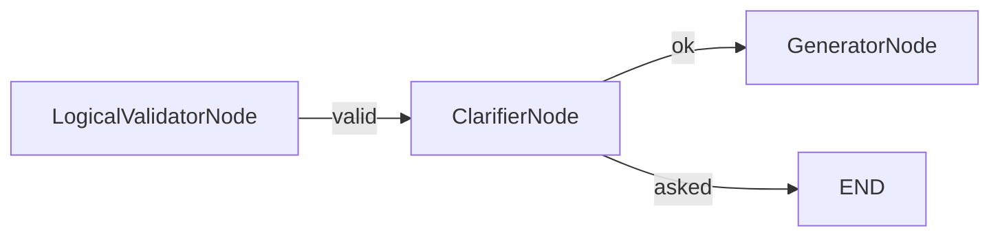

# ClarifierNode

## Overview

- Asks instead of guessing: when the planner read a phrase of the question in
  more than one way, and two or three readings pass the checks, it ends the
  sub-query with the options rather than running the most likely one.
- Sits on the logical validator's "valid" edge, before the generator, so every
  path from the planner to the generator still passes the validator.
- Makes no model call.
- Class: `ClarifierNode`
- Source: `packages/nl2sql/src/nl2sql/pipeline/nodes/clarifier/node.py`
- Design: [Wave B, section 7](../wave_b.md#7-clarify-instead-of-guess) (D47).

---

## Responsibilities

- Run each of the planner's alternative readings through the validator's own
  checks (`LogicalValidatorNode.check`: the static checks and the caller's
  scope) and drop those that fail. A reading that names a table the caller
  cannot read is never offered, and never listed as an assumption.
- Render each remaining reading to SQL with the generator and drop one whose
  SQL another option already has (the default reading comes first). At most
  three options: the default and two alternatives.
- End the sub-query with `NEEDS_CLARIFICATION` when it may ask, and publish
  `clarification.requested`.
- Otherwise let the default plan go on, keeping the readings that passed on
  `ast_planner_response.alternatives`, which the
  [explanation](../../api/core/query.md#explanation) lists as assumptions.

---

## Position in Execution Graph

Upstream:
- `LogicalValidatorNode`, when the plan passed

Downstream:
- `GeneratorNode`, unless it asked
- `END`, when it asked



---

## Inputs

From `SubgraphExecutionState`:

- `ast_planner_response.plan`, `ambiguous_phrase` and `alternatives`. Each
  alternative already went through `plan.after` in the planner node, as the
  plan did: one a hook denied is not there, one a hook changed is there as
  changed.
- `sub_query`, `relevant_tables` and `user_context`, for the validator's checks.
- `clarify`: set by `wrap_subgraph` when the run's `clarify` is on and the
  sub-query is the run's only one.

From the runtime: `settings.clarify.enabled`, and the run's pinned knowledge
for the datasource's knowledge digest.

---

## Outputs

- No alternatives: nothing (it passes straight through).
- Otherwise `ast_planner_response` with `alternatives` cut to the readings that
  passed and were not merged.
- When it asks, also one `PipelineError`: `NEEDS_CLARIFICATION`, severity
  `INFO`, never retried. Its `details` carry what the result needs to build the
  `ClarificationRequest`: `phrase`, `datasource_id`, `schema_version`,
  `knowledge_digest`, `sub_query` and `options` (`id`, `label`, `plan`; the
  default reading, `a`, has no label from the planner). The result adds the
  question, the asker and each option's explanation (`result_from_state` in
  `api/query_api.py`).

---

## When it asks

All of these hold:

1. The planner named the phrase (`ambiguous_phrase`) and at least one
   alternative passed the checks and was not merged.
2. `state.clarify` is on: the run's `clarify` (`run_query(clarify=...)`,
   default true; evals pass false) and the run has exactly one sub-query.
3. `settings.clarify.enabled` is on (the default).

The prompts are the same either way: `clarify` only decides whether the
clarifier ends the run.

---

## Contracts & Interfaces

```
def __call__(self, state: SubgraphExecutionState) -> Dict[str, Any]
```

`check_clarifier` in `build_sql_agent_graph` routes `end` when the state holds
a `NEEDS_CLARIFICATION` error, else `ok`. The layer router ends the run on it
(nothing is executed, aggregated or synthesized), and `wrap_subgraph` reports
the sub-query with status `needs_clarification` and no `MISSING_SQL` error.

---

## Observability

- `clarification.requested` (`sub_query_id`, `phrase`, `options`), an operator
  event, never on the caller's stream.
- A validator's `policy.decision` for an alternative that read a denied table.
- `node.started` and `node.finished` as every step.

---

## Related Code

- `packages/nl2sql/src/nl2sql/pipeline/nodes/clarifier/node.py`
- `packages/nl2sql/src/nl2sql/pipeline/subgraphs/sql_agent.py`
- `packages/nl2sql/src/nl2sql/api/query_api.py` (`result_from_state`)
- `packages/nl2sql/tests/unit/test_clarifier.py`
