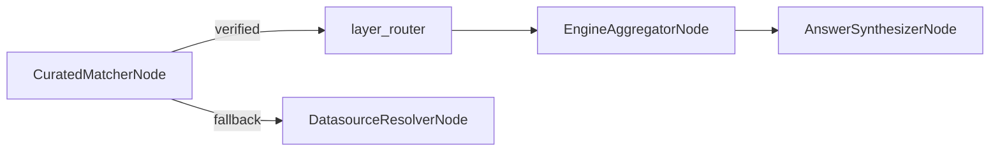

# CuratedMatcherNode

## Overview

- Answers a question with a verified query from `curated.yaml` when one fits, before the model plans anything.
- Searches only the verified queries of datasources the caller's role may read, asks the model once to pick one and give its parameter values, and checks the values and the role's table access in code.
- Runs the saved SQL with the values as bound parameters, under the row ceiling, and hands the result to the aggregator and the answer synthesizer as a one-sub-query run.
- Falls back to the generated pipeline for anything else, with a reason code; a fallback is never an error of the run.
- Class: `CuratedMatcherNode`
- Source: `packages/nl2sql/src/nl2sql/pipeline/nodes/curated_matcher/node.py`
- Design: [Curated answers](../curated_answers.md#matching-at-question-time)

---

## Responsibilities

- Limit the search to datasources that have verified queries and that `rbac.get_allowed_datasources()` allows (the pinned `datasource_id` only, when one is given).
- Retrieve candidates with `VectorStore.retrieve_verified_query_candidates()` (top `CURATED_MATCH_TOP_K`), skipping a query that is in the index but no longer in the file.
- Ask no model when the best similarity is below `CURATED_MATCH_FLOOR`.
- Make one structured-output call, `VerifiedQueryChoice`.
- Check the chosen values (`params.resolve_params`): type, `min`/`max`, `choices`, required.
- Check every table the SQL reads against the role's `allowed_tables` with `table_allowed()`, and that the SQL is still one read-only query.
- Check the adapter declares `SUPPORTS_BOUND_PARAMETERS` before running a query with parameters.
- Run the SQL through `SqlExecutorService` with `ExecutorRequest.parameters` and `max_rows`.
- On a hit, fill the state the way a one-sub-query generated run leaves it.

---

## Position in Execution Graph

The node is in the graph only when curated answers are on: `CURATED_ENABLED` is true, the curated file is loaded and holds at least one verified query, and the run executes (a plan-only run has no matcher). Otherwise the graph starts at `DatasourceResolverNode`, exactly as without curated answers.

Upstream:
- Entry point (no upstream nodes).

Downstream:
- `layer_router` on a hit: the scan is already done, so it sends the run to `EngineAggregatorNode`, then `AnswerSynthesizerNode`.
- `DatasourceResolverNode` on any fallback.



---

## Inputs

From `GraphState`:

- `user_query` (str, required): searched, and shown to the model.
- `datasource_id` (Optional[str]): when set, only this datasource is searched.
- `user_context` (`UserContext`, required): the role's datasources and tables.

Context dependencies (`Runtime`):

- `curated`: the loaded `CuratedFileConfig`. The matcher reads every query from it, never from the index.
- `vector_store`: `retrieve_verified_query_candidates()`.
- `rbac`: `get_allowed_datasources()` and `get_allowed_tables()`.
- `ds_registry`: dialect, adapter row limit, `supports()`.
- `schema_store`: the latest schema version, stamped on the sub-query.
- `llm_registry`: the choice's model, agent name `curatedmatcher` (falls back to `default`).

---

## Outputs

On a hit, mutations to `GraphState`:

- `verified_match` (`VerifiedMatch`: `datasource_id`, `query_id`, `description`, `params`)
- `decomposer_response`: one `SubQuery` (id `verified_<query_id>`, intent the question) in one `standalone` combine group
- `execution_dag`: `build_execution_dag()` of that response
- `artifact_refs`: the saved result
- `subgraph_outputs`: one `SubgraphOutput` with `plan_source="verified"`, the SQL, `row_cap`, `truncated`, and the checks `read_only`, `params` and `policy`
- `reasoning`

On a fallback: nothing the rest of the graph reads. `execution_failed` also adds a `warnings` entry.

Always, outside the state (the trace keeps the node's whole return):

- `curated_match`: `matched`, `reason` (a fallback code or None), `detail`, `floor`, `candidates` (`datasource_id`, `query_id`, `similarity`), `choice` (the model's `query_id`, `params`, `reason`), `params` (after checking).
- `retrieval`: the search's record, shaped like the resolver's, when a search ran.

---

## Internal Flow (Step-by-Step)

1. Searchable datasources: registered, allowed for the role (`*` allows all), the pinned one alone if pinned, and holding verified queries. None: `not_configured`, no search and no embedding call.
2. Candidates. None (or none still in the file): `no_candidates`.
3. Best similarity below `CURATED_MATCH_FLOOR`: `below_floor`, no model call.
4. One `VerifiedQueryChoice` call. It raised (no recording in a replay, a provider error): `model_failed`. `none_of_these`: `none_of_these`. An id that is not a candidate: `unknown_query`.
5. Values: an unknown name, a name twice, a value that does not parse or is out of bounds: `param_invalid`; a param with no default left out or empty: `param_missing`. A param left out takes its default.
6. Tables: any table the SQL reads not allowed for the role: `policy_denied`. The normal pipeline then enforces RBAC as always; the user is not told a verified query exists.
7. Capability: a query with params on an adapter without `SUPPORTS_BOUND_PARAMETERS`: `capability_missing`.
8. Run with the values bound and `max_rows` set to `min(adapter.row_limit or RESULT_ROW_LIMIT, RESULT_ROW_LIMIT)`. Failed or no result: `execution_failed`, with a warning.
9. Fill the state and route to `layer_router`.

### The choice prompt

System message (`curated_matcher/prompts.py`), then the question after a `User Query:` line, which `nl2sql.llm.replay.extract_question` recognises:

```text
You decide whether one of the verified queries below answers the user's question. A data team wrote and checked each one; you cannot change what a query does, only pick one and give its parameter values.

Rules:
1. Pick a query only when it answers the whole question as asked: the same measure, the same ranking or grouping, the same filters. A query about something close but different (ranked by another measure, grouped another way, a different entity) does not answer it.
2. When no query answers the whole question, set query_id to "none_of_these". When unsure, choose "none_of_these": the question is then answered another way, which is better than a wrong answer.
3. Use the id exactly as listed (datasource.query).
4. Give a value for each parameter the question states, as text: an int as digits, a date as YYYY-MM-DD, a string exactly as one of its choices when it has them. Leave out a parameter the question does not state; never guess a value the question does not give.
5. Give the reason in one short sentence.

Verified queries (JSON):
{candidates}
```

`{candidates}` lists, in ranked order, each candidate's qualified id (`chinook.top_customers_by_revenue`), its description, and its params with type, bounds, choices, default and `required`. Never the SQL.

---

## Contracts & Interfaces

```
def __call__(self, state: GraphState) -> Dict[str, Any]
```

Key contracts:

- `VerifiedQueryChoice`, `ParamValue`, `VerifiedMatch` (`curated_matcher/schemas.py`)
- `VerifiedQueryCandidate` (`indexing/models.py`)
- `ExecutorRequest.parameters`, `ExecutorRequest.max_rows`
- `SubgraphOutput` with `plan_source="verified"`

---

## Determinism Guarantees

- No model writes or edits the SQL; the model picks an id and supplies values, which code checks and the driver binds.
- The candidates block is serialized with sorted keys in ranked order.
- The search and the choice are as deterministic as the embedding model and the configured temperature and seed.

---

## Error Handling

The node never adds an error to the run. Every failure, including an unexpected exception, is a fallback with a reason code: `not_configured`, `no_candidates`, `below_floor`, `none_of_these`, `model_failed`, `unknown_query`, `param_invalid`, `param_missing`, `policy_denied`, `capability_missing`, `execution_failed`.

---

## Retry + Idempotency

- No retry: a fallback runs the generated pipeline instead.
- Idempotent for the same input state and the same model answer.

---

## Performance Characteristics

- A verified answer costs two model calls (this choice and the answer) instead of four or more.
- Below the floor, or with no candidates, a fallback costs one embedding call and no model call.
- The result is read in batches and the stream stops at `max_rows`.

---

## Observability

- Logger: `curated_matcher`
- The trace records the node with its `curated_match` record and the search; the choice call is recorded like every LLM call, under node `curated_matcher`.
- `QueryResult.source` says `verified` with the query id and values, or `generated`.
