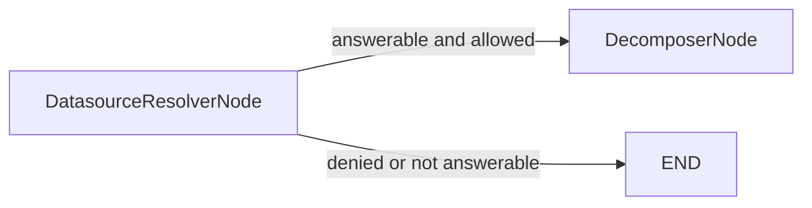

# DatasourceResolverNode

## Overview

- Picks the datasources a question goes to: an explicit override, the only registered datasource, or routing (five signals fused with reciprocal rank fusion) when more than one is registered.
- Enforces RBAC and the schema version mismatch policy before planning.
- Refuses a question no datasource can answer, with one small structured LLM call, before the decomposer runs.
- Sits at the entry of the control graph and gates the pipeline.
- Class: `DatasourceResolverNode`
- Source: `packages/nl2sql/src/nl2sql/pipeline/nodes/datasource_resolver/node.py`

---

## Responsibilities

- Choose candidate datasources:
    - an explicit `datasource_id` is used as given;
    - with exactly one datasource registered, that one is used and no vector search runs;
    - otherwise `Retriever.route()` ranks the datasources the caller's scope reaches (see [Routing](../indexing.md#routing-five-signals-fused)).
- Validate datasource IDs against the registered adapter list.
- Enforce RBAC datasource access.
- Judge answerability over the allowed candidates, refuse with `QUESTION_NOT_ANSWERABLE` when none can answer, and forward only the candidates the verdict names, at most `settings.routing.max_datasources` of them.
- Give each forwarded datasource its description and a capped table list, for the decomposer to route on.
- Populate `DatasourceResolverResponse` in `GraphState`.

---

## Position in Execution Graph

Upstream:
- Entry point (no upstream nodes), or `CuratedMatcherNode` when curated answers are configured and it fell back.

Downstream:
- `DecomposerNode` if resolution succeeds.
- Terminates early (`END`) if no datasource is allowed, or the question is not answerable.

Trigger conditions:
- The control graph's entry node, unless curated answers are configured; then it runs whenever the [curated matcher](curated_matcher_node.md) did not answer.



---

## Inputs

From `GraphState`:

- `user_query` (str, required): the question; used for routing (more than one datasource) and for the answerability check.
- `datasource_id` (Optional[str]): explicit override for datasource selection.
- `user_context` (`UserContext`, required): RBAC enforcement.

Context dependencies (`Runtime`):

- `vector_store`: the run's pinned `Retriever`. Its `route` ranks the candidates when more than one datasource is registered and no override is given, and gives each datasource's live schema version and snapshot (the snapshot's description and table list feed the answerability check and the decomposer's routing context).
- `ds_registry`: adapter registry for registered IDs.
- `rbac`: filters allowed datasources.
- `llm_registry`: the answerability check's model, agent name `datasourceresolver` (falls back to `default`).
- `settings.routing` (`candidates`, `max_datasources`, `floor_ratio`) and `settings.retrieval.decomposer_tables`.

Validation performed:

- Datasource override must exist in the registry.
- RBAC must allow at least one candidate.
- At least one allowed candidate must be judged able to answer.

---

## Outputs

Mutations to `GraphState`:

- `datasource_resolver_response` (`DatasourceResolverResponse`)
- `errors` (list of `PipelineError`) on failure
- `reasoning` (how the candidates were chosen, and the answerability reason) and `warnings`

Side effects:

- One LLM call (the answerability check) once the role check passes.
- Routing's five index searches (one embedding of the question) when more than one datasource is registered and no override is given.

---

## Internal Flow (Step-by-Step)

1. Candidates:
    - `state.datasource_id` set: it must be registered (`INVALID_STATE` otherwise); it is the only candidate.
    - Exactly one datasource registered: it is the only candidate; no vector search.
    - Otherwise: the vector store must exist (`SCHEMA_RETRIEVAL_FAILED` otherwise). The scope filter comes first: the registered datasources the caller's role may not read are left out, and none left is a `CRITICAL` `SECURITY_VIOLATION` with no search and no model call. `Retriever.route` then ranks the rest (the description, example, verified-query, table and column signals, fused with reciprocal rank fusion), keeping the top `settings.routing.candidates` (5) and dropping any under `settings.routing.floor_ratio` (0.5) times the best. The description signal ranks every datasource entry exactly, so no reachable datasource is missed by the approximate search. No candidate is `SCHEMA_RETRIEVAL_FAILED` (with a re-index hint when the index is empty).
2. Role check: candidates the role may not read are dropped. None left is a `CRITICAL` `SECURITY_VIOLATION`, and no model call is made.
3. Schema version mismatch policy (`fail` returns `INVALID_STATE`; `warn` adds a warning).
4. Answerability check over the **allowed** candidates only (see below). An empty verdict returns `QUESTION_NOT_ANSWERABLE`.
5. Narrow to the verdict. After routing, only the allowed candidates the verdict names go forward, at most `settings.routing.max_datasources` (3) of them, the best by fused score first; a candidate the verdict rejects never reaches the decomposer, and a verdict naming only unknown ids is `QUESTION_NOT_ANSWERABLE`. With an override or a single datasource there is one candidate, and a non-empty verdict accepts it.
6. Attach routing context to each forwarded datasource, from the snapshot its live build was made from: `description`, `tables` (sorted bare table names, at most `settings.retrieval.decomposer_tables`, 30) and `more_tables` (how many were left out).
7. Return `DatasourceResolverResponse` with the forwarded datasources (sorted by id), their IDs as `allowed_datasource_ids`, and unsupported IDs.
8. On exceptions, log and return `SCHEMA_RETRIEVAL_FAILED` with the exception text; a provider's refusal of the model call is a `PROVIDER_*` error instead (see [provider failures](../../observability/error-handling.md#provider-failures)).

A single registered datasource is the shortcut, not the usual case: with more
than one - the demo registers three - routing runs, and nothing else in the
flow changes.

### Order of checks

The role check runs before the answerability check, so:

- a caller with no allowed datasource gets the RBAC refusal and the model is never asked;
- the model sees only datasources the role may read;
- a question that is answerable but touches tables the role may not read passes this node and is refused by `LogicalValidatorNode`'s table policy, as before.

### Answerability check

A structured call (`AnswerabilityResponse`: `answerable_datasource_ids`, `reason`) with this prompt (`datasource_resolver/prompts.py`). The system message:

```text
You check whether a question can be answered from the datasources below, before any SQL is planned. For each datasource you see its description and the tables it holds, not its data.

Rules:
1. List the id of every datasource that could hold data relevant to the question, even partly. A question that needs several datasources lists all of them.
2. Be conservative. When you are unsure, treat the question as answerable and list the datasources that might answer it. Refusing a question that could have been answered is worse than running one that finds nothing.
3. Return an empty list only when the question is clearly about something none of these datasources hold, such as the weather, general knowledge, or small talk.
4. Use only ids from the list below.
5. Give the reason in one short sentence.

Datasources (JSON):
{datasources}
```

The human message:

```text
User Query:
{user_query}
```

- `{datasources}` is a JSON list, one entry per allowed candidate, sorted by id, with sorted keys: `description` (the datasource description from the live build's snapshot, which indexing takes from the datasources config) and `tables` (sorted bare table names).
- The instructions and datasources come first (the system message) and the question last (the human message), so the prompt is byte-identical across questions up to the question and a provider's prompt cache can serve the prefix. OpenAI caches only prompts of 1,024 tokens or more, so with one small datasource nothing is cached; the prefix grows, and becomes cacheable, with more datasources.
- The verdict refuses and narrows: an empty list refuses the question, and after routing only the allowed candidates it names reach the decomposer. It cannot add a datasource the role may not read.
- For Chinook on its own the rendered prompt is about 260 tokens (`o200k_base`), plus the `AnswerabilityResponse` function schema; the demo now registers three datasources, so its prompt is correspondingly longer.

---

## Contracts & Interfaces

Implements a LangGraph node callable:

```
def __call__(self, state: GraphState) -> Dict[str, Any]
```

Key contracts:

- `DatasourceResolverResponse`
- `ResolvedDatasource`
- `AnswerabilityResponse`
- `PipelineError`

---

## Determinism Guarantees

- Candidate choice is deterministic for an override or a single datasource.
- Routing's ranking may vary with more than one datasource (approximate searches; ties in fused score go to the smaller id).
- The answerability prompt is serialized deterministically; the verdict is a model call at the configured temperature and seed.

---

## Error Handling

Emits `PipelineError` with:

- `INVALID_STATE` (unknown datasource override; schema version mismatch under `fail`)
- `SECURITY_VIOLATION` (RBAC denial)
- `QUESTION_NOT_ANSWERABLE` (`ERROR`: no allowed datasource can answer the question; `QueryResult.status` is `error`)
- `SCHEMA_RETRIEVAL_FAILED` (no candidates, no vector store with several datasources, or exceptions)

Exceptions are caught at the node boundary and logged with `logger.error`.

---

## Retry + Idempotency

- No internal retry logic.
- Idempotent for the same input state, except vector retrieval ranking and the model's verdict may vary.

---

## Performance Characteristics

- One small LLM call per question once the role check passes; it saves the decomposer, planner and synthesizer calls on every unanswerable question.
- Routing (one question embedding, five index searches, no model) only with more than one datasource.
- RBAC checks are in-memory operations; schema lookups are store reads.

---

## Observability

- Logger: `datasource_resolver`
- The answerability call is recorded like every LLM call: usage under node `datasource_resolver` in `QueryResult.usage`, and in the run trace keyed by node, sub-query, attempt and call.
- Vector retrieval uses `VECTOR_BREAKER` at the vector store layer.
- Returns a `retrieval` record in its update for the run trace: the query
  embedded, one search record per routing signal (`route.description`,
  `route.examples`, `route.curated`, `route.tables`, `route.columns`: the pool
  with similarities, each datasource's best entry picked) and a `routing`
  record (each signal's datasource ranking, the fused scores and ranks, the
  datasources kept and those dropped with why); or `skipped: true` and why (an explicit `datasource_id`, a single registered
  datasource, no vector store). The answerability check is not part of it: it
  is an LLM call and is traced as one.
  See [Debugging a run](../../observability/debugging.md#retrieval).

---

## Configuration

- LLM agent `datasourceresolver` in the LLM config (optional; see [LLM configuration](../../configuration/llm.md#per-node-models))
- `settings.routing.candidates`, `max_datasources` and `floor_ratio`, and `settings.retrieval.decomposer_tables` (see [Settings](../../configuration/settings.md))

---

## Extension Points

- Replace this node in `build_graph()` to change resolution behavior.
- Extend retrieval by modifying the node or the vector store retrieval strategy.

---

## Known Limitations

- Tenant scoping is not implemented in vector retrieval.
- The answerability check sees table names, not columns or data, so it refuses only questions clearly outside every datasource.

---

## Related Code

- `packages/nl2sql/src/nl2sql/pipeline/nodes/datasource_resolver/node.py`
- `packages/nl2sql/src/nl2sql/pipeline/nodes/datasource_resolver/prompts.py`
- `packages/nl2sql/src/nl2sql/pipeline/nodes/datasource_resolver/schemas.py`
