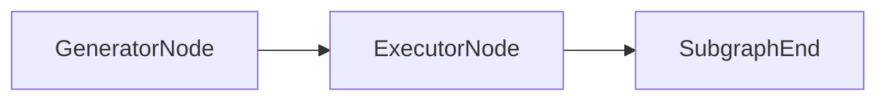

# ExecutorNode

## Overview

- Delegates SQL execution to an executor service based on datasource capabilities.
- Persists results via the artifact store and returns `ExecutorResponse`.
- Sits after `GeneratorNode` in the SQL agent subgraph.
- Class: `ExecutorNode`
- Source: `packages/nl2sql/src/nl2sql/pipeline/nodes/executor/node.py`

---

## Responsibilities

- Validate required execution inputs (SQL and datasource ID).
- Gate execution on the datasource declaring `supports_sql`.
- Build and submit `ExecutorRequest`.
- Return executor response and propagate errors.

---

## Position in Execution Graph

Upstream:
- `GeneratorNode`

Downstream:
- Subgraph end (artifacts returned to control graph).

Trigger conditions:
- Executed when SQL generation succeeds.



---

## Inputs

From `SubgraphExecutionState`:

- `generator_response.sql_draft` (required)
- `sub_query.datasource_id` (required)
- `sub_query.schema_version` (optional)
- `trace_id`, `subgraph_name`, `user_context`

From `Runtime`:

- `ds_registry`
- `tenant_id`

Validation performed:

- Missing SQL → `MISSING_SQL`
- Missing datasource ID → `MISSING_DATASOURCE_ID`
- No executor for datasource → `INVALID_STATE`

---

## Outputs

Mutations to `SubgraphExecutionState`:

- `executor_response` (`ExecutorResponse`)
- `errors` and `reasoning`

Side effects:

- Executes SQL against datasource via executor service.
- Reads the result a batch at a time when the adapter has `execute_batches` (`StreamingAdapterProtocol`), `settings.results.fetch_batch_size` rows per batch, and writes each batch to the artifact as it arrives (`ArtifactStore.write_batches`); an adapter without it is called through `execute` and its one frame is written the same way. A failure the adapter reports between batches fails the sub-query as a failed `execute` would, and nothing is written (see [artifact store](../../storage/artifact-store.md#batched-writes)). `metrics.row_count` and `metrics.bytes_returned` are summed over the batches.
- `SqlExecutorService` also takes `ExecutorRequest.parameters` and `max_rows`, which this node never sets: generated SQL carries no parameters and its `LIMIT` is in the text. The [curated matcher](curated_matcher_node.md) sets both for a verified query: the parameters reach the adapter in `AdapterRequest.parameters` and are bound, and the stream stops after `max_rows` rows, cutting the last batch and closing the adapter's stream.
- Persists results to artifact store, one artifact per sub-query: the request's `node_id` (the sub-query id) is passed to the store as `sub_query_id` and `dag_node_id`, so two sub-queries of one run never write the same file (see [artifact store](../../storage/artifact-store.md#one-artifact-per-sub-query)). The `ArtifactRef` records it as `sub_query_id`.

---

## Internal Flow (Step-by-Step)

1. Validate SQL and datasource ID.
2. Check the adapter declares `supports_sql`; otherwise return `INVALID_STATE`.
3. Build `ExecutorRequest` with trace/subgraph identifiers and schema version.
4. Run `execute.before`, execute the request, and run `execute.after` on the result's summary.
5. After `execute.after`, run the answer sanity checks on the result (below),
   unless `settings.pipeline.sanity_checks` is `false`; a result a hook stopped
   is never checked.
6. On exception, emit `EXECUTOR_CRASH`.

## Answer sanity checks

Cheap checks on each sub-query's result, before the aggregator, in
`pipeline/nodes/executor/sanity/`: the filter values of an empty result
(`values.py`), join fan-out (`fanout.py`) and all-null columns (`nulls.py`).
Every probe is a sqlglot tree built from the plan and rendered by the adapter
(`render_sql`), bounded, and never run on a table the caller's scope denies; a
check that fails to run reports nothing, and a failure in the checks never
fails the run. A verified query is not checked: it runs in the
[curated matcher](curated_matcher_node.md), not through this node.

**Probes and hooks.** A probe (the value check's and the fan-out check's) is
SQL the [hooks](../../configuration/hooks.md) never see: it runs outside
`execute.before` and `execute.after`, and nothing publishes it. So when any
hook is attached at `execute.before` (an operator gating the SQL that reaches
the database), no probe runs: only the all-null check, which reads the saved
result and sends nothing to the database. `settings.pipeline.sanity_checks:
false` turns every check off. A probe is bounded by the datasource's timeout;
one that times out is skipped silently.

| Check | Runs on | Code | Then |
|---|---|---|---|
| Missing filter value | an empty result | `VALUE_NOT_FOUND` | A close value and a retry left: an `ERROR`, retried once. Otherwise a `WARNING`. |
| Join fan-out | a result with rows | `JOIN_FAN_OUT` | Under `COUNT`, confirmed, with a retry left: an `ERROR`, retried once. Under `SUM` or `AVG`, or with no retry left: a `WARNING`. |
| All-null column | a result with rows | `ALL_NULL_COLUMN` | Always a `WARNING`. |

Each check retries at most once per sub-query, within
`settings.pipeline.retries.max`, and a pinned plan (supplied, approved or
chosen) is never retried, so its findings are warnings. Each finding carries
`details.attempt`, which the [SQL agent](../subgraphs/sql_agent.md) routes on,
and publishes `sanity.flagged` (`code`, `sub_query_id`, `retry`; see
[Events](../../observability/events.md)). A warning reaches the result's
`warnings` as a `RunWarning`, and the answer synthesizer says it (see
[AnswerSynthesizerNode](answer_synthesizer_node.md)).

### Join fan-out

Joining Customer to Invoice on `Invoice.CustomerId` repeats each customer once
per invoice, so `COUNT(c.CustomerId)` counts invoices and `SUM(c.Credit)` adds
each customer's credit several times. A table's rows are repeated when a join
in the plan reaches, on its far side, a key that is not the far table's whole
primary key (from the snapshot, through the sub-query's `relevant_tables`);
every table on the near side of that join is repeated. One table joined to two
others on their many side (a many-to-many sum: invoices and tickets of one
customer) is the same case. A table with no known primary key is taken as
unique, so it is never suspected: a warehouse that declares no keys
(Snowflake or BigQuery often do not, nor do views) gets no fan-out check.

A suspected `COUNT`, `SUM` or `AVG` over a column of a repeated table (not
already `DISTINCT`) is confirmed by one probe over the plan's own `FROM`,
joins, `WHERE` and `GROUP BY`: does any group hold one row of that table more
than once?

```sql
SELECT 1 FROM <the plan's FROM and joins>
WHERE <the plan's WHERE> AND NOT <alias>.<primary key> IS NULL
GROUP BY <the plan's groups>, <alias>.<primary key>
HAVING COUNT(*) > 1 LIMIT 1
```

A row confirms it. The rows an outer join null-extends have no key, so they
never count, and a row that appears once in each of several groups (which a
grouped aggregate counts rightly) never counts either. The probe needs a
single-column primary key and every table of the plan readable by the caller.
The key keeps its case as reflected and is spelled as the generator spells a
column, rendered by the adapter in its dialect.

Under `COUNT` the planner is told to count distinct values, which the plan can
say (`Expr.distinct`). Under `SUM` or `AVG` the repair (aggregate the many
side first) needs a derived table the plan cannot express, so it is a warning:
"SUM(Customer.Credit) may count some Customer rows more than once: joining
Invoice repeats them." Messages name tables and columns, never values.

### All-null columns

A result with rows whose column holds only nulls (usually an outer join that
matched nothing, or the wrong column) is a warning. It reads the saved
result's null counts, never its values; there is no probe and no fix to
suggest.

### An empty result's filter values

"Which customers bought Metal?" planned as `Genre.Name = 'Metal'` returns no
rows because Chinook's genre is 'Heavy Metal'. Reported as is, the answer says
nobody bought any. So when a query succeeds with **zero rows**,
`sanity/values.py`'s `check_values()` looks at every string literal the plan's `WHERE`
compares a bare column to with `=`, `IN` or `LIKE`, through `AND` and `OR`
only (a negated or `!=` comparison, a column inside a function, and a number
are left alone), at most five per sub-query:

1. **Does it exist?** `SELECT 1 FROM <table> WHERE <column> = '<value>' LIMIT 1`
   (`LIKE` for a pattern). If yes, nothing is said: the empty result stands.
2. **The closest values.** From the column's sample values in the snapshot
   when one of them is close (a case-insensitive match, then by similarity),
   with no query. Otherwise a case-insensitive match first
   (`LOWER(column) = LOWER('value')`, `DISTINCT`, `LIMIT 3`); failing that, a
   bounded `SELECT DISTINCT column ... LIMIT n` (n is 500, or the adapter's
   `row_limit` if lower) and the three most similar by `difflib` (cutoff 0.6).
3. **What it reports**, as `VALUE_NOT_FOUND`:
   - With a close value and a retry left, an `ERROR` telling the planner which
     values exist: "No Genre.Name value is 'Jaz', so the query returned no rows.
     The closest existing values are 'Jazz'; use one of them if it is what the
     question means." The SQL agent sends it back through the refiner (see
     [SQL agent](../subgraphs/sql_agent.md)). It is raised once per sub-query:
     an empty result after that retry is reported as a warning instead.
   - Otherwise a `WARNING`: "There is no Genre with Name 'Polka'." (with
     "; the closest is ..." when there is one). The sub-query still succeeds
     with its empty result, and the answer synthesizer is told the value does
     not exist (see [AnswerSynthesizerNode](answer_synthesizer_node.md)).

Every probe is a `SELECT` built with sqlglot and rendered by the adapter
(`render_sql`), so no dialect is named here; each has a `LIMIT` no higher than
the adapter's row cap. A table the role may not read (RBAC, as the logical
validator checks it) is never probed, a probe the database refuses claims
nothing, and a failure in the check never fails the run.

---

## Contracts & Interfaces

Implements a LangGraph node callable:

```
def __call__(self, state: SubgraphExecutionState) -> Dict[str, Any]
```

Key contracts:

- `ExecutorRequest`
- `ExecutorResponse`

---

## Determinism Guarantees

- Deterministic request construction.
- Execution results depend on external datasource state and are not deterministic.

---

## Error Handling

Emits `PipelineError` with:

- `MISSING_SQL`
- `MISSING_DATASOURCE_ID`
- `INVALID_STATE`
- `EXECUTION_FAILED`: the database rejected the query as wrong (the adapter's `retryable`); the SQL agent sends it back to the refiner while retries remain
- `DB_EXECUTION_ERROR`: the database refused or could not run the query (permission, timeout, connection); fatal
- `EXECUTOR_CRASH`: an exception escaped the adapter
- `VALUE_NOT_FOUND`: an empty result filtered on a value its column does not have; an `ERROR` (retried once) when a close value exists, a `WARNING` otherwise
- `JOIN_FAN_OUT`: an aggregate over rows a join repeated, confirmed by the probe; an `ERROR` (retried once) under `COUNT`, a `WARNING` under `SUM` or `AVG`
- `ALL_NULL_COLUMN`: a result column with no value; a `WARNING`

---

## Retry + Idempotency

- No internal retry logic. The SQL agent's `check_execution` routes a retryable `EXECUTION_FAILED`, and this attempt's `VALUE_NOT_FOUND` or `JOIN_FAN_OUT` `ERROR`, back to the refiner (see [SQL agent](../subgraphs/sql_agent.md)).
- Idempotency depends on datasource and query semantics.

---

## Performance Characteristics

- External I/O dominates (database execution).
- Artifact persistence writes Parquet results.

---

## Observability

- Logger: `executor` (and `sanity`, `sanity.values`, `sanity.fanout` for skipped checks)
- `sanity.flagged` for each sanity finding
- Propagates executor response reasoning and errors.

---

## Configuration

- `tenant_id` from settings.
- `settings.pipeline.sanity_checks` (default `true`): `false` turns the sanity checks off.
- Executor selection based on adapter capabilities.

---

## Extension Points

- Extend `SqlExecutorService` to alter execution behavior.
- Replace node in `build_sql_agent_graph()` to alter execution behavior.

---

## Known Limitations

- Executes in‑process on the pipeline thread pool; there is no process sandbox (see `../../execution/isolation.md`).
- No built‑in retries on transient execution failures.
- The fan-out check reads only the select list's `COUNT`, `SUM` and `AVG` of a plain column, and confirms with the plan's whole `WHERE` but no `GROUP BY`; a `SUM` or `AVG` fan-out is reported, not repaired.
- The filter-value check covers string literals in `WHERE` only, not `HAVING`, and reads at most 500 distinct values to find a similar one, so on a high-cardinality column a near miss can go unsuggested (the value is then reported as missing).

---

## Related Code

- `packages/nl2sql/src/nl2sql/pipeline/nodes/executor/node.py`
- `packages/nl2sql/src/nl2sql/execution/executor/sql_executor.py`
- `packages/nl2sql/src/nl2sql/pipeline/nodes/executor/sanity/` (`values.py`, `fanout.py`, `nulls.py`)
