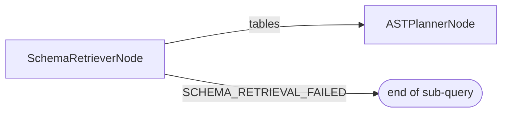

# SchemaRetrieverNode

## Overview

- Retrieves schema context for a sub‑query using staged vector search and authoritative snapshots.
- Exists to constrain planning to relevant tables/columns while remaining schema‑grounded.
- Sits at the entry of the SQL agent subgraph.
- Class: `SchemaRetrieverNode`
- Source: `packages/nl2sql/src/nl2sql/pipeline/nodes/schema_retriever/node.py`

---

## Responsibilities

- Build a semantic query from sub‑query intent, filters, group_by, expected_schema, metrics.
- Retrieve candidate tables/columns/relationships from the run's pinned `Retriever`.
- Resolve authoritative tables from `SchemaStore`.
- Fall back to full schema snapshot when retrieval returns no candidates or
  the search fails; see [Error Handling](#error-handling).
- Keep the columns a join or an answer needs on a table cut to the columns
  the search returned; see [Kept columns](#kept-columns).
- Rank the datasource's `preferred_tables` first and set `preferred=True` on
  them, on the full-snapshot path and the retrieval path; see
  [Preferred tables](#preferred-tables).
- Hide every table the caller may not read, on every path. The caller's
  `Scope` (`ctx.policy_engine.scope(user_context, datasource_id)`, the one the
  logical validator refuses with) filters the snapshot's tables *before*
  anything is chosen: the full-snapshot path sends the readable tables only
  (and compares their count, not the snapshot's, with
  `full_snapshot_max_tables`), and the vector searches run with
  `tables=<the readable tables>`, so the top `k` is filled with readable ones.
  A hidden table's name, columns, keys, statistics and data never reach the
  prompt or the run trace, and a relationship from a readable table into a
  hidden one is dropped. See
  [Security Model](../../security/model.md#hidden-tables-and-strict-refusal).
- The tables it returns keep every statistic, but the planner and refiner
  prompts render them with `render_schema_for_prompt` (`schema.py`), which
  sends only `sample_values` and, for date, time and numeric columns other
  than keys, a `range` of `[min_value, max_value]`. See
  [AST Planner: prompt layout](ast_planner_node.md#prompt-layout-and-caching).
- Read the run's pinned knowledge (the glossary, `Runtime.knowledge` as
  `pin_index()` kept it) and put what the caller may see into the schema block
  and `knowledge_used`; see [Knowledge](#knowledge).

---

## Position in Execution Graph

Upstream:
- SQL agent subgraph entry.

Downstream:
- `ASTPlannerNode`, or the end of the sub-query when it returned a
  non-retryable error (retrieval failed with no snapshot to fall back to).

Trigger conditions:
- Always executed as the subgraph entry node.



---

## Inputs

From `SubgraphExecutionState`:

- `sub_query` (required): includes intent, filters, group_by, expected_schema, metrics, schema_version.

From `Runtime`:

- `knowledge` (optional): the run's pinned `Knowledge`; none means no glossary
- `settings.knowledge`: `top_k` and `block_max_chars`
- `vector_store` (optional)
- `state` (the state store; required for authoritative resolution)
- `ds_registry` (optional): `get_preferred_tables(datasource_id)`, `get_dialect(datasource_id)` (for derived date roles)

Validation performed:

- If `sub_query` missing, returns empty `relevant_tables`.
- If no candidates from vector store, falls back to full snapshot.

---

## Outputs

Mutations to `SubgraphExecutionState`:

- `relevant_tables` (list of `Table`)
- `knowledge_used` (`KnowledgeUsed`): the terms and rules sent as
  `[BUSINESS_CONTEXT]`; absent when none matched, and for a pinned plan
- `reasoning` and `warnings` in fallback paths
- `errors`: one `CRITICAL` `SCHEMA_RETRIEVAL_FAILED` when retrieval failed
  and there is no snapshot to fall back to

Side effects:

- Vector store queries.
- Schema store reads.
- None for knowledge: the planner publishes `knowledge.used` (an operator
  event, never on the caller's stream) on the sub-query's first prompt that
  carries `knowledge_used`. A plan-cache hit sends no prompt, so it publishes
  nothing, and the sub-query's result reports no `knowledge_used`.

---

## Internal Flow (Step-by-Step)

1. Build semantic query with `_build_semantic_query()`.
2. Retrieve table/metric chunks via `retrieve_schema_context()`, `k = settings.retrieval.table_k` (8).
3. If no table chunks, retrieve columns via `retrieve_column_candidates()`, `k = table_k`.
4. If tables are identified, retrieve columns/relationships via `retrieve_planning_context()`, `k = settings.retrieval.planning_k` (12).
5. Resolve schema snapshot via `_resolve_snapshot()`.
6. Build `Table` objects with `_build_tables_from_snapshot()`: each table
   keeps the columns the searches returned plus its [kept columns](#kept-columns).
7. If no tables were found, return full snapshot with warning.
8. On exception, see [Error Handling](#error-handling).

### Kept columns

The `planning` search returns `planning_k` (12) entries across all the tables
found, so a table often arrives with a few columns and none of its keys. On
Pagila (29 tables), the 0.9.0 smoke test's question about films in the Sports
category got `film` without `film_id` or `title` and `category` without `name`,
and no join or answer could be validated (bug B103 in
[Wave C, section 14](../wave_c.md#14-bugs-wave-c-fixes)). So a table cut to
the search's columns also keeps (`_kept_columns`):

- its primary key;
- both sides of every join it is offered: the constrained columns of its
  foreign keys and glossary joins into a readable table, and the referred
  columns of a foreign key or glossary join into it from another table sent,
  so every relationship in the schema block can be bound;
- its label: a column named `name` or `title`, or `<table>_name` /
  `<table>_title` (case ignored). An answer lists or filters by it far more
  often than the search ranks it.

A table sent whole (the full-snapshot path, or a table the search named with
no column) is unchanged.

### Preferred tables

A datasource's `preferred_tables` (in `datasources.yaml`, see
[Datasources](../../configuration/datasources.md#preferred-tables)) are
matched against snapshot tables by bare name or `schema.table`, case ignored.

- Full snapshot: every preferred table is in the list, first.
- Retrieval: preferred tables the `tables` search picked come first. A
  preferred table the search scored but did not pick is added (before the
  `planning` search, so its columns and relationships are fetched too) when
  its similarity is at least the least similar pick's minus
  `PREFERRED_MARGIN` (0.05).
- Each preferred `Table` has `preferred=True`. `render_schema_for_prompt`
  sorts preferred tables first, then by name, and prints `"preferred":true` on
  them only; with no preferred tables the block is byte-identical to before.
  Planner instruction 14 tells the model to plan against a preferred table
  when it answers the question.
- Being preferred never shows a hidden table: a preferred table the caller's
  scope denies is left out like any other.

### Knowledge

Wave B (K2, [design](../wave_b.md#4-knowledge-in-the-prompts)). The
datasource's merged knowledge is first filtered to the caller's scope with
`nl2sql.knowledge.scope.visible` (an item naming a table the caller cannot
read, or whose text mentions one, is left out), then resolved against the
snapshot by `schema_knowledge()`:

| Field of the schema block | What is sent |
| --- | --- |
| A table's `description` | The glossary's, else the database's comment (D38). Either is dropped when its text mentions a table the caller cannot read. |
| A column's `description` | The same rule |
| A column's `role` | The glossary's, else the one the snapshot proves: `identifier` for a primary or foreign key, `date` for a temporal type (D61) |
| A column's `unit`, `grain`, `values` | The glossary's, when it sets them (`values` on `role: enum` only) |
| `relationships` | The foreign keys into readable tables, plus each glossary join between two readable tables whose names resolve and whose types compare, with its `cardinality` and `"source": "glossary"` (D46). The logical validator's join check matches it as it matches a foreign key. |

`notes` are never sent. `knowledge_used` (`nl2sql/knowledge/match.py`):

- **Terms** whose name or a synonym appears, as whole words with case and
  punctuation ignored, in the sub-query's intent or the question: 1.0 for the
  name, 0.9 for a synonym, the best `settings.knowledge.top_k` (8). Two terms
  sharing a synonym are both sent; that is how the planner sees an ambiguity.
  A term the caller sees also matches when its `knowledge.term` index entry is
  at least `settings.knowledge.match_floor` (0.6) similar to the sub-query's
  intent (`Retriever.retrieve_term_candidates`), scoring that similarity; if the
  search fails, terms match by name only.
- **Rules** whose `tables` is empty or names one of the tables sent.
- The denied-name pattern is built once per sub-query, and only the readable
  tables' comments are checked against it.
- The block is cut to `settings.knowledge.block_max_chars` (4,000) by
  `fit_business_context` (`nl2sql/knowledge/render.py`): the lowest-scored
  terms first, then rules from the last; `dropped` lists what was cut.

Both hold only items within the caller's scope, since
`SubQueryResult.knowledge_used` is returned to the caller.

---

## Contracts & Interfaces

Implements a LangGraph node callable:

```
def __call__(self, state: SubgraphExecutionState) -> Dict[str, Any]
```

Key contracts:

- `Table` / `Column` (node schema)
- `SchemaSnapshot` (authoritative source)

---

## Determinism Guarantees

- Deterministic snapshot resolution for a fixed `schema_version`.
- Vector retrieval ranking may be non‑deterministic (MMR).

---

## Error Handling

- Exceptions are caught and logged via `logger.error`.
- With a snapshot (the search failed, e.g. the embedding model could not
  load), it does what the no-candidates path does: every table the caller may
  read, a `SCHEMA_RETRIEVAL_FAILED` `RunWarning` with a fixed message (the
  exception detail goes to the log only), and no error. Planning against no
  tables fails every attempt (bug B105 in
  [Wave C, section 14](../wave_c.md#14-bugs-wave-c-fixes)).
- Without one (the snapshot itself could not be read), it returns empty
  `relevant_tables` and a `CRITICAL` `SCHEMA_RETRIEVAL_FAILED` error with a
  fixed message, which is not retryable: the SQL agent ends the sub-query before the planner.

---

## Retry + Idempotency

- No internal retry logic.
- Idempotent for fixed vector retrieval output; vector ranking may vary.

---

## Performance Characteristics

- Depends on vector store retrieval latency and schema store reads.
- In‑memory processing of candidates and snapshot tables.

---

## Observability

- Logger: `schema_retriever`
- Emits reasoning and warnings on fallback paths.
- Returns a `retrieval` record in its update (not a state field, so LangGraph
  drops it; the run trace keeps it): the query text embedded, each search's
  pool with scores, the MMR picks in order and what was dropped, and the tables
  and columns sent to the planner; or, when the schema is small enough to send
  whole, `skipped: true` and why. Column entries of a table the role cannot read
  keep their name and rank but lose their scores (their embedded text holds
  sample values). See [Debugging a run](../../observability/debugging.md#retrieval).

---

## Configuration

- `settings.retrieval.full_snapshot_max_tables`, `table_k` and `planning_k` (see [Settings](../../configuration/settings.md#retrieval)).
- Vector store configuration is set in `Runtime`.

---

## Extension Points

- Modify semantic query construction to include additional signals.
- Replace node in `build_sql_agent_graph()` for alternative retrieval strategies.

---

## Known Limitations

- No tenant scoping in vector retrieval.
- No caching of retrieved tables across retries.
- Fallback to full schema can be expensive for large schemas. A failed search
  falls back the same way, with no `full_snapshot_max_tables` cap, so a very
  large schema may overflow the context.
- A pruned table keeps its foreign-key columns for joins into any table the
  caller can read, with no per-table cap; a wide fact table keeps them all.
- The label rule goes by column name, so a label named otherwise
  (`first_name`, `country`) is kept only when the search returns it. It also
  strips one trailing `s` from the table name (`customers` matches
  `customer_name`), so other plurals (`categories` and `category_name`) miss.

---

## Related Code

- `packages/nl2sql/src/nl2sql/pipeline/nodes/schema_retriever/node.py`
- `packages/nl2sql/src/nl2sql/indexing/retrieval.py`
