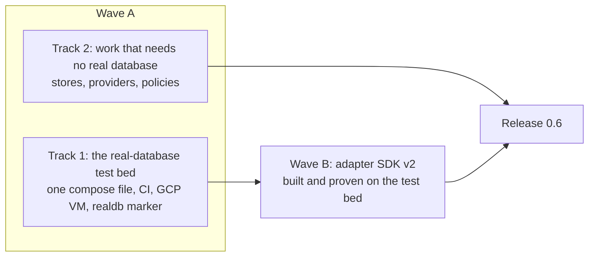
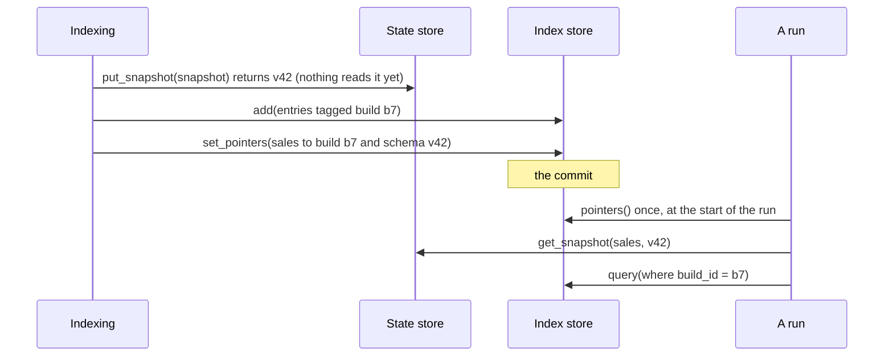
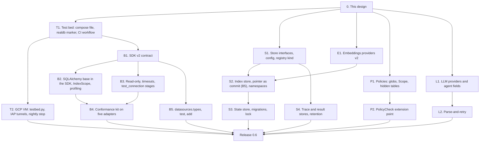

# Phase 2: test bed, storage, providers, policies and adapter SDK v2 (design)

!!! note "Status: design"
    This page is the design for Phase 2 of the redesign, which ships as
    release 0.6. Nothing on it is built yet. Each pull request in
    [the PR plan](#12-pr-plan) adds a "Built" note to the sections it builds,
    as Phase 1 did. Phase 1 is described in
    [Configuration v2 and the extension registry](configuration_v2.md).

## Principles

The Phase 1 principles still hold, and the owner restated them for Phase 2:

- **No users yet, so design it correctly, not compatibly.** No shims, no
  aliases, no deprecation periods. Where a 0.5 shape is wrong, 0.6 replaces
  it.
- **Never over-engineer.** Ship what 0.6 needs. Anything that can wait, does.
- **Prefer extension points over built-ins.** A small interface and a way to
  register your own beats another built-in we have to maintain.
- **No database-specific code outside adapters.** The plan says *what*; the
  adapter says *how*.
- **The package is the product.** The CLI, `nl2sql-api` and the playground
  use the public API only.

One more rule comes from how Phase 2 was ordered: **nothing about a real
database is designed from memory.** Until now every test ran against SQLite,
DuckDB and mocks. Phase 2 builds a test bed with real PostgreSQL, MySQL and
SQL Server first, and the adapter work is proven on it.

## Owner decisions

The owner answered every question this design raised, and confirmed the choices it made on its own. Each answer is written
into the section it affects.

| # | Decision | Where |
|---|---|---|
| 1 | **No Cloud SQL.** A stopped Cloud SQL instance still bills its public IPv4 address, so the test bed is one compose file instead, run locally, in CI and on one small GCP VM. | [The real-database test bed](#3-the-real-database-test-bed) |
| 2 | **CI runs the real databases only when they matter:** on pull requests that change database-facing code, nightly on `main`, and on demand before a release. A small gate job that always runs is the required check, so a skipped run passes honestly. The containers run on GitHub's runners. | [CI: the `realdb` workflow](#ci-the-realdb-workflow) |
| 3 | **The GCP test bed is one small VM running the same compose file,** started and stopped on demand, with an ephemeral external IP, no public database port, and access through IAP tunnels. A nightly scheduler job stops it. There are no GitHub-to-GCP credentials: it is run by hand, at least before each release. | [The GCP VM](#the-gcp-vm) |
| 4 | **SQL Server declares `ENFORCES_READ_ONLY` false,** `check()` warns, and the docs recommend a login with only `db_datareader`. | [Read-only and timeouts, honestly](#read-only-and-timeouts-honestly) |
| 5 | **Two-part policy patterns are rejected,** with the fix in the message. | [Pattern rules](#pattern-rules) |
| 6 | **No S3 or ADLS result store in 0.6.** The `ResultStore` interface ships with a docs example; a community plugin can come later. | [The interfaces](#the-interfaces) |
| 7 | **Built-in LLM providers stay minimal: `openai`, `anthropic` and `openai_compatible`.** There is no `azure_openai`; Azure's v1 endpoint, vLLM, LiteLLM and any other OpenAI-style server use `openai_compatible` with a `base_url`. `openrouter` and `ollama` stay as named presets of `openai_compatible`: a fixed `base_url` and key variable, with no code path of their own. Everything else is a plugin through the provider interface and the registry. The same holds for embeddings. | [LLM and embeddings providers](#5-llm-and-embeddings-providers) |
| 8 | **Read-only always.** There is no per-datasource `read_only` setting: every adapter makes its session read-only whenever it can. | [Read-only and timeouts, honestly](#read-only-and-timeouts-honestly) |
| 9 | **Sample values are off by default** (`index.sample_values: false`); the demo turns them on. | [`IndexScope`: what gets indexed](#indexscope-what-gets-indexed) |
| 10 | **Policy patterns match regardless of case,** so a deny cannot be dodged by `Orders` against `orders`. | [Pattern rules](#pattern-rules) |
| 11 | **A `PolicyCheck` is called once per user and datasource per run,** with no cache across runs. | [The `PolicyCheck` extension point](#the-policycheck-extension-point) |
| 12 | **The runtime price table moves to Phase 3** with the cost observer, and **the REST routes for Connect a database to Phase 4**; Phase 2 ships the package methods. | [Not in Phase 2](#not-in-phase-2) |

## Where Phase 1 left us

| Area | What 0.5 has | What is still wrong |
|---|---|---|
| Config | One typed `Config` from `nl2sql.yaml` and split files; strict keys; `${provider:key}` references | Nothing for Phase 2 to fix |
| Registry | `Registry.default()`, `add_*` and decorators for adapters, LLMs, embeddings and secrets | No store or policy-check kinds yet |
| Storage | `storage.path` only. Under it: Chroma in `index/`, `state.db`, `traces/`, `results/` | One store class per thing, opened by path, Chroma private attributes used throughout, and bug B5 |
| LLMs | `openai`, `anthropic`, `openrouter`, `ollama`; per-agent provider, model, temperature, key and `base_url` | No general OpenAI-compatible provider that the presets build on; one malformed structured answer ends the run |
| Embeddings | `local` and `openai` | No `base_url`; a model change is refused instead of building a new index |
| Policies | `allow_all`, `default_role`, `admin_roles`, `refusal_names_tables`, roles with `allowed_datasources` and `allowed_tables` | No deny; no globs; five call sites of `table_allowed`; denied tables still shown to the planner; no extension point |
| Adapters | Interface version 1 with `driver_modules` and `install_hint`; typed connection models hidden inside each adapter | Unknown connection keys are ignored, read-only is enforced only on SQLite with an option, `test_connection` returns a bool, profiling reflects twice and counts every row |

## 1. Goals and non-goals

### What ships in 0.6

| Goal | What it means |
|---|---|
| **A real-database test bed** | PostgreSQL with Pagila, MySQL with Sakila and SQL Server 2022 with AdventureWorksLT, plus a generated schema of 1,200 tables in 20 schemas. One `docker-compose.yml` runs them locally, on GitHub's runners in CI, and on one small GCP VM started on demand. A `realdb` pytest marker and fixtures point the same tests at any of them. |
| **Four stores** | `storage` gets `index`, `state`, `traces` and `results`, each with a `type`, behind four small interfaces in the SDK. The index's build pointer is the commit, which fixes bug B5. The index has one namespace per embedding model. |
| **A general LLM provider** | `openai`, `anthropic` and `openai_compatible` (any server with an OpenAI-style API at a `base_url`: Azure's v1 endpoint, vLLM, LiteLLM), with `openrouter` and `ollama` kept as named presets of it. Each provider declares how it returns structured output, and a malformed answer is retried with the error fed back. |
| **Embeddings providers** | `local`, `openai` and `openai_compatible`, `base_url` on the hosted ones, and a known model and dimension for every embedder. |
| **Policies, step 1** | Allow and deny globs over `datasource.schema.table`, one `Scope` object used at every place access is decided, denied tables hidden from the planner, and a `PolicyCheck` extension point. |
| **Adapter SDK v2** | A typed `ConnectionModel` per adapter (which also drives a generated form), `IndexScope`, type-aware profiling with catalog row estimates, honest read-only and timeout capabilities checked against real servers, `test_connection` that names the failed stage, the SQLAlchemy base made public as an SDK extra, and a conformance kit run against all five built-in adapters. |
| **Connect a database, in the package** | `engine.datasources.types()`, `test()` and `add()`: the package methods a Connect-a-database form calls. |

### Not in Phase 2

| Later | Why it waits | Where it goes |
|---|---|---|
| PostgreSQL state store and pgvector index (multi-replica) | Single replica is enough until someone runs several. The interfaces are written so these are plugins or built-ins later. | Later (owner) |
| `deny_columns`, row filters, user attributes | Step 2 and 3 of the policy ladder | Later (owner) |
| JWT and identity-provider groups mapped to roles | They belong to the API's role resolver | Phase 4 (apps), JWT later (owner) |
| dbt as a knowledge source | Needs the knowledge-source interface | Later (owner) |
| Async hooks; any event bus or hook | Nothing in Phase 2 consumes events | Phase 3 |
| Snowflake and BigQuery adapters | The conformance kit comes first; a community package passes it, then is adopted | Later (owner) |
| S3 or ADLS result stores | The results interface ships with a docs example; remote stores come as plugins (owner decision 6) | Later |
| The runtime price table owned by `llm/` | It belongs with the cost observer | Phase 3 |
| REST routes and forms for Connect a database, `datasources.scan()` and `draft()` | The package methods ship first; the apps render them | Phase 4 |
| Retrieval limits as settings, incremental re-indexing | The wide schema in the test bed measures the problem first | After 0.6 |

## 2. Order of work

Phase 2 runs in two waves, in this order because until now there was no real
database to test against.



- **Wave A, track 1** builds the test bed. Nothing else depends on the GCP
  part; the CI containers and fixtures are what Wave B needs.
- **Wave A, track 2** changes code that SQLite, DuckDB and the fake LLM can
  test: storage, LLM and embeddings providers, and policies.
- **Wave B** starts once track 1's CI job is merged. It may overlap the end
  of track 2.
- **Release 0.6** follows the last Wave B pull request.

## 3. The real-database test bed

!!! note "Built: the compose file, the `realdb` marker and the CI workflow (PR T1)"
    `testbed/` holds the compose file, `wide_schema.py`, `samples.py` (the
    pinned samples with their checksums), `passwords.py`, the servers' init
    scripts and `gate.py`; `packages/nl2sql/tests/realdb/` holds the
    fixtures; and `.github/workflows/realdb.yml` runs them. Four details
    differ from the first draft of this section. The passwords have no
    default: `testbed/passwords.py` writes random ones to the git-excluded
    `testbed/.env`, and CI generates new ones per run, so no password is
    written in the repository. Pagila is pinned to commit `5ba5a57`, because
    later commits need PostgreSQL 18. The `audit` schema is a small 21st
    schema beside the 20 numbered ones that hold the 1,200 tables.
    `datasource()` defaults to the server's own sample database (Pagila,
    Sakila or AdventureWorksLT) and passes other keywords to `Datasource`,
    since `Datasource.index` arrives with B1. The GCP VM and
    `scripts/testbed.py` are PR T2. See
    [The real-database test bed](../testing/test-bed.md).

### What it is

One file, `testbed/docker-compose.yml`, defines the whole test bed. The same
file runs in three places (owner decision 2):

| Where | When | Cost |
|---|---|---|
| Your machine | whenever you want | free |
| GitHub's runners (CI) | pull requests that change database-facing code, nightly on `main`, and on demand before a release | free; no IP address involved |
| One small GCP VM | by hand, at least once before each release | about $0.07 an hour running; disk only (about $1 to $2 a month) when stopped |

| Server | Sample database | Generated schema |
|---|---|---|
| PostgreSQL 16 | Pagila | `wide` (1,200 tables, 20 schemas) |
| MySQL 8.0 | Sakila | `wide_s01` ... `wide_s20` (MySQL's schemas are databases) |
| SQL Server 2022 | AdventureWorksLT 2022 | `wide` |
| SQLite, DuckDB | the conformance kit's own seed, in process, in the unit job | — |

The generated schema is loaded on all three servers everywhere, because
`IndexScope` and catalog row estimates are per adapter, and one compose file
means one behaviour.

There is no Cloud SQL. An earlier draft of this page used three Cloud SQL
instances; a stopped Cloud SQL instance still bills its public IPv4 address,
and a VM running the same compose file is cheaper, simpler and identical to
CI.

### The sample databases and their licences

The compose file's `samples` service downloads each sample from a pinned URL
and checks its SHA-256. Nothing is committed to the repository, so we never
redistribute the files. If we ever vendor one, its licence file goes beside
it.

| Sample | Files | Source | Licence | What we must do |
|---|---|---|---|---|
| Pagila | `pagila-schema.sql`, `pagila-insert-data.sql` | github.com/devrimgunduz/pagila | PostgreSQL License (copyright Devrim Gündüz) | Keep the notice if the files are ever copied |
| Sakila | `sakila-schema.sql`, `sakila-data.sql` | downloads.mysql.com (`sakila-db.tar.gz`) | New BSD (stated on the Sakila licence page) | Keep the notice if copied |
| AdventureWorksLT 2022 | `AdventureWorksLT2022.bak` | github.com/microsoft/sql-server-samples, release `adventureworks` | MIT (the repository's licence) | Keep the notice if copied |

The server images have their own terms. The SQL Server image runs the free
Developer edition, which needs `ACCEPT_EULA=Y` and is licensed for
development and testing, which is all we do with it. The PostgreSQL and MySQL
images are used as they are.

### The generated wide schema

`testbed/wide_schema.py --dialect postgres|mysql|tsql --seed 7` writes one
SQL file. The same seed always gives the same schema. It has:

| Feature | Count | What it tests |
|---|---|---|
| Schemas | 20 (`sales_01` ... `ops_20`, plus `audit`) | `IndexScope` include and exclude, policy globs |
| Tables | 1,200, with 5 to 30 columns each | Reflecting once, catalog-only indexing, retrieval at scale |
| Views | 2 per schema | Views are indexed |
| Odd column types | boolean, uuid, json, binary, xml or array where the server has it | Type-aware profiling never aborts |
| Comments | on 30% of tables and columns | Descriptions come from the database |
| Foreign keys | within each schema | Join paths |
| Mixed-case names | 10 tables, such as `"CustomerAccounts"` | Quoting |
| Rows | 3 tables with 1,000,000 rows, 50 with 1,000, the rest empty | Row estimates, `max_profile_rows` |

The big tables are filled on the server with a series function
(`generate_series`, a recursive CTE, or a numbers table), so the file stays
small. That SQL lives in the test bed, which is test code, not engine code.

### The compose file

`docker compose -f testbed/docker-compose.yml up -d --wait` starts and loads
everything. Loading happens once per data volume, so a second `up` is quick.

| Service | Image | What it does |
|---|---|---|
| `samples` | `python:3.12-slim` | One-shot. Downloads the pinned samples, checks them, runs `wide_schema.py` for the three dialects, and writes the files into the `samples` volume. Skips what is already there. |
| `postgres` | `postgres:16` | Starts after `samples`. Its first start runs Pagila and the wide schema from `/docker-entrypoint-initdb.d`, the image's own init mechanism. |
| `mysql` | `mysql:8.0` | The same, with Sakila. The image's init uses the `mysql` client, which handles `DELIMITER` blocks. |
| `mssql` | `mcr.microsoft.com/mssql/server:2022-latest` | Starts the server. |
| `mssql-init` | the same image (it ships `sqlcmd`) | One-shot, after `mssql` is healthy. Restores AdventureWorksLT from the `.bak`, loads the wide schema, and creates the test logins. Skips each step whose database already exists. |

Every service has a healthcheck, so `--wait` returns only when every server
is loaded. Each server also gets a login `nl2sql_reader` with read grants on
its sample database only; the conformance kit uses it for the `permission`
stage of `test_connection`.

The file reads four variables. The bind address has a default; the
passwords do not, so no password is written in the repository:

| Variable | Default | On the GCP VM |
|---|---|---|
| `TESTBED_BIND` | `127.0.0.1` | `0.0.0.0` (the firewall admits only IAP, see below) |
| `TESTBED_POSTGRES_PASSWORD` | none: required; `testbed/passwords.py` makes random ones, and CI makes new ones per run | from Secret Manager |
| `TESTBED_MYSQL_PASSWORD` | none: required; `testbed/passwords.py` makes random ones, and CI makes new ones per run | from Secret Manager |
| `TESTBED_MSSQL_PASSWORD` | none: required; `testbed/passwords.py` makes random ones, and CI makes new ones per run | from Secret Manager |


| Service | Published port | User |
|---|---|---|
| `postgres` | 15432 | `postgres` |
| `mysql` | 13306 | `root` |
| `mssql` | 11433 | `sa` |

The ports avoid a clash with a database already installed locally.

### Local use

```bash
python testbed/passwords.py > testbed/.env               # once
docker compose -f testbed/docker-compose.yml up -d --wait
set -a; . testbed/.env; set +a
REALDB=compose pytest -m realdb
docker compose -f testbed/docker-compose.yml down        # add -v to drop the data
```

### CI: the `realdb` workflow

A new workflow, `.github/workflows/realdb.yml`, with three jobs (owner
decision 2):

| Job | Runs | What it does |
|---|---|---|
| `changes` | always | Works out whether the pull request touches database-facing code (the paths below) |
| `realdb` | on a pull request when `changes` says so; nightly on `main` (`schedule`); on demand (`workflow_dispatch`), which is run before every release | `docker compose ... up -d --wait` on the runner, installs Microsoft's `msodbcsql18` for pyodbc, installs `packages/nl2sql[postgres,mysql,mssql,duckdb]`, then `pytest -m realdb` with `REALDB=compose` and `REALDB_REQUIRED=1` |
| `realdb-gate` | always (`if: always()`), after the other two | Passes when `realdb` passed or was skipped because nothing database-facing changed; fails when it failed or was cancelled. This is the required check, so a skipped job is an honest pass and never mistaken for one that ran. |

The paths that make `realdb` run:

```text
packages/sdk/**
packages/nl2sql/src/nl2sql/adapters/**
packages/nl2sql/src/nl2sql/indexing/**
packages/nl2sql/src/nl2sql/storage/**        (and schema/** until S3 moves it)
packages/nl2sql/tests/realdb/**
testbed/**
.github/workflows/realdb.yml
```

`REALDB_REQUIRED=1` turns a skipped `realdb` test into a failure: a green run
that skipped the real databases proves nothing. The unit job in `test.yml`
changes to `pytest -m "not integration and not realdb"`. The containers run
on GitHub's runners; no cloud credentials are involved.

### The `realdb` marker and fixtures

`pytest.ini` registers the marker:

```ini
realdb: needs a real PostgreSQL, MySQL or SQL Server (the test bed). Start
    testbed/docker-compose.yml and set REALDB=compose, or run it through
    scripts/testbed.py for the GCP VM.
```

The fixtures live in `packages/nl2sql/tests/realdb/conftest.py`:

| Variable | Meaning |
|---|---|
| `REALDB=compose` | The compose servers on `127.0.0.1`, at the published ports, with the passwords in `TESTBED_*_PASSWORD` |
| `REALDB_POSTGRES`, `REALDB_MYSQL`, `REALDB_MSSQL` | A URL for one server, such as `postgresql://postgres:<password>@127.0.0.1:15432/`, with the password percent-encoded. It wins over `REALDB=compose`. `scripts/testbed.py run` sets these. |
| `REALDB_REQUIRED=1` | A missing server is a failure, not a skip |

```python
@pytest.fixture(params=["postgres", "mysql", "mssql"])
def server(request) -> RealServer: ...            # skips loudly, or fails under REALDB_REQUIRED

def datasource(server, database="pagila", **index) -> Datasource:
    """A Datasource for one test-bed database, built from the server's URL."""

@pytest.fixture
def engine_on(server, tmp_path) -> Callable[..., NL2SQL]: ...   # an engine on that server, fake LLM
```

The skip message names the fix: "realdb: no PostgreSQL. Run
`docker compose -f testbed/docker-compose.yml up -d --wait` and set
`REALDB=compose`, or run `python scripts/testbed.py run -- pytest -m realdb`."

Test code may name dialects and use SQLAlchemy directly. The boundary tests
cover `packages/*/src`, not the tests.

### The GCP VM

One small VM, `nl2sql-testbed` in `nl2sql-testbed-261014` (zone `us-central1-a`), runs the same compose file
(owner decision 3). It is started for a session and stopped after it.

| Setting | Value |
|---|---|
| Machine | `e2-standard-2` (2 vCPU, 8 GB: SQL Server alone wants 2 GB) |
| Image | Debian 12, with Docker and the compose plugin installed once by its startup script |
| Disk | 30 GB standard persistent disk: the images and the data volumes, kept while stopped, so a later session skips the load |
| External IP | Ephemeral only, for outbound traffic (image pulls, sample downloads). It is released, and free, while the VM is stopped. |
| Inbound | No public database port. The VM sits in its own VPC, `nl2sql-testbed`, so the default network's open SSH and RDP rules do not apply, and one firewall rule admits TCP 22, 15432, 13306 and 11433 from IAP's range `35.235.240.0/20` only. |
| Access | `gcloud compute start-iap-tunnel`, which forwards `localhost:15432`, `13306` and `11433` on the caller's machine to the VM |
| Passwords | Secret Manager: the existing `testbed-postgres-root-password`, `testbed-mysql-root-password` and `testbed-mssql-root-password`. Never in the repository. |
| Bucket | `gs://nl2sql-testbed-261014-samples` is not needed: the VM downloads the samples itself, once |

There are no GitHub-to-GCP credentials. The owner, or an agent the owner
asks, runs the VM by hand.

`scripts/testbed.py` is Python, not a shell script, because the owner works on
Windows and CI runs Linux. It calls `gcloud` (found with `shutil.which`, so
`gcloud.cmd` works) and never writes its own process's environment.

| Command | What it does |
|---|---|
| `up` | Starts the VM (`gcloud compute instances start`). Copies `testbed/` to it (`gcloud compute scp --tunnel-through-iap`). Runs `docker compose up -d --wait` on it over `gcloud compute ssh --tunnel-through-iap`, with `TESTBED_BIND=0.0.0.0` and the three passwords from Secret Manager passed on that command's environment only (they travel on its stdin, never on a command line). Then opens the three IAP tunnels in the background and waits until each local port answers. |
| `run -- <cmd>` | `up`, then runs `<cmd>` with `REALDB_POSTGRES`, `REALDB_MYSQL` and `REALDB_MSSQL` (pointing at the local tunnel ports) in the child's environment only, then closes the tunnels and stops the VM in a `finally`: also on Ctrl-C, a failing command or a failed `up`. It exits with the command's code. |
| `down` | Closes any tunnels it opened and stops the VM. Safe to run again. |
| `status` | The VM's state, how long it has been running, and whether the tunnels are open. Never a password. |

Passwords are read with `gcloud secrets versions access latest` into memory,
and are never written to a file or printed.

**The nightly backstop.** If `testbed.py` is killed hard, or the VM is
started by hand, it would keep billing. One Cloud Scheduler job calls the
Compute Engine API directly at 03:00 UTC, with an OAuth token for a service
account that may only stop instances in this project:
`POST https://compute.googleapis.com/compute/v1/projects/nl2sql-testbed-261014/zones/us-central1-a/instances/nl2sql-testbed/stop`.
Stopping a stopped VM does nothing, so the job needs no logic, and one job is
inside Cloud Scheduler's free tier.

`docs/testing/test-bed.md` gives the commands for the owner to create the
VM, the firewall rule and the scheduler job once. Nothing in the repository
creates cloud resources by itself.

### Cost controls

| Control | Why |
|---|---|
| The VM is stopped whenever no session runs | A running VM bills by the hour |
| Ephemeral external IP only | Released, and free, while stopped |
| No public database port; IAP's range only | Nothing else can reach the servers |
| `run` always stops the VM in a `finally` | A failed test cannot leave it running |
| The nightly stop at 03:00 UTC | The backstop for everything above |
| CI runs on GitHub's runners | Free, and only when database-facing code changes, nightly, or on demand |
| Budget of $10 a month with alerts | The last line |

| Item | Approximate cost (check the billing report after the first month) |
|---|---|
| Stopped | the 30 GB disk: about $1 to $2 a month |
| Running | about $0.07 an hour |

So even a daily session stays well inside $10.

## 4. Storage: four stores

!!! note "Built: the interfaces, config and registry kind (S1)"
    `nl2sql_sdk.stores` holds the four protocols with `Entry`, `Hit`,
    `Filter` and `BuildPointer`; `StoreConfig` and the four `Storage`
    sub-blocks are in `nl2sql/config/models.py`; the `store` registry kind
    (`add_store`, `@registry.store`, group `nl2sql.stores`) and the slot check
    are in `nl2sql/registry.py` and `nl2sql/storage/__init__.py`. The
    built-ins, `nl2sql/storage/{chroma,sqlite,files,local}.py`, are thin
    wrappers that build today's `VectorStore`, `SqliteSchemaStore` and
    `ArtifactStore` and hold the traces folder; `Runtime.index`, `.state`,
    `.traces` and `.results` are built through the registry. Building it
    settled these details:

    - `IndexStore.query` returns `Hit` (`id`, `text`, `metadata`,
      `distance`, and `vector` only when `with_vectors`), which the sketch
      below used without defining.
    - Until S2 to S4 move the engine onto each interface, the engine reads a
      slot only through its built-in store, and a plugin store in that slot
      is a `ConfigError` at `storage.<slot>` rather than silently unused.
    - `max_age_days` arrives with retention in S4; until then `files` and
      `local` take no keys.

!!! note "Built: the index store and the pointer as the commit (S2)"
    `nl2sql/storage/chroma.py` is the `chroma` index store on Chroma's public
    client API, one collection per namespace, with each datasource's
    `BuildPointer` in the collection's metadata. The engine embeds and ranks:
    `nl2sql/indexing/retrieval.py` holds the `Retriever` (MMR in numpy over the
    vectors `query` returns) and `namespace_for`; `indexing/vector_store.py`,
    `retrieval_trace.py`, `indexing/embeddings.py` (the local embedder moved
    to `embeddings/local.py`), staging, `full`, `switch_guard`,
    `EmbeddingModelMismatchError`, `get_latest_snapshot`/`get_latest_version`
    and `settings.schema.version_mismatch` are deleted. `Runtime.vector_store`
    is a `Retriever` on the live pointers, `Runtime.pin_index()` pins them for
    a run (`run_with_graph` calls it), and the index slot takes any
    `IndexStore`. `engine.index.prune()` and `nl2sql index prune` are added.
    Building it settled these details:

    - `Entry.metadata` holds scalars only, so a relationship entry stores
      `from_columns` and `to_columns` comma-joined and the retriever splits
      them; empty values are left out.
    - The local embedder uses chromadb's bundled ONNX model function, so
      `embeddings/local.py` is the one exception to "only `nl2sql/storage/`
      imports chromadb". `langchain-chroma` is no longer a dependency.
    - Health keeps `index_version` per datasource (the pointer's schema
      version, which the playground shows) and drops `snapshot_version`;
      `stale` now means a datasource without a live build, or whose
      snapshot is gone.
    - The `chroma` store opens `index/` on the first write; reads of a missing
      folder or namespace create nothing.
    - Snapshot immutability and `keep_snapshots` (so eviction never removes a
      pointed version) are S3's: until then `settings.schema.max_versions`
      still evicts the oldest versions, and an unchanged structure still
      refreshes its stored metadata in place.

!!! note "Built: the trace and result stores, and retention (S4)"
    `nl2sql/storage/files.py` is the `files` `TraceStore` and
    `nl2sql/storage/local.py` the `local` `ResultStore`, each with
    `max_age_days` (14 and 7, at least 1) and `purge`. The run trace is
    written through `Runtime.traces`, `engine.traces.get` reads through it,
    and `ArtifactStore(results, path_template)` writes Parquet and the
    manifest through `Runtime.results`; `ArtifactStoreConfig` and
    `Runtime.traces_dir` are deleted, and the traces and results slots take
    any store. `engine.storage.info()` and `purge()`, `nl2sql storage purge`
    and the API's startup and daily purge are added. No S3 or ADLS store is
    built in; `storage/artifact-store.md` has an S3 example. Building it
    settled these details:

    - `ArtifactRef.uri` is the result's key in the results store
      (`<tenant_id>/<request_id>/<sub_query_id>.parquet`), not a file path,
      and `ArtifactRef.backend` is deleted.
    - Reading a result: when `ResultStore.open` returns a local file, as
      `local` does, polars scans the file in place; any other stream is read
      into memory first, since a scan outlives the call that opened it.
    - `purge()` purges a store that has a `max_age_days` attribute and leaves
      one without it alone; it returns the counts per slot purged.
    - `QueryResult.trace_path` is the file the `files` store wrote, and None
      with another trace store; `trace_id` always names the trace.
    - `nl2sql trace show <id>` reads through `engine.traces.get`.
      `Runtime.stores` (`StorePaths`) stays for the state store's callers
      until S3.

!!! note "Built: the state store, migrations and the lock (S3)"
    `nl2sql/storage/sqlite.py` is the `sqlite` state store: immutable
    snapshots (a trigger refuses any `UPDATE`), the plan cache, feedback,
    `nl2sql_meta` migrations (1 adopts 0.5's three tables, 2 adds the later
    feedback columns, 3 adds the trigger and the `locks` table) and the lease.
    `schema/sqlite_store.py`, `schema/in_memory_store.py`, `schema/store.py`,
    `schema/protocol.py` (the fingerprint moved to `schema/fingerprint.py`) and
    `feedback/store.py` are deleted; `Runtime.schema_store` is gone and the
    engine reads `Runtime.state` through `StateStore`, so the state slot takes
    any state store. The runtime calls `migrate()` when it opens the stores;
    the store opens its file on first use. `health.py`, `nl2sql cache clear`
    (through the new `engine.clear_plan_cache()`) and `nl2sql curated
    proposals export` (through `engine.feedback.list()`) go through the
    engine. Building it settled these details:

    - `StateStore.list_versions(datasource_id)`, newest first, is added: the
      engine needs it to keep "the newest `max_versions`".
    - `put_snapshot` returns the stored version when the contract and metadata
      are identical, and stores a new version otherwise, so a re-index whose
      statistics changed gets a new version and a cold plan cache for that
      datasource (the cache is already keyed on the run date).
    - After a build, `keep` is every version a pointer names in any namespace,
      the version the build replaced (runs in flight may have pinned it, as
      with builds), and the newest `max_versions`.
    - `engine.index.build()` holds the `index` lock with a one-hour lease; a
      build started while it is held fails every datasource at once with the
      holder's expiry. A store's `lock()` raises when the lease is held.
    - The engine builds the feedback row (`nl2sql.feedback.rated_row`) and the
      store keeps it as given, so `add_feedback` needs no rating rules.
    - With every slot read through its interface, the runtime's "built-in only"
      slot check, `Runtime.stores` (`StorePaths`) and the CLI's `store_paths`
      are deleted.

### The config

Every sub-block is optional. A config with only `path` stays valid and means
the built-ins below.

```yaml
# storage.yaml
path: .nl2sql
index:   { type: chroma }                       # <path>/index/
state:   { type: sqlite }                       # <path>/state.db
traces:  { type: files, max_age_days: 14 }      # <path>/traces/
results: { type: local, max_age_days: 7 }       # <path>/results/
```

A plugin store takes its own keys, validated by its `config_model`:

```yaml
index: { type: qdrant, url: "http://qdrant:6333", api_key: "${env:QDRANT_KEY}" }
```

The same in Python, by name or with an object:

```python
from nl2sql import Storage, StoreConfig

Storage(path=".nl2sql")
Storage(path=".nl2sql", traces=StoreConfig(type="files", max_age_days=30))
Storage(path=".nl2sql", index=MyQdrantIndex(url="http://qdrant:6333"))   # any IndexStore object
```

| Field | Type | Default |
|---|---|---|
| `path` | `Path` | required (Phase 1) |
| `index` | `StoreConfig \| IndexStore` | `{type: chroma}` |
| `state` | `StoreConfig \| StateStore` | `{type: sqlite}` |
| `traces` | `StoreConfig \| TraceStore` | `{type: files}` |
| `results` | `StoreConfig \| ResultStore` | `{type: local}` |

`StoreConfig` is like `SecretProviderConfig`: `type`, plus the store's own keys,
which keep their references until the store is built. `max_age_days` is a key
of the `files` and `local` stores, not of every store.

**Names.** Store names share one entry point group, `nl2sql.stores` (owner
decision), so they are unique across the four slots. Each store class says
which slot it fills (`slot = "index"`), and the engine checks it: "`chroma`
is an index store; `results` needs a results store. Installed: local."

| Slot | Built-in | Location under `path` |
|---|---|---|
| `index` | `chroma` | `index/` |
| `state` | `sqlite` | `state.db` |
| `traces` | `files` | `traces/` |
| `results` | `local` | `results/` |

### The interfaces

They live in `nl2sql_sdk.stores`, so they need only pydantic and the
standard library. Each has `interface_version = 1`, a `slot`, a
`config_model` and `from_config(cfg, *, folder: Path)`, where `folder` is
`storage.path`.

```python
class Entry(BaseModel):          # one index entry
    id: str
    text: str
    vector: list[float]
    metadata: dict[str, str | int | float | bool]

class Filter(BaseModel):         # what the engine filters on today, and nothing more
    eq: dict[str, Scalar] = {}
    ne: dict[str, Scalar] = {}
    in_: dict[str, list[Scalar]] = Field({}, alias="in")

class BuildPointer(BaseModel):   # which build of one datasource is live
    build_id: str
    schema_version: str
    built_at: datetime
    curated_hash: str | None = None

class IndexStore(Protocol):
    slot: ClassVar[Literal["index"]]
    def open(self, namespace: str, dimension: int) -> None: ...
    def add(self, namespace: str, entries: Sequence[Entry]) -> None: ...
    def query(self, namespace: str, vector: Sequence[float], k: int, where: Filter | None = None,
              with_vectors: bool = False) -> list[Hit]: ...        # MMR needs the vectors
    def get(self, namespace: str, where: Filter, with_vectors: bool = False) -> list[Entry]: ...
    def delete(self, namespace: str, where: Filter) -> int: ...
    def pointers(self, namespace: str) -> dict[str, BuildPointer]: ...        # by datasource id
    def set_pointers(self, namespace: str, updates: dict[str, BuildPointer | None]) -> None: ...  # atomic
    def namespaces(self) -> list[str]: ...
    def drop(self, namespace: str) -> None: ...
    def close(self) -> None: ...

class StateStore(Protocol):
    slot: ClassVar[Literal["state"]]
    def migrate(self) -> list[str]: ...                       # applied migration names
    def put_snapshot(self, snapshot: SchemaSnapshot) -> str: ...      # returns schema_version
    def get_snapshot(self, datasource_id: str, schema_version: str) -> SchemaSnapshot | None: ...
    def list_versions(self, datasource_id: str) -> list[str]: ...              # newest first (S3)
    def keep_snapshots(self, datasource_id: str, keep: set[str]) -> int: ...   # deletes the rest
    def get_plan(self, key: str, datasource_id: str, schema_version: str) -> str | None: ...
    def put_plan(self, key: str, datasource_id: str, schema_version: str, plan_json: str) -> None: ...
    def clear_plans(self) -> int: ...
    def add_feedback(self, row: dict) -> dict: ...
    def list_feedback(self, limit: int | None = None) -> list[dict]: ...
    def clear_feedback(self) -> int: ...
    def lock(self, name: str, ttl_s: int) -> ContextManager[None]: ...
    def close(self) -> None: ...

class TraceStore(Protocol):
    slot: ClassVar[Literal["traces"]]
    def write(self, trace_id: str, document: dict) -> None: ...
    def get(self, trace_id: str) -> dict | None: ...
    def purge(self, older_than: datetime) -> int: ...

class ResultStore(Protocol):     # bytes only: the engine keeps writing Parquet
    slot: ClassVar[Literal["results"]]
    def write(self, key: str, chunks: Iterable[bytes]) -> int: ...
    def open(self, key: str) -> BinaryIO: ...
    def exists(self, key: str) -> bool: ...
    def purge(self, older_than: datetime) -> int: ...
```

Design notes:

- **The engine embeds.** Today Chroma's LangChain wrapper embeds documents
  itself. In 0.6 the engine embeds with its own embedder and hands the store
  vectors, so a store never depends on LangChain, and MMR runs in the engine
  on the vectors `query` returns.
- **No staging or rename in the interface.** A rebuild writes a new build
  beside the live one and switches a pointer, so no backend has to rename
  anything.
- **The filter is small on purpose.** `eq`, `ne` and `in` (combined with
  "and") are all the engine uses today. Each backend translates them.
- **`ResultStore` stores bytes.** The engine still writes Parquet and the
  manifest; the store only puts and gets them. A remote store (S3, ADLS)
  then needs four methods and no Polars knowledge.
- **The lock** is a lease in the state store: in SQLite, a `locks` row taken
  in a `BEGIN IMMEDIATE` transaction, with an expiry so a crashed holder
  cannot block forever. It makes `nl2sql index` safe to run while
  `nl2sql-api` serves the same `storage.path`, and needs no new dependency.

### The build pointer is the commit (bug B5)

**The bug.** Indexing registers the schema snapshot in the state store
before it writes the index (`indexing/orchestrator.py`), and the resolver,
retriever, curated matcher and `datasources.schema()` read the state store's
*latest* snapshot. If the index build fails, the "latest" snapshot describes
a schema the live index was never built from. Today this only produces a
warning (`settings.schema.version_mismatch`).

**The fix.** A snapshot is an immutable row keyed by `schema_version`. The
index's `BuildPointer` records the `schema_version` the build was made from,
and every reader resolves "live" through the pointer. Switching the pointer
is the commit.



- A failed build leaves an unreferenced snapshot and entries that no
  pointer names. The next build of that datasource deletes them.
- `get_latest_snapshot` and `get_latest_version` are deleted, so no reader
  can ask the wrong question. `settings.schema.version_mismatch` is deleted,
  because the mismatch can no longer happen.
- `keep_snapshots` keeps every version a pointer names, plus the newest
  `settings.schema.max_versions`.
- It works for any pair of backends (Chroma and SQLite today, pgvector and
  PostgreSQL later) without a transaction across the two.

### A run pins the pointers

A run reads `pointers()` once, when it starts, the way it already pins its
LLM set. Every step of the run uses that build and that schema version. To
make that safe, a new build deletes only the builds *before* the previous
one, so an in-flight run never loses its entries. That replaces
`switch_guard` and the playground's `RunGate` for index switches.

### One namespace per embedding model

The index namespace is `nl2sql__<model slug>__<dimension>`, for example
`nl2sql__local-all-minilm-l6-v2__384`. The slug and dimension come from the
embedder (see [section 5](#5-llm-and-embeddings-providers)).

- Changing the embedding model opens a new, empty namespace. `check()`
  reports the index as `missing` for the new model, with "run
  `nl2sql index`". `EmbeddingModelMismatchError` and the dimension check are
  deleted.
- Switching back to an earlier model finds its namespace still built.
- `engine.index.prune()` and `nl2sql index prune` drop every namespace except
  the current one, including 0.5's `nl2sql_store` collection, which 0.6
  never reads.
- A full rebuild no longer needs a staging collection: `index.build()` with
  no ids builds every datasource in the current namespace. The `full`
  argument, `create_staging`, `promote` and `discard` are deleted.

### Migrations and retention

- **Migrations.** The SQLite state store keeps a `nl2sql_meta` table and
  applies numbered migrations at startup. Migration 1 creates 0.5's three
  tables if they do not exist, so a 0.5 `state.db` is adopted as it is. The
  feedback store's ad-hoc `ALTER TABLE` statements move into migrations.
- **Retention.** `files` traces and `local` results take `max_age_days`
  (defaults 14 and 7). `engine.storage.purge()` deletes what is older and
  returns the counts. `nl2sql storage purge` calls it, and `nl2sql-api`
  calls it at startup and once a day. Feedback and snapshots have no age
  limit: feedback is cleared by hand, and snapshots by `keep_snapshots`.

### The facade

| Method | What it does |
|---|---|
| `engine.storage.info()` | Each slot's type and location, and the current index namespace |
| `engine.storage.purge()` | Retention, as above |
| `engine.index.prune()` | Drops the namespaces of other embedding models |
| `engine.index.build(datasource_ids=None, *, curated_only=False, enrich=False, on_datasource=None)` | `full` and `switch_guard` are gone |

### What changes in existing code

| Today | 0.6 |
|---|---|
| `indexing/vector_store.py` (855 lines, Chroma private attributes throughout) | `nl2sql/storage/chroma.py`, the `chroma` index store, on Chroma's public client API. Retrieval and MMR move to `indexing/retrieval.py`, on `IndexStore`. |
| `schema/sqlite_store.py`, `schema/in_memory_store.py`, `schema/protocol.py`, `feedback/store.py` | `nl2sql/storage/sqlite.py`, the `sqlite` state store (snapshots, plan cache, feedback, migrations, locks). Tests use it on `:memory:`. |
| `execution/artifacts/store.py` writing files itself | Writes Parquet through the `ResultStore`; `nl2sql/storage/local.py` is the `local` store |
| Trace documents written by `tracing/document.py` | Through the `TraceStore`; `nl2sql/storage/files.py` is the `files` store |
| `Runtime.stores` (`StorePaths`) | `Runtime.index`, `.state`, `.traces`, `.results`, built through the registry |
| `indexing/rebuild.py` staging and promote | Deleted |
| `indexing/health.py` opening `state.db` and importing `chromadb` | Reads through the stores |
| `get_latest_snapshot` / `get_latest_version` callers | Resolve through the pinned pointer |

A new boundary test: only `nl2sql/storage/` imports `chromadb` or `sqlite3`.

## 5. LLM and embeddings providers

!!! note "Built: LLM providers and agent fields (PR L1)"
    `openai_compatible`, with `openrouter` and `ollama` as its presets;
    `structured_output`, `max_tokens`, `timeout_s`, `max_retries` and
    `headers` on `LLM` and `AgentLLM`; `LLMProvider` on interface version 2.
    See [LLM configuration](../configuration/llm.md).

!!! note "Built: parse-and-retry (PR L2)"
    `parse_retries` on `LLM` and `AgentLLM`; `structured()` and
    `streaming_structured()` retry an answer that does not parse;
    `StructuredOutputError` and `MODEL_OUTPUT_INVALID`. See
    [Parse-and-retry](../configuration/llm.md#parse-and-retry).

### The LLM config

Phase 1's `llm` section stays flat. Six fields are added to `LLM` and to
`AgentLLM`, and an agent inherits each one it does not set:

```yaml
# llm.yaml
provider: openai_compatible
base_url: http://vllm:8000/v1
model: qwen3-32b
api_key: "${env:VLLM_KEY}"          # optional for this provider
structured_output: json_schema      # tool_calling | json_schema | json_mode
parse_retries: 1
max_tokens: 8000
timeout_s: 60
max_retries: 2
headers: { X-Team: analytics }
agents:
  ast_planner: { provider: anthropic, model: claude-opus-5, max_tokens: 16000 }
  answer_synthesizer:
    provider: openai_compatible     # Azure OpenAI's v1 endpoint
    base_url: https://my-resource.openai.azure.com/openai/v1/
    api_key: "${env:AZURE_OPENAI_API_KEY}"
    model: gpt-5-4-prod             # the Azure deployment name
```

```python
from nl2sql import LLM, AgentLLM

LLM(provider="openai_compatible", base_url="http://vllm:8000/v1", model="qwen3-32b",
    structured_output="json_schema",
    agents={"ast_planner": AgentLLM(provider="anthropic", model="claude-opus-5", max_tokens=16000)})
```

| New field | Type | Default | Notes |
|---|---|---|---|
| `structured_output` | `"tool_calling" \| "json_schema" \| "json_mode" \| None` | the provider's | How structured answers are asked for |
| `parse_retries` | `int >= 0` | `1` | Retries of a malformed structured answer |
| `max_tokens` | `int \| None` | the provider's | Today fixed at 16,000 for Anthropic and unset for OpenAI |
| `timeout_s` | `float \| None` | the client library's | Per request |
| `max_retries` | `int \| None` | the client library's | Network and rate-limit retries, done by the client |
| `headers` | `dict[str, Secret]` | `{}` | Values may be references; they never print |

The client cache key already covers every field of the agent model, so these
need no change there.

### Providers

The built-ins stay minimal (owner decision 7):

| Provider | Wire | Key variable | `base_url` | Default `structured_output` |
|---|---|---|---|---|
| `openai` | OpenAI | `OPENAI_API_KEY` | optional | `tool_calling` |
| `anthropic` | Anthropic | `ANTHROPIC_API_KEY` | optional | `tool_calling` |
| **`openai_compatible`** | OpenAI | none: write `api_key` (usually `${env:...}`) if the server needs one | **required** | `json_schema` |
| `openrouter` | preset of `openai_compatible` | `OPENROUTER_API_KEY` | fixed: `https://openrouter.ai/api/v1` | `tool_calling` |
| `ollama` | preset of `openai_compatible` | none | fixed: `http://localhost:11434/v1` (a `base_url` may override it) | `tool_calling` |

- **`openai_compatible`** is any server with an OpenAI-style chat API:
  Azure OpenAI's v1 endpoint (`https://<resource>.openai.azure.com/openai/v1/`,
  with `model` as the deployment name), vLLM, LiteLLM, LM Studio, llama.cpp's
  server or a company gateway. Without `api_key` it sends a placeholder,
  because the OpenAI client refuses to start without one. Its default is
  `json_schema` because local servers support schema-guided decoding more
  often than tool calls; set `tool_calling` for Azure.
- **`openrouter` and `ollama` stay**, as named presets of `openai_compatible`:
  a `PROVIDER_PRESETS` row each, with a fixed `base_url`, a key variable (or a
  placeholder key for Ollama) and a default `structured_output`, and no code
  path of their own. `nl2sql init --provider openrouter` and the demo's
  `sk-or-` key detection keep working. `PROVIDER_PRESETS` stays the one table
  of key variables.
- **Anything else is a plugin**: a class implementing `LLMProvider`,
  registered with `registry.add_llm` or the `nl2sql.llms` entry point group.
  An Azure provider with Entra ID sign-in, Bedrock or Gemini would each be
  one.

### Structured output, and parse-and-retry

Every structured call already goes through one function, `structured()` in
`llm/wires/__init__.py`. Phase 2 changes it:

1. Ask with the agent's `structured_output` method. For `json_mode`, the
   schema is added to the prompt, since JSON mode alone does not carry it.
2. If the answer does not parse (`OutputParserException`, a pydantic
   `ValidationError`, no tool call, or `None`), ask again, up to
   `parse_retries` times. Each retry adds the model's answer and the
   validation errors to the messages: "Your answer did not match the
   schema: `steps[0].op`: field required. Answer again with only
   `PlanModel`."
3. If it still fails, raise `StructuredOutputError(agent, schema, attempts)`.
   `provider_error()` maps it to a new `ErrorCode.MODEL_OUTPUT_INVALID`,
   whose message names the agent and suggests another `structured_output`
   or a stronger model.

The method is not switched automatically: the agent's setting is what runs.
Retries are counted in the run's trace and in token usage. A streamed answer
that fails to parse is retried without streaming.

### Embeddings

!!! note "Built: embeddings providers v2 (PR E1)"
    `openai_compatible`, `base_url` and `dimension` on the `embeddings`
    section, `EmbeddingInfo` and `describe()` on interface version 2, and the
    one-call probe as `Runtime.embedding_info`. The index does not read it
    yet: namespaces per model come with S2. See
    [Embeddings](../configuration/embeddings.md).

```yaml
# embeddings.yaml
provider: openai_compatible
base_url: http://ollama:11434/v1
model: nomic-embed-text
dimension: 768            # optional: otherwise asked of the provider, or probed with one call
```

| Field | Type | Default | Notes |
|---|---|---|---|
| `provider` | `str \| None` | required unless `instance` | Phase 1 |
| `model` | `str \| None` | the provider's default | Phase 1 |
| `api_key` | `Secret \| None` | the provider's variable | Phase 1 |
| `instance` | embeddings object | `None` | Phase 1 (code only) |
| **`base_url`** | `str \| None` | `None` | For `openai` and `openai_compatible`. An error for `local`. |
| **`dimension`** | `int \| None` | `None` | Needed only when the provider does not know it and you want to skip the probe |

| Provider | Default model | Dimension known? |
|---|---|---|
| `local` | `all-MiniLM-L6-v2` | yes, 384 |
| `openai` | `text-embedding-3-small` | yes, for OpenAI's own models |
| **`openai_compatible`** | none: `model` is required | only with `dimension:`; otherwise probed |
| an `instance` | its own | probed |

**Model and dimension.** The engine needs both to name the index namespace.
The embedder reports them as `EmbeddingInfo(provider, model, dimension)`.
When the dimension is unknown, the engine embeds the text `"dimension probe"`
once, at the first index build or query, and remembers the answer for the
engine's life. Writing `dimension:` skips that one paid call.

### Interface changes

| Interface | 0.5 | 0.6 |
|---|---|---|
| `LLMProvider` | version 1, `create(agent)` | **version 2**: adds `structured_output` (the default method); `ResolvedAgent` carries the new fields |
| `EmbeddingsProvider` | version 1, `create(cfg)` | **version 2**: adds `describe(cfg) -> EmbeddingInfo` (the dimension may be `None`, meaning "probe") |

As in Phase 1, the engine accepts exactly the version it was built for.

### What changes in existing code

| Today | 0.6 |
|---|---|
| `structured()` with no retry | Parse-and-retry as above |
| `openrouter` and `ollama` as their own providers on the OpenAI wire | Presets of `openai_compatible`: same names, same key variables, one code path |
| Anthropic `max_tokens` fixed at 16,000 | `max_tokens` from the agent |
| `embeddings/openai.py` without `base_url` | `base_url` passed through; `openai_compatible` added beside it (Azure, Ollama and other servers use it) |
| `VectorStore` dimension checks and the model-mismatch error | Deleted: the namespace carries the model and dimension |

## 6. Policies, step 1

!!! note "Built: globs and `Scope` (PR P1)"
    `allow` and `deny` on `Role`, the pattern rules, `PolicyEngine.scope` and
    `Scope` in `nl2sql/policies/` (which replaces `nl2sql/auth/`), a run's
    scopes pinned (`PolicyEngine.run`), every call site on `Scope`, the
    retriever hiding denied tables, and the demo roles rewritten. Beyond the
    table below, `engine.policies.allowed()` is replaced by
    `engine.policies.scope()`, since a flat table list cannot say what a deny
    does. See [Policies](../configuration/policies.md).

!!! note "Built: `PolicyCheck` (PR P2)"
    `nl2sql_sdk.policy` (`UserContext`, `Grant`, `PolicyCheck`), the
    `policies.check` block (or a check object), the intersection with the
    roles, failing closed, and the `policy_check` registry kind. The runtime
    builds the block through the registry, and `PolicyEngine.run` makes the
    check asked once per caller and datasource per run. A `grant` that
    returns something other than a `Grant`, or a pattern that does not parse,
    fails closed like an exception. See
    [A policy check](../configuration/policies.md#a-policy-check).

### The config

```yaml
# policies.yaml
default_role: viewer
admin_roles: [admin]
refusal_names_tables: false
roles:
  admin:
    description: Everything
    allow: ["*"]
  analyst:
    description: Sales, except the audit schema and PII tables
    allow: [sales]
    deny:  [sales.audit.*, "sales.*.*_pii"]
  viewer:
    description: Reporting views and support tickets
    allow: [sales.reporting.*, support.public.tickets]
check:                                 # optional: a registered PolicyCheck
  type: corp_iam
  url: "${env:IAM_URL}"
```

```python
from nl2sql import Policies, Role

Policies(default_role="viewer", admin_roles=["admin"],
         roles={"analyst": Role(description="Sales", allow=["sales"], deny=["sales.audit.*"])},
         check=MyIamCheck())             # an object, or a {type: ...} block
```

`allow_all`, `default_role`, `admin_roles` and `refusal_names_tables` are
Phase 1's and do not change. `nl2sql-api` already reads `admin_roles` for its
admin routes. `Role.allowed_datasources` and `Role.allowed_tables` are
replaced by `allow` and `deny`.

### Pattern rules

| Rule | Detail |
|---|---|
| **Shape** | `*` (everything), `ds` (a whole datasource), or `ds.schema.table`. Each part is an `fnmatch` glob: `sales.audit.*`, `sales.*.*_pii`. |
| **Two parts** | Rejected, with a fix: "`sales.orders` has two parts: write `sales.<schema>.orders`, or `sales.<schema>.*`". Owner decision 5. |
| **Schemas** | SQLite and DuckDB tables are in `main`. A plan table with no schema is in the adapter's default schema (`public`, `dbo`, `main`), as in 0.5. |
| **Case** | Matching ignores case, so a deny cannot be dodged by `Orders` against `orders`. |
| **Within a role** | Deny beats allow. |
| **Across roles** | A caller may read a table if *some* role allows it and that same role does not deny it. That keeps 0.5's union. |
| **Datasource access** | Implied: a role reaches a datasource when any of its allow patterns can match inside it. |
| **Unknown datasources** | A pattern naming a datasource that is not configured is a `policies.validate()` problem, not a startup error, because datasources can be added at runtime. |

### One `Scope`

```python
@dataclass(frozen=True)
class Scope:
    datasource_id: str
    def reaches_datasource(self) -> bool: ...
    def allows(self, schema: str | None, table: str) -> bool: ...
    def rule_for(self, schema: str | None, table: str) -> str | None: ...   # the deny or missing allow, for the log
```

`PolicyEngine.scope(user, datasource_id) -> Scope` builds it from the roles,
`allow_all`, `default_role` and the optional check. A run builds each
datasource's `Scope` once and keeps it, so every step decides the same way.

| Where | 0.5 | 0.6 |
|---|---|---|
| Datasource resolver | `get_allowed_datasources` | `scope.reaches_datasource()` before any model call |
| Curated matcher | `table_allowed` on the verified SQL's tables | `scope.allows` on the same tables |
| Schema retriever | strips sample values and statistics of denied tables, but shows their structure | drops denied tables entirely (below) |
| Logical validator | `table_allowed` on each plan table | `scope.allows`; refuses with `SECURITY_VIOLATION` |
| Executor's value check | probes allowed tables only | `scope.allows` |
| `engine.policies.allows()` | `RBAC.is_allowed` | the same `Scope` |
| Decomposer context | datasource descriptions and table names | filtered by `scope` too |

`table_allowed`, `RBAC`, `RolePolicy` and `default_schema()` in `auth/` are
deleted. `nl2sql/auth/` becomes `nl2sql/policies/`.

### Denied tables are hidden from the planner

The owner decided (D7) that denied tables are hidden by default. In 0.5 the
planner sees every table's name, columns and keys ("structure yes, data no").
In 0.6 the retriever filters entries through the `Scope` *before* it takes the
top `k`, fetching more candidates when needed, so a schema with many denied
tables still fills the prompt with readable ones.

What the user sees changes: a question that needs only denied tables gets
"no data for that question" from the planner rather than a refusal. A plan
that names a hidden table anyway is still refused by the validator. With
`refusal_names_tables: true` the refusal names the table, for debugging.

### The `PolicyCheck` extension point

```python
# nl2sql_sdk.policy
class UserContext(BaseModel):          # moves here from nl2sql.auth.models
    user_id: str | None = None
    tenant_id: str | None = None
    roles: list[str] = []

class Grant(BaseModel):
    allow: list[str] = []              # the same patterns as policies.yaml
    deny: list[str] = []

class PolicyCheck(Protocol):
    interface_version: ClassVar[int]   # 1
    config_model: ClassVar[type[BaseModel]]
    @classmethod
    def from_config(cls, cfg: BaseModel) -> "PolicyCheck": ...
    def grant(self, user: UserContext, datasource_id: str) -> Grant: ...
```

| Rule | Detail |
|---|---|
| **Combined by intersection** | The effective scope allows a table only if the YAML roles allow it *and* the check's `Grant` does. Neither can widen the other. With `allow_all: true` and a check, the check alone decides. |
| **Fails closed** | Any exception from `grant` denies that datasource for the run, and is logged with the check's name. There is no fail-open option. |
| **How often** | Once per user and datasource per run. No cache across runs. |
| **Timeouts** | The check owns them (an HTTP client timeout). The pipeline's `timeout_s` bounds the run anyway. |
| **Registration** | `registry.add_policy_check(name, cls)`, `@registry.policy_check(name)`, or the `nl2sql.policy_checks` entry point group. No built-in: OPA, Cedar, OpenFGA, Unity Catalog or an internal service are each a plugin. |

The docs page gets a 30-line example that calls an HTTP service.

## 7. Adapter SDK v2 (Wave B)

Wave B is built on the test bed. Every behaviour below that touches a
database has a `realdb` test.

!!! note "Built: B1, the contract"
    `ConnectionModel`, `Limits`, `IndexScope`, `ConnectionCheck`,
    `IndexIssue`, the two enforcement capabilities and `DatasourceAdapter`
    version 2 are in `nl2sql_sdk`; the five built-ins declare public, strict
    connection models (B18) and build their engine on first use; a
    datasource has `index:`; the engine validates `connection` against the
    adapter's model. Filled in on the way: the SQLAlchemy base already
    applies `IndexScope`'s schema, table and column rules, SQLite is already
    always `mode=ro` (its `options` bag went with strict keys), and
    `test_connection` returns a `ConnectionCheck` with the driver's message
    and no stage yet (B3 classifies). The pool settings, `profile`,
    `sample_values` and `max_profile_rows` come with B2.

!!! note "Built: B2, the SQLAlchemy base in the SDK"
    `nl2sql_sdk.sqlalchemy` (the `nl2sql-sdk[sqlalchemy]` extra) holds
    `SQLAlchemyAdapter`, `SQLAlchemyConnection` with `pool`, `ColumnProfile`
    and `column_profile`; the five built-ins import it, and the engine's
    `adapters/sqlalchemy_base/` is gone with `dry_run`, `explain` and
    `cost_estimate` (B22, B23, B24). A snapshot reflects each schema once,
    after `IndexScope` has dropped what it does not want, takes row counts
    from `row_estimates` (PostgreSQL, MySQL, SQL Server, DuckDB; SQLite
    counts), profiles by `column_profile`, keeps values only with
    `sample_values`, and reports failures as `IndexIssue`s, which
    `index.build()` returns and `nl2sql index` prints. Filled in on the way:
    `IndexScope.wants_schema`, which also leaves out a schema no
    `include_tables` pattern names; SQLite and DuckDB connections have no
    `pool` (a file has no server to protect); a schema-wide estimate failure
    is an issue on `schema.*`. `session_setup` and `classify` come with B3.
    Not done here: the scope is not yet part of the snapshot's fingerprint,
    which lives in the state store (S3).

!!! note "Built: B3, honest enforcement and stages"
    `session_setup` and `classify` are on the SDK's base; the five built-ins
    declare `ENFORCES_READ_ONLY` and `ENFORCES_TIMEOUT` as the table below
    says, SQLite stops a slow statement with a progress handler (B20), and
    `check()` reports the adapter's stage (B26) and warns about a session
    that can write. Filled in on the way: `test_connection` also lists the
    schemas, so a login that connects but cannot read the catalog is
    `permission`; an error the adapter cannot place has no stage rather than
    `connect`; DuckDB's `:memory:` cannot be opened read-only, so it does not
    declare `ENFORCES_READ_ONLY`; the warning says "a login that can only
    read", since the engine names no database, and the SQL Server page
    recommends `db_datareader`.

### The contract

```python
# nl2sql_sdk (core: pydantic and the standard library)
class ConnectionModel(BaseModel):
    model_config = ConfigDict(extra="forbid", hide_input_in_errors=True)
    # SecretStr fields are secrets. Field(title, description, examples) and
    # json_schema_extra={"group": "advanced"} drive the generated form.

class Limits(BaseModel):               # moves here from nl2sql.config
    row_limit: PositiveInt | None = None
    timeout_ms: PositiveInt | None = None
    max_bytes: PositiveInt | None = None

class IndexScope(BaseModel):           # a datasource's `index:` block
    include_schemas: list[str] = []    # globs; empty means every non-system schema
    exclude_schemas: list[str] = []
    include_tables: list[str] = []     # "schema.table" globs
    exclude_tables: list[str] = []
    exclude_columns: list[str] = []    # "schema.table.column" globs
    profile: Literal["catalog", "stats"] = "stats"
    sample_values: bool = False
    max_profile_rows: PositiveInt = 1_000_000
    def wants_table(self, ref: TableRef) -> bool: ...    # one matcher for every adapter
    def wants_column(self, ref: TableRef, column: str) -> bool: ...

class ConnectionCheck(BaseModel):
    ok: bool
    stage: Literal["config", "driver", "network", "auth", "database", "permission"] | None = None
    message: str | None = None
    fix: str | None = None
    server_version: str | None = None

class IndexIssue(BaseModel):           # a table or column indexed without something
    table: str
    column: str | None = None
    stage: Literal["reflect", "estimate", "profile", "values"]
    message: str

class DatasourceCapability(str, Enum):
    SUPPORTS_SQL; SUPPORTS_BOUND_PARAMETERS
    ENFORCES_READ_ONLY                 # new: the session cannot write
    ENFORCES_TIMEOUT                   # new: a statement over limits.timeout_ms is stopped by the server or driver
    # SUPPORTS_REST is removed: nothing uses it

class DatasourceAdapter(Protocol):     # replaces DatasourceAdapterProtocol
    interface_version: ClassVar[int]   # 2
    title: ClassVar[str]               # "PostgreSQL", for the form
    connection_model: ClassVar[type[ConnectionModel]]
    driver_modules: ClassVar[tuple[str, ...]]
    install_hint: ClassVar[str]

    def __init__(self, datasource_id: str, connection: ConnectionModel, limits: Limits,
                 *, folder: Path | None = None) -> None: ...      # never connects
    def capabilities(self) -> set[DatasourceCapability]: ...
    def get_dialect(self) -> str: ...                  # a sqlglot name, unchanged
    def default_schema(self) -> str | None: ...
    def test_connection(self) -> ConnectionCheck: ...
    def fetch_schema_snapshot(self, scope: IndexScope,
                              on_table: Callable[[str], None] | None = None) -> SchemaSnapshot: ...
    def execute(self, request: AdapterRequest) -> ResultFrame: ...
    def close(self) -> None: ...
```

`SchemaSnapshot` gains `issues: list[IndexIssue]`, and `TableMetadata` gains
`row_count_source: "catalog" | "exact" | None`. The optional
`StreamingAdapterProtocol` and `SqlRenderingAdapterProtocol` do not change.

What goes from version 1: `connect()` (an adapter connects on first use, and
`test_connection` connects), `datasource_engine_type`, `connection_args`,
`statement_timeout_ms`, `row_limit` and `max_bytes` (now `limits`), and the
unused `dry_run`, `explain` and `cost_estimate`.

### `ConnectionModel` and the generated form

Each built-in declares its model publicly. For example:

```python
class PostgresConnection(SQLAlchemyConnection):     # SQLAlchemyConnection adds `pool`
    host: str = Field(title="Host", examples=["db.internal"])
    port: int = Field(5432, title="Port")
    database: str = Field(title="Database")
    user: str = Field(title="User")
    password: SecretStr = Field(title="Password")
    sslmode: Literal["disable", "prefer", "require", "verify-full"] = Field(
        "prefer", json_schema_extra={"group": "advanced"})
```

- **Strict.** `extra="forbid"`: `hostname:` is now an error with "did you
  mean 'host'", where 0.5 silently ignored it (bug B18).
- **Validated at build.** The engine resolves the references in `connection`,
  then validates against the adapter's model. Python callers may pass a
  dict or a model instance: `Datasource(connection=PostgresConnection(...))`.
- **The form.** `connection_model.model_json_schema()` is the form. A
  `SecretStr` field is `"format": "password", "writeOnly": true`, which a
  form renders as a password input. A field in the `advanced` group is
  folded away. A new adapter gets a form for nothing.
- **Pool.** `SQLAlchemyConnection` adds `pool: {size: 5, max_overflow: 0,
  timeout_s: 30, recycle_s: 1800}`. With no overflow, the pool size is also
  the cap on concurrent queries against that database, so NL2SQL cannot
  overload a production server.

### `IndexScope`: what gets indexed

```yaml
# datasources/sales.yaml
type: postgres
connection: { host: db.internal, database: sales, user: nl2sql, password: "${env:SALES_DB_PASSWORD}" }
index:
  include_schemas: [public, reporting]
  exclude_tables: ["*.*_audit", "public.tmp_*"]
  exclude_columns: ["public.customers.email"]
  profile: stats
  sample_values: false
```

| Field | Default | Meaning |
|---|---|---|
| `include_schemas` | every schema except the adapter's system schemas | Globs |
| `exclude_schemas` | none | Globs, applied after include |
| `include_tables`, `exclude_tables` | all, none | `schema.table` globs |
| `exclude_columns` | none | `schema.table.column` globs: the column is not indexed or profiled. This is not access control; `deny_columns` is a later policy step. |
| `profile` | `stats` | `catalog`: names, types, keys, comments and catalog row estimates, with no query against table data. `stats`: also each column's null share, distinct count and min/max. |
| `sample_values` | `false` | Store each text column's values (all of them when 50 or fewer distinct, otherwise the five most frequent). Off by default (owner decision D18): values reach the index, prompts and the provider. `NL2SQL.demo()` and `init --demo` turn it on. |
| `max_profile_rows` | 1,000,000 | A table estimated above this gets `catalog` profiling and an `IndexIssue` saying so |

The filter runs before any per-table query, so an excluded schema costs
nothing. The scope is part of the snapshot's fingerprint, so changing it
makes a new `schema_version`.

### Profiling and row estimates

The SQLAlchemy base changes how it reads a schema:

- **Reflect once.** `inspector.get_multi_columns`, `get_multi_pk_constraint`
  and `get_multi_foreign_keys` per schema, instead of reflecting the whole
  database twice table by table. The wide schema measures it: the target is
  a `catalog` snapshot of 1,200 PostgreSQL tables in under 60 seconds in CI.
- **Catalog row estimates.** An overridable `row_estimates(conn, schema) ->
  dict[str, int] | None`: PostgreSQL `pg_class.reltuples`, MySQL
  `information_schema.tables.table_rows`, SQL Server `sys.partitions`, DuckDB
  `duckdb_tables().estimated_size`. SQLite returns `None`, and gets
  `COUNT(*)` under `profile: stats`. Nothing counts every row of every table
  any more.
- **Type-aware statistics.** An overridable `column_profile(sa_type) ->
  ColumnProfile(min_max, distinct, values)`. No MIN/MAX on boolean, uuid,
  json, binary, xml or arrays; values only for text and only with
  `sample_values`. This makes 0.4.1's skip list a public rule.
- **Isolation.** Each column's statistics query is isolated as today (a
  rollback after a failure), and a failure becomes an `IndexIssue` instead
  of a log line, so `index.build()` can report it.

### Read-only and timeouts, honestly

Each adapter does its session setup in one place, `session_setup(dbapi_conn)`,
run on every new pooled connection. A capability is declared only when the
conformance kit proves it on a real server.

| Adapter | Read-only | Timeout | `ENFORCES_READ_ONLY` | `ENFORCES_TIMEOUT` |
|---|---|---|---|---|
| PostgreSQL | `SET default_transaction_read_only = on` | `SET statement_timeout` | yes | yes |
| MySQL | `SET SESSION TRANSACTION READ ONLY` | `SET SESSION MAX_EXECUTION_TIME` (applies to `SELECT`, which is all the engine runs) | yes | yes |
| SQL Server | none at session level: `ApplicationIntent=ReadOnly` only routes to a readable replica | pyodbc's query timeout (the client cancels) | **no** | yes |
| DuckDB | `read_only=True` on the connection | interrupt after the deadline (0.4.1) | yes | yes |
| SQLite | `mode=ro` always, not only with `options.read_only` | a progress handler that stops a statement after the deadline (today it is only a lock wait, bug B20) | yes | yes |

There is no `read_only` setting: the engine never writes, so every adapter
always makes its session read-only when it can. When it cannot (SQL Server),
`engine.check()` adds a warning to that datasource's status: "sales (mssql):
this adapter cannot make the session read-only. Connect with a login that
has only `db_datareader`." The typed plan and the validator still block every
write. This is owner decision 4.

### `test_connection`: which stage failed

| Stage | Means | Example fix |
|---|---|---|
| `config` | The connection does not validate against the model | the field and "did you mean" |
| `driver` | A module in `driver_modules` is missing | the `install_hint` |
| `network` | The host or port cannot be reached | "check the host, port and firewall" |
| `auth` | The login was refused | "check the user and password" |
| `database` | The database does not exist | "check `database`" |
| `permission` | Connected, but the catalog cannot be read | "grant read access to the schemas you index" |

Mapping a driver error to a stage is the adapter's job: an overridable
`classify(exc)` on the SQLAlchemy base reads the SQLSTATE class (`08`
connection, `28` authorization, `3D` database) and each adapter adds its own
codes (MySQL 1045 and 1049, SQL Server 18456 and 4060). `check()`'s
`DatasourceStatus.stage` is now one of these, where 0.5 always said
`connect`.

### The SQLAlchemy base, public

`BaseSQLAlchemyAdapter` moves from the engine to `nl2sql_sdk.sqlalchemy`,
installed with `nl2sql-sdk[sqlalchemy]`, as `SQLAlchemyAdapter` with
`SQLAlchemyConnection`. The five built-ins import it from there.

- The SDK core still imports only pydantic and the standard library. The
  `sqlalchemy` subpackage may also import SQLAlchemy and sqlglot, and the
  boundary test says so.
- Its overridable methods are the whole extension surface: `url(connection)`
  (with `sqlalchemy.engine.URL.create`, so credentials are escaped),
  `session_setup`, `row_estimates`, `column_profile`, `classify`,
  `system_schemas` and `render_sql`.
- The docs' "build an adapter" page shows a complete adapter in about 40
  lines.

### The conformance kit

`nl2sql_sdk.testing`, installed with `nl2sql-sdk[testing]` (adds pytest and
sqlglot), ships `AdapterConformance`, a test class an adapter author
subclasses. The author provides three fixtures:

| Fixture | What it gives |
|---|---|
| `adapter_factory` | Builds the adapter for a `ConnectionModel` and `Limits` |
| `seed` | A function that runs DDL with a *writable* connection outside the adapter. The kit's seed (two schemas, a view, mixed-case names, boolean, uuid and json columns) is written once and transpiled to the adapter's dialect with sqlglot. |
| `sleep_sql` | A query that takes a given number of seconds on this database |

What it checks:

| Check | Pass means |
|---|---|
| Dialect | `get_dialect()` is a name `sqlglot.Dialect.get_or_raise` accepts |
| Connection model | Unknown keys fail; a password with `@ : / # %` connects; no secret appears in `repr`, `str` or an error |
| Stages | Good settings give `ok`; a wrong password gives `auth`; a closed port gives `network`; a missing database gives `database` |
| Scope | System schemas are left out; include and exclude rules hold; views are included; mixed-case names keep their case |
| Odd columns | Profiling a boolean, uuid or json column gives statistics or an `IndexIssue`, never an exception |
| Row estimates | Every table has a row count and says where it came from |
| Bound parameters | `1; DROP TABLE x` passed as a parameter is a value |
| Read-only | If declared: an `INSERT` and a `CREATE TABLE` through `execute` fail and change nothing. If not declared: the test is reported as skipped with the reason. |
| Timeout | If declared: `sleep_sql(5)` with a 1-second limit fails within 3 seconds, with a timeout error code |
| Errors | A query naming a missing column is `retryable`; a permission error is not |
| Streaming | If `execute_batches` exists, its frames match `execute`'s result |

The kit proves itself on the five built-ins: SQLite and DuckDB in the unit
job, PostgreSQL, MySQL and SQL Server in the `realdb` job.

### `engine.datasources`: the methods behind Connect a database

!!! note "Built: B5"
    `types()` returns `DatasourceType`s (exported from `nl2sql`), `test()`
    takes an id or a `Datasource`, and `add()` validates `index` as an
    `IndexScope` again, since `model_copy(update=...)` skips validation. Filled
    in on the way: `Registry.load(..., require_installed=False)` and
    `missing_modules` describe an adapter without its driver; a `Datasource`
    that cannot be built fails `test()` at `config` (unknown type, or a
    connection the model rejects) or `driver` (the install hint is the fix),
    and an adapter that names no stage still reports `connect` until B3
    classifies. The REST routes and the form are Phase 4.

| Method | What it does |
|---|---|
| `types() -> list[DatasourceType]` | Every adapter the engine's registry can name: `name`, `title`, `installed` (its driver modules are found), `install_hint`, and `connection_schema` (the model's JSON Schema). Adapter modules import without their driver, so the schema is there even before the driver is installed. |
| `test(datasource: Datasource \| str) -> DatasourceStatus` | With an id, as in 0.5. With a `Datasource` that is not added: builds the adapter, runs `test_connection`, closes it, and registers nothing. The status carries the `ConnectionCheck`'s stage, message and fix. |
| `add(datasource)` | As in 0.5, now validating `connection` against the adapter's model and `index` as an `IndexScope` |

These are what the Phase 4 form, the terminal app and `nl2sql datasources
add` will call. Saving the result to a file stays the calling app's job, as
Phase 1 decided.

### What changes in existing code

| Today | 0.6 |
|---|---|
| `adapters/sqlalchemy_base/` in the engine | `nl2sql_sdk/sqlalchemy/` |
| Private `*ConnectionConfig` models with `extra: ignore` | Public `*Connection` models with `extra: forbid` |
| `construct_uri` with per-adapter `URL.create` | `url(connection)` on the base |
| `fetch_schema_contact` and `fetch_schema_metadata`, each reflecting everything | One reflection pass per schema, filtered by `IndexScope` |
| `_get_row_count` with `COUNT(*)` | `row_estimates`, with `COUNT(*)` only where there is no catalog estimate |
| `dry_run`, `explain`, `cost_estimate`, `adapters/sqlalchemy_base/models.py` | Deleted |
| `test_connection() -> bool` | `-> ConnectionCheck` |
| `DatasourceRegistry` passing `connection_args` and keyword limits | Builds `adapter_cls(id, connection_model(**resolved), limits, folder=...)` |
| `cli/demo` and `datasets` setting SQLite `options.read_only` | Gone: SQLite is always read-only |

## 8. The registry after Phase 2

| Kind | Entry point group | Interface | Version in 0.6 | Built-ins |
|---|---|---|---|---|
| adapter | `nl2sql.adapters` | `nl2sql_sdk.DatasourceAdapter` | **2** | sqlite, postgres, mysql, mssql, duckdb |
| llm | `nl2sql.llms` | `nl2sql.llm.LLMProvider` | **2** | openai, anthropic, **openai_compatible**, and its presets openrouter and ollama |
| embeddings | `nl2sql.embeddings` | `nl2sql.embeddings.EmbeddingsProvider` | **2** | local, openai, **openai_compatible** |
| secrets | `nl2sql.secrets` | `nl2sql_sdk.secrets.SecretProvider` | 1 | env, aws, azure, hashicorp |
| **store** | `nl2sql.stores` | `nl2sql_sdk.stores` (four protocols) | **1** | chroma, sqlite, files, local |
| **policy check** | `nl2sql.policy_checks` | `nl2sql_sdk.policy.PolicyCheck` | **1** | none |

New on `Registry`: `add_store`, `add_policy_check`, and the `store` and
`policy_check` decorators. Hooks, observers, scorers and knowledge sources
stay in later phases.

## 9. Events and hooks

Phase 2 adds no event bus and no hooks: nothing in 0.6 would consume them.
Where Phase 3 will emit an event, Phase 2 returns the data instead, so Phase 3
only has to publish it.

| Phase 2 returns | Where | Phase 3 event |
|---|---|---|
| `IndexIssue` list in the snapshot, and in `IndexProgress` | `index.build(on_datasource=...)` | `index.column_failed` |
| `ConnectionCheck` | `datasources.test()`, `check()` | `datasource.failed` |
| Parse retries, in the trace | `structured()` | `llm.parse_retry` |
| The rule that denied a table, in the log and the trace | `Scope.rule_for` | `policy.decision` |
| The pointer switch, in the log | `IndexStore.set_pointers` | `index.swapped` |
| Purge counts | `storage.purge()` | `retention.purged` |

## 10. Bugs Phase 2 fixes

| # | Bug | Evidence | Fixed by |
|---|---|---|---|
| **B5** | The snapshot is registered before the index switch, and readers use the "latest" snapshot | `indexing/orchestrator.py` (`register_snapshot` before `refresh_schema_chunks`); `get_latest_*` in the resolver, retriever, curated matcher and `datasources.schema()` | S2 |
| B18 | Every adapter's connection model ignores unknown keys, so a typo is silent | `model_config = {"extra": "ignore"}` in all five adapters | B1 |
| B19 | `pytest.ini` tells you to run `nl2sql setup --demo`, which 0.5 removed | `pytest.ini`, the `integration` marker | T1 |
| B20 | SQLite's "timeout" is a lock wait, so a slow query is never stopped | `adapters/sqlite/adapter.py` | B3 |
| B21 | Read-only is enforced only on SQLite, and only with `options.read_only` | `adapters/*/adapter.py` | B3 |
| B22 | Indexing reflects the database twice and runs `COUNT(*)` on every table | `sqlalchemy_base/adapter.py` (`fetch_schema_contact`, `fetch_schema_metadata`, `_get_row_count`) | B2 |
| B23 | Text values are always collected into the index and prompts | `sqlalchemy_base/adapter.py` (`_get_sample_values`) | B2 |
| B24 | `explain` and `cost_estimate` are broken and have no callers | `adapters/mssql`, `adapters/sqlite`, `sqlalchemy_base/models.py` | B2 |
| B25 | Changing the embedding model is refused instead of building a new index | `EmbeddingModelMismatchError` in `indexing/vector_store.py` | S2 |
| B26 | `check()` reports every connection failure at stage `connect` | `test_connection() -> bool` | B3 |

The rest of the original list: B1 to B4, B6 to B12 and B15 to B17 were fixed
in 0.4.1 and 0.5. B13 (results readable by anyone with the request id) is a
later policy step, and B14 (OpenTelemetry only on the CLI path) is Phase 3.

## 11. Boundary and invariant changes

| Rule | Change |
|---|---|
| The SDK imports only pydantic and the standard library | Still true of `nl2sql_sdk`. `nl2sql_sdk.sqlalchemy` may also import SQLAlchemy and sqlglot; `nl2sql_sdk.testing` may also import pytest and sqlglot. |
| An adapter imports only the SDK, its driver, SQLAlchemy, sqlglot, pydantic and the standard library | Unchanged |
| Nothing outside `nl2sql/adapters/` imports SQLAlchemy or a driver | Unchanged. New: only `nl2sql/storage/` imports `chromadb` or `sqlite3`. |
| No dialect name outside the adapters | `nl2sql/storage/` joins the scanned folders. `storage/sqlite.py` is an exception, as `schema/sqlite_store.py` is today: it names the engine's own metadata store, not a datasource. |
| The import-time rule | `import nl2sql` still loads no driver, chromadb or onnxruntime. Stores are imported when built. |
| New | Every place that decides table access calls a `Scope`; nothing outside `nl2sql/policies/` matches policy patterns. |

## 12. PR plan

Each PR is written test-first and updates the docs it affects in the same PR.
At most four PRs are open at once.



| # | PR | Depends on | Tests first | Docs |
|---|---|---|---|---|
| T1 | **Test bed.** `testbed/docker-compose.yml` (the `samples` and `mssql-init` one-shots, healthchecks, the four variables), `testbed/wide_schema.py`, the pinned samples with checksums, the `realdb` marker, `tests/realdb/conftest.py`, `.github/workflows/realdb.yml` (`changes`, `realdb`, `realdb-gate`), the unit job's `not realdb`. Fixes B19. | — | `test_wide_schema_is_deterministic`, `test_wide_schema_has_1200_tables_in_20_schemas`, `test_samples_reject_a_bad_checksum`, `test_samples_skip_what_is_there`, `test_realdb_fixture_skips_with_the_fix_when_unset`, `test_realdb_fixture_fails_when_required`, `test_gate_passes_on_skip_and_fails_on_failure` (the gate's script); `realdb`: `test_each_sample_is_loaded`, `test_reader_login_cannot_read_the_wide_schema` | new `testing/test-bed.md` (licences, compose, CI); `testing/architecture.md`; `CLAUDE.md` and `CONTRIBUTING.md` checks |
| T2 | **GCP VM.** `scripts/testbed.py` (`up`, `run`, `down`, `status`) with `gcloud compute` start, stop, `scp` and `ssh` through IAP, and `start-iap-tunnel`; the one-time set-up commands (VM, firewall rule for `35.235.240.0/20`, scheduler stop job) in the docs. | T1 | Unit tests with a fake `gcloud` on `PATH`: `test_up_starts_copies_composes_and_tunnels`, `test_passwords_reach_compose_and_the_child_only`, `test_run_stops_even_when_the_command_fails`, `test_run_stops_on_keyboard_interrupt`, `test_run_stops_after_a_failed_up`, `test_down_closes_tunnels_and_is_idempotent`, `test_status_never_prints_a_password` | `testing/test-bed.md` (GCP VM, cost controls, set-up commands) |
| S1 | **Store interfaces.** `nl2sql_sdk.stores` (four protocols, `Entry`, `Filter`, `BuildPointer`); `StoreConfig` and the four `Storage` sub-blocks; the `store` registry kind and `nl2sql.stores` group; slot checks. The built-ins are thin wrappers over today's classes. | — | `test_storage_with_only_path_is_valid`, `test_store_type_in_the_wrong_slot_names_the_installed_ones`, `test_store_block_keys_are_validated_by_its_config_model`, `test_store_object_is_used_as_given`, `test_the_sdk_stores_module_imports_only_pydantic` | `configuration/storage.md`, `adapters/sdk.md` (stores) |
| E1 | **Embeddings providers v2.** `openai_compatible`, `base_url`, `dimension`, `describe()`, the one-call probe. | — | `test_openai_compatible_needs_a_model_and_base_url`, `test_base_url_is_an_error_for_local`, `test_known_dimension_needs_no_call`, `test_unknown_dimension_is_probed_once`, `test_no_azure_embeddings_provider_is_built_in` | `configuration/embeddings.md` |
| P1 | **Policies: globs and `Scope`.** `allow`/`deny`, the pattern rules, `PolicyEngine.scope`, a run's scopes pinned, every call site on `Scope`, the retriever hiding denied tables, `nl2sql/auth` to `nl2sql/policies`. Demo roles rewritten. | — | `test_deny_beats_allow_within_a_role`, `test_union_across_roles_keeps_each_roles_deny`, `test_two_part_pattern_is_rejected_with_the_fix`, `test_matching_ignores_case`, `test_denied_table_never_reaches_the_planner_prompt`, `test_plan_naming_a_hidden_table_is_refused`, `test_every_access_decision_goes_through_scope` (architecture), the tier 1 benchmark per demo role | `configuration/policies.md`, `security/model.md`, `architecture/nodes/schema_retriever_node.md`, `logical_validator_node.md` |
| L1 | **LLM providers and agent fields.** `openai_compatible`; `openrouter` and `ollama` become its presets (no code path of their own); `structured_output`, `max_tokens`, `timeout_s`, `max_retries`, `headers`; provider interface version 2. | — | `test_built_in_llm_providers_are_openai_anthropic_openai_compatible_and_its_presets`, `test_openrouter_and_ollama_build_through_openai_compatible`, `test_init_provider_openrouter_still_works`, `test_openai_compatible_requires_base_url`, `test_openai_compatible_sends_a_placeholder_key`, `test_agent_inherits_each_new_field`, `test_headers_never_print`, `test_json_mode_puts_the_schema_in_the_prompt` (fake LLM), `test_provider_version_1_is_rejected` | `configuration/llm.md` (a `base_url` table for Azure, vLLM, Ollama, LiteLLM, OpenRouter), the provider list in `api/core/llm.md` |
| S2 | **Index store and the pointer as commit (B5).** The `chroma` store on Chroma's public API; the engine embeds; MMR in the engine; pointers record `schema_version`; readers resolve through the pinned pointer; namespaces per model; `index.prune()`; staging, `full` and `switch_guard` deleted; `version_mismatch` deleted. | S1, E1 | `test_failed_build_leaves_the_live_schema_version` (B5), `test_readers_use_the_pointers_schema_version`, `test_run_pins_pointers_across_a_rebuild`, `test_model_change_opens_an_empty_namespace` (B25), `test_switching_back_finds_the_old_namespace_built`, `test_prune_keeps_only_the_current_namespace`, `test_only_storage_imports_chromadb` | `architecture/indexing.md`, `schema/store.md`, `configuration/storage.md`, `configuration/settings.md` (`schema.version_mismatch` removed) |
| P2 | **`PolicyCheck`.** `nl2sql_sdk.policy` (`UserContext`, `Grant`, `PolicyCheck`); `policies.check`; intersection; fail closed; the registry kind. | P1 | `test_check_cannot_widen_yaml_roles`, `test_yaml_roles_cannot_widen_the_check`, `test_check_exception_denies_and_logs`, `test_check_is_called_once_per_datasource_per_run`, `test_allow_all_with_a_check_uses_the_check` | `configuration/policies.md` (with the HTTP example), `security/model.md` |
| S3 | **State store.** The `sqlite` state store: immutable snapshots, plan cache, feedback, `nl2sql_meta` migrations (migration 1 adopts a 0.5 file), the lock; `FeedbackStore` and `schema/` stores folded in; `health.py` through the stores. | S2 | `test_snapshot_rows_are_never_updated`, `test_keep_snapshots_keeps_every_pointed_version`, `test_a_05_state_file_is_adopted`, `test_lock_blocks_a_second_holder_and_expires`, `test_index_build_holds_the_lock`, `test_only_storage_imports_sqlite3` | `schema/store.md`, `observability/feedback.md` |
| S4 | **Trace and result stores.** `files` and `local`; the artifact store writes through `ResultStore`; `max_age_days`; `engine.storage.info()` and `purge()`; `nl2sql storage purge`; the API's startup and daily purge. | S1 | `test_purge_deletes_only_older_files`, `test_result_pages_read_through_the_store`, `test_trace_get_reads_through_the_store`, `test_api_purges_at_startup` | `storage/artifact-store.md`, `observability/debugging.md`, `configuration/storage.md` |
| L2 | **Parse-and-retry.** In `structured()` and the streaming path; `StructuredOutputError`; `MODEL_OUTPUT_INVALID`; retries in the trace. | L1 | `test_malformed_answer_is_retried_with_the_error`, `test_retries_stop_at_parse_retries`, `test_final_failure_names_the_agent_and_suggests_a_method`, `test_streamed_answer_is_retried_without_streaming`, `test_retries_are_counted_in_usage` | `configuration/llm.md`, `observability/error-handling.md` |
| B1 | **SDK v2 contract.** `ConnectionModel`, `Limits`, `IndexScope`, `ConnectionCheck`, `IndexIssue`, new capabilities, `DatasourceAdapter` version 2; public strict connection models in the five built-ins (B18); `Datasource.index`; the engine builds adapters through the model. | T1 | `test_unknown_connection_key_suggests_the_field` (B18), `test_connection_model_instance_is_accepted`, `test_adapter_version_1_is_rejected`, `test_index_scope_globs`; `realdb`: `test_each_server_connects_through_its_model` | `adapters/sdk.md`, `configuration/datasources.md` |
| B2 | **The SQLAlchemy base in the SDK.** `nl2sql_sdk.sqlalchemy` (extra); reflect once; `IndexScope` filtering; `row_estimates`; `column_profile`; `sample_values`; issues; dead methods deleted (B22, B23, B24). | B1 | `realdb`: `test_wide_schema_catalog_snapshot_under_60_seconds`, `test_estimates_come_from_the_catalog`, `test_excluded_schema_is_never_queried`, `test_no_values_without_sample_values`, `test_odd_columns_become_issues`; boundary: `test_sdk_core_imports_only_pydantic_and_the_stdlib` | `adapters/sqlalchemy.md`, `adapters/development.md`, `extensions/add-adapter.md`, `architecture/indexing.md` |
| B3 | **Honest enforcement and stages.** `session_setup` per adapter; SQLite always `mode=ro` with a progress-handler timeout (B20, B21); `classify` and the six stages (B26); the `check()` warning for an unenforced read-only. | B1 | `realdb` per server: `test_write_through_execute_fails`, `test_slow_query_is_stopped`, `test_wrong_password_is_auth`, `test_closed_port_is_network`, `test_missing_database_is_database`; unit: `test_sqlite_slow_query_is_stopped`, `test_check_warns_when_read_only_is_not_enforced` | the five adapter pages, `security/model.md` |
| B5 | **`types()`, `test(Datasource)`, `add()`.** | B1 | `test_types_lists_uninstalled_adapters_with_schema`, `test_secret_field_is_a_password_in_the_schema`, `test_test_registers_nothing`, `test_test_reports_the_stage`, `test_add_validates_index_scope` | `api/core/datasource.md` |
| B4 | **The conformance kit.** `nl2sql_sdk.testing` (extra); the kit's tests; the five built-ins run it (SQLite and DuckDB in the unit job, the others in `realdb`). | B2, B3 | The kit is the test list in [the conformance kit](#the-conformance-kit); `test_kit_reports_undeclared_read_only_as_skipped` | `adapters/development.md` (running the kit), `adapters/sdk.md` |

The waves, with at most four PRs at once:

| Wave | PRs | Notes |
|---|---|---|
| 1 | T1, S1, E1, P1 | Both tracks start |
| 2 | T2, S2, L1, P2 | |
| 3 | S3, S4, L2, B1 | B1 needs only T1, so Wave B starts here |
| 4 | B2, B3, B5 | |
| 5 | B4 | Then release 0.6 |

## 13. Release 0.6

- release-please opens the release PR as usual. Releasing is the owner's
  act (see [Releasing](../development/releasing.md)); no agent merges it.
- `docs/releases/0.6.0.md` is written with the release-notes process. Its
  "breaking changes" table covers: the storage sub-blocks and the new index
  namespace (run `nl2sql index` after upgrading), the policy pattern rules
  (`allow`/`deny` replace `allowed_datasources`/`allowed_tables`; two-part
  patterns are rejected), denied tables hidden from the planner,
  `sample_values` off by default, strict connection keys, adapter interface
  version 2, LLM and embeddings provider interface version 2, and the
  deleted `index.build(full=..., switch_guard=...)` arguments and
  `settings.schema.version_mismatch`.
- Before tagging, the `realdb` workflow is run on demand on `main`, and the
  owner runs `python scripts/testbed.py run -- pytest -m realdb` once on the
  GCP VM. Both results go in the release notes.

## 14. Open questions

None. The owner answered all seven and confirmed the design's own choices;
see [Owner decisions](#owner-decisions).
