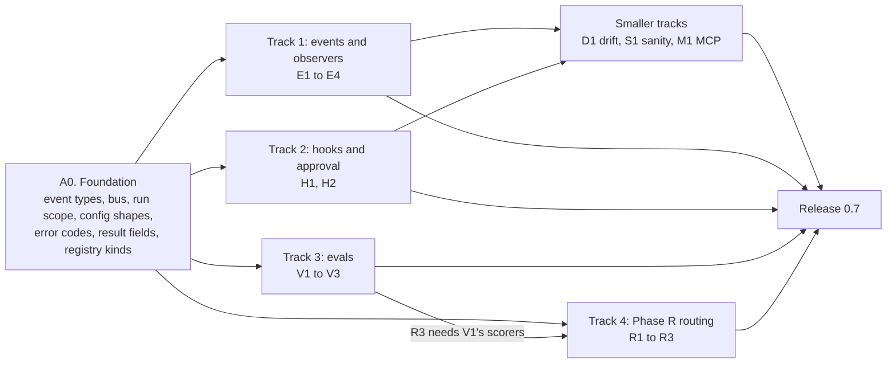
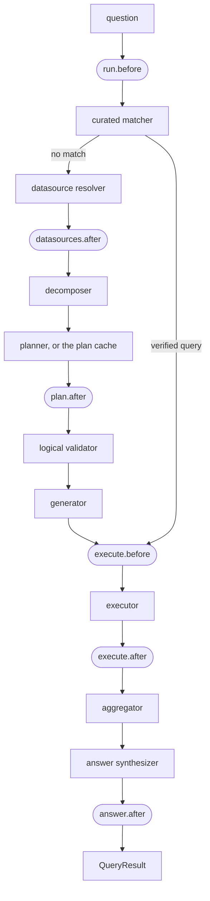
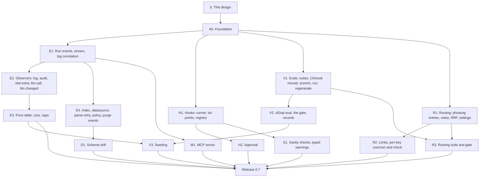

# Wave A: events, observers, hooks, evals and routing (design)

!!! note "Status: design"
    This page is the design for Wave A of the product redesign, which ships
    as release 0.7. Each pull request in
    [the PR plan](#16-pr-plan) adds a "Built" note to the sections it builds,
    as Phase 1 and Phase 2 did; A0, the foundation, and E1 are built. Phase 1 is
    [Configuration v2 and the extension registry](configuration_v2.md);
    Phase 2 is [Phase 2: test bed, storage, providers, policies and adapter
    SDK v2](phase2.md). Wave A is what those pages called "Phase 3", plus
    the cross-database routing work ("Phase R") and three smaller tracks.

## Principles

The owner restated them for Wave A, and they rank above everything below:

- **The package is the product; the playground only demonstrates it.**
  Every capability is a public facade method or an extension point first.
  The CLI, `nl2sql-api`, the playground and the MCP server use the public
  API only, and nothing in this design exists only in one of them.
- **No active users: design it correctly, not compatibly.** No shims, no
  aliases, no deprecation paths. Where a 0.6 shape is wrong, 0.7 replaces it.
- **Never over-engineer.** Ship what 0.7 needs; the cut lists below are part
  of the design.
- **Everything is configurable** in `nl2sql.yaml` (and its section files) or
  in code with dependency injection, **extensible through the registry**,
  and **events and observability apply everywhere**: a question on the
  generated or the verified-query path, an index build, a purge, an LLM swap,
  from the CLI or the server. **Hooks apply to every run**, on both paths;
  there is no hook on an index build in 0.7.

Two older rules shape this wave in particular: *the model emits a typed
plan, never SQL* (it decides how evals are seeded), and *anything the
generator can reject, the validator rejects first* (it decides where the
join-key check and the hook boundary live).

## Decisions

The owner was asleep when this design was written and asked that its
recommendations be used, each marked for confirmation. D9 to D13 were
already on record from the final redesign; D14 onwards are new. Each
decision is written into the section it affects. An independent review of
the first draft (PR #308) changed several of them; those are marked
**amended after review** and are still the owner's to confirm.

| # | Decision | Status | Where |
|---|---|---|---|
| D9 | **Hooks fail closed; observers fail open.** A hook that raises denies, unless that hook is configured `on_error: open`. An observer that raises is logged and skipped; it can never fail a run. | decided overnight, owner to confirm | [Hooks](#6-hooks), [Observers](#4-observers) |
| D10 | **Approval ends the run, and the re-run pins what was approved.** A hook at `execute.before` may answer `needs_approval`; the run ends with status `needs_approval` and an `ApprovalRequest` that carries the decomposition, the sub-query, its validated plan and the SQL's hash, bound to the asker. An approver re-runs the question with an `Approval`; the re-run uses the pinned decomposition and plan, validates and generates again, and compares the SQL's hash. Nothing is queued or stored. | decided overnight, amended after review, owner to confirm | [Approval](#7-approval) |
| D11 | **A dated price table ships in `llm/`;** a model it does not list has a null cost. `llm.prices` in the config adds or overrides rows. | decided overnight, owner to confirm | [Cost and caps](#5-cost-the-price-table-and-per-question-caps) |
| D12 | **Evals use curated answers by default** and record each answer's source; every case a verified query answered is also run with curated answers off, so the report has a generated-only accuracy over every case. Modes `plans` and `retrieval` always run with curated answers off, and mode `full` with the plan cache off, as tier 1 and tier 2 do today. | decided overnight, amended after review, owner to confirm | [Evals](#8-evals-as-a-product) |
| D13 | **No masking at `execute.after` on day one.** After the validator a hook may only allow, deny or ask for approval. | decided overnight, owner to confirm | [Hooks](#6-hooks) |
| D14 | **`Event` and the `Observer` interface live in the SDK** (`nl2sql_sdk.events`, pydantic only), so an observer plugin depends on the SDK alone. `Hook` and `Scorer` live in the engine, because they see engine types (a plan, a `QueryResult`). | decided overnight, owner to confirm | [The event bus](#3-the-event-bus) |
| D15 | **Events never carry result rows, sample values, keys or header values.** They carry the question, SQL, table names and counts; the question and the answer text (`answer.delta`) are carried and may contain values from the data. The full `QueryResult` is never published on the bus: only the stream's own terminal event holds it. | decided overnight, amended after review, owner to confirm | [The catalog](#the-catalog) |
| D16 | **`policy.decision` is published for denials, at the enforcement points only:** the validator's table refusal, the curated matcher's refusal of a verified query, and the resolver's datasource refusal. `Scope` itself publishes nothing, because it is also asked to filter (the retriever, the value check), which would flood the bus with tables nobody asked for. | decided overnight, amended after review, owner to confirm | [The catalog](#the-catalog) |
| D17 | **`stream_query` yields bus `Event`s, from a caller-safe allow-list:** `run.*`, `node.*`, `answer.delta`, `result.manifest`, `sanity.flagged` and `run.limit_reached`. `QueryEvent` and its six type names are deleted, with no alias. Operator events (`policy.decision`, `hook.decision`, `llm.call` and the rest) are reached only through `engine.events.subscribe`. | decided overnight, amended after review, owner to confirm | [The run's stream](#the-runs-stream) |
| D18 | **OpenTelemetry becomes the `otel` extra and an observer.** `settings.observability` is replaced by an `observers:` section; with no section the engine runs `log` and `audit`. | decided overnight, owner to confirm | [Observers](#4-observers) |
| D19 | **The audit log moves under `storage.path`** (`audit/`, JSON lines, 90 days, purged by `engine.storage.purge()`), written by the `audit` observer: one summary line per run (who, which datasources and tables, status, source) plus the denials, approvals, limits and changes. `common/event_logger.py` is deleted (bug B27). | decided overnight, amended after review, owner to confirm | [Built-in observers](#built-in-observers) |
| D20 | **Caps: `max_llm_calls` defaults to 60, `max_cost_usd` to none.** A cost cap with a configured model the price table cannot price is a `ConfigError` when the engine is built. | decided overnight, owner to confirm | [Per-question caps](#per-question-caps) |
| D21 | **The six hook points** are `run.before`, `datasources.after`, `plan.after`, `execute.before`, `execute.after` and `answer.after`. The first three may modify; the last three may not. | decided overnight, owner to confirm | [The six points](#the-six-points) |
| D22 | **No built-in hooks in 0.7.** The docs carry a 30-line example; the tests use fakes. | decided overnight, owner to confirm | [Hooks](#6-hooks) |
| D23 | **Hooks run in config order.** The first deny ends the point; modifications chain, each hook seeing the previous one's output. | decided overnight, owner to confirm | [Hook decisions](#decisions-and-the-runner) |
| D24 | **An approval is bound to the asker and checked by the engine.** The request's id hashes the question, the asker's `user_id` and `tenant_id`, the hook, the datasource, the plan and the SQL's hash; the engine recomputes it, and an approval for another asker or another request is refused. Approvers are the hook's `approver_roles`, by default `policies.admin_roles`. An approved decision counts as `Allow`, and the next hook at the point still runs. An `Approval` is not signed and does not expire: it is trusted exactly as far as the `UserContext` a caller passes is trusted today. | decided overnight, amended after review, owner to confirm | [Approval](#7-approval) |
| D25 | **`engine.evals` only.** No top-level `engine.evaluate` (the top level stays questions only). `engine.benchmark`, `BenchmarkAPI`, `BenchmarkConfig` and `nl2sql benchmark` are deleted. | decided overnight, owner to confirm | [The facade](#the-facade) |
| D26 | **Seeding asks the model for questions and typed plans,** never SQL, five per call, under a cost cap (`max_cost_usd`, by default `evals.yaml`'s). The engine's validator and generator turn each plan into SQL, the adapter runs it read-only, and the case is written with `status: draft`. | decided overnight, amended after review, owner to confirm | [Seeding](#seeding-benchmark-your-own-database) |
| D27 | **`regenerate` runs gold SQL through the datasource's adapter.** `evaluation/gold.py`'s direct `sqlite3` use and its boundary exemption go. | decided overnight, owner to confirm | [Regenerating expected rows](#regenerating-expected-rows) |
| D28 | **Routing fuses five signals with reciprocal rank fusion** (`k = 60`), keeps the top 3, and drops a datasource scoring under half the best. `candidates`, `max_datasources`, `max_sub_queries` and `floor_ratio` are settings; the vote depth and the fusion constant stay constants until a measurement asks for a knob. | decided overnight, amended after review, owner to confirm | [Phase R](#9-phase-r-cross-database-routing) |
| D29 | **A decomposition over `max_sub_queries` ends the run** with `QUESTION_TOO_BROAD`, whose message asks for a narrower question. It is not retried. | decided overnight, owner to confirm | [Limits](#limits) |
| D30 | **Join keys are coerced, not just checked.** The engine's aggregator casts both sides of a join key to the declared `dtype` (in polars, so no dialect is involved), and a value that does not convert is a warning. The validator rejects only categories that cannot be coerced (temporal against number or boolean); an unknown type is not checked. The plan has no `CAST`, so the validator never asks the model for one. | decided overnight, amended after review, owner to confirm | [The join-key type check](#the-join-key-type-check) |
| D31 | **Structural diffs are stored with the new version** in the state store (store interface version 2). A rename is reported as a drop and an add. `index.check()` never re-indexes. | decided overnight, owner to confirm | [Schema drift](#10-schema-drift-measure-first) |
| D32 | **Sanity checks:** a missing filter value with a close match, and a confirmed fan-out under `COUNT` (repairable as `COUNT(DISTINCT ...)`), are retried once. A fan-out under `SUM` or `AVG` (the plan has no derived tables to repair it), an all-null column, a missing value with no close match, and any check with no retry left are warnings. Many-to-many sums are one case of `JOIN_FAN_OUT`, not a code of their own. | decided overnight, amended after review, owner to confirm | [Answer sanity checks](#11-answer-sanity-checks) |
| D33 | **MCP is stdio only in 0.7,** behind the `mcp` extra; the caller's role comes from `nl2sql mcp --role`, by default `policies.default_role`, and with neither the server refuses to start. `engine.datasources.schema()` requires a `user_context` and hides denied tables (bug B29); there is no default admin view. | decided overnight, amended after review, owner to confirm | [MCP server](#12-mcp-server-stdio) |
| D34 | **`QueryResult.warnings` is typed** (`RunWarning`: `code`, `node`, `message`, `sub_query_id`, `detail`), replacing the list of dicts. It lands with the sanity checks (S1), the PR that adds warnings, not in the foundation. | decided overnight, amended after review, owner to confirm | [Answer sanity checks](#11-answer-sanity-checks) |
| D35 | **The first PR adds the shared shapes, and only those:** the SDK's `Event` and `Observer`, the bus, the catalog, `RunScope` with its publish slots, the registry kinds, the config shapes, the error codes, the new `status`, `stop` and `approvals_needed` result fields, and stub `engine.events` and `engine.evals` namespaces. The parallel PRs then never edit `config/models.py`, `common/errors.py`, `events/run.py` or `public_api.py`'s namespace list; the overlaps that remain are listed in the PR plan. | decided overnight, amended after review, owner to confirm | [PR plan](#16-pr-plan) |

## Where 0.6 leaves us

| Area | What 0.6 has | What is still wrong |
|---|---|---|
| Events | `stream_query` yields six `QueryEvent` types from a LangChain callback (`pipeline/events.py`). Phase 2 returns, but does not publish, the data for six more (phase2.md, section 9). | No bus. Nothing outside a streamed question can observe the engine: an index build, a purge, an LLM swap. |
| Logs | `TraceContextFilter` and `trace_context()` in `common/logger.py` | `trace_context()` is never called, so every log line's `trace_id` is null (the rest of bug B14). |
| OpenTelemetry | Three instruments in `common/metrics.py`; `configure_metrics` | Configured only in `cli/commands/run.py`, so `nl2sql-api` and the playground never export. `opentelemetry` is a hard dependency, loaded by the runtime through `pipeline/plan_cache.py` and `services/callbacks/token_handler.py` (B14). |
| Audit | `common/event_logger.py`: one `llm.changed` record per LLM swap | A module-global logger that creates `logs/audit_events.log` in the process's working directory (B27). |
| Cost | `TokenUsageCallback` prices calls from `llm.prices`, which is empty by default; `evaluation/prices.py` holds a dated table that only tier 2 reads | A run's `usage.cost` is null unless the user writes prices (B28). No cap on a question's cost or calls. |
| Hooks | None | Nothing can veto or rewrite a step, or ask for a person's approval. |
| Evals | `engine.benchmark`: tier 1 (gold plans, fake LLM), tier 2 (real model, dollar cap, baseline gate), retrieval recall; `chinook_gold.yaml`; `nl2sql benchmark` | Chinook only, one fixed file shape, no scorer interface, gold rows produced with `sqlite3` outside the adapter, and no way to build a gold set for your own database. Curated answers are off by default in tier 2. |
| Routing | One `schema.datasource` index entry per datasource (description, domains and every sample question in one text); `retrieve_datasource_candidates(k=5)`; the answerability verdict already returns a list | One phrasing dilutes the others; tables and columns never vote; no fusion, no floor, no limit on datasources or sub-queries; `TABLE_K`, `PLANNING_K` and `k=5` are constants; join keys across datasources are not type-checked. |
| Drift | Immutable snapshots with a structural fingerprint (`schema/fingerprint.py`), the last `max_versions` kept, the plan cache keyed on `schema_version` | Health is `stale` only without a build or after a `curated.yaml` change. Nothing compares the live database with the build, and no diff between versions exists. |
| Sanity | `VALUE_NOT_FOUND`: an empty result filtered on a value its column lacks (`executor/value_check.py`), retried once with the closest values | Nothing catches join fan-out, sums over many-to-many joins, or all-null columns. Warnings are untyped dicts. |
| MCP | None | |

## 1. Goals and non-goals

### What ships in 0.7

| Goal | What it means |
|---|---|
| **An event bus** | Synchronous and in process. Typed events for a run and its steps, model calls, hook and policy decisions, index builds, drift, purges, LLM swaps and evals. `engine.events.subscribe()`; `stream_query` yields the run's events, each ready to send as a Server-Sent Event. |
| **Observers** | A registry kind (`nl2sql.observers`). Built-in `log` (correlated: every line carries its `trace_id`), `audit` and `otel` (the `otel` extra). `import nl2sql` loads no `opentelemetry`. Observers fail open. |
| **Cost and caps** | A dated price table in `llm/`. A cap on each question's cost and on its model calls, ending the run as `stopped` with a typed reason. |
| **Hooks** | Six points through a run, a registry kind (`nl2sql.hooks`), fail closed with a per-hook `on_error: open`. Modify before the validator, deny only after it, held by an architecture test. |
| **Approval** | A run that ends `needs_approval`, and a re-run that carries the approval. |
| **Evals as a product** | `engine.evals`, `evals.yaml` and suite files, five scorers behind a `Scorer` interface (`nl2sql.scorers`), `regenerate` through the adapter, the regression gate, `nl2sql eval`, and seeding a draft gold set from your own database. The Chinook gold set moves over unchanged. |
| **Phase R** | Routing on one entry per example phrasing, table and column votes and reciprocal rank fusion; up to 3 datasources and 6 sub-queries per question; retrieval limits as settings; join keys coerced in the aggregator and checked in the validator; routing evals beyond Chinook as the gate. |
| **Schema drift, measured** | `engine.index.check()` and `nl2sql index --check`, a stored structural diff per version, its impact on verified queries and policies, and a `schema.drifted` event. |
| **Answer sanity checks** | Join fan-out, many-to-many sums, all-null columns and missing filter values, as typed warnings or one retry. |
| **An MCP server** | `nl2sql mcp` over stdio with `ask`, `list_datasources` and `describe_table`, on the public facade only. |

### Not in Wave A

| Later | Why it waits |
|---|---|
| Hooks on every event; an async bus; a stored event log; webhooks; `/metrics` | Cut from the final design. Observers cover what an event is for; a stored log and webhooks are a product of their own. |
| Masking result values at `execute.after` | D13: deny first, masking once deny is proven |
| A hook on an index build | No use for one yet; events cover observing a build |
| Repairing a `SUM` or `AVG` fan-out | The plan has no derived tables; splitting the question in the decomposer is a Wave B idea (D32) |
| Approval expiry | D24: nothing is stored, so there is nothing to expire |
| An approval queue, signed approvals | D10, D24: the run ends and is asked again; nothing is stored |
| Pluggable result comparators, a built-in LLM judge, an eval scheduler, a leaderboard UI | Cut from the final design. A scorer plugin can do the first two. |
| Automatic re-indexing on drift, scheduled checks | Drift is measured first (owner) |
| MCP over HTTP with auth | Wave C |
| REST routes for evals, approval and drift | Wave D (API parity) |
| Glossary, knowledge sources, clarification results | Wave B; see the preview at the end of this page |

## 2. Order of work

One foundation PR, then four tracks that touch different files, then
three smaller tracks for whichever agent frees up first.



## 3. The event bus

### The event

```python
# nl2sql_sdk.events (pydantic and the standard library only, D14)
class Event(BaseModel):
    model_config = ConfigDict(frozen=True)
    name: str                    # "node.finished", from the catalog
    at: datetime                 # UTC
    trace_id: str | None = None  # the run's id; None for an engine event (an index build)
    tenant_id: str | None = None
    data: dict[str, Any] = {}    # JSON-ready; the catalog's model for this name, dumped

    def sse(self) -> str:        # "event: <name>\ndata: <json>\n\n"
        ...

class Observer(Protocol):
    interface_version: ClassVar[int]           # 1
    config_model: ClassVar[type[BaseModel]]
    events: ClassVar[frozenset[str] | None]    # the names it wants; None means every event
    @classmethod
    def from_config(cls, cfg: BaseModel, *, folder: Path) -> "Observer": ...   # folder: storage.path
    def on_event(self, event: Event) -> None: ...
    def close(self) -> None: ...
```

`trace_id` is the name the facade already uses for a run (`QueryResult.trace_id`,
`engine.traces.get`, `engine.results`), so an event, a log line, a trace and
a result page all join on one value.

### The bus

```python
# nl2sql/events/bus.py
class EventBus:
    def subscribe(self, fn: Callable[[Event], None], names: Iterable[str] | None = None,
                  *, fail: Literal["open", "raise"] = "open") -> Subscription: ...
    def publish(self, name: str, data: BaseModel | Mapping[str, Any] = {}, *,
                trace_id: str | None = None) -> Event: ...
    def close(self) -> None: ...               # closes every observer it built
```

| Rule | Detail |
|---|---|
| **Synchronous, in process** | `publish` calls each subscriber in subscription order, on the publishing thread, and returns. There is no queue and no worker. A slow observer slows the run; the docs say so, and `otel` exports in its SDK's own background thread. |
| **One bus per engine** | `Runtime.bus`, built with the runtime. Two engines in one process share nothing (the invariant *An Engine Owns Its Config*). |
| **Observers fail open (D9)** | An exception from a subscriber is caught, logged once per subscriber and event name at WARNING, and counted (`EventBus.failures`). The bus never raises into the engine. The internal run collectors subscribe with `fail="raise"`, because a broken collector is an engine bug a test must see. |
| **Thread safety** | Sub-queries run on LangGraph's worker threads, so `publish` is called concurrently. The bus holds its subscriber list immutably (copy on subscribe); an observer that keeps state locks it. |
| **Checked names** | `publish` refuses a name the catalog does not list (a `ValueError`: an engine bug), and validates `data` against the name's model. A test scans every `publish("...")` call site for catalogued names. |

**Engine events go through `ctx.bus`.** Code that runs outside a question
(an index build, `storage.purge`, `replace_llm`, `index.check`, a
datasource check, an eval run) publishes with `ctx.bus.publish(...)`
explicitly; it always holds the runtime.

**Run events go through the run's scope.** A `RunScope`
(`nl2sql/events/run.py`) is the life of one question on the bus. Where it
sits follows from the code as it is:

1. **It is opened by the caller that builds the result:** `QueryAPI.run_query`
   and `stream_query`, and the eval runner. `run_with_graph` returns graph
   state; the `QueryResult` is built afterwards by `result_from_state` in
   `QueryAPI` (`api/query_api.py`), so only there can `run.finished` be
   published with the result's summary. The scope makes the run's `trace_id`
   and hands it to `run_with_graph`, which puts it in `GraphState`.
2. **Its context is entered inside the worker.** `run_with_graph` submits the
   graph to its own `ThreadPoolExecutor` with the caller's
   `copy_context()` (`pipeline/runtime.py`; 0.6 submitted it without one),
   so the worker inherits the caller's context variables (a request's keys,
   the run's pinned LLM set), and `policy_engine.run()` is entered inside
   `_invoke`. The scope's context variables (the `trace_id`, the
   `tenant_id` and the scope itself) are entered there too, beside it;
   LangGraph's own worker threads then inherit them, as they already inherit
   `current_datasource_id`. Code deep in a run (the structured-output retry
   in `llm/wires/`, the hook runner, the budget, the enforcement points)
   publishes with the module function `nl2sql.events.publish(name, data)`,
   which reads the scope from the context and is for code inside a
   `RunScope` only: outside one it does nothing. The same context variable
   is what `TraceContextFilter` reads, which fixes the null `trace_id` on
   every log line (B14).
3. **It closes exactly once.** `run.finished` (with the summary) when
   `QueryAPI` has the result, or `run.failed` when `run_with_graph` raised or
   the result could not be built. Both are published on the bus, so the
   audit observer and the `otel` run span see a crashed run too.
4. **A closed scope drops what comes after.** A timed-out run is answered
   while its graph winds down in the background (`run_with_graph`'s
   `TimeoutError` branch); the `llm.call` and `node.*` events it publishes
   after `run.finished` are dropped and counted (`RunScope.late_events`), so
   no observer sees a run continue after it ended. The usage in
   `run.finished` is what was spent until the answer; the docs say a
   timed-out run may spend a little more.

`RunScope` is also where the run-scoped pieces attach and detach
(`RunScope.attach`): the stream's queue, the usage collector, the budget, and
the trace's event list. It is the one place later PRs plug a run-scoped
piece into, so they do not each edit `run_with_graph` or `QueryAPI`.

### The catalog

`nl2sql/events/catalog.py` lists every event the engine publishes, with a
pydantic model for its `data`. `engine.events.catalog()` returns it (name,
description, the data's JSON Schema), so an observer author and the docs page
read the same list. Events never carry result rows, sample values, keys or
header values (D15); the question and the answer text are carried and may
contain values from the data. `test_no_bus_event_carries_rows` runs a demo
question with a capturing subscriber and checks that no `rows` key appears at
any depth of any event.

**Run events** (they have a `trace_id`):

| Name | Data | Published by |
|---|---|---|
| `run.started` | `question`, `user_id`, `tenant_id`, `roles`, `datasource_id`, `execute` | `RunScope`, when it opens |
| `run.finished` | A summary, never rows: `status` (`success`, `plan_only`, `error`, `needs_approval`, `stopped`), `duration_s`, `usage` totals with `cost`, `error_codes`, `source` (`verified`, `generated`), `datasources` used, `tables` read (`datasource.schema.table`), `result_manifest`, `user_id`, `roles` | `RunScope`, once, last |
| `run.failed` | `message`, `error_code` | `RunScope`: the run could not start, or crashed outside the pipeline (today's stream `error` event) |
| `node.started` | `node`, `sub_query_id` | The LangChain callback in `pipeline/events.py` |
| `node.finished` | `node`, `sub_query_id`, `seconds`, `ok` | The same |
| `answer.delta` | `field` (`summary`, `content`), `text` | The same |
| `result.manifest` | `results` (`ResultSummary` list: columns, row counts, truncated) | The same, after the aggregator |
| `llm.call` | `node`, `agent`, `model`, the six token counts, `latency_s`, `cost`, `usage_reported`, `error` (redacted) | `TokenUsageCallback`, per finished call |
| `llm.parse_retry` | `agent`, `schema`, `attempt`, `errors` (validation messages only) | `structured()` in `llm/wires/__init__.py` (phase2.md, section 9) |
| `plan_cache.lookup` | `datasource_id`, `hit` | `pipeline/plan_cache.py` (replaces its OpenTelemetry counter) |
| `policy.decision` | `datasource_id`, `schema`, `table` (None for a datasource), `rule`, `step`; denials only (D16) | The enforcement points only: `LogicalValidatorNode._validate_policy`, `CuratedMatcherNode._check_access` and the resolver's datasource refusal (phase2.md, section 9) |
| `hook.decision` | `hook`, `point`, `decision` (`allow`, `modify`, `deny`, `needs_approval`, `approved`, `error`), `reason`, `sub_query_id`, `approver` (for `approved`), `seconds` | The hook runner |
| `run.limit_reached` | `limit` (`max_cost_usd`, `max_llm_calls`), `value`, `spent` | The budget |
| `sanity.flagged` | `code`, `sub_query_id`, `retry` | The sanity checks |

**Engine events** (no `trace_id`, except where a run caused them):

| Name | Data | Published by |
|---|---|---|
| `datasource.failed` | `datasource_id`, `stage`, `message`, `fix` | `Runtime.check_datasource` and `try_datasource` (phase2.md, section 9) |
| `index.started` | `datasource_id`, `namespace` | `indexing/rebuild.py` |
| `index.column_failed` | `datasource_id`, `table`, `column`, `stage`, `message` | the orchestrator, one per `IndexIssue` (phase2.md, section 9) |
| `index.swapped` | `datasource_id`, `namespace`, `build_id`, `schema_version`, `replaced_build_id`, `replaced_schema_version`, `counts` | `IndexingOrchestrator._commit` (phase2.md, section 9) |
| `index.failed` | `datasource_id`, `reason` | `indexing/rebuild.py` |
| `schema.drifted` | `datasource_id`, `from_version`, `to_version` (None for the live database), `detected_by` (`check`, `build`), the diff's counts | `index.check()` and the orchestrator |
| `retention.purged` | counts per slot | `engine.storage.purge()` (phase2.md, section 9) |
| `llm.changed` | `by`, `changes` (old and new provider and model per agent; never a key) | `Runtime.replace_llm` (configuration_v2.md, section 7) |
| `eval.case` | `suite`, `case_id`, `role`, `pass`, `source`, `scores`, `cost` | `engine.evals.run` |
| `eval.finished` | `suite`, `cases`, `accuracy`, `accuracy_generated`, `cost`, `gate` | `engine.evals.run` |

### The run's stream

`engine.stream_query` yields `Event`s (D17). `QueryEvent`, its `type`
literal and the names `node_started`, `node_finished`, `result_manifest`,
`answer_delta`, `final` and `error` are deleted. `event.sse()` is the event
as one Server-Sent Event, which is all `nl2sql-api`'s `POST /query/stream`
sends.

**The stream is the caller's, so it carries only what the caller may see.**
It yields its own run's events from an allow-list, in publish order:
`run.started`, `node.started`, `node.finished`, `answer.delta`,
`result.manifest`, `sanity.flagged`, `run.limit_reached`, and then exactly one
of `run.finished` or `run.failed`. `policy.decision` would tell a denied user
which table exists (the validator names no table unless
`policies.refusal_names_tables` is set, for exactly that reason), and
`hook.decision` and `llm.call` are operator data (hook names and reasons,
models and cost). Those reach an operator through `engine.events.subscribe`
only. `test_stream_never_yields_policy_or_hook_or_llm_call_events` holds it.

**The terminal event holds the result, on the stream only.** The stream's
`run.finished` is the bus event's summary plus `data.result`, the
`QueryResult` as JSON (as `final` holds it today). `QueryAPI` adds the result
to the stream's copy; the event published on the bus never has it (D15).

| 0.6 | 0.7 |
|---|---|
| `QueryEvent(type="node_started", data={"node"})` | `Event(name="node.started", data={"node", "sub_query_id"})` |
| `answer_delta` | `answer.delta` |
| `result_manifest` | `result.manifest` |
| `final` (the `QueryResult` as JSON) | `run.finished`, whose `data.result` is the `QueryResult` as JSON (stream only) |
| `error` | `run.failed` |
| (none) | `run.started`, `sanity.flagged`, `run.limit_reached` |

The CLI's `nl2sql run`, the playground and `nl2sql-api` move to the new
names in the same PR.

### The facade

| Method | What it does |
|---|---|
| `engine.events.subscribe(fn, names=None) -> Subscription` | A function (or an `Observer`) called for every event, or for `names`: the operator's view of every run and of the engine. `Subscription.close()` detaches it. Fails open. |
| `engine.events.catalog() -> list[EventInfo]` | Every event name, its description and its data's JSON Schema |
| `engine.stream_query(...) -> Iterator[Event]` | As above |

`Event` is exported from `nl2sql` (from `nl2sql_sdk.events`, lazily).

!!! note "Built: the event, the bus, the catalog and the run scope (A0)"
    `nl2sql_sdk/events.py` holds `Event` (with `sse()`, whose `data` line is
    the whole event as JSON) and the `Observer` protocol. `nl2sql/events/`
    holds `EventBus` (`bus.py`; `publish` also takes `tenant_id`), the catalog
    with a strict model per event and `catalog()` returning `EventInfo`
    (`catalog.py`, which also defines `RunStatus`), and `RunScope`,
    `current_scope()` and the module `publish` (`run.py`). `Runtime.bus` is
    built with the runtime and closed with it. `QueryAPI.open_scope(question,
    datasource_id=, execute=, user_context=)` makes the scope, with the run's
    usage collector, and calls `start()` (which publishes `run.started`);
    `QueryAPI.close_scope(scope, result)` closes it with
    `finish(result, tables=...)`, or `fail(message, code)` when the summary
    cannot be built, and a `result` built without a graph run is accepted.
    `run_query` and `stream_query` open their own scope, or take an open one
    as `scope=` (internal; Wave C's turn opens it before its rewrite call) and
    close it. `RunScope.callbacks()` is the usage collector and the LangChain
    handlers attached (the budget, from E3): a model call made in the run
    but outside the graph passes them, inside `entered()`, so it counts in
    the run's `usage` and carries its `trace_id`. `run_with_graph` takes
    `scope=`, uses its `trace_id` and its usage collector, enters it beside
    `policy_engine.run()` in `_invoke` (submitted with the caller's
    `copy_context()`) and adds its `callbacks()` to the graph's. That is all
    of Wave C's A2 need ([wave_c.md](wave_c.md)); E1 keeps `scope=` when it
    moves `stream_query` to `Event`s. The
    scope sets the context `TraceContextFilter` reads, so log lines written
    during a run carry its `trace_id` and `tenant_id`. `attach` takes a
    function or an object with `on_event` (subscribed to this run's events
    with `fail="raise"`), a LangChain callback handler (added to the
    graph's callbacks) and anything with `close` (closed with the scope);
    a closed scope refuses `attach` with `RuntimeError`. Closing detaches
    every subscription and calls every `close` even when an attached piece
    raised on the terminal event. `run_query` and `stream_query` close the
    scope with `run.failed` on any `BaseException` (a `KeyboardInterrupt`
    too) and re-raise it. The scope holds its lock while the bus delivers
    each of its events, so `run.finished` is always last; the cost is that
    a run's events reach subscribers one at a time and `finish` (a timed-out
    run's too) waits for the delivery in flight, so an observer must never
    block (the `Observer` and `RunScope` docstrings say so; E2's `audit` and
    `otel` hand slow work to a queue). `run.finished`'s `usage` and
    `result_manifest` copy only the catalog models' own fields, so a field
    added to `UsageTotals` or `ResultSummary` never fails a run.
    `run.finished`'s `tables` come from each sub-query's plan, or a verified
    query's SQL, as `datasource.schema.table`. `engine.events` and
    `engine.evals` are empty namespaces; E1 adds `subscribe` and `catalog`.

!!! note "Built: run events, the stream and `engine.events` (E1)"
    `pipeline/events.py`'s `RunEvents(publish)` is a LangChain callback that
    publishes `node.started`, `node.finished` (each with its
    `sub_query_id`, from the sub-query subgraph's `subgraph_id` and inherited
    by the runs inside it), `result.manifest` (`results` only; the event's
    `trace_id` is the `request_id`) and `answer.delta`. `QueryAPI.open_scope`
    attaches one to every scope (`scope.attach(RunEvents(scope.publish))`),
    so every run publishes its steps, streamed or not, and
    `scope.callbacks()` is now the usage collector, the `RunEvents`, then
    whatever was attached. `QueryEvent` is deleted, with its export.
    **The allow-list is one definition:** each catalog entry (`EventSpec`)
    has `stream` and `audit` flags, and `nl2sql.events.STREAM_EVENTS` (D17)
    and `AUDIT_EVENTS` (D19, which E2's `audit` observer reads; of
    `hook.decision` it keeps the decisions the entry's description names)
    are derived from them; `EventInfo` reports both. A later event joins a
    list by its own catalog entry (Wave B's events stay off the stream). The
    stream: `QueryAPI.stream_query(..., scope=None, names=STREAM_EVENTS)`
    yields `Event`s. `RunScope.follow(fn, names)` replays what the scope
    already published (`RunScope.events`, a new list of every event the
    scope published, in order) and attaches `fn`, both under the scope's
    lock, so an event published meanwhile is neither lost nor doubled; the
    stream follows its scope with `names` minus `run.finished`, and puts its
    own `run.finished`: the summary
    `close_scope` (which now returns the published event) returned, plus
    `data.result`. So a scope opened before the stream (Wave C's turn, need
    A2) still gives the stream its `run.started` and anything the turn
    published in it, and `names` (internal) is where Wave C's
    `conversations.stream` adds `conversation.rewritten` (need A4); it
    appends `conversation.turn` after the stream's `run.finished` itself.
    The stream ends with exactly one terminal event whatever breaks: when
    no `run.failed` reached it (the scope could not open, was already
    closed, or a collector raised on its terminal event), it ends with a
    `run.failed` built in place, with the scope's `trace_id` when there is
    a scope. A `KeyboardInterrupt` ends it the same way. `scope=` is kept on
    `run_query` and `stream_query`; a closed `scope=` is a `ValueError` at
    the call. `engine.events.subscribe(fn, names=None)` subscribes to
    `Runtime.bus` (fail open) and `catalog()` returns `catalog()`. The trace
    document has `events` (the scope's events but `answer.delta`); since
    `run_with_graph` writes the trace before `run.finished` is published,
    the list ends before it. That reads `scope.events` in
    `pipeline/runtime.py` (one argument to `write_run_trace`), not
    `tracing/recorder.py`, a small difference from the file list above.
    `nl2sql run`, the playground (`app.py` and `web/playground/src/stream.js`,
    rebuilt) and `nl2sql-api`'s stream route read the new names; each SSE
    `data` line is the whole event. The invariant *Events Carry No Rows, and
    the Stream Carries No Operator Data* is in `invariants.md`.

## 4. Observers

### The registry kind and the config

| Kind | Entry point group | Interface | Version | Built-ins |
|---|---|---|---|---|
| observer | `nl2sql.observers` | `nl2sql_sdk.events.Observer` | 1 | `log`, `audit`, `otel` |

`registry.add_observer(name, cls)`, `@registry.observer(name)`. An observer is
"attached, many" (configuration_v2.md, section 6): the config lists any number.

```yaml
# nl2sql.yaml
observers: observers.yaml

# observers.yaml
- type: log
  level: INFO                     # node.started and answer.delta are logged only at DEBUG
- type: audit
  max_age_days: 90
- type: otel                      # needs nl2sql-engine[otel]
  endpoint: http://collector:4317
  metrics: true
  traces: true
- type: corp_siem                 # a plugin; its config_model checks the rest
  url: "${env:SIEM_URL}"
```

```python
from nl2sql import Config, ObserverConfig
Config(..., observers=[ObserverConfig(type="log"), MyObserver()])   # a {type: ...} block or an object
```

| Rule | Detail |
|---|---|
| **No section** | `observers` absent means `[{type: log}, {type: audit}]` (D18). `observers: []` means none. |
| **Objects skip the registry** | As every other kind: an `Observer` object is used as given. |
| **Validation** | `type` is resolved and the block validated by the observer's `config_model` at `NL2SQL(...)`, with the usual "did you mean". `otel` without the extra installed is a `ConfigError` naming `pip install "nl2sql-engine[otel]"`. |
| **Built when the engine is** | Subscribed to `Runtime.bus` in config order, and closed by `engine.close()`. |
| **`settings.observability`** | Deleted. `exporter: otlp` and `otlp_endpoint` become an `otel` block. Its two readers go with it in A0: `cli/commands/run.py` (`configure_metrics`) and `cli/common/engine.py` (JSON logs under `otlp`). Between A0 and E2 nothing exports to OpenTelemetry; no release falls in between. |

!!! note "Built: the observer kind and the section (A0)"
    The `observer` registry kind (`add_observer`, `@registry.observer`) and
    the `observers` section (`ObserverConfig`, or an object with
    `on_event`) are accepted and validated; nothing builds an observer yet
    (E2). `Config.observers` is `None` when the section is absent, which E2
    reads as `log` and `audit`. `settings.observability` and its readers
    (`nl2sql run`'s `configure_metrics`, the CLI's and `nl2sql-api`'s switch
    to JSON logs) are gone. `nl2sql --log-format text|json` and
    `NL2SQL_LOG_FORMAT` choose the log format; `configure_logging(json_format=None)`
    reads the variable.

### Built-in observers

| Observer | What it does | Keys |
|---|---|---|
| `log` | One log line per event on logger `nl2sql.events`: the name and a short summary of `data`. `node.started` and `answer.delta` are logged only when `level` is `DEBUG`, so the default adds about one line per step, not one per token. The `trace_id` reaches the line through the context, so with `configure_logging(json_format=True)` every line, the engine's own included, carries it. | `level` (`INFO`), `events` (a list; by default all but the two above) |
| `audit` | JSON lines in `<storage.path>/audit/<date>.jsonl`. One summary line per `run.finished` and `run.failed` (`trace_id`, user, roles, datasources, tables read, status, source; never rows), so the log answers "who read `payroll.salaries`" without a line per allowed table. And one line per `llm.changed`, `hook.decision` with `deny`, `needs_approval`, `approved` or `error`, `policy.decision`, `run.limit_reached`, `index.swapped`, `retention.purged` and `schema.drifted`. Replaces `common/event_logger.py` (B27, D19). `engine.storage.purge()` deletes files older than `max_age_days`. | `max_age_days` (90, at least 1) |
| `otel` | Metrics: `nl2sql.node.duration`, `nl2sql.token.usage` and `nl2sql.plan_cache.lookups` (as today, from `node.finished`, `llm.call` and `plan_cache.lookup`), and `nl2sql.run.cost`. Traces: one span per run (`run.started` to `run.finished`) with a child span per node, keyed by `trace_id` and `sub_query_id`. Sets its own `MeterProvider` and `TracerProvider` for its exporter rather than the process-global ones, so two engines can export to two collectors. | `endpoint` (`http://localhost:4317`), `exporter` (`otlp`, `console`), `metrics`, `traces`, `service_name` (`nl2sql`) |

`opentelemetry-api`, `-sdk` and `-exporter-otlp` move from the engine's
dependencies to the `otel` extra. Only `nl2sql/observers/otel.py` imports
them, and only when the observer is built. `common/metrics.py` is deleted:
`plan_cache.py` and `token_handler.py` publish events instead of adding to
counters.

### The run collectors

Three things the engine already builds for every run become run-scoped bus
subscribers attached by `RunScope`, not configurable observers, since the
result depends on them:

| Collector | Fills | Today |
|---|---|---|
| Usage | `QueryResult.usage` (tokens, calls, cost) and the budget | `TokenUsageCallback` keeps its LangChain hooks (the only place usage is visible) and publishes `llm.call` (E2, which deletes the OpenTelemetry counter it fed); the roll-up reads the events (E3) |
| Timings | `QueryResult.timings` | `NodeTimingCallback`, from `node.finished` |
| Trace | The trace document's new `events` list (every run event but `answer.delta`) | `TraceRecorder` keeps the per-node records; the events are added beside them |

### Logs with correlation (B14)

- `RunScope` sets the run's `trace_id` and `tenant_id` in the context
  variables `TraceContextFilter` reads; `stream_query`'s thread already
  copies the caller's context, and so does every LangGraph worker.
- `configure_logging` stays an entry point's call (`nl2sql`, `nl2sql demo`,
  `nl2sql-api`, `nl2sql mcp`), as the invariant on process globals says:
  logging handlers are global by nature. It installs the filter on its
  handler, as today. A library caller who configures logging their own way
  adds `nl2sql.TraceContextFilter` to their handler; the docs say so.
- `cli/common/engine.py` stops switching to JSON logs when OpenTelemetry is
  configured; `--log-format json` (and `NL2SQL_LOG_FORMAT`) chooses it for
  any command. `NL2SQL_LOG_FORMAT` joins `READS_THE_ENVIRONMENT`.

!!! note "Built: log correlation (E1)"
    `run_query` and `stream_query`'s thread run inside `scope.entered()` as
    well as the graph's worker, so every log line written during a run, on
    the caller's thread or a LangGraph worker thread, carries its `trace_id`
    and `tenant_id` (`test_every_log_line_in_a_run_has_its_trace_id`,
    `test_log_lines_on_worker_threads_have_the_trace_id`).
    `docs/observability/events.md` shows a library caller adding
    `TraceContextFilter`.

## 5. Cost, the price table and per-question caps

### The price table

`evaluation/prices.py` moves to `nl2sql/llm/prices.py` (D11). It keeps its
shape: `PRICES_CHECKED_ON`, and per model `input`, `cached_input`,
`cache_write`, `output` (USD per million tokens), `verified` and `source`.

```python
# nl2sql/llm/prices.py
PRICES_CHECKED_ON = "2026-09-21"
PRICES: dict[str, ModelPrice] = {...}            # dated and sourced; updated by hand

def price_for(model: str, overrides: Mapping[str, Price]) -> ModelPrice | None:
    """The config's llm.prices row, else the table's, by exact name; None when neither has it."""
```

| Rule | Detail |
|---|---|
| **Overrides** | `llm.prices` (Phase 1's field) adds a model or replaces a row. A negotiated rate or a fine-tune goes there. |
| **Exact names** | No prefix matching (`gpt-5.4` must not price `gpt-5.4-mini`). A call is priced by the model name the provider reported, then by the name configured, as `token_handler._cost` does today, so a dated variant the provider reports (`gpt-5.4-2026-03-05`) is priced by its configured name. |
| **Unknown model** | Cost `None`, for the call and for any total that includes it. Never zero. |
| **Facade** | `engine.llm.prices()` returns the effective table: `checked_on`, each row with its `source` (`table` or `config`), so a UI can show "prices as of 2026-09-21". |

Evals keep tier 2's rule: a run with `max_cost_usd` refuses to start if a
model it would call has no price.

### Per-question caps

```yaml
# settings.yaml
pipeline:
  timeout_s: 60
  max_llm_calls: 60       # model calls per question, parse retries included; null: no cap
  max_cost_usd: 0.50      # dollars per question; null (the default): no cap
```

| Rule | Detail |
|---|---|
| **Defaults (D20)** | `max_llm_calls: 60`, `max_cost_usd: null`. 60 covers the largest legitimate run: resolver, decomposer, six sub-queries each with a planner call and three refiner and planner retries, the answer, and parse retries. |
| **Enforced before each call, through the token** | The budget is a run-scoped callback (`nl2sql/limits.py`, attached by `RunScope`). On `on_chat_model_start` it compares the usage collector's totals with the caps. When the next call would exceed the call cap, or the spent cost has reached the cost cap, it **cancels the run's `CancellationToken` with a reason**, `RunStop(limit, value, spent)`, and then raises, as `_StopWhenCancelled` does. Raising alone is not enough: the nodes wrap their model calls in `except Exception` (the planner turns any failure into a retryable `PLANNING_FAILURE`, and the decomposer and answer synthesizer catch too), so the raise would be retried and end as a planner error. The cancelled token is what ends it: the SQL agent's routers check it before every retry and end the sub-query, and `_StopWhenCancelled` refuses every later step and call. `CancellationToken.cancel(reason=None)` gains the optional reason. |
| **Overshoot** | The call in flight finishes, so a run can overshoot the cost cap by the calls in flight: at most one per running sub-query. The docs say so. |
| **A cap needs prices** | With `max_cost_usd` set, every model the config names must have a price; otherwise `NL2SQL(...)` raises a `ConfigError` listing them, with the fix "add llm.prices.<model>". Since a call falls back to its configured name, every call of such an engine is priced. |
| **How the run ends** | `run_with_graph` already maps a cancelled token to its `cancelled` outcome; a token cancelled with a `RunStop` reason maps instead to `QueryResult.status = "stopped"`, `QueryResult.stop = RunStop(limit, value, spent)`, an error `RUN_LIMIT_REACHED` (not retryable) whose message names the limit and the setting, and the answer "This question reached its limit of 60 model calls (settings.pipeline.max_llm_calls)." `run.limit_reached` is published, and the audit observer records it. `test_cap_hit_inside_the_planner_ends_stopped_not_planning_failure` holds it. |
| **Evals** | An eval run's own `max_cost_usd` is across the run, as tier 2's is; the per-question caps apply inside it too. |

## 6. Hooks

A hook is code the operator registers that sees a run at fixed points and
may let it continue, change what it carries, stop it, or ask for approval.
No hook ships built in (D22).

### The six points



| Point | When | The hook sees | It may answer | Called from |
|---|---|---|---|---|
| `run.before` | Once, before the first step | `question`, `user`, `datasource_id`, `execute` | allow, modify (`question`), deny | `run_with_graph`'s `_invoke` in `pipeline/runtime.py`, before `graph.invoke` (the events package never depends on hooks) |
| `datasources.after` | The resolver chose its datasources, before the decomposer | + `datasource_ids` | allow, modify (`datasource_ids`: a subset only), deny | `DatasourceResolverNode` |
| `plan.after` | Per sub-query and attempt: a plan from the planner or the plan cache, before the validator | + `sub_query`, `plan` | allow, modify (`plan`), deny | `ASTPlannerNode`, on both paths |
| `execute.before` | Per sub-query: validated, generated SQL, or a verified query's SQL with its bound values, before the adapter runs it | + `datasource_id`, `sql`, `params`, `tables` | allow, deny, needs_approval | `ExecutorNode` and `CuratedMatcherNode` |
| `execute.after` | Per sub-query, after it ran | + `result`: the `ResultSummary` (columns, row count, truncated); never rows | allow, deny | `ExecutorNode` and `CuratedMatcherNode` |
| `answer.after` | The answer is written, before it is returned | + `final_answer`, the sub-query summaries | allow, deny | `AnswerSynthesizerNode` |

- **Modify before the validator, deny only after (D21, D13).** A plan a hook
  changed at `plan.after` is validated like any other, so a hook can never
  smuggle in what the validator forbids, including a table the role may not
  read. After the validator nothing may change the SQL, the plan or the
  result; a hook may only stop it. `datasources.after` may only remove
  datasources: the resolver re-applies the scope check to what the hook
  returns, and an added id is a hook error.
- **The verified path** has no routing and no plan, so only `run.before`,
  `execute.before`, `execute.after` and `answer.after` apply. A deny there
  ends the run; it does not fall back to the generated path, because a deny
  means no.
- **A plan-only run** (`execute=False`) never reaches the `execute.*` points.
- **Deny scope.** A deny at a per-sub-query point (`plan.after`,
  `execute.before`, `execute.after`) may name `scope="sub_query"`, which drops
  that sub-query (the answer says so) and lets the others continue; the
  default is `scope="run"`. This is the only narrowing after the validator.
  A sub-query that feeds a `join` or `compare` combine group cannot be
  dropped alone, since the group would have one side: the whole group is
  dropped, with its post-combine operations, and the answer says which part
  of the question went unanswered and why.
- **The plan cache keeps the planner's plan.** `graph_utils` caches the
  planner's response after a clean execution. It stores the plan the
  planner (or the cache) produced, before any `plan.after` hook changed it,
  and `plan.after` runs on every cache hit. So a hook's change is never
  cached, is applied fresh on each run, and stops applying the moment the
  hook config changes. `test_cached_plan_is_the_planners_not_the_hooks`
  holds it.

### The interface

```python
# nl2sql/hooks/__init__.py (engine: the context holds engine types, D14)
HookPoint = Literal["run.before", "datasources.after", "plan.after",
                    "execute.before", "execute.after", "answer.after"]

class HookContext(BaseModel):          # frozen; fields beyond the point's are None
    point: HookPoint
    trace_id: str
    question: str
    user: UserContext
    datasource_id: str | None
    datasource_ids: list[str] | None
    sub_query: SubQuery | None
    plan: PlanModel | None
    sql: str | None
    params: dict[str, Any] | None
    tables: list[str] | None           # datasource.schema.table, read by the SQL
    result: ResultSummary | None
    final_answer: dict | None
    approvals: list[Approval]          # what the run was re-run with (section 7)

class Allow(BaseModel): ...
class Modify(BaseModel):  question: str | None = None; datasource_ids: list[str] | None = None; plan: PlanModel | None = None
class Deny(BaseModel):    reason: str; scope: Literal["run", "sub_query"] = "run"
class NeedsApproval(BaseModel): reason: str
Decision = Allow | Modify | Deny | NeedsApproval

class Hook(Protocol):
    interface_version: ClassVar[int]           # 1
    config_model: ClassVar[type[BaseModel]]
    points: ClassVar[frozenset[HookPoint]]     # where it may be attached
    @classmethod
    def from_config(cls, cfg: BaseModel) -> "Hook": ...
    def __call__(self, ctx: HookContext) -> Decision: ...
```

### Decisions and the runner

`nl2sql/hooks/runner.py` holds `HookRunner.call(point, ctx) -> Decision`,
built once per engine from the config, and the table of points
(`HOOK_POINTS`: each point's allowed decisions and the fields `Modify` may set
there).

| Rule | Detail |
|---|---|
| **Order (D23)** | Hooks run in config order. A `Modify` replaces the fields it sets, and the next hook sees the result. The first `Deny`, or `NeedsApproval` without a matching approval, ends the point; later hooks are not asked. A `NeedsApproval` the run's approvals cover counts as `Allow`, and the next hook still runs (D24). |
| **Fails closed (D9)** | An exception, a return value that is not a `Decision`, or a decision the point does not allow (a `Modify` at `execute.before`, a `NeedsApproval` at `plan.after`) is a hook error, which denies with `HOOK_FAILED` and the hook's name. With `on_error: open` on that hook, an exception is logged and treated as `Allow`; a disallowed decision still denies, because it is a bug in the hook, not an outage. |
| **Timeouts** | The hook owns them, as a `PolicyCheck` does; the pipeline's `timeout_s` bounds the run anyway. |
| **Events** | Every call publishes `hook.decision`; the audit observer keeps the denials, approvals and errors. |
| **Errors** | `Deny` becomes a `PipelineError` `HOOK_DENIED` (`CRITICAL`, not retryable) whose message is the hook's `reason`, and whose `details` name the hook and the point. A run-scoped deny ends the run with `status: "error"`. |

### The config

```yaml
# nl2sql.yaml
hooks: hooks.yaml

# hooks.yaml (a list; order matters)
- type: corp_sql_review           # a registered hook
  points: [execute.before]        # a subset of the hook's own points; all of them by default
  on_error: closed                # closed (the default) | open
  approver_roles: [dba]           # who may approve its needs_approval; default policies.admin_roles
  url: "${env:REVIEW_URL}"        # the hook's own keys, checked by its config_model
- type: question_rewriter
  points: [run.before]
```

```python
from nl2sql import Config, HookConfig
Config(..., hooks=[HookConfig(type="corp_sql_review", points=["execute.before"]), MyHook()])
```

| Kind | Entry point group | Interface | Version | Built-ins |
|---|---|---|---|---|
| hook | `nl2sql.hooks` | `nl2sql.hooks.Hook` | 1 | none |

`registry.add_hook(name, cls)`, `@registry.hook(name)`. A point the hook does
not declare is a `ConfigError` at build.

!!! note "Built: the hook kind and the section (A0)"
    The `hook` registry kind and the `hooks` section are accepted and
    validated: `HookConfig` (`points`, `on_error`, `approver_roles`, and the
    hook's own keys) or an object with `__call__`. `HookPoint`, the six point
    names, is defined in `nl2sql/config/models.py`, where the config and the
    `hook.decision` event both read it, and re-exported from `nl2sql.hooks`,
    where H1 imports it.

### The architecture test

`test_hooks_modify_only_before_the_validator` holds the boundary three ways:

1. `HOOK_POINTS` allows `Modify` at `run.before`, `datasources.after` and
   `plan.after` only.
2. An AST scan finds every `hooks.call("<point>", ...)` call site: a point
   that allows `Modify` may be called only from `pipeline/runtime.py`,
   `datasource_resolver/node.py` and `ast_planner/node.py`, and the generator,
   executor, curated matcher, aggregator and answer synthesizer may call only
   points that do not.
3. The SQL agent graph, built with fakes, has exactly one path from
   `ast_planner` to `generator`, and it passes `logical_validator`.

## 7. Approval

A hook at `execute.before` answers `NeedsApproval("Reads payroll.salaries")`.
The minimal shape (D10, D24):

```python
class ApprovalRequest(BaseModel):          # on QueryResult.approvals_needed
    id: str                                # sha256 over every field below except reason and approver_roles, hex
    question: str
    asker_user_id: str | None              # the run's UserContext
    asker_tenant_id: str | None
    hook: str
    point: Literal["execute.before"]
    datasource_id: str
    decomposition: DecomposerResponse | None   # generated path: the run's decomposition
    sub_query: SubQuery | None                 # generated path: the sub-query the SQL answers
    plan: PlanModel | None                     # generated path: its validated plan
    verified: VerifiedRef | None               # verified path: the query id and its bound params
    sql: str
    sql_sha256: str
    reason: str
    approver_roles: list[str]              # for display; the engine checks the hook's configured roles

class Approval(BaseModel):                 # passed back on the re-run
    request: ApprovalRequest
    by: UserContext                        # the approver
```

1. **The run ends.** The sub-query does not run, the others finish the step
   they are on, nothing is aggregated or synthesized, and the result has
   `status: "needs_approval"`, `approvals_needed` (one `ApprovalRequest` per
   pending sub-query), an error `NEEDS_APPROVAL` and the answer "This
   question needs approval before it runs: Reads payroll.salaries."
   `hook.decision` is published and audited.
2. **The approver re-runs it.** An app shows the request to someone with an
   approver role, who calls
   `engine.run_query(question, user_context=<the asker>, approvals=[Approval(request=..., by=<the approver>)])`.
   `run_query` and `stream_query` gain the `approvals` argument.
3. **The re-run pins what was approved.** The plan cache cannot do it: it
   holds only plans that executed cleanly (`pipeline/graph_utils.py`), which
   a sub-query stopped at `execute.before` never did, and its key is the
   decomposer's `intent` text, which is model output and can change. So:
   - **Generated path.** The run takes the request's `decomposition` instead
     of calling the resolver and decomposer. Each datasource in it is checked
     with `scope.reaches_datasource()` as the resolver would, and
     `datasources.after` is not called (there is no routing, as on the
     verified path). The approved sub-query's planner step returns the
     pinned `plan` with `plan_source="approved"`, as a cache hit returns a
     cached one; other sub-queries plan as usual. The pinned plan still goes
     through `plan.after`, the validator and the generator, so a plan the
     policies or the code no longer accept is refused like any other. An
     `approved` plan is never written to the plan cache.
   - **Verified path.** The curated matcher runs the request's `verified`
     query with its bound params, with no matching call.
4. **The approval is checked by the engine, not the hook.** When a hook
   answers `NeedsApproval` at `execute.before`, the runner looks for an
   `Approval` whose request has the same hook and datasource and whose
   `sql_sha256` equals the hash of the SQL just generated, and accepts it
   only if: the engine's recomputation of the request's `id` matches (the
   request was not edited); the request's question, `asker_user_id` and
   `asker_tenant_id` are this run's; and `by` holds one of the roles the
   hook is configured with (`approver_roles`, by default
   `policies.admin_roles`), not the roles the request lists. An accepted
   approval counts as `Allow`: `hook.decision` is published with
   `decision: "approved"` and the approver, and the next hook at the point
   still runs. The hook also sees `ctx.approvals`, so a hook that wants a
   stricter rule can apply it.
5. **Different SQL asks again.** If the regenerated SQL's hash differs (the
   generator changed, or a `plan.after` hook changed the plan), the run ends
   `needs_approval` again with the new SQL: an approval never covers SQL
   nobody saw.

!!! note "Built: the shapes on the result (A0)"
    `ApprovalRequest`, `Approval` and `VerifiedRef` (`id`, `params`) are in
    `nl2sql/hooks/approval.py`, and `RunStop` in `nl2sql/limits.py`; all are
    exported from `nl2sql`. `QueryResult.status` is a `RunStatus`
    (`success`, `plan_only`, `error`, `needs_approval`, `stopped`, and
    `needs_clarification`, reserved for Wave B), or `None` when nothing ran
    and nothing failed (0.6's `""`). `result_from_state` reads the state's
    `approvals_needed` and `stop`, and sets the status from them before
    looking at errors, so H2 and E3 put those keys in the state and touch no
    result code. The error codes `HOOK_DENIED`, `HOOK_FAILED`,
    `NEEDS_APPROVAL`, `RUN_LIMIT_REACHED` and `QUESTION_TOO_BROAD` (never
    retried), `JOIN_KEY_TYPE_MISMATCH` and `JOIN_FAN_OUT` (retried) and
    `JOIN_KEY_UNCONVERTED` and `ALL_NULL_COLUMN` (warnings) are in
    `ErrorCode`; `DECLARED_AHEAD` in `test_boundary_tidy_ups.py` lists each
    with the PR that raises it, which takes it off the list.

Nothing is stored: no queue, no expiry, no table. The asking app holds the
request until someone acts on it. An `Approval` is not signed and does not
expire (D24): it is trusted as far as the `user_context` a caller passes is
trusted today, which is the application's responsibility (`nl2sql-api`
resolves both from its auth). The REST shape is Wave D.

## 8. Evals as a product

`engine.benchmark` becomes `engine.evals` (D25). What 0.6 calls tier 1, tier
2 and retrieval recall become three modes of one run over one case format,
scored by registered scorers.

### The files

```yaml
# nl2sql.yaml
evals: evals.yaml

# evals.yaml: the section
suites: [evals/chinook.yaml, evals/routing.yaml]
scorers: [result_match, outcome, faithfulness, retrieval_recall, routing]   # the default: all five
curated: true                       # D12
max_cost_usd: 5.00                  # across a run in mode full; required for it
gate:
  max_regressions: 2
  alpha: 0.05
  max_cost_increase: 0.20
```

```yaml
# evals/chinook.yaml: a suite
version: 1
cases:
- id: chinook_001
  question: How many customers do we have, by country?
  datasources: [chinook]
  status: approved                  # draft | approved | retired; only approved cases run
  origin: hand                      # hand | seeded
  difficulty: easy
  tags: [aggregation, rbac-denial]
  paraphrase_group: null
  outcome: {admin: allowed, analyst: allowed, viewer: refused}
  tables: [Customer]
  columns: [Customer.Country, Customer.CustomerId]
  order_matters: false
  sql: |
    SELECT Country, COUNT(CustomerId) AS customer_count
    FROM Customer GROUP BY Country ORDER BY customer_count DESC, Country
  rows: [...]                       # written by regenerate, never by hand
  alt_sql: []                       # reviewed alternatives
  alt_rows: []                      # written by regenerate
  plan: {...}                       # optional: the hand-written gold plan, for mode plans
```

| Field | Was (`chinook_gold.yaml`) | Notes |
|---|---|---|
| `datasources` | `datasource` (one) | A list, so a cross-database case can say where it should go. The routing scorer reads it. |
| `status`, `origin` | none | New. Every moved Chinook case is `approved`, `hand`. `origin` is `hand`, `seeded` or `feedback`. |
| `outcome` | `expected` | The same map of role to `allowed`, `refused` or `unanswerable` |
| `tables`, `columns` | `needed_tables`, `needed_columns` | |
| `sql`, `rows`, `alt_sql`, `alt_rows` | `gold_sql`, `gold_result`, `alt_gold_sql`, `alt_gold_result` | Same values |
| `plan` | `chinook_gold_plans.yaml`, by id | Folded into the case |

!!! note "Built: the section and the settings (A0)"
    `EvalsConfig` (with `EvalGate`) is `Config.evals`, from `evals.yaml`;
    `suites` are paths relative to `nl2sql.yaml`, resolved by V1. The
    settings the other tracks read are in place with their defaults:
    `settings.pipeline.max_llm_calls`, `max_cost_usd` and `sanity_checks`,
    `settings.routing`, and `settings.retrieval.table_k`, `planning_k` and
    `decomposer_tables`; `eval_seeder` is in `AgentName`.

`evals.yaml` is a config section file like the others: strict keys, loaded
with the config. A suite file is data: it is read when a run asks for it,
not when the engine starts, so a thousand cases cost an engine start
nothing. The suites the package ships (Chinook, routing) live in
`nl2sql/evaluation/suites/`; `nl2sql init --demo` copies them next to the
demo's `nl2sql.yaml`.

**The Chinook gold set moves unchanged.** The PR that moves it computes a
SHA-256 over every case's question, SQL, alternatives, rows, outcomes and
needed tables and columns, read from `chinook_gold.yaml` and
`chinook_gold_plans.yaml` with the old loader, and pins it in
`test_chinook_suite_holds_the_gold_data_unchanged`, which computes the same
digest from the new suite. Then the old files are deleted. No question, SQL
or row changes; only the keys around them do. `docs/testing/evaluation-dataset.md`
and the rule in `CLAUDE.md` move to the new names (`alt_sql`).

**Feedback drafts move to the case format too.** `engine.feedback.export`
writes rated runs as gold drafts today, through `GoldQuestion` and the gold
file's dumper (`feedback/drafts.py`, `api/feedback_api.py`). They become
cases with `status: draft` and `origin: feedback`, so a person reviews them
the same way as seeded ones.

### The facade

| Method | What it does |
|---|---|
| `engine.evals.load(path=None) -> list[EvalSuite]` | The suites named in `evals.yaml`, or one file |
| `engine.evals.run(suites=None, *, mode="full", llm=None, cases=None, roles=None, scorers=None, curated=None, passes=1, max_cost_usd=None, on_case=None) -> EvalReport` | Runs every approved case, once per role in its `outcome` map, `passes` times. `cases` narrows by id or tag. `llm` is `None` (the engine's own `llm` section), one `LLM`, or a mapping of names to `LLM`s, which tier 2 compares today: each config runs on its own derived runtime over the same cases, and the report compares them. `None` arguments take `evals.yaml`'s values. |
| `engine.evals.gate(report, baseline) -> GateResult` | The regression gate below |
| `engine.evals.regenerate(path) -> RegenerateReport` | Runs each case's `sql` and `alt_sql` through its datasource's adapter and writes `rows` and `alt_rows` |
| `engine.evals.seed(datasource_id, *, count=20, out, user_context, max_cost_usd=None) -> SeedReport` | Draft cases from a datasource's schema, as the caller sees it |
| `engine.evals.scorers() -> list[str]` | The registered scorer names |

| Mode | What runs | Model calls | Was |
|---|---|---|---|
| `full` | The whole pipeline, on the configured LLM | yes; needs `max_cost_usd` | tier 2 |
| `plans` | Each case's gold `plan` through the validator, generator and executor, with the gold-plan fake LLM | none | tier 1 |
| `retrieval` | Datasource routing and schema retrieval only | none (the local or configured embedder) | retrieval recall |

`full` runs on a derived runtime (`ctx.derive`, as tier 2 does), so the
engine serving traffic is untouched, and that runtime has the **plan cache
off**, as tier 2's does, so a second pass asks the planner again rather
than measuring the cache. Modes `plans` and `retrieval` run with **curated
answers off**, whatever `curated` says: the curated matcher makes a model
call the gold-plan fake cannot answer, and a verified hit would skip the gold
plan or the retrieval being measured. The named LLM configs in
`evaluation/presets/` stay, and `nl2sql eval run --llm` takes a preset name or
a file holding an `llm` section. Each case runs under its own `RunScope`.
Every finished case publishes `eval.case`; the end publishes `eval.finished`.

**Curated answers (D12).** `curated: true` is the default in mode `full`. Each case result
records its `source` (`verified` or `generated`). A case a verified query
answered is run a second time with curated answers off, and that result is
scored as its generated answer. The report carries `accuracy` (what users
see), `accuracy_generated` (every case on the generated path: the model's
own skill, comparable across configs) and both split by source. Only the
curated hits pay the second run.

### Scorers

```python
# nl2sql/evaluation/scorers/__init__.py (engine: it sees QueryResult, D14)
class Score(BaseModel):
    value: float | None        # 0..1; None when the scorer does not apply to this case
    passed: bool | None
    detail: dict[str, Any] = {}

class CaseRun(BaseModel):      # what a scorer is given
    case: EvalCase
    role: str
    result: QueryResult        # with the run's trace when one was kept
    rows: list[list[Any]]      # the first terminal result, read from the results store

class Scorer(Protocol):
    interface_version: ClassVar[int]     # 1
    config_model: ClassVar[type[BaseModel]]
    modes: ClassVar[frozenset[str]]      # the modes it can score
    @classmethod
    def from_config(cls, cfg: BaseModel) -> "Scorer": ...
    def score(self, run: CaseRun) -> Score: ...
```

| Scorer | Pass means | Modes | From |
|---|---|---|---|
| `result_match` | The rows match `rows` or any `alt_rows` (order when `order_matters`, the numeric tolerance and the period rules of today's `ModelEvaluator`) | full, plans | `evaluation/evaluator.py` |
| `outcome` | The role's outcome is the case's: `allowed` ran and answered, `refused` ended `SECURITY_VIOLATION`, `unanswerable` ended `QUESTION_NOT_ANSWERABLE` | full, plans | the same |
| `retrieval_recall` | Value: the share of `tables` and `columns` the schema retriever picked; passes at 1.0 | full, retrieval | `evaluation/retrieval_recall.py` |
| `faithfulness` | Every number the answer states is in the result or its count | full | `evaluation/faithfulness.py` |
| `routing` | The datasources the run used are exactly `datasources`; in `retrieval` mode, all of them are among the fused top `max_datasources` | full, retrieval | new (Phase R) |

| Kind | Entry point group | Interface | Version | Built-ins |
|---|---|---|---|---|
| scorer | `nl2sql.scorers` | `nl2sql.evaluation.scorers.Scorer` | 1 | the five above |

A case passes when every scorer that applies to it passes. A scorer that
raises scores the case as an error (`passed: None`, the message in
`detail`) and the run continues; the report counts errors apart from fails.

### Regenerating expected rows

`regenerate` replaces `python -m nl2sql.evaluation.gold` (D27). For each
approved case it asks the case's datasource adapter, through the engine's
`DatasourceRegistry`, to run `sql` and every `alt_sql` (read-only, with the
datasource's limits), and writes the rows back into the suite in the
order the SQL returns them, keeping the file's formatting rules from
`gold.py`'s dumper. A case whose SQL fails is reported and left unchanged.
`evaluation/gold.py` stops importing `sqlite3`, and its entry in
`STATE_LIBRARY_EXCEPTIONS` is removed: the Chinook gold rows now come from
the same adapter questions run on. Gold data is never edited by hand: a new
accepted answer is a reviewed `alt_sql`, then `regenerate`.

### The regression gate

`nl2sql/evaluation/gate.py` takes tier 2's gate as it is
(`compare_with_baseline`, `check_baseline`): at most `max_regressions`
cases that passed in the baseline and fail now, a one-sided test at `alpha`
on the accuracy difference, and at most `max_cost_increase` more cost per
case. It compares `accuracy_generated` and, separately, `accuracy`, and only
compares reports of the same suite digest and mode (a changed suite is a
series break, as `records.py` already reports). `GateResult(ok, regressions,
series_break)`.

| Where | Gate |
|---|---|
| CI, every pull request | `mode: plans` on Chinook (today's tier 1 test) and `mode: retrieval` on Chinook and routing, against `benchmarks/` baselines. Free. |
| Before a release, by the owner | `mode: full` with a key, against the last published record. Asked for explicitly: it spends the owner's key. |

### The CLI

| Command | Calls |
|---|---|
| `nl2sql eval run [--suite PATH] [--mode full\|plans\|retrieval] [--llm NAME=PRESET_OR_FILE ...] [--cases ID/TAG ...] [--max-cost USD] [--baseline FILE] [--out FILE]` | `engine.evals.run`, then `gate` with `--baseline`; exit 1 on a regression, 3 when stopped at the cost cap |
| `nl2sql eval regenerate PATH` | `engine.evals.regenerate` |
| `nl2sql eval seed --datasource ID [--count N] [--role R] [--max-cost USD] --out PATH` | `engine.evals.seed`, as the caller `--role` names |
| `nl2sql eval publish` | Writes the report as a record under `benchmarks/` and refreshes the README block (today's `benchmark publish`) |

`nl2sql benchmark` and all its subcommands are deleted.

### Seeding: benchmark your own database

`engine.evals.seed("sales", count=20, out="evals/sales.yaml")` (D26):

1. A new agent, `eval_seeder` (added to `AgentName`), is shown the
   datasource's live snapshot, filtered by the caller's scope: tables,
   columns, keys, descriptions, and sample values only where the datasource
   has `sample_values` on. It is asked for questions of mixed difficulty,
   each with a typed `PlanModel`, never SQL, **five per call**, until `count`
   are written or the budget is spent: twenty plans in one structured answer
   would be fragile to parse, and one bad plan would cost the other nineteen.
   Each call goes through parse-and-retry as every structured call does.
2. **Seeding has its own cost cap.** It runs outside a question, so no
   per-question cap applies; it runs under the same budget (`nl2sql/limits.py`)
   with `max_cost_usd`, by default `evals.yaml`'s, and a model with no price
   refuses to start, as an eval in mode `full` does. When the budget is
   spent, the cases so far are written and the report says it stopped.
3. Each plan goes through the engine's `LogicalValidatorNode` and
   `GeneratorNode`, so the SQL is the engine's own rendering in the
   adapter's dialect. A plan the validator rejects is dropped and counted.
4. The SQL runs through the adapter, read-only and within the datasource's
   limits, to confirm it executes and returns rows. A failure or an empty
   result drops the case and is counted.
5. Survivors are appended to `out` with `status: draft`, `origin: seeded`,
   `sql`, `plan`, `tables`, `columns` (from the plan) and `outcome` set to
   the caller's role allowed. A question already in the file is skipped.
   `rows` are left empty.
6. A person reads each draft, fixes the question or the SQL, and sets
   `status: approved`; `regenerate` then writes the rows. Drafts never run in
   an eval.

`SeedReport(written, dropped_invalid, dropped_failed, dropped_empty, dropped_duplicate, stopped_at_cost_cap, usage)`.

## 9. Phase R: cross-database routing

Phase R was never built: 0.6 has `domains` on a datasource and nothing
else of it. Everything below is in `indexing/` and the resolver, decomposer
and validator nodes.

### One entry per phrasing

Today `SchemaChunkBuilder._build_datasource_chunks` writes one
`schema.datasource` entry per datasource whose text holds its description,
domains and every sample question, so the fifth sample question barely
moves the vector.

| Entry type | Text | Count |
|---|---|---|
| `schema.datasource` | description and domains | one per datasource |
| `schema.datasource_example` (new) | one sample question (from `sample_questions`, or enrichment's) | one per question |
| `curated.verified_query` (exists) | one phrasing of a verified query | one per phrasing (already) |

`ENTRY_TYPES` in `api/indexing_api.py` and the inspector gain the new type.

### Votes and fusion

`Retriever.route(question, datasource_ids, explain) -> list[RouteCandidate]`
replaces `retrieve_datasource_candidates`. It runs five searches over the
live builds of the datasources the caller's scope reaches (the scope filter
moves before the search, so a denied datasource never even ranks), and each
search ranks datasources by their best entry:

| Signal | Search |
|---|---|
| description | `schema.datasource`, exact over every datasource (as today) |
| examples | `schema.datasource_example`, top `VOTE_K` |
| curated | `curated.verified_query`, top `VOTE_K` |
| tables | `schema.table` across every datasource, top `VOTE_K` |
| columns | `schema.column` across every datasource, top `VOTE_K` |

The ranks are fused with reciprocal rank fusion (D28):

```text
score(ds) = sum over signals s where ds ranks:  1 / (RRF_K + rank_s(ds))
```

`VOTE_K = 20` and `RRF_K = 60` (the value the RRF literature uses) are
constants on `Retriever`, beside `FETCH_MULTIPLIER` and `LAMBDA_MULT`, until
the routing suite shows a reason to tune them.

Then the candidates are the top `candidates` by score, dropping any whose
score is under `floor_ratio` times the best. The trace records each signal's
ranking and the fused scores (`retrieval.searches`, with a new
`routing` record), so the playground's inspector and an eval can show why a
datasource was or was not chosen.

The answerability verdict is unchanged in shape (it already returns a list):
it may pick several of the candidates, and the resolver forwards at most
`max_datasources` of them, in fused order.

### Limits

```yaml
# settings.yaml
routing:
  candidates: 5          # datasources shown to the answerability check
  max_datasources: 3     # datasources one question may use
  max_sub_queries: 6     # sub-queries one question may have
  floor_ratio: 0.5       # drop a candidate scoring under this share of the best
retrieval:
  full_snapshot_max_tables: 15     # exists
  table_k: 8                       # was SchemaRetrieverNode.TABLE_K
  planning_k: 12                   # was SchemaRetrieverNode.PLANNING_K
  decomposer_tables: 30            # was MAX_DECOMPOSER_TABLES in the resolver
```

- **`max_datasources`** bounds what the resolver forwards.
- **`max_sub_queries`** is stated in the decomposer's prompt. A decomposition
  over it ends the run with `QUESTION_TOO_BROAD` (D29): "This question needs
  more than 6 separate queries. Ask about fewer things at once." It is not
  retried: a model that ignored the limit once will usually do so again, and
  the question is the thing to change.

### The join-key type check

A `join` or `compare` combine group joins two sub-queries' results in the
aggregator on its `join_keys` (`aggregation/engines/polars_duckdb.py`, a
polars `join`). Today nothing checks that both sides of a key have the same
kind of type, so a text `customer_id` from one database joined to an integer
from another fails in the aggregator (`AGGREGATOR_FAILED`, terminal) or
matches nothing (B30).

A validator check alone cannot fix that case. The plan has no cast (there is
no `CAST` in `ALLOWED_FUNCTIONS`, and nothing in `ast_planner/schemas.py`),
and when one database stores the key as text there is no numeric column for
the model to pick instead: a "type mismatch, try again" would turn one
terminal failure into three wasted retries and then another. So the fix is
in two parts (D30):

1. **The decomposer declares the type.** `DecomposerResponse`'s validator
   requires that each `JoinKeyPair.left` and `.right` names a column in the
   `expected_schema` of its side's sub-query, with a `dtype`, and that the two
   dtypes can be coerced to each other (the table below). A violation is a
   `ValueError`, which parse-and-retry feeds back to the model. The
   decomposer node then marks those columns as join keys on its own copy of
   each `SubQuery`: `ExpectedColumn.join_key` is excluded from the model's
   tool schema (`SkipJsonSchema`), so the model can never set it.
2. **The aggregator coerces.** Before the join, the engine's aggregator casts
   both sides of each key to the declared `dtype` in polars, non-strictly. A
   value that does not convert becomes null, does not match, and is counted
   in a `JOIN_KEY_UNCONVERTED` warning ("3 of 412 support.customer_ref values
   are not numbers and joined nothing"). This is engine-side compute on
   result frames, so no dialect is involved.
3. **The validator rejects only what cannot be coerced.** In
   `LogicalValidatorNode._validate_static`, for each select item that is a
   join key and a plain column reference, the column's `data_type` from the
   snapshot is parsed with `sqlglot.exp.DataType.build(data_type,
   dialect=<the adapter's>)` and put in a category: number, text, temporal,
   boolean, or other. Against the declared `dtype`:

| Column \ declared | number | text | temporal | boolean |
|---|---|---|---|---|
| number | ok | ok (formatted) | **reject** | ok (0 and 1) |
| text | ok (parsed) | ok | ok (parsed) | ok (parsed) |
| temporal | **reject** | ok (formatted) | ok | **reject** |
| boolean | ok | ok | **reject** | ok |

   A rejected pair is `JOIN_KEY_TYPE_MISMATCH`, a retryable `ERROR` that asks
   for another column, never a cast: "The join key order_date is declared a
   date, but Orders.OrderId is a number. Select the date column for this
   key." A type sqlglot cannot place is `other` and is not checked; a
   computed select item is not checked.

No dialect name is written in the engine: the dialect comes from the adapter,
as the generator already does. `test_text_and_integer_keys_join_after_coercion`
is B30's test.

### The routing gate

`nl2sql/evaluation/suites/routing.yaml` holds approved cases over the demo's
three databases (`chinook`, `support`, `webanalytics`), single and
cross-database, each with its `datasources`, plus cases over the test bed's
1,200-table `wide` schema that run in the `realdb` job. The `routing` scorer
in `retrieval` mode is the CI gate (free); the same suite in `full` mode is
the release check. R1 records the 0.6 baseline first, so the gate measures
Phase R's change rather than asserting a number.

## 10. Schema drift: measure first

The owner wants drift captured and measured before anything acts on it.
Nothing here re-indexes or schedules (D31).

### `engine.index.check()`

```python
engine.index.check(datasource_ids=None) -> list[DriftReport]

class DriftReport(BaseModel):
    datasource_id: str
    status: Literal["unchanged", "drifted", "not_indexed", "failed"]
    live_version: str | None          # the build pointer's schema version
    checked_at: datetime
    diff: SchemaDiff | None           # live database against the live build
    impact: DriftImpact | None
    error: str | None
```

For each datasource it reflects the live database with the datasource's
`IndexScope` (`adapter.fetch_schema_snapshot`, no profiling: `profile:
catalog` for the check), fingerprints it with `generate_schema_fingerprint`,
and compares it with the fingerprint of the snapshot the live build pointer
names. Equal fingerprints are `unchanged`; otherwise the diff and impact are
computed and `schema.drifted` is published with `detected_by: "check"`.
Nothing is stored and nothing is rebuilt. `nl2sql index --check` prints the
reports and exits 0 when nothing drifted, 1 when something did, 2 when a
check failed, so a cron job or CI step can act on it.

### The diff

```python
class ColumnChange(BaseModel):
    table: str; column: str
    changes: dict[str, tuple[Any, Any]]     # "type", "nullable", "pk": (old, new)

class SchemaDiff(BaseModel):
    datasource_id: str
    from_version: str
    to_version: str | None                  # None: the live database
    tables_added: list[str]; tables_dropped: list[str]
    columns_added: list[ColumnRef]; columns_dropped: list[ColumnRef]
    columns_changed: list[ColumnChange]
    foreign_keys_added: list[str]; foreign_keys_dropped: list[str]
    engine_type: tuple[str, str] | None     # (old, new) when the adapter type changed
    def is_empty(self) -> bool: ...
```

It compares exactly what the fingerprint covers (`schema/fingerprint.py`):
table and column names, types, nullability, primary keys, foreign keys, and
the snapshot's `engine_type`, which the diff reports as
`engine_type: tuple[str, str] | None` (a datasource whose `type` changed).
The fingerprint also covers `datasource_id`, which is the same on both sides
of any diff, so: for two snapshots of one datasource, `diff.is_empty()` is
true exactly when the fingerprints are equal; a property test holds that. A
rename is a drop and an add: there is no reliable way to tell a rename from
a drop without asking someone.

**Stored with the new version.** When a build stores a snapshot whose
fingerprint differs from the version it replaces, the orchestrator computes
the diff and stores it beside the new version, then publishes
`schema.drifted` with `detected_by: "build"`. A version whose structure did
not change (only statistics did) gets no diff. `StateStore` gains:

```python
def put_schema_diff(self, diff: SchemaDiff) -> None: ...                       # keyed by datasource and to_version
def get_schema_diff(self, datasource_id: str, schema_version: str) -> SchemaDiff | None: ...
```

so the `store` kind moves to interface version 2 (the other three stores
only declare it), and the `sqlite` store adds migration 4, a
`schema_diffs` table that `keep_snapshots` prunes with its version. The
diff's model lives in `nl2sql_sdk.schema` beside `SchemaSnapshot`. The
version moves for all four slots, not only the state store, because the
registry has one version per kind (`INTERFACE_VERSIONS["store"]` in
`registry.py`) and the four slots share the `nl2sql.stores` group; a version
per slot would be a second mechanism for one method.

| Facade | What it does |
|---|---|
| `engine.index.check(datasource_ids=None)` | Above |
| `engine.index.versions(datasource_id) -> list[SchemaVersionInfo]` | Each stored version, newest first: `schema_version`, `created_at`, `fingerprint`, `live` (a pointer names it), `has_diff` |
| `engine.index.diff(datasource_id, schema_version=None) -> SchemaDiff \| None` | The stored diff that introduced a version (the live one by default) |

Measuring is then a matter of reading these: how often each datasource's
structure changes between builds, and how far the live database is from the
build at any check.

### Impact

`DriftImpact` lists what the diff breaks, from data the engine already has:

| What | How |
|---|---|
| Verified queries | Each query in `curated.yaml` whose SQL reads a dropped table or column, or a column whose type changed: the tables and columns from the same sqlglot parse `nl2sql curated validate` uses |
| Policy rules | Each role's `allow` or `deny` pattern that matched a dropped table and now matches nothing, from a new `nl2sql.policies.patterns_matching(datasource_id, tables)` (pattern matching stays in `policies/`, by the invariant) |
| Preferred tables | The datasource's `preferred_tables` that were dropped |

The plan cache needs no impact entry: it is keyed on `schema_version`, so a
rebuild already makes its plans unreachable.

## 11. Answer sanity checks

Cheap checks after a sub-query runs, before the aggregator. They live in
`pipeline/nodes/executor/sanity/`, which takes in today's
`value_check.py`. Every probe is a sqlglot expression built from the plan and
rendered by the adapter (`render_sql` or its dialect), bounded by the
datasource's row limit, and skipped for a table the caller's scope denies,
as `value_check.py` does today. A check that fails to run reports nothing.

| Check | When it runs | Detects | Then (D32) |
|---|---|---|---|
| **Missing value** (exists) | An empty result filtered on a string literal | The column has no such value. With sample values in the snapshot the closest is taken from them with no query; otherwise from today's bounded `DISTINCT` probe. | A close value and a retry left: retried once (`VALUE_NOT_FOUND`, `ERROR`). Otherwise a warning. |
| **Join fan-out** | The plan joins a table on a key that is not unique on the other side (known from the snapshot's primary and foreign keys) and aggregates `SUM`, `AVG` or `COUNT` over a column of the one side. This includes one table joined to two others on their many side (a many-to-many sum), which is the same probe per many side. | A probe over the plan's `FROM`, joins and `WHERE`: `COUNT(*)` against `COUNT(DISTINCT <one side's primary key>)`. More rows than keys confirms that each row was counted several times. | Under `COUNT`, confirmed with a retry left: retried once (`JOIN_FAN_OUT`, `ERROR`), telling the planner to count distinct keys, which the plan can say (`Expr.distinct`). Under `SUM` or `AVG`: a warning only, since the repair (aggregate the many side first) needs a derived table the plan cannot express; splitting such a question in the decomposer is a Wave B idea. Otherwise a warning. |
| **All-null column** | A result with rows | A result column whose every value is null: usually an outer join that matched nothing, or the wrong column | A warning only (`ALL_NULL_COLUMN`): no probe, and no reliable fix to suggest |

Retries are counted against `settings.pipeline.retries.max`, and each check
retries at most once per sub-query, as `VALUE_NOT_FOUND` does. A verified
query is not checked: a person wrote its SQL. `settings.pipeline.sanity_checks:
true` turns them all off when false.

**Typed warnings (D34).** `QueryResult.warnings` becomes `list[RunWarning]`,
in S1, the PR that adds warnings (today's producers: `result_from_state` in
`api/query_api.py`, `executor/value_check.py`, `executor/node.py`, the
answer synthesizer):

```python
class RunWarning(BaseModel):         # not Warning, which is a Python builtin
    code: str                     # an ErrorCode value: VALUE_NOT_FOUND, JOIN_FAN_OUT, ALL_NULL_COLUMN, ...
    node: str
    message: str                  # what the answer says
    sub_query_id: str | None = None
    detail: dict[str, Any] = {}
```

The answer synthesizer is given the warnings, as it is given
`VALUE_NOT_FOUND` warnings today, and `sanity.flagged` is published for each.

## 12. MCP server (stdio)

`nl2sql mcp` serves the engine to an MCP client (a desktop assistant, an IDE)
over stdio, using the official `mcp` Python SDK.

| Rule | Detail |
|---|---|
| **An extra** | `pip install "nl2sql-engine[mcp]"`. `import nl2sql` never loads `mcp`; the boundary test adds it to `FORBIDDEN_AT_IMPORT`. |
| **Public facade only** | `nl2sql/mcp/server.py` imports the top-level `nl2sql` and `mcp`, nothing else from the engine, held by the same test that holds the API and the playground. `nl2sql/cli/commands/mcp.py` builds the engine and calls `serve(engine, user_context)`. |
| **Who is asking (D33)** | stdio has no authentication: the person who started the process is the caller. `--role` (repeatable) and `--user` set the `UserContext`; without them the role is `policies.default_role`. That defaults to none (`config/models.py`), and a caller with no role reads nothing, so `nl2sql mcp` with neither refuses to start, naming both fixes; `getting_started/mcp.md` says so. |
| **Logs** | To stderr only; stdout is the protocol. |
| **HTTP and auth** | Wave C |

| Tool | Arguments | Returns | Facade |
|---|---|---|---|
| `ask` | `question`, `datasource_id` (optional) | `status`, the answer (`summary`, `content`), per sub-query its SQL, columns and the first 20 rows, `truncated`, `source`, `warnings`, `trace_id`, and `approvals_needed` or `stop` when set | `engine.run_query` |
| `list_datasources` | none | each datasource's `id`, `type`, `description` and status, for the datasources the caller's scope reaches | `engine.datasources.list`, `engine.policies.scope` |
| `describe_table` | `datasource_id`, `table` | its columns (name, type, nullable, key, description), foreign keys, row count and description; "not found" for a table the caller may not read, so a denied table is indistinguishable from a missing one | `engine.datasources.schema(datasource_id, user_context=...)` |

`engine.datasources.schema(datasource_id, *, user_context)` takes the caller,
required, and drops the tables its scope denies (B29). There is no default:
an app that forgot the argument would fail open. A caller that wants the
whole schema passes an admin `UserContext` explicitly. The playground's
schema panel passes the selected role.

## 13. The registry after Wave A

| Kind | Entry point group | Interface | Version in 0.7 | Built-ins |
|---|---|---|---|---|
| adapter | `nl2sql.adapters` | `nl2sql_sdk.DatasourceAdapter` | 2 | sqlite, postgres, mysql, mssql, duckdb |
| llm | `nl2sql.llms` | `nl2sql.llm.LLMProvider` | 2 | openai, anthropic, openai_compatible (with openrouter and ollama) |
| embeddings | `nl2sql.embeddings` | `nl2sql.embeddings.EmbeddingsProvider` | 2 | local, openai, openai_compatible |
| secrets | `nl2sql.secrets` | `nl2sql_sdk.secrets.SecretProvider` | 1 | env, aws, azure, hashicorp |
| store | `nl2sql.stores` | `nl2sql_sdk.stores` | **2** (`StateStore` diffs) | chroma, sqlite, files, local |
| policy check | `nl2sql.policy_checks` | `nl2sql_sdk.policy.PolicyCheck` | 1 | none |
| **observer** | `nl2sql.observers` | `nl2sql_sdk.events.Observer` | **1** | log, audit, otel |
| **hook** | `nl2sql.hooks` | `nl2sql.hooks.Hook` | **1** | none |
| **scorer** | `nl2sql.scorers` | `nl2sql.evaluation.scorers.Scorer` | **1** | result_match, outcome, retrieval_recall, faithfulness, routing |

New on `Registry`: `add_observer`, `add_hook`, `add_scorer` and their
decorators. Knowledge sources stay for Wave B.

!!! note "Built: the three kinds (A0)"
    `observer`, `hook` and `scorer` are in `nl2sql/registry.py` (`GROUPS`,
    `INTERFACE_VERSIONS` at 1, `add_*` and the decorators). No built-in is
    declared yet: E2 adds the observers and V1 the scorers.

## 14. Bugs Wave A fixes

| # | Bug | Evidence | Fixed by |
|---|---|---|---|
| **B14** (rest) | Every log line's `trace_id` is null; OpenTelemetry is set up only on `nl2sql run`; `opentelemetry` is a hard dependency loaded by the runtime | `trace_context()` in `common/logger.py` has no caller; `configure_metrics` only in `cli/commands/run.py`; `common/metrics.py` imported at module scope by `pipeline/plan_cache.py` and `services/callbacks/token_handler.py` | E1 (correlation), E2 (the `otel` observer and extra) |
| B27 | The audit log is a module-global writing `logs/audit_events.log` in the process's working directory, created on first import | `common/event_logger.py` (`event_logger = EventLogger()`, `os.makedirs("logs")`) | E2 |
| B28 | A run's cost is null unless the user writes prices, while a dated table sits unused outside tier 2 | `llm.prices` defaults to `{}`; `evaluation/prices.py` is read only by `evaluation/tier2.py` | E3 |
| B29 | `engine.datasources.schema()` shows every table, whatever the caller's role, so the playground's schema panel lists denied tables | `api/datasource_api.py` `schema()` takes no caller; `cli/demo/playground/app.py` | M1 |
| B30 | A join across datasources on keys of different types fails in the aggregator, terminally, or silently matches nothing | `CombineGroup.join_keys` is never type-checked; `aggregation/aggregator.py` | R2 |

## 15. Boundary and invariant changes

| Rule | Change |
|---|---|
| The SDK imports only pydantic and the standard library | Still true. New: `nl2sql_sdk.events`. |
| `import nl2sql` loads no heavy library | `mcp` joins `FORBIDDEN_AT_IMPORT` (`opentelemetry` is already there, and now the runtime does not load it either: `test_building_an_engine_loads_no_opentelemetry` builds a demo engine with no `otel` observer and checks `sys.modules`). |
| New: only `nl2sql/observers/otel.py` imports `opentelemetry` | `test_only_the_otel_observer_imports_opentelemetry` |
| New: only `nl2sql/mcp/` imports `mcp`, and it imports only the top-level `nl2sql` | Added to `test_the_cli_the_playground_and_the_api_use_only_the_public_api` and `test_the_playground_the_demo_command_and_the_api_import_only_the_public_nl2sql` |
| New: hooks modify only before the validator | `test_hooks_modify_only_before_the_validator` ([section 6](#the-architecture-test)), and a new invariant *Hooks Modify Before the Validator, Deny After* in `invariants.md` |
| New: every published event is catalogued | `test_every_published_event_is_in_the_catalog` (an AST scan of `publish(` call sites) |
| New: no event carries result rows; the stream yields only the caller-safe events | `test_no_bus_event_carries_rows`, `test_stream_never_yields_policy_or_hook_or_llm_call_events`, and a new invariant *Events Carry No Rows, and the Stream Carries No Operator Data* in `invariants.md` |
| New: `policy.decision` is published only where access is enforced | `test_retriever_filtering_publishes_nothing` |
| New: observers fail open, hooks fail closed | A new invariant in `invariants.md` with its tests |
| `nl2sql/evaluation/gold.py` may import `sqlite3` | Removed (D27) |
| The environment allow-list | `CI` in `nl2sql benchmark` becomes `CI` in `nl2sql eval`; `NL2SQL_LOG_FORMAT` is added for `configure_logging` |
| *Datasource Access Is Policy-Gated* | Unchanged in substance: routing's searches now run only over datasources the scope reaches, still before any model call |
| *The Validator Rejects Everything the Generator Can* | Extended: the join-key coercibility check is the validator's (the aggregator coerces what it allows); `test_logical_validator_generator_parity.py` gains a case |
| `invariants.md`, *Policy Enforcement*: "nothing outside `nl2sql/policies/` matches a policy pattern" | Unchanged; drift impact calls `policies.patterns_matching` |

## 16. PR plan

Each PR is written test-first and updates the docs it affects in the same
PR; a new docs page also gets its `mkdocs.yml` nav entry in that PR. At most
four PRs are open at once. A0 lands first and alone. It front-loads the
shared shapes (D35), and only those, so the four tracks touch different
files; the overlaps that remain are listed under the table with the order
they merge in.



| # | PR | Files | Depends on | Tests first | Docs |
|---|---|---|---|---|---|
| A0 | **Foundation.** The SDK's `Event` and `Observer`. `nl2sql/events/`: the bus, the catalog (every Wave A event and its data model), the module `publish`, and `RunScope` complete: opened and closed by `QueryAPI`, its context entered inside `run_with_graph`'s `_invoke`, `run.started`, `run.finished` (summary) and `run.failed` published on the bus, late events dropped, `attach` for run-scoped pieces. `Runtime.bus`. The `observer`, `hook` and `scorer` registry kinds. Every new config shape (`observers`, `hooks`, `evals` sections; `settings.pipeline.max_llm_calls`, `max_cost_usd`, `sanity_checks`; `settings.routing`; `settings.retrieval.table_k`, `planning_k`, `decomposer_tables`; `eval_seeder` in `AgentName`) with its loader entry, and `settings.observability` deleted with its two readers. The new `ErrorCode`s (`HOOK_DENIED`, `HOOK_FAILED`, `NEEDS_APPROVAL`, `RUN_LIMIT_REACHED`, `QUESTION_TOO_BROAD`, `JOIN_KEY_TYPE_MISMATCH`, `JOIN_KEY_UNCONVERTED`, `JOIN_FAN_OUT`, `ALL_NULL_COLUMN`). The new `QueryResult` fields `status` values, `stop` and `approvals_needed` (not the typed warnings: S1). Stub `engine.events` and `engine.evals` namespaces that later PRs fill. `--log-format` (and `NL2SQL_LOG_FORMAT`). A section nothing reads yet is accepted and validated; the PR that reads it is named in its docstring. Files: `packages/sdk/src/nl2sql_sdk/events.py`, `nl2sql/events/*` (new), `runtime.py` (`bus`), `pipeline/runtime.py` (`_invoke`), `api/query_api.py` (the scope, the fields), `api/events_api.py` and `api/evals_api.py` (stubs), `public_api.py`, `__init__.py`, `registry.py`, `config/models.py`, `config/loader.py`, `common/errors.py`, `common/logger.py` (the format), `cli/main.py` (`--log-format`), `cli/commands/run.py` and `cli/common/engine.py` (no `settings.observability`). | — | `test_sdk_events_imports_only_pydantic`, `test_publish_calls_subscribers_in_order`, `test_a_raising_subscriber_never_fails_the_publisher`, `test_raise_subscribers_propagate`, `test_publish_refuses_an_uncatalogued_name`, `test_publish_validates_data_against_the_catalog`, `test_trace_id_reaches_graph_worker_threads`, `test_run_finished_is_published_once_with_a_summary`, `test_run_failed_is_published_on_the_bus`, `test_no_event_after_run_finished_on_timeout`, `test_no_bus_event_carries_rows`, `test_module_publish_outside_a_run_scope_is_a_no_op`, `test_two_engines_have_two_buses`, `test_registry_lists_observers_hooks_and_scorers`, `test_new_config_sections_are_strict`, `test_observability_setting_is_gone`, `test_every_published_event_is_in_the_catalog` (architecture) | `architecture/wave_a.md` (Built note), `configuration/system.md` (the new sections), `configuration/settings.md` |
| E1 | **Run events and the stream.** `pipeline/events.py` publishes `node.*`, `answer.delta`, `result.manifest`; `stream_query` yields `Event`s from the caller-safe allow-list, its terminal `run.finished` with `data.result` (`QueryEvent` deleted); `TraceContextFilter` fed by the run's context (B14, logs); the trace document's `events`; `engine.events.subscribe` and `catalog`; the CLI's `run`, the playground and `nl2sql-api`'s stream route on the new names. Files: `pipeline/events.py`, `api/query_api.py` (`stream_query`), `api/events_api.py`, `common/logger.py` (the filter), `tracing/document.py`, `tracing/recorder.py`, `cli/commands/run.py`, `cli/demo/playground/app.py`, `packages/api/src/nl2sql_api/routes/query.py`, `services/query.py`. | A0 | `test_stream_yields_events_in_publish_order`, `test_stream_ends_with_exactly_one_run_finished_or_failed`, `test_stream_terminal_event_carries_the_query_result`, `test_stream_never_yields_policy_or_hook_or_llm_call_events`, `test_every_log_line_in_a_run_has_its_trace_id`, `test_log_lines_on_worker_threads_have_the_trace_id`, `test_subscribe_receives_engine_and_run_events`, `test_trace_document_lists_the_run_events`, `test_query_event_is_gone` (public surface), the API's `test_query_stream_route` on the new names | `observability/events.md` (new, with its nav entry: the catalog, the stream, SSE), `observability/debugging.md`, `api/core/` query page, `api/rest/` stream route |
| H1 | **Hooks.** `nl2sql/hooks/` (`__init__.py`, `points.py`, `runner.py`); the runner built by the runtime; the six call sites, `run.before` in `_invoke`; fail closed, `on_error: open`; deny scopes, with a `join`/`compare` group dropped whole; `hook.decision`; the plan cache keeps the planner's plan (`ASTPlannerResponse` carries it beside the hooked one, and `graph_utils` caches that). Files: `hooks/*` (new), `runtime.py` (build the runner), `pipeline/runtime.py`, `pipeline/graph_utils.py`, `pipeline/nodes/datasource_resolver/node.py`, `ast_planner/node.py`, `ast_planner/schemas.py`, `executor/node.py`, `curated_matcher/node.py`, `answer_synthesizer/node.py`, `aggregation/aggregator.py` (a dropped group). | A0 | `test_hooks_run_in_config_order`, `test_first_deny_ends_the_point`, `test_modify_chains`, `test_hook_exception_denies`, `test_on_error_open_allows_on_exception`, `test_disallowed_decision_denies_even_when_open`, `test_modified_plan_is_validated`, `test_datasources_after_cannot_add_a_datasource`, `test_cached_plan_passes_plan_after`, `test_cached_plan_is_the_planners_not_the_hooks`, `test_verified_query_passes_execute_before`, `test_deny_on_verified_path_does_not_fall_back`, `test_sub_query_deny_drops_only_that_sub_query`, `test_sub_query_deny_in_a_join_group_drops_the_group`, `test_plan_only_run_skips_execute_points`, `test_hooks_modify_only_before_the_validator` (architecture), `test_unknown_point_is_a_config_error` | `configuration/hooks.md` (new, with its nav entry and the 30-line example), `architecture/invariants.md` (new invariant), `architecture/pipeline.md`, `security/model.md` |
| V1 | **Evals core.** `nl2sql/evaluation/` reorganised: `suite.py` (case and suite models, loader), `run.py` (the modes; `llm` configs compared; plan cache off in `full`; curated off in `plans` and `retrieval`), `scorers/` (interface and five built-ins; `retrieval_recall.py` becomes a scorer), `regenerate.py` (through the adapter), `suites/chinook.yaml` (moved, digest-pinned), `report.py`; `engine.evals` filled. Deleted in the same PR, with everything that imports them: `engine.benchmark`, `api/benchmark_api.py`, `evaluation/types.py` (`BenchmarkConfig`), `evaluation/benchmark_runner.py`, `tier1.py`, `tier2.py` (their logic is in `run.py` and `report.py`), `evaluation/datasets/*.yaml`, and the `nl2sql benchmark` command (`cli/commands/benchmark.py`, its entries in `cli/main.py`), so nothing is left importing them; `nl2sql eval` arrives in V2, with no release in between. The tier 1 integration tests move to `engine.evals.run(mode="plans")`, so CI's key-free step keeps running them. `evaluation/presets/` stays. Feedback drafts in the case format (`origin: feedback`). `nl2sql init --demo` copies the suites. `gold.py` without `sqlite3`. Files: `evaluation/*`, `api/evals_api.py`, `api/benchmark_api.py` (deleted), `public_api.py` (`benchmark` removed), `__init__.py` (exports), `feedback/drafts.py`, `api/feedback_api.py`, `config/project.py`, `cli/commands/init.py`, `cli/commands/benchmark.py` (deleted), `cli/main.py`, the boundary test's exemption. | A0 | `test_chinook_suite_holds_the_gold_data_unchanged`, `test_only_approved_cases_run`, `test_each_scorer_scores_its_modes`, `test_a_raising_scorer_marks_the_case_error`, `test_mode_plans_needs_no_key` (today's tier 1 through `engine.evals`), `test_modes_plans_and_retrieval_run_with_curated_off`, `test_mode_full_turns_the_plan_cache_off`, `test_mode_full_compares_named_llm_configs`, `test_mode_full_refuses_an_unpriced_model`, `test_curated_hit_is_also_scored_generated`, `test_report_has_accuracy_and_accuracy_generated`, `test_regenerate_runs_through_the_adapter`, `test_regenerate_leaves_a_failing_case_unchanged`, `test_feedback_export_writes_draft_cases`, `test_init_demo_copies_the_suites`, `test_gold_does_not_import_sqlite3` (architecture), `test_benchmark_is_gone` (public surface) | `evals/index.md`, `evals/cases.md`, `evals/scorers.md` (new, with nav entries); `benchmarks.md` replaced; `testing/evaluation-dataset.md`; `observability/feedback.md`; `CLAUDE.md` (`alt_sql`) |
| R1 | **Routing.** `schema.datasource_example` entries; `Retriever.route` with the five signals, RRF, floor and `candidates`; the scope filter before the search; the routing trace record; `settings.retrieval` and `settings.routing` read by the resolver and the schema retriever; the retrieval scorer moved off `retrieve_datasource_candidates`, `TABLE_K` and `PLANNING_K`; the 0.6 retrieval baseline recorded first. Files: `indexing/chunk_builder.py`, `indexing/models.py`, `indexing/retrieval.py`, `api/indexing_api.py` (`ENTRY_TYPES`), `pipeline/nodes/datasource_resolver/node.py`, `pipeline/nodes/schema_retriever/node.py`, `evaluation/scorers/retrieval_recall.py` (after V1). | A0 | `test_each_sample_question_is_its_own_entry`, `test_rrf_fuses_signal_ranks`, `test_floor_ratio_drops_weak_candidates`, `test_resolver_forwards_at_most_max_datasources`, `test_denied_datasource_never_ranks`, `test_table_votes_route_a_question_without_examples`, `test_retrieval_k_values_come_from_settings`, `test_routing_record_in_the_trace` | `architecture/indexing.md`, `architecture/nodes/datasource_resolver_node.md`, `architecture/nodes/schema_retriever_node.md`, `configuration/settings.md` |
| E2 | **Observers.** The observer kind built from `observers:`; built-in `log`, `audit` (B27; run summaries; `storage.purge` includes it) and `otel` (`otel` extra, own providers). Everything that fed the deleted modules moves in this PR: `token_handler.py` publishes `llm.call` instead of adding to `token_usage_counter`, `plan_cache.py` publishes `plan_cache.lookup`, and `replace_llm` publishes `llm.changed` instead of calling `event_logger`; then `common/metrics.py` and `common/event_logger.py` are deleted and opentelemetry leaves the core dependencies. Files: `nl2sql/observers/` (new: `__init__.py`, `log.py`, `audit.py`, `otel.py`), `runtime.py` (build the observers; `replace_llm`), `api/storage_api.py`, `pipeline/plan_cache.py`, `services/callbacks/token_handler.py`, `common/metrics.py` and `common/event_logger.py` (deleted), `packages/nl2sql/pyproject.toml`. | E1 | `test_default_observers_are_log_and_audit`, `test_log_skips_node_started_and_answer_delta_below_debug`, `test_observer_exception_is_logged_once_and_skipped`, `test_audit_writes_under_storage_path`, `test_audit_writes_one_summary_per_run`, `test_purge_deletes_old_audit_files`, `test_llm_call_is_published_per_call`, `test_llm_replace_publishes_llm_changed_without_keys`, `test_otel_without_the_extra_names_the_fix`, `test_otel_exports_node_spans_and_metrics` (in-memory exporter), `test_two_engines_export_to_two_otel_providers`, `test_building_an_engine_loads_no_opentelemetry`, `test_only_the_otel_observer_imports_opentelemetry` (architecture) | `configuration/observers.md` (new, with its nav entry), `observability/stack.md`, `deployment/` OTel notes, `configuration/settings.md` (`observability` removed) |
| H2 | **Approval.** `ApprovalRequest` (decomposition, sub-query, plan or verified ref, SQL hash, asker), `Approval`; `run_query(..., approvals=)` and `stream_query`; an `approved_route` graph entry that takes the pinned decomposition (scope-checked) in place of the resolver and decomposer; the planner returning a pinned plan as `plan_source="approved"`, never cached; the curated matcher running a pinned verified query; the runner's checks (recomputed id, same asker and question, the hook's configured roles, the regenerated SQL's hash); the `needs_approval` ending. Files: `hooks/approval.py` (new), `hooks/runner.py`, `public_api.py`, `api/query_api.py` (`run_query` signature), `pipeline/graph.py`, `pipeline/state.py`, `pipeline/routes.py`, `ast_planner/node.py`, `curated_matcher/node.py`. | H1 | `test_needs_approval_ends_the_run_with_a_request`, `test_matching_approval_allows`, `test_approved_rerun_uses_the_pinned_plan_even_when_the_model_would_replan`, `test_approved_rerun_skips_the_resolver_and_decomposer`, `test_approved_plan_is_never_cached`, `test_approval_for_other_sql_asks_again`, `test_approval_for_another_asker_is_not_accepted`, `test_edited_request_is_not_accepted`, `test_approver_without_role_is_not_accepted`, `test_next_hook_runs_after_an_approval`, `test_needs_approval_outside_execute_before_denies`, `test_verified_query_can_need_approval`, `test_approval_is_audited` | `configuration/hooks.md` (approval), `api/core/` query page |
| V2 | **The CLI and the gate.** `nl2sql eval run` (with `--llm`), `regenerate`, `publish`; `evaluation/gate.py` from tier 2's gate; records keyed by suite digest and mode; `CI` read by `nl2sql eval`. Files: `cli/commands/eval.py` (new), `cli/main.py`, `evaluation/gate.py`, `evaluation/records.py`, `.github/workflows/test.yml` (the retrieval gate step), the boundary test's `READS_THE_ENVIRONMENT`. | V1 | `test_eval_run_exits_1_on_a_regression`, `test_eval_run_exits_3_at_the_cost_cap`, `test_eval_run_llm_takes_a_preset_or_a_file`, `test_gate_compares_only_the_same_suite_and_mode`, `test_gate_checks_both_accuracies`, `test_publish_writes_a_record` | `evals/index.md` (CLI, CI), `development/releasing.md` (the pre-release eval), `benchmarks.md` |
| R2 | **Limits and join keys (B30).** `max_sub_queries` in the decomposer prompt and node, `QUESTION_TOO_BROAD`; the `JoinKeyPair` dtype rule in `DecomposerResponse`; `join_key` on the node's copy of `ExpectedColumn`, out of the tool schema; the aggregator's coercion and `JOIN_KEY_UNCONVERTED`; the validator's coercibility check. Files: `pipeline/nodes/decomposer/schemas.py`, `decomposer/node.py`, `decomposer/prompts.py`, `pipeline/nodes/validator/node.py`, `aggregation/aggregator.py`, `aggregation/engines/polars_duckdb.py`. | R1 | `test_decomposition_over_the_limit_is_question_too_broad`, `test_join_key_without_dtype_is_retried_by_parse_retry`, `test_join_key_flag_is_not_in_the_tool_schema`, `test_text_and_integer_keys_join_after_coercion`, `test_unconverted_key_values_are_a_warning`, `test_validator_rejects_a_number_key_declared_temporal`, `test_validator_accepts_a_text_key_declared_numeric`, `test_unknown_type_is_not_checked`, the parity case in `test_logical_validator_generator_parity.py` | `architecture/invariants.md` (*Combine Groups*), `architecture/nodes/decomposer_node.md`, `logical_validator_node.md`, `engine_aggregator_node.md` |
| E3 | **Cost and caps.** `llm/prices.py` (moved, dated); `price_for` with `llm.prices` overrides; the usage collector on `llm.call`; `engine.llm.prices()`; the budget attached by `RunScope`, cancelling the token with a `RunStop` reason; `run_with_graph` mapping that reason to `status: "stopped"`; the build-time check for a cost cap. Files: `llm/prices.py`, `evaluation/prices.py` (deleted; `evaluation/run.py`'s import), `services/callbacks/token_handler.py`, `nl2sql/limits.py` (new), `common/cancellation.py` (the reason), `pipeline/runtime.py` (the `stopped` mapping), `api/llm_api.py`, `runtime.py` (the check). | E2 | `test_known_model_is_priced_from_the_table`, `test_config_price_overrides_the_table`, `test_dated_variant_is_priced_by_its_configured_name`, `test_unknown_model_cost_is_null`, `test_call_cap_stops_before_the_next_call`, `test_cost_cap_stops_before_the_next_call`, `test_cap_hit_inside_the_planner_ends_stopped_not_planning_failure`, `test_stopped_result_names_the_limit_and_setting`, `test_cost_cap_with_an_unpriced_model_is_a_config_error`, `test_parse_retries_count_as_calls`, `test_limit_reached_is_audited` | `configuration/llm.md` (prices), `configuration/settings.md` (caps), `observability/stack.md` |
| E4 | **The Phase 2 events, published.** `index.started`, `index.column_failed`, `index.swapped`, `index.failed`, `datasource.failed` and `retention.purged` through `ctx.bus`; `llm.parse_retry` through the run's scope; `policy.decision` at the three enforcement points. Files: `indexing/rebuild.py`, `indexing/orchestrator.py`, `runtime.py` (`check_datasource`, `try_datasource`), `llm/wires/__init__.py`, `pipeline/nodes/validator/node.py` (`_validate_policy`), `curated_matcher/node.py` (`_check_access`), `datasource_resolver/node.py` (the refusal), `api/storage_api.py`. | E1 | `test_index_build_publishes_started_and_swapped_on_ctx_bus`, `test_index_issue_publishes_column_failed`, `test_failed_check_publishes_datasource_failed`, `test_purge_publishes_counts`, `test_parse_retry_is_published_in_the_run`, `test_validator_denial_publishes_policy_decision`, `test_retriever_filtering_publishes_nothing`, `test_verified_query_refusal_publishes_policy_decision` | `observability/events.md`, phase2.md section 9 (a Built note) |
| R3 | **The routing suite and gate.** `suites/routing.yaml` over chinook, support and webanalytics; wide-schema cases in `realdb`; the `routing` scorer gate in CI against the recorded baseline. Files: `evaluation/suites/routing.yaml`, `tests/integration/test_routing_gate.py`, `tests/realdb/test_routing_wide.py`, `benchmarks/retrieval/` baseline. | R1, V1 | `test_routing_suite_cases_are_approved_and_regenerated`, `test_routing_recall_does_not_regress` (integration), `realdb`: `test_routing_on_the_wide_schema` | `evals/cases.md` (the routing suite), `benchmarks.md` |
| V3 | **Seeding.** `engine.evals.seed` (caller required, batches of five, its own budget); the `eval_seeder` prompt; plans through the validator and generator; read-only execution; drafts appended; `nl2sql eval seed`. Files: `evaluation/seed.py` (new), `evaluation/prompts.py` (new), `api/evals_api.py`, `cli/commands/eval.py`. | V2, E3 | `test_seed_asks_for_plans_not_sql` (fake LLM), `test_seed_asks_five_per_call`, `test_seed_stops_at_its_cost_cap`, `test_invalid_plan_is_dropped_and_counted`, `test_failing_or_empty_sql_is_dropped`, `test_drafts_are_written_as_draft_and_seeded`, `test_existing_question_is_skipped`, `test_draft_cases_never_run`, `test_seed_respects_the_callers_scope` | `evals/seeding.md` (new, with its nav entry: benchmark your own database) |
| D1 | **Schema drift.** `engine.index.check`, `versions`, `diff`; `SchemaDiff` (with `engine_type`) in the SDK; `StateStore.put_schema_diff` and `get_schema_diff`, store interface version 2, migration 4; the orchestrator stores the diff and publishes `schema.drifted`; `DriftImpact`; `policies.patterns_matching`; `nl2sql index --check`. Files: `schema/diff.py` (new), `schema/impact.py` (new), `packages/sdk/src/nl2sql_sdk/schema.py`, `nl2sql_sdk/stores.py`, `registry.py` (`store` version), `storage/sqlite.py` and the other three stores' version, `indexing/orchestrator.py`, `api/indexing_api.py`, `policies/patterns.py`, `cli/main.py` (the `index` command's `--check`). | E4 | `test_diff_is_empty_exactly_when_fingerprints_match` (property, one datasource), `test_engine_type_change_is_in_the_diff`, `test_rename_is_drop_and_add`, `test_check_reports_drift_without_reindexing`, `test_check_never_writes_the_index`, `test_build_stores_a_diff_for_a_structural_change_only`, `test_diff_is_pruned_with_its_snapshot`, `test_impact_lists_broken_verified_queries_and_rules`, `test_index_check_exit_codes`, `test_store_version_1_is_rejected`; `realdb`: `test_check_sees_an_added_column` | `schema/drift.md` (new, with its nav entry), `schema/store.md`, `adapters/sdk.md` (stores v2) |
| S1 | **Sanity checks and typed warnings.** `executor/sanity/` (`values.py` from `value_check.py`, `fanout.py`, `nulls.py`, `__init__.py`); sample values first for the closest value; the `COUNT` fan-out retry; `RunWarning` and `QueryResult.warnings` typed (D34); `sanity.flagged`. Files: `pipeline/nodes/executor/sanity/*` (new), `executor/value_check.py` (moved), `executor/node.py`, `pipeline/subgraphs/sql_agent.py` (`check_execution` retries `JOIN_FAN_OUT`), `answer_synthesizer/node.py`, `api/query_api.py` (`RunWarning`, `result_from_state`). | H1 | `test_count_fan_out_is_confirmed_by_the_probe_and_retried_once`, `test_sum_fan_out_is_a_warning_only`, `test_many_to_many_sum_is_a_join_fan_out`, `test_unique_join_is_not_probed`, `test_all_null_column_is_a_warning_only`, `test_closest_value_comes_from_sample_values_without_a_query`, `test_probe_is_rendered_by_the_adapter`, `test_denied_table_is_never_probed`, `test_verified_query_is_not_checked`, `test_sanity_checks_off`, `test_warnings_are_typed`, the existing `VALUE_NOT_FOUND` tests moved | `architecture/nodes/executor_node.md`, `observability/error-handling.md`, `api/core/` query page |
| M1 | **MCP server.** `nl2sql/mcp/server.py` (`ask`, `list_datasources`, `describe_table`); `nl2sql mcp`, refusing to start with no role; the `mcp` extra; `datasources.schema(..., user_context=)` required (B29); the playground's schema panel passes its role. Files: `nl2sql/mcp/` (new), `cli/commands/mcp.py` (new), `cli/main.py`, `api/datasource_api.py`, `cli/demo/playground/app.py`, `pyproject.toml`, the boundary test's lists. | E1 | `test_import_nl2sql_does_not_load_mcp`, `test_mcp_uses_only_the_public_api` (architecture), `test_ask_returns_answer_sql_and_capped_rows` (in-process MCP client, fake LLM), `test_list_datasources_hides_unreachable_ones`, `test_describe_table_hides_a_denied_table_as_not_found`, `test_schema_requires_a_caller`, `test_schema_with_a_caller_drops_denied_tables`, `test_mcp_without_a_role_refuses_to_start`, `test_logs_go_to_stderr` | `getting_started/mcp.md` (new, with its nav entry), `api/core/datasource.md` |

The waves, with at most four PRs at once:

| Wave | PRs | Notes |
|---|---|---|
| 1 | A0 | Alone; everything else branches from it |
| 2 | E1, H1, V1, R1 | The four tracks start. Merge order: H1, V1, then R1 (see below) |
| 3 | E2, H2, V2, R2 | |
| 4 | E3, E4, R3 | |
| 5 | V3, D1, S1, M1 | Whichever agent frees up first |

Known overlaps, each with its order:

| File | PRs | Order |
|---|---|---|
| `pipeline/nodes/datasource_resolver/node.py` | H1 (the `datasources.after` call), R1 (routing), both wave 2 | H1 merges first; R1 rebases |
| `evaluation/retrieval_recall.py`, which V1 turns into `evaluation/scorers/retrieval_recall.py` | V1 (moves it), R1 (its calls to `retrieve_datasource_candidates`, `TABLE_K`, `PLANNING_K`), both wave 2 | V1 merges first; R1 updates the scorer |
| `runtime.py` | E3 (the cap check), E4 (`check_datasource`), both wave 4 | E4 merges first; E3 adds one call |
| `cli/main.py` | D1 (`--check`), M1 (`mcp`), both wave 5 | Either order; each adds one command or option |
| The boundary test's constant lists | most PRs | Rebase on merge |

Every other pair of PRs in one wave touches different files: A0 front-loads
`config/models.py`, `common/errors.py`, `events/run.py`, the result fields and
the `engine.events` and `engine.evals` namespaces in `public_api.py`, which
were the files three tracks would otherwise have shared.

## 17. Release 0.7

- release-please opens the release PR as usual. Releasing is the owner's act
  (see [Releasing](../development/releasing.md)); no agent merges it.
- `docs/releases/0.7.0.md` is written with the release-notes process. Its
  breaking-changes table covers: `QueryEvent` replaced by `Event` and the
  stream's new event names; `settings.observability` replaced by
  `observers:`; OpenTelemetry moved to the `otel` extra; the audit log's new
  place; `engine.benchmark`, `nl2sql benchmark` and `chinook_gold.yaml`
  replaced by `engine.evals`, `nl2sql eval` and the suite format;
  `QueryResult.warnings` typed and the new statuses; the store interface
  version 2; the new `schema.datasource_example` entries (run `nl2sql index`
  after upgrading); and the new default `max_llm_calls: 60`.
- Before tagging, the CI gates are green, the `realdb` workflow is run on
  demand on `main`, and the owner runs `nl2sql eval run --mode full` on
  Chinook and routing with a key, once, and publishes the record.

## 18. Open questions

None blocking. Every decision above was made overnight and is marked for
the owner to confirm; those the review of PR #308 changed are marked
amended. A change to one is a change to the section it names and, where it
says so, to the PR plan.

## Waves B–D (preview)

Listed only so the interfaces chosen now leave room; none of it is designed
here.

**Wave B**

- `glossary.yaml` and the `KnowledgeSource` extension point (`nl2sql.knowledge_sources`).
- A schema auto-profiler that drafts descriptions and glossary terms for review.
- Clarify instead of guess: a structured `clarification` result in place of an answer.
- Plan-to-English "why this answer", from the typed plan.
- A cost guard: the adapter's `estimate(sql)` and a policy rule acting through Wave A's `execute.before` hook and approval.
- A review queue for corrections (feedback turned into curated proposals).

**Wave C**

- Conversation sessions, follow-up rewriting, and a chat tool registry for charts, diagrams and reports.
- A chart spec chosen from a result's shape, and a dashboard generator.
- Launchpad: `nl2sql launch`, the setup workflow with Connect a database.
- MCP over streamable HTTP, with authentication.

**Wave D**

- `nl2sql-api` `/api/v1` parity with the facade (evals, approval, drift, events).
- Jobs with SSE progress, `/ready`, the replay provider, and results bound to the user who asked (B13).
- The web app on `nl2sql-api`, demonstrating everything.
- Docker Compose for the whole stack.
- The Textual terminal app.
