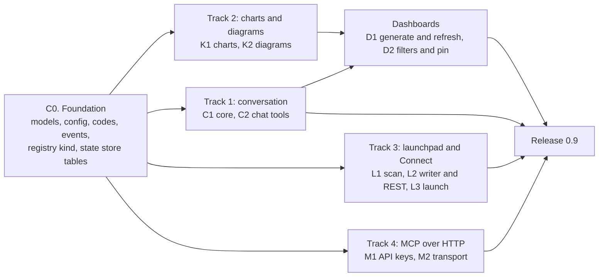
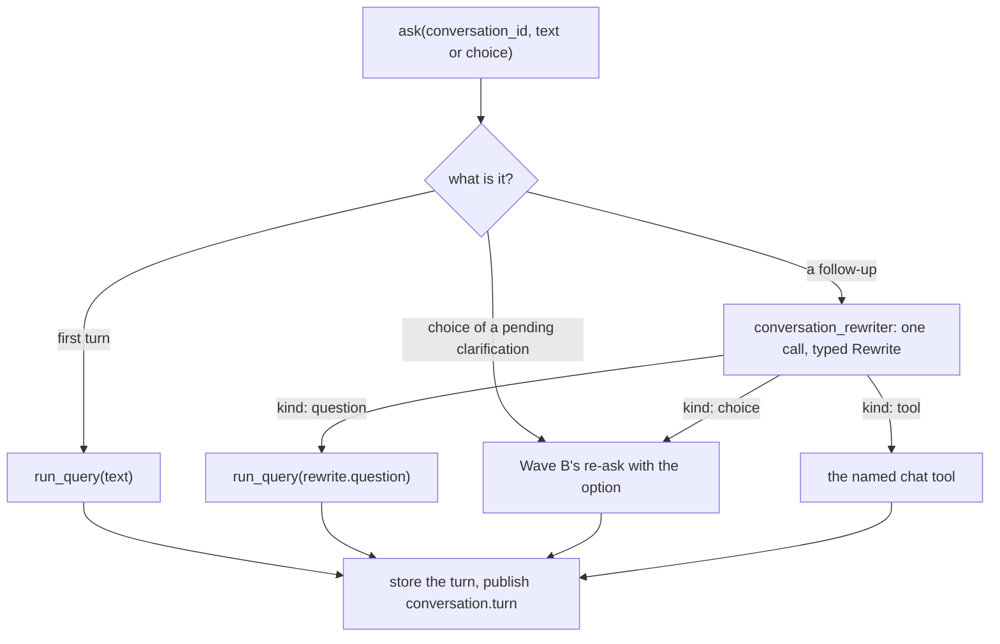
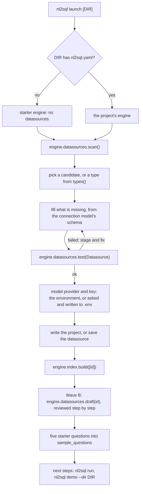
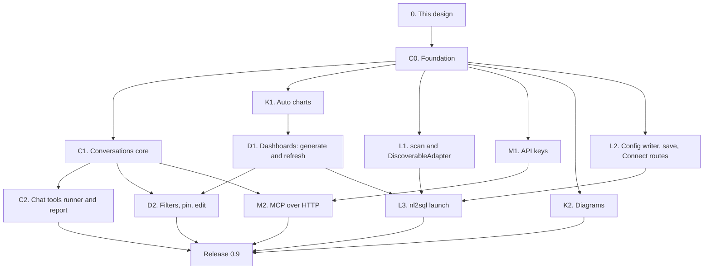

# Wave C: conversation, charts, dashboards, launchpad and MCP over HTTP (design)

!!! note "Status: design"
    This page is the design for Wave C of the product redesign, which ships
    as release 0.9. Nothing on it is built yet. Each pull request in
    [the PR plan](#13-pr-plan) adds a "Built" note to the sections it builds,
    as Phase 1 and Phase 2 did. Phase 1 is
    [Configuration v2 and the extension registry](configuration_v2.md);
    Phase 2 is [Phase 2: test bed, storage, providers, policies and adapter
    SDK v2](phase2.md). Wave A (0.7: events, observers, hooks, approval,
    evals, routing, drift, sanity checks, MCP over stdio) and Wave B (0.8:
    glossary and knowledge sources, the schema profiler, clarifications,
    "why this answer", the cost guard, the corrections queue) are designed
    on their own pages, `architecture/wave_a.md` and `architecture/wave_b.md`,
    which were not merged when this page was written. Wave C builds on the
    shapes they chose and lists what it needs from them in
    [Needs from Waves A and B](#8-needs-from-waves-a-and-b), rather than
    redesigning them.

## Principles

The owner set them for the redesign, and they rank above everything below:

- **The package is the product; the playground only demonstrates it.**
  Every capability on this page is a public facade method or an extension
  point in `nl2sql` first. The CLI, `nl2sql-api`, the playground and the MCP
  server use the public API only. The web UI for conversations, charts and
  dashboards is Wave D, not here.
- **No active users: design it correctly, not compatibly.** No shims, no
  aliases, no deprecation paths.
- **Never over-engineer.** Ship what 0.9 needs; the cut list is part of the
  design.
- **Configurable** in `nl2sql.yaml` (and its section files) or in code with
  dependency injection, **extensible through the registry**, every new
  action **published on the Wave A event bus**, and **hooks apply** to every
  run this wave adds: a conversation turn, a dashboard tile, a launch's
  starter question.

Two older rules decide most of this wave: *the model emits a typed plan,
never SQL* (dashboards build plans in code, and the model never writes a
chart), and *anything the generator can reject, the validator rejects first*
(a dashboard filter is a predicate added to a plan before the validator, not
text added to SQL).

## Decisions

The owner was asleep when this design was written and asked that its
recommendations be used, each marked for confirmation. Wave A uses D9 to
D35 and Wave B D36 onwards, so Wave C starts at D100. Each decision is
written into the section it affects.

| # | Decision | Status | Where |
|---|---|---|---|
| D100 | **`engine.conversations` is a namespace over ids, not a live session object.** A conversation is stored data; every call names it, so the CLI, `nl2sql-api`, MCP and a Python caller use it the same way, and a server holds nothing between requests. | decided overnight, owner to confirm | [Conversation](#3-conversation) |
| D101 | **One rewrite call per follow-up.** The first turn, an option chosen from a clarification, a retry and an explicit tool call make no rewrite call; every other turn makes exactly one, with the new agent `conversation_rewriter` and the typed output `Rewrite`. No heuristic decides that a follow-up "looks standalone". | decided overnight, owner to confirm | [Rewriting](#rewriting-a-follow-up) |
| D102 | **The rewritten question is what runs,** through `run_query`, unchanged. The pipeline never sees the conversation. The plan cache keys on the rewritten question, so the same follow-up in two conversations shares a plan. | decided overnight, owner to confirm | [Rewriting](#rewriting-a-follow-up) |
| D103 | **The rewriter sees the last `context_turns` (3) turns:** what was typed, the question that ran, its status, the answer's summary, the result's columns and the tables read. Never rows. | decided overnight, owner to confirm | [Rewriting](#rewriting-a-follow-up) |
| D104 | **A Wave B clarification is a turn that waits for a choice.** The next turn may name an option (`choice=`) or be text the rewriter maps to one; a choice re-asks through Wave B's stateless path with no rewrite call. | decided overnight, owner to confirm | [Clarifications](#clarifications-and-approvals-in-a-conversation) |
| D105 | **A conversation belongs to the `(tenant_id, user_id)` that started it.** Roles are never stored: each turn runs with the roles the caller passes now. Another user's conversation is "not found", the same answer as a missing one. A conversation started without a `user_id` belongs to "no user", which suits a single-user tool and nothing shared. | decided overnight, owner to confirm | [Ownership](#ownership-and-retention) |
| D106 | **Turns are stored without rows,** in the state store, for 30 days by default (`conversations.max_age_days`), purged by `engine.storage.purge()`. Rows are read from the result store by `trace_id` while its own retention keeps them. | decided overnight, owner to confirm | [Ownership](#ownership-and-retention) |
| D107 | **A `needs_approval` turn is answered by `retry`,** which re-runs the turn's question with the approvals the asker was given. No rewrite call; no approval is stored. | decided overnight, owner to confirm | [Clarifications and approvals](#clarifications-and-approvals-in-a-conversation) |
| D108 | **Chat tools are invoked by the user, never chosen by the model.** A caller names the tool (`conversations.tool(...)`), or the user's words ask for it ("chart that") and the same rewrite call that D101 already makes returns it as a typed `ToolCall`. The model never calls a tool the user did not ask for, and there is no agent loop. | decided overnight, owner to confirm | [Chat tools](#4-chat-tools) |
| D109 | **The built-in tools make no model call,** and a tool reaches the engine through the public facade only, as an app does. A plugin tool is the operator's code and may do what it likes with the facade. | decided overnight, owner to confirm | [The interface](#the-interface) |
| D110 | **`ChartSpec` is our own small typed model, with `to_vega_lite()`.** Four kinds: `line`, `bar`, `big_number`, `table`. Vega-Lite (v5) is the export, not the type: a renderer that is not Vega-based reads the spec directly. No colour is ever set; the renderer's theme decides. | decided overnight, owner to confirm | [The spec](#the-spec) |
| D111 | **The chart is chosen by rules, from the columns' kinds and the plan,** with no model call. The one-line takeaway is a template filled from the data (first and last point, top category and its share), also with no model call; a model-written takeaway is not offered. | decided overnight, owner to confirm | [Choosing a chart](#choosing-a-chart) |
| D112 | **`ResultSummary` gains `column_kinds`** (`number`, `text`, `temporal`, `boolean`, `unknown`: Wave A's join-key categories, D30), read from the saved result's schema when it is written. | decided overnight, owner to confirm | [Choosing a chart](#choosing-a-chart) |
| D113 | **Diagrams are Mermaid text with no colour and no `%%{init}` line,** so they read the same on a light or dark page. The answer view is drawn from the plans; the schema view is an `erDiagram` from the snapshot's foreign keys, filtered by the caller's scope and capped at 30 tables. | decided overnight, owner to confirm | [Diagrams](#diagrams) |
| D114 | **A report is Markdown assembled from stored turns,** with no model call. PDF is out of scope. | decided overnight, owner to confirm | [Reports](#reports) |
| D115 | **Dashboard questions come from fixed templates over Wave B's column roles,** which build typed plans in code. Each plan is validated, generated, run and traced like any other; its English question comes from Wave B's plan-to-English. Generating a dashboard makes no model call. | decided overnight, owner to confirm | [Choosing the tiles](#choosing-the-tiles) |
| D116 | **A tile is one plan on one datasource, or one verified query.** Refresh runs the stored plan (no planner call, no refiner); a plan that no longer validates marks the tile `stale`, and `regenerate` asks the model once for a new plan. An answer that needed several sub-queries cannot be pinned in 0.9. | decided overnight, owner to confirm | [Tiles and refresh](#tiles-and-refresh) |
| D117 | **A dashboard filter is a typed predicate added to a tile's plan before the validator,** applied to the tiles whose plan reads the filtered table; the others say they are not filtered. Filter values travel as plan literals, so the generator renders them as it renders any literal. | decided overnight, owner to confirm | [Filters](#filters) |
| D118 | **A dashboard always runs as the viewer.** Visibility is `private` (the owner) or `tenant` (everyone in the owner's tenant may view and refresh; only the owner edits). A viewer's scope denies a tile exactly as it would deny the question, and a tile reading a table the viewer may not see is listed without its question or plan. | decided overnight, owner to confirm | [Ownership and visibility](#ownership-and-visibility) |
| D119 | **`run_query` gains `answer: bool = True`;** `False` skips the answer synthesizer. Tiles use it: a tile shows a chart, not a paragraph, and the call costs a model call. | decided overnight, owner to confirm | [Tiles and refresh](#tiles-and-refresh) |
| D120 | **`scan()` looks in three places, each declared by the adapters:** a connection URL the caller passes (`nl2sql launch` passes `DATABASE_URL`), database files under the folder by the suffixes adapters declare (two levels deep), and the default ports adapters declare, on `127.0.0.1` only. Nothing in the engine names a database. No network or cloud discovery. | decided overnight, owner to confirm | [Finding a database](#finding-a-database-scan) |
| D121 | **`scan()` is not a REST route in 0.9.** The server's files and ports are not the user's; the Wave D local launchpad may add it. | decided overnight, owner to confirm | [Connect a database over REST](#connect-a-database-over-rest) |
| D122 | **No secret value is ever written into YAML.** The config writer writes a secret field as `${env:NL2SQL_<ID>_<FIELD>}`; `nl2sql launch` puts the value in the `.env` beside `nl2sql.yaml`; the REST route refuses a literal secret unless it is the fresh local install that `nl2sql-api` already treats as admin (no role source, loopback client). | decided overnight, owner to confirm | [Writing the config](#writing-the-config) |
| D123 | **Saving a datasource is a package method, `engine.datasources.save(id)`,** which writes `datasources/<id>.yaml` beside the loaded config. This replaces Phase 1's "saving is the app's job": the web form, the terminal and launch need the same writer, and the package is the product. | decided overnight, owner to confirm | [Writing the config](#writing-the-config) |
| D124 | **Starter questions are the same templates as dashboard tiles** (five), written into the datasource's `sample_questions`, where they also help routing. No model call. | decided overnight, owner to confirm | [`nl2sql launch`](#nl2sql-launch) |
| D125 | **`nl2sql launch` does not verify the model key with a call.** The first starter question the user runs is the check. | decided overnight, owner to confirm | [`nl2sql launch`](#nl2sql-launch) |
| D126 | **MCP over HTTP is `nl2sql mcp --http`,** the MCP SDK's streamable HTTP transport in stateless mode, in its own process. It is not mounted in `nl2sql-api` in 0.9. | decided overnight, owner to confirm | [MCP over HTTP](#9-mcp-over-http-with-auth) |
| D127 | **Authentication is API keys first (bearer); OAuth later.** Keys are made by `engine.api_keys`, stored hashed in the state store, and each carries the `user_id`, `tenant_id` and roles its caller runs as. Binding to anything but loopback without keys is refused. A chat app's connector UI that offers only OAuth waits for the OAuth step. | decided overnight, owner to confirm | [Authentication](#authentication-api-keys-d127) |
| D128 | **The hosted demo does not expose MCP in 0.9.** It serves recorded answers with no key, so an MCP client could ask nothing new; exposing it waits for OAuth and a decision on whose key pays. | decided overnight, owner to confirm | [MCP over HTTP](#9-mcp-over-http-with-auth) |
| D129 | **The first PR adds every Wave C shape at once:** models, config sections, error codes, events, the `chat_tool` registry kind, `ResultSummary.column_kinds`, `run_query(answer=)` and the state store's new tables with their migration, so the parallel PRs never edit the same shared file. | decided overnight, owner to confirm | [PR plan](#13-pr-plan) |

## Where 0.8 will leave us

What the code has today (0.6), plus what Waves A and B add, as their designs
describe it.

| Area | What 0.8 has | What is still missing |
|---|---|---|
| Questions | `engine.run_query` and `stream_query` (`api/query_api.py`), one question per call; Wave A's typed `Event` stream, hooks and approval; Wave B's `clarification` result and stateless re-ask | Nothing remembers the previous question: "and by month?" is a question about nothing |
| Results | `QueryResult` with a 50-row `RowSample` per sub-query; full results as parquet in the result store, read by `engine.results.page` and `csv` (`api/results_api.py`); `ResultSummary` is node id, columns, row count, truncated (`execution/artifacts/results.py`) | No column types on a result, so nothing can choose a chart; no chart, diagram or report anywhere in the package (the playground has none either) |
| Profile | Wave B's profiler: column roles, join proposals, drafted descriptions, a review file | Nothing turns a profile into questions worth asking |
| Setup | `nl2sql init` writes a commented example (`config/project.py`, `cli/commands/init.py`); `engine.datasources.types()`, `test(Datasource)` and `add()` (Phase 2, B5); `nl2sql demo` serves any config folder (`cli/commands/demo.py`, `prepare_project`) | No command that finds a database, connects it, indexes it and drafts its descriptions; `add()` changes only the running engine, and nothing writes one datasource back to its file |
| REST | `POST /api/v1/datasource` (admin) registers a datasource in the process (`packages/api/src/nl2sql_api/routes/datasource.py`) | No route for the adapter types or a connection test; any failure, a typo in the body included, is a 500 with no detail (bug B100) |
| MCP | Wave A: `nl2sql mcp` over stdio, with `ask`, `list_datasources` and `describe_table`; the role from `--role` | No HTTP, so no remote client; no authentication; no follow-ups |
| State store | Snapshots, plan cache, feedback, locks (`storage/sqlite.py`, `nl2sql_sdk/stores.py`); Wave A's diffs; Wave B's review queue | No conversations, dashboards or API keys |

## 1. Goals and non-goals

### What ships in 0.9

| Goal | What it means |
|---|---|
| **Conversation** | `engine.conversations`: start, ask, stream, retry, get, list, delete. A follow-up is rewritten into a self-contained question by one typed model call and run unchanged. Every turn keeps what was typed, what ran, its result and its `trace_id`. Clarifications and approvals are turns. Stored per user with retention. |
| **Chat tools** | A `chat_tool` registry kind and four built-ins: `chart`, `diagram`, `report`, `pin`. Asked for by name or in the user's words; never picked by the model on its own. |
| **Auto charts** | `engine.results.chart(...)` returns a renderer-neutral `ChartSpec` (line, bar, big number, table) chosen by rules, with a template takeaway and a Vega-Lite export. |
| **Auto dashboards** | `engine.dashboards.generate(datasource_id)`: six to ten tiles from Wave B's profile, each a validated, traced pipeline run with its chart and layout; filters that re-run tiles; save, load, refresh, pin; caps. |
| **Launchpad** | `nl2sql launch` (and `uvx nl2sql launch`): find a database, test it, write the config, set the model key, index, draft and review, five starter questions. Every step is a package method. |
| **Connect a database over REST** | Thin `nl2sql-api` routes over `types()`, `test()`, `add()`, `save()` and Wave B's draft. |
| **MCP over HTTP** | `nl2sql mcp --http` with API-key auth, identity to role mapping, and follow-ups and clarifications in `ask`. |

### Not in Wave C

| Later | Why it waits | Where |
|---|---|---|
| The web UI for conversations, charts, dashboards and the launchpad; the Textual app | The package ships first; the apps render it | Wave D |
| REST routes for conversations, chat tools, dashboards and API keys | API parity is its own wave | Wave D |
| A model that picks tools, an agent loop, tool chains | D108: explicit tools are predictable and cost nothing extra | Later, if ever |
| Model-written takeaways and narrative reports | D111, D114: a template is free and never wrong about a number | Later |
| PDF reports | Markdown converts with any tool | Later |
| Multi-sub-query tiles, cross-database dashboards | D116: a tile is one plan; combining needs the aggregator's state stored | Later |
| Scheduled refresh, alerts, sharing links, embedding | A dashboard product of their own | Later |
| Editing or branching a conversation; summarising long ones | A window of three turns covers follow-ups (D103) | Later |
| OAuth for MCP and `nl2sql-api`; hosted-demo MCP | D127, D128 | After 0.9 |
| MCP inside `nl2sql-api`, rate limiting | D126; per-question caps bound the spend | Wave D |
| `scan()` over REST, network or cloud discovery | D120, D121 | Wave D (local), later |
| Results bound to the user who asked (B13) | Unchanged: Wave C's own reads go through conversation ownership | Wave D |

## 2. Order of work

One small foundation PR, then four tracks that touch different files.



## 3. Conversation

### The shape

```python
# nl2sql/conversations/models.py (engine: a turn holds a QueryResult)
TurnKind = Literal["question", "choice", "tool", "retry"]
TurnStatus = Literal["answered", "awaiting_choice", "needs_approval", "stopped", "error", "tool"]

class Turn(BaseModel):
    index: int                         # 1-based, in the order asked
    at: datetime                       # UTC
    kind: TurnKind
    text: str                          # what the user typed, or the chosen option's label
    question: str | None               # what ran; None for a tool turn
    rewritten: bool                    # question differs from text
    refers_to: list[int] = []          # the turns the rewrite drew on
    status: TurnStatus
    trace_id: str | None               # the run's id: its events, trace and result pages
    result: QueryResult | None         # stored without rows (D106)
    tool: ToolOutput | None = None     # a tool turn's output (section 4)

class Conversation(BaseModel):
    id: str                            # random, 22 url-safe characters
    tenant_id: str | None
    user_id: str | None                # the owner (D105)
    title: str                         # the first question, cut at 80 characters
    datasource_id: str | None          # when set, every turn skips routing
    created_at: datetime
    updated_at: datetime
    turns: list[Turn]
    pending: Clarification | None      # Wave B's clarification the last turn asked
```

`Conversation` and `Turn` are exported from `nl2sql`. A turn's
`result.sub_queries[].rows` is always `None` once stored; everything else of
the `QueryResult` is kept, so a turn shows its SQL, plan, validation,
warnings, source and usage without its trace.

### The facade

| Method | What it does |
|---|---|
| `engine.conversations.start(*, user_context=None, datasource_id=None) -> Conversation` | A new, empty conversation owned by the caller. Nothing runs. |
| `engine.conversations.ask(conversation_id, text=None, *, choice=None, user_context=None, execute=True, cancellation_token=None) -> Turn` | One turn: rewrite (when D101 says so), run, store. `choice` picks an option of a pending clarification instead of `text`. |
| `engine.conversations.stream(conversation_id, text=None, *, choice=None, user_context=None, execute=True) -> Iterator[Event]` | As `ask`, yielding `conversation.rewritten`, then the run's events (Wave A's stream), then `conversation.turn`, whose data is the stored `Turn`. Closing the iterator early cancels the run; no turn is stored. |
| `engine.conversations.retry(conversation_id, *, user_context=None, approvals=[]) -> Turn` | Re-runs the last question turn's `question` as a new turn of kind `retry` (D107), with no rewrite call. For an approval, a timeout or a stopped run. |
| `engine.conversations.tool(conversation_id, name, args=None, *, user_context=None) -> Turn` | Calls a chat tool by name as a turn of kind `tool` (section 4). |
| `engine.conversations.report(conversation_id, *, turns=None, title=None, user_context=None) -> str` | The Markdown report ([Reports](#reports)); the `report` tool calls it. |
| `engine.conversations.get(conversation_id, *, user_context=None) -> Conversation` | One conversation, with its turns |
| `engine.conversations.list(*, user_context=None, limit=20) -> list[ConversationInfo]` | The caller's conversations, newest first: `id`, `title`, `updated_at`, `turns` (a count) |
| `engine.conversations.delete(conversation_id, *, user_context=None) -> None` | Deletes it and its turns; its results stay until their own retention |

Every method raises `ConversationNotFound` (a `LookupError`) for an id that
does not exist or is not the caller's (D105). `ask` and `stream` on a
conversation that is already running a turn raise `ConversationBusy`: the
turn holds the state store's lock `conversation:<id>` (the lock Phase 2's
`StateStore.lock` already provides) for the pipeline's `timeout_s` plus ten
seconds.

### Rewriting a follow-up



```python
# nl2sql/conversations/models.py
class ToolCall(BaseModel):
    name: str                          # an enabled chat tool
    args: dict[str, Any] = {}          # validated by that tool's args_model

class Rewrite(BaseModel):              # the conversation_rewriter's structured output
    kind: Literal["question", "choice", "tool"]
    question: str | None = None        # kind "question": answerable with no other context
    standalone: bool = False           # the text needed no context; question is the text verbatim
    refers_to: list[int] = []          # turn indexes it used
    choice: str | None = None          # kind "choice": a pending option's id
    tool: ToolCall | None = None       # kind "tool"
```

| Rule | Detail |
|---|---|
| **When (D101)** | Every turn after the first whose input is `text`, unless a pending clarification's option is given as `choice`. One call, made with `structured()` and Phase 2's parse-and-retry. |
| **What the model sees (D103)** | For each of the last `context_turns` turns: the text, the question that ran, the status, `final_answer.summary`, the result's columns, the datasources and tables read. The pending clarification's options (id and label). The enabled tools' names, one-line descriptions and argument schemas. The new text. Never rows: the summary is what the user already read, written by the answer synthesizer from its preview. |
| **What it is told** | Resolve what the text leaves out ("and by month?", "only the EU ones", "what about last year?") from the turns it was given, add no filter the user did not state, keep every value the user typed verbatim, set `standalone` and copy the text when it needs no context, and return `kind: "tool"` only when the user asks for a chart, a diagram, a report or a pin. The prompt names no database dialect (the dialect rule). |
| **Checked** | `kind: "question"` needs `question`; `choice` must be a pending option's id; `tool.name` must be an enabled tool and `tool.args` must validate against its `args_model`. A failure is fed back by parse-and-retry. |
| **When it cannot** | After the parse retries, the turn ends `error` with `REWRITE_FAILED` (not retryable) and the answer "I could not tell what that refers to. Please ask it as a full question." Running the literal follow-up instead would answer a question nobody asked. |
| **The agent** | `conversation_rewriter` joins `AgentName`; it inherits the top-level LLM like every agent, and the docs suggest a small model for it. |
| **Accounting** | The call runs inside the turn's `RunScope` (Wave A), so its `llm.call` event carries the turn's `trace_id`, its usage is in the turn's `QueryResult.usage`, and it counts against `max_llm_calls` and `max_cost_usd`. |
| **Datasource** | A conversation started with `datasource_id` passes it on every turn. Otherwise each turn is routed; a follow-up rewritten as "...on the sales database" carries the hint in its text. |

**Hooks.** A turn is a run, so all six of Wave A's points apply. `run.before`
sees the rewritten question; `HookContext` gains `conversation_id` (set for a
turn, `None` otherwise), so a hook that cares can read the conversation
through the facade. Nothing else in the hook interface changes.

### Clarifications and approvals in a conversation

- **A clarification (D104).** A run that ends with Wave B's `clarification`
  result stores a turn with status `awaiting_choice` and sets
  `Conversation.pending`. The next turn may pass `choice="b"`, or text the
  rewriter maps to an option ("the second one", "by order date"). Either way
  the engine re-asks through Wave B's stateless path with that option, which
  runs the option's typed plan; the turn's kind is `choice` and its text is
  the option's label. Any next turn clears `pending`; a `choice` with nothing
  pending raises `ValueError` ("Nothing in this conversation is waiting for a
  choice.").
- **An approval (D107).** A run that ends `needs_approval` stores a turn with
  that status and the result's `approval` requests. An approver acts on the
  request outside the conversation (an app shows it, as Wave A describes);
  the asker then calls `retry(conversation_id, approvals=[...])`, which re-runs
  the last question turn's `question` with those approvals. If the plan
  changes, the SQL hash differs and the turn asks again, as Wave A's approval
  does everywhere.

### Ownership and retention

| Rule | Detail |
|---|---|
| **Owner (D105)** | `start` records the caller's `tenant_id` (else `settings.tenant_id`) and `user_id`. Every other method compares the caller's with the stored pair; a mismatch is `ConversationNotFound`. |
| **Roles** | Never stored. Each turn runs with the `user_context` passed to that call, so a role taken away applies at the next turn. |
| **Results** | A turn's rows are read with `engine.results.page(turn.trace_id, ...)`. A tool reads only turns of a conversation the caller owns, so Wave C adds no new way to read another user's results (bug B13 stays Wave D's). |
| **Limits** | `conversations.max_turns` (50): the 51st turn is refused with `CONVERSATION_TOO_LONG` and the fix "start a new conversation". |
| **Retention (D106)** | `engine.storage.purge()` deletes conversations whose `updated_at` is older than `conversations.max_age_days` (30; `null` keeps them) and reports the count in `retention.purged`. A turn whose result has already been purged says so (`ResultNotFound` from `engine.results`) and keeps its text, question and SQL. |

### The config

```yaml
# nl2sql.yaml
conversations: conversations.yaml

# conversations.yaml (every value shown is the default)
context_turns: 3        # turns the rewriter sees
max_turns: 50
max_age_days: 30        # null keeps them
```

The section is optional; absent, these defaults apply. In code:
`Config(..., conversations=Conversations(context_turns=5))`.

### Events

| Name | Data | Published by |
|---|---|---|
| `conversation.started` | `conversation_id`, `user_id`, `datasource_id` | `start` |
| `conversation.rewritten` | `conversation_id`, `turn`, `kind`, `standalone`, `refers_to`, `question` (or `tool`, `choice`) | the rewriter, inside the turn's run |
| `conversation.turn` | `conversation_id`, `turn`, `kind`, `status`, `trace_id`, `rewritten`; in the stream, the stored `Turn` as JSON | `ask`, `retry`, `tool`, once the turn is stored. The stream's terminal event. |

Like every Wave A event, none carries rows (D15); the question is allowed.

## 4. Chat tools

### Invoked, not chosen (D108)

A chat tool turns something the conversation already has into something
else: a chart, a diagram, a report, a dashboard tile. It never asks the
database a new question. A tool runs only when the user asks for it, in one
of two ways:

1. **By name.** `engine.conversations.tool(cid, "chart", {"turn": 3})`. A UI
   button, an MCP client or a script does this.
2. **In words.** "Chart that", "draw the tables behind this", "write this up",
   "pin it to my sales dashboard". The rewrite call D101 already makes returns
   `kind: "tool"` with a typed `ToolCall`, so asking in words costs nothing
   extra.

The model never calls a tool on its own initiative, and nothing loops: one
turn is one question run or one tool call. That keeps a turn's cost, latency
and audit trail the same as a question's.

### The interface

```python
# nl2sql/chat_tools/__init__.py (engine: a tool sees a Conversation)
class ToolContext(BaseModel):
    model_config = ConfigDict(arbitrary_types_allowed=True, frozen=True)
    conversation: Conversation          # a copy; the tool cannot change it
    user: UserContext
    engine: "NL2SQL"                    # the public facade only (D109)

class ToolOutput(BaseModel):
    kind: Literal["chart", "mermaid", "markdown", "json"]
    title: str
    body: str | dict[str, Any]          # chart: ChartSpec as JSON; mermaid and markdown: text
    refs: dict[str, str] = {}           # e.g. {"dashboard_id": ..., "tile_id": ...}

class ChatTool(Protocol):
    interface_version: ClassVar[int]          # 1
    title: ClassVar[str]
    description: ClassVar[str]                # one line; the rewriter reads it
    args_model: ClassVar[type[BaseModel]]     # its JSON Schema is shown to the rewriter
    config_model: ClassVar[type[BaseModel]]
    @classmethod
    def from_config(cls, cfg: BaseModel) -> "ChatTool": ...
    def __call__(self, ctx: ToolContext, args: BaseModel) -> ToolOutput: ...
```

| Rule | Detail |
|---|---|
| **Public facade only (D109)** | A tool gets the `NL2SQL` facade, not the runtime. `nl2sql/chat_tools/` imports only the top-level `nl2sql` and its own modules, held by the architecture test that holds the API and MCP. |
| **Errors** | A tool that raises, or returns something that is not a `ToolOutput`, ends the turn `error` with `TOOL_FAILED` and the tool's name. A tool that cannot apply (a chart of a turn with no result) raises `ToolNotApplicable(message)`, which becomes `TOOL_NOT_APPLICABLE` with that message. |
| **Unknown or disabled** | `UNKNOWN_CHAT_TOOL`, naming the enabled ones. |
| **The default target** | A tool argument `turn` defaults to the last turn with a result. |
| **Events** | `chat_tool.called`: `tool`, `conversation_id`, `turn`, `ok`, `seconds`, `error_code`. |
| **Facade** | `engine.chat_tools.list() -> list[ChatToolInfo]`: name, title, description, the args' JSON Schema. |

| Kind | Entry point group | Interface | Version | Built-ins |
|---|---|---|---|---|
| chat tool | `nl2sql.chat_tools` | `nl2sql.chat_tools.ChatTool` | 1 | `chart`, `diagram`, `report`, `pin` |

`registry.add_chat_tool(name, cls)` and `@registry.chat_tool(name)`. A chat
tool is "attached, many", like an observer:

```yaml
# nl2sql.yaml
chat_tools: chat_tools.yaml

# chat_tools.yaml (absent: the four built-ins; []: none)
- type: chart
- type: diagram
  max_tables: 30
- type: report
- type: pin
- type: corp_export        # a plugin; its config_model checks the rest
  bucket: "${env:EXPORT_BUCKET}"
```

### The four built-ins

| Tool | Args | Output | Through |
|---|---|---|---|
| `chart` | `turn`, `result_id` (the turn's first result), `kind` (`line`, `bar`, `big_number`, `table`; chosen when absent) | `chart` | `engine.results.chart(turn.result, ...)` (section 5) |
| `diagram` | `view` (`answer`, `schema`), `turn` (answer view), `datasource_id` and `tables` (schema view) | `mermaid` | `nl2sql.diagram_for(result)`, `engine.datasources.diagram(...)` |
| `report` | `turns` (every answered turn), `title` | `markdown` | `engine.conversations.report(...)` |
| `pin` | `turn`, `dashboard` (an id, or a title for a new one) | `json` with `refs` | `engine.dashboards.pin(...)` (section 6) |

### Diagrams

Mermaid text, written to read the same on a light or a dark page (D113): no
`%%{init}` line, no `style`, `classDef` or `linkStyle`, no colour. Emphasis
is carried by shape and grouping.

- **The answer view** (`nl2sql.diagram_for(result) -> str`, a pure function
  exported from `nl2sql`): a `flowchart LR` of the tables each sub-query's
  plan read, one node per table (`datasource.schema.table`), one edge per
  join labelled with its columns, and one `subgraph` per datasource when
  there are several, with the combine step's join keys between them. A
  verified query has no plan; its diagram lists the tables its SQL reads
  (Wave A's `tables`), unconnected.
- **The schema view** (`engine.datasources.diagram(datasource_id, *,
  tables=None, user_context=None) -> str`): an `erDiagram` from the live
  snapshot: each table with its key columns, each foreign key as a
  relationship. Only tables the caller's scope reaches, as
  `datasources.schema(user_context=)` (Wave A, B29). With `tables`, those and
  their neighbours one foreign key away; without, the whole datasource. More
  than `max_tables` (30) is cut to the 30 with the most foreign keys, and a
  `%% 41 more tables not shown` comment says so.

### Reports

`engine.conversations.report(cid, turns=None, title=None)` assembles
Markdown from stored turns, with no model call (D114):

```text
# <title, or the conversation's title>
Generated <date> · <n> questions · nl2sql <version>

## <question>
<final_answer.summary>
**Why this answer.** <Wave B's plan-to-English for each sub-query>
<a Markdown table of the first 20 rows, read through engine.results.page; or "results expired">
<the takeaway of the chart the turn would get, when it is not a table>
<details><summary>SQL</summary> ```sql ... ``` </details>
Trace: <trace_id>
```

A Markdown renderer shows it as is; a PDF is one `pandoc` call away and out
of scope.

## 5. Auto charts

### The spec

```python
# nl2sql/charts/spec.py
ColumnKind = Literal["number", "text", "temporal", "boolean", "unknown"]

class Encoding(BaseModel):
    field: str                          # a result column
    kind: ColumnKind
    title: str                          # the column, humanised: "total_amount" -> "Total amount"

class ChartData(BaseModel):
    trace_id: str
    result_id: str
    columns: list[str]
    rows: list[list[Any]]               # at most settings.charts.max_points
    truncated: bool                     # the result had more rows than were charted

class ChartSpec(BaseModel):
    kind: Literal["line", "bar", "big_number", "table"]
    title: str                          # the question that ran
    x: Encoding | None = None           # line: temporal; bar: the category
    y: list[Encoding] = []              # one or more measures
    series: Encoding | None = None      # line only: a category split into lines
    value: Encoding | None = None       # big_number
    data: ChartData
    takeaway: str | None = None
    reason: str                         # why this kind: "one date column and one number"

    def to_vega_lite(self) -> dict[str, Any] | None: ...   # None for a table
```

`to_vega_lite()` returns a Vega-Lite v5 spec with the rows inline
(`data.values`), `mark` `line`, `bar` or (for a big number) a `text` mark,
temporal or nominal `x`, quantitative `y`, several measures folded with a
`fold` transform, and a `color` encoding only for `series`. It sets no
colour scheme, font or size (D110): the renderer's theme decides. A table
returns `None`; the renderer draws a table from `data`.

### Choosing a chart

`engine.results.chart(result, result_id=None, *, kind=None, tenant_id=None)
-> ChartSpec`. `result` is a `QueryResult` (the plan is used) or a
`trace_id` (only the columns' kinds are). `kind` forces a kind the data can
draw, else `ValueError` naming the ones it can.

**Column kinds (D112).** The artifact writer records each column's kind when
it writes the parquet file, from the Arrow type, into
`ResultSummary.column_kinds`: integer, decimal and float are `number`; date,
time and timestamp are `temporal`; string is `text`; bool is `boolean`;
anything else `unknown`. The plan refines them, because the plan knows what
the database's types do not say:

- a select item that is `DATE_TRUNC(unit, x)` is `temporal` (the plan's
  portable `DATE_TRUNC` returns an ISO string);
- a select item that is `DATE_PART('year', x)` and is grouped on is
  `temporal` (a year axis);
- a select item that is an aggregate (`SUM`, `COUNT`, `AVG`, `MIN`, `MAX`) is
  a **measure**; a grouped column is a **dimension**. Without a plan, every
  `number` is a measure and everything else a dimension.

**The rules (D111),** first match wins:

| # | Shape of the result | Chart |
|---|---|---|
| 1 | One row, one measure (and at most one text column, a label) | `big_number` |
| 2 | One temporal dimension, one to `max_series` (5) measures, at least two rows | `line`, x sorted ascending |
| 3 | One temporal and one text dimension with at most `max_series` distinct values, one measure | `line` with `series` |
| 4 | One text or boolean dimension, one to three measures, two to `max_categories` (20) rows | `bar`, in the result's order when the plan ordered it, else by the first measure descending |
| 5 | Anything else, or more than `max_points` (1,000) rows for a line | `table` |

The data is read with `engine.results.page` up to `max_points` rows; when
the result has more, `data.truncated` is true and a line chart becomes a
table rather than drop points silently.

**The takeaway.** One sentence from a template, filled from the data, with
no model call:

| Chart | Template |
|---|---|
| `line` | "{y} went from {first} in {x0} to {last} in {xn} ({change:+.0%})." For a series, the series with the largest last value. |
| `bar` | "{top} has the highest {y}: {value}." When every value is non-negative and the measure is a `SUM` or `COUNT`: "...{value}, {share:.0%} of the total shown." |
| `big_number` | "{y}: {value}." |
| `table` | none |

Numbers are written with thousands separators and at most three significant
digits after the point; a `null` first or last value gives no change.

```yaml
# settings.yaml
charts:
  max_points: 1000
  max_categories: 20
  max_series: 5
```

## 6. Auto dashboards

A dashboard is a saved list of tiles. A tile is one question, the typed plan
that answers it, how to chart it and where it sits. A refresh runs every
tile through the pipeline, as the viewer, and returns the results with their
charts.

### The shape

```python
# nl2sql/dashboards/models.py
class TileLayout(BaseModel):            # a 4-column grid
    x: int; y: int; w: int; h: int

class Tile(BaseModel):
    id: str
    title: str                          # short: "Revenue by month"
    question: str                       # Wave B's English for the plan, or the pinned question
    datasource_id: str
    source: Literal["plan", "verified"]
    plan: dict[str, Any] | None         # PlanModel as JSON (source "plan")
    verified: VerifiedRef | None        # a verified query's id and params (source "verified")
    chart: Literal["auto", "line", "bar", "big_number", "table"] = "auto"
    layout: TileLayout

class DashboardFilter(BaseModel):
    id: str
    label: str
    column: str                         # "schema.table.column" in the dashboard's datasource
    op: Literal["in", "between"]        # values of a dimension, or a range of a temporal column
    default: list[Any] | None = None

class Dashboard(BaseModel):
    id: str
    title: str
    datasource_id: str
    tenant_id: str | None
    user_id: str | None                 # the owner
    visibility: Literal["private", "tenant"] = "private"
    tiles: list[Tile]
    filters: list[DashboardFilter] = []
    created_at: datetime
    updated_at: datetime

class TileRun(BaseModel):
    tile_id: str
    status: Literal["ok", "empty", "stale", "denied", "needs_approval", "stopped", "error"]
    trace_id: str | None
    chart: ChartSpec | None
    filtered: bool                      # every active filter applied to this tile
    error: dict[str, Any] | None        # the QueryResult's first error, client-safe

class DashboardRun(BaseModel):
    dashboard_id: str
    at: datetime
    filters: dict[str, list[Any]]
    tiles: list[TileRun]
    usage: QuestionUsage                # summed over the tiles
```

### The facade

| Method | What it does |
|---|---|
| `engine.dashboards.generate(datasource_id, *, user_context=None, title=None, max_tiles=None, questions=None) -> tuple[Dashboard, DashboardRun]` | Chooses tiles from the profile, runs each, keeps the ones that answered, lays them out, saves the dashboard owned by the caller, and returns it with its first run. `questions` adds the caller's own questions, run through `run_query` (model calls, so the caps below matter). |
| `engine.dashboards.refresh(dashboard_id, *, user_context=None, filters=None) -> DashboardRun` | Runs every tile as the caller with the filter values given (else each filter's default). Stores nothing: results go to the result store under each tile's `trace_id`. |
| `engine.dashboards.get(dashboard_id, *, user_context=None) -> Dashboard` | One dashboard the caller may view (D118) |
| `engine.dashboards.list(*, user_context=None) -> list[DashboardInfo]` | The caller's, then the tenant's |
| `engine.dashboards.save(dashboard, *, user_context=None) -> Dashboard` | The owner saves an edit: title, visibility, layout, a removed tile, a filter. Tile plans are validated against the live snapshot before saving. |
| `engine.dashboards.pin(conversation_id, turn, *, dashboard_id=None, title=None, user_context=None) -> Tile` | Adds a turn's answer as a tile, to a dashboard the caller owns or a new one titled `title` |
| `engine.dashboards.regenerate(dashboard_id, tile_id, *, user_context=None) -> Tile` | Re-asks a `stale` tile's question with `run_query` (a model call), stores the new plan |
| `engine.dashboards.filter_values(dashboard_id, filter_id, *, user_context=None, limit=100) -> list[Any]` | The distinct values of an `in` filter's column, or the min and max of a `between` one, by a plan built in code and run as the caller |
| `engine.dashboards.delete(dashboard_id, *, user_context=None)` | The owner deletes it |

`DashboardNotFound` (a `LookupError`) for a missing id or one the caller may
not view; `PermissionError` when a viewer who is not the owner edits.

### Choosing the tiles

The tiles come from fixed templates over Wave B's profile (D115). The
profile says which columns are measures, dimensions (with their distinct
count), time columns (with their range) and identifiers, which tables are
large, and how they join. Each template builds a `PlanModel` in code; the
plan then takes the same path as a model's: `plan.after` hooks, the logical
validator, the generator, `execute.before` hooks (the cost guard among
them), the adapter, `execute.after`.

| Group | Template | Plan | Chart | At most |
|---|---|---|---|---|
| Key totals | The row count of the largest table; the sum of its top measures | `COUNT(*)`; `SUM(measure)` | `big_number` | 4 |
| Trends | A measure by month over the last 12 months of data (the profile's maximum date, not today) | `DATE_TRUNC('month', time)`, `SUM(measure)`, grouped, ordered, `WHERE time >= <max - 12 months>` | `line` | 2 |
| Top N | The top 10 values of a dimension by a measure: on the table, or a label column one foreign key away | `GROUP BY dimension`, `SUM(measure)`, `ORDER BY 2 DESC`, `LIMIT 10` | `bar` | 2 |
| Distributions | Row count by a dimension with at most 12 distinct values | `GROUP BY dimension`, `COUNT(*)` | `bar` | 2 |

| Rule | Detail |
|---|---|
| **Ranking** | Tables by row estimate, then by how many measures they have; measures by their non-null share, then name; dimensions by distinct count (fewer first, at least 2). Ties break by name, so the same profile always gives the same dashboard. |
| **Count** | Up to `dashboards.max_tiles` (10). A profile with no measure gives the row counts and distributions only; with nothing to chart, `generate` raises `NoTiles` with what the profile is missing ("no measure or time column was found; review the profile"). |
| **Kept** | A tile whose first run is `ok` is kept. `empty`, `error` and `denied` tiles are dropped and listed in the run's `skipped` with the reason. |
| **Titles** | From the template and the columns' descriptions, humanised: "Total revenue", "Revenue by month", "Top 10 customers by revenue", "Orders by status". `question` is Wave B's plan-to-English for the plan. |
| **No profile** | `NO_PROFILE` (raised as `ValueError`): "Profile the datasource first: engine.datasources.draft('sales')". |
| **Layout** | Big numbers first, one column wide, on one row; then lines (four wide for the first, two after); then bars (two wide); tables last, four wide. A tile's `h` is 1 for a big number, else 2. |
| **Filters** | `generate` adds a `between` filter on the time column the trends use, and an `in` filter on each of the (at most two) dimensions the distributions use. |

### Tiles and refresh

| Rule | Detail |
|---|---|
| **One plan (D116)** | A plan tile runs `run_query(tile.question, datasource_id=..., plan=tile.plan, answer=False, user_context=viewer)`: Wave B's path for running a supplied plan, which makes no planner call. A validator failure on that path is not sent to the refiner: the tile is `stale`, with the validator's error. A verified tile runs its verified query with its params. |
| **No prose (D119)** | `answer=False` skips the answer synthesizer; `final_answer` is `None`. A tile's text is its chart's takeaway. |
| **Charts** | `engine.results.chart(result, kind=tile.chart if not "auto")`. |
| **Order** | Tiles run one after another, in layout order. A `stopped` tile (a cap) ends the refresh; the remaining tiles are `stopped` too. |
| **Caps** | Wave A's per-question caps apply to each tile. `dashboards.max_cost_usd` caps a `generate` or `refresh` across its tiles, as an eval run's cap does: checked before each tile, with the same rule that an unpriced model fails at build. Tiles built from the profile make no model call, so the cap is there for the calls a caller adds: `questions=` and `regenerate`. |
| **Pinning** | `pin` takes a turn whose result has one sub-query with a plan, or a verified answer. A turn with several sub-queries raises `TILE_NOT_PINNABLE` ("answers that combine several queries cannot be pinned yet"). The tile's `question` is the turn's question, its `title` the question cut at 60 characters. |
| **Drift** | Wave A's `schema.drifted` is not acted on. A tile goes `stale` the first time its plan stops validating, and `regenerate` fixes it on request. |

### Filters

A filter value is a predicate added to a tile's plan before the validator
(D117), never text added to a question or SQL:

1. For each active filter, find the tile plan's `TableRef` for the filter's
   `schema.table`. A plan that does not read that table is run unfiltered,
   and its `TileRun.filtered` is `False`, so the UI can say so.
2. Add `alias.column IN (v1, v2, ...)` or `alias.column BETWEEN a AND b` to
   the plan's `where`, joined with `AND`. Values are plan literals.
3. The plan goes on to `plan.after`, the validator and the generator like
   any other. A value of the wrong type is a validator error, and the tile is
   `error`, not `stale`.

`filters` maps filter ids to values; an id the dashboard does not have is a
`ValueError`. A filtered run skips the plan cache, as every supplied plan
does.

### Ownership and visibility

- **Runs as the viewer (D118).** `refresh` and `filter_values` run every tile
  with the caller's `user_context`. A tile reading a table the caller's scope
  denies is `denied`, exactly as the question would be. Nothing in a saved
  dashboard carries a grant.
- **Private or tenant.** `private` dashboards are seen by their owner;
  `tenant` dashboards by everyone whose `tenant_id` matches. Only the owner
  saves, pins to, regenerates in or deletes a dashboard.
- **Hidden tiles.** `get` for a viewer who is not the owner lists a tile
  whose plan reads a table the viewer's scope denies as `{id, layout,
  status: "denied"}`, without its title, question or plan, so a shared
  dashboard does not leak table names.

### The config and events

```yaml
# nl2sql.yaml
dashboards: dashboards.yaml

# dashboards.yaml (every value shown is the default)
max_tiles: 10
max_cost_usd: null      # across one generate or refresh; null: no cap beyond the per-question ones
```

| Name | Data | Published by |
|---|---|---|
| `dashboard.generated` | `dashboard_id`, `datasource_id`, `tiles`, `skipped`, `cost` | `generate` |
| `dashboard.refreshed` | `dashboard_id`, counts per tile status, the filter ids applied (never values), `cost` | `refresh` |
| `dashboard.changed` | `dashboard_id`, `change` (`saved`, `pinned`, `regenerated`, `deleted`), `by` | the owner's edits |

Each tile run is a run, with its own `run.started` and `run.finished`, and
every hook point applies.

## 7. Launchpad: the setup workflow

### The flow



Every box but the prompts is a package method, so the Wave D web form calls
the same ones.

### Finding a database: `scan()`

```python
# nl2sql_sdk/discovery.py (pydantic and the standard library only)
class Found(BaseModel):
    kind: Literal["url", "file", "port"]
    value: str                           # the URL, the file path, or "127.0.0.1:5432"

@runtime_checkable
class DiscoverableAdapter(Protocol):     # optional: an adapter without it is never found, only chosen
    file_suffixes: ClassVar[tuple[str, ...]]      # (".sqlite", ".sqlite3", ".db")
    default_ports: ClassVar[tuple[int, ...]]      # (5432,)
    url_schemes: ClassVar[tuple[str, ...]]        # ("postgresql", "postgres")
    @classmethod
    def connection_for(cls, found: Found) -> dict[str, Any] | None:
        """The connection fields this finding fills in, or None when it is not this adapter's
        (a .db file that is not SQLite). Never connects."""
```

```python
# engine.datasources
def scan(self, folder: str | Path = ".", *, url: str | None = None,
         ports: bool = True) -> list[Candidate]: ...

class Candidate(BaseModel):
    type: str                            # the adapter's registry name
    title: str
    found: Found
    connection: dict[str, Any]           # what was filled in; repr masks secret fields
    missing: list[str]                   # required fields the form still needs
    installed: bool
    install_hint: str
```

| Rule | Detail |
|---|---|
| **Declared by adapters (D120)** | The suffixes, ports and URL schemes are class variables on each adapter, and `connection_for` is the adapter's. The engine loops over the registry's adapters (installed or not, as `types()` does) and names no database itself, so the dialect rule holds and a plugin adapter is found the same way. |
| **A URL** | `url`'s scheme, up to any `+driver`, is matched against `url_schemes`. The caller passes it; `nl2sql launch` passes `DATABASE_URL` from the environment, which is the only new environment read (an entry point's, on the allow-list). |
| **Files** | Under `folder`, two levels deep, skipping hidden folders and `storage.path`, at most 50 files, matched by suffix, then confirmed by `connection_for` (which may read a file's first bytes, as SQLite's `SQLite format 3` header). |
| **Ports** | With `ports`, a TCP connect to `127.0.0.1` on each declared port with a 0.2 s timeout. Loopback only: `scan` never touches another host. An open port fills `host` and `port`; the rest is `missing`. |
| **Order** | URL, then files, then ports; duplicates (the same file or port) once. |
| **Never connects** | `scan` opens no database session; `test()` does. |

The five built-in adapters declare: SQLite (`.sqlite`, `.sqlite3`, `.db`,
URL `sqlite`), DuckDB (`.duckdb`, URL `duckdb`), PostgreSQL (5432,
`postgresql`, `postgres`), MySQL (3306, `mysql`, `mariadb`) and SQL Server
(1433, `mssql`, `sqlserver`).

### Writing the config

Two writers, both in the package:

| Function | What it writes |
|---|---|
| `nl2sql.config.write_project(config, folder, *, force=False) -> list[Path]` | The split layout `nl2sql init` writes today (`nl2sql.yaml`, one file per section, `datasources/<id>.yaml`, `.gitignore` lines), from any `Config`. `init_project` becomes a caller of it, and so does `nl2sql launch`. As today, it refuses to overwrite without `force`, and loads what it wrote with `load_config` before returning. |
| `engine.datasources.save(datasource_id, *, env_file=False) -> Path` | One datasource, as `datasources/<id>.yaml` beside the config the engine was loaded from (D123). Overwrites that one file. Raises `ValueError` when the engine was built in code (no folder) or its `datasources` section is not a folder include. Publishes `datasource.saved` (audited). |

**Secrets (D122).** A field the adapter's connection model marks secret
(Phase 2: `format: password` in its schema) is never written as a value:

| Its value | Written as |
|---|---|
| A reference (`${env:VAR}`, `${vault:path}`) | The reference, unchanged |
| A literal, with `env_file=True` | `${env:NL2SQL_<ID>_<FIELD>}` in the YAML, and the value in the `.env` beside `nl2sql.yaml` by `nl2sql.config.write_env_values(folder, values)`, which replaces a line with the same name and keeps the rest |
| A literal, otherwise | Refused: `SecretValueInConfig` naming the field, with the fix "pass ${env:VAR} or a secret provider reference" |

`write_env_values` writes a file, never `os.environ` (the invariant on
process globals), and checks that `.gitignore` lists `.env`.

### `nl2sql launch`

`nl2sql launch [DIR] [--provider NAME] [--yes] [--no-ports]`, also run as
`uvx nl2sql launch`, which needs nothing installed first (the package's
`nl2sql` script; an adapter's driver is installed when chosen with
`nl2sql install`, which exists).

| Step | What happens | Package call |
|---|---|---|
| 1. Engine | With no `DIR/nl2sql.yaml`: a starter engine from `starter_config(llm=default_llm(provider), path=DIR/.nl2sql)`, a `Config` with no datasources, `allow_all` policies and local embeddings. With one: that project's engine. | `NL2SQL(starter_config(...))`, `NL2SQL.from_config(...)` |
| 2. Find | Lists candidates with where they were found, plus "another database" | `datasources.scan(DIR, url=$DATABASE_URL, ports=not --no-ports)`, `types()` |
| 3. Fill | Asks for each `missing` field from the connection model's JSON Schema; a secret field's input is hidden. An uninstalled driver: shows the install hint and offers `nl2sql install`. | `types()` |
| 4. Test | Shows the failed stage and its fix, and goes back to step 3 | `datasources.test(Datasource)` |
| 5. Model | The provider's key from the environment, or asked (hidden) and written to `DIR/.env` | `nl2sql.config.write_env_values` |
| 6. Write | A new project: the whole layout. An existing one: the datasource file. Secrets go to `.env`. | `write_project`, `datasources.add`, `datasources.save(env_file=True)` |
| 7. Index | With progress | `engine.index.build([id], on_datasource=...)` |
| 8. Draft and review | Wave B's draft: descriptions, column roles, join proposals, glossary terms. Each group is shown and accepted, edited or skipped; `--yes` writes Wave B's review file and applies nothing, so nothing a model drafted is accepted unread. | Wave B's `draft` and its apply |
| 9. Starter questions | Five, from the dashboard templates (D124), added to the datasource's `sample_questions` and saved | `engine.dashboards.suggest_questions(id, n=5)` |
| 10. Next | Prints `nl2sql run "<first starter question>"` and `nl2sql demo --dir DIR`, which serves any project folder | |

`engine.dashboards.suggest_questions(datasource_id, *, n=5) -> list[str]`
returns the English of the first `n` tile plans `generate` would choose,
without running them. The model key is not checked with a call (D125); the
first `nl2sql run` is the check, and its error names the provider and the
variable.

### Connect a database over REST

Thin routes in `nl2sql-api` over the facade, every one admin-only
(`auth.require_admin`), as `POST /api/v1/datasource` is today. They import
only the top-level `nl2sql`.

| Route | Facade | Notes |
|---|---|---|
| `GET /api/v1/datasource-types` | `datasources.types()` | The form's adapters, installed or not, with each connection schema |
| `POST /api/v1/datasource/test` | `datasources.test(Datasource)` | Body: one `Datasource`. Returns the status with its stage and fix. Registers nothing. |
| `POST /api/v1/datasource` | `datasources.add`, then `save` when `save: true` | Changed: a body that does not validate is a 422 listing each problem by path, never a value (fixes B100); `save` is refused for a literal secret unless the API has no role source and the client is loopback (D122) |
| `POST /api/v1/datasource/{id}/draft` | Wave B's `draft(id)` | Synchronous in 0.9; Wave D's jobs make it a background job with progress |
| `POST /api/v1/datasource/{id}/draft/apply` | Wave B's apply | Body: the reviewed draft |

`scan()` has no route (D121). The routes publish no events of their own; the
facade methods they call do.

## 8. Needs from Waves A and B

Wave C uses these as their designs describe them. Where a name differs when
they are built, Wave C follows the built name.

| From | What Wave C needs | Used by |
|---|---|---|
| Wave A | The event bus, the catalog and `engine.events`; Wave C adds its events to the catalog in C0 | Every section |
| Wave A | `RunScope` that a caller can open before the graph, so the rewrite call shares the turn's `trace_id`, usage and caps | Conversation |
| Wave A | `HookContext` with one more optional field, `conversation_id` | Conversation |
| Wave A | `stream_query` yielding `Event`s, ending with `run.finished` or `run.failed` | `conversations.stream` |
| Wave A | `QueryResult.status` values `needs_approval` and `stopped`, `approval`, `stop`, typed `warnings`; `run_query(approvals=)` | Turns, `retry`, tiles |
| Wave A | `max_llm_calls`, `max_cost_usd`, `price_for` and the build-time check for an unpriced model | Turns, `dashboards.max_cost_usd` |
| Wave A | The `audit` observer's list of audited events, which Wave C extends (`datasource.saved`, `api_key.created`, `api_key.revoked`, `mcp.denied`) | Audit |
| Wave A | The type categories of D30 | `column_kinds` |
| Wave A | `datasources.schema(user_context=)` dropping denied tables (B29) | The schema diagram |
| Wave A | The MCP server (`nl2sql/mcp/server.py`, `serve(engine, user_context)`) and its three tools | MCP over HTTP |
| Wave A | The state store interface version it sets (2), which Wave C raises after Wave B | C0 |
| Wave B | The `clarification` result (options with an id, a label and a typed plan) and the stateless re-ask with a chosen option | Conversation |
| Wave B | Running a supplied typed plan through `plan.after`, the validator, the generator and the executor, with no planner or refiner call, as `run_query(..., plan=)` or the re-ask's equivalent | Tiles, filters, `filter_values` |
| Wave B | Plan-to-English for a `PlanModel` | Tile questions, starter questions, reports |
| Wave B | The profile: column roles (measure, dimension, time, identifier, label), distinct-count and min/max for time columns, row estimates, join proposals, and how to read it for a datasource | Tile templates, filters |
| Wave B | The draft and its review file, and the method that applies a reviewed draft (named here `datasources.draft(id)` and its apply) | Launch, the draft routes |
| Wave B | The cost guard acting at `execute.before` | Tiles inherit it; nothing to build |
| Wave B | The state store version it sets, which Wave C's migration follows | C0 |

## 9. MCP over HTTP with auth

### The transport (D126)

`nl2sql mcp --http [--host 127.0.0.1] [--port 8765]` serves Wave A's MCP
server over the MCP SDK's streamable HTTP transport at `/mcp`, in stateless
mode with JSON responses: each request stands alone, which is all the tools
need, because a follow-up names its `conversation_id`. stdio stays the
default. The server is its own process, built on the same
`nl2sql/mcp/server.py`; mounting it in `nl2sql-api` is Wave D.

```yaml
# nl2sql.yaml
mcp: mcp.yaml

# mcp.yaml (every value shown is the default)
http:
  host: 127.0.0.1
  port: 8765
  path: /mcp
  allowed_origins: []     # browser Origins allowed; a request with any other Origin is a 403
auth: api_keys            # api_keys | none (none: loopback only)
```

| Rule | Detail |
|---|---|
| **Binding** | A host that is not loopback with `auth: none` refuses to start, naming the fix. TLS is a reverse proxy's or a tunnel's job; the docs show both, and say that remote chat apps require `https`. |
| **Origin** | A request with an `Origin` header not in `allowed_origins` is refused, as the MCP specification asks of a server (DNS rebinding). A request with no `Origin` (not a browser) is allowed. |
| **Logs** | As stdio: to stderr, with the `trace_id` of each `ask` |
| **Extra** | The `mcp` extra, which Wave A adds; it brings the HTTP server the SDK's transport runs on. Only `nl2sql/mcp/` imports `mcp`, Starlette or Uvicorn outside the demo. |

### Authentication: API keys (D127)

```python
# engine.api_keys
def create(self, *, user_id: str, roles: list[str], tenant_id: str | None = None,
           label: str = "", user_context: UserContext | None = None) -> tuple[ApiKey, str]: ...
def list(self, *, user_context: UserContext | None = None) -> list[ApiKey]: ...
def revoke(self, key_id: str, *, user_context: UserContext | None = None) -> None: ...
def verify(self, token: str) -> UserContext | None: ...

class ApiKey(BaseModel):              # never the secret
    id: str                           # 8 characters, shown in lists and logs
    label: str
    user_id: str
    tenant_id: str | None
    roles: list[str]
    created_at: datetime
    created_by: str | None
    revoked_at: datetime | None
```

| Rule | Detail |
|---|---|
| **The token** | `nl2sql_<id>_<secret>`, the secret 32 random bytes, URL-safe. `create` returns it once; only `sha256(secret)` is stored, in the state store. A high-entropy secret needs no salt or slow hash. |
| **Verify** | Looks the key up by `id`, compares the hash with `hmac.compare_digest`, and returns the key's `UserContext` (its `user_id`, `tenant_id`, roles) or `None` for a malformed, unknown or revoked key. |
| **Who may manage keys** | `create`, `list` and `revoke` need a caller with a `policies.admin_roles` role; a missing `user_context` is the operator at the terminal, as with the CLI everywhere. `roles` must name configured roles. |
| **Identity to role (D127)** | Each key carries the roles its holder runs as. Nothing is inferred from the client; a key per person or per app is the unit of revocation. |
| **On the wire** | `Authorization: Bearer <token>`. Missing or invalid: 401 with `WWW-Authenticate: Bearer`, and `mcp.denied` (`reason`: `missing`, `malformed`, `unknown`, `revoked`; the key id when there is one; never the token), which the audit observer keeps. |
| **CLI** | `nl2sql keys create --user NAME --role analyst [--tenant T] [--label L]` prints the token once; `nl2sql keys list`; `nl2sql keys revoke ID`. |
| **OAuth later** | A client that lets its user set a header (a desktop assistant's config file, an IDE, a script using a model provider's remote MCP tool with headers) works with keys. A chat app's connector screen that offers only OAuth does not, which is why OAuth is the next step after 0.9. |

`engine.api_keys` is the engine's and not MCP's, so Wave D's `nl2sql-api`
can accept the same keys.

### The tools

| Tool | Change |
|---|---|
| `ask` | Gains `conversation_id` and `choice`. Without `conversation_id` it starts a conversation owned by the key's user and returns its id; with it, the turn is a follow-up. The output adds `conversation_id`, `turn`, `question` (what ran), and, for a clarification, its options (id and label) for the client to pass back as `choice`. |
| `list_datasources`, `describe_table` | Unchanged; they run as the key's user |

No `chart` tool over MCP: a chat client draws its own charts from the rows
`ask` returns, and a Vega-Lite spec is not something most clients render.

### The hosted demo (D128)

Not exposed in 0.9. The hosted demo answers from recordings with no model
key, so an MCP client could ask only the recorded questions, and exposing a
live one raises whose key pays and how it is limited. Both wait for OAuth.

## 10. The registry after Wave C

| Kind | Entry point group | Interface | Version in 0.9 | Built-ins |
|---|---|---|---|---|
| adapter | `nl2sql.adapters` | `nl2sql_sdk.DatasourceAdapter` (+ optional `DiscoverableAdapter`) | 2 (Wave B's, if it raised it) | sqlite, postgres, mysql, mssql, duckdb |
| store | `nl2sql.stores` | `nl2sql_sdk.stores` | **raised** (conversations, dashboards, API keys) | chroma, sqlite, files, local |
| **chat tool** | `nl2sql.chat_tools` | `nl2sql.chat_tools.ChatTool` | **1** | chart, diagram, report, pin |
| llm, embeddings, secrets, policy check, observer, hook, scorer, knowledge source | unchanged | | | |

`DiscoverableAdapter` is optional, so adding it does not raise the adapter
interface version: an adapter without it is still listed by `types()` and
chosen by hand.

New on `Registry`: `add_chat_tool` and the `chat_tool` decorator.

### The state store

`StateStore` gains, with JSON documents as `add_feedback` takes today (the
SDK holds no engine model):

```python
# nl2sql_sdk/stores.py
def put_conversation(self, doc: dict) -> None: ...
def get_conversation(self, conversation_id: str) -> dict | None: ...
def list_conversations(self, tenant_id: str | None, user_id: str | None, limit: int) -> list[dict]: ...
def delete_conversation(self, conversation_id: str) -> bool: ...
def purge_conversations(self, older_than: datetime) -> int: ...
def put_dashboard(self, doc: dict) -> None: ...
def get_dashboard(self, dashboard_id: str) -> dict | None: ...
def list_dashboards(self, tenant_id: str | None, user_id: str | None) -> list[dict]: ...
def delete_dashboard(self, dashboard_id: str) -> bool: ...
def put_api_key(self, row: dict) -> None: ...
def get_api_key(self, key_id: str) -> dict | None: ...
def list_api_keys(self) -> list[dict]: ...
```

The built-in `sqlite` store adds three tables in one migration, after Wave
B's: `conversations` (id, tenant, user, updated_at, the document),
`dashboards` (id, tenant, user, visibility, the document) and `api_keys`
(id, the hash, revoked_at, the row). A conversation is one document,
rewritten per turn: 50 turns without rows is a few hundred kilobytes at
most, and it is read whole.

## 11. Error codes and exceptions

Pipeline `ErrorCode`s, on a turn's or a tile's `QueryResult`:

| Code | Severity | When |
|---|---|---|
| `REWRITE_FAILED` | `ERROR`, not retryable | The rewriter's output did not validate after parse retries |
| `CONVERSATION_TOO_LONG` | `ERROR`, not retryable | More than `max_turns` |
| `TOOL_FAILED` | `ERROR` | A chat tool raised or returned something else |
| `TOOL_NOT_APPLICABLE` | `WARNING` | The tool cannot apply to that turn |
| `UNKNOWN_CHAT_TOOL` | `ERROR` | A name that is not enabled |
| `TILE_STALE` | `ERROR`, not retryable | A tile's stored plan no longer validates |

Facade exceptions: `ConversationNotFound`, `ConversationBusy`,
`DashboardNotFound` (all `LookupError`), `NoTiles`, `TileNotPinnable`,
`SecretValueInConfig` (all `ValueError`), each exported from `nl2sql`. On
`nl2sql-api`, a `LookupError` is a 404 and a `ValueError` a 422.

## 12. Boundary and invariant changes

| Rule | Change |
|---|---|
| The SDK imports only pydantic and the standard library | Still true. New: `nl2sql_sdk.discovery`. |
| `import nl2sql` loads no heavy library | Unchanged. `nl2sql/charts/` reads parquet through `engine.results`, never importing `pyarrow` or `polars` at module scope; `test_importing_nl2sql_loads_no_heavy_library` covers it. |
| Nothing outside the adapters names a dialect | Holds for `scan()`: suffixes, ports and URL schemes are adapter class variables. The rewriter's prompt names none. |
| The REST API, the playground and `nl2sql demo` import only the top-level `nl2sql` | Extended to `nl2sql/chat_tools/` (D109) and the new Connect routes |
| New: the built-in chat tools, charts, diagrams and dashboard generation make no model call | `test_charts_diagrams_tools_and_dashboards_make_no_model_call`: `nl2sql/charts/`, `nl2sql/dashboards/templates.py` and the four built-in tools import nothing from `nl2sql.llm` and call no `run_query` without a supplied plan (an AST scan) |
| New: only `nl2sql/mcp/` (and `nl2sql/cli/demo/`) import Starlette or Uvicorn | Added to the boundary test |
| The environment allow-list | `DATABASE_URL`, read by `nl2sql/cli/commands/launch.py` only |
| No process globals | `write_env_values` writes a file; nothing writes `os.environ` |
| New invariant: *Saved Answers Run as the Caller* | A conversation turn and a dashboard tile run with the scope of the caller of that call; nothing stored carries a role or a grant. Enforced by `test_turn_runs_with_the_callers_roles_not_the_starters` and `test_tenant_dashboard_tile_is_denied_for_a_viewer_without_access`. Added to `invariants.md`. |
| *The Validator Rejects Everything the Generator Can* | Unchanged in substance: a filter and a code-built plan both reach the generator only through the validator |

## 13. PR plan

Each PR is written test-first and updates the docs it affects in the same
PR. At most four PRs are open at once. C0 lands first and alone; it is small
on purpose, and it front-loads every shared shape (D129) so the four tracks
touch different files. Every PR uses fakes: no test calls a real model.



| # | PR | Files | Depends on | Tests first | Docs |
|---|---|---|---|---|---|
| C0 | **Foundation.** The models: `Conversation`, `Turn`, `Rewrite`, `ToolCall` (`nl2sql/conversations/models.py`), `ChartSpec`, `Encoding`, `ChartData` (`nl2sql/charts/spec.py`, `to_vega_lite` a stub that K1 fills), `Dashboard`, `Tile`, `TileLayout`, `DashboardFilter`, `TileRun`, `DashboardRun` (`nl2sql/dashboards/models.py`), `ChatTool`, `ToolContext`, `ToolOutput` (`nl2sql/chat_tools/__init__.py`), `Found`, `DiscoverableAdapter` (`nl2sql_sdk/discovery.py`); the config sections `conversations`, `chat_tools`, `dashboards`, `mcp` and `settings.charts`, and `conversation_rewriter` in `AgentName` (`config/models.py`, `config/loader.py`); every new `ErrorCode` (`common/errors.py`) and exception; every Wave C event in the catalog (`events/catalog.py`); the `chat_tool` kind (`registry.py`); `ResultSummary.column_kinds` (the field only); `run_query(answer=)` and `stream_query(answer=)` honoured by `pipeline/routes.py` (skip the synthesizer); `HookContext.conversation_id`; the `StateStore` methods and the `sqlite` store's migration (`nl2sql_sdk/stores.py`, `storage/sqlite.py`); `nl2sql/__init__.py` exports. A section nothing reads yet is accepted and validated; the PR that reads it is named in its docstring. | — (Waves A and B merged) | `test_new_config_sections_are_strict`, `test_conversation_rewriter_is_an_agent`, `test_registry_lists_chat_tools`, `test_wave_c_events_are_catalogued`, `test_answer_false_skips_the_synthesizer`, `test_state_store_round_trips_conversations_dashboards_and_keys`, `test_migration_adopts_a_0_8_state_file`, `test_store_version_before_wave_c_is_rejected`, `test_sdk_discovery_imports_only_pydantic`, `test_chart_spec_and_dashboard_models_are_strict` | `architecture/wave_c.md` (Built note), `configuration/system.md` (the sections), `configuration/settings.md` (`charts`), `schema/store.md` |
| C1 | **Conversations core.** `engine.conversations` (`start`, `ask`, `stream`, `retry`, `get`, `list`, `delete`); the rewriter (prompt, `Rewrite` checks, parse-retry feedback, inside the turn's `RunScope`); clarification choices through Wave B's re-ask; approvals by `retry`; ownership; the lock; rows stripped; retention in `engine.storage.purge()`; the three conversation events. Files: `nl2sql/conversations/` (`api.py`, `rewriter.py`, `prompts.py`, `store.py`), `api/conversations_api.py` (new), `public_api.py` (namespace), `api/storage_api.py` (purge count). | C0 | `test_first_turn_makes_no_rewrite_call`, `test_follow_up_makes_exactly_one_rewrite_call` (fake LLM), `test_rewritten_question_runs_unchanged`, `test_standalone_follow_up_runs_its_own_text`, `test_rewriter_never_sees_rows`, `test_invalid_rewrite_is_retried_then_rewrite_failed`, `test_choice_re_asks_without_a_rewrite_call`, `test_text_mapped_to_a_pending_option_is_a_choice`, `test_choice_with_nothing_pending_is_an_error`, `test_retry_with_approvals_runs_the_last_question`, `test_other_users_conversation_is_not_found`, `test_turn_runs_with_the_callers_roles_not_the_starters`, `test_second_concurrent_ask_is_busy`, `test_stored_turn_has_no_rows`, `test_max_turns`, `test_purge_deletes_old_conversations`, `test_rewrite_call_counts_against_max_llm_calls`, `test_stream_ends_with_conversation_turn`, `test_run_before_hook_sees_conversation_id` | `conversations/index.md` (new), `api/core/conversations.md` (new), `configuration/llm.md` (the agent), `architecture/invariants.md` (*Saved Answers Run as the Caller*) |
| C2 | **Chat tools.** The tool runner (built from `chat_tools:`, defaults, `UNKNOWN_CHAT_TOOL`, `TOOL_FAILED`, `ToolNotApplicable`); `conversations.tool`; `kind: "tool"` from the rewriter; `engine.chat_tools.list`; `conversations.report` and the `report` tool; `chat_tool.called`. Files: `nl2sql/chat_tools/runner.py`, `nl2sql/chat_tools/report.py`, `nl2sql/conversations/api.py` (the `tool` method, the rewriter's tool branch), `api/chat_tools_api.py` (new), `public_api.py`. | C1 | `test_tool_by_name_is_a_tool_turn`, `test_tool_asked_in_words_costs_no_extra_call`, `test_model_cannot_call_a_disabled_tool`, `test_tool_args_are_validated`, `test_raising_tool_is_tool_failed`, `test_tools_import_only_the_public_nl2sql` (architecture), `test_report_has_each_turns_question_sql_and_trace`, `test_report_says_when_results_expired`, `test_report_makes_no_model_call`, `test_empty_chat_tools_section_disables_tools` | `conversations/tools.md` (new: the interface, a plugin example), `configuration/system.md` |
| K1 | **Auto charts.** The artifact writer fills `column_kinds`; `nl2sql/charts/choose.py` (the plan refinements and five rules), `takeaway.py`, `vega.py` (`to_vega_lite`); `engine.results.chart`; the `chart` tool. Files: `execution/artifacts/results.py` (the kinds), `nl2sql/charts/*`, `api/results_api.py`, `nl2sql/chat_tools/chart.py`. | C0 | `test_column_kinds_follow_the_arrow_types`, `test_date_trunc_select_is_temporal`, `test_one_row_one_measure_is_a_big_number`, `test_time_and_measure_is_a_line`, `test_category_and_measure_is_a_bar`, `test_too_many_categories_is_a_table`, `test_too_many_points_is_a_table_not_dropped_points`, `test_forced_kind_the_data_cannot_draw_is_an_error`, `test_takeaway_line_change_and_bar_share`, `test_vega_lite_sets_no_colour` (property over the four kinds), `test_vega_lite_validates_against_the_v5_schema` (a vendored schema), `test_trace_id_only_uses_kinds`, `test_chart_tool_on_a_turn_without_result_is_not_applicable`, `test_charts_make_no_model_call` (architecture) | `charts/index.md` (new: the spec, the rules, rendering with Vega-Lite), `api/core/results.md` |
| K2 | **Diagrams.** `nl2sql.diagram_for(result)`, `engine.datasources.diagram(...)`, the `diagram` tool. Files: `nl2sql/charts/diagram.py`, `api/datasource_api.py` (`diagram`), `nl2sql/chat_tools/diagram.py`, `nl2sql/__init__.py` (export). | C0 | `test_answer_diagram_has_one_edge_per_join_with_its_columns`, `test_cross_datasource_answer_has_a_subgraph_per_datasource`, `test_schema_diagram_hides_denied_tables`, `test_schema_diagram_is_cut_at_max_tables_with_a_comment`, `test_diagram_has_no_colour_or_init_line` (no `%%{`, `style`, `classDef`, `linkStyle`), `test_diagram_parses` (a Mermaid grammar check with the docs build's parser, or a vendored minimal check) | `charts/diagrams.md` (new), `api/core/datasource.md` |
| D1 | **Dashboards: generate and refresh.** The templates over Wave B's profile (`nl2sql/dashboards/templates.py`), ranking, layout, `generate`, `refresh`, `get`, `list`, `delete`, `suggest_questions`, tile runs on Wave B's plan path with `answer=False`, `stale` on a validator failure with no refiner, `dashboards.max_cost_usd`, visibility and hidden tiles, the events. Files: `nl2sql/dashboards/` (`api.py`, `templates.py`, `layout.py`, `run.py`), `api/dashboards_api.py` (new), `public_api.py`. | K1 (Wave B's profile and plan path) | `test_same_profile_gives_the_same_dashboard`, `test_generate_makes_no_model_call` (fake LLM records none), `test_tiles_pass_plan_after_and_the_validator`, `test_failed_or_empty_tiles_are_dropped_and_listed`, `test_profile_without_measures_gives_counts_and_distributions`, `test_no_profile_names_the_fix`, `test_tile_run_skips_the_synthesizer`, `test_invalid_stored_plan_is_stale_without_refiner`, `test_refresh_runs_as_the_viewer`, `test_tenant_dashboard_tile_is_denied_for_a_viewer_without_access`, `test_viewer_does_not_see_a_denied_tiles_question`, `test_dashboard_cost_cap_stops_the_remaining_tiles`, `test_suggest_questions_runs_nothing`, `test_layout_puts_big_numbers_first` | `dashboards/index.md` (new), `api/core/dashboards.md` (new) |
| D2 | **Filters, pin and edit.** Filters as plan predicates, `filter_values`, `save`, `pin` (and `TileNotPinnable`), `regenerate`, the `pin` tool, `dashboard.changed`. Files: `nl2sql/dashboards/filters.py`, `nl2sql/dashboards/api.py` (the methods), `nl2sql/chat_tools/pin.py`. | D1, C1 | `test_filter_is_a_predicate_before_the_validator`, `test_filter_skips_tiles_that_do_not_read_its_table`, `test_wrong_typed_filter_value_is_a_validator_error`, `test_filter_values_runs_as_the_caller`, `test_unknown_filter_id_is_an_error`, `test_pin_a_single_query_turn`, `test_pin_a_multi_query_turn_is_refused`, `test_pin_tool_creates_a_dashboard_by_title`, `test_only_the_owner_saves`, `test_save_validates_tile_plans`, `test_regenerate_asks_once_and_stores_the_plan` | `dashboards/index.md` (filters, pinning) |
| L1 | **`scan()`.** `DiscoverableAdapter` on the five built-ins; `engine.datasources.scan`; `Candidate`. Files: `nl2sql/datasources/discovery.py` (new), `api/datasource_api.py` (`scan`), `adapters/{sqlite,duckdb,postgres,mysql,mssql}/adapter.py` (class variables and `connection_for`), `nl2sql/__init__.py`. | C0 | `test_scan_finds_a_sqlite_file_by_suffix_and_header`, `test_db_file_that_is_not_sqlite_is_skipped`, `test_scan_stops_at_two_levels_and_skips_storage_path`, `test_url_scheme_with_driver_maps_to_the_adapter`, `test_url_password_never_prints_in_a_candidate`, `test_port_probe_is_loopback_only` (a fake socket), `test_scan_never_opens_a_session`, `test_uninstalled_adapter_candidate_has_its_hint`, `test_plugin_adapter_is_found_by_its_declarations`, `test_no_dialect_name_outside_the_adapters` (existing, still green) | `adapters/sdk.md` (`DiscoverableAdapter`), `extensions/add-adapter.md`, `api/core/datasource.md` |
| L2 | **The config writer and the Connect routes.** `write_project` (from `init_project`), `starter_config`, `write_env_values`, `engine.datasources.save`, `SecretValueInConfig`, `datasource.saved`; `nl2sql-api`'s four new routes and the 422 on `POST /datasource` (B100). Files: `config/project.py`, `config/__init__.py`, `api/datasource_api.py` (`save`), `packages/api/src/nl2sql_api/routes/datasource.py`, `services/datasource.py`, `models/datasource.py`. | C0 (Wave B's draft for the two draft routes) | `test_write_project_round_trips_any_config`, `test_init_writes_what_it_wrote_before` (the existing init tests, unchanged), `test_secret_literal_goes_to_env_file_as_a_reference`, `test_secret_literal_is_refused_without_env_file`, `test_env_file_keeps_other_lines`, `test_save_writes_one_datasource_file`, `test_save_needs_a_folder_include`, `test_an_engine_with_no_datasources_builds_and_checks`; API: `test_types_route`, `test_test_route_registers_nothing`, `test_add_with_a_typo_is_a_422_naming_the_path` (B100), `test_save_refuses_a_literal_secret_off_loopback`, `test_connect_routes_are_admin_only`, `test_api_imports_only_the_public_nl2sql` (existing) | `api/rest/datasource.md`, `configuration/datasources.md` (saving, secrets), `api/core/datasource.md` |
| L3 | **`nl2sql launch`.** The command and its prompts over the package calls; `DATABASE_URL` on the allow-list; the draft review loop; starter questions saved; the next steps. Files: `cli/commands/launch.py` (new), `cli/main.py`, `tests/architecture/test_boundaries.py` (`READS_THE_ENVIRONMENT`). | L1, L2, D1 (`suggest_questions`), Wave B's draft | CLI tests with a fake LLM and a temp folder holding a SQLite file: `test_launch_finds_the_file_and_writes_a_project`, `test_launch_into_an_existing_project_saves_one_datasource`, `test_failed_test_shows_the_stage_and_asks_again`, `test_key_is_written_to_env_never_yaml`, `test_yes_writes_the_review_file_and_applies_nothing`, `test_starter_questions_are_saved_as_sample_questions`, `test_launch_makes_no_model_call` (fake LLM records none), `test_database_url_is_read_only_by_launch` (architecture) | `getting_started/launch.md` (new), `getting_started/index.md`, `README.md`, `packages/nl2sql/README.md` |
| M1 | **API keys.** `engine.api_keys` (`create`, `list`, `revoke`, `verify`), the audit events, `nl2sql keys`. Files: `nl2sql/policies/keys.py` (new), `api/api_keys_api.py` (new), `public_api.py`, `cli/commands/keys.py` (new), `cli/main.py`. | C0 | `test_token_is_returned_once_and_only_its_hash_is_stored`, `test_verify_returns_the_keys_user_context`, `test_revoked_key_does_not_verify`, `test_malformed_token_does_not_verify`, `test_only_admins_manage_keys`, `test_key_roles_must_be_configured`, `test_key_events_never_carry_the_token` | `security/api-keys.md` (new), `security/model.md` |
| M2 | **MCP over HTTP.** `nl2sql mcp --http`; stateless streamable HTTP; bearer auth through `engine.api_keys.verify`; the Origin check; the loopback rule; `ask` with `conversation_id` and `choice`; `mcp.denied`. Files: `nl2sql/mcp/http.py` (new), `nl2sql/mcp/server.py` (`ask`), `cli/commands/mcp.py`, `tests/architecture/test_boundaries.py` (Starlette and Uvicorn). | M1, C1 (Wave A's MCP server) | In-process HTTP client, fake LLM: `test_http_ask_needs_a_bearer_key`, `test_revoked_key_is_401_and_audited`, `test_tools_run_as_the_keys_roles`, `test_foreign_origin_is_403`, `test_public_bind_without_keys_refuses_to_start`, `test_ask_returns_a_conversation_id_and_continues_it`, `test_clarification_options_round_trip_as_choice`, `test_stdio_is_still_the_default` | `getting_started/mcp.md` (HTTP, keys, TLS behind a proxy, client set-up) |

The waves, with at most four PRs at once:

| Wave | PRs | Notes |
|---|---|---|
| 1 | C0 | Alone and small; everything else branches from it |
| 2 | C1, K1, L1, M1 | The four tracks start; no two touch the same file |
| 3 | C2, K2, D1, L2 | |
| 4 | D2, L3, M2 | |

Known overlaps, kept small: `public_api.py` (C1, C2, D1 and M1 each add one
namespace; land in wave order), `api/datasource_api.py` (K2's `diagram`,
L1's `scan`, L2's `save`: three separate methods), `cli/main.py` (L3 and M1
each add a command), `nl2sql/conversations/api.py` (C1, then C2), and the
boundary test's constant lists.

## 14. Bugs Wave C fixes

| # | Bug | Evidence | Fixed by |
|---|---|---|---|
| B100 | `POST /api/v1/datasource` answers every failure, a typo in the body included, with a 500 and "the cause is in the server log", so a Connect form cannot say what is wrong | `packages/api/src/nl2sql_api/routes/datasource.py` (`except Exception` around `add_datasource`) | L2 |

Bugs are numbered from B100 for the same reason decisions are: Wave B may
number its own from B31.

## 15. Release 0.9

- release-please opens the release PR as usual. Releasing is the owner's act
  (see [Releasing](../development/releasing.md)); no agent merges it.
- `docs/releases/0.9.0.md` is written with the release-notes process. Its
  breaking-changes table covers: the state store's new version (an 0.8 file
  is migrated in place), `ResultSummary.column_kinds`, the new
  `conversation_rewriter` agent (a config that pins every agent's model
  should add it), `POST /api/v1/datasource` answering 422 for a bad body,
  and `init_project` now writing through `write_project` (same files).
- Before tagging, the owner runs `nl2sql launch` once against the test bed's
  PostgreSQL with a key, asks three follow-ups through
  `engine.conversations` in a short script (the chat UI is Wave D), generates a dashboard for Chinook, and connects one MCP client
  over HTTP with a key. The results go in the release notes.

## 16. Open questions

None blocking. Every decision above was made overnight and is marked for
the owner to confirm. Three are worth a look first, because they set what a
user sees: D108 (tools are asked for, never chosen by the model), D116 (a
multi-query answer cannot be pinned yet) and D128 (no MCP on the hosted
demo).
