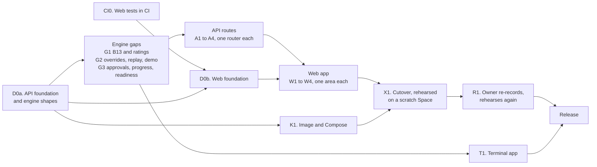
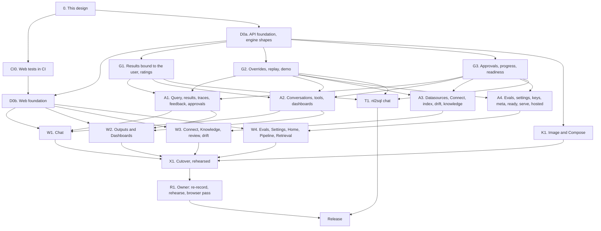

# Wave D: the apps (API v1, web app, Compose, terminal app) (design)

!!! note "Status: design"
    This page is the design for Wave D of the product redesign, the last
    wave, which ships as the release after 0.9. Nothing on it is built yet.
    Each pull request in [the PR plan](#14-pr-plan) adds a "Built" note to
    the sections it builds, as the earlier phases and waves do. Phase 1 is
    [Configuration v2 and the extension registry](configuration_v2.md);
    Phase 2 is [Phase 2: test bed, storage, providers, policies and adapter
    SDK v2](phase2.md); [Wave A](wave_a.md) (0.7: events, observers, hooks,
    approval, evals, routing, drift, sanity warnings, MCP over stdio) and
    [Wave B](wave_b.md) (0.8: glossary and knowledge, the profiler and review
    queue, clarification, plan-to-English, the cost guard, corrections) are
    designed on their own pages. Wave C (0.9: conversations and chat tools,
    `ChartSpec`, dashboards, the launchpad, API keys, MCP over HTTP) is
    designed in `architecture/wave_c.md`, not merged when this page was
    written; this page follows its amended version. Wave D renders what the
    three waves build. Where it needs something they do not provide, the gap
    is listed in [Needs from Waves A to C](#11-needs-from-waves-a-to-c) as a
    facade method, not designed around.

## Principles

The owner set them for the redesign, and they rank above everything below:

- **The package is the product; the playground only demonstrates it.** The
  web app talks only to `nl2sql-api`'s public `/api/v1` routes. The terminal
  app talks only to the Python facade. Neither holds feature logic: a chart
  is chosen by `engine.results.chart`, a dashboard by
  `engine.dashboards.generate`, a follow-up by `engine.conversations.ask`.
  Every gap this page found is a facade method plus a route, listed
  explicitly.
- **No active users: correct, not compatible.** Routes are renamed where
  their names are wrong, the playground's private server is deleted, and
  `nl2sql demo` keeps no flag whose behaviour is gone. No aliases.
- **Never over-engineer.** One process, one worker, jobs in memory, one
  Docker image, one Compose service, plain React and plain CSS. The apps
  expose what Waves A to C build and nothing they cut. The cut list is part
  of the design.
- **Both apps have a demo mode and a your-data mode.** Demo mode is the
  sample databases with recorded answers and no key; your-data mode is the
  caller's `nl2sql.yaml`.
- **The UI must not look AI-generated.** The playground's "Porcelain" design
  system (`web/playground/src/styles.css`: its tokens, type scale, the run
  spine, the raised card, the 44px controls) is the baseline for every new
  page. No component library, no gradient, no icon font.

## Decisions

The owner was asleep when this design was written and asked that its
recommendations be used, each marked for confirmation. Wave A uses D9 to
D35, Wave B D36 to D61 and Wave C D100 to D130, so Wave D starts at D200.
After an independent review several were amended; those are marked so. The
final redesign's decisions D13 to D16 are cited by the brief for this wave;
their numbers collide with Wave A's, so this page calls them **final-design
D13 to D16** and records how each is applied.

| # | Decision | Status | Where |
|---|---|---|---|
| D200 | **The apps hold serving state only.** `nl2sql-api` may keep the job queue, hosted-demo limits and sessions; everything a user would call a feature is a facade method. `nl2sql_api` imports only the top-level `nl2sql`, and the web app calls only `/api/v1` routes listed in the committed `openapi.json`. Both are tests. | decided overnight, owner to confirm | [Principles](#principles), [Boundaries](#12-boundary-and-invariant-changes) |
| D201 | **One route convention, applied to the old routes too:** plural nouns (`/datasources`, `/conversations`, `/results`), ids in the path, an action on a collection or a resource as a verb sub-path (`/proposals/accept`), long work as `POST /jobs/{kind}`. `/datasource`, `/index/{id}`, `/index-all`, `/index/status`, `/llm/{agent}` and `/query/{request_id}/results/...` are renamed or folded with no alias. | decided overnight, amended after review, owner to confirm | [Conventions](#route-conventions) |
| D202 | **One error envelope, and only the facade's own exceptions are mapped.** `{"error": {"code", "message", "fix", "details"}}` for every non-2xx response. The facade's named exceptions share one base, `nl2sql.NL2SQLError` (`code`, `message`, `fix`, `status`); the API maps that base and nothing else. Any other exception, a built-in `ValueError`, `KeyError` or `PermissionError` included, is a 500 naming a request id, never its text. A pipeline outcome stays a 200 with the `QueryResult`. | decided overnight, amended after review, owner to confirm | [Errors](#the-error-envelope) |
| D203 | **Every request resolves one full `UserContext`** (`user_id`, `tenant_id`, `roles`) from one configured source, `api.auth`: `api_keys` (Wave C's bearer keys), `proxy` (user, tenant and role headers, trusted only from `proxy.trusted_from`), `static` (one role) or `none`. Anonymous browser sessions exist only inside `serve --demo --hosted`, never as a config value. `trust_body_role`, `role_header` and `role` are deleted. | decided overnight, amended after review, owner to confirm | [Identity](#identity-and-auth) |
| D204 | **Results and traces are bound to the user who asked (bug B13)** in the engine. A run records its asker's `(tenant_id, user_id)`; `results.*` and `traces.get` with a `user_context` answer only that asker, and another user's run is "not found". `user_context=None` is the trusted in-process operator, as Wave A's D24 and Wave C's keys treat it, so `nl2sql trace` reads any run. The API, MCP and the terminal app always pass the caller, which a boundary test checks. Every new method this wave adds requires the caller and fails closed (Wave C's D130). | decided overnight, amended after review, owner to confirm | [Results bound to the user](#results-bound-to-the-user-b13) |
| D205 | **Final-design D15, applied safely:** with `api.auth: none`, `nl2sql-api` refuses to start unless it binds a loopback host, as Wave C's MCP does without keys. It then answers only requests whose `Host` is `localhost`, `127.0.0.1` or `[::1]` (with its port) and refuses any request carrying `Forwarded` or `X-Forwarded-For`, so neither a same-host proxy nor a DNS-rebinding page passes for the operator. Such a request is the local operator, with the admin roles. Compose ships with `auth: api_keys`. | decided overnight, amended after review, owner to confirm | [Identity](#identity-and-auth) |
| D206 | **Jobs run in process, on one worker thread, in memory.** A job is one facade call (index, profile, eval, dashboard) with a progress callback; jobs run one at a time in submission order; each caller has at most one job queued or running; the last 100 are kept and lost on restart. `nl2sql-api` runs one Uvicorn worker. The durable queue is cut. | decided overnight, amended after review, owner to confirm | [Jobs](#jobs) |
| D207 | **Server-Sent Events carry Wave A's `Event` as is** (`event.sse()`), through one helper that closes the facade's iterator when the client goes away (and cancels the token where the method takes one), with a heartbeat every 15 seconds. A job's event stream is an async generator, so a waiting browser holds no worker thread. | decided overnight, amended after review, owner to confirm | [Streams](#streams) |
| D208 | **`/ready` is real, and its rule is the engine's:** `CheckReport.ready(keys_optional=)` decides (every required datasource ready, every key resolves unless keys are optional, the index `ok` or `stale`). `/ready` answers status only to an anonymous caller and the report to an admin. The API now starts with a failed required datasource and reports not ready, instead of refusing to start. | decided overnight, amended after review, owner to confirm | [Health and readiness](#health-and-readiness) |
| D209 | **The replay provider is an LLM provider,** `provider: replay`, answering through the normal LLM interface from a recordings file; a question it has no recording for ends with the error code `REPLAY_MISS`. The demo's local fake HTTP server and its error-string matching leave the demo path. `nl2sql demo --record` is removed; recording is `scripts/record_demo_answers.py`, run by the owner. | decided overnight, owner to confirm | [The replay provider](#the-replay-provider) |
| D210 | **A key typed into the web app stays in the browser tab** and travels with each request as a per-call `LLMOverride` (`llm_override=` on the facade), in every mode. The web app never writes a key to disk. **A model the caller chooses runs only on a key the caller sent:** `X-NL2SQL-Models` is honoured only for providers the same request carries a key for, so a caller can never move a step onto the operator's account. Callers may bring a key only where `api.request_llm: true`; the demo sets it, the default is off. | decided overnight, amended after review, owner to confirm | [Keys and models](#keys-and-models-in-the-web-app) |
| D211 | **Final-design D13, applied with one change.** The web app ships inside `nl2sql-api` as package data, served by `nl2sql-api serve`. It adds no dependency to `nl2sql-api`, so there is no `web` extra there; instead the engine's `demo` extra becomes `nl2sql-api`, so `pip install "nl2sql-engine[demo]"` stays the one install line. `nl2sql demo` is a launcher that runs `python -m nl2sql_api serve --demo` in a child process; the engine never imports `nl2sql_api`. The playground server (`nl2sql/cli/demo/`) is deleted. | decided overnight, amended after review, owner to confirm | [Serving](#4-serving-the-web-app-and-nl2sql-demo) |
| D212 | **Final-design D14, applied through Wave C's writer:** Connect's **Save** calls Wave C's `datasources.save(id, *, by, env_file)`, which writes `datasources/<id>.yaml`, with `env_file` true only for the fresh local install (Wave C's D122). No second save target, no overlay, no new switch. Saving is admin work, so it is off on the hosted demo; where the config is mounted read-only (Docker), `save` fails with its own message and the datasource stays registered in memory until restart, which the page says. | decided overnight, amended after review, owner to confirm | [Saving a datasource](#saving-a-datasource-final-design-d14) |
| D213 | **Final-design D16, applied: one Docker image,** `nl2sql-api`, with all five adapters and Microsoft's ODBC driver for SQL Server. The driver and unixODBC are small beside the ONNX runtime and Chroma the image already carries, so slim and full images are not worth two tags. CI builds and tests `linux/amd64`; `arm64` is published only once K1 has checked that `msodbcsql18` exists for Debian 12 on arm64. The image job records the size; a split is reconsidered only if the ODBC layers pass 15% of it. | decided overnight, amended after review, owner to confirm | [Docker image](#the-image) |
| D214 | **Charts are drawn by our own SVG renderer from `ChartSpec`** (four kinds), in Porcelain's tokens; Vega is not bundled, and the Vega-Lite export is a download. Mermaid is loaded on the first diagram as its own chunk (about 2 to 3 MB of the `nl2sql-api` wheel, recorded by the web job). The single-file build is dropped. | decided overnight, amended after review, owner to confirm | [Charts and diagrams](#charts-diagrams-and-reports) |
| D215 | **Approval grants are stored by the engine** (`engine.approvals`), amending Wave A's D10 and D24 and Wave C's D107. Over HTTP the approver and the asker are two callers at different times: the asker cannot prove a grant, and the approver must not run the question as the asker, so the approver grants a request by id and the asker's re-run names the id. A grant is reusable until it expires (24 hours), as an `Approval` is. | decided overnight, amended after review, owner to confirm | [Approvals](#approvals-over-rest) |
| D216 | **One React app, in `web/app`** (renamed from `web/playground`): the existing Vite and React 18 setup, a hash router, plain JavaScript, Porcelain's CSS split per area, the API client split per area. No TypeScript, no state library, no component library. | decided overnight, amended after review, owner to confirm | [The web app](#5-the-web-app) |
| D217 | **Web tests stay what they are, run in CI, and read real shapes:** `node --test` over pure modules, a contract test that every route the client calls is in `openapi.json`, and golden response files (`web/app/src/api/fixtures/*.json`) written by the API's route tests and checked like `openapi.json`, which the node tests read instead of hand-made objects. No browser test runs in CI; the owner runs a short browser pass before the release. | decided overnight, amended after review, owner to confirm | [Testing](#testing-the-web-app) |
| D218 | **The terminal app is `nl2sql chat`,** on Textual behind the `tui` extra, in `nl2sql/cli/chat/`, on the facade only. Charts become text (a big number, sparklines, bars, a table); diagrams are shown as text. It takes no key: the CLI's environment and `.env` as everywhere. | decided overnight, owner to confirm | [The terminal app](#7-the-terminal-app-nl2sql-chat) |
| D219 | **Compose is one service:** `api` (one Uvicorn worker), one data volume, `auth: api_keys`, a healthcheck on `/api/v1/ready`. It starts not ready until indexed; `/ready` says why, and indexing is one command, `docker compose run --rm api nl2sql index`, so nothing re-indexes on every `up`. | decided overnight, amended after review, owner to confirm | [Compose](#6-docker-compose-self-host) |
| D220 | **Not in `nl2sql-api`:** MCP (Wave C's D126 stands: its own process), the operator event stream (observers are the operator's surface) and a `scan` route (Wave C's D121 left it to Wave D; the server's files and ports are still not the user's). `GET /events/catalog` is the one events route. | decided overnight, amended after review, owner to confirm | [Not in Wave D](#not-in-wave-d) |
| D221 | **The hosted demo serves the user's side of the web app:** chat, tools, charts, diagrams, reports, dashboards and the knowledge view, keyless from recordings or with the visitor's key. Admin work (Connect, review, index, profile, evals, drift, LLM settings, keys) is off because a hosted visitor is never admin, not by a hosted switch. Jobs, streams and questions are capped per session. | decided overnight, amended after review, owner to confirm | [The hosted demo](#the-hosted-demo) |
| D222 | **The guided questions are the datasources' `sample_questions`,** which `nl2sql init --demo` already writes (`config/project.py`). The only gap is exposing them on `DatasourceInfo`; `nl2sql.datasets.demo` stops being imported by any app. | decided overnight, amended after review, owner to confirm | [Demo mode](#demo-mode-and-your-data-mode) |
| D223 | **The foundation is three PRs, not one:** the CI web job first (bug B202, needs nothing), then the API foundation with every engine shape the gaps need, and the web foundation (shell, shared helpers, the client's transport, the CSS split, the build output) beside it, so the parallel PRs never edit the same file. | decided overnight, amended after review, owner to confirm | [PR plan](#14-pr-plan) |
| D224 | **Dashboards are Wave C's surface and no more:** generate, get, list, refresh, filter values, pin, and delete a dashboard or one tile (`delete(tile_id=)`). Editing, regenerating a stale tile, tiles from the caller's own questions at generate time and tenant sharing are not built: a stale tile is removed and the question pinned again. | decided after review, owner to confirm | [Routes](#the-routes) |

## Where 0.9 will leave us

What the code has today (0.6), plus what Waves A to C add, as their designs
describe them.

| Area | What 0.9 has | What is still missing |
|---|---|---|
| REST | `nl2sql-api` with 17 routes under `/api/v1` (query 4, datasource 4, indexing 4, llm 3, health 2: `routes/*.py`), plus Wave C's `GET /datasource-types` and `POST /datasource/test` | Nothing for conversations, chat tools, charts, dashboards, knowledge, proposals, evals, approvals, drift, clarification or API keys. Indexing blocks the request. |
| Errors | Several routes catch `Exception` and answer `str(e)` in a 500 (`routes/datasource.py` `list_datasources`, `get_datasource`, `remove_datasource`; `routes/indexing.py`; `routes/llm.py`) | A driver's message can carry a connection string; no shape a client can branch on (bug B200) |
| Identity | Roles only, from a header, a static role or the request body (`auth.py`); no `user_id`, no tenant | Nothing to bind a result, conversation or dashboard to; Wave C's D105 says Wave D must set a `user_id` before exposing conversations |
| Results | `engine.results.page` and `csv` read the engine's tenant folder (`api/results_api.py`) | Anyone with a role and a `trace_id` reads anyone's rows (bug B13) |
| Readiness | `GET /api/v1/ready` always answers `success: true` (`services/health.py`); the lifespan refuses to start on a failed required datasource (`main.py`) | An orchestrator cannot tell a broken API from a working one (bug B201) |
| The playground | A private FastAPI app with 21 routes (`nl2sql/cli/demo/playground/app.py`), served by `nl2sql demo` (`cli/commands/demo.py`); hosted mode (`playground/hosted.py`); a local fake LLM server for replay (`nl2sql.testing.fake_llm`, `nl2sql.llm.replay`); a React page in `web/playground` built into the engine's wheel | A second API beside `nl2sql-api`, with internal imports the boundary test lists as exceptions (`STILL_IMPORTED_FROM_INSIDE` in `tests/architecture/test_boundaries.py`). One question at a time: no follow-ups, charts, dashboards, review, evals or Connect. |
| Web tests | 24 `node --test` files under `web/playground/src` | Never run in CI: `.github/workflows/test.yml` has no Node job (bug B202) |
| Docker | `packages/api/Dockerfile` (PostgreSQL and MySQL drivers only); the Space image `deploy/huggingface/Dockerfile` runs `nl2sql demo --hosted` | No Compose for self-hosting; no SQL Server or DuckDB in the API image |
| Terminal | `nl2sql run` (one question), Wave C's `nl2sql launch` | No conversation in a terminal; `textual` is already kept out of `import nl2sql` by a test, and never used |

## 1. Goals and non-goals

### What ships

| Goal | What it means |
|---|---|
| **API parity** | Every Wave A to C capability a user or operator reaches through the facade has a `/api/v1` route, with one error envelope, one identity, streams over SSE and jobs for long work. |
| **Results bound to the user** | B13, fixed in the engine and enforced by every app that reads rows or traces. |
| **A real `/ready`** | What an orchestrator and Compose's healthcheck need, decided by the engine. |
| **The replay provider** | Recorded answers served through the normal LLM interface, so demo mode is the real pipeline with a recorded model. |
| **The web app** | Served by `nl2sql-api`; demonstrates every capability: chat with follow-ups and tools, charts, diagrams, reports, clarification, approval, "why this answer", warnings, dashboards, Connect, knowledge and proposals review, corrections, evals, drift. Demo and your-data modes. Porcelain kept. |
| **The hosted demo keeps working** | nl2sql.codewithnk.com: keyless replay and bring-your-own-key, on the new server, rehearsed on a scratch Space before the release. |
| **Compose** | Self-hosting in one command: one service, one volume, one worker, auth on, healthcheck. |
| **The terminal app** | `nl2sql chat`: conversation, results, charts as text, clarification and approval prompts, demo and your-data modes. |
| **No exceptions left** | `STILL_IMPORTED_FROM_INSIDE` is empty and deleted. |

### Not in Wave D

| Later | Why it waits |
|---|---|
| A durable job queue, several workers, horizontal scaling | D206: one process serves a team; a queue is a product of its own |
| OAuth or SSO login in the web app | Wave C's D127: keys first. A proxy that authenticates can use `api.auth: proxy`. |
| MCP mounted in `nl2sql-api`, an operator event stream over REST, a `scan` route | D220 |
| Editing a dashboard, regenerating a stale tile, tiles from the caller's own questions, tenant-shared dashboards, dragging a layout | D224: Wave C builds none of them; a stale tile is removed and pinned again |
| Editing the plan from "why this answer" | Wave B's cut list |
| A browser end-to-end suite in CI | D217: route tests, golden fixtures and the HTTP smoke cover the contract; the owner runs a browser pass before the release |
| Rate limiting beyond the hosted demo's | Per-question caps (Wave A) bound spend; a public deployment puts a proxy in front |
| TypeScript, a component library, a design-system package | D216 |
| A Kubernetes chart | `docs/deployment/kubernetes.md` stays prose; Compose is the supported self-host |

## 2. Order of work



## 3. The API: `/api/v1` at parity

### Route conventions

| Rule | Detail |
|---|---|
| **Prefix** | Everything under `/api/v1`; the web page and its assets at `/`. |
| **Nouns** | Plural collections, ids in the path: `GET /conversations/{id}`. An action is a verb sub-path on the resource it acts on: `POST /approvals/{id}/grant`, `POST /proposals/accept` (the facade takes a list of ids). |
| **Long work** | `POST /jobs/{kind}` returns `202` and the job; `GET /jobs/{id}` and `GET /jobs/{id}/events` follow it ([Jobs](#jobs)). No route blocks for longer than a question. |
| **Streams** | A route that streams a run ends in `/stream` and answers `text/event-stream` ([Streams](#streams)). |
| **Bodies** | Request models are pydantic, strict (`extra="forbid"`), declared beside their router. Responses are the facade's own models (`QueryResult`, `Conversation`, `Dashboard`, `Proposal`, ...), served as they are, so the HTTP shape cannot drift from the package's. |
| **The caller** | Every handler that calls an owned, scoped or privileged facade method passes the request's `UserContext` as `user_context=` or, for an admin write, `by=`. |
| **Sync handlers** | A handler that calls the engine is `def`, so Starlette runs it in its thread pool, as `routes/query.py` does today. |
| **No services layer** | `nl2sql_api/services/` and `dependencies.py` are deleted: each wrapper was one line over a facade call. A router calls the facade directly. |
| **OpenAPI** | Every route has a summary, its request and response models and its error statuses. `packages/api/openapi.json` is committed; `test_openapi_snapshot_is_current` fails when it is stale and prints the command that rewrites it. |

### The error envelope

```python
# nl2sql_api/errors.py
class ApiError(BaseModel):
    code: str                     # an NL2SQLError's code, or NOT_FOUND, INVALID_REQUEST,
                                  # UNAUTHENTICATED, FORBIDDEN, CONFLICT, LIMIT_REACHED, NOT_READY, INTERNAL
    message: str                  # one sentence a person can act on
    fix: str | None = None
    details: list[dict] = []      # 422: one entry per problem, {"loc": [...], "msg": ...}; never a value
    request_id: str | None = None # 500 only: the id in the server log

class ErrorBody(BaseModel):
    error: ApiError
```

**One base class (D202).** The engine gains `nl2sql.NL2SQLError(Exception)`
with `code`, `message`, `fix` and `status` (the HTTP status it means:
404, 409, 422 or 403). The facade's named exceptions derive from it as well
as from the built-in they are today, so a Python caller's `except
LookupError` still works:

| Exception (from) | Status | Code |
|---|---|---|
| `ConversationNotFound`, `DashboardNotFound` (Wave C), `ResultNotFound`, `JobNotFound`, `DatasourceNotFound`, `ApprovalNotFound` (new) | 404 | `NOT_FOUND` |
| `ConversationBusy` (Wave C); `ReviewError(FILE_CHANGED)` (Wave B) and Wave C's `save` that reuses it | 409 | `CONFLICT`, `FILE_CHANGED` |
| `NoTiles`, `TileNotPinnable`, `NotIndexed`, `SecretValueInConfig` (Wave C); `MissingProviderKey` (G2); a facade argument check that raises its own subclass | 422 | the exception's code |
| `ReviewError(NOT_AUTHORIZED, NOT_WRITABLE)` (Wave B); a caller without an admin or approver role where the facade checks it (`NotAuthorized`, new) | 403 | the exception's code |

| Raised | Status | Code |
|---|---|---|
| A request body or query that does not validate | 422 | `INVALID_REQUEST`, each problem by path and message; the input is never echoed (the playground's `_invalid_request` handler, generalised) |
| No identity | 401 | `UNAUTHENTICATED`, with `WWW-Authenticate: Bearer` under `api_keys` |
| A hosted limit | 429 | `LIMIT_REACHED`, with `Retry-After` |
| Not ready | 503 | `NOT_READY` |
| Anything else: a built-in `ValueError`, `pydantic.ValidationError`, `KeyError`, `PermissionError` or `OSError` from anywhere | 500 | `INTERNAL`; the message is "Something failed on the server. Request id: ...", and the exception is logged with that id and the run's `trace_id` (Wave A's log correlation) |

A pipeline outcome is not an error: `POST /query` answers 200 with a
`QueryResult` whose `status` is `error`, `needs_clarification`,
`needs_approval` or `stopped`, as today. D0a removes the per-route `except
Exception` blocks of the old routes so the one handler applies to every
route from then on. `test_no_route_returns_exception_text` raises, through
every registered route with a stub engine, a `ValueError`, a
`pydantic.ValidationError` (with an `input_value`), a `KeyError` and a
`PermissionError`, each carrying a fake connection string, and checks that
each is a 500 whose body holds no part of it (B200).

### Identity and auth

`nl2sql_api/identity.py` replaces `auth.py`. One dependency, `caller`,
resolves the request's `UserContext`; `admin` adds the role check.

```yaml
# nl2sql.yaml (the api section; the engine validates it and never reads it)
api:
  auth: api_keys              # api_keys | proxy | static | none (default: none)
  proxy:                      # auth: proxy only
    trusted_from: [127.0.0.1/32, "::1/128"]   # CIDRs the proxy connects from
    user_header: X-Forwarded-User
    tenant_header: null
    roles_header: X-NL2SQL-Roles
  static_role: analyst        # auth: static only
  request_llm: false          # callers may send their own key and models (D210)
  cors_origins: []
```

| `api.auth` | The caller | Admin |
|---|---|---|
| `api_keys` | `Authorization: Bearer <token>`, verified by Wave C's `engine.api_keys.verify`; the key's `user_id`, `tenant_id` and roles. Missing or invalid: 401. | A key whose roles include one of `policies.admin_roles` |
| `proxy` | The headers the proxy sets on every request: the user, the tenant (else `settings.tenant_id`), the roles (comma-separated). Honoured only when the connecting peer is in `proxy.trusted_from`; from any other peer, or with no user header, a 401. | The roles, as above |
| `static` | `user_id: "static"`, `static_role`. For a single-user deployment on a private network. | Only when `static_role` is an admin role |
| `none` | Refuses to start unless the bind host is loopback (D205). A request whose `Host` is `localhost`, `127.0.0.1` or `[::1]` (with the port) and that carries no `Forwarded` or `X-Forwarded-For` header is the local operator, `user_id: "local"` with the admin roles; any other request is a 403 naming the fix. | That operator |

The hosted demo's anonymous sessions are not a value of `api.auth` (D203):
`serve --demo --hosted` installs them itself ([The hosted
demo](#the-hosted-demo)). `api.trust_body_role`, `api.role_header` and
`api.role`, and the body's `user_context`, are deleted. The engine's `Api`
model (`config/models.py`) carries the new fields so `nl2sql config check`
reports a typo.

### Results bound to the user (B13)

B13 is fixed in the engine (D204), so the facade, the API, MCP and the
terminal app all get it:

1. The result writer records the run's `tenant_id` and `user_id` in the
   result manifest (`execution/artifacts/results.py`), beside the columns it
   already records; the trace document records them too.
2. `engine.results.manifest`, `page`, `csv` and Wave C's `chart` take
   `user_context=None` (replacing `chart`'s `tenant_id`); with a context,
   they compare it with the stored pair, and a mismatch raises
   `ResultNotFound`. `engine.traces.get(trace_id, *, user_context=None)`
   does the same and returns `None`.
3. `user_context=None` is the trusted in-process operator: it reads any run
   of the engine's tenant, as `nl2sql trace <id>` (`cli/commands/trace.py`)
   and `nl2sql run` need, and as Wave A's D24 trusts the context an
   in-process caller passes.
4. Every app passes the caller. `test_apps_always_pass_the_caller` scans
   `nl2sql_api/`, `nl2sql/mcp/` and `nl2sql/cli/chat/` (AST) for calls of
   `results.*`, `traces.get` and `results.chart` without `user_context`.
5. Wave C's built-in `chart` tool and dashboard runs pass the tool's or the
   tile's caller (`nl2sql/chat_tools/chart.py`, `nl2sql/dashboards/`).
6. Results written before the change have no owner and are read only by
   `None`; the release notes say so.

`test_another_users_result_is_not_found`, `test_another_users_trace_is_not_found`,
`test_cli_trace_reads_any_run`, `test_ownerless_result_is_read_only_by_the_operator`
(engine) and `test_results_route_hides_another_users_rows` (API).

### Streams

`nl2sql_api/sse.py` is the one place an SSE response is built:

```python
def event_stream(open_events: Callable[[], Iterator[Event]], request: Request,
                 *, token: CancellationToken | None = None) -> StreamingResponse
```

| Rule | Detail |
|---|---|
| **The wire** | Each item is Wave A's `Event.sse()`: `event: <name>` and `data: <json>`. No second event vocabulary. |
| **Cancellation** | The iterator runs in the thread pool. When the client disconnects, the helper closes the iterator, which cancels the run for Wave C's `conversations.stream` (it takes no token and cancels on close), and cancels `token` too for `stream_query`, which takes one (`cancel_when_disconnected` in `playground/app.py`, moved). |
| **Heartbeat** | A `: keep-alive` comment every 15 seconds, so a proxy does not close a quiet stream while the planner thinks. |
| **Headers** | `Cache-Control: no-cache`, `X-Accel-Buffering: no` (both servers set them today). |
| **Refusals** | Identity, validation and hosted limits are checked before the stream starts and answer with the envelope; once streaming, a failure is the run's `run.failed`. |

The streams: `POST /query/stream` (Wave A's caller-safe allow-list, ending
`run.finished` with `data.result`), `POST /conversations/{id}/turns/stream`
(Wave C's run events with `conversation.rewritten`, ending
`conversation.turn`), and `GET /jobs/{id}/events`, which is an `async`
generator over the in-memory job and holds no thread.

### Jobs

```python
# nl2sql_api/jobs.py
JobKind = Literal["index", "profile", "eval", "dashboard"]

class JobProgress(BaseModel):
    at: datetime
    step: str                    # "chinook", "case 12 of 80", "tile 3 of 8"
    done: int
    total: int | None

class Job(BaseModel):
    id: str                      # 22 url-safe characters
    kind: JobKind
    status: Literal["queued", "running", "succeeded", "failed", "cancelled"]
    params: IndexJob | ProfileJob | EvalJob | DashboardJob   # the request body, typed per kind
    created_by: str | None       # the caller's user_id
    created_at: datetime
    started_at: datetime | None
    finished_at: datetime | None
    progress: list[JobProgress]
    result: IndexResult | list[ProfileReport] | EvalReport | DashboardCreated | None   # typed per kind
    error: ApiError | None
```

`IndexResult` is the index build's report; `DashboardCreated` is the new
dashboard's id and its first `DashboardRun`. Each lands in `openapi.json`,
so the web app reads a typed eval report.

| Kind | Route | Facade call | Progress from | Who |
|---|---|---|---|---|
| `index` | `POST /jobs/index` `{datasource_ids?}` | `engine.index.build(ids, on_datasource=, cancellation_token=)` | `on_datasource` | admin |
| `profile` | `POST /jobs/profile` `{datasource_ids?, draft, max_cost_usd?}` | Wave B's `engine.knowledge.profile(ids, user_context=, draft=, max_cost_usd=, on_datasource=, cancellation_token=)`, on the server's key: a key typed in a browser never pays for drafts | `on_datasource` | admin |
| `eval` | `POST /jobs/eval` `{suites?, mode, cases?, max_cost_usd?}` | Wave A's `engine.evals.run(..., on_case=, cancellation_token=)` | `on_case` | admin, in every mode: a report holds every role's cases, plans and SQL |
| `dashboard` | `POST /jobs/dashboard` `{datasource_id, title?, max_tiles?}` | Wave C's `engine.dashboards.generate(..., user_context=, on_tile=, cancellation_token=)` | `on_tile` | any caller; the dashboard is theirs |

| Rule | Detail |
|---|---|
| **One worker (D206)** | One daemon thread takes jobs in submission order. Two index builds never race on the index, and a profile never reads a snapshot an index build is replacing. A question is not a job: it runs on the request's thread as today. |
| **One process** | The queue lives in the process, so `nl2sql-api serve` and the image run one Uvicorn worker. `serve` has no `--workers`; the docs say why. |
| **In memory** | The last 100 jobs. A restart loses them; what they produced (an index build, proposals, a dashboard) is in the engine's stores. |
| **One per caller** | A caller with a job queued or running gets a 409 naming it, so one caller cannot stall the queue. The duplicate check for `dashboard` is per caller, so two users generating a dashboard for the same datasource never collide. |
| **Ownership** | `GET /jobs` lists the caller's jobs (an admin sees all); another user's job is a 404, as D204. |
| **Cancel** | `DELETE /jobs/{id}`: a queued job is removed; a running one has its token cancelled and stops between items (datasources, cases, tiles). |
| **Events** | `GET /jobs/{id}/events` sends every `JobProgress` so far, then each new one, then `job.finished` with the job. These are the API's, not the engine's catalog's. |
| **Facade gaps** | `on_datasource` exists on `index.build` and `on_case` on `evals.run`; `profile` and `generate` gain a callback, and all four gain `cancellation_token` (G3). |

`test_jobs_run_one_at_a_time_in_order`, `test_job_progress_replays_then_follows`,
`test_job_events_hold_no_worker_thread`, `test_cancel_running_job_stops_between_items`,
`test_second_job_for_a_caller_is_a_conflict`,
`test_two_users_generate_for_one_datasource`, `test_another_users_job_is_not_found`,
`test_eval_job_is_admin_only`, `test_api_runs_one_worker`.

### Health and readiness

| Route | Answers |
|---|---|
| `GET /health` | Liveness: `{"status": "ok", "version": {"engine", "api"}}`, from process state only. The Space's release check polls it for the version (`scripts/fresh_install_check.py`). |
| `GET /ready` | The engine's `check()` report, cached 10 seconds, judged by `CheckReport.ready(keys_optional=)` (D208): `keys_optional` is true when `api.request_llm` is on or every agent is on `replay`. 200 `{"status": "ready"}` or 503 `{"status": "not_ready"}` to everyone; an admin caller also gets `CheckReport.problems()` (each failing datasource and its stage, each agent whose key does not resolve, the index status), never a secret. An optional datasource that failed is a problem but not "not ready". |
| `GET /meta` | Without a caller: `mode` (`demo`, `hosted`, `your_data`), the identity source and `request_llm`, which is what the page needs to show a sign-in. With a caller: also the datasources it may reach with their `sample_questions` (D222), which of those the replay provider has recordings for, `recorded_with`, and the hosted limits. |
| `GET /about` | `engine.about()`: the pipeline's steps and the model each runs on (today's `/api/pipeline`). |

`nl2sql-api` no longer refuses to start when a required datasource fails:
it starts, `/ready` is 503, and the reason is one admin request away, which
an orchestrator's restart loop would otherwise hide.

`test_ready_fails_on_a_required_datasource`, `test_ready_passes_with_an_optional_failure`,
`test_ready_fails_on_a_missing_index`, `test_ready_passes_with_request_keys`,
`test_ready_details_only_for_admin`, `test_meta_without_a_caller_lists_no_datasource`.

### The routes

Every route below is new unless marked. "Admin" is the `admin` dependency;
everything else needs a caller. A name in **bold** in the facade column is
a gap ([section 11](#11-needs-from-waves-a-to-c)). `caller` is the request's
`UserContext`.

**Questions, results, traces and feedback** (`routes/query.py`)

| Route | Facade | Notes |
|---|---|---|
| `POST /query` (changed) | `run_query(question, user_context=caller, datasource_id=, execute=, choice=, approvals=, llm_override=)` | Body: `question` (was `natural_language`), `datasource_id`, `execute`, `choice` (Wave B's `ClarificationChoice`), `approval_ids` (D215). A body with both `choice` and `approval_ids` is a 422 `CLARIFICATION_INVALID` before the engine is called, as Wave B refuses them together. |
| `POST /query/stream` (changed) | `stream_query(...)` | Wave A's `Event`s |
| `GET /results/{trace_id}` | `results.manifest(..., user_context=caller)` | The manifest, without rows |
| `GET /results/{trace_id}/{result_id}` (moved) | `results.page(..., user_context=caller)` | Was `/query/{request_id}/results/{result_id}` |
| `GET /results/{trace_id}/{result_id}.csv` (moved) | `results.csv(..., user_context=caller)` | |
| `GET /results/{trace_id}/{result_id}/chart` | Wave C's `results.chart(trace_id, result_id, kind=, user_context=caller)` | `?kind=`; `?format=vega-lite` answers `to_vega_lite()` |
| `GET /traces/{trace_id}` | `traces.get(trace_id, user_context=caller)` | Today only the playground has it |
| `POST /feedback` (from the playground) | **`feedback.record(trace_id, rating, *, user_context, note=None)`** | The engine reads the run's own trace; the playground's in-memory "recent runs" goes |
| `POST /feedback/correct` | Wave B's `feedback.correct(trace_id, *, user_context=caller, sql=, plan=, question=, note=)` | Returns the `Proposal` |
| `GET /feedback` | `feedback.list()` | Admin |

The answer view's diagram is the conversation's `diagram` tool; there is no
`/diagram/{trace_id}` route.

**Approvals** (`routes/approvals.py`, D215)

| Route | Facade | Notes |
|---|---|---|
| `GET /approvals` | **`approvals.list(*, user_context=caller, status="pending")`** | An approver sees the requests their roles may approve; an asker sees their own |
| `POST /approvals/{request_id}/grant` | **`approvals.grant(request_id, *, by=caller)`** | `NotAuthorized` (403) unless the caller holds one of the hook's approver roles |
| `POST /approvals/{request_id}/deny` | **`approvals.deny(request_id, *, by=caller, reason=None)`** | |

**Conversations and chat tools** (`routes/conversations.py`; every Wave C
method takes `user_context=caller`)

| Route | Facade |
|---|---|
| `POST /conversations` | `conversations.start(user_context=, datasource_id=)` |
| `GET /conversations` | `conversations.list(user_context=)` |
| `GET /conversations/{id}` | `conversations.get` |
| `DELETE /conversations/{id}` | `conversations.delete` |
| `POST /conversations/{id}/turns` | `conversations.ask(id, text=, user_context=, choice=, execute=, llm_override=)` |
| `POST /conversations/{id}/turns/stream` | `conversations.stream(...)` |
| `POST /conversations/{id}/retry` | `conversations.retry(id, user_context=, approvals=, llm_override=)`, the body's `approval_ids` passed as **request ids** |
| `POST /conversations/{id}/tools/{name}` | `conversations.tool(id, name, args, user_context=)` |
| `GET /conversations/{id}/report` | `conversations.report(id, user_context=, turns=, title=)`, `text/markdown` |
| `GET /chat-tools` | `chat_tools.list()` |

A busy conversation is a 409 (`ConversationBusy`). A turn with status
`needs_clarification` is answered with `choice` (an option id) in the next
turn's body (Wave C's D104).

**Dashboards** (`routes/dashboards.py`; D224; every method takes
`user_context=caller`)

| Route | Facade |
|---|---|
| `GET /dashboards` | `dashboards.list`: the caller's |
| `POST /jobs/dashboard` | `dashboards.generate` (a job) |
| `GET /dashboards/{id}` | `dashboards.get` |
| `DELETE /dashboards/{id}` | `dashboards.delete(id)` |
| `DELETE /dashboards/{id}/tiles/{tile_id}` | `dashboards.delete(id, tile_id=)`: how a stale tile is removed |
| `POST /dashboards/{id}/refresh` | `dashboards.refresh(id, filters=)`; synchronous: a refresh makes no model call and its tiles are capped at `max_tiles` |
| `GET /dashboards/{id}/filters/{filter_id}/values` | `dashboards.filter_values` |
| `POST /dashboards/pin` | `dashboards.pin(conversation_id, turn, dashboard_id=, title=)` |
| `GET /datasources/{id}/starter-questions` | `dashboards.suggest_questions(id, user_context=, n=)` |

**Datasources, Connect, index and drift** (`routes/datasources.py`,
`routes/index.py`)

| Route | Facade | Notes |
|---|---|---|
| `GET /datasources` (moved) | `datasources.list()` | With **`sample_questions`**, filtered to the datasources the caller's scope reaches |
| `GET /datasources/{id}` (moved) | `datasources.get` | |
| `GET /datasources/{id}/schema` | `datasources.schema(id, user_context=caller)` (Wave A, B29) | The caller's view |
| `GET /datasources/{id}/diagram` | Wave C's `datasources.diagram(id, user_context=caller, tables=)` | Mermaid |
| `GET /datasource-types` (Wave C, kept) | `datasources.types()` | The Connect form's adapters and connection schemas |
| `POST /datasources/test` (moved from Wave C's `/datasource/test`) | `datasources.test(Datasource)` | Admin; registers nothing |
| `POST /datasources` (moved) | `datasources.add`, then Wave C's `datasources.save(id, by=caller, env_file=)` when `save: true` | Admin; `env_file` exactly as Wave C's D122 decides (D212) |
| `DELETE /datasources/{id}` (moved) | `datasources.remove` | Admin |
| `GET /index` (moved from `/index/status`) | `index.health()` | |
| `POST /jobs/index` (replaces `/index/{id}`, `/index-all`) | `index.build` (a job) | Admin |
| `DELETE /index` (kept) | `index.clear()` | Admin |
| `GET /index/check` | Wave A's `index.check(ids)` | Drift: a `DriftReport` per datasource with its impact. Admin: it reflects every live database. |
| `GET /index/inspect`, `POST /index/inspect` | `index.inspect_defaults()`, `index.inspect(...)` | The Retrieval inspector (the playground's `/api/retrieval`) |

**Knowledge and proposals** (`routes/knowledge.py`)

| Route | Facade |
|---|---|
| `GET /knowledge` | `knowledge.show(datasource_id=, user_context=caller)` |
| `GET /knowledge/sources` | `knowledge.sources(user_context=caller)` |
| `POST /knowledge/reload` | `knowledge.reload(user_context=caller)` (admin) |
| `POST /knowledge/choices` | `knowledge.save_choice(choice, user_context=caller, term=)`: a clarification pick as a `term` proposal |
| `POST /jobs/profile` | `knowledge.profile` (a job; admin) |
| `GET /proposals` | `proposals.list(user_context=caller, kind=, status=, datasource_id=)` (admin) |
| `GET /proposals/{id}` | `proposals.get(id, user_context=caller)` (admin) |
| `POST /proposals/accept` | `proposals.accept(ids, by=caller, edits=)` → `AcceptReport` (admin) |
| `POST /proposals/reject` | `proposals.reject(ids, by=caller, reason=)` (admin) |
| `POST /proposals/examples` | Wave C's need B2, `proposals.propose_examples(datasource_id, questions, by=caller)`: Connect files the starter questions as `example` proposals (admin) |

The review file (`proposals.export` and `apply`) stays a CLI workflow: a file
in git is its point. Wave C's D121 has no draft route; drafting is the
`profile` job with `draft: true`, and its output is proposals.

**Evals** (`routes/evals.py`; admin)

| Route | Facade |
|---|---|
| `GET /evals/suites` | `evals.load()`: suites with their case counts |
| `GET /evals/scorers` | `evals.scorers()` |
| `POST /jobs/eval` | `evals.run` (a job); the report is the job's `result` |

`evals.gate`, `regenerate` and `seed` stay in the CLI: they write files or
compare with a baseline file in the repository.

**Settings, keys and events** (`routes/settings.py`)

| Route | Facade | Notes |
|---|---|---|
| `GET /llm` (kept) | `llm.list()` | Folds today's `GET /llm/{agent}`, which is removed |
| `GET /llm/providers` | `llm.providers()`, with **labels, verified models and key shape** | The Settings page's choices |
| `PUT /settings/llm` (kept) | `llm.replace(section, by=caller)` | Admin; in memory |
| `GET /api-keys`, `POST /api-keys`, `DELETE /api-keys/{id}` | Wave C's `api_keys.list(by=)`, `create(..., by=)`, `revoke(id, by=)` | Admin; the token is in the `POST` response once |
| `GET /events/catalog` | Wave A's `events.catalog()` | |

### Approvals over REST

Wave A's approval holds nothing: the app that asked keeps the
`ApprovalRequest`, and the approver's `Approval` names who approved. In
process that works because one program sees both people. Over HTTP the
approver and the asker are two callers, at different times, on different
connections: the asker's request cannot prove that someone else approved,
and the approver must not re-run the question as the asker (Wave A binds
the run to the asker). So D215 keeps the grant in the engine, keyed by the
request's id:

```python
# engine.approvals (state store, beside the review queue); the caller is required (D204)
def list(self, *, user_context, status="pending") -> list[ApprovalRecord]: ...
def grant(self, request_id: str, *, by: UserContext) -> ApprovalRecord: ...
def deny(self, request_id: str, *, by: UserContext, reason: str | None = None) -> ApprovalRecord: ...
```

| Rule | Detail |
|---|---|
| **Submitted by the run** | A run that ends `needs_approval` stores each `ApprovalRequest` as pending; nobody calls a `submit`. |
| **Granted by an approver** | `grant` checks that `by` holds one of the hook's approver roles (Wave A's D24), else `NotAuthorized`. |
| **Used by id** | `run_query(approvals=)`, `stream_query(approvals=)` and Wave C's `conversations.retry(approvals=)` accept request ids beside `Approval` objects; a granted id becomes the `Approval` the engine already checks (the request's hash, the asker, the approver's roles, the SQL's hash), so Wave A's checks are unchanged. A denied or unknown id is `APPROVAL_NOT_GRANTED` on the result. |
| **Reusable until expiry** | A grant answers any re-run of that request (same question, asker, plan and SQL) for `settings.approvals.max_age_hours` (24), as Wave A's `Approval` is reusable. Purged by `engine.storage.purge()`. |
| **Amends** | Wave A's D10 ("nothing is stored") and D24, and Wave C's D107 ("nothing is stored"; `retry` takes `Approval`s), listed in [Needs](#11-needs-from-waves-a-to-c). |

In the web app the asker sees "Waiting for approval" with the reason; an
approver sees the request under **Approvals** (the plan in English, the
SQL, the reason) and grants it; the asker's **Run it now** calls `retry`
with the id.

### The replay provider

Demo mode must answer with no key, through the same pipeline a key would
use (D209):

```yaml
# llm.yaml in the demo project
provider: replay
recordings: null        # null: the recordings packaged with the engine (nl2sql/datasets/recordings/)
```

| Rule | Detail |
|---|---|
| **Where** | `nl2sql/llm/providers/replay.py` (from `llm/replay.py`'s `ReplayStore` and `extract_question`): a provider in `PROVIDER_PRESETS` with no key variable, whose chat model answers `structured()` and plain calls from the store. |
| **Matching** | As today: the structured-output name plus the question the prompt was built around. Wave C's rewriter prompt gains the same `[USER_QUERY]` marker so a recorded follow-up matches. |
| **A miss** | The provider raises `ReplayMiss`; the pipeline ends with `REPLAY_MISS` (`ERROR`, not retryable) and "No recorded answer for this question. Add an API key to ask it live." No marker string is matched (`REPLAY_MISS_MARKER` and `finish_question` in `playground/app.py` go). |
| **Labelled** | Each usage call records `provider: "replay"` and the recording's `recorded_with` model; the web app shows "Recorded run" from that, not from a flag the server adds. |
| **Coverage** | `engine.llm.recorded(questions) -> list[str]` answers which questions the store covers, for `/meta`. |
| **Overrides** | A per-call `LLMOverride` with a key replaces the replay provider for that call, which is how a hosted visitor goes live. |
| **Recording** | `scripts/record_demo_answers.py` runs the guided questions, the scripted follow-ups and the clarification question through a real provider with a recording wrapper (`nl2sql.llm.replay.Recorder`, internal; scripts may import it) and writes the store. `nl2sql demo --record`, `RecordingProxy` and the demo's use of `FakeLLMServer` go; `FakeLLMServer` stays for tests. |

### Keys and models in the web app

D210 makes one rule for every mode: a key typed into the browser lives in
that tab's `sessionStorage` and is sent with each request; the model per
step likewise. The hosted page already works this way
(`web/playground/src/hostedKey.js`, `hostedModels.js`); the local page's
"save key to `.env`" and "write models to `llm.yaml`" go. The cost is that
a local user types the key once per tab (or puts it in `.env` once);
`getting_started/demo.md` says so.

| Header | Holds |
|---|---|
| `X-NL2SQL-Api-Key-<provider>` | One provider's key; one header per key (as today) |
| `X-NL2SQL-Models` | `{"ast_planner": "anthropic:claude-opus-5"}`, no secret (as today) |

`nl2sql_api/overrides.py` (in D0a) turns the headers into the engine's
`LLMOverride(keys={provider: key}, models={agent: (provider, model)})` and
passes it as `llm_override=` (a new keyword, so it never means two types
beside Wave A's `evals.run(llm=)`) to `run_query`, `stream_query` and
`conversations.ask`, `stream` and `retry`.

| Rule | Detail |
|---|---|
| **Off by default** | With `api.request_llm: false` the headers are a 403 naming the setting. |
| **Never the operator's key** | A model in `X-NL2SQL-Models` on a provider the request sent no key for is a 422 naming the step and the provider (`MissingProviderKey`), even when the server holds that provider's key. Keys without models run the configured models, using the caller's key for its provider, as `llm/request_key.py` resolves them today. |
| **Never written** | A key is never logged, never in a trace (the redactor already masks request keys) and never in an error. |
| **Not for admin work** | Profiling, evals and dashboards run on the server's configuration; `llm_override` is on the question and turn methods only. |

`test_request_key_headers_refused_without_request_llm`,
`test_model_override_without_request_key_is_422_even_when_server_has_key`,
`test_request_key_never_in_a_response_log_or_trace`.

### Saving a datasource (final-design D14)

Connect tests a connection, registers it with `datasources.add`, and saves
it only through Wave C's writer (D212):

| Where | What **Save** does |
|---|---|
| `nl2sql-api serve` on loopback with `auth: none`, config loaded from a folder | `datasources.save(id, by=caller, env_file=True)`: `datasources/<id>.yaml`, secrets as `${env:...}` with the values in `.env` (Wave C's D122) |
| Any other deployment with an admin caller | `datasources.save(id, by=caller, env_file=False)`: a literal secret is a 422 `SecretValueInConfig` asking for a `${env:...}` reference |
| The Docker image, Compose (the config mounted read-only) | `save` fails with its own message; the page shows it and that the datasource is registered in memory until restart, and how to add it to the mounted config |
| The hosted demo | Off: Connect is admin work (D221) |

## 4. Serving the web app and `nl2sql demo`

### `nl2sql-api serve`

`nl2sql_api/serve.py`, run as `nl2sql-api serve` (the console script,
replacing `server.py`) or `python -m nl2sql_api serve`:

```text
nl2sql-api serve [--config PATH] [--host 127.0.0.1] [--port 8000]
nl2sql-api serve --demo [--dir nl2sql-demo] [--host] [--port]
nl2sql-api serve --demo --hosted [--dir] [--host] [--port] [--questions-per-minute 6] [--questions-per-session 30]
```

| Mode | What it does |
|---|---|
| your data (default) | Builds `NL2SQL.from_config(path)`, serves `/api/v1` and the page. Refuses to start under `auth: none` on a non-loopback host (D205). |
| `--demo` | `nl2sql.prepare_demo(dir)` writes the demo project the first time (`init_project(demo=True)`), builds the index if `check()` says it is missing, and returns the config path. The demo's model is chosen as today's `nl2sql demo` chooses it: a provider key in the environment or the project's `.env`, else a reachable Ollama, else the replay provider. The demo config sets `api.request_llm: true` and `api.auth: none`. |
| `--demo --hosted` | As `--demo`, plus: refuses to start when a provider key is in the environment (as today), never uses Ollama, installs anonymous sessions ([below](#the-hosted-demo)) and the per-visitor limits (`nl2sql_api/hosted.py`, from `playground/hosted.py`'s `Limits`), and sends the link-preview tags (`playground/preview.py`, moved). |

The page, its chunks, the social card and the clips are package data of
`nl2sql_api` (`web/static/`, `web/assets/`), served at `/`, `/assets/`,
`/social-card.png` and `/clips/{name}` (`routes/web.py`). Any other path
under `/` that is not a file answers the page, so the hash router owns
navigation.

### `nl2sql demo`, a launcher (D211)

`cli/commands/demo.py` shrinks to about 40 lines. It checks that `nl2sql_api`
is installed (`importlib.util.find_spec`), else prints
`pip install "nl2sql-engine[demo]"` and exits 1. It then starts
`[sys.executable, "-m", "nl2sql_api", "serve", "--demo", ...]` with
`subprocess.Popen`, opens the browser unless `--no-browser`, and waits; a
`KeyboardInterrupt` is forwarded to the child (`CTRL_BREAK_EVENT` on
Windows, `SIGINT` elsewhere) and the launcher exits with the child's code.
Its flags are `--dir`, `--host`, `--port` and `--no-browser`. `--hosted`
and the limits are gone from it (the Space runs `nl2sql-api serve`
directly), and so are `--record`, `--api-key` and `--allow-settings`, with
no alias: recording is a script, a key is typed into the page or put in
`.env`, and the settings gate is D205's loopback rule.

The engine's `pyproject.toml` replaces `demo = ["fastapi", "uvicorn"]` with
`demo = ["nl2sql-api~=X.Y.Z"]` (the release-please version marker, as
`nl2sql-api` pins the engine), and drops the package data for
`nl2sql.cli.demo` and `nl2sql.cli.demo.playground`. The two distributions
now depend on each other; `publish_pypi.yaml` uploads `nl2sql-api` before
or with the engine, so `pip install "nl2sql-engine[demo]"` never resolves
in between, and `docs/development/releasing.md` says so. The recordings
move to `nl2sql/datasets/recordings/`, beside the sample databases they
answer. Wave C's `nl2sql launch` ends by printing a command that serves the
project; that line becomes `nl2sql-api serve --config DIR/nl2sql.yaml`.

### Demo mode and your-data mode

| | Demo | Your data |
|---|---|---|
| Datasources | The three sample SQLite databases | The caller's config |
| Guided questions | Each demo datasource's `sample_questions`, which `nl2sql init --demo` already writes (D222) | The datasource's `sample_questions`, plus the glossary `examples` a person accepted (Wave C's starter questions reach them only through an accepted `example` proposal) |
| The model | Replay, a key in the environment, a reachable Ollama, or the tab's key | The configured model, or the tab's key where `request_llm` is on |
| Knowledge | The demo glossary (Wave B ships one for Chinook) | The caller's |
| Dashboards | Generated from the demo's indexed schema, no model call | Generated after indexing, no model call |
| Evals | The Chinook suite (local operator only) | The caller's suites (admin) |

### The hosted demo

The Space keeps its URL, its limits and its keyless start (D221):

| | Hosted |
|---|---|
| Identity | An anonymous session per browser: a random 128-bit id in the `HttpOnly`, `SameSite=Lax` cookie `nl2sql_demo_session` that `playground/hosted.py` already sets, as `user_id`, with `policies.default_role`. Never admin. Nothing a visitor makes is visible to another. |
| Questions and turns | Recorded guided questions and their scripted follow-ups answer with no key; anything else needs the visitor's key (`REPLAY_MISS` with "Add a key in Settings") |
| Chat tools, charts, diagrams, reports | On: no model call |
| Dashboards | Generate (one job per session, no model call), refresh, filter, pin, delete a tile: on, per session |
| Knowledge view, "why this answer" | On, read-only |
| Evals, drift, Connect, review, index, profile, LLM settings, API keys | Off: admin routes, and a visitor is never admin |
| Limits | The questions-per-minute and per-session limits apply to questions, turns and `POST /jobs/*`, keyed as today on the session and on `X-Forwarded-For`'s first hop (the Space's proxy); at most one job and two open streams per session (429) |
| State | The Space's disk is ephemeral: conversations and dashboards live until the container restarts, and the page says so |

`deploy/huggingface/Dockerfile` installs `nl2sql-engine[demo]` (which brings
`nl2sql-api`), builds the demo project and index as today, and runs
`nl2sql-api serve --demo --hosted --dir /home/demo/demo --host 0.0.0.0 --port
$PORT ...`. Its healthcheck and `scripts/fresh_install_check.py` move to
`/api/v1/health`, `/api/v1/meta`, `/api/v1/datasources/{id}/schema` (with a
session) and `/api/v1/index`; `publish_pypi.yaml`'s `space-smoke` and
`test.yml`'s `fresh-install` keep their shape. The cutover is rehearsed on a
scratch Space before the release ([X1](#14-pr-plan)).

## 5. The web app

### Architecture


| Rule | Detail |
|---|---|
| **Where** | `web/app/` (renamed from `web/playground/`, D216). `npm run build` writes `packages/api/src/nl2sql_api/web/static/`, committed, so `pip install nl2sql-api` needs no Node. The single-file plugin goes (D214): the build is `index.html` plus hashed chunks, and Mermaid is its own chunk. Until X1, `nl2sql demo` keeps serving the page already committed in the engine. |
| **Transport** | `src/api/http.js` (D0b): `request(method, path, body)` adds the identity header (a bearer key held in the tab under `api_keys`), the key and model headers (D210), and parses the envelope into an `ApiError`; `stream(path, body, onEvent)` reads SSE from a `fetch` body. |
| **Client** | One file per area, each owned by the W-PR for that area: `src/api/chat.js` (W1), `outputs.js` and `dashboards.js` (W2), `connect.js` and `knowledge.js` (W3), `evals.js`, `settings.js` and `meta.js` (W4). `src/api/routes.test.js` reads every `src/api/*.js` file's paths. |
| **Router** | `src/router.js` (kept): hash routes `#/`, `#/chat/{id?}`, `#/dashboards/{id?}`, `#/connect`, `#/knowledge`, `#/approvals`, `#/evals`, `#/settings`, `#/pipeline`, `#/retrieval`, `#/trace/{id}`. The shell (D0b) lazy-loads a stub per page, which the W-PRs fill. |
| **Sign-in** | Under `api_keys`, a page that `/meta` says needs a caller asks for an API key and keeps it in `sessionStorage`; under `proxy` and `none` there is nothing to ask. |
| **State** | React state in each page; the shell holds `/meta`, the identity and the tab's keys. Nothing else is stored in the browser. |
| **Styles** | `src/styles.css` is split (in D0b, by moving rules, not changing them) into `styles/base.css` (tokens, type, the card, controls) and one file per area. New pages use only the base tokens; `styles.test.js` keeps holding the tokens. |
| **No logic** | A page never computes what the facade returns: the chart kind, a takeaway, a tile, an explanation, a rewrite. Review holds it, and the client files make every server call visible. |

### Who owns which existing file

D0b moves what several areas share into `src/lib/` and `src/components/`, so
no W-PR deletes a file another imports:

| Existing file | After D0b | Owner afterwards |
|---|---|---|
| `runState.js` (`secs`), `sqlHighlight.js`, `settings.js` (`providerName`), `artifacts.js`, `plan.js` | `src/lib/` | shared, no W-PR edits them |
| `IndexPanel.jsx`, `indexHealth.js`, `NodeInspector.jsx`, `run.js` (its trace helpers), `SqlCard.jsx`, `Ledger.jsx` | `src/components/` | shared |
| `JobProgress.jsx` (new), `outputs/Output.jsx` (new: a stub that dispatches a `ToolOutput` by kind) | `src/components/`, `src/outputs/` | W2 fills `Output.jsx`'s renderers |
| `App.jsx` (the shell), `router.js`, `main.jsx` | kept | D0b |
| `AskParts.jsx`, `Panes.jsx`, `stream.js` | kept until W1 | W1 replaces and deletes them |
| `RowsTable.jsx`, `results.js` | `src/outputs/` | W2 |
| `SchemaPanel.jsx`, `datasources.js` | `src/connect/` | W3 |
| `Home.jsx`, `home.js`, `Clip.jsx`, `Pipeline.jsx`, `pipeline.js`, `pipelinePhases.js`, `Retrieval.jsx`, `retrieval.js`, `Settings.jsx`, `hostedKey.js`, `hostedModels.js`, `firstRun.js`, `status.js`, `faults.js`, `questions.js`, `railFade.js` | `src/pages/` and beside them | W4 |
| `Feedback.jsx`, `feedback.js` | `src/chat/` | W1 |

### Pages

| Page | What it shows | Client |
|---|---|---|
| **Home** (kept) | The hero, the path, three features with clips; "Try a sample question" opens Chat with the first recorded guided question | `meta.js` |
| **Chat** (replaces Ask) | The caller's conversations, the transcript, the composer with the guided questions as chips and the datasource switcher. Each turn: the question that ran (with "rewritten from ..." when it was), the answer, the result table (paged, CSV), its chart, warnings, and folded panels: **Why this answer** (Wave B's `explanation`: tables, joins, filters, measures, assumptions, terms, the planner's note labelled), **SQL**, **Plan**, **Trace** (the node inspector). Streaming fills the run spine as `node.*` events arrive. | `chat.js` |
| — tools | Buttons on a turn: **Chart**, **Diagram**, **Report**, **Pin**; or typed ("chart that"). A tool turn renders its `ToolOutput` through `Output.jsx`. | `chat.js` |
| — clarification | A `needs_clarification` turn shows the options (label and the option's explanation) as a radio group with **Use this reading**, plus **Remember this meaning** (a pick saved as a proposal) | `chat.js` |
| — approval | A `needs_approval` turn shows the reason and the SQL; "Waiting for approval", then **Run it now** once granted | `chat.js` |
| — correction | **This is wrong** on a turn: a rating with a note, and optionally corrected SQL; the answer is "Sent for review" with the proposal id | `chat.js` |
| **Approvals** | Pending requests with the asker, the plan in English, the SQL and the reason; **Grant** or **Deny**. A badge in the nav for an approver. | `chat.js` |
| **Dashboards** | The caller's; **Generate** for a datasource (a job with progress); a dashboard as a 4-column grid of tiles (big number, line, bar, table), each with its takeaway, "not filtered" when a filter does not apply, `stale` with **Remove**, `denied` as a blank tile; filters as chips (an `in` filter's values, a `between` range); **Refresh**; **Delete** | `dashboards.js` |
| **Connect** (admin) | Pick an adapter type (installed or not, with its install line); a form generated from the adapter's connection JSON Schema (text, number, boolean, enum, `format: password` hidden, `description` as help); **Test** shows the failed stage and its fix; **Add** and, where it applies, **Save**; then **Index** and **Profile** as jobs with progress; then the starter questions, filed for review; then **Review** | `connect.js` |
| **Knowledge** | The merged knowledge per datasource (descriptions with their origin, terms, rules, joins); the schema diagram; **Proposals** (admin): by kind, each with its evidence and change, **Accept** (with an edit form) and **Reject** (with a reason), one or many; **Drift** (admin): each datasource's `DriftReport`, its diff and what it breaks | `knowledge.js` |
| **Evals** (admin) | The suites and their case counts; **Run** (mode, cases, cost cap; `full` runs on the server's model) as a job with per-case progress; the report: accuracy, accuracy on the generated path, by source and by role, each failing case with its scorer messages | `evals.js` |
| **Settings** | The tab's keys and models (today's hosted cards, now in every mode where `request_llm` is on); the tab's API key under `api_keys`; the server's LLM per agent (admin); API keys (admin: create, shown once; revoke); the index panel (health, Rebuild as an index job) | `settings.js` |
| **Pipeline** (kept), **Retrieval** (kept) | As today | `meta.js`, `connect.js` |

### Charts, diagrams and reports

| Output | Rendered by (W2) |
|---|---|
| `ChartSpec` (D214) | `src/outputs/Chart.jsx` and `chart.js`: SVG, sized to its container, axes from the `x`, `y` and `series` encodings, the takeaway under it, `data.truncated` said in words, colours only from Porcelain's tokens (one series colour, then the series palette `styles.test.js` holds for contrast in both themes). A `table` spec renders the rows table. **Download Vega-Lite** fetches `?format=vega-lite`. |
| Mermaid | `src/outputs/Mermaid.jsx`: `import("mermaid")` on first use, `theme: "neutral"` in the light theme and `"dark"` in the dark one; Wave C's Mermaid has no colour, so the page's theme decides. The source is one click away. |
| Report | `src/outputs/Report.jsx`: the Markdown shown with a small renderer for the subset Wave C's report uses (headings, paragraphs, tables, `<details>`, code), and **Download .md** |
| Rows | `RowsTable.jsx` (moved): paged from `/results/...`, CSV link |

### Testing the web app

| Test | What it holds |
|---|---|
| `node --test` over `src/**/*.test.js` (CI0 runs it in CI, fixing B202) | Every pure module: the router, the transport's envelope parsing and SSE reader, chart scales and paths, the schema form generator, filters, key handling, the hosted first run |
| `src/api/routes.test.js` | Every path in `src/api/*.js` exists in `packages/api/openapi.json` with that method (D217) |
| Golden fixtures | `web/app/src/api/fixtures/*.json`: an `ApiError` and a `Job` (D0a), a `QueryResult` (A1), a `Turn` and a `Dashboard` with its run (A2), a `Proposal` and a `DriftReport` (A3), a `Job` with an `EvalReport` and `/meta` (A4). Each is written by that PR's route test from a real response, and `test_web_fixtures_are_current` fails when one is stale, as `openapi.json`'s test does. `turns.js`, `chart.js`, `status.js` and the other node tests read them. |
| `test_openapi_snapshot_is_current` | `openapi.json` is what the app serves |
| `npm run build` in the CI job | The page builds; the job summary records the size of the built page and of the Mermaid chunk |
| `scripts/fresh_install_check.py` (changed) | A fresh install of the three wheels serves the page and the v1 routes, demo and hosted |
| Owner's browser pass (R1) | A short Playwright run over Chat, a tool, Dashboards and Settings on the scratch Space, by the owner before the release |

## 6. Docker Compose self-host

### The image

`packages/api/Dockerfile`, one image (D213):

- `python:3.12-slim`; Microsoft's package repository for `msodbcsql18` and
  `unixodbc` with `ACCEPT_EULA=Y`;
- `nl2sql-engine[postgres,mysql,mssql,duckdb,anthropic]` and `nl2sql-api`
  from the repository;
- the three sample databases, written at build time by `nl2sql init --demo
  /opt/nl2sql/samples`, and the local embedding model fetched into the
  image's cache, as the Space's image does;
- a non-root user, `ENV NL2SQL_CONFIG=/etc/nl2sql/nl2sql.yaml`;
- `CMD ["nl2sql-api", "serve", "--host", "0.0.0.0", "--port", "8000"]`, one
  worker;
- `HEALTHCHECK` on `/api/v1/ready`.

`test.yml`'s `api-image` job builds it for `linux/amd64`, imports both
packages, runs `pyodbc.drivers()` to see the SQL Server driver, and records
the image size in the job summary. K1 checks the arm64 package before any
arm64 image is published (D213).

### `deploy/compose/`

```yaml
# deploy/compose/docker-compose.yml (shape)
services:
  api:
    image: nl2sql-api:local
    build: { context: ../.., dockerfile: packages/api/Dockerfile }
    env_file: .env
    volumes: [ "./config:/etc/nl2sql:ro", "nl2sql-data:/data" ]
    ports: [ "8000:8000" ]
    healthcheck:
      test: ["CMD", "python", "-c", "import urllib.request; urllib.request.urlopen('http://127.0.0.1:8000/api/v1/ready', timeout=4)"]
      interval: 30s
      start_period: 30s
volumes:
  nl2sql-data: {}
```

| Rule | Detail |
|---|---|
| **One service (D219)** | `api` starts and is not ready until the index exists; `/ready` says so to an admin. Index once with `docker compose run --rm api nl2sql index`, again only when the schema changes (or `POST /jobs/index`). Nothing re-indexes on `up`. |
| **One volume** | `storage.path: "${env:NL2SQL_DATA_DIR}"` with `NL2SQL_DATA_DIR=/data` in `.env`: index, state store, traces, results, audit log. |
| **Auth on** | `config/nl2sql.yaml` ships with `api.auth: api_keys`. The first admin key: `docker compose run --rm api nl2sql keys create --as admin --user admin --role admin`, printed once (Wave C's CLI). |
| **The example config** | One datasource, `/opt/nl2sql/samples/data/chinook.sqlite` from the image, so the stack answers after one index command; the docs show replacing it with a PostgreSQL datasource. |
| **Keys** | `.env.example` lists the provider key and `NL2SQL_DATA_DIR`; `.env` is git-ignored. |
| **TLS** | A reverse proxy in front, with `api_keys` (D205 forbids `none` off loopback); the page shows Caddy's two lines. |

`docs/deployment/compose.md` (new) is the page: up, index, the first key,
the web app with the key, connecting your database, backups of the volume,
upgrading.

## 7. The terminal app: `nl2sql chat`

```text
nl2sql chat [--config PATH | --demo [--dir nl2sql-demo]] [--as ROLE] [--user NAME] [--datasource ID]
```

| Rule | Detail |
|---|---|
| **Where** | `nl2sql/cli/chat/` (`app.py`, `widgets.py`, `charts.py`), the command in `cli/commands/chat.py`, which imports the app lazily and prints `pip install "nl2sql-engine[tui]"` when Textual is missing. `import nl2sql` still loads no `textual` (the existing test). |
| **Facade only** | `nl2sql/cli/chat/` imports only the top-level `nl2sql` and `textual`. The caller is `UserContext(user_id=--user or the OS user, roles=[--as or policies.default_role])`, passed to every call (D204). |
| **Layout** | Conversations on the left (`conversations.list`); the transcript in the middle; the composer at the bottom with the guided questions on `Tab`; a side panel toggled with `F2` for "why this answer", `F3` for the SQL. |
| **A turn** | Streamed from `conversations.stream`: a one-line status per step, then the answer, the warnings, and the result as a `DataTable` (first page; `PageDown` reads the next through `results.page(..., user_context=)`). |
| **Charts** | `/chart` (or "chart that") calls the `chart` tool; `charts.py` draws the `ChartSpec` as text: `big_number` as a large figure, `line` as one Textual `Sparkline` per series with the first and last values, `bar` as horizontal bars of block characters with values, `table` as a `DataTable`. The takeaway under it. |
| **Diagrams, reports** | `/diagram` shows the Mermaid text in a code block (a terminal cannot render it); `/report` shows the Markdown in Textual's `Markdown` widget, `s` saves it to a file the user names. |
| **Clarification** | A `needs_clarification` turn opens an option list; the pick is `conversations.ask(choice=)`. `r` saves the pick as a proposal. |
| **Approval** | A `needs_approval` turn shows the reason and the SQL. When `--as` holds an approver role, **Approve and run** grants (`approvals.grant`) and retries with the id; otherwise it says who can approve, and `/approvals` lists pending ones for an approver. |
| **Demo mode** | `--demo` calls `nl2sql.prepare_demo(dir)`, the same function `serve --demo` uses. |
| **Keys** | None typed in the app (D218): the environment and the project's `.env`, as every command. |
| **Tests** | Textual's `App.run_test()` pilot over an engine with the fake LLM from `nl2sql.testing`: `test_chat_streams_a_turn_and_shows_rows`, `test_follow_up_shows_the_rewritten_question`, `test_chart_tool_draws_sparklines_for_a_line`, `test_bar_chart_text_has_one_row_per_category`, `test_clarification_pick_asks_with_choice`, `test_approver_can_approve_and_retry`, `test_demo_mode_answers_from_recordings`, `test_chat_imports_only_the_public_nl2sql` (architecture), `test_importing_nl2sql_loads_no_textual` (existing). |

## 8. Capability parity

| Capability | Facade | Route | Web app | Terminal |
|---|---|---|---|---|
| Ask, stream | `run_query`, `stream_query` | `/query`, `/query/stream` | Chat | a turn |
| Follow-ups | `conversations.*` | `/conversations/...` | Chat | the app |
| Chat tools | `conversations.tool`, `chat_tools.list` | `/conversations/{id}/tools/{name}`, `/chat-tools` | turn buttons | slash commands |
| Charts | `results.chart` | `/results/.../chart` | `Chart.jsx` | `charts.py` |
| Diagrams | the `diagram` tool, `datasources.diagram` | tools route, `/datasources/{id}/diagram` | `Mermaid.jsx` | text |
| Reports | `conversations.report` | `/conversations/{id}/report` | `Report.jsx` | Markdown widget |
| Clarification | `run_query(choice=)`, `conversations.ask(choice=)`, `knowledge.save_choice` | turn body, `/knowledge/choices` | picker | option list |
| Approval | `approvals.*`, `run_query(approvals=)`, `conversations.retry` | `/approvals/...`, `/conversations/{id}/retry` | Chat, Approvals | prompt |
| Why this answer | `QueryResult.explanation` | in every result | panel | `F2` |
| Warnings | `QueryResult.warnings` | in every result | under the answer | under the answer |
| Results | `results.*` (B13) | `/results/...` | table, CSV | `DataTable` |
| Traces | `traces.get` | `/traces/{id}` | node inspector | — |
| Feedback, corrections | `feedback.record`, `feedback.correct` | `/feedback`, `/feedback/correct` | turn actions | — (`nl2sql feedback correct`) |
| Dashboards | `dashboards.*` | `/dashboards/...`, `/jobs/dashboard` | Dashboards | — (`/pin` only) |
| Connect | `datasources.types`, `test`, `add`, `save` | `/datasource-types`, `/datasources/...` | Connect | — (`nl2sql launch`) |
| Index | `index.build`, `health`, `clear`, `inspect` | `/jobs/index`, `/index`, `/index/inspect` | Settings, Retrieval | — (`nl2sql index`) |
| Drift | `index.check` | `/index/check` | Knowledge | — (`nl2sql index --check`) |
| Knowledge, proposals | `knowledge.*`, `proposals.*` | `/knowledge/...`, `/proposals/...` | Knowledge, Connect | — (`nl2sql review`) |
| Profile | `knowledge.profile` | `/jobs/profile` | Connect | — (`nl2sql profile`) |
| Evals | `evals.load`, `run`, `scorers` | `/evals/...`, `/jobs/eval` | Evals | — (`nl2sql eval`) |
| LLM settings | `llm.list`, `providers`, `replace` | `/llm`, `/llm/providers`, `/settings/llm` | Settings | — |
| API keys | `api_keys.*` | `/api-keys` | Settings | — (`nl2sql keys`) |
| Events | `events.catalog` | `/events/catalog` | — | — |
| Pipeline | `about()` | `/about` | Pipeline | — |

The terminal app is a chat app; the CLI's commands already cover the admin
work, so it does not repeat them.

## 9. Bugs Wave D fixes

| # | Bug | Evidence | Fixed by |
|---|---|---|---|
| B13 | Results are readable by anyone with a role and the run's id | `api/results_api.py` reads the engine's tenant folder for any caller; `routes/query.py` result routes | G1 (engine), A1 (routes) |
| B200 | Routes answer `str(e)` in a 500; a driver's message can hold a connection string | `routes/datasource.py` (`list_datasources`, `get_datasource`, `remove_datasource`), `routes/indexing.py`, `routes/llm.py` | D0a (the envelope and the handler on every route) |
| B201 | `/ready` is always ready | `services/health.py` `readiness_check` | A4 (with G3's `CheckReport.ready`) |
| B202 | The web unit tests never run in CI | `.github/workflows/test.yml` has no Node job; `web/playground/package.json` `test` | CI0 |
| B203 | The query route's docs name environment variables that no longer exist (`NL2SQL_API_ROLE_HEADER`, `NL2SQL_API_ROLE`, `NL2SQL_API_TRUST_BODY_ROLE`) | `routes/query.py` `execute_query` docstring, `models/query.py` | A1 (and D203 deletes the settings) |
| B204 | A rating is stored from what the playground remembered of the run, for its last 200 runs, lost on restart | `playground/app.py` `recent`, `RECENT_RUNS` | G1 (`feedback.record` reads the trace) |
| B205 | A replay miss is recognised by matching an error message string | `playground/app.py` `REPLAY_MISS_MARKER`, `finish_question` | G2 (`REPLAY_MISS` code) |

## 10. The registry and config after Wave D

| Change | Where |
|---|---|
| LLM provider `replay` | `PROVIDER_PRESETS` (`llm/registry.py`): no key variable, a `recordings` field on its config |
| `api` section | `auth` (`api_keys`, `proxy`, `static`, `none`), `proxy` (`trusted_from`, the three headers), `static_role`, `request_llm`, `cors_origins`; `role_header`, `role`, `trust_body_role` deleted |
| `settings.approvals.max_age_hours` | 24 (D215) |
| State store | `put_approval`, `get_approval`, `list_approvals`, `decide_approval`, `purge_approvals`; the store interface version Wave C sets (4) is raised to 5; the `sqlite` store adds one table in migration 7 |
| Extras | Engine: `demo = ["nl2sql-api~=X.Y.Z"]`, `tui = ["textual>=0.80"]`. `nl2sql-api`: none. |

## 11. Needs from Waves A to C

Wave D uses their shapes as their designs name them now (Wave A and Wave B
as merged, Wave C as amended); where a built name differs, Wave D follows
the built name. The first table amends decisions of those waves; the second
lists the gaps, each a facade change with its PR.

### Amendments to earlier waves

| Wave | Decision | Amendment | PR |
|---|---|---|---|
| Wave A | D10, D24 ("nothing is queued or stored") | Approval grants are stored and named by request id (D215); the checks are unchanged | G3 |
| Wave C | D107 (`retry` takes `Approval`s; nothing stored) | `retry(approvals=)` also takes request ids | G3 |
| Wave B, Wave C | `feedback.record(result, *, question, role, rating, ...)` | `record(trace_id, rating, *, user_context, note=None)`, reading the run's trace; Wave B's thumbs-up proposal is unchanged | G1 |
| Wave C | `results.chart(..., tenant_id=None)` | `user_context=None` replaces `tenant_id`, with D204's meaning | G1 |

### Gaps

| PR | Gap | Used by |
|---|---|---|
| D0a | **`nl2sql.NL2SQLError` (`code`, `message`, `fix`, `status`)** as the base of every named facade exception (Waves A to C's and this wave's), keeping their built-in parents | The error envelope (D202) |
| D0a | **`LLMOverride(keys, models)`, `ErrorCode.REPLAY_MISS` and `APPROVAL_NOT_GRANTED`, `NotAuthorized`, `ApprovalNotFound`, the approval store methods and migration, the `Api` fields**: shapes only | Every later PR |
| G1 | **`results.manifest/page/csv/chart(..., user_context=None)` and `traces.get(trace_id, *, user_context=None)`, bound to the asker (B13); the manifest and trace record `tenant_id` and `user_id`** | Every read of rows or a trace |
| G1 | **`feedback.record(trace_id, rating, *, user_context, note=None)`** (amendment above) | `/feedback` |
| G2 | **`llm_override=` on `run_query`, `stream_query`, `conversations.ask`, `stream`, `retry`**, through `llm/request_key.py`, which the apps stop importing; a model override refused without the caller's own key for that provider | D210 |
| G2 | **The `replay` provider, `ReplayMiss`, `engine.llm.recorded(questions)`**, the rewriter prompt's `[USER_QUERY]` marker | Demo mode |
| G2 | **`engine.llm.providers()` with each provider's label, verified models and key shape; `nl2sql.provider_for_key(key)` and `nl2sql.provider_keys_in_environment()` exported**, replacing the apps' imports of `nl2sql.llm.providers` | Settings, hosted start |
| G2 | **`DatasourceInfo.sample_questions`** (the datasource's own plus accepted glossary `examples`); **`nl2sql.prepare_demo(dir) -> Path`** (with today's model choice) and **`nl2sql.init_project`** exported from the top level, replacing the apps' imports of `nl2sql.datasets.demo` and `nl2sql.config` | `/meta`, demo mode, `nl2sql chat --demo` |
| G3 | **`engine.approvals`: `list`, `grant`, `deny`; a `needs_approval` run stores its requests; `run_query`, `stream_query` and `conversations.retry` take request ids** (amendments above) | Approvals |
| G3 | **`on_datasource=` on `knowledge.profile`, `on_tile=` on `dashboards.generate`, and `cancellation_token=` on `index.build`, `knowledge.profile`, `evals.run` and `dashboards.generate`** | Jobs |
| G3 | **`CheckReport.ready(*, keys_optional: bool) -> bool` and `CheckReport.problems() -> list[str]`**, with `stale` counting as ready | `/ready`, `nl2sql doctor` |

### Used as stated

| From | What |
|---|---|
| Wave A | `Event`, `event.sse()`, the caller-safe stream ending `run.finished` with `data.result`; `events.catalog()`; `needs_approval`, `stopped`, `approvals_needed`, typed `warnings`, `run_query(approvals=)`; `evals.load`, `run(on_case=)`, `scorers`, `EvalReport`; `index.check()`, `DriftReport`; `datasources.schema(id, *, user_context)` (B29); log correlation by `trace_id` (B14) |
| Wave B | `needs_clarification`, `QueryResult.clarification` and `explanation`, `run_query(choice=)`, `ClarificationChoice`, `CLARIFICATION_INVALID` (choice with approvals) and `CLARIFICATION_STALE`; `knowledge.show`, `sources`, `reload`, `export`, `profile(datasource_ids, *, user_context, draft, max_cost_usd)`, `save_choice`, each with the caller required (D60); `proposals.list`, `get` (caller required), `accept(ids, *, by, edits=None) -> AcceptReport`, `reject(ids, *, by, reason=None)`; `feedback.correct`; `ReviewError` |
| Wave C | `conversations.*` (caller required, D105, D130), statuses including `needs_clarification`, `chat_tools.list`, `ToolOutput`; `results.chart`, `ChartSpec.to_vega_lite`, `diagram_for`, `datasources.diagram(*, user_context)`; `dashboards.generate`, `refresh`, `filter_values`, `pin`, `get`, `list`, `delete(*, tile_id=None)`, `suggest_questions(*, user_context)` (D118, D130); `datasources.types`, `test`, `add`, `save(id, *, by, env_file=False)` and D122's rule for `env_file`; `proposals.propose_examples` and the `example` proposal kind (Wave C's need B2 from Wave B); `api_keys.create`, `list`, `revoke` (each with `by`) and `verify`; `nl2sql.config.write_project` |

## 12. Boundary and invariant changes

| Rule | Change |
|---|---|
| The REST API, the playground and `nl2sql demo` import only the top-level `nl2sql` | `STILL_IMPORTED_FROM_INSIDE` is emptied and deleted (X1); the playground is gone; `cli/commands/demo.py` imports nothing from the engine but `nl2sql` and `nl2sql.cli`. The test covers `nl2sql_api/`, `cli/commands/demo.py` and `nl2sql/cli/chat/`. |
| New: the engine never imports `nl2sql_api` | `test_engine_never_imports_the_api`: no module under `packages/nl2sql/src` names `nl2sql_api` (D211) |
| New: the apps always pass the caller | `test_apps_always_pass_the_caller` (D204) |
| New: the web app calls only routes in `openapi.json` | `routes.test.js` (D200, D217) |
| New: only `nl2sql/cli/chat/` imports `textual` | Added to the boundary test; `import nl2sql` loads no `textual` (existing) |
| The `.env` entry points | `ENTRY_POINTS_LOADING_DOTENV` drops `cli/commands/demo.py` (the launcher loads nothing; its child does) and replaces `api/src/nl2sql_api/main.py` with `api/src/nl2sql_api/serve.py`. `READS_THE_ENVIRONMENT` is unchanged: `--hosted`'s key check calls `nl2sql.provider_keys_in_environment()`, which reads inside `llm/`. |
| Only `nl2sql/mcp/`, `nl2sql/cli/demo/` and `cli/commands/demo.py` import Starlette or Uvicorn (Wave C) | `nl2sql/cli/demo/` is deleted and the launcher imports neither; the engine imports them only in `nl2sql/mcp/` |
| *Only an Accept Writes a Person's File* (Wave B, amended by Wave C) | Unchanged: Wave D adds no writer (D212) |
| New invariant: *Results Belong to Their Asker* | A saved result or trace is read, by any caller that names itself, only by the `(tenant_id, user_id)` that asked; only the in-process operator (`user_context=None`) reads any. Enforced by `test_another_users_result_is_not_found`, `test_apps_always_pass_the_caller` and the API's route test. Added to `invariants.md`. |
| No process globals | Unchanged: per-request keys travel as a value (`LLMOverride`), never in the environment |

## 13. Testing

| Layer | How |
|---|---|
| Engine gaps (G1 to G3) | Unit tests with the fake LLM, as every wave |
| API routes (A1 to A4) | FastAPI `TestClient` over a stub engine with dependency overrides (`packages/api/tests/conftest.py`'s pattern), plus one module per router over a real engine built with `nl2sql.testing.config.make_config` and the fake LLM for the flows that cross namespaces (ask, chart, pin, refresh); each writes its golden fixtures |
| Web app | `node --test`, the route contract and the fixtures (D217) |
| Terminal app | Textual's pilot (section 7) |
| Image and Compose | The `api-image` CI job; `test_compose_file_shape` (one service, one worker, the healthcheck path, the volume, `auth: api_keys` in the example config) |
| Fresh install, the Space | `scripts/fresh_install_check.py` on the v1 routes, in `fresh-install` and `space-smoke`, and on the scratch Space in X1 and R1 |
| Real models | None in CI. Recording, the browser pass and the release check are the owner's (R1). |

## 14. PR plan

Each PR is written test-first and updates the docs it affects in the same
PR; a new docs page gets its `mkdocs.yml` nav entry in the PR that adds it.
At most four PRs are open at once. No test calls a real model; no agent
uses a key.



| # | PR | Files | Depends on | Tests first | Docs |
|---|---|---|---|---|---|
| CI0 | **Web tests in CI (B202).** A `web` job in `test.yml` on today's `web/playground`: `npm ci`, `npm test`, `npm run build`, the built page's size in the job summary. | `.github/workflows/test.yml` | — | The job itself, on the 24 existing test files | `CONTRIBUTING.md` (the web job) |
| D0a | **API foundation and engine shapes.** API: `nl2sql_api/errors.py` (envelope, the `NL2SQLError` handler, the request id), `identity.py` (replaces `auth.py`: four sources, `trusted_from`, D205's start refusal, `Host` and forwarded-header checks, `caller`, `admin`), `sse.py`, `overrides.py` (headers to `LLMOverride`), `jobs.py` and `routes/jobs.py`, `routes/health.py` (`/health`, `/about`, `/meta` skeleton; `/ready` keeps today's answer until A4), `serve.py` and `__main__.py` (replacing `server.py`, one worker), `main.py` (an app factory registering one router per namespace, each an empty `APIRouter` in its own file: `query`, `approvals`, `conversations`, `dashboards`, `datasources`, `index`, `knowledge`, `evals`, `settings`, `web`), the `except Exception` blocks removed from `routes/datasource.py`, `indexing.py` and `llm.py`, `openapi.json` and its test, the fixtures test with `ApiError` and `Job`. Engine shapes only: `NL2SQLError` and the named exceptions re-parented (`common/errors.py` and each exception's module), the `Api` model (`config/models.py`, `config/loader.py`), `LLMOverride` (`nl2sql/llm/override.py`), `REPLAY_MISS` and `APPROVAL_NOT_GRANTED`, `NotAuthorized`, `ApprovalNotFound`, the approval store methods and migration (`nl2sql_sdk/stores.py`, `storage/sqlite.py`), `settings.approvals`, `nl2sql/__init__.py` exports. | Waves A to C released | `test_error_envelope_shape`, `test_validation_error_never_echoes_input`, `test_no_route_returns_exception_text` (four exception types, B200), `test_nl2sql_error_maps_to_its_status`, `test_builtin_lookup_error_is_500`, `test_identity_api_keys`, `test_identity_proxy_headers`, `test_proxy_headers_from_an_untrusted_peer_are_401`, `test_identity_static`, `test_none_refuses_to_start_off_loopback`, `test_none_refuses_proxied_request`, `test_none_refuses_foreign_host_header`, `test_none_loopback_request_is_the_operator`, `test_trust_body_role_is_gone`, `test_api_section_is_strict`, `test_sse_heartbeat_and_close_on_disconnect`, the jobs tests (section 3), `test_overrides_headers_to_llm_override`, `test_openapi_snapshot_is_current`, `test_web_fixtures_are_current`, `test_state_store_round_trips_approvals`, `test_named_exceptions_keep_their_builtin_parents` | `architecture/wave_d.md` (Built note), `api/rest/index.md` (conventions, envelope, identity), new `api/rest/errors.md` and `api/rest/jobs.md` (with nav entries), `configuration/system.md` (`api`), `security/model.md` (identity, D205) |
| D0b | **Web foundation.** `git mv web/playground web/app`; `src/lib/` and `src/components/` (the ownership table in section 5); `src/api/http.js` and its tests; `src/api/routes.test.js` (reads every `src/api/*.js`); the shell `App.jsx` with lazy page stubs and the router's new routes; `outputs/Output.jsx` (stub), `components/JobProgress.jsx`; `styles.css` split into `styles/*.css` by moving rules; Vite output to `packages/api/src/nl2sql_api/web/static/` without the single-file plugin; `packages/api/pyproject.toml` (package data for `web/`); `test.yml` (the job's path). | CI0, D0a | `http.test.js` (envelope, identity and key headers), `sse.test.js` (split frames, heartbeats), `router.test.js` (new routes), `styles.test.js` (unchanged tokens after the split), every existing test still green after its move | `web/app/README.md` |
| G1 | **Results bound to the user, ratings.** Files: `execution/artifacts/results.py`, `api/results_api.py`, `tracing/document.py`, `api/traces_api.py`, `api/feedback_api.py`, `feedback/` (record from a trace), `nl2sql/chat_tools/chart.py`, `nl2sql/dashboards/` (pass the caller to `results`), `docs/architecture/invariants.md`. | D0a | `test_manifest_records_the_asker`, `test_another_users_result_is_not_found`, `test_another_users_trace_is_not_found`, `test_cli_trace_reads_any_run`, `test_ownerless_result_is_read_only_by_the_operator`, `test_chart_with_another_users_trace_is_not_found`, `test_record_reads_the_runs_own_trace`, `test_record_of_another_users_run_is_not_found`, `test_record_requires_a_caller` | new `api/core/results.md` (with its nav entry), `observability/feedback.md`, `invariants.md` (*Results Belong to Their Asker*) |
| G2 | **Overrides, replay and demo.** `llm_override=` on the run and conversation methods through `use_request_llms`; the model-override key rule; the `replay` provider (from `llm/replay.py`), `ReplayMiss`, `recorded()`, the recordings moved to `nl2sql/datasets/recordings/`; `llm.providers()` with labels, verified models and key shape; `provider_for_key` and `provider_keys_in_environment` exported; the rewriter prompt's marker; `DatasourceInfo.sample_questions`; `prepare_demo` (the model choice from today's `cli/commands/demo.py`, the Ollama check in `llm/`) and `init_project` exported; `scripts/record_demo_answers.py` on the `Recorder`. Files: `nl2sql/llm/providers/replay.py` (new), `llm/registry.py`, `llm/replay.py`, `llm/request_key.py`, `api/query_api.py` (`llm_override`), `nl2sql/conversations/api.py` and `prompts.py`, `api/llm_api.py`, `api/types.py`, `api/datasource_api.py` (`sample_questions`), `config/project.py` (`prepare_demo`), `public_api.py`, `nl2sql/__init__.py`, `pyproject.toml` (package data), `scripts/record_demo_answers.py`. | D0a | `test_replay_answers_a_recorded_question_through_the_pipeline`, `test_unrecorded_question_is_replay_miss`, `test_replay_usage_names_the_recorded_model`, `test_recorded_lists_covered_questions`, `test_override_key_replaces_replay_for_one_call`, `test_override_never_reaches_the_environment_or_trace`, `test_model_override_without_its_key_is_refused`, `test_providers_carry_labels_and_key_shape`, `test_recorded_follow_up_replays_the_rewrite`, `test_datasource_info_lists_sample_questions`, `test_prepare_demo_writes_once_and_indexes_when_missing`, `test_prepare_demo_picks_replay_without_a_key`, `test_record_script_writes_the_store` (fake upstream) | `configuration/llm.md` (`replay`, overrides), `getting_started/demo.md` |
| G3 | **Approvals, progress, readiness.** `engine.approvals`; a `needs_approval` run stores its requests; request ids in `run_query`, `stream_query` and `conversations.retry`; `on_datasource` and `on_tile` and the four `cancellation_token`s; `CheckReport.ready` and `problems`. Files: `nl2sql/approvals/` (new: `api.py`), `hooks/runner.py` (look up grants), `api/query_api.py` (store requests, ids), `nl2sql/conversations/api.py` (`retry`), `api/indexing_api.py`, `api/knowledge_api.py`, `nl2sql/profiler/run.py`, `nl2sql/dashboards/api.py`, `nl2sql/evaluation/run.py`, `check.py`, `public_api.py`. | D0a | `test_grant_by_id_runs_as_an_approval`, `test_grant_needs_an_approver_role`, `test_denied_request_does_not_run`, `test_grant_is_reusable_until_it_expires`, `test_grants_are_purged`, `test_needs_approval_run_stores_its_request`, `test_retry_with_a_granted_id`, `test_profile_reports_each_datasource`, `test_generate_reports_each_tile`, `test_cancelled_index_build_stops_between_datasources` (and the same for profile, evals and generate), `test_ready_counts_stale_as_ready`, `test_ready_with_optional_keys`, `test_problems_name_no_secret` | `security/model.md` (approvals), `api/core/*.md` for each changed method |
| A1 | **Query, results, traces, feedback, approvals routes.** Files: `routes/query.py` (rewritten), `routes/approvals.py`, `models/query.py`, fixtures (`QueryResult`); delete `services/query.py`. | G1, G2, G3 | `test_query_body_question_choice_and_approval_ids`, `test_choice_with_approval_ids_is_422`, `test_query_stream_yields_wave_a_events`, `test_results_route_hides_another_users_rows`, `test_trace_route_hides_another_users_trace`, `test_chart_route_and_vega_lite_format`, `test_feedback_records_from_the_trace`, `test_correct_returns_a_proposal`, `test_approver_grants_and_asker_retries`, `test_request_key_headers_refused_without_request_llm`, `test_model_override_without_request_key_is_422_even_when_server_has_key`, `test_request_key_never_in_a_response_log_or_trace`, `test_query_docs_name_no_removed_variable` (B203) | `api/rest/query.md`, new `api/rest/results.md` and `api/rest/approvals.md` (with nav entries) |
| A2 | **Conversations, chat tools, dashboards routes.** Files: `routes/conversations.py`, `routes/dashboards.py`, `models/conversations.py`, `models/dashboards.py`, fixtures (`Turn`, `Dashboard`). | G1, G2, G3 | `test_start_ask_follow_up_round_trip` (fake LLM), `test_turn_stream_ends_with_conversation_turn`, `test_closing_the_stream_cancels_the_turn`, `test_busy_conversation_is_409`, `test_needs_clarification_then_choice_turn`, `test_retry_with_approval_ids`, `test_tool_route_returns_tool_output`, `test_report_is_markdown`, `test_other_users_conversation_is_404`, `test_generate_is_a_job_with_tile_progress`, `test_refresh_with_filters`, `test_filter_values`, `test_delete_a_tile`, `test_pin_a_turn`, `test_starter_questions_need_a_caller` | new `api/rest/conversations.md` and `api/rest/dashboards.md` (with nav entries) |
| A3 | **Datasources, Connect, index, drift, knowledge routes.** Files: `routes/datasources.py` (replaces `routes/datasource.py`), `routes/index.py` (replaces `routes/indexing.py`), `routes/knowledge.py`, `models/datasources.py`, fixtures (`Proposal`, `DriftReport`); delete `services/datasource.py`, `services/indexing.py`. | G2, G3 | `test_types_route_carries_connection_schemas`, `test_test_route_registers_nothing`, `test_save_uses_wave_cs_writer_with_env_file_only_on_fresh_local_install`, `test_save_on_a_read_only_config_is_its_own_error`, `test_index_job_progress_per_datasource`, `test_drift_check_route_is_admin`, `test_inspect_route`, `test_schema_route_hides_denied_tables`, `test_datasources_list_has_sample_questions_in_scope`, `test_knowledge_show_as_caller`, `test_profile_job_creates_proposals_on_the_server_key`, `test_accept_many_with_edits`, `test_accept_and_reject_need_admin`, `test_accept_file_changed_is_409`, `test_file_starter_questions_as_examples`, `test_save_choice_creates_a_term_proposal` | `api/rest/datasource.md` (renamed `datasources.md`), `api/rest/indexing.md`, new `api/rest/knowledge.md` (with its nav entry) |
| A4 | **Evals, settings, keys, meta, ready, serve, hosted.** Files: `routes/evals.py`, `routes/settings.py` (replaces `routes/llm.py`), `routes/health.py` (`/ready` on `CheckReport.ready`, `/meta` filled), `routes/web.py` (page, assets, clips, social card), `serve.py` (`--demo`, `--hosted`), `hosted.py` (anonymous sessions, limits, the job and stream caps) and `preview.py` (moved from the playground), fixtures (`Job` with an `EvalReport`, `/meta`); delete `services/llm.py`, `services/health.py`. | G2, G3 | `test_eval_job_is_admin_only`, `test_providers_route_has_no_key`, `test_replace_llm_is_admin`, `test_api_key_token_returned_once`, `test_ready_*` (section 3), `test_meta_without_a_caller_lists_no_datasource`, `test_meta_lists_sample_questions_and_recorded`, `test_serve_demo_prepares_and_serves`, `test_hosted_refuses_an_environment_key`, `test_hosted_session_cookie_is_nl2sql_demo_session`, `test_hosted_limits_are_429_with_retry_after`, `test_hosted_one_job_and_two_streams_per_session`, `test_hosted_admin_routes_are_403`, `test_page_and_clips_are_served`, `test_unknown_path_serves_the_page` | `api/rest/llm.md` (renamed `settings.md`), new `api/rest/evals.md` (with its nav entry), `api/rest/health.md`, `deployment/hosted-demo.md` |
| W1 | **Chat.** Files: `src/pages/Chat.jsx`, `src/chat/` (`Transcript.jsx`, `Turn.jsx`, `Composer.jsx`, `Clarify.jsx`, `Approval.jsx`, `WhyPanel.jsx`, `Warnings.jsx`, `Correction.jsx`, `turns.js`, `spine.js`, `Feedback.jsx` and `feedback.js` moved), `src/pages/Approvals.jsx`, `src/api/chat.js`, `styles/chat.css`; delete `AskParts.jsx`, `Panes.jsx`, `stream.js` and their tests. | A1, A2, D0b | `turns.test.js` (from the `Turn` fixtures: rewritten, `needs_clarification`, `needs_approval`, tool), `spine.test.js` (Wave A's event names fill the spine), `clarify.test.js`, `why.test.js` (explanation sections, the planner note labelled), `warnings.test.js` | new `apps/web.md` (with its nav entry), `web/app/README.md` |
| W2 | **Outputs and Dashboards.** Files: `src/outputs/` (`Output.jsx` filled, `Chart.jsx`, `chart.js`, `Mermaid.jsx`, `Report.jsx`, `markdown.js`, `RowsTable.jsx` and `results.js` moved), `src/pages/Dashboards.jsx`, `src/dashboards/` (`Grid.jsx`, `Tile.jsx`, `Filters.jsx`, `layout.js`), `src/api/outputs.js`, `src/api/dashboards.js`, `styles/outputs.css`, `styles/dashboards.css`, `package.json` (`mermaid`). | A1, A2, D0b | `chart.test.js` (from fixtures: scales, a line per series, bars in the spec's order, big number formatting, truncated said), `markdown.test.js`, `layout.test.js` (the 4-column grid from `TileLayout`), `filters.test.js` (`in` and `between` values to the refresh body), `mermaid.test.js` (theme follows the page) | `apps/web.md` (charts, dashboards) |
| W3 | **Connect, Knowledge, review, drift.** Files: `src/pages/Connect.jsx`, `src/connect/` (`SchemaForm.jsx`, `schemaForm.js`, `Steps.jsx`, `SchemaPanel.jsx` and `datasources.js` moved), `src/pages/Knowledge.jsx`, `src/knowledge/` (`Glossary.jsx`, `Proposals.jsx`, `Drift.jsx`), `src/api/connect.js`, `src/api/knowledge.js`, `styles/connect.css`, `styles/knowledge.css`. | A3, D0b | `schemaForm.test.js` (each JSON Schema type, `format: password` hidden, required fields, defaults, enums), `proposals.test.js` (an accept body for several ids with edits, from the `Proposal` fixture), `drift.test.js` (from the `DriftReport` fixture), `datasources.test.js` (moved) | `apps/web.md` (Connect, review) |
| W4 | **Evals, Settings, Home, Pipeline, Retrieval, hosted first run.** Files: `src/pages/Evals.jsx`, `src/evals/report.js`, `src/pages/Settings.jsx` (per-tab keys and models, the tab's API key, server LLM, API keys), `src/pages/Home.jsx`, `Pipeline.jsx`, `Retrieval.jsx` and the modules beside them (section 5's table), `src/api/evals.js`, `settings.js`, `meta.js`, `styles/settings.css`, `styles/evals.css`. | A4, D0b | `report.test.js` (from the `EvalReport` fixture), `hostedKey.test.js` and `hostedModels.test.js` (kept, now every mode), `firstRun.test.js` (recorded from the `usage` provider), `status.test.js` (modes from the `/meta` fixture), `home.test.js` (kept) | `apps/web.md` (evals, settings), the `getting_started/` pages that show the playground |
| T1 | **`nl2sql chat`.** Files: `nl2sql/cli/chat/` (new: `app.py`, `widgets.py`, `charts.py`), `cli/commands/chat.py` (new), `cli/main.py`, `pyproject.toml` (`tui` extra), `tests/architecture/test_boundaries.py` (`textual` only in `cli/chat/`; `cli/chat/` imports only `nl2sql`). | G1, G2, G3 | The pilot tests in section 7 | new `apps/terminal.md` (with its nav entry), `getting_started/index.md` |
| K1 | **Image and Compose.** Files: `packages/api/Dockerfile` (ODBC, all adapters, the samples and the embedding model, non-root, `serve`, healthcheck), `deploy/compose/` (new: `docker-compose.yml`, `config/`, `.env.example`, `README.md`), `.github/workflows/test.yml` (`api-image`: driver check and size), `tests/unit/test_docker_images.py`. The arm64 check for `msodbcsql18` is recorded in the PR. | D0a | `test_compose_file_shape`, `test_api_image_runs_one_worker`, `test_api_image_healthcheck_is_ready`, `test_compose_example_config_uses_api_keys`, the image job's `pyodbc.drivers()` check | new `deployment/compose.md` (with its nav entry), `deployment/docker.md`, `deployment/architecture.md` |
| X1 | **Cutover, rehearsed.** `cli/commands/demo.py` as the launcher; delete `nl2sql/cli/demo/` (the playground, `llm_config.py`, `stamp.py`, `defaults.py`); the engine's `demo` extra and package data; `STILL_IMPORTED_FROM_INSIDE` emptied and deleted; `ENTRY_POINTS_LOADING_DOTENV`; `cli/commands/launch.py` (its last line); `deploy/huggingface/Dockerfile`, `docker-compose.yml`, `README.md`; `scripts/fresh_install_check.py`, `scripts/record_home_clips.py` (v1 routes, `serve --demo --hosted`); `.github/workflows/record_demo.yml`, `publish_space.yml`, `publish_pypi.yaml` (upload order); `docs/development/releasing.md`; the playground's Python tests replaced by the API's; `README.md`, `packages/nl2sql/README.md`, `packages/api/README.md`, `CLAUDE.md`. **Done when** `publish_space.yml`'s no-tag dispatch has deployed `main` with this PR to a scratch Space and `fresh_install_check.py`, the keyless guided questions and one keyless follow-up pass against it. | W1 to W4, K1 | `test_demo_is_a_launcher` (runs `nl2sql_api serve --demo` with the flags; install hint without `nl2sql_api`), `test_launcher_forwards_ctrl_c`, `test_engine_never_imports_the_api`, `test_apps_always_pass_the_caller`, `test_still_imported_from_inside_is_gone` (the public-only test with no exceptions), `test_hosted_space_definition` (updated), `test_launch_prints_the_serve_command`, the `fresh-install` job on the new routes | `deployment/hosted-demo.md`, `getting_started/demo.md`, `CLAUDE.md` (the facade rule's exception list is gone), `CONTRIBUTING.md` |
| R1 | **Owner: re-record, rehearse, browser pass.** Not an agent PR. The owner runs Actions → **Record demo answers** with `record: answers` (the guided questions, the scripted follow-ups and the clarification question, on the key the workflow holds), reviews and merges its PR, then `record: clips` for the home page clips on the new server. Then the scratch-Space rehearsal of X1 again, and the short browser pass (section 5). Pre-approved by the owner; no agent runs any of it. | X1 | The workflow's own checks; `test_replay_covered` | the release's `docs/releases/` page |

The waves, with at most four PRs at once:

| Wave | PRs | Notes |
|---|---|---|
| 1 | CI0, D0a | CI0 is a bug fix and may land at once |
| 2 | D0b, G1, G2, G3 | The G-PRs share three files, edited in separate functions (below) |
| 3 | A1, A2, A3, A4 | One router each; `main.py` already registers them all |
| 4 | W1, W2, W3, W4 | One area each; the shell, `http.js`, `src/lib/` and `styles/base.css` are D0b's |
| 5 | T1, K1 | |
| 6 | X1 | Then R1 by the owner, then the release |

Known overlaps, kept small:

- `public_api.py` and `nl2sql/__init__.py`: G1, G2 and G3 each add methods
  or exports; they land in wave order and rebase.
- `api/query_api.py`: G2's `llm_override` and G3's stored requests and ids,
  in separate functions; `nl2sql/conversations/api.py`: G2's
  `llm_override`, G3's `retry` ids.
- `packages/api/openapi.json` and `web/app/src/api/fixtures/`: every A-PR
  regenerates them. The A-PRs merge one at a time; each rebases and
  regenerates with the command `test_openapi_snapshot_is_current` prints,
  and each writes only its own fixture files.
- The engine's `pyproject.toml`: G2's package data, T1's extra, X1's `demo`
  extra.
- `web/app/package.json`: W2 adds `mermaid`; nobody else adds a dependency.
- `.github/workflows/test.yml`: CI0, then D0b's path change, then K1's
  image job; never in the same wave.

## 15. Release

- release-please opens the release PR as usual. Releasing is the owner's act
  (see [Releasing](../development/releasing.md)); no agent merges it.
- `docs/releases/X.Y.Z.md` is written with the release-notes process. Its
  breaking-changes table covers every renamed or removed route (section 3,
  `/llm/{agent}` among them, no aliases), the error envelope, `api.auth`
  replacing `role_header`, `role` and `trust_body_role`, results bound to
  their asker (ownerless old results), `feedback.record`'s new signature,
  `nl2sql demo`'s removed flags, the engine's `demo` extra now installing
  `nl2sql-api`, the state store's new version, the API starting when a
  required datasource fails, and `/ready` failing where it used to pass.
- Before tagging, the owner checks the scratch Space (keyless and with a
  key), runs the Compose stack with a key, connects the test bed's
  PostgreSQL through the web app, asks three follow-ups with a chart and a
  pin, generates a dashboard, runs the Chinook evals in `plans` mode, and
  opens `nl2sql chat --demo`. After the release deploys, the live Space is
  checked again.

## 16. Open questions

None blocking. Every decision above is marked for the owner to confirm.
Five are worth a look first, because they change what a user or an
operator sees: D211 (the `web` extra moves to the engine's `demo` extra),
D210 (a key typed into the web app is never saved, locally too), D215
(approval grants are stored, amending Waves A and C), D221 (what the hosted
demo leaves on) and D224 (dashboards stay at Wave C's surface).
