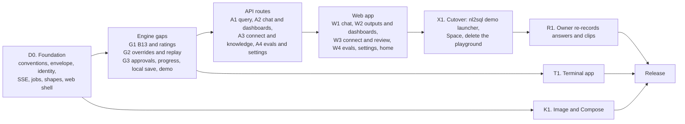
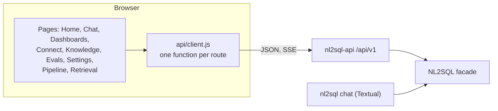
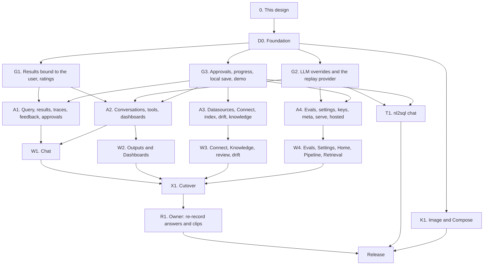

# Wave D: the apps (API v1, web app, Compose, terminal app) (design)

!!! note "Status: design"
    This page is the design for Wave D of the product redesign, the last
    wave, which ships as the release after 0.9. Nothing on it is built yet.
    Each pull request in [the PR plan](#14-pr-plan) adds a "Built" note to
    the sections it builds, as Phase 1, Phase 2 and the earlier waves do.
    Phase 1 is [Configuration v2 and the extension registry](configuration_v2.md);
    Phase 2 is [Phase 2: test bed, storage, providers, policies and adapter
    SDK v2](phase2.md). Wave A (0.7: events, observers, hooks, approval,
    evals, routing, drift, sanity warnings, MCP over stdio), Wave B (0.8:
    glossary and knowledge, the profiler and review queue, clarification,
    plan-to-English, the cost guard, corrections) and Wave C (0.9:
    conversations and chat tools, `ChartSpec`, dashboards, the launchpad,
    API keys, MCP over HTTP) are designed on their own pages,
    `architecture/wave_a.md`, `architecture/wave_b.md` and
    `architecture/wave_c.md`, which were not merged when this page was
    written. Wave D renders what they build. Where it needs something they
    do not provide, the gap is listed in
    [Needs from Waves A to C](#11-needs-from-waves-a-to-c) as a facade method,
    not designed around.

## Principles

The owner set them for the redesign, and they rank above everything below:

- **The package is the product; the playground only demonstrates it.** The
  web app talks only to `nl2sql-api`'s public `/api/v1` routes. The terminal
  app talks only to the Python facade. Neither holds feature logic: a chart
  is chosen by `engine.results.chart`, a dashboard by
  `engine.dashboards.generate`, a follow-up by `engine.conversations.ask`.
  Every gap this page found is a facade method plus a route, listed
  explicitly.
- **No active users: correct, not compatible.** Routes are renamed where
  their names are wrong, the playground's private server is deleted, and
  `nl2sql demo` keeps no flag whose behaviour is gone. No aliases.
- **Never over-engineer.** One process, one worker, jobs in memory, one
  Docker image, plain React and plain CSS. The cut list is part of the
  design.
- **Both apps have a demo mode and a your-data mode.** Demo mode is the
  sample databases with recorded answers and no key; your-data mode is the
  caller's `nl2sql.yaml`.
- **The UI must not look AI-generated.** The playground's "Porcelain" design
  system (`web/playground/src/styles.css`: its tokens, type scale, the run
  spine, the raised card, the 44px controls) is the baseline for every new
  page. No component library, no gradient, no icon font.

## Decisions

The owner was asleep when this design was written and asked that its
recommendations be used, each marked for confirmation. Wave A uses D9 to
D35, Wave B D36 to D59 and Wave C D100 to D129, so Wave D starts at D200.
The final redesign's decisions D13 to D16 are cited by the brief for this
wave; their numbers collide with Wave A's, so this page calls them
**final-design D13 to D16** and records how each is applied.

| # | Decision | Status | Where |
|---|---|---|---|
| D200 | **The apps hold serving state only.** `nl2sql-api` may keep the job queue, hosted-demo limits and sessions; everything a user would call a feature is a facade method. `nl2sql_api` imports only the top-level `nl2sql`, and the web app calls only `/api/v1` routes listed in the committed OpenAPI file. Both are tests. | decided overnight, owner to confirm | [Principles](#principles), [Boundaries](#12-boundary-and-invariant-changes) |
| D201 | **One route convention, applied to the old routes too:** plural nouns (`/datasources`, `/conversations`, `/results`), ids in the path, actions as a sub-resource verb (`/proposals/{id}/accept`), long work as `POST /jobs/{kind}`. `/datasource`, `/index/{id}`, `/index-all` and `/query/{request_id}/results/...` are renamed with no alias. | decided overnight, owner to confirm | [Conventions](#route-conventions) |
| D202 | **One error envelope:** `{"error": {"code", "message", "fix", "details"}}` for every non-2xx response, with a fixed mapping from the facade's exception types to statuses. A 500 names a request id, never the exception text. A pipeline outcome (a refusal, a clarification, an approval) stays a 200 with the `QueryResult`. | decided overnight, owner to confirm | [Errors](#the-error-envelope) |
| D203 | **Every request resolves one full `UserContext`** (`user_id`, `tenant_id`, `roles`) from one configured source, `api.auth`: `api_keys` (Wave C's bearer keys), `proxy` (trusted user, tenant and role headers), `static` (one role), `anonymous` (a random session cookie per browser, for the hosted demo) or `none`. `trust_body_role` is deleted. | decided overnight, owner to confirm | [Identity](#identity-and-auth) |
| D204 | **Results and traces are bound to the user who asked (bug B13)** in the engine: a run records its asker's `(tenant_id, user_id)`; reading another user's results or trace is "not found", the same answer as a missing one, as Wave C's D105 does for conversations. | decided overnight, owner to confirm | [Results bound to the user](#results-bound-to-the-user-b13) |
| D205 | **Final-design D15, applied:** with `api.auth: none`, admin routes answer loopback clients only and every other client gets a 403 naming the fix; a loopback client is the local operator, so `nl2sql-api serve` on a laptop just works. Off loopback with `none`, every route but health, readiness, `/meta` and the page is a 401. Compose ships with `auth: api_keys`. | decided overnight, owner to confirm | [Identity](#identity-and-auth) |
| D206 | **Jobs run in process, on one worker thread, in memory.** A job is one facade call (index, profile, eval, dashboard generate) with a progress callback; jobs run one at a time in submission order; the last 100 are kept and lost on restart. `nl2sql-api` runs one Uvicorn worker. The durable queue is cut. | decided overnight, owner to confirm | [Jobs](#jobs) |
| D207 | **Server-Sent Events carry Wave A's `Event` as is** (`event.sse()`), through one helper that handles cancellation on disconnect and a heartbeat every 15 seconds. The web app reads `POST` streams with `fetch` and a stream reader, not `EventSource`. | decided overnight, owner to confirm | [Streams](#streams) |
| D208 | **`/ready` is real:** 200 when every required datasource is ready, every agent's key resolves (or the agent is on the replay provider, or callers bring keys) and the index is `ok` or `stale`; otherwise 503 with the report, no secret in it. Cached for 10 seconds. `/health` stays liveness only. | decided overnight, owner to confirm | [Health and readiness](#health-and-readiness) |
| D209 | **The replay provider is an LLM provider,** `provider: replay`, that answers through the normal LLM interface from a recordings file; a question it has no recording for ends with the error code `REPLAY_MISS`. The demo's local fake HTTP server and its error-string matching leave the demo path. `nl2sql demo --record` is removed; recording is `scripts/record_demo_answers.py`, run by the owner. | decided overnight, owner to confirm | [The replay provider](#the-replay-provider) |
| D210 | **A key typed into the web app stays in the browser tab** and travels with each request as a per-call LLM override, in every mode, local or hosted. The web app never writes a key to disk; the server's own key is the operator's (`.env`, the environment, a secret provider). Callers may bring a key only where `api.request_llm: true`; the demo config sets it, the default is off. | decided overnight, owner to confirm | [Keys and models](#keys-and-models-in-the-web-app) |
| D211 | **Final-design D13, applied with one change.** The web app ships inside `nl2sql-api` as package data, served by `nl2sql-api serve`. It adds no dependency to `nl2sql-api`, so there is no `web` extra there; instead the engine's `demo` extra becomes `nl2sql-api`, so `pip install "nl2sql-engine[demo]"` stays the one install line. `nl2sql demo` is a launcher that runs `python -m nl2sql_api serve --demo` in a subprocess; the engine never imports `nl2sql_api`. The playground server (`nl2sql/cli/demo/`) is deleted. | decided overnight, owner to confirm | [Serving](#4-serving-the-web-app-and-nl2sql-demo) |
| D212 | **Final-design D14, applied:** the apps save a datasource to disk only when `nl2sql-api serve` runs locally with a config folder, into `datasources.local.yaml` beside `nl2sql.yaml`, which the loader reads as an overlay; secrets go to `.env` as Wave C's D122 writes them. `api.local_writes` is off in the Docker image and on the hosted demo, where Connect tests and registers in memory only. | decided overnight, owner to confirm | [Saving a datasource](#saving-a-datasource-final-design-d14) |
| D213 | **Final-design D16, applied: one Docker image,** `nl2sql-api`, with all five adapters and Microsoft's ODBC driver for SQL Server. The driver and unixODBC are small beside the ONNX runtime and Chroma the image already carries, so slim and full images are not worth two tags. The image job records the size; a split is reconsidered only if the ODBC layers pass 15% of it. | decided overnight, owner to confirm | [Docker image](#the-image) |
| D214 | **Charts are drawn by our own SVG renderer from `ChartSpec`** (four kinds), in Porcelain's tokens; Vega is not bundled, and the Vega-Lite export is a download. Mermaid is loaded on the first diagram as its own chunk. The single-file build is dropped. | decided overnight, owner to confirm | [Charts and diagrams](#charts-diagrams-and-reports) |
| D215 | **Approval grants are stored by the engine** (`engine.approvals`), an amendment to Wave A's D10. Over REST the asker cannot be trusted to carry an `Approval` whose `by` names someone else, so the approver grants by request id and the re-run names the request id; the engine looks the grant up. | decided overnight, owner to confirm | [Approvals](#approvals-over-rest) |
| D216 | **One React app, in `web/app`** (renamed from `web/playground`): the existing Vite and React 18 setup, a hash router, plain JavaScript, Porcelain's CSS split per area. No TypeScript, no state library, no component library. | decided overnight, owner to confirm | [The web app](#5-the-web-app) |
| D217 | **Web tests stay what they are, and run in CI:** `node --test` over pure modules, plus a contract test that every route the API client calls is in the committed `openapi.json`, which a Python test keeps current. Route behaviour is tested in Python. No browser test runs in CI; the HTTP smoke (`scripts/fresh_install_check.py`) covers a fresh install. | decided overnight, owner to confirm | [Testing](#testing-the-web-app) |
| D218 | **The terminal app is `nl2sql chat`,** on Textual behind the `tui` extra, in `nl2sql/cli/chat/`, on the facade only. Charts become text (a big number, sparklines, bars, a table); diagrams are shown as text. It takes no key: the CLI's environment and `.env` as everywhere. | decided overnight, owner to confirm | [The terminal app](#7-the-terminal-app-nl2sql-chat) |
| D219 | **Compose is two services from one image:** a one-shot `index` service, then `api` (one Uvicorn worker), one data volume, `auth: api_keys`, a healthcheck on `/api/v1/ready`. The first admin key is made with `docker compose run --rm api nl2sql keys create`. | decided overnight, owner to confirm | [Compose](#6-docker-compose-self-host) |
| D220 | **Not in `nl2sql-api`:** MCP (Wave C's D126 stands: its own process), and the operator event stream (observers are the operator's surface). `GET /events/catalog` is the one events route. | decided overnight, owner to confirm | [Not in Wave D](#not-in-wave-d) |
| D221 | **The hosted demo serves the whole web app read-mostly:** chat, tools, charts, dashboards, the knowledge view, plans-mode evals and drift; keyless questions answer from recordings and any other needs the visitor's key. Admin work (Connect, accept, index, profile, LLM settings) is off, by D205's rule, not by a hosted switch. | decided overnight, owner to confirm | [The hosted demo](#the-hosted-demo) |
| D222 | **The guided questions are the datasources' `sample_questions`.** The demo writes them into each demo datasource; `/meta` reads them through the facade. `nl2sql.datasets.demo` stops being imported by any app. | decided overnight, owner to confirm | [Demo mode](#demo-mode-and-your-data-mode) |
| D223 | **The first PR adds every shared shape at once:** the route conventions, the error envelope, identity, the SSE helper, the job runner, the empty routers for every namespace, the `api` config fields, the engine shapes the gaps need (`LLMOverride`, `REPLAY_MISS`, the approval store's methods), the web shell with its API client, and the CSS split, so the parallel PRs never edit the same file. | decided overnight, owner to confirm | [PR plan](#14-pr-plan) |

## Where 0.9 will leave us

What the code has today (0.6), plus what Waves A to C add, as their designs
describe them.

| Area | What 0.9 has | What is still missing |
|---|---|---|
| REST | `nl2sql-api` with 14 routes under `/api/v1`: query, stream, result pages and CSV (`routes/query.py`), datasources (`routes/datasource.py`, plus Wave C's types, test and draft), index (`routes/indexing.py`), LLM (`routes/llm.py`), health (`routes/health.py`) | Nothing for conversations, chat tools, charts, dashboards, knowledge, proposals, evals, approvals, drift, clarification, explanation or API keys. Long work (indexing) blocks the request. |
| Errors | Each route catches `Exception` and answers `str(e)` in a 500 (`routes/datasource.py` `list`, `get`, `remove`; `routes/indexing.py`; `routes/llm.py`) | A driver's message can carry a connection string; no shape a client can branch on (bug B200) |
| Identity | Roles only, from a header, a static role or the request body (`auth.py`); no `user_id`, no tenant | Nothing to bind a result, conversation or dashboard to |
| Results | `engine.results.page` and `csv` read the engine's tenant folder (`api/results_api.py`) | Anyone with a role and a `trace_id` reads anyone's rows (bug B13) |
| Readiness | `GET /api/v1/ready` always answers `success: true` (`services/health.py`) | A container orchestrator cannot tell a broken API from a working one (bug B201) |
| The playground | A private FastAPI app with 21 routes (`nl2sql/cli/demo/playground/app.py`), served by `nl2sql demo` (`cli/commands/demo.py`); hosted mode (`playground/hosted.py`); a local fake LLM server for replay (`nl2sql.testing.fake_llm`, `nl2sql.llm.replay`); a React page in `web/playground` built into the engine's wheel | It is a second API beside `nl2sql-api`, with internal imports the boundary test lists as exceptions (`STILL_IMPORTED_FROM_INSIDE` in `tests/architecture/test_boundaries.py`). It shows one question at a time: no follow-ups, charts, dashboards, review, evals or Connect. |
| Web tests | 24 `node --test` files under `web/playground/src` | Never run in CI: `.github/workflows/test.yml` has no Node job (bug B202) |
| Docker | `packages/api/Dockerfile` (PostgreSQL and MySQL drivers only); the Space image `deploy/huggingface/Dockerfile` runs `nl2sql demo --hosted` | No Compose for self-hosting; no SQL Server or DuckDB in the API image |
| Terminal | `nl2sql run` (one question), Wave C's `nl2sql launch` | No conversation in a terminal; `textual` is already kept out of `import nl2sql` by a test, and never used |

## 1. Goals and non-goals

### What ships

| Goal | What it means |
|---|---|
| **API parity** | Every Wave A to C capability a user or operator reaches through the facade has a `/api/v1` route, with one error envelope, one identity, streams over SSE and jobs for long work. |
| **Results bound to the user** | B13, fixed in the engine and enforced by every route that reads rows or traces. |
| **A real `/ready`** | What an orchestrator and Compose's healthcheck need. |
| **The replay provider** | Recorded answers served through the normal LLM interface, so demo mode is the real pipeline with a recorded model. |
| **The web app** | Served by `nl2sql-api`; demonstrates every capability: chat with follow-ups and tools, charts, diagrams, reports, clarification, approval, "why this answer", warnings, dashboards, Connect, knowledge and proposals review, corrections, evals, drift. Demo and your-data modes. Porcelain kept. |
| **The hosted demo keeps working** | nl2sql.codewithnk.com: keyless replay and bring-your-own-key, on the new server. |
| **Compose** | Self-hosting in one command: index, then serve, one volume, one worker, auth on, healthcheck. |
| **The terminal app** | `nl2sql chat`: conversation, results, charts as text, clarification and approval prompts, demo and your-data modes. |
| **No exceptions left** | `STILL_IMPORTED_FROM_INSIDE` is empty and deleted. |

### Not in Wave D

| Later | Why it waits |
|---|---|
| A durable job queue, several workers, horizontal scaling | D206: one process serves a team; a queue is a product of its own |
| OAuth or SSO login in the web app | Wave C's D127: keys first. A proxy that authenticates can set `api.auth: proxy` headers today. |
| MCP mounted in `nl2sql-api`, an operator event stream over REST | D220 |
| Editing a dashboard's layout by dragging, scheduled refresh, sharing links | Wave C's cut list; the web app shows and edits what `dashboards.save` accepts (title, visibility, removing a tile, filters) |
| Editing the plan from "why this answer" | Wave B's cut list |
| A browser end-to-end suite in CI | D217: the HTTP smoke and route tests cover the contract; clips stay owner-recorded |
| Rate limiting beyond the hosted demo's | Per-question caps (Wave A) bound spend; a public deployment puts a proxy in front |
| TypeScript, a component library, a design-system package | D216 |
| A Kubernetes chart | `docs/deployment/kubernetes.md` stays prose; Compose is the supported self-host |

## 2. Order of work



## 3. The API: `/api/v1` at parity

### Route conventions

| Rule | Detail |
|---|---|
| **Prefix** | Everything under `/api/v1`; the web page and its assets at `/`. |
| **Nouns** | Plural collections, ids in the path: `GET /conversations/{id}`. An action on a resource is a verb sub-resource: `POST /proposals/{id}/accept`. |
| **Long work** | `POST /jobs/{kind}` returns `202` and the job; `GET /jobs/{id}` and `GET /jobs/{id}/events` follow it ([Jobs](#jobs)). No route blocks for longer than a question. |
| **Streams** | A route that streams a run ends in `/stream` and answers `text/event-stream` ([Streams](#streams)). |
| **Bodies** | Request models are pydantic, strict (`extra="forbid"`), declared beside their router. Responses are the facade's own models (`QueryResult`, `Conversation`, `Dashboard`, `Proposal`, ...), served as they are, so the HTTP shape cannot drift from the package's. |
| **Sync handlers** | A handler that calls the engine is `def`, so Starlette runs it in its thread pool, as `routes/query.py` does today. |
| **No services layer** | `nl2sql_api/services/` and `dependencies.py` are deleted: each wrapper was one line over a facade call. A router calls the facade directly. |
| **OpenAPI** | Every route has a summary, its request and response models, and its error statuses. `packages/api/openapi.json` is committed; `test_openapi_snapshot_is_current` fails when it is stale, with the command that rewrites it. |

### The error envelope

```python
# nl2sql_api/errors.py
class ApiError(BaseModel):
    code: str                     # NOT_FOUND, INVALID_REQUEST, UNAUTHENTICATED, FORBIDDEN,
                                  # CONFLICT, LIMIT_REACHED, NOT_READY, INTERNAL, or an engine code
    message: str                  # one sentence a person can act on
    fix: str | None = None        # what to do, when the engine said
    details: list[dict] = []      # 422: one entry per problem, {"loc": [...], "msg": ...}; never a value
    request_id: str | None = None # 500 only: the id in the server log

class ErrorBody(BaseModel):
    error: ApiError
```

| Raised | Status | Code |
|---|---|---|
| A request body or query that does not validate | 422 | `INVALID_REQUEST`, each problem by path and message; the input is never echoed (the playground's `_invalid_request` handler, generalised; fixes Wave C's B100 everywhere) |
| `LookupError` (`ConversationNotFound`, `DashboardNotFound`, `ResultNotFound`, `JobNotFound`, an unknown datasource) | 404 | `NOT_FOUND` |
| `ValueError` from the facade (`NoTiles`, `TileNotPinnable`, `SecretValueInConfig`, a bad filter) | 422 | the exception's code when it has one, else `INVALID_REQUEST` |
| `PermissionError`, `ReviewError(NOT_AUTHORIZED)` | 403 | `FORBIDDEN` |
| `ConversationBusy`, `ReviewError(FILE_CHANGED)`, a job of that kind already queued for the same target | 409 | `CONFLICT` |
| No identity | 401 | `UNAUTHENTICATED`, with `WWW-Authenticate: Bearer` under `api_keys` |
| A hosted limit | 429 | `LIMIT_REACHED`, with `Retry-After` |
| Not ready | 503 | `NOT_READY` |
| Anything else | 500 | `INTERNAL`; the message is "Something failed on the server. Request id: ...", and the exception is logged with that id and the run's `trace_id` (Wave A's log correlation) |

A pipeline outcome is not an error: `POST /query` answers 200 with a
`QueryResult` whose `status` is `error`, `needs_clarification`,
`needs_approval` or `stopped`, as today. `test_no_route_returns_exception_text`
raises an exception carrying a fake connection string through every route
with a stub engine and checks no response body contains it (B200).

### Identity and auth

`nl2sql_api/identity.py` replaces `auth.py`. One dependency, `caller`,
resolves the request's `UserContext`; `admin` adds the role check.

```yaml
# nl2sql.yaml (the api section; the engine validates it and never reads it)
api:
  auth: api_keys              # api_keys | proxy | static | anonymous | none (default: none)
  proxy:                      # auth: proxy only
    user_header: X-Forwarded-User
    tenant_header: null
    roles_header: X-NL2SQL-Roles
  static_role: analyst        # auth: static only
  request_llm: false          # callers may send their own key and models (D210)
  local_writes: false         # Connect may save to datasources.local.yaml (D212)
  cors_origins: []
```

| `api.auth` | The caller | Admin |
|---|---|---|
| `api_keys` | `Authorization: Bearer <token>`, verified by Wave C's `engine.api_keys.verify`; the key's `user_id`, `tenant_id` and roles. Missing or invalid: 401. | A key whose roles include one of `policies.admin_roles` |
| `proxy` | The headers a trusted proxy sets on every request: the user, the tenant (else `settings.tenant_id`), the roles (comma-separated). No user header: 401. | The roles, as above |
| `static` | `user_id: "static"`, `static_role`. For a single-user deployment behind a private network. | Only when `static_role` is an admin role |
| `anonymous` | A random 128-bit session id in an `HttpOnly`, `SameSite=Lax` cookie (`nl2sql_session`, the hosted session cookie `playground/hosted.py` already sets) as `user_id`, and `policies.default_role`. Results, conversations and dashboards are bound to the browser. | Never |
| `none` | Loopback client: `user_id: "local"` with the admin roles (the local operator). Any other client: 401. | Loopback only, else 403 with the fix (final-design D15, D205) |

`api.trust_body_role`, `api.role_header` and `api.role` are deleted, as is
the body's `user_context` (D203). The engine's `Api` model
(`config/models.py`) carries the new fields so `nl2sql config check` reports
a typo; `test_api_section_is_strict` holds it.

### Results bound to the user (B13)

B13 is fixed in the engine (D204), so the facade, the API, MCP and the
terminal app all get it:

1. The result writer records the run's `tenant_id` and `user_id` in the
   result manifest (`execution/artifacts/results.py`), beside the columns it
   already records. The trace document records them too.
2. `engine.results.manifest`, `page`, `csv` and Wave C's `chart` take
   `user_context` and compare it with the stored pair; a mismatch raises
   `ResultNotFound`. `engine.traces.get(trace_id, user_context=)` does the
   same and returns `None`. The `tenant_id` argument is replaced by
   `user_context`.
3. An admin reads no one else's rows through these methods either; an
   operator who must reads the files under `storage.path`.
4. Results written before the change have no owner and are readable only
   with no `user_context` (the CLI's own runs); the release notes say so.

`test_another_users_result_is_not_found` and
`test_another_users_trace_is_not_found` (engine), and
`test_results_route_hides_another_users_rows` (API).

### Streams

`nl2sql_api/sse.py` is the one place an SSE response is built:

```python
def event_stream(events: Callable[[CancellationToken], Iterator[Event]], request: Request) -> StreamingResponse
```

| Rule | Detail |
|---|---|
| **The wire** | Each item is Wave A's `Event.sse()`: `event: <name>` and `data: <json>`. No second event vocabulary. |
| **Cancellation** | The iterator runs in the thread pool; a client that disconnects cancels the token, which stops the run before its next step (`cancel_when_disconnected` in `playground/app.py`, moved). |
| **Heartbeat** | A `: keep-alive` comment every 15 seconds, so a proxy does not close a quiet stream while the planner thinks. |
| **Headers** | `Cache-Control: no-cache`, `X-Accel-Buffering: no` (both routes set them today). |
| **Refusals** | Identity, validation and hosted limits are checked before the stream starts and answer with the envelope; once streaming, a failure is the run's `run.failed`. |

The streams: `POST /query/stream` (Wave A's caller-safe allow-list, ending
`run.finished` with `data.result`), `POST /conversations/{id}/turns/stream`
(Wave C's `conversation.rewritten`, the run's events, then
`conversation.turn`), and `GET /jobs/{id}/events`.

### Jobs

```python
# nl2sql_api/jobs.py
JobKind = Literal["index", "profile", "eval", "dashboard"]

class JobProgress(BaseModel):
    at: datetime
    step: str                    # "chinook", "case 12 of 80", "tile 3 of 8"
    done: int
    total: int | None

class Job(BaseModel):
    id: str                      # 22 url-safe characters
    kind: JobKind
    status: Literal["queued", "running", "succeeded", "failed", "cancelled"]
    params: dict[str, Any]       # the request body, as given
    created_by: str | None       # the caller's user_id
    created_at: datetime
    started_at: datetime | None
    finished_at: datetime | None
    progress: list[JobProgress]
    result: dict[str, Any] | None   # the facade call's return value, as JSON
    error: ApiError | None
```

| Kind | Route | Facade call | Progress from | Who |
|---|---|---|---|---|
| `index` | `POST /jobs/index` `{datasource_ids?}` | `engine.index.build(ids, on_datasource=, cancellation_token=)` | `on_datasource` | admin |
| `profile` | `POST /jobs/profile` `{datasource_ids?, draft}` | Wave B's `engine.knowledge.profile(ids, draft=, on_datasource=, cancellation_token=)` | `on_datasource` | admin |
| `eval` | `POST /jobs/eval` `{suites?, mode, cases?, max_cost_usd?}` | Wave A's `engine.evals.run(..., on_case=, cancellation_token=)` | `on_case` | admin; `mode: plans` for any caller (no model call) |
| `dashboard` | `POST /jobs/dashboard` `{datasource_id, title?, questions?}` | Wave C's `engine.dashboards.generate(..., on_tile=, cancellation_token=)` | `on_tile` | any caller; the dashboard is theirs |

| Rule | Detail |
|---|---|
| **One worker (D206)** | One daemon thread takes jobs in submission order. Two index builds never race on the index, and a profile never reads a snapshot an index build is replacing. A question is not a job: it runs on the request's thread as today. |
| **One process** | The queue lives in the process, so `nl2sql-api serve` and the image run one Uvicorn worker. `serve --workers` does not exist; the docs say why. |
| **In memory** | The last 100 jobs, finished or not. A restart loses them; what they produced (an index build, proposals, a dashboard) is in the engine's stores. |
| **Duplicates** | A job of the same kind and the same targets already queued or running is a 409 naming its id. |
| **Ownership** | `GET /jobs` lists the caller's jobs (an admin sees all); another user's job is 404, as D204. |
| **Cancel** | `DELETE /jobs/{id}`: a queued job is removed; a running one has its token cancelled and stops between items (datasources, cases, tiles). |
| **Events** | `GET /jobs/{id}/events` sends every `JobProgress` so far, then each new one, then `job.finished` with the job, as SSE. The catalog does not gain these: they are the API's, not the engine's. |
| **Facade gaps** | `on_datasource` exists on `index.build` and `on_case` on `evals.run`; `profile` and `generate` gain a callback, and all four gain `cancellation_token` ([gaps](#11-needs-from-waves-a-to-c)). |

`test_jobs_run_one_at_a_time_in_order`, `test_job_progress_replays_then_follows`,
`test_cancel_running_job_stops_between_items`,
`test_duplicate_job_is_a_conflict`, `test_another_users_job_is_not_found`,
`test_api_runs_one_worker` (the image's command and `serve`).

### Health and readiness

| Route | Answers |
|---|---|
| `GET /health` | Liveness: `{"status": "ok", "version": {"engine", "api"}}`, from process state only. The Space's release check polls it for the version (`scripts/fresh_install_check.py`). |
| `GET /ready` | `engine.check()`'s report, read through the facade, cached 10 seconds: 200 when ready (D208), else 503 `NOT_READY` with `details` listing each failing part: a required datasource and its stage, an agent whose key does not resolve, the index status. An optional datasource that failed is listed but does not fail readiness. With `api.request_llm: true` or an agent on `replay`, an unresolved key does not fail it. |
| `GET /meta` | What the web app needs before anything else: `mode` (`demo`, `hosted`, `your_data`), the identity source, `request_llm`, `local_writes`, hosted limits, the datasources with their `sample_questions` (D222), which of those the replay provider has recordings for, and `recorded_with`. |
| `GET /about` | `engine.about()`: the pipeline's steps and the model each runs on (today's `/api/pipeline`). |

`test_ready_fails_on_a_required_datasource`, `test_ready_passes_with_an_optional_failure`,
`test_ready_fails_on_a_missing_index`, `test_ready_passes_with_request_keys`,
`test_ready_never_holds_a_secret`.

### The routes

Every route below is new unless marked. "Admin" is the `admin` dependency;
everything else needs a caller. The facade column names the method; a name
in *italics* is a gap.

**Questions, results, traces and feedback** (`routes/query.py`)

| Route | Facade | Notes |
|---|---|---|
| `POST /query` (changed) | `run_query(question, datasource_id=, execute=, choice=, approvals=, llm=, user_context=)` | Body: `question` (was `natural_language`), `datasource_id`, `execute`, `choice` (Wave B's `ClarificationChoice`), `approval_ids` (D215). `QueryResult` carries Wave B's `explanation` and `clarification`, Wave A's typed `warnings` and `approvals_needed`. |
| `POST /query/stream` (changed) | `stream_query(...)` | Wave A's `Event`s |
| `GET /results/{trace_id}` | `results.manifest(..., user_context=)` | Was nothing; the manifest without rows |
| `GET /results/{trace_id}/{result_id}` (moved) | `results.page(..., user_context=)` | Was `/query/{request_id}/results/{result_id}` |
| `GET /results/{trace_id}/{result_id}.csv` (moved) | `results.csv(..., user_context=)` | |
| `GET /results/{trace_id}/{result_id}/chart` | Wave C's `results.chart(trace_id, result_id, kind=, user_context=)` | `?kind=`; `?format=vega-lite` answers `to_vega_lite()` |
| `GET /traces/{trace_id}` | *`traces.get(trace_id, user_context=)`* | Today only the playground has it |
| `GET /diagram/{trace_id}` | Wave C's `nl2sql.diagram_for(result)` | The answer view as Mermaid; reads the run's result through the facade as the caller |
| `POST /feedback` (from the playground) | *`feedback.rate(trace_id, rating, note=, user_context=)`* | The engine reads the run's own trace; the playground's in-memory "recent runs" goes |
| `POST /feedback/correct` | Wave B's `feedback.correct(trace_id, sql=, plan=, question=, note=, user_context=)` | Returns the `Proposal` |
| `GET /feedback` | `feedback.list()` | Admin |

**Approvals** (`routes/approvals.py`, D215)

| Route | Facade | Notes |
|---|---|---|
| `GET /approvals` | *`approvals.list(status="pending", user_context=)`* | An approver sees the requests their roles may approve; an asker sees their own |
| `POST /approvals/{request_id}/grant` | *`approvals.grant(request_id, by=caller)`* | 403 unless the caller holds one of the hook's approver roles |
| `POST /approvals/{request_id}/deny` | *`approvals.deny(request_id, by=caller, reason=)`* | |

**Conversations and chat tools** (`routes/conversations.py`)

| Route | Facade |
|---|---|
| `POST /conversations` | `conversations.start(datasource_id=, user_context=)` |
| `GET /conversations` | `conversations.list(user_context=)` |
| `GET /conversations/{id}` | `conversations.get` |
| `DELETE /conversations/{id}` | `conversations.delete` |
| `POST /conversations/{id}/turns` | `conversations.ask(id, text=, choice=, execute=, llm=, user_context=)` |
| `POST /conversations/{id}/turns/stream` | `conversations.stream(...)` |
| `POST /conversations/{id}/retry` | `conversations.retry(id, approval_ids=, llm=, user_context=)` |
| `POST /conversations/{id}/tools/{name}` | `conversations.tool(id, name, args, user_context=)` |
| `GET /conversations/{id}/report` | `conversations.report(id, turns=, title=)`, `text/markdown` |
| `GET /chat-tools` | `chat_tools.list()` |

A busy conversation is a 409 (`ConversationBusy`); a pending clarification
is answered with `choice` in the turn body.

**Dashboards** (`routes/dashboards.py`)

| Route | Facade |
|---|---|
| `GET /dashboards` | `dashboards.list` |
| `POST /jobs/dashboard` | `dashboards.generate` (a job) |
| `GET /dashboards/{id}` | `dashboards.get` |
| `PUT /dashboards/{id}` | `dashboards.save` (owner) |
| `DELETE /dashboards/{id}` | `dashboards.delete` (owner) |
| `POST /dashboards/{id}/refresh` | `dashboards.refresh(id, filters=)`; runs tile by tile, so it is synchronous: a refresh makes no model call and its tiles are capped at `max_tiles` |
| `GET /dashboards/{id}/filters/{filter_id}/values` | `dashboards.filter_values` |
| `POST /dashboards/{id}/tiles/{tile_id}/regenerate` | `dashboards.regenerate` (owner; one model call) |
| `POST /dashboards/pin` | `dashboards.pin(conversation_id, turn, dashboard_id=, title=)` |
| `GET /datasources/{id}/starter-questions` | `dashboards.suggest_questions(id, n=)` |

**Datasources, Connect, index and drift** (`routes/datasources.py`, `routes/index.py`)

| Route | Facade | Notes |
|---|---|---|
| `GET /datasources` (moved) | `datasources.list()` | With *`sample_questions`* |
| `GET /datasources/{id}` (moved) | `datasources.get` | |
| `GET /datasources/{id}/schema` | `datasources.schema(id, user_context=)` (Wave A, B29) | The caller's view |
| `GET /datasources/{id}/diagram` | Wave C's `datasources.diagram(id, tables=, user_context=)` | Mermaid |
| `GET /datasource-types` (Wave C) | `datasources.types()` | The Connect form's adapters and connection schemas |
| `POST /datasources/test` (moved from Wave C's `/datasource/test`) | `datasources.test(Datasource)` | Admin; registers nothing |
| `POST /datasources` (moved) | `datasources.add`, then *`datasources.save(id, local=True)`* when `save: true` and `api.local_writes` | Admin; D212 |
| `DELETE /datasources/{id}` (moved) | `datasources.remove` | Admin |
| `GET /index` (moved from `/index/status`) | `index.health()` | |
| `POST /jobs/index` (replaces `/index/{id}`, `/index-all`) | `index.build` (a job) | Admin |
| `DELETE /index` | `index.clear()` | Admin |
| `GET /index/check` | Wave A's `index.check(ids)` | Drift: `DriftReport` per datasource with its impact. Admin, because it reflects every live database. |
| `POST /index/inspect` | `index.inspect(...)`, with `GET /index/inspect` for `inspect_defaults()` | The Retrieval inspector (the playground's `/api/retrieval`) |

Wave C's `POST /datasource/{id}/draft` and `/draft/apply` are replaced: the
draft is Wave B's `knowledge.profile(draft=True)`, run as a `profile` job, and
its output is proposals, reviewed through the routes below.

**Knowledge and proposals** (`routes/knowledge.py`)

| Route | Facade |
|---|---|
| `GET /knowledge` | `knowledge.show(datasource_id=, user_context=)` |
| `GET /knowledge/sources` | `knowledge.sources()` (admin) |
| `POST /knowledge/reload` | `knowledge.reload()` (admin) |
| `POST /knowledge/choices` | `knowledge.save_choice(choice, term=, user_context=)`: saving a clarification pick as a `term` proposal |
| `POST /jobs/profile` | `knowledge.profile` (a job; admin) |
| `GET /proposals` | `proposals.list(kind=, status=, datasource_id=)` (admin) |
| `GET /proposals/{id}` | `proposals.get` (admin) |
| `POST /proposals/{id}/accept` | `proposals.accept(id, by=caller, edit=)` (admin) |
| `POST /proposals/{id}/reject` | `proposals.reject(id, by=caller, reason=)` (admin) |

The review file (`proposals.export` and `apply`) stays a CLI workflow: a file
in git is its point.

**Evals** (`routes/evals.py`)

| Route | Facade |
|---|---|
| `GET /evals/suites` | `evals.load()`: suites with their case counts, never gold rows |
| `GET /evals/scorers` | `evals.scorers()` |
| `POST /jobs/eval` | `evals.run` (a job); the report is the job's `result` |

`evals.gate`, `regenerate` and `seed` stay in the CLI: they write files or
compare with a baseline file in the repository.

**Settings, keys and events** (`routes/settings.py`)

| Route | Facade | Notes |
|---|---|---|
| `GET /llm` (kept) | `llm.list()` | |
| `GET /llm/providers` | `llm.providers()`, with *labels, verified models and key shape* | The Settings page's choices |
| `PUT /settings/llm` (kept) | `llm.replace(section, by=)` | Admin; in memory |
| `GET /api-keys`, `POST /api-keys`, `DELETE /api-keys/{id}` | Wave C's `api_keys.list`, `create`, `revoke` | Admin; the token is in the `POST` response once |
| `GET /events/catalog` | Wave A's `events.catalog()` | |

### Approvals over REST

Wave A's approval holds nothing: the asking app keeps the `ApprovalRequest`,
and the approver's `Approval` names who approved (`by`). That is safe in
process, where the app decides what `by` is. Over HTTP the asker would send
`by` in the body, so anyone could approve their own question. D215 moves the
grant into the engine, keyed by the request's id:

```python
# engine.approvals (state store, beside the review queue)
def submit(self, request: ApprovalRequest) -> None: ...          # the run does this when it ends needs_approval
def list(self, *, status="pending", user_context) -> list[ApprovalRecord]: ...
def grant(self, request_id: str, *, by: UserContext) -> ApprovalRecord: ...
def deny(self, request_id: str, *, by: UserContext, reason: str | None = None) -> ApprovalRecord: ...
```

`run_query(approvals=...)` takes request ids as well as `Approval` objects; a
granted id becomes the `Approval` the engine already checks (the request's
hash, the asker, the approver's roles, the SQL's hash), so Wave A's checks
are unchanged. Grants expire after `settings.approvals.max_age_hours` (24)
and are purged by `engine.storage.purge()`. In the web app the asker sees
"Waiting for approval" with the reason; an approver sees the request under
**Approvals** (the plan in English, the SQL, the reason) and grants it; the
asker's **Run it now** calls `retry` with the id.

### The replay provider

Demo mode must answer with no key, through the same pipeline a key would
use (D209):

```yaml
# llm.yaml in the demo project
provider: replay
recordings: null        # null: the recordings packaged with the engine (nl2sql/datasets/recordings/)
```

| Rule | Detail |
|---|---|
| **Where** | `nl2sql/llm/providers/replay.py` (from `llm/replay.py`'s `ReplayStore` and `extract_question`): a provider in `PROVIDER_PRESETS` with no key variable, whose chat model answers `structured()` and plain calls from the store. |
| **Matching** | As today: the structured-output name plus the question the prompt was built around. The conversation rewriter's prompt gains the same `[USER_QUERY]` marker so a recorded follow-up matches. |
| **A miss** | The provider raises `ReplayMiss`; the pipeline ends with the error `REPLAY_MISS` (`ERROR`, not retryable) and the message "No recorded answer for this question. Add an API key to ask it live." No marker string is matched on (`REPLAY_MISS_MARKER` and `finish_question` in `playground/app.py` go). |
| **Labelled** | Each usage call records `provider: "replay"` and the recording's `recorded_with` model; the web app shows "Recorded run" from that, not from a flag the server adds. |
| **Coverage** | *`engine.llm.recorded(questions) -> list[str]`* answers which questions the store covers, for `/meta`. |
| **Overrides** | A per-call `LLMOverride` with a key replaces the replay provider for that call, which is how a hosted visitor goes live. |
| **Recording** | `scripts/record_demo_answers.py` runs the guided questions, the scripted follow-ups and the clarification question through a real provider with a recording wrapper (`nl2sql.llm.replay.Recorder`, internal; scripts may import it) and writes the store. `nl2sql demo --record`, `RecordingProxy` and the demo's use of `FakeLLMServer` go; `FakeLLMServer` stays for tests. |

### Keys and models in the web app

D210 makes one rule for every mode: a key typed into the browser lives in
that tab's `sessionStorage` and is sent with each request; the model per
step likewise. The hosted page already works this way
(`web/playground/src/hostedKey.js`, `hostedModels.js`); the local page's
"save key to `.env`" and "write models to `llm.yaml`" go.

| Header | Holds |
|---|---|
| `X-NL2SQL-Api-Key-<provider>` | One provider's key; one header per key (as today) |
| `X-NL2SQL-Models` | `{"ast_planner": "anthropic:claude-opus-5"}`, no secret (as today) |

`nl2sql_api/overrides.py` turns the headers into the engine's
*`LLMOverride(keys={provider: key}, models={agent: (provider, model)})`* and
passes it as `llm=` to `run_query`, `stream_query`, `conversations.ask`,
`stream` and `retry`. With `api.request_llm: false` the headers are a 403
naming the setting. A key is never logged, never in a trace (the redactor
already masks request keys) and never in an error. A missing key for a step
the caller put on a provider is a 422 naming the step and the provider (the
engine's `MissingProviderKey`, today raised in `llm/request_key.py`).

### Saving a datasource (final-design D14)

Connect in the web app tests a connection, registers it, and (D212) saves it
only where the server owns a folder it may write:

| Where | `api.local_writes` | Save |
|---|---|---|
| `nl2sql-api serve` on loopback, config loaded from a folder | true (`serve` sets it) | *`datasources.save(id, local=True)`* writes `datasources.local.yaml` beside `nl2sql.yaml` (one list), secrets as `${env:NL2SQL_<ID>_<FIELD>}` with the value in `.env` (Wave C's `write_env_values`). `.gitignore` gains the file. |
| The Docker image, Compose | false | The datasource is added in memory and the page says it lasts until restart, and how to add it to the mounted config |
| The hosted demo | false, and Connect is admin-only (D221) | Off |

The loader reads `datasources.local.yaml` after the `datasources` section
when it exists; an id in both is a `ConfigError` naming the two files. Wave
C's `datasources.save(id)` (one file under `datasources/`, for `nl2sql
launch`) is unchanged.

## 4. Serving the web app and `nl2sql demo`

### `nl2sql-api serve`

`nl2sql_api/serve.py`, run as `nl2sql-api serve` (the console script,
replacing `server.py`) or `python -m nl2sql_api serve`:

```text
nl2sql-api serve [--config PATH] [--host 127.0.0.1] [--port 8000]
nl2sql-api serve --demo [--dir nl2sql-demo] [--hosted --questions-per-minute 6 --questions-per-session 30]
```

| Mode | What it does |
|---|---|
| your data (default) | Builds `NL2SQL.from_config(path)`, checks it, serves `/api/v1` and the page. `api.local_writes` is on only on a loopback host with a config folder. |
| `--demo` | *`nl2sql.prepare_demo(dir)`*: writes the demo project the first time (`init_project(demo=True)`), builds the index if `check()` says it is missing, and returns the config path. The demo config uses the replay provider unless the environment holds a provider key, sets `api.request_llm: true` and `api.auth: none`. |
| `--demo --hosted` | As `--demo`, plus: refuses to start when a provider key is in the environment (as today), sets `api.auth: anonymous`, applies the per-visitor limits to question and turn routes (`nl2sql_api/hosted.py`, from `playground/hosted.py`'s `Limits`), and sends the link-preview tags (`playground/preview.py`, moved). |

The page, its assets, the social card and the clips are package data of
`nl2sql_api` (`web/static/`, `web/assets/`), served at `/`, `/assets/`,
`/social-card.png` and `/clips/{name}` (`routes/web.py`). Every other path
under `/` that is not a file answers the page, so the hash router owns
navigation.

### `nl2sql demo`, a launcher (D211)

`cli/commands/demo.py` shrinks to about 30 lines: it checks that `nl2sql_api`
is installed (`importlib.util.find_spec`), else prints
`pip install "nl2sql-engine[demo]"` and exits 1; then it runs
`[sys.executable, "-m", "nl2sql_api", "serve", "--demo", ...]` with the flags
it was given, opens the browser unless `--no-browser`, and exits with the
child's code. Its flags are `--dir`, `--host`, `--port`, `--no-browser`,
`--hosted` and the two limits. `--record`, `--api-key` and `--allow-settings`
are removed with no alias: recording is a script, a key is typed into the
page or put in `.env`, and the settings gate is D205's loopback rule.

The engine's `pyproject.toml` replaces `demo = ["fastapi", "uvicorn"]` with
`demo = ["nl2sql-api~=X.Y.Z"]` (the release-please version marker, as
`nl2sql-api` pins the engine), and drops the package data for
`nl2sql.cli.demo` and `nl2sql.cli.demo.playground`. The recordings move to
`nl2sql/datasets/recordings/`, beside the sample databases they answer.

### Demo mode and your-data mode

| | Demo | Your data |
|---|---|---|
| Datasources | The three sample SQLite databases | The caller's config |
| Guided questions | Each demo datasource's `sample_questions` (D222), written by `init --demo` from today's `DEMO_QUESTIONS_BY_DATASOURCE` | The datasource's `sample_questions` (Wave C's starter questions, Wave B's glossary examples) |
| The model | The replay provider, or the tab's key | The configured model, or the tab's key where `request_llm` is on |
| Knowledge | The demo glossary (Wave B ships one for Chinook) | The caller's |
| Dashboards | Generated from the demo profile, no model call | Generated after a profile |
| Evals | The Chinook suite, `plans` mode with no key | The caller's suites |

### The hosted demo

The Space keeps its URL, its limits and its keyless start (D221):

| | Hosted |
|---|---|
| Identity | `anonymous`: one session per browser; nothing a visitor makes is visible to another |
| Questions and turns | Recorded guided questions and their scripted follow-ups answer with no key; anything else needs the visitor's key (`REPLAY_MISS` with "Add a key in Settings") |
| Chat tools, charts, diagrams, reports | On: no model call |
| Dashboards | Generate (a job, no model call), refresh, filter, pin: on, per session. `regenerate` needs a key. |
| Knowledge view, "why this answer", drift status | On (read-only) |
| Evals | `plans` mode on, one job at a time, paced like a question |
| Connect, accept or reject, index, profile, LLM settings, API keys | Off: admin routes, and an anonymous caller is never admin |
| State | The Space's disk is ephemeral; conversations and dashboards live until the container restarts, and the page says so |

`deploy/huggingface/Dockerfile` installs `nl2sql-engine[demo]` (which brings
`nl2sql-api`), builds the demo project and index as today, and runs
`nl2sql-api serve --demo --hosted --dir /home/demo/demo --host 0.0.0.0 --port
$PORT ...`; its healthcheck and `scripts/fresh_install_check.py` move to
`/api/v1/health`, `/api/v1/meta`, `/api/v1/datasources/{id}/schema` and
`/api/v1/index`. `publish_pypi.yaml`'s `space-smoke` and `test.yml`'s
`fresh-install` keep their shape.

## 5. The web app

### Architecture



| Rule | Detail |
|---|---|
| **Where** | `web/app/` (renamed from `web/playground/`, D216). `npm run build` writes `packages/api/src/nl2sql_api/web/static/`, committed, so `pip install nl2sql-api` needs no Node. The single-file plugin goes (D214): the build is `index.html` plus hashed chunks, and Mermaid is its own chunk. |
| **Client** | `src/api/client.js`: one exported function per route, built on `request(method, path, body)` that adds the identity header (a bearer key held in the tab, under `api_keys`), the key and model headers (D210), parses the envelope into an `ApiError`, and `stream(path, body, onEvent)` that reads SSE from a `fetch` body. `src/api/routes.js` is the table of every path the client calls. |
| **Router** | `src/router.js` (kept): hash routes `#/`, `#/chat/{id?}`, `#/dashboards/{id?}`, `#/connect`, `#/knowledge`, `#/evals`, `#/settings`, `#/pipeline`, `#/retrieval`, `#/trace/{id}`. The shell lazy-loads each page. |
| **State** | React state in each page; the shell holds `/meta`, the identity and the tab's keys. Nothing else is stored in the browser but the keys, the models and the API key (sessionStorage, as today). |
| **Styles** | `src/styles.css` is split (in D0, by moving rules, not changing them) into `styles/base.css` (tokens, type, the card, controls) and one file per area, so parallel PRs never edit one file. New pages use only the base tokens; `styles.test.js` keeps holding the tokens. |
| **No logic** | A page never computes what the facade returns: the chart kind, a takeaway, a tile, an explanation, a rewrite. `test_web_app_has_no_feature_logic` is not a test anyone can write, so review holds it, and the route table makes every server call visible. |

### Pages

| Page | What it shows | Routes |
|---|---|---|
| **Home** (kept) | The hero, the path, three features with clips; "Try a sample question" opens Chat with the first recorded guided question | `/meta` |
| **Chat** (replaces Ask) | A conversation list (the caller's), the transcript, the composer with the guided questions as chips and the datasource switcher. Each turn: the question that ran (with "rewritten from ..." when it was), the answer, the result table (paged, CSV), its chart, warnings, and folded panels: **Why this answer** (Wave B's `explanation`: tables, joins, filters, measures, assumptions, terms, the planner's note labelled), **SQL**, **Plan**, **Trace** (the node inspector, kept). Streaming shows the run spine filling as `node.*` events arrive (today's `stream.js`, on Wave A's names). | `/conversations`, `/conversations/{id}/turns/stream`, `/results/...`, `/traces/{id}` |
| — tools | Buttons on a turn: **Chart**, **Diagram**, **Report**, **Pin**; or typed ("chart that"). A tool turn renders its `ToolOutput`: a chart, a Mermaid diagram, Markdown (the report, with Download), or the pin's dashboard link. | `/conversations/{id}/tools/{name}`, `/chat-tools` |
| — clarification | A `awaiting_choice` turn shows the options (label and the option's explanation text) as a radio group with **Use this reading**, plus **Remember this meaning** (saves a pick as a proposal) | turn body `choice`, `/knowledge/choices` |
| — approval | A `needs_approval` turn shows the reason and the SQL; "Waiting for approval", then **Run it now** once granted | `/approvals`, `/conversations/{id}/retry` |
| — correction | **This is wrong** on a turn: a note, and optionally corrected SQL; the answer is "Sent for review" with the proposal id | `/feedback`, `/feedback/correct` |
| **Approvals** (inside Knowledge for admins, a badge in the nav) | Pending requests with the asker, the plan in English, the SQL and the reason; Grant or Deny | `/approvals` |
| **Dashboards** | The caller's and the tenant's; **Generate** for a datasource (a job with progress); a dashboard as a 4-column grid of tiles (big number, line, bar, table), each with its takeaway, "not filtered" when a filter does not apply, `stale` with **Regenerate**, `denied` as a blank tile; filters as chips (an `in` filter's values, a `between` range); **Refresh**; title, visibility, remove a tile | `/dashboards`, `/jobs/dashboard`, `/dashboards/{id}/...` |
| **Connect** (admin) | Pick an adapter type (installed or not, with its install line); a form generated from the adapter's connection JSON Schema (text, number, boolean, enum, `format: password` as a hidden field, `description` as help); **Test** shows the failed stage and its fix; **Add** (and **Save** where `local_writes`); then **Index** and **Profile** as jobs with progress; then **Review** | `/datasource-types`, `/datasources/test`, `/datasources`, `/jobs/index`, `/jobs/profile` |
| **Knowledge** | The merged knowledge per datasource (descriptions with their origin, `generated` labelled, terms, rules, joins); the schema diagram; **Proposals** (admin): by kind, each with its evidence and change, **Accept** (with an edit form), **Reject** (with a reason); **Drift** (admin): each datasource's `DriftReport`, its diff and what it breaks | `/knowledge`, `/datasources/{id}/diagram`, `/proposals`, `/index/check` |
| **Evals** | The suites and their case counts; **Run** (mode, cases, cost cap; `full` needs a key) as a job with per-case progress; the report: accuracy, accuracy on the generated path, by source and by role, each failing case with its scorer messages | `/evals/suites`, `/jobs/eval`, `/jobs/{id}` |
| **Settings** | The tab's keys and models (today's hosted cards, now in every mode); the server's LLM per agent (admin, `PUT /settings/llm`); API keys (admin: create, shown once; revoke); the index panel (kept: health, Rebuild as an index job) | `/llm`, `/llm/providers`, `/settings/llm`, `/api-keys`, `/index`, `/jobs/index` |
| **Pipeline** (kept), **Retrieval** (kept) | As today | `/about`, `/index/inspect` |

### Charts, diagrams and reports

| Output | Rendered by |
|---|---|
| `ChartSpec` (D214) | `src/outputs/Chart.jsx` and `chart.js`: SVG, sized to its container, axes from `x`, `y` and `series` encodings, the takeaway under it, `data.truncated` said in words, colours only from Porcelain's tokens (one series colour, then the series palette `styles.test.js` holds for contrast in both themes). A `table` spec renders the rows table. **Download Vega-Lite** fetches `?format=vega-lite`. |
| Mermaid | `src/outputs/Mermaid.jsx`: `import("mermaid")` on first use, `theme: "neutral"` in the light theme and `"dark"` in the dark one; the text is Wave C's colourless Mermaid, so the page's theme decides. The source is one click away. |
| Report | `src/outputs/Report.jsx`: the Markdown shown with a small renderer for the subset Wave C's report uses (headings, paragraphs, tables, `<details>`, code), and **Download .md** |
| Rows | `RowsTable.jsx` (kept): paged from `/results/...`, CSV link |

### Testing the web app

| Test | What it holds |
|---|---|
| `node --test` over `src/**/*.test.js` (kept, and now a CI job, fixing B202) | Every pure module: the router, the client's envelope parsing and SSE reader, chart scales and paths, the schema form generator, filters, key handling, the hosted first run |
| `src/api/routes.test.js` | Every path in `routes.js` exists in `packages/api/openapi.json` with that method (D217) |
| `packages/api/tests/test_openapi_snapshot.py` | `openapi.json` is what the app serves |
| `npm run build` in the CI job | The page builds; the committed build is not compared byte for byte (the Python package test `test_web_page_is_packaged` checks the files exist) |
| `scripts/fresh_install_check.py` (changed) | A fresh install of the three wheels serves the page and the v1 routes, demo and hosted |

## 6. Docker Compose self-host

### The image

`packages/api/Dockerfile`, one image (D213):

- `python:3.12-slim`; Microsoft's package repository for `msodbcsql18` and
  `unixodbc` with `ACCEPT_EULA=Y` (amd64 and arm64 are both published for
  Debian 12);
- `nl2sql-engine[postgres,mysql,mssql,duckdb,anthropic]` and `nl2sql-api`
  from the repository;
- the local embedding model fetched at build time into the image's cache
  (as the Space image does), so the first index needs no download;
- a non-root user, `ENV NL2SQL_CONFIG=/etc/nl2sql/nl2sql.yaml`;
- `CMD ["nl2sql-api", "serve", "--host", "0.0.0.0", "--port", "8000"]`, one
  worker;
- `HEALTHCHECK` on `/api/v1/ready`.

`test.yml`'s `api-image` job builds it, imports both packages, runs
`pyodbc.drivers()` to see the SQL Server driver, and prints the image size
to the job summary.

### `deploy/compose/`

```yaml
# deploy/compose/docker-compose.yml (shape)
services:
  index:
    image: nl2sql-api:local
    build: { context: ../.., dockerfile: packages/api/Dockerfile }
    command: ["nl2sql", "index"]
    env_file: .env
    volumes: [ "./config:/etc/nl2sql:ro", "nl2sql-data:/data" ]
  api:
    image: nl2sql-api:local
    depends_on:
      index: { condition: service_completed_successfully }
    env_file: .env
    volumes: [ "./config:/etc/nl2sql:ro", "nl2sql-data:/data" ]
    ports: [ "8000:8000" ]
    healthcheck:
      test: ["CMD", "python", "-c", "import urllib.request; urllib.request.urlopen('http://127.0.0.1:8000/api/v1/ready', timeout=4)"]
      interval: 30s
      start_period: 30s
volumes:
  nl2sql-data: {}
```

| Rule | Detail |
|---|---|
| **One volume** | `storage.path: "${env:NL2SQL_DATA_DIR}"` with `NL2SQL_DATA_DIR=/data` in `.env`: index, state store, traces, results, audit log. |
| **Index first** | The `index` service runs once and exits; `api` starts after it succeeds. A rebuild later is a `POST /jobs/index` or `docker compose run --rm index`. |
| **Auth on** | `config/nl2sql.yaml` ships with `api.auth: api_keys`. The first admin key: `docker compose run --rm api nl2sql keys create --user admin --role admin`, printed once. |
| **The example config** | The image carries the three sample databases, written at build time by `nl2sql init --demo /opt/nl2sql/samples` as the Space's image does. `deploy/compose/config/` holds an `nl2sql.yaml` whose one datasource is `/opt/nl2sql/samples/data/chinook.sqlite`, so `docker compose up` answers at once; the docs show replacing it with a PostgreSQL datasource. |
| **Keys** | `.env.example` lists the provider key and `NL2SQL_DATA_DIR`; `.env` is git-ignored. |
| **TLS** | A reverse proxy in front; the page shows Caddy's two lines. |

`docs/deployment/compose.md` (new) is the page: up, the first key, the web
app with the key pasted into Settings, connecting your database, backups of
the volume, upgrading.

## 7. The terminal app: `nl2sql chat`

```text
nl2sql chat [--config PATH | --demo [--dir nl2sql-demo]] [--as ROLE] [--user NAME] [--datasource ID]
```

| Rule | Detail |
|---|---|
| **Where** | `nl2sql/cli/chat/` (`app.py`, `widgets.py`, `charts.py`), the command in `cli/commands/chat.py`, which imports the app lazily and prints `pip install "nl2sql-engine[tui]"` when Textual is missing. `import nl2sql` still loads no `textual` (the existing test). |
| **Facade only** | `nl2sql/cli/chat/` imports only the top-level `nl2sql` and `textual`, held by the boundary test that holds the API. The caller is `UserContext(user_id=--user or the OS user, roles=[--as or policies.default_role])`. |
| **Layout** | Conversations on the left (`conversations.list`); the transcript in the middle; the composer at the bottom with the guided questions on `Tab`; a side panel toggled with `F2` for "why this answer", `F3` for the SQL. |
| **A turn** | Streamed from `conversations.stream`: a one-line status per step, then the answer, the warnings, and the result as a `DataTable` (first page; `PageDown` reads the next through `results.page`). |
| **Charts** | `/chart` (or "chart that") calls the `chart` tool; `charts.py` draws the `ChartSpec` as text: `big_number` as a large figure, `line` as one Textual `Sparkline` per series with the first and last values, `bar` as horizontal bars of block characters with values, `table` as a `DataTable`. The takeaway under it. |
| **Diagrams, reports** | `/diagram` shows the Mermaid text in a code block (a terminal cannot render it); `/report` shows the Markdown in Textual's `Markdown` widget, `s` saves it to a file the user names. |
| **Clarification** | An `awaiting_choice` turn opens an option list; the pick is `conversations.ask(choice=)`. `r` on it saves the pick as a proposal. |
| **Approval** | A `needs_approval` turn shows the reason and the SQL. When `--as` holds an approver role, **Approve and run** grants and retries; otherwise it says who can approve and `nl2sql chat` lists pending approvals with `/approvals` for an approver. |
| **Demo mode** | `--demo` calls `nl2sql.prepare_demo(dir)`, the same function `serve --demo` uses, and runs on the replay provider unless a key is in the environment. |
| **Keys** | None typed in the app (D218): the environment and the project's `.env`, as every command. |
| **Tests** | Textual's `App.run_test()` pilot over an engine with the fake LLM from `nl2sql.testing`: `test_chat_streams_a_turn_and_shows_rows`, `test_follow_up_shows_the_rewritten_question`, `test_chart_tool_draws_sparklines_for_a_line`, `test_bar_chart_text_has_one_row_per_category`, `test_clarification_pick_asks_with_choice`, `test_approver_can_approve_and_retry`, `test_demo_mode_answers_from_recordings`, `test_chat_imports_only_the_public_nl2sql` (architecture), `test_importing_nl2sql_loads_no_textual` (existing). |

## 8. Capability parity

Every capability of Waves A to C, and where each surface reaches it.

| Capability | Facade | Route | Web app | Terminal |
|---|---|---|---|---|
| Ask, stream | `run_query`, `stream_query` | `/query`, `/query/stream` | Chat (a conversation's first turn) | a turn |
| Follow-ups | `conversations.*` | `/conversations/...` | Chat | the app |
| Chat tools | `conversations.tool`, `chat_tools.list` | `/conversations/{id}/tools/{name}`, `/chat-tools` | turn buttons | slash commands |
| Charts | `results.chart` | `/results/.../chart` | `Chart.jsx` | `charts.py` |
| Diagrams | `diagram_for`, `datasources.diagram` | `/diagram/{trace_id}`, `/datasources/{id}/diagram` | `Mermaid.jsx` | text |
| Reports | `conversations.report` | `/conversations/{id}/report` | `Report.jsx` | Markdown widget |
| Clarification | `run_query(choice=)`, `conversations.ask(choice=)`, `knowledge.save_choice` | turn body, `/knowledge/choices` | picker | option list |
| Approval | *`approvals.*`*, `run_query(approvals=)`, `conversations.retry` | `/approvals/...`, `/conversations/{id}/retry` | Chat, Approvals | prompt |
| Why this answer | `QueryResult.explanation` | in every result | panel | `F2` |
| Warnings | `QueryResult.warnings` | in every result | under the answer | under the answer |
| Results | `results.*` (B13) | `/results/...` | table, CSV | `DataTable` |
| Traces | *`traces.get(user_context=)`* | `/traces/{id}` | node inspector | — |
| Feedback, corrections | *`feedback.rate`*, `feedback.correct` | `/feedback`, `/feedback/correct` | turn actions | — (`nl2sql feedback correct`) |
| Dashboards | `dashboards.*` | `/dashboards/...`, `/jobs/dashboard` | Dashboards | — (`/pin` only) |
| Connect | `datasources.types`, `test`, `add`, *`save(local=)`* | `/datasource-types`, `/datasources/...` | Connect | — (`nl2sql launch`) |
| Index | `index.build`, `health`, `clear`, `inspect` | `/jobs/index`, `/index`, `/index/inspect` | Settings, Retrieval | — (`nl2sql index`) |
| Drift | `index.check` | `/index/check` | Knowledge | — (`nl2sql index --check`) |
| Knowledge, proposals | `knowledge.*`, `proposals.*` | `/knowledge/...`, `/proposals/...` | Knowledge | — (`nl2sql review`) |
| Profile | `knowledge.profile` | `/jobs/profile` | Connect | — (`nl2sql profile`) |
| Evals | `evals.load`, `run`, `scorers` | `/evals/...`, `/jobs/eval` | Evals | — (`nl2sql eval`) |
| LLM settings | `llm.list`, `providers`, `replace` | `/llm`, `/llm/providers`, `/settings/llm` | Settings | — |
| API keys | `api_keys.*` | `/api-keys` | Settings | — (`nl2sql keys`) |
| Events | `events.catalog` | `/events/catalog` | — | — |
| Pipeline | `about()` | `/about` | Pipeline | — |

The terminal app is a chat app; the CLI's commands already cover the admin
work, so it does not repeat them.

## 9. Bugs Wave D fixes

| # | Bug | Evidence | Fixed by |
|---|---|---|---|
| B13 | Results are readable by anyone with a role and the run's id | `api/results_api.py` reads the engine's tenant folder for any caller; `routes/query.py` result routes | G1 (engine), A1 (routes) |
| B200 | Routes answer `str(e)` in a 500; a driver's message can hold a connection string | `routes/datasource.py` (`list_datasources`, `get_datasource`, `remove_datasource`), `routes/indexing.py`, `routes/llm.py` | D0 (envelope), A1 to A4 |
| B201 | `/ready` is always ready | `services/health.py` `readiness_check` | D0 |
| B202 | The web unit tests never run in CI | `.github/workflows/test.yml` has no Node job; `web/playground/package.json` `test` | D0 |
| B203 | The query route's docs name environment variables that no longer exist (`NL2SQL_API_ROLE_HEADER`, `NL2SQL_API_ROLE`, `NL2SQL_API_TRUST_BODY_ROLE`) | `routes/query.py` `execute_query` docstring, `models/query.py` | A1 (and D203 deletes the settings) |
| B204 | A rating is stored from what the playground remembered of the run, for its last 200 runs, lost on restart | `playground/app.py` `recent`, `RECENT_RUNS` | G1 (`feedback.rate` reads the trace) |
| B205 | A replay miss is recognised by matching an error message string | `playground/app.py` `REPLAY_MISS_MARKER`, `finish_question` | G2 (`REPLAY_MISS` code) |

## 10. The registry and config after Wave D

| Change | Where |
|---|---|
| LLM provider `replay` | `PROVIDER_PRESETS` (`llm/registry.py`): no key variable, a `recordings` field on its config |
| `api` section | `auth`, `proxy`, `static_role`, `request_llm`, `local_writes`, `cors_origins`; `role_header`, `role`, `trust_body_role` deleted |
| `datasources.local.yaml` | Read by the loader after the `datasources` section when it exists (D212) |
| `settings.approvals.max_age_hours` | 24 (D215) |
| State store | `put_approval`, `get_approval`, `list_approvals`, `decide_approval`, `purge_approvals`; the store interface version Wave C set is raised by one; the `sqlite` store adds one table in one migration |
| Extras | Engine: `demo = ["nl2sql-api~=X.Y.Z"]`, `tui = ["textual>=0.80"]`. `nl2sql-api`: none. |

## 11. Needs from Waves A to C

Wave D uses their shapes as their designs name them; where a built name
differs, Wave D follows the built name. Items in **bold** are gaps: methods
or fields none of the three designs provides, each a facade change with its
route above.

| From | What Wave D needs | Used by |
|---|---|---|
| Wave A | `Event`, `event.sse()`, `stream_query` yielding the caller-safe allow-list and a terminal `run.finished` with `data.result` | `/query/stream`, every stream |
| Wave A | `events.catalog()` | `/events/catalog` |
| Wave A | `QueryResult.status` (`needs_approval`, `stopped`), `approvals_needed`, typed `warnings`; `run_query(approvals=)` | Chat, approvals |
| Wave A | `evals.load`, `run(on_case=)`, `scorers`, `EvalReport` | Evals |
| Wave A | `index.check()`, `DriftReport`, `DriftImpact` | Drift |
| Wave A | `datasources.schema(id, user_context=)` (B29) | Schema views |
| Wave A | Log correlation by `trace_id` (B14) | The 500's request id beside the run |
| Wave B | `QueryResult.explanation`, `clarification`; `run_query(choice=)`, `ClarificationChoice` | Why this answer, the picker |
| Wave B | `knowledge.show`, `sources`, `reload`, `profile`, `save_choice`; `proposals.list`, `get`, `accept`, `reject` | Knowledge, Connect |
| Wave B | `feedback.correct` | Corrections |
| Wave C | `conversations.*`, `chat_tools.list`, `ToolOutput` | Chat |
| Wave C | `results.chart`, `ChartSpec.to_vega_lite`, `diagram_for`, `datasources.diagram` | Outputs |
| Wave C | `dashboards.*`, `suggest_questions` | Dashboards |
| Wave C | `datasources.types`, `test`, `add`, `save`; `write_env_values`; `api_keys.*`, `verify` | Connect, identity, Settings |
| Wave C | `nl2sql.config.write_project`, `starter_config` | `prepare_demo` |
| Wave C (naming) | Wave C's `datasources.draft(id)` and "its apply" are Wave B's `knowledge.profile(draft=True)` and `proposals.accept`; Wave C's two draft routes are replaced by the profile job and the proposals routes | Connect |
| **New (G1)** | **`results.manifest/page/csv/chart(..., user_context=)` and `traces.get(trace_id, user_context=)`, bound to the asker (B13); the manifest and trace record `tenant_id` and `user_id`** | Every read of rows or a trace |
| **New (G1)** | **`feedback.rate(trace_id, rating, *, note=None, user_context)`**, reading the run's own trace | `/feedback` |
| **New (G2)** | **`LLMOverride(keys, models)` and `llm=` on `run_query`, `stream_query`, `conversations.ask`, `stream`, `retry`**, replacing `nl2sql.llm.request_key` for the apps | D210 |
| **New (G2)** | **The `replay` provider, `ErrorCode.REPLAY_MISS`, `engine.llm.recorded(questions)`** | Demo mode |
| **New (G2)** | **`engine.llm.providers()` gains each provider's label, verified models and key shape; `nl2sql.provider_for_key(key)` exported**, replacing the apps' imports of `nl2sql.llm.providers` | Settings |
| **New (G3)** | **`engine.approvals`: `submit`, `list`, `grant`, `deny`; `run_query(approvals=)` accepting request ids** (D215) | Approvals |
| **New (G3)** | **`on_datasource=` on `knowledge.profile`, `on_tile=` on `dashboards.generate`, and `cancellation_token=` on `index.build`, `knowledge.profile`, `evals.run`, `dashboards.generate`** | Jobs |
| **New (G3)** | **`datasources.save(id, local=True)` and the loader's `datasources.local.yaml`** (D212) | Connect |
| **New (G3)** | **`DatasourceInfo.sample_questions`; `nl2sql.prepare_demo(dir) -> Path` and `nl2sql.init_project` exported from the top level; the demo config writes the guided questions as `sample_questions`**, replacing `nl2sql.datasets.demo` and `nl2sql.config` in the apps | `/meta`, demo mode, `nl2sql chat --demo` |

## 12. Boundary and invariant changes

| Rule | Change |
|---|---|
| The REST API, the playground and `nl2sql demo` import only the top-level `nl2sql` | `STILL_IMPORTED_FROM_INSIDE` is emptied and deleted (X1); the playground is gone; `cli/commands/demo.py` imports nothing from the engine but `nl2sql` and `nl2sql.cli`. The test covers `nl2sql_api/`, `cli/commands/demo.py` and `nl2sql/cli/chat/`. |
| New: the engine never imports `nl2sql_api` | `test_engine_never_imports_the_api`: no module under `packages/nl2sql/src` names `nl2sql_api` (D211) |
| New: the web app calls only routes in `openapi.json` | `routes.test.js` (D200, D217) |
| New: only `nl2sql/cli/chat/` imports `textual` | Added to the boundary test; `import nl2sql` loads no `textual` (existing) |
| The environment allow-list | `READS_THE_ENVIRONMENT` loses `cli/commands/demo.py` once it is a launcher (it reads no key); `nl2sql_api/serve.py` joins as an entry point that loads `.env` (replacing `api/src/nl2sql_api/main.py` in `ENTRY_POINTS_LOADING_DOTENV`), and `--hosted`'s check for a provider key goes through `nl2sql.provider_keys_in_environment()`, which reads inside `llm/` |
| Only `nl2sql/mcp/` and `nl2sql/cli/demo/` import Starlette or Uvicorn (Wave C) | `nl2sql/cli/demo/` is deleted; the engine imports neither outside `nl2sql/mcp/` |
| New invariant: *Results Belong to Their Asker* | A saved result or trace is read only by the `(tenant_id, user_id)` that asked. Enforced by `test_another_users_result_is_not_found` and the API's route test. Added to `invariants.md`. |
| No process globals | Unchanged: per-request keys travel as a value (`LLMOverride`), never in the environment |

## 13. Testing

| Layer | How |
|---|---|
| Engine gaps (G1 to G3) | Unit tests with the fake LLM, as every wave |
| API routes (A1 to A4) | FastAPI `TestClient` over a stub engine with dependency overrides (`packages/api/tests/conftest.py`'s pattern), plus one test module per router over a real engine built with `nl2sql.testing.config.make_config` and the fake LLM for the flows that cross namespaces (ask, chart, pin, refresh) |
| Web app | `node --test` and the route contract (D217) |
| Terminal app | Textual's pilot (section 7) |
| Image and Compose | The `api-image` CI job; `test_compose_file_shape` (parses the YAML: one worker, the healthcheck path, the volume, `auth: api_keys` in the example config) |
| Fresh install, the Space | `scripts/fresh_install_check.py` on the v1 routes, in `fresh-install` and `space-smoke` |
| Real models | None in CI. Recording and the release check are the owner's (R1). |

## 14. PR plan

Each PR is written test-first and updates the docs it affects in the same
PR. At most four PRs are open at once. D0 lands first and alone (D223). No
test calls a real model; no agent uses a key.



| # | PR | Files | Depends on | Tests first | Docs |
|---|---|---|---|---|---|
| D0 | **Foundation.** API: `nl2sql_api/errors.py` (envelope, handlers), `identity.py` (replaces `auth.py`: the five sources, `caller`, `admin`, anonymous sessions), `sse.py`, `jobs.py` (runner, models) and `routes/jobs.py` (`GET /jobs`, `/jobs/{id}`, `/jobs/{id}/events`, `DELETE`), `routes/health.py` (`/health`, real `/ready`, `/meta` skeleton, `/about`), `serve.py` and `__main__.py` (replacing `server.py`, one worker), `main.py` (an app factory registering one router per namespace: `query`, `approvals`, `conversations`, `dashboards`, `datasources`, `index`, `knowledge`, `evals`, `settings`, `web`, each an empty `APIRouter` in its own file), `openapi.json` and its snapshot test; delete `services/health.py`. Engine shapes only: the `Api` model's new fields (`config/models.py`, `config/loader.py`), `LLMOverride` (`nl2sql/llm/override.py`, exported), `ErrorCode.REPLAY_MISS` (`common/errors.py`), the approval store methods and migration (`nl2sql_sdk/stores.py`, `storage/sqlite.py`), `settings.approvals`. Web: `git mv web/playground web/app`; `src/api/client.js`, `sse.js`, `routes.js` with tests; the shell `App.jsx` with lazy page stubs and the router's new routes; `styles.css` split into `styles/*.css` by moving rules; Vite output to `packages/api/src/nl2sql_api/web/static/` without the single-file plugin; `components/JobProgress.jsx`. CI: a `web` job in `test.yml` (`npm ci`, `npm test`, `npm run build`). | Waves A to C released | `test_error_envelope_shape`, `test_validation_error_never_echoes_input`, `test_no_route_returns_exception_text` (B200), `test_lookup_error_is_404`, `test_identity_api_keys`, `test_identity_proxy_headers`, `test_identity_static`, `test_anonymous_session_is_stable_per_browser`, `test_none_admits_loopback_as_admin_only`, `test_none_off_loopback_is_401`, `test_admin_route_off_loopback_without_auth_is_403` (D205), `test_trust_body_role_is_gone`, `test_api_section_is_strict`, `test_sse_heartbeat_and_cancel_on_disconnect`, the five jobs tests (section 3), `test_ready_*` (five), `test_openapi_snapshot_is_current`, `test_state_store_round_trips_approvals`, `test_llm_override_is_a_value_with_no_environment`; web: `client.test.js` (envelope, headers), `sse.test.js` (split frames, heartbeats), `router.test.js` (new routes), `styles.test.js` (unchanged tokens after the split) | `architecture/wave_d.md` (Built note), `api/rest/index.md` (conventions, the envelope, identity), new `api/rest/errors.md`, `api/rest/jobs.md`, `api/rest/health.md`, `configuration/system.md` (`api`), `security/model.md` (identity) |
| G1 | **Results bound to the user, ratings.** The writer records the asker; `results.*` and `traces.get` take `user_context`; `feedback.rate`. Files: `execution/artifacts/results.py`, `api/results_api.py`, `tracing/document.py`, `api/traces_api.py`, `api/feedback_api.py`, `feedback/` (rate from a trace), `docs/architecture/invariants.md`. | D0 | `test_manifest_records_the_asker`, `test_another_users_result_is_not_found`, `test_another_users_trace_is_not_found`, `test_ownerless_result_needs_no_user_context`, `test_rate_reads_the_runs_own_trace`, `test_rate_of_another_users_run_is_not_found` | `api/core/results.md`, `observability/feedback.md`, `invariants.md` (*Results Belong to Their Asker*) |
| G2 | **LLM overrides and the replay provider.** `llm=` on the run and conversation methods through `use_request_llms`; the `replay` provider (from `llm/replay.py`), `ReplayMiss` to `REPLAY_MISS`, `recorded()`, the recordings moved to `nl2sql/datasets/recordings/`; `llm.providers()` with labels, verified models and key shape; `provider_for_key` and `provider_keys_in_environment` exported; the rewriter prompt's `[USER_QUERY]` marker; `scripts/record_demo_answers.py` on the `Recorder`. Files: `nl2sql/llm/providers/replay.py` (new), `llm/registry.py`, `llm/replay.py`, `llm/request_key.py`, `api/query_api.py`, `public_api.py`, `nl2sql/conversations/api.py` (`llm=`), `nl2sql/conversations/prompts.py`, `api/llm_api.py`, `nl2sql/__init__.py`, `pyproject.toml` (package data), `scripts/record_demo_answers.py`. | D0 | `test_replay_answers_a_recorded_question_through_the_pipeline`, `test_unrecorded_question_is_replay_miss`, `test_replay_usage_names_the_recorded_model`, `test_recorded_lists_covered_questions`, `test_override_key_replaces_replay_for_one_call`, `test_override_never_reaches_the_environment_or_trace`, `test_missing_key_for_a_chosen_step_names_it`, `test_providers_carry_labels_and_key_shape`, `test_recorded_follow_up_replays_the_rewrite`, `test_record_script_writes_the_store` (fake upstream) | `configuration/llm.md` (`replay`, overrides), `getting_started/demo.md` |
| G3 | **Approvals, progress, local save, demo.** `engine.approvals` and request ids in `run_query(approvals=)`; the run submits a request when it ends `needs_approval`; `on_datasource` and `on_tile` callbacks and `cancellation_token` on the four long calls; `datasources.save(local=True)` and the loader's overlay; `DatasourceInfo.sample_questions`; `prepare_demo`, `init_project` exported; the demo config's `sample_questions` and `api` block. Files: `nl2sql/approvals/` (new: `api.py`), `hooks/runner.py` (look up grants), `api/query_api.py` (submit), `api/indexing_api.py`, `api/knowledge_api.py`, `nl2sql/dashboards/api.py`, `nl2sql/evaluation/` (token), `api/datasource_api.py` (`save(local=)`), `config/loader.py` (overlay), `config/project.py` (demo questions, `prepare_demo`), `api/types.py`, `public_api.py`, `nl2sql/__init__.py`. | D0 | `test_grant_by_id_runs_as_an_approval`, `test_grant_needs_an_approver_role`, `test_denied_request_does_not_run`, `test_grants_expire_and_are_purged`, `test_needs_approval_run_submits_its_request`, `test_profile_reports_each_datasource`, `test_generate_reports_each_tile`, `test_cancelled_index_build_stops_between_datasources` (and the same for profile, evals, generate), `test_save_local_writes_the_overlay_with_env_refs`, `test_overlay_id_clash_is_a_config_error`, `test_demo_datasources_carry_their_guided_questions`, `test_prepare_demo_writes_once_and_indexes_when_missing` | `configuration/datasources.md` (the local file), `security/model.md` (approvals), `api/core/*.md` for each changed method |
| A1 | **Query, results, traces, feedback, approvals routes.** Files: `nl2sql_api/routes/query.py` (rewritten: `/query`, `/query/stream`, `/results/...`, `/traces/{id}`, `/diagram/{id}`, `/feedback`, `/feedback/correct`), `routes/approvals.py`, `nl2sql_api/overrides.py` (headers to `LLMOverride`), `models/query.py`; delete `services/query.py`. | G1, G3 | `test_query_body_question_choice_and_approval_ids`, `test_query_stream_yields_wave_a_events`, `test_results_route_hides_another_users_rows`, `test_trace_route_hides_another_users_trace`, `test_chart_route_and_vega_lite_format`, `test_feedback_rates_from_the_trace`, `test_correct_returns_a_proposal`, `test_approver_grants_and_asker_retries`, `test_request_key_headers_refused_without_request_llm`, `test_request_key_never_in_a_response_or_log`, `test_query_docs_name_no_removed_variable` (B203) | `api/rest/query.md`, new `api/rest/results.md`, `api/rest/approvals.md` |
| A2 | **Conversations, chat tools, dashboards routes.** Files: `routes/conversations.py`, `routes/dashboards.py` (and the `dashboard` job kind registration in it), `models/conversations.py`, `models/dashboards.py`. | G1, G2, G3 | `test_start_ask_follow_up_round_trip` (fake LLM), `test_turn_stream_ends_with_conversation_turn`, `test_busy_conversation_is_409`, `test_choice_turn`, `test_tool_route_returns_tool_output`, `test_report_is_markdown`, `test_other_users_conversation_is_404`, `test_generate_is_a_job_with_tile_progress`, `test_refresh_with_filters`, `test_filter_values`, `test_only_owner_saves_or_deletes`, `test_pin_a_turn`, `test_regenerate_needs_the_owner` | new `api/rest/conversations.md`, `api/rest/dashboards.md` |
| A3 | **Datasources, Connect, index, drift, knowledge routes.** Files: `routes/datasources.py` (replaces `routes/datasource.py`), `routes/index.py` (replaces `routes/indexing.py`; the `index` job kind), `routes/knowledge.py` (the `profile` job kind), `models/datasources.py`; delete `services/datasource.py`, `services/indexing.py`, Wave C's draft routes. | G3 | `test_types_route_carries_connection_schemas`, `test_test_route_registers_nothing`, `test_add_with_save_writes_the_local_file_only_when_local_writes`, `test_save_refused_in_docker_mode`, `test_index_job_progress_per_datasource`, `test_drift_check_route_is_admin`, `test_inspect_route`, `test_schema_route_hides_denied_tables`, `test_knowledge_show_as_caller`, `test_profile_job_creates_proposals`, `test_accept_and_reject_need_admin`, `test_accept_file_changed_is_409`, `test_save_choice_creates_a_term_proposal` | `api/rest/datasource.md` (renamed to `datasources.md`), `api/rest/indexing.md`, new `api/rest/knowledge.md` |
| A4 | **Evals, settings, keys, meta, serve and hosted.** Files: `routes/evals.py` (the `eval` job kind), `routes/settings.py` (replaces `routes/llm.py`; API keys; `/events/catalog`), `routes/health.py` (`/meta` filled), `routes/web.py` (page, assets, clips, social card), `nl2sql_api/serve.py` (`--demo`, `--hosted`), `nl2sql_api/hosted.py` and `preview.py` (moved from the playground), `pyproject.toml` (package data); delete `services/llm.py`. | G2, G3 | `test_eval_job_plans_mode_needs_no_key`, `test_eval_full_mode_is_admin`, `test_providers_route_has_no_key`, `test_replace_llm_is_admin`, `test_api_key_token_returned_once`, `test_meta_lists_sample_questions_and_recorded`, `test_serve_demo_prepares_and_serves`, `test_hosted_refuses_an_environment_key`, `test_hosted_limits_are_429_with_retry_after`, `test_hosted_admin_routes_are_403`, `test_page_and_clips_are_served`, `test_unknown_path_serves_the_page` | `api/rest/llm.md` (renamed `settings.md`), new `api/rest/evals.md`, `deployment/hosted-demo.md` |
| W1 | **Chat.** Files: `web/app/src/pages/Chat.jsx`, `src/chat/` (`Transcript.jsx`, `Turn.jsx`, `Composer.jsx`, `Clarify.jsx`, `Approval.jsx`, `WhyPanel.jsx`, `Warnings.jsx`, `Correction.jsx`, `turns.js`, `spine.js` from `stream.js` and `runState.js`), `src/pages/Approvals.jsx`, `styles/chat.css`; delete `AskParts.jsx`, `Panes.jsx`, `run.js`, `runState.js`, `stream.js` and their tests once moved. | A1, A2 | `turns.test.js` (a turn's view from a stored `Turn`: rewritten, awaiting choice, needs approval, tool), `spine.test.js` (Wave A event names fill the spine), `clarify.test.js`, `why.test.js` (explanation sections, planner note labelled), `warnings.test.js` | `web/app/README.md` (Chat), new `apps/web.md` |
| W2 | **Outputs and Dashboards.** Files: `src/outputs/` (`Chart.jsx`, `chart.js`, `Mermaid.jsx`, `Report.jsx`, `markdown.js`, `RowsTable.jsx` and `results.js` moved), `src/pages/Dashboards.jsx`, `src/dashboards/` (`Grid.jsx`, `Tile.jsx`, `Filters.jsx`, `layout.js`), `styles/outputs.css`, `styles/dashboards.css`, `package.json` (`mermaid`). | A2 | `chart.test.js` (scales, a line per series, bars in the spec's order, big number formatting, truncated said), `markdown.test.js` (the report subset), `layout.test.js` (the 4-column grid from `TileLayout`), `filters.test.js` (`in` and `between` values to the refresh body), `mermaid.test.js` (theme follows the page) | `apps/web.md` (charts, dashboards) |
| W3 | **Connect, Knowledge, review, drift.** Files: `src/pages/Connect.jsx`, `src/connect/` (`SchemaForm.jsx`, `schemaForm.js`, `Steps.jsx`), `src/pages/Knowledge.jsx`, `src/knowledge/` (`Glossary.jsx`, `Proposals.jsx`, `Drift.jsx`), `SchemaPanel.jsx`, `IndexPanel.jsx`, `indexHealth.js` and `datasources.js` moved, `styles/connect.css`, `styles/knowledge.css`. | A3 | `schemaForm.test.js` (each JSON Schema type, `format: password` hidden, required fields, defaults, enums), `proposals.test.js` (accept body with an edit), `drift.test.js` (diff rows and impact), `indexHealth.test.js` (kept) | `apps/web.md` (Connect, review) |
| W4 | **Evals, Settings, Home, Pipeline, Retrieval, hosted first run.** Files: `src/pages/Evals.jsx`, `src/evals/report.js`, `src/pages/Settings.jsx` (from `Settings.jsx`, `settings.js`, `hostedKey.js`, `hostedModels.js`: per-tab keys and models in every mode, server LLM, API keys), `src/pages/Home.jsx`, `Pipeline.jsx`, `Retrieval.jsx`, `firstRun.js`, `status.js`, `home.js` (on `/meta`), `styles/settings.css`, `styles/evals.css`. | A4 | `report.test.js` (accuracy, by source and role, failing cases), `hostedKey.test.js` and `hostedModels.test.js` (kept, now every mode), `firstRun.test.js` (recorded from `usage` provider), `status.test.js` (modes from `/meta`), `home.test.js` (kept) | `apps/web.md` (evals, settings), `getting_started/` pages that show the playground |
| T1 | **`nl2sql chat`.** Files: `nl2sql/cli/chat/` (new: `app.py`, `widgets.py`, `charts.py`), `cli/commands/chat.py` (new), `cli/main.py`, `pyproject.toml` (`tui` extra), `tests/architecture/test_boundaries.py` (`textual` only in `cli/chat/`; `cli/chat/` imports only `nl2sql`). | G2, G3 | The pilot tests in section 7 | new `apps/terminal.md`, `getting_started/index.md` |
| K1 | **Image and Compose.** Files: `packages/api/Dockerfile` (ODBC, all adapters, the embedding model, non-root, `serve`, healthcheck), `deploy/compose/` (new: `docker-compose.yml`, `config/`, `.env.example`, `README.md`), `.github/workflows/test.yml` (`api-image`: driver check and size), `tests/unit/test_docker_images.py`. | D0 | `test_compose_file_shape`, `test_api_image_runs_one_worker`, `test_api_image_healthcheck_is_ready`, `test_compose_example_config_uses_api_keys`, the image job's `pyodbc.drivers()` check | new `deployment/compose.md`, `deployment/docker.md`, `deployment/architecture.md` |
| X1 | **Cutover.** `cli/commands/demo.py` as the launcher; delete `nl2sql/cli/demo/` (the playground, `llm_config.py`, `stamp.py`, `defaults.py`, recordings moved by G2); the engine's `demo` extra and package data; `STILL_IMPORTED_FROM_INSIDE` emptied and deleted; `READS_THE_ENVIRONMENT` and `ENTRY_POINTS_LOADING_DOTENV`; `deploy/huggingface/Dockerfile`, `docker-compose.yml`, `README.md`; `scripts/fresh_install_check.py`, `scripts/record_home_clips.py` (v1 routes, `serve --demo --hosted`); `.github/workflows/record_demo.yml`, `publish_space.yml`; the playground's Python tests replaced by the API's; `README.md`, `packages/nl2sql/README.md`, `packages/api/README.md`. | W1 to W4, K1 | `test_demo_is_a_launcher` (runs `nl2sql_api serve --demo` with the flags; install hint without `nl2sql_api`), `test_engine_never_imports_the_api`, `test_still_imported_from_inside_is_gone` (the public-only test with no exceptions), `test_hosted_space_definition` (updated), the `fresh-install` job on the new routes | `deployment/hosted-demo.md`, `getting_started/demo.md`, `CLAUDE.md` (the facade rule's exception list is gone), `CONTRIBUTING.md` (the web job) |
| R1 | **Owner: re-record the demo answers and clips.** Not an agent PR. The owner runs Actions → **Record demo answers** with `record: answers` (the guided questions, the scripted follow-ups, the clarification question, on the key the workflow holds), reviews and merges its PR, then `record: clips` for the home page clips on the new server. Pre-approved by the owner; no agent runs either. | X1 | The workflow's own checks: every guided question recorded, `test_replay_covered` | `docs/releases/` note for the release |

The waves, with at most four PRs at once:

| Wave | PRs | Notes |
|---|---|---|
| 1 | D0 | Alone; every shared file is touched here |
| 2 | G1, G2, G3, K1 | Engine gaps and the image; no two touch the same file |
| 3 | A1, A2, A3, A4 | One router each; `main.py` already registers them all |
| 4 | W1, W2, W3, W4 | One area each; the shell, the client and `styles/base.css` are D0's |
| 5 | T1, X1 | Then R1 by the owner, then the release |

Known overlaps, kept small: `public_api.py` and `nl2sql/__init__.py` (G1,
G2 and G3 each add methods or exports; land in wave order),
`api/query_api.py` (G2's `llm=`, G3's submit and approval ids: separate
functions), `pyproject.toml` of the engine (G2's package data, T1's extra,
X1's `demo` extra), and `web/app/package.json` (W2 adds `mermaid`; nobody
else adds a dependency).

## 15. Release

- release-please opens the release PR as usual. Releasing is the owner's act
  (see [Releasing](../development/releasing.md)); no agent merges it.
- `docs/releases/X.Y.Z.md` is written with the release-notes process. Its
  breaking-changes table covers: every renamed route (the table in section
  3, no aliases), the error envelope, `api.auth` replacing `role_header`,
  `role` and `trust_body_role`, results bound to their asker (ownerless old
  results), `nl2sql demo`'s removed flags, the engine's `demo` extra now
  installing `nl2sql-api`, the state store's new version, and `/ready`
  failing where it used to pass.
- Before tagging, the owner runs `docker compose up` from `deploy/compose/`
  with a key, connects the test bed's PostgreSQL through the web app, asks
  three follow-ups with a chart and a pin, generates a dashboard, runs the
  Chinook evals in `plans` mode, and opens `nl2sql chat --demo`. The hosted
  Space is checked keyless and with a key after the deploy.

## 16. Open questions

None blocking. Every decision above was made overnight and is marked for the
owner to confirm. Four are worth a look first, because they change what a
user or an operator sees: D211 (the `web` extra moves to the engine's `demo`
extra), D210 (a key typed into the web app is never saved, locally too),
D215 (approval grants are stored, amending Wave A) and D221 (what the
hosted demo leaves on).
