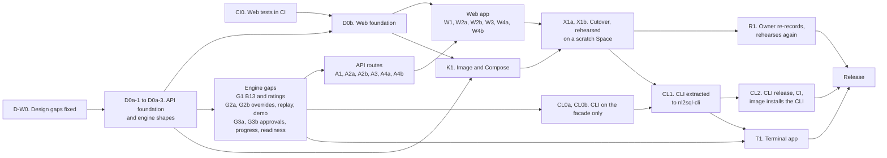
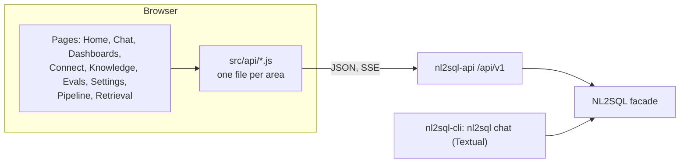
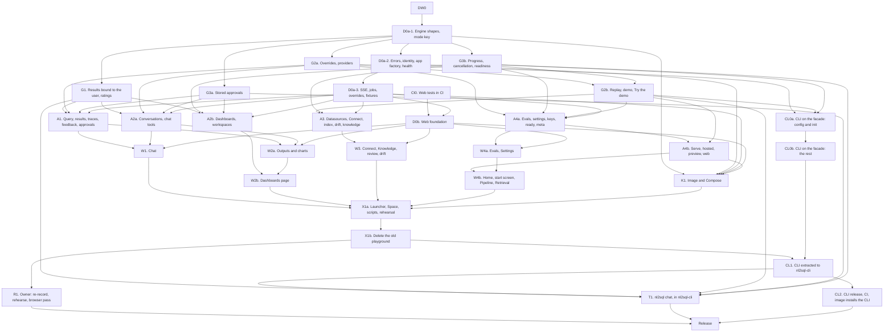
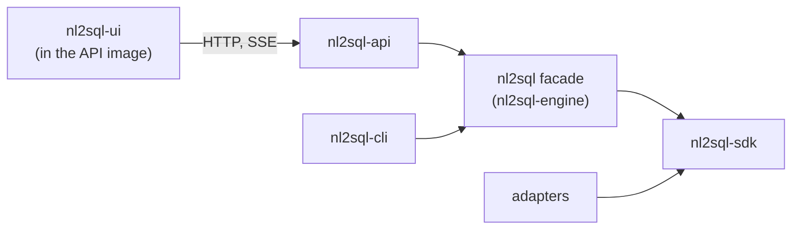

# Wave D: the apps (API v1, web app, Compose, terminal app) (design)

!!! note "Status: design"
    This page is the design for Wave D of the product redesign, the last
    wave, which ships as the release after 0.9. Nothing on it is built yet.
    Each pull request in [the PR plan](#14-pr-plan) adds a "Built" note to
    the sections it builds, as the earlier phases and waves do. Phase 1 is
    [Configuration v2 and the extension registry](configuration_v2.md);
    Phase 2 is [Phase 2: test bed, storage, providers, policies and adapter
    SDK v2](phase2.md); [Wave A](wave_a.md) (0.7: events, observers, hooks,
    approval, evals, routing, drift, sanity warnings, MCP over stdio) and
    [Wave B](wave_b.md) (0.8: glossary and knowledge, the profiler and review
    queue, clarification, plan-to-English, the cost guard, corrections) are
    designed on their own pages. Wave C (0.9: conversations and chat tools,
    `ChartSpec`, dashboards, the launchpad, API keys, MCP over HTTP) is
    designed in `architecture/wave_c.md`, not merged when this page was
    written; this page follows its amended version. Wave D renders what the
    three waves build. Where it needs something they do not provide, the gap
    is listed in [Needs from Waves A to C](#11-needs-from-waves-a-to-c) as a
    facade method, not designed around.

!!! note "Layout amended on 2026-10-30"
    The owner decided where the apps live: one UI codebase in the
    root-level `nl2sql-ui/`, built into the API's Docker image, and the
    terminal app with every other CLI command in their own root-level
    `nl2sql-cli/` distribution, built on the engine's facade (D225 to D233,
    [section 17](#17-repository-layout-the-ui-and-the-cli-app)).
    Below, a path that describes the planned layout is corrected
    (`web/app` and the planned `nl2sql/cli/chat/` become `nl2sql-ui/` and
    `nl2sql-cli/`); a path that describes today's code (`web/playground`,
    `nl2sql/cli/demo/`) keeps its name.

!!! note "Wave C as revised on 2026-10-28, and as built"
    [Wave C](wave_c.md) was revised after the first draft of this page: a
    model-led chat (the model calls tools in a bounded loop;
    `conversation.step` replaces `conversation.rewritten`), dashboards that are
    artifacts pinned whole (several sub-queries per chart; `needs_fixing`
    replaces `stale`; no single-tile pin), workspaces, manual dashboard edits
    with chat parity, refresh with stored results and schedules, and one
    access rule for every entry point. Wave D's chat and dashboard routes, its
    Chat and Dashboards pages, D224 and the job and fixture tables follow that
    revision, with the names checked against the code on `main`
    (`nl2sql/dashboards/api.py`, `nl2sql/api/dashboards_api.py`,
    `workspaces_api.py`, `conversations_api.py`, `common/errors.py`). Where
    the code and a Wave C page differ, the code wins.

The owner set them for the redesign, and they rank above everything below:

- **The package is the product; the playground only demonstrates it.** The
  web app talks only to `nl2sql-api`'s public `/api/v1` routes. The terminal
  app talks only to the Python facade. Neither holds feature logic: a chart
  is chosen by `engine.results.chart`, a dashboard by
  `engine.dashboards.generate`, a follow-up by `engine.conversations.ask`.
  Every gap this page found is a facade method plus a route, listed
  explicitly.
- **No active users: correct, not compatible.** Routes are renamed where
  their names are wrong, the playground's private server is deleted, and
  `nl2sql demo` keeps no flag whose behaviour is gone. No aliases.
- **Never over-engineer.** One process, one worker, jobs in memory, one
  Docker image, one Compose service, plain React and plain CSS. The apps
  expose what Waves A to C build and nothing they cut. The cut list is part
  of the design.
- **Both apps have a demo mode and a your-data mode.** Demo mode is the
  sample databases with recorded answers and no key; your-data mode is the
  caller's `nl2sql.yaml`.
- **The UI must not look AI-generated.** The playground's "Porcelain" design
  system (`web/playground/src/styles.css` today, `nl2sql-ui/src/styles.css` after D0b: its tokens, type scale, the run
  spine, the raised card, the 44px controls) is the baseline for every new
  page. No component library, no gradient, no icon font.

## Decisions

The owner was asleep when this design was written and asked that its
recommendations be used, each marked for confirmation. Wave A uses D9 to
D35, Wave B D36 to D61 and Wave C D100 to D130, so Wave D starts at D200.
After an independent review several were amended; those are marked so. The
final redesign's decisions D13 to D16 are cited by the brief for this wave;
their numbers collide with Wave A's, so this page calls them **final-design
D13 to D16** and records how each is applied.

| # | Decision | Status | Where |
|---|---|---|---|
| D200 | **The apps hold serving state only.** `nl2sql-api` may keep the job queue, hosted-demo limits and sessions; everything a user would call a feature is a facade method. `nl2sql_api` imports only the top-level `nl2sql`, and the web app calls only `/api/v1` routes listed in the committed `openapi.json`. Both are tests. | decided overnight, owner to confirm | [Principles](#principles), [Boundaries](#12-boundary-and-invariant-changes) |
| D201 | **One route convention, applied to the old routes too:** plural nouns (`/datasources`, `/conversations`, `/results`), ids in the path, an action on a collection or a resource as a verb sub-path (`/proposals/accept`), long work as `POST /jobs/{kind}`. `/datasource`, `/index/{id}`, `/index-all`, `/index/status`, `/llm/{agent}` and `/query/{request_id}/results/...` are renamed or folded with no alias. | decided overnight, amended after review, owner to confirm | [Conventions](#route-conventions) |
| D202 | **One error envelope, and only the facade's own exceptions are mapped.** `{"error": {"code", "message", "fix", "details"}}` for every non-2xx response. The facade's named exceptions share one base, `nl2sql.NL2SQLError` (`code`, `message`, `fix`, `status`); the API maps that base and nothing else. Any other exception, a built-in `ValueError`, `KeyError` or `PermissionError` included, is a 500 naming a request id, never its text. A pipeline outcome stays a 200 with the `QueryResult`. | decided overnight, amended after review, owner to confirm | [Errors](#the-error-envelope) |
| D203 | **Every request resolves one full `UserContext`** (`user_id`, `tenant_id`, `roles`) from one configured source, `api.auth`: `api_keys` (Wave C's bearer keys), `proxy` (user, tenant and role headers, trusted only from `proxy.trusted_from`), `static` (one role) or `none`. Anonymous browser sessions exist only inside `serve --demo --hosted`, never as a config value. `trust_body_role`, `role_header` and `role` are deleted. | decided overnight, amended after review, owner to confirm | [Identity](#identity-and-auth) |
| D204 | **Results and traces are bound to the user who asked (bug B13)** in the engine. Results were built early by Wave C's C-W2, with a required `user_context` and no operator path (see the [B13 note](#results-bound-to-the-user-b13)); what follows is for traces. A run records its asker's `(tenant_id, user_id)`; `traces.get` with a `user_context` answers only that asker, and another user's run is "not found". `user_context=None` is the trusted in-process operator for traces, as Wave A's D24 and Wave C's keys treat it, so `nl2sql trace` reads any run. The API, MCP and the terminal app always pass the caller, which a boundary test checks. Every new method this wave adds requires the caller and fails closed (Wave C's D130). | decided overnight, amended after review, owner to confirm | [Results bound to the user](#results-bound-to-the-user-b13) |
| D205 | **Final-design D15, applied safely:** with `api.auth: none`, `nl2sql-api` refuses to start unless it binds a loopback host, as Wave C's MCP does without keys. It then answers only requests whose `Host` is `localhost`, `127.0.0.1` or `[::1]` (with its port) and refuses any request carrying `Forwarded` or `X-Forwarded-For`, so neither a same-host proxy nor a DNS-rebinding page passes for the operator. Such a request is the local operator, with the admin roles. Compose ships with `auth: api_keys`. | decided overnight, amended after review, owner to confirm | [Identity](#identity-and-auth) |
| D206 | **Jobs run in process, on one worker thread, in memory.** A job is one facade call (index, profile, eval, dashboard) with a progress callback; jobs run one at a time in submission order; each caller has at most one job queued or running; the last 100 are kept and lost on restart. `nl2sql-api` runs one Uvicorn worker. The durable queue is cut. | decided overnight, amended after review, owner to confirm | [Jobs](#jobs) |
| D207 | **Server-Sent Events carry Wave A's `Event` as is** (`event.sse()`), through one helper that closes the facade's iterator when the client goes away (and cancels the token where the method takes one), with a heartbeat every 15 seconds. A job's event stream is an async generator, so a waiting browser holds no worker thread. | decided overnight, amended after review, owner to confirm | [Streams](#streams) |
| D208 | **`/ready` is real, and its rule is the engine's:** `CheckReport.ready(keys_optional=)` decides (every required datasource ready, every key resolves unless keys are optional, the index `ok` or `stale`). `/ready` answers status only to an anonymous caller and the report to an admin. The API now starts with a failed required datasource and reports not ready, instead of refusing to start. | decided overnight, amended after review, owner to confirm | [Health and readiness](#health-and-readiness) |
| D209 | **The replay provider is an LLM provider,** `provider: replay`, answering through the normal LLM interface from a recordings file; a question it has no recording for ends with the error code `REPLAY_MISS`. The demo's local fake HTTP server and its error-string matching leave the demo path. `nl2sql demo --record` is removed; recording is `scripts/record_demo_answers.py`, run by the owner. | decided overnight, owner to confirm | [The replay provider](#the-replay-provider) |
| D210 | **A key typed into the web app stays in the browser tab** and travels with each request as a per-call `LLMOverride` (`llm_override=` on the facade), in every mode. The web app never writes a key to disk. **A model the caller chooses runs only on a key the caller sent:** `X-NL2SQL-Models` is honoured only for providers the same request carries a key for, so a caller can never move a step onto the operator's account. Callers may bring a key only where `api.request_llm: true`; the demo sets it, the default is off. | decided by owner 2026-10-30 | [Keys and models](#keys-and-models-in-the-web-app) |
| D211 | **Final-design D13, applied with one change.** The web app ships inside `nl2sql-api` as package data, served by `nl2sql-api serve`. It adds no dependency to `nl2sql-api`, so there is no `web` extra there; instead the `demo` extra becomes `nl2sql-api` (first written on the engine, so `pip install "nl2sql-engine[demo]"` was the one install line; since D227 it belongs to `nl2sql-cli`, whose `web` extra is `nl2sql-api` (D231), so the line is `pip install "nl2sql-cli[web]"` and the engine and the API no longer depend on each other). `nl2sql demo` is a launcher that runs `python -m nl2sql_api serve --demo` in a child process; the engine never imports `nl2sql_api`. The playground server (`nl2sql/cli/demo/`) is deleted. The wheel keeps carrying the built page (D226). | decided by owner 2026-10-30; install line and launcher's home amended by D227 | [Serving](#4-serving-the-web-app-and-nl2sql-demo) |
| D212 | **Final-design D14, applied through Wave C's writer:** Connect's **Save** calls Wave C's `datasources.save(id, *, by, env_file)`, which writes `datasources/<id>.yaml`, with `env_file` true only for the fresh local install (Wave C's D122). No second save target, no overlay, no new switch. Saving is admin work, so it is off on the hosted demo; where the config is mounted read-only (Docker), `save` fails with its own message and the datasource stays registered in memory until restart, which the page says. | decided overnight, amended after review, owner to confirm | [Saving a datasource](#saving-a-datasource-final-design-d14) |
| D213 | **Final-design D16, applied: one Docker image,** `nl2sql-api`, with all five adapters and Microsoft's ODBC driver for SQL Server. The driver and unixODBC are small beside the ONNX runtime and Chroma the image already carries, so slim and full images are not worth two tags. CI builds and tests `linux/amd64`; `arm64` is published only once K1 has checked that `msodbcsql18` exists for Debian 12 on arm64. The image job records the size; a split is reconsidered only if the ODBC layers pass 15% of it. | decided overnight, amended after review, owner to confirm | [Docker image](#the-image) |
| D214 | **Charts are drawn by our own SVG renderer from `ChartSpec`** (four kinds), in Porcelain's tokens; Vega is not bundled, and the Vega-Lite export is a download. Mermaid is loaded on the first diagram as its own chunk (about 2 to 3 MB of the `nl2sql-api` wheel, recorded by the web job). The single-file build is dropped. | decided overnight, amended after review, owner to confirm | [Charts and diagrams](#charts-diagrams-and-reports) |
| D215 | **Approval grants are stored by the engine** (`engine.approvals`), amending Wave A's D10 and D24 and Wave C's D107. Over HTTP the approver and the asker are two callers at different times: the asker cannot prove a grant, and the approver must not run the question as the asker, so the approver grants a request by id and the asker's re-run names the id. A grant is reusable until it expires (24 hours), as an `Approval` is. | decided by owner 2026-10-30 | [Approvals](#approvals-over-rest) |
| D216 | **One React app, in `nl2sql-ui/`** (renamed from `web/playground`, at the repository root since D225): the existing Vite and React 18 setup, a hash router, plain JavaScript, Porcelain's CSS split per area, the API client split per area. No TypeScript, no state library, no component library. The location was `web/app` until 2026-10-30. | decided overnight, amended after review, owner to confirm; location amended by D225 (decided by owner 2026-10-30) | [The web app](#5-the-web-app) |
| D217 | **Web tests stay what they are, run in CI, and read real shapes:** `node --test` over pure modules, a contract test that every route the client calls is in `openapi.json`, and golden response files (`nl2sql-ui/src/api/fixtures/*.json`) written by the API's route tests and checked like `openapi.json`, which the node tests read instead of hand-made objects. No browser test runs in CI; the owner runs a short browser pass before the release. | decided overnight, amended after review, owner to confirm | [Testing](#testing-the-web-app) |
| D218 | **The terminal app is `nl2sql chat`,** on Textual (a normal dependency of `nl2sql-cli`, D231), in `nl2sql-cli/src/nl2sql_cli/chat/` since D227 (it was `nl2sql/cli/chat/`), on the facade only. Charts become text (a big number, sparklines, bars, a table); diagrams are shown as text. It takes no key: the CLI's environment and `.env` as everywhere. | decided overnight, owner to confirm; location and the extra amended by D227 and D231 (decided by owner 2026-10-30) | [The terminal app](#7-the-terminal-app-nl2sql-chat) |
| D219 | **Compose is one service:** `api` (one Uvicorn worker), one data volume, `auth: api_keys`, a healthcheck on `/api/v1/ready`. It starts not ready until indexed; `/ready` says why, and indexing is one command, `docker compose run --rm api nl2sql index`, so nothing re-indexes on every `up`. | decided overnight, amended after review, owner to confirm | [Compose](#6-docker-compose-self-host) |
| D220 | **Not in `nl2sql-api`:** MCP (Wave C's D126 stands: its own process), the operator event stream (observers are the operator's surface) and a `scan` route (Wave C's D121 left it to Wave D; the server's files and ports are still not the user's). `GET /events/catalog` is the one events route. | decided overnight, amended after review, owner to confirm | [Not in Wave D](#not-in-wave-d) |
| D221 | **The hosted demo serves the user's side of the web app:** chat, tools, charts, diagrams, reports, dashboards and the knowledge view, keyless from recordings or with the visitor's key. Admin work (Connect, review, index, profile, evals, drift, LLM settings, keys) is off because a hosted visitor is never admin, not by a hosted switch. Jobs, streams and questions are capped per session. | decided by owner 2026-10-30 | [The hosted demo](#the-hosted-demo) |
| D222 | **The guided questions are the datasources' `sample_questions`,** which `nl2sql init --demo` already writes (`config/project.py`). The only gap is exposing them on `DatasourceInfo`; `nl2sql.datasets.demo` stops being imported by any app. | decided overnight, amended after review, owner to confirm | [Demo mode](#demo-mode-and-your-data-mode) |
| D223 | **The foundation is five PRs, not one:** the CI web job first (CI0, bug B202, needs nothing), then the API foundation with every engine shape the gaps need, in three parts (D0a-1 engine shapes and the `mode:` key; D0a-2 errors, identity and the app factory; D0a-3 streams, jobs and overrides), and the web foundation (D0b) (shell, shared helpers, the client's transport, the CSS split, the build output) beside it, so the parallel PRs never edit the same file. | decided by owner 2026-10-30; the API foundation is three PRs (D0a-1 to D0a-3) | [PR plan](#14-pr-plan) |
| D224 | **Dashboards are Wave C's surface and no more:** whatever Wave C's `engine.dashboards` and `engine.workspaces` offer (open, refresh, edit, arrange, filters, schedule, pin, move, delete, workspaces), as thin routes. Wave C (revised 2026-10-28) builds editing and workspaces in the package, and [the routes](#the-routes) expose them. | decided by owner 2026-10-30; follows Wave C as revised 2026-10-28 (its D116, D131 and D133) | [Routes](#the-routes) |
| D225 | **One UI codebase, in the root-level `nl2sql-ui/`** (not under `packages/`, not under `web/`; amends D216's location, not its stack). It is one of the shipped products. Demo, playground and real use are the same code: the mode (demo, your data, hosted) is configuration, not a build, and reaches the page through `GET /meta`. The configuration is the project's config and, in Docker Compose, environment variables. | decided by owner 2026-10-30 | [Layout](#17-repository-layout-the-ui-and-the-cli-app) |
| D226 | **The UI ships inside the API's Docker image, and the API's PyPI wheel carries the same built UI.** One build (`npm run build` in `nl2sql-ui`, written to `nl2sql_api/web/static/`) serves `pip install nl2sql-api` and the image: the image's Node stage runs it, and so does the wheel build, so neither needs Node at install time. `nl2sql-api` serves the result; the UI talks only to the API. Compose stays one service (D219 stands). | decided by owner 2026-10-30 | [Image](#the-image) |
| D227 | **The terminal app and every other CLI command move to their own root-level `nl2sql-cli/`,** packaged as its own distribution that imports the engine package only, through the public `nl2sql` facade, as `nl2sql-api` does. It does not use the SDK (the SDK is for adapter authors) and never touches `engine._runtime`. The `nl2sql` console script and `nl2sql chat` (D218) move with it; the engine keeps no `nl2sql/cli/`. | decided by owner 2026-10-30 | [Layout](#17-repository-layout-the-ui-and-the-cli-app) |
| D228 | **Four things ship:** the engine (`nl2sql-engine`, with `nl2sql-sdk` for adapter authors), the API image with the UI inside it (and the `nl2sql-api` wheel), the CLI app (`nl2sql-cli`), and the UI as its own folder, `nl2sql-ui/`. | decided by owner 2026-10-30 | [Layout](#17-repository-layout-the-ui-and-the-cli-app) |
| D229 | **The mode is a `mode:` key in `nl2sql.yaml`** (`demo`, `your_data` or `hosted`; `your_data` when absent), **overridable in Compose by one environment variable, `NL2SQL_MODE`.** `GET /meta` reports it. The variable is read at the entry point only (`nl2sql_api serve`, added to `READS_THE_ENVIRONMENT` in the boundary test) and travels in `Config`, so two engines in one process share nothing; the engine and the page read no environment. `serve --demo` and `--demo --hosted` stay as launcher flags and set `demo` and `hosted`; a flag beats `NL2SQL_MODE`, which beats the file. | decided by owner 2026-10-30 | [Layout](#17-repository-layout-the-ui-and-the-cli-app) |
| D230 | **The API image installs `nl2sql-cli`,** so `docker compose run --rm api nl2sql index` (and `nl2sql keys create`) work. | decided by owner 2026-10-30 | [Compose](#6-docker-compose-self-host) |
| D231 | **Names and dependencies of the CLI.** PyPI distribution `nl2sql-cli`, import package `nl2sql_cli`, console command `nl2sql`. The CLI sits on the engine only: its one dependency is `nl2sql-engine`, plus Textual as a plain dependency (the terminal app) and the `demo` command itself, which move in. Commands that need the web server (`nl2sql demo`, `serve`) need `nl2sql-api`, which is the optional `web` extra: `pip install "nl2sql-cli[web]"`. Those commands **shell out** (`python -m nl2sql_api serve ...` as a child process, found with `importlib.util.find_spec`), so `nl2sql_cli` never imports `nl2sql_api`, lazily or otherwise; shelling out is the least code and keeps the boundary test absolute. Without the extra they print the install line and exit 1. The API image installs `nl2sql-cli` beside `nl2sql-api`, so every command works there. The CLI moves after the cutover: CL1 follows X1b. | decided by owner 2026-10-30; the `web` extra and the shell-out are the coordinator's correction of the same day | [Layout](#17-repository-layout-the-ui-and-the-cli-app) |
| D232 | **The engine facade gets a public method that starts the MCP server;** `nl2sql mcp` calls it. The server stays in `nl2sql/mcp/`. | decided by owner 2026-10-30 | [Layout](#17-repository-layout-the-ui-and-the-cli-app) |
| D233 | **One two-stage Dockerfile at the repository root:** stage one builds `nl2sql-ui`, stage two is the API image. It moves from `packages/api/Dockerfile`; the three workflows that name it change with it. The Space's `deploy/huggingface/Dockerfile` stays its own file. | decided by owner 2026-10-30 | [Image](#the-image) |
| D234 | **Opening a dashboard only reads.** `GET /dashboards/{id}` never refreshes (it calls `open(refresh_due=False)`); the page then calls `POST /dashboards/{id}/refresh` for the tiles that are due. A GET runs no query and stores nothing. | decided by owner 2026-10-30 | [Routes](#the-routes) |
| D235 | **Dashboard edits are `PUT` on sub-resources, one per facade method:** `PUT /dashboards/{id}/title`, `/chart` (under a tile), `/layout`, `/filters`, `/schedule`, and the workspace rename is `PUT /workspaces/{id}/name`, the same style. | decided by owner 2026-10-30 | [Routes](#the-routes) |
| D236 | **A refresh takes request ids like a query does:** G3a adds request ids to `dashboards.refresh`, as it does for `run_query`, `stream_query` and `conversations.retry` (D215), so the route's `approval_ids` have something to resolve against. A2b depends on G3a. | decided by owner 2026-10-30 | [Routes](#the-routes) |
| D237 | **Try the demo is a facade method and a job route:** G2b adds `engine.add_demo()` (it adds the three sample databases and the demo glossary to the project, then indexes them); A4a exposes it as `POST /jobs/demo` (admin; a job because it indexes); W4b's start screen calls it. A4a depends on G2b. | decided by owner 2026-10-30 | [The start screen](#the-start-screen) |

## Where 0.9 will leave us

What the code has today (0.6), plus what Waves A to C add, as their designs
describe them.

| Area | What 0.9 has | What is still missing |
|---|---|---|
| REST | `nl2sql-api` with 17 routes under `/api/v1` (query 4, datasource 4, indexing 4, llm 3, health 2: `routes/*.py`), plus Wave C's `GET /datasource-types` and `POST /datasource/test` | Nothing for conversations, chat tools, charts, dashboards, knowledge, proposals, evals, approvals, drift, clarification or API keys. Indexing blocks the request. |
| Errors | Several routes catch `Exception` and answer `str(e)` in a 500 (`routes/datasource.py` `list_datasources`, `get_datasource`, `remove_datasource`; `routes/indexing.py`; `routes/llm.py`) | A driver's message can carry a connection string; no shape a client can branch on (bug B200) |
| Identity | Roles only, from a header, a static role or the request body (`auth.py`); no `user_id`, no tenant | Nothing to bind a result, conversation or dashboard to; Wave C's D105 says Wave D must set a `user_id` before exposing conversations |
| Results | `engine.results.page` and `csv` read the engine's tenant folder (`api/results_api.py`) | Anyone with a role and a `trace_id` reads anyone's rows (bug B13) |
| Readiness | `GET /api/v1/ready` always answers `success: true` (`services/health.py`); the lifespan refuses to start on a failed required datasource (`main.py`) | An orchestrator cannot tell a broken API from a working one (bug B201) |
| The playground | A private FastAPI app with 21 routes (`nl2sql/cli/demo/playground/app.py`), served by `nl2sql demo` (`cli/commands/demo.py`); hosted mode (`playground/hosted.py`); a local fake LLM server for replay (`nl2sql.testing.fake_llm`, `nl2sql.llm.replay`); a React page in `web/playground` built into the engine's wheel | A second API beside `nl2sql-api`, with internal imports the boundary test lists as exceptions (`STILL_IMPORTED_FROM_INSIDE` in `tests/architecture/test_boundaries.py`). One question at a time: no follow-ups, charts, dashboards, review, evals or Connect. |
| Web tests | 24 `node --test` files under `web/playground/src` | Never run in CI: `.github/workflows/test.yml` has no Node job (bug B202) |
| Docker | `packages/api/Dockerfile` (PostgreSQL and MySQL drivers only); the Space image `deploy/huggingface/Dockerfile` runs `nl2sql demo --hosted` | No Compose for self-hosting; no SQL Server or DuckDB in the API image |
| Terminal | `nl2sql run` (one question), Wave C's `nl2sql launch` | No conversation in a terminal; `textual` is already kept out of `import nl2sql` by a test, and never used |

## 1. Goals and non-goals

### What ships

| Goal | What it means |
|---|---|
| **API parity** | Every Wave A to C capability a user or operator reaches through the facade has a `/api/v1` route, with one error envelope, one identity, streams over SSE and jobs for long work. |
| **Results bound to the user** | B13, fixed in the engine and enforced by every app that reads rows or traces. |
| **A real `/ready`** | What an orchestrator and Compose's healthcheck need, decided by the engine. |
| **The replay provider** | Recorded answers served through the normal LLM interface, so demo mode is the real pipeline with a recorded model. |
| **The web app** | One codebase in `nl2sql-ui/` (D225), served by `nl2sql-api` and built into its image (D226); demonstrates every capability: chat with follow-ups and tools, charts, diagrams, reports, clarification, approval, "why this answer", warnings, dashboards, Connect, knowledge and proposals review, corrections, evals, drift. Demo and your-data modes. Porcelain kept. |
| **The hosted demo keeps working** | nl2sql.codewithnk.com: keyless replay and bring-your-own-key, on the new server, rehearsed on a scratch Space before the release. |
| **Compose** | Self-hosting in one command: one service, one volume, one worker, auth on, healthcheck. |
| **The terminal app** | `nl2sql chat` in the `nl2sql-cli` distribution (D227): conversation, results, charts as text, clarification and approval prompts, demo and your-data modes. |
| **A CLI of its own** | The `nl2sql` command and its subcommands leave the engine for `nl2sql-cli`, on the facade only (D227). |
| **No exceptions left** | `STILL_IMPORTED_FROM_INSIDE` is empty and deleted, and the whole CLI, not only the demo command, imports only the top-level `nl2sql` (CL0a, CL0b). |

### Not in Wave D

| Later | Why it waits |
|---|---|
| A durable job queue, several workers, horizontal scaling | D206: one process serves a team; a queue is a product of its own |
| OAuth or SSO login in the web app | Wave C's D127: keys first. A proxy that authenticates can use `api.auth: proxy`. |
| MCP mounted in `nl2sql-api`, an operator event stream over REST, a `scan` route | D220 |
| Tenant-shared dashboards, publishing a dashboard to a shared workspace, Power BI or Tableau targets, metric alerts | Wave C's Later list (LT1 to LT3): Wave C builds editing, workspaces and refresh in the package; sharing waits |
| Editing the plan from "why this answer" | Wave B's cut list |
| A browser end-to-end suite in CI | D217: route tests, golden fixtures and the HTTP smoke cover the contract; the owner runs a browser pass before the release |
| Rate limiting beyond the hosted demo's | Per-question caps (Wave A) bound spend; a public deployment puts a proxy in front |
| TypeScript, a component library, a design-system package | D216 |
| A second UI codebase (a separate demo or hosted build) | D225: one codebase, the mode is configuration |
| A Kubernetes chart | `docs/deployment/kubernetes.md` stays prose; Compose is the supported self-host |
| A multi-project platform | Decided with the owner on 2026-10-29: later, as its own package (working name `nl2sql-platform`) so `nl2sql-engine` and `nl2sql-api` keep serving one project unchanged. Sketch: a project is one `NL2SQL` engine and one project folder; the platform package holds many, keeps each running (schedules, jobs), lists them in one platform file, holds platform-wide identity (a key or a proxy identity names a person; the platform knows their projects) and answers every access question through one `can(user, action, project)` check over named actions (`project.create`, `project.use`, `project.configure`, ...). At first only an admin creates projects and grants them; project-level roles later become a table `can` reads, with no route or page change. It adds platform routes beside the per-project `/api/v1`. Waits because quotas and sharing between projects on one server are a product of their own. |

## 2. Order of work



The graph is the order, not the batches: the PRs are built in
[session batches](#session-batches), and the full dependency graph is in
[section 14](#14-pr-plan).

## 3. The API: `/api/v1` at parity

### Route conventions

| Rule | Detail |
|---|---|
| **Prefix** | Everything under `/api/v1`; the web page and its assets at `/`. |
| **Nouns** | Plural collections, ids in the path: `GET /conversations/{id}`. An action is a verb sub-path on the resource it acts on: `POST /approvals/{id}/grant`, `POST /proposals/accept` (the facade takes a list of ids). |
| **Long work** | `POST /jobs/{kind}` returns `202` and the job; `GET /jobs/{id}` and `GET /jobs/{id}/events` follow it ([Jobs](#jobs)). No route blocks for longer than a question. |
| **Streams** | A route that streams a run ends in `/stream` and answers `text/event-stream` ([Streams](#streams)). |
| **Bodies** | Request models are pydantic, strict (`extra="forbid"`), declared beside their router. Responses are the facade's own models (`QueryResult`, `Conversation`, `Dashboard`, `Proposal`, ...), served as they are, so the HTTP shape cannot drift from the package's. |
| **The caller** | Every handler that calls an owned, scoped or privileged facade method passes the request's `UserContext` as `user_context=` or, for an admin write, `by=`. |
| **Sync handlers** | A handler that calls the engine is `def`, so Starlette runs it in its thread pool, as `routes/query.py` does today. |
| **No services layer** | `nl2sql_api/services/` and `dependencies.py` are deleted: each wrapper was one line over a facade call. A router calls the facade directly. |
| **OpenAPI** | Every route has a summary, its request and response models and its error statuses. `packages/api/openapi.json` is committed; `test_openapi_snapshot_is_current` fails when it is stale and prints the command that rewrites it. |

### The error envelope

```python
# nl2sql_api/errors.py
class ApiError(BaseModel):
    code: str                     # an NL2SQLError's code, or NOT_FOUND, INVALID_REQUEST,
                                  # UNAUTHENTICATED, FORBIDDEN, CONFLICT, LIMIT_REACHED, NOT_READY, INTERNAL
    message: str                  # one sentence a person can act on
    fix: str | None = None
    details: list[dict] = []      # 422: one entry per problem, {"loc": [...], "msg": ...}; never a value
    request_id: str | None = None # 500 only: the id in the server log

class ErrorBody(BaseModel):
    error: ApiError
```

**One base class (D202).** The engine gains `nl2sql.NL2SQLError(Exception)`
with `code`, `message`, `fix` and `status` (the HTTP status it means:
404, 409, 422 or 403). The facade's named exceptions derive from it as well
as from the built-in they are today, so a Python caller's `except
LookupError` still works:

| Exception (from) | Status | Code |
|---|---|---|
| `ConversationNotFound`, `DashboardNotFound`, `WorkspaceNotFound` (Wave C), `ResultNotFound`, `JobNotFound`, `DatasourceNotFound`, `ApprovalNotFound` (new) | 404 | `NOT_FOUND` |
| `ConversationBusy`, `DashboardBusy` (Wave C; `dashboards/run.py`); `ReviewError(FILE_CHANGED)` (Wave B) and Wave C's `save` that reuses it | 409 | `CONFLICT`, `FILE_CHANGED` |
| `NoTiles`, `WorkspaceNotEmpty`, `ScheduleTooFrequent`, `NotIndexed`, `SecretValueInConfig` (Wave C); `MissingProviderKey` (G2a); `NotPinnable` (`pin` of a saved dashboard or an empty draft), `ChartNotSupported` (`set_tile_chart` to a kind the tile cannot draw), `UnknownTile` and `UnknownFilter` (`refresh` with a bad `tile_id` or filter), all new in D0a-1: they replace the bare `ValueError`s `main` raises, and keep `ValueError` as a parent; any other facade argument check that raises its own subclass | 422 | the exception's code |
| `ReviewError(NOT_AUTHORIZED, NOT_WRITABLE)` (Wave B); a caller without an admin or approver role where the facade checks it (`NotAuthorized`, new) | 403 | the exception's code |

| Raised | Status | Code |
|---|---|---|
| A request body or query that does not validate | 422 | `INVALID_REQUEST`, each problem by path and message; the input is never echoed (the playground's `_invalid_request` handler, generalised) |
| No identity | 401 | `UNAUTHENTICATED`, with `WWW-Authenticate: Bearer` under `api_keys` |
| A hosted limit | 429 | `LIMIT_REACHED`, with `Retry-After` |
| Not ready | 503 | `NOT_READY` |
| Anything else: a built-in `ValueError`, `pydantic.ValidationError`, `KeyError`, `PermissionError` or `OSError` from anywhere | 500 | `INTERNAL`; the message is "Something failed on the server. Request id: ...", and the exception is logged with that id and the run's `trace_id` (Wave A's log correlation) |

A pipeline outcome is not an error: `POST /query` answers 200 with a
`QueryResult` whose `status` is `error`, `needs_clarification`,
`needs_approval` or `stopped`, as today. D0a-2 removes the per-route `except
Exception` blocks of the old routes so the one handler applies to every
route from then on. `test_no_route_returns_exception_text` raises, through
every registered route with a stub engine, a `ValueError`, a
`pydantic.ValidationError` (with an `input_value`), a `KeyError` and a
`PermissionError`, each carrying a fake connection string, and checks that
each is a 500 whose body holds no part of it (B200).

### Identity and auth

`nl2sql_api/identity.py` replaces `auth.py`. One dependency, `caller`,
resolves the request's `UserContext`; `admin` adds the role check.

```yaml
# nl2sql.yaml (the api section; the engine validates it and never reads it)
api:
  auth: api_keys              # api_keys | proxy | static | none (default: none)
  proxy:                      # auth: proxy only
    trusted_from: [127.0.0.1/32, "::1/128"]   # CIDRs the proxy connects from
    user_header: X-Forwarded-User
    tenant_header: null
    roles_header: X-NL2SQL-Roles
  static_role: analyst        # auth: static only
  request_llm: false          # callers may send their own key and models (D210)
  cors_origins: []
```

| `api.auth` | The caller | Admin |
|---|---|---|
| `api_keys` | `Authorization: Bearer <token>`, verified by Wave C's `engine.api_keys.verify`; the key's `user_id`, `tenant_id` and roles. Missing or invalid: 401. | A key whose roles include one of `policies.admin_roles` |
| `proxy` | The headers the proxy sets on every request: the user, the tenant (else `settings.tenant_id`), the roles (comma-separated). Honoured only when the connecting peer is in `proxy.trusted_from`; from any other peer, or with no user header, a 401. | The roles, as above |
| `static` | `user_id: "static"`, `static_role`. For a single-user deployment on a private network. | Only when `static_role` is an admin role |
| `none` | Refuses to start unless the bind host is loopback (D205). A request whose `Host` is `localhost`, `127.0.0.1` or `[::1]` (with the port) and that carries no `Forwarded` or `X-Forwarded-For` header is the local operator, `user_id: "local"` with the admin roles; any other request is a 403 naming the fix. | That operator |

The hosted demo's anonymous sessions are not a value of `api.auth` (D203):
`serve --demo --hosted` installs them itself ([The hosted
demo](#the-hosted-demo)). `api.trust_body_role`, `api.role_header` and
`api.role`, and the body's `user_context`, are deleted. The engine's `Api`
model (`config/models.py`) carries the new fields so `nl2sql config check`
reports a typo.

### Results bound to the user (B13)

Built early for results by Wave C's C-W2, with a stricter rule than below:
`user_context` is required (none is a `TypeError`, no `None` operator) and
a manifest with no owner is refused for every caller
([Who can read a run](../api/core/results.md#who-can-read-a-run)). A caller
with no `user_id` also has its sorted roles recorded and must match them, so
an anonymous `viewer` cannot read an anonymous `admin` run. So the results
half of the steps below (the `None` operator in 2 and 3, and the results
part of 6) does not apply; traces (`engine.traces.get`) remain this
section's.

B13 is fixed in the engine (D204), so the facade, the API, MCP and the
terminal app all get it:

1. The result writer records the run's `tenant_id` and `user_id` in the
   result manifest (`execution/artifacts/results.py`), beside the columns it
   already records; the trace document records them too.
2. `engine.results.manifest`, `page`, `csv` and Wave C's `chart` take
   `user_context=None` (replacing `chart`'s `tenant_id`); with a context,
   they compare it with the stored pair, and a mismatch raises
   `ResultNotFound`. `engine.traces.get(trace_id, *, user_context=None)`
   does the same and returns `None`.
3. `user_context=None` is the trusted in-process operator: it reads any run
   of the engine's tenant, as `nl2sql trace <id>` (`cli/commands/trace.py`, `nl2sql_cli/commands/trace.py` after D227)
   and `nl2sql run` need, and as Wave A's D24 trusts the context an
   in-process caller passes.
4. Every app passes the caller. `test_apps_always_pass_the_caller` scans
   `nl2sql_api/`, `nl2sql/mcp/` and `nl2sql-cli/src/nl2sql_cli/` (AST) for calls of
   `results.*`, `traces.get` and `results.chart` without `user_context`.
5. Wave C's built-in `chart` tool and dashboard runs pass the tool's or the
   tile's caller (`nl2sql/chat_tools/chart.py`, `nl2sql/dashboards/`).
6. Results written before the change have no owner and are read only by
   `None`; the release notes say so.

`test_another_users_result_is_not_found`, `test_another_users_trace_is_not_found`,
`test_cli_trace_reads_any_run`, `test_ownerless_result_is_read_only_by_the_operator`
(engine) and `test_results_route_hides_another_users_rows` (API).

### Streams

`nl2sql_api/sse.py` is the one place an SSE response is built:

```python
def event_stream(open_events: Callable[[], Iterator[Event]], request: Request,
                 *, token: CancellationToken | None = None) -> StreamingResponse
```

| Rule | Detail |
|---|---|
| **The wire** | Each item is Wave A's `Event.sse()`: `event: <name>` and `data: <json>`. No second event vocabulary. |
| **Cancellation** | The iterator runs in the thread pool. When the client disconnects, the helper closes the iterator, which cancels the run for Wave C's `conversations.stream` (it takes no token and cancels on close), and cancels `token` too for `stream_query`, which takes one (`cancel_when_disconnected` in `playground/app.py`, moved). |
| **Heartbeat** | A `: keep-alive` comment every 15 seconds, so a proxy does not close a quiet stream while the planner thinks. |
| **Headers** | `Cache-Control: no-cache`, `X-Accel-Buffering: no` (both servers set them today). |
| **Refusals** | Identity, validation and hosted limits are checked before the stream starts and answer with the envelope; once streaming, a failure is the run's `run.failed`. |

The streams: `POST /query/stream` (Wave A's caller-safe allow-list, ending
`run.finished` with `data.result`), `POST /conversations/{id}/turns/stream`
(Wave C's run events with `conversation.step`, ending
`conversation.turn`), and `GET /jobs/{id}/events`, which is an `async`
generator over the in-memory job and holds no thread.

### Jobs

```python
# nl2sql_api/jobs.py
JobKind = Literal["index", "profile", "eval", "dashboard"]

class JobProgress(BaseModel):
    at: datetime
    step: str                    # "chinook", "case 12 of 80", "tile 3 of 8"
    done: int
    total: int | None

class Job(BaseModel):
    id: str                      # 22 url-safe characters
    kind: JobKind
    status: Literal["queued", "running", "succeeded", "failed", "cancelled"]
    params: IndexJob | ProfileJob | EvalJob | DashboardJob   # the request body, typed per kind
    created_by: str | None       # the caller's user_id
    created_at: datetime
    started_at: datetime | None
    finished_at: datetime | None
    progress: list[JobProgress]
    result: IndexResult | list[ProfileReport] | EvalReport | DashboardJobResult | None   # typed per kind
    error: ApiError | None
```

`IndexResult` is the index build's report; `DashboardJobResult` (in `nl2sql_api/jobs.py`) is what
`dashboards.generate` returns, as a model: `{dashboard: Dashboard, run: DashboardRun}`; the engine's
`DashboardGenerated` event is a different thing and is not the result. Each lands in `openapi.json`,
so the web app reads a typed eval report.

| Kind | Route | Facade call | Progress from | Who |
|---|---|---|---|---|
| `index` | `POST /jobs/index` `{datasource_ids?}` | `engine.index.build(ids, on_datasource=, cancellation_token=)` | `on_datasource` | admin |
| `profile` | `POST /jobs/profile` `{datasource_ids?, draft, max_cost_usd?}` | Wave B's `engine.knowledge.profile(ids, user_context=, draft=, max_cost_usd=, on_datasource=, cancellation_token=)`, on the server's key: a key typed in a browser never pays for drafts | `on_datasource` | admin |
| `eval` | `POST /jobs/eval` `{suites?, mode, cases?, max_cost_usd?}` | Wave A's `engine.evals.run(..., on_case=, cancellation_token=)` | `on_case` | admin, in every mode: a report holds every role's cases, plans and SQL |
| `demo` | `POST /jobs/demo` `{}` | `engine.add_demo(user_context=, on_datasource=)` (G2b, D237): adds the three sample databases and the demo glossary to the project, then indexes them; the result is an `IndexResult` | `on_datasource` | admin |
| `dashboard` | `POST /jobs/dashboard` `{datasource_id, title?, workspace_id?, max_tiles?}` | Wave C's `engine.dashboards.generate(datasource_id, *, user_context=, title=, workspace_id=, max_tiles=, on_tile=, cancellation_token=)` | `on_tile` | any caller; the dashboard is theirs |

| Rule | Detail |
|---|---|
| **One worker (D206)** | One daemon thread takes jobs in submission order. Two index builds never race on the index, and a profile never reads a snapshot an index build is replacing. A question is not a job: it runs on the request's thread as today. |
| **One process** | The queue lives in the process, so `nl2sql-api serve` and the image run one Uvicorn worker. `serve` has no `--workers`; the docs say why. |
| **In memory** | The last 100 jobs. A restart loses them; what they produced (an index build, proposals, a dashboard) is in the engine's stores. |
| **One per caller** | A caller with a job queued or running gets a 409 naming it, so one caller cannot stall the queue. The duplicate check for `dashboard` is per caller, so two users generating a dashboard for the same datasource never collide. |
| **Ownership** | `GET /jobs` lists the caller's jobs (an admin sees all); another user's job is a 404, as D204. |
| **Cancel** | `DELETE /jobs/{id}`: a queued job is removed; a running one has its token cancelled and stops between items (datasources, cases, tiles). |
| **Events** | `GET /jobs/{id}/events` sends every `JobProgress` so far, then each new one, then `job.finished` with the job. These are the API's, not the engine's catalog's. |
| **Facade gaps** | `on_datasource` exists on `index.build` and `on_case` on `evals.run`; `profile` and `generate` gain a callback, and all four gain `cancellation_token` (G3b). |

`test_jobs_run_one_at_a_time_in_order`, `test_job_progress_replays_then_follows`,
`test_job_events_hold_no_worker_thread`, `test_cancel_running_job_stops_between_items`,
`test_second_job_for_a_caller_is_a_conflict`,
`test_two_users_generate_for_one_datasource`, `test_another_users_job_is_not_found`,
`test_eval_job_is_admin_only`, `test_api_runs_one_worker`.

### Health and readiness

| Route | Answers |
|---|---|
| `GET /health` | Liveness: `{"status": "ok", "version": {"engine", "api"}}`, from process state only. The Space's release check polls it for the version (`scripts/fresh_install_check.py`). |
| `GET /ready` | The engine's `check()` report, cached 10 seconds, judged by `CheckReport.ready(keys_optional=)` (D208): `keys_optional` is true when `api.request_llm` is on or every agent is on `replay`. 200 `{"status": "ready"}` or 503 `{"status": "not_ready"}` to everyone; an admin caller also gets `CheckReport.problems()` (each failing datasource and its stage, each agent whose key does not resolve, the index status), never a secret. An optional datasource that failed is a problem but not "not ready". |
| `GET /meta` | Without a caller: `mode` (`demo`, `hosted`, `your_data`), the identity source and `request_llm`, which is what the page needs to show a sign-in. With a caller: also the datasources it may reach with their `sample_questions` (D222), which of those the replay provider has recordings for, `recorded_with`, and the hosted limits. |
| `GET /about` | `engine.about()`: the pipeline's steps and the model each runs on (today's `/api/pipeline`). |

`nl2sql-api` no longer refuses to start when a required datasource fails:
it starts, `/ready` is 503, and the reason is one admin request away, which
an orchestrator's restart loop would otherwise hide.

`test_ready_fails_on_a_required_datasource`, `test_ready_passes_with_an_optional_failure`,
`test_ready_fails_on_a_missing_index`, `test_ready_passes_with_request_keys`,
`test_ready_details_only_for_admin`, `test_meta_without_a_caller_lists_no_datasource`.

### The routes

Every route below is new unless marked. "Admin" is the `admin` dependency;
everything else needs a caller. A name in **bold** in the facade column is
a gap ([section 11](#11-needs-from-waves-a-to-c)). `caller` is the request's
`UserContext`.

**Questions, results, traces and feedback** (`routes/query.py`)

| Route | Facade | Notes |
|---|---|---|
| `POST /query` (changed) | `run_query(question, user_context=caller, datasource_id=, execute=, choice=, approvals=, llm_override=)` | Body: `question` (was `natural_language`), `datasource_id`, `execute`, `choice` (Wave B's `ClarificationChoice`), `approval_ids` (D215). A body with both `choice` and `approval_ids` is a 422 `CLARIFICATION_INVALID` before the engine is called, as Wave B refuses them together. |
| `POST /query/stream` (changed) | `stream_query(...)` | Wave A's `Event`s |
| `GET /results/{trace_id}` | `results.manifest(..., user_context=caller)` | The manifest, without rows |
| `GET /results/{trace_id}/{result_id}` (moved) | `results.page(..., user_context=caller)` | Was `/query/{request_id}/results/{result_id}` |
| `GET /results/{trace_id}/{result_id}.csv` (moved) | `results.csv(..., user_context=caller)` | |
| `GET /results/{trace_id}/{result_id}/chart` | Wave C's `results.chart(trace_id, result_id, kind=, user_context=caller)` | `?kind=`; `?format=vega-lite` answers `to_vega_lite()` |
| `GET /traces/{trace_id}` | `traces.get(trace_id, user_context=caller)` | Today only the playground has it |
| `POST /feedback` (from the playground) | **`feedback.record(trace_id, rating, *, user_context, note=None)`** | The engine reads the run's own trace; the playground's in-memory "recent runs" goes |
| `POST /feedback/correct` | Wave B's `feedback.correct(trace_id, *, user_context=caller, sql=, plan=, question=, note=)` | Returns the `Proposal` |
| `GET /feedback` | `feedback.list()` | Admin |

The answer view's diagram is the conversation's `diagram` tool; there is no
`/diagram/{trace_id}` route.

**Approvals** (`routes/approvals.py`, D215)

| Route | Facade | Notes |
|---|---|---|
| `GET /approvals` | **`approvals.list(*, user_context=caller, status="pending")`** | An approver sees the requests their roles may approve; an asker sees their own |
| `POST /approvals/{request_id}/grant` | **`approvals.grant(request_id, *, by=caller)`** | `NotAuthorized` (403) unless the caller holds one of the hook's approver roles |
| `POST /approvals/{request_id}/deny` | **`approvals.deny(request_id, *, by=caller, reason=None)`** | |

**Conversations and chat tools** (`routes/conversations.py`; every Wave C
method takes `user_context=caller`)

| Route | Facade |
|---|---|
| `POST /conversations` | `conversations.start(user_context=, datasource_id=, dashboard_id=)`: `dashboard_id` opens a chat on a saved dashboard to edit it |
| `GET /conversations` | `conversations.list(user_context=)` |
| `GET /conversations/{id}` | `conversations.get` |
| `DELETE /conversations/{id}` | `conversations.delete` |
| `POST /conversations/{id}/turns` | `conversations.ask(id, text=, user_context=, choice=, execute=, llm_override=)` |
| `POST /conversations/{id}/turns/stream` | `conversations.stream(...)` |
| `POST /conversations/{id}/retry` | `conversations.retry(id, user_context=, approvals=, llm_override=)`, the body's `approval_ids` passed as **request ids** |
| `POST /conversations/{id}/tools/{name}` | `conversations.tool(id, name, args, user_context=)` |
| `GET /conversations/{id}/report` | `conversations.report(id, user_context=, turns=, title=)`, `text/markdown` |
| `GET /chat-tools` | `chat_tools.list()` |

The model decides what a turn does (Wave C's bounded tool loop), so a turn
stream carries `conversation.step` events and ends with `conversation.turn`;
there is no separate rewrite step. A busy conversation is a 409
(`ConversationBusy`). A turn with status
`needs_clarification` is answered with `choice` (an option id) in the next
turn's body (Wave C's D104).

**Dashboards and workspaces** (`routes/dashboards.py`, `routes/workspaces.py`;
D224; every method takes `user_context=caller`). A dashboard is an artifact
the model builds in chat as a draft and the caller pins whole into a workspace
(Wave C's D116, D131); the routes are thin over the named methods of
`engine.dashboards` and `engine.workspaces` and add none.

| Route | Facade |
|---|---|
| `GET /dashboards` | `dashboards.list(workspace_id=, status=)`: the caller's |
| `POST /jobs/dashboard` | `dashboards.generate` (a job; the result is a `DashboardJobResult`: the new `Dashboard` and its first `DashboardRun`) |
| `GET /dashboards/{id}` | `dashboards.open(id, refresh_due=False)`: only reads, never refreshes (D234). A `DashboardView` with the stored `TileRun`s, `refreshed_at` and the tiles due; the page then calls `POST /dashboards/{id}/refresh` for the tiles that are due |
| `POST /dashboards/{id}/refresh` | `dashboards.refresh(id, tile_id=, filters=, approvals=)`; synchronous: a refresh makes no model call and runs the stored queries, so a request's `approval_ids` are request ids (D215) |
| `GET /dashboards/{id}/filters/{filter_id}/values` | `dashboards.filter_values(id, filter_id, limit=)` |
| `PUT /dashboards/{id}/title` | `dashboards.rename` |
| `PUT /dashboards/{id}/tiles/{tile_id}/title` | `dashboards.rename_tile` |
| `PUT /dashboards/{id}/tiles/{tile_id}/chart` | `dashboards.set_tile_chart(..., chart=)`: `auto`, `line`, `bar`, `big_number` or `table` |
| `DELETE /dashboards/{id}/tiles/{tile_id}` | `dashboards.remove_tile`: how a `needs_fixing` tile is removed |
| `PUT /dashboards/{id}/layout` | `dashboards.arrange(id, arrangements)`: `TileArrangement`s (a `TileLayout` plus its `tile_id`) on the 4-column grid |
| `PUT /dashboards/{id}/filters` | `dashboards.set_filters` (`in` and `between`) |
| `PUT /dashboards/{id}/schedule` | `dashboards.set_schedule(id, every_minutes)`; `null` stops it |
| `POST /dashboards/{id}/pin` | `dashboards.pin(id, workspace_id=, title=)`: saves a draft whole into a workspace; a saved dashboard is a 422 |
| `POST /dashboards/{id}/move` | `dashboards.move(id, workspace_id)` |
| `DELETE /dashboards/{id}` | `dashboards.delete(id)` |
| `GET /workspaces` | `workspaces.list()` |
| `POST /workspaces` | `workspaces.create(name)` |
| `PUT /workspaces/{id}/name` | `workspaces.rename(id, name)` |
| `DELETE /workspaces/{id}` | `workspaces.delete(id)`: an empty one only, else `WorkspaceNotEmpty` (422) |
| `GET /datasources/{id}/starter-questions` | `dashboards.suggest_questions(id, user_context=, n=)`; its router file is `routes/dashboards.py` (A2b), though the path sits under `/datasources` |

Edits that change what data a chart shows (`add_tile`, `replace_plan`) exist
only in chat, as Wave C's D133 has them: the page offers rename, chart type,
remove, arrange, filters, schedule and move, which call no model. A draft is
made and edited in a conversation by the `dashboard_edit` tool and pinned by
the `dashboard_pin` tool (`POST /conversations/{id}/tools/{name}`) or by the
pin route above. `DashboardNotFound` and `WorkspaceNotFound` are 404;
`DashboardBusy` (a refresh already running) is a 409; `NoTiles`,
`ScheduleTooFrequent` and `WorkspaceNotEmpty` are 422. D0a-1 re-parents them
on `NL2SQLError` with those statuses.

**Datasources, Connect, index and drift** (`routes/datasources.py`,
`routes/index.py`)

| Route | Facade | Notes |
|---|---|---|
| `GET /datasources` (moved) | `datasources.list()` | With **`sample_questions`**, filtered to the datasources the caller's scope reaches |
| `GET /datasources/{id}` (moved) | `datasources.get` | |
| `GET /datasources/{id}/schema` | `datasources.schema(id, user_context=caller)` (Wave A, B29) | The caller's view |
| `GET /datasources/{id}/diagram` | Wave C's `datasources.diagram(id, user_context=caller, tables=)` | Mermaid |
| `GET /datasource-types` (Wave C, kept) | `datasources.types()` | The Connect form's adapters and connection schemas |
| `POST /datasources/test` (moved from Wave C's `/datasource/test`) | `datasources.test(Datasource)` | Admin; registers nothing |
| `POST /datasources` (moved) | `datasources.add`, then Wave C's `datasources.save(id, by=caller, env_file=)` when `save: true` | Admin; `env_file` exactly as Wave C's D122 decides (D212) |
| `DELETE /datasources/{id}` (moved) | `datasources.remove` | Admin |
| `GET /index` (moved from `/index/status`) | `index.health()` | |
| `POST /jobs/index` (replaces `/index/{id}`, `/index-all`) | `index.build` (a job) | Admin |
| `DELETE /index` (kept) | `index.clear()` | Admin |
| `GET /index/check` | Wave A's `index.check(ids)` | Drift: a `DriftReport` per datasource with its impact. Admin: it reflects every live database. |
| `GET /index/inspect`, `POST /index/inspect` | `index.inspect_defaults()`, `index.inspect(..., user_context=)` | The Retrieval inspector (the playground's `/api/retrieval`). Searches as the caller: the pool holds only what the caller's scope reaches (K3b). |

**Knowledge and proposals** (`routes/knowledge.py`)

| Route | Facade |
|---|---|
| `GET /knowledge` | `knowledge.show(datasource_id=, user_context=caller)` |
| `GET /knowledge/sources` | `knowledge.sources(user_context=caller)` |
| `POST /knowledge/reload` | `knowledge.reload(user_context=caller)` (admin) |
| `POST /knowledge/choices` | `knowledge.save_choice(choice, user_context=caller, term=)`: a clarification pick as a `term` proposal |
| `POST /jobs/profile` | `knowledge.profile` (a job; admin) |
| `GET /proposals` | `proposals.list(user_context=caller, kind=, status=, datasource_id=)` (admin) |
| `GET /proposals/{id}` | `proposals.get(id, user_context=caller)` (admin) |
| `POST /proposals/accept` | `proposals.accept(ids, by=caller, edits=)` → `AcceptReport` (admin) |
| `POST /proposals/reject` | `proposals.reject(ids, by=caller, reason=)` (admin) |
| `POST /proposals/examples` | Wave C's need B2, `proposals.propose_examples(datasource_id, questions, by=caller)`: Connect files the starter questions as `example` proposals (admin) |

The review file (`proposals.export` and `apply`) stays a CLI workflow: a file
in git is its point. Wave C's D121 has no draft route; drafting is the
`profile` job with `draft: true`, and its output is proposals.

**Evals** (`routes/evals.py`; admin)

| Route | Facade |
|---|---|
| `GET /evals/suites` | `evals.load()`: suites with their case counts |
| `GET /evals/scorers` | `evals.scorers()` |
| `POST /jobs/eval` | `evals.run` (a job); the report is the job's `result` |

`evals.gate`, `regenerate` and `seed` stay in the CLI: they write files or
compare with a baseline file in the repository.

**Settings, keys and events** (`routes/settings.py`)

| Route | Facade | Notes |
|---|---|---|
| `GET /llm` (kept) | `llm.list()` | Folds today's `GET /llm/{agent}`, which is removed |
| `GET /llm/providers` | `llm.providers()`, with **labels, verified models and key shape** | The Settings page's choices |
| `PUT /settings/llm` (kept) | `llm.replace(section, by=caller)` | Admin; in memory |
| `GET /api-keys`, `POST /api-keys`, `DELETE /api-keys/{id}` | Wave C's `api_keys.list(by=)`, `create(..., by=)`, `revoke(id, by=)` | Admin; the token is in the `POST` response once |
| `GET /events/catalog` | Wave A's `events.catalog()` | |

### Approvals over REST

Wave A's approval holds nothing: the app that asked keeps the
`ApprovalRequest`, and the approver's `Approval` names who approved. In
process that works because one program sees both people. Over HTTP the
approver and the asker are two callers, at different times, on different
connections: the asker's request cannot prove that someone else approved,
and the approver must not re-run the question as the asker (Wave A binds
the run to the asker). So D215 keeps the grant in the engine, keyed by the
request's id:

```python
# engine.approvals (state store, beside the review queue); the caller is required (D204)
def list(self, *, user_context, status="pending") -> list[ApprovalRecord]: ...
def grant(self, request_id: str, *, by: UserContext) -> ApprovalRecord: ...
def deny(self, request_id: str, *, by: UserContext, reason: str | None = None) -> ApprovalRecord: ...
```

| Rule | Detail |
|---|---|
| **Submitted by the run** | A run that ends `needs_approval` stores each `ApprovalRequest` as pending; nobody calls a `submit`. |
| **Granted by an approver** | `grant` checks that `by` holds one of the hook's approver roles (Wave A's D24), else `NotAuthorized`. |
| **Used by id** | `run_query(approvals=)`, `stream_query(approvals=)` and Wave C's `conversations.retry(approvals=)` accept request ids beside `Approval` objects; a granted id becomes the `Approval` the engine already checks (the request's hash, the asker, the approver's roles, the SQL's hash), so Wave A's checks are unchanged. A denied or unknown id is `APPROVAL_NOT_GRANTED` on the result. |
| **Reusable until expiry** | A grant answers any re-run of that request (same question, asker, plan and SQL) for `settings.approvals.max_age_hours` (24), as Wave A's `Approval` is reusable. Purged by `engine.storage.purge()`. |
| **Amends** | Wave A's D10 ("nothing is stored") and D24, and Wave C's D107 ("nothing is stored"; `retry` takes `Approval`s), listed in [Needs](#11-needs-from-waves-a-to-c). |

In the web app the asker sees "Waiting for approval" with the reason; an
approver sees the request under **Approvals** (the plan in English, the
SQL, the reason) and grants it; the asker's **Run it now** calls `retry`
with the id.

### The replay provider

Demo mode must answer with no key, through the same pipeline a key would
use (D209):

```yaml
# llm.yaml in the demo project
provider: replay
recordings: null        # null: the recordings packaged with the engine (nl2sql/datasets/recordings/)
```

| Rule | Detail |
|---|---|
| **Where** | `nl2sql/llm/providers/replay.py` (from `llm/replay.py`'s `ReplayStore` and `extract_question`): a provider in `PROVIDER_PRESETS` with no key variable, whose chat model answers `structured()` and plain calls from the store. |
| **Matching** | As today: the structured-output name plus the question the prompt was built around. Wave C's `conversation` agent prompt gains the same `[USER_QUERY]` marker so a recorded step matches. |
| **A miss** | The provider raises `ReplayMiss`; the pipeline ends with `REPLAY_MISS` (`ERROR`, not retryable) and "No recorded answer for this question. Add an API key to ask it live." No marker string is matched (`REPLAY_MISS_MARKER` and `finish_question` in `playground/app.py` go). |
| **Labelled** | Each usage call records `provider: "replay"` and the recording's `recorded_with` model; the web app shows "Recorded run" from that, not from a flag the server adds. |
| **Coverage** | `engine.llm.recorded(questions) -> list[str]` answers which questions the store covers, for `/meta`. |
| **Overrides** | A per-call `LLMOverride` with a key replaces the replay provider for that call, which is how a hosted visitor goes live. |
| **Recording** | `scripts/record_demo_answers.py` runs the guided questions, the scripted follow-ups and the clarification question through a real provider with a recording wrapper (`nl2sql.llm.replay.Recorder`, internal; scripts may import it) and writes the store. `nl2sql demo --record`, `RecordingProxy` and the demo's use of `FakeLLMServer` go; `FakeLLMServer` stays for tests. |

### Keys and models in the web app

D210 makes one rule for every mode: a key typed into the browser lives in
that tab's `sessionStorage` and is sent with each request; the model per
step likewise. The hosted page already works this way
(`web/playground/src/hostedKey.js`, `hostedModels.js`); the local page's
"save key to `.env`" and "write models to `llm.yaml`" go. The cost is that
a local user types the key once per tab (or puts it in `.env` once);
`getting_started/demo.md` says so.

| Header | Holds |
|---|---|
| `X-NL2SQL-Api-Key-<provider>` | One provider's key; one header per key (as today) |
| `X-NL2SQL-Models` | `{"ast_planner": "anthropic:claude-opus-5"}`, no secret (as today) |

`nl2sql_api/overrides.py` (in D0a-3) turns the headers into the engine's
`LLMOverride(keys={provider: key}, models={agent: (provider, model)})` and
passes it as `llm_override=` (a new keyword, so it never means two types
beside Wave A's `evals.run(llm=)`) to `run_query`, `stream_query` and
`conversations.ask`, `stream` and `retry`.

| Rule | Detail |
|---|---|
| **Off by default** | With `api.request_llm: false` the headers are a 403 naming the setting. |
| **Never the operator's key** | A model in `X-NL2SQL-Models` on a provider the request sent no key for is a 422 naming the step and the provider (`MissingProviderKey`), even when the server holds that provider's key. Keys without models run the configured models, using the caller's key for its provider, as `llm/request_key.py` resolves them today. |
| **Never written** | A key is never logged, never in a trace (the redactor already masks request keys) and never in an error. |
| **Not for admin work** | Profiling, evals and dashboards run on the server's configuration; `llm_override` is on the question and turn methods only. |

`test_request_key_headers_refused_without_request_llm`,
`test_model_override_without_request_key_is_422_even_when_server_has_key`,
`test_request_key_never_in_a_response_log_or_trace`.

### Saving a datasource (final-design D14)

Connect tests a connection, registers it with `datasources.add`, and saves
it only through Wave C's writer (D212):

| Where | What **Save** does |
|---|---|
| `nl2sql-api serve` on loopback with `auth: none`, config loaded from a folder | `datasources.save(id, by=caller, env_file=True)`: `datasources/<id>.yaml`, secrets as `${env:...}` with the values in `.env` (Wave C's D122) |
| Any other deployment with an admin caller | `datasources.save(id, by=caller, env_file=False)`: a literal secret is a 422 `SecretValueInConfig` asking for a `${env:...}` reference |
| The Docker image, Compose (the config mounted read-only) | `save` fails with its own message; the page shows it and that the datasource is registered in memory until restart, and how to add it to the mounted config |
| The hosted demo | Off: Connect is admin work (D221) |

## 4. Serving the web app and `nl2sql demo`

### `nl2sql-api serve`

`nl2sql_api/serve.py`, run as `nl2sql-api serve` (the console script,
replacing `server.py`) or `python -m nl2sql_api serve`:

```text
nl2sql-api serve [--config PATH] [--host 127.0.0.1] [--port 8000]
nl2sql-api serve --demo [--dir nl2sql-demo] [--host] [--port]
nl2sql-api serve --demo --hosted [--dir] [--host] [--port] [--questions-per-minute 6] [--questions-per-session 30]
```

| Mode | What it does |
|---|---|
| your data (default) | Builds `NL2SQL.from_config(path)`, serves `/api/v1` and the page. Refuses to start under `auth: none` on a non-loopback host (D205). |
| `--demo` | `nl2sql.prepare_demo(dir)` writes the demo project the first time (`init_project(demo=True)`), builds the index if `check()` says it is missing, and returns the config path. The demo's model is chosen as today's `nl2sql demo` chooses it: a provider key in the environment or the project's `.env`, else a reachable Ollama, else the replay provider. The demo config sets `api.request_llm: true` and `api.auth: none`. |
| `--demo --hosted` | As `--demo`, plus: refuses to start when a provider key is in the environment (as today), never uses Ollama, installs anonymous sessions ([below](#the-hosted-demo)) and the per-visitor limits (`nl2sql_api/hosted.py`, from `playground/hosted.py`'s `Limits`), and sends the link-preview tags (`playground/preview.py`, moved). |

The page, its chunks, the social card and the clips are package data of
`nl2sql_api` (`web/static/`, `web/assets/`), served at `/`, `/assets/`,
`/social-card.png` and `/clips/{name}` (`routes/web.py`). Any other path
under `/` that is not a file answers the page, so the hash router owns
navigation.

### `nl2sql demo`, a launcher (D211)

`cli/commands/demo.py` (X1a shrinks it where it is; CL1 then moves it to
`nl2sql_cli/commands/demo.py`, D227) is about 40 lines. It checks that
`nl2sql_api` is installed (`importlib.util.find_spec`), else prints
`pip install "nl2sql-cli[web]"` and exits 1. It then starts
`[sys.executable, "-m", "nl2sql_api", "serve", "--demo", ...]` with
`subprocess.Popen`, opens the browser unless `--no-browser`, and waits; a
`KeyboardInterrupt` is forwarded to the child (`CTRL_BREAK_EVENT` on
Windows, `SIGINT` elsewhere) and the launcher exits with the child's code.
Its flags are `--dir`, `--host`, `--port` and `--no-browser`. `--hosted`
and the limits are gone from it (the Space runs `nl2sql-api serve`
directly), and so are `--record`, `--api-key` and `--allow-settings`, with
no alias: recording is a script, a key is typed into the page or put in
`.env`, and the settings gate is D205's loopback rule.

X1a replaces the engine's `demo = ["fastapi", "uvicorn"]` with
`demo = ["nl2sql-api~=X.Y.Z"]` (the release-please version marker, as
`nl2sql-api` pins the engine) and drops the package data for
`nl2sql.cli.demo` and `nl2sql.cli.demo.playground`; between X1a and CL1 the
engine and the API depend on each other, so `publish_pypi.yaml` uploads
`nl2sql-api` before or with the engine and `docs/development/releasing.md`
says so. CL1 replaces the engine's extra with the `web` extra of
`nl2sql-cli` (D231): the dependencies then run one way (`nl2sql-cli[web]` to `nl2sql-api` to
`nl2sql-engine` to `nl2sql-sdk`), the engine has no `demo` extra, and the
upload-order rule is no longer needed. The recordings
move to `nl2sql/datasets/recordings/`, beside the sample databases they
answer. Wave C's `nl2sql launch` ends by printing a command that serves the
project; that line becomes `nl2sql-api serve --config DIR/nl2sql.yaml`.

### Demo mode and your-data mode

| | Demo | Your data |
|---|---|---|
| Datasources | The three sample SQLite databases | The caller's config |
| Guided questions | Each demo datasource's `sample_questions`, which `nl2sql init --demo` already writes (D222) | The datasource's `sample_questions`, plus the glossary `examples` a person accepted (Wave C's starter questions reach them only through an accepted `example` proposal) |
| The model | Replay, a key in the environment, a reachable Ollama, or the tab's key | The configured model, or the tab's key where `request_llm` is on |
| Knowledge | The demo glossary (Wave B ships one for Chinook) | The caller's |
| Dashboards | Generated from the demo's indexed schema, no model call | Generated after indexing, no model call |
| Evals | The Chinook suite (local operator only) | The caller's suites (admin) |

### The start screen

Decided with the owner on 2026-10-29. The web app offers the two choices up front:

- **Local or self-hosted.** When the served project has no datasource yet (a fresh `nl2sql-api serve` on an empty
  project folder, which Wave C's L2 already allows), the app opens on a start screen with **Try the demo** and
  **Connect your database**. **Try the demo** adds the three sample databases and the demo glossary to the project as
  ordinary datasources and indexes them (`POST /jobs/demo`, a job with progress, which calls the facade method `engine.add_demo()`), then opens Chat on a guided question. **Connect your
  database** opens Connect. Both remain reachable afterwards: Connect can add the sample databases, and the Chat
  datasource switcher moves between them and the caller's own. The server still serves one project; no second
  engine is involved. Both actions are admin, as Connect is.
- **Hosted.** The start screen shows the same two choices. **Try the demo** opens Chat as today. **Connect your
  database** connects nothing on the hosted server: it shows how to run nl2sql yourself (the one-line install and
  launch command, the Docker Compose option, a link to the self-hosting guide) and says the visitor's data never
  reaches the hosted server.
- `/meta` says which screen applies (`start: "choose" | "hosted" | null`), so the page computes nothing (section 5's
  "No logic").

### The hosted demo

The Space keeps its URL, its limits and its keyless start (D221):

| | Hosted |
|---|---|
| Identity | An anonymous session per browser: a random 128-bit id in the `HttpOnly`, `SameSite=Lax` cookie `nl2sql_demo_session` that `playground/hosted.py` already sets, as `user_id`, with `policies.default_role`. Never admin. Nothing a visitor makes is visible to another. |
| Questions and turns | Recorded guided questions and their scripted follow-ups answer with no key; anything else needs the visitor's key (`REPLAY_MISS` with "Add a key in Settings") |
| Chat tools, charts, diagrams, reports | On: no model call |
| Dashboards | Generate (one job per session, no model call), open, refresh, filter, edit, arrange, pin whole, move, delete, and workspaces: on, per session |
| Knowledge view, "why this answer" | On, read-only |
| Evals, drift, Connect, review, index, profile, LLM settings, API keys | Off: admin routes, and a visitor is never admin |
| Start screen | **Try the demo** and **Connect your database**; the second shows how to run nl2sql locally or self-host (see [The start screen](#the-start-screen)) |
| Limits | The questions-per-minute and per-session limits apply to questions, turns and `POST /jobs/*`, keyed as today on the session and on `X-Forwarded-For`'s first hop (the Space's proxy); at most one job and two open streams per session (429) |
| State | The Space's disk is ephemeral: conversations and dashboards live until the container restarts, and the page says so |

`deploy/huggingface/Dockerfile` installs `nl2sql-engine[demo]` (which brings
`nl2sql-api`; `nl2sql-cli[web]`, once CL1 has moved the CLI), builds the demo
project and index as today, and runs
`nl2sql-api serve --demo --hosted --dir /home/demo/demo --host 0.0.0.0 --port
$PORT ...`. Its healthcheck and `scripts/fresh_install_check.py` move to
`/api/v1/health`, `/api/v1/meta`, `/api/v1/datasources/{id}/schema` (with a
session) and `/api/v1/index`; `publish_pypi.yaml`'s `space-smoke` and
`test.yml`'s `fresh-install` keep their shape. The cutover is rehearsed on a
scratch Space before the release ([X1a](#14-pr-plan)).

## 5. The web app

### Architecture



| Rule | Detail |
|---|---|
| **Where** | `nl2sql-ui/` at the repository root (D225; renamed from `web/playground/` by D0b, which leaves no `web/` folder). The API's Docker image builds it in a Node stage and `nl2sql-api` serves the result (D226). `npm run build` writes `packages/api/src/nl2sql_api/web/static/`, which the image and the wheel both carry (D226), so `pip install nl2sql-api` needs no Node. The single-file plugin goes (D214): the build is `index.html` plus hashed chunks, and Mermaid is its own chunk. Until X1a, `nl2sql demo` keeps serving the page already committed in the engine. |
| **One build, every mode** | Demo, playground and real use are the same code (D225). The mode and what follows from it (the start screen, the hosted limits, whether a visitor may bring a key) arrive in `GET /meta`; the page reads no environment variable and no build flag. The server derives the mode from the project's config and, in Compose, from environment variables (`mode:` in the config, `NL2SQL_MODE` in Compose, D229). |
| **Transport** | `src/api/http.js` (D0b): `request(method, path, body)` adds the identity header (a bearer key held in the tab under `api_keys`), the key and model headers (D210), and parses the envelope into an `ApiError`; `stream(path, body, onEvent)` reads SSE from a `fetch` body. |
| **Client** | One file per area, each owned by the W-PR for that area: `src/api/chat.js` (W1), `outputs.js` (W2a) and `dashboards.js` (W2b), `connect.js` and `knowledge.js` (W3), `evals.js` and `settings.js` (W4a), `meta.js` (W4b). `src/api/routes.test.js` reads every `src/api/*.js` file's paths. |
| **Router** | `src/router.js` (kept): hash routes `#/`, `#/chat/{id?}`, `#/dashboards/{id?}`, `#/connect`, `#/knowledge`, `#/approvals`, `#/evals`, `#/settings`, `#/pipeline`, `#/retrieval`, `#/trace/{id}`. The shell (D0b) lazy-loads a stub per page, which the W-PRs fill. |
| **Sign-in** | Under `api_keys`, a page that `/meta` says needs a caller asks for an API key and keeps it in `sessionStorage`; under `proxy` and `none` there is nothing to ask. |
| **State** | React state in each page; the shell holds `/meta`, the identity and the tab's keys. Nothing else is stored in the browser. |
| **Styles** | `src/styles.css` is split (in D0b, by moving rules, not changing them) into `styles/base.css` (tokens, type, the card, controls) and one file per area. New pages use only the base tokens; `styles.test.js` keeps holding the tokens. |
| **No logic** | A page never computes what the facade returns: the chart kind, a takeaway, a tile, an explanation, a rewrite. Review holds it, and the client files make every server call visible. |

### Who owns which existing file

D0b moves what several areas share into `src/lib/` and `src/components/`, so
no W-PR deletes a file another imports:

| Existing file | After D0b | Owner afterwards |
|---|---|---|
| `runState.js` (`secs`), `sqlHighlight.js`, `settings.js` (`providerName`), `artifacts.js`, `plan.js` | `src/lib/` | shared, no W-PR edits them |
| `IndexPanel.jsx`, `indexHealth.js`, `NodeInspector.jsx`, `run.js` (its trace helpers), `SqlCard.jsx`, `Ledger.jsx` | `src/components/` | shared |
| `JobProgress.jsx` (new), `outputs/Output.jsx` (new: a stub that dispatches a `ToolOutput` by kind) | `src/components/`, `src/outputs/` | W2a fills `Output.jsx`'s renderers |
| `App.jsx` (the shell), `router.js`, `main.jsx` | kept | D0b |
| `AskParts.jsx`, `Panes.jsx`, `stream.js` | kept until W1 | W1 replaces and deletes them |
| `RowsTable.jsx`, `results.js` | `src/outputs/` | W2a |
| `SchemaPanel.jsx`, `datasources.js` | `src/connect/` | W3 |
| `Home.jsx`, `home.js`, `Clip.jsx`, `Pipeline.jsx`, `pipeline.js`, `pipelinePhases.js`, `Retrieval.jsx`, `retrieval.js`, `Settings.jsx`, `hostedKey.js`, `hostedModels.js`, `firstRun.js`, `status.js`, `faults.js`, `questions.js`, `railFade.js` | `src/pages/` and beside them | W4a (`Settings.jsx`, `hostedKey.js`, `hostedModels.js`) and W4b (the rest) |
| `Feedback.jsx`, `feedback.js` | `src/chat/` | W1 |

### Pages

| Page | What it shows | Client |
|---|---|---|
| **Home** (kept) | The hero, the path, three features with clips; "Try a sample question" opens Chat with the first recorded guided question. The start screen ([section 4](#the-start-screen)) when `/meta` asks for it | `meta.js` |
| **Chat** (replaces Ask) | The caller's conversations, the transcript, the composer with the guided questions as chips and the datasource switcher. Each turn: the model's steps as they stream (`conversation.step`: it chose to ask, to chart, to edit a dashboard), the question that ran, the answer, the result table (paged, CSV), its chart, warnings, and folded panels: **Why this answer** (Wave B's `explanation`: tables, joins, filters, measures, assumptions, terms, the planner's note labelled), **SQL**, **Plan**, **Trace** (the node inspector). Streaming fills the run spine as `node.*` events arrive. | `chat.js` |
| — tools | Buttons on a turn: **Chart**, **Diagram**, **Report**, and **Pin dashboard** when the conversation holds a draft dashboard (the `dashboard_pin` tool saves it whole into a workspace); or typed ("chart that"), where the model picks the tool. A tool turn renders its `ToolOutput` through `Output.jsx`. | `chat.js` |
| — clarification | A `needs_clarification` turn shows the options (label and the option's explanation) as a radio group with **Use this reading**, plus **Remember this meaning** (a pick saved as a proposal) | `chat.js` |
| — approval | A `needs_approval` turn shows the reason and the SQL; "Waiting for approval", then **Run it now** once granted | `chat.js` |
| — correction | **This is wrong** on a turn: a rating with a note, and optionally corrected SQL; the answer is "Sent for review" with the proposal id | `chat.js` |
| **Approvals** | Pending requests with the asker, the plan in English, the SQL and the reason; **Grant** or **Deny**. A badge in the nav for an approver. | `chat.js` |
| **Dashboards** | The caller's workspaces (create, rename, delete when empty) and the dashboards in each; **Generate** for a datasource (a job with progress). A dashboard opens with its stored results (a read), then the page refreshes the tiles older than its schedule with `POST /dashboards/{id}/refresh` ("refreshed 2 h ago"); it is a 4-column grid of tiles (big number, line, bar, table), each with its takeaway, "not filtered" when a filter does not apply, `needs_fixing` with **Remove** (or **Fix in chat**, which opens a conversation on the dashboard), `denied` as a blank tile, `needs_approval` with a link to Approvals. Edits that call no model: rename, chart type, remove, **arrange** (drag on the grid), filters as chips (an `in` filter's values, a `between` range), a refresh **schedule**, **Move** to another workspace, **Pin** a draft whole, **Refresh**, **Delete**. Changes to what a chart shows are made in chat | `dashboards.js` |
| **Connect** (admin) | Pick an adapter type (installed or not, with its install line); a form generated from the adapter's connection JSON Schema (text, number, boolean, enum, `format: password` hidden, `description` as help); **Test** shows the failed stage and its fix; **Add** and, where it applies, **Save**; then **Index** and **Profile** as jobs with progress; then the starter questions, filed for review; then **Review** | `connect.js` |
| **Knowledge** | The merged knowledge per datasource (descriptions with their origin, terms, rules, joins); the schema diagram; **Proposals** (admin): by kind, each with its evidence and change, **Accept** (with an edit form) and **Reject** (with a reason), one or many; **Drift** (admin): each datasource's `DriftReport`, its diff and what it breaks | `knowledge.js` |
| **Evals** (admin) | The suites and their case counts; **Run** (mode, cases, cost cap; `full` runs on the server's model) as a job with per-case progress; the report: accuracy, accuracy on the generated path, by source and by role, each failing case with its scorer messages | `evals.js` |
| **Settings** | The tab's keys and models (today's hosted cards, now in every mode where `request_llm` is on); the tab's API key under `api_keys`; the server's LLM per agent (admin); API keys (admin: create, shown once; revoke); the index panel (health, Rebuild as an index job) | `settings.js` |
| **Pipeline** (kept), **Retrieval** (kept) | As today | `meta.js`, `connect.js` |

### Charts, diagrams and reports

| Output | Rendered by (W2a) |
|---|---|
| `ChartSpec` (D214) | `src/outputs/Chart.jsx` and `chart.js`: SVG, sized to its container, axes from the `x`, `y` and `series` encodings, the takeaway under it, `data.truncated` said in words, colours only from Porcelain's tokens (one series colour, then the series palette `styles.test.js` holds for contrast in both themes). A `table` spec renders the rows table. **Download Vega-Lite** fetches `?format=vega-lite`. |
| Mermaid | `src/outputs/Mermaid.jsx`: `import("mermaid")` on first use, `theme: "neutral"` in the light theme and `"dark"` in the dark one; Wave C's Mermaid has no colour, so the page's theme decides. The source is one click away. |
| Report | `src/outputs/Report.jsx`: the Markdown shown with a small renderer for the subset Wave C's report uses (headings, paragraphs, tables, `<details>`, code), and **Download .md** |
| Rows | `RowsTable.jsx` (moved): paged from `/results/...`, CSV link |

### Testing the web app

| Test | What it holds |
|---|---|
| `node --test` over `src/**/*.test.js` (CI0 runs it in CI, fixing B202) | Every pure module: the router, the transport's envelope parsing and SSE reader, chart scales and paths, the schema form generator, filters, key handling, the hosted first run |
| `src/api/routes.test.js` | Every path in `src/api/*.js` exists in `packages/api/openapi.json` with that method (D217) |
| Golden fixtures | `nl2sql-ui/src/api/fixtures/*.json`: an `ApiError` and a `Job` (D0a-3), a `QueryResult` (A1), a `Turn` (A2a), a `Dashboard` and a `DashboardView` with its runs (A2b), a `Proposal` and a `DriftReport` (A3), a `Job` with an `EvalReport` and `/meta` (A4a). Each is written by that PR's route test from a real response, and `test_web_fixtures_are_current` fails when one is stale, as `openapi.json`'s test does. `turns.js`, `chart.js`, `status.js` and the other node tests read them. |
| `test_openapi_snapshot_is_current` | `openapi.json` is what the app serves |
| `npm run build` in the CI job | The page builds; the job summary records the size of the built page and of the Mermaid chunk |
| `scripts/fresh_install_check.py` (changed) | A fresh install of the three wheels serves the page and the v1 routes, demo and hosted |
| Owner's browser pass (R1) | A short Playwright run over Chat, a tool, Dashboards and Settings on the scratch Space, by the owner before the release |

## 6. Docker Compose self-host

### The image

`Dockerfile` at the repository root (D233), one image (D213):

- `python:3.12-slim`; Microsoft's package repository for `msodbcsql18` and
  `unixodbc` with `ACCEPT_EULA=Y`;
- `nl2sql-engine[postgres,mysql,mssql,duckdb,anthropic]` and `nl2sql-api`
  from the repository;
- a first stage on a Node image that runs `npm ci` and `npm run build` in
  `nl2sql-ui/` and copies the build into the image, where the API serves it
  (D226; the build context is the repository root, as for the Python
  layers);
- the three sample databases, written at build time by `nl2sql init --demo
  /opt/nl2sql/samples`, and the local embedding model fetched into the
  image's cache, as the Space's image does;
- a non-root user, `ENV NL2SQL_CONFIG=/etc/nl2sql/nl2sql.yaml`;
- `CMD ["nl2sql-api", "serve", "--host", "0.0.0.0", "--port", "8000"]`, one
  worker;
- `HEALTHCHECK` on `/api/v1/ready`.

`test.yml`'s `api-image` job builds it for `linux/amd64`, imports both
packages, runs `pyodbc.drivers()` to see the SQL Server driver, and records
the image size in the job summary, and `GET /` answers the built page. K1 checks the arm64 package before any
arm64 image is published (D213).

### `deploy/compose/`

```yaml
# deploy/compose/docker-compose.yml (shape)
services:
  api:
    image: nl2sql-api:local
    build: { context: ../.., dockerfile: Dockerfile }
    env_file: .env
    volumes: [ "./config:/etc/nl2sql:ro", "nl2sql-data:/data" ]
    ports: [ "8000:8000" ]
    healthcheck:
      test: ["CMD", "python", "-c", "import urllib.request; urllib.request.urlopen('http://127.0.0.1:8000/api/v1/ready', timeout=4)"]
      interval: 30s
      start_period: 30s
volumes:
  nl2sql-data: {}
```

| Rule | Detail |
|---|---|
| **One service (D219)** | `api` starts and is not ready until the index exists; `/ready` says so to an admin. Index once with `docker compose run --rm api nl2sql index`, again only when the schema changes (or `POST /jobs/index`). Nothing re-indexes on `up`. |
| **One volume** | `storage.path: "${env:NL2SQL_DATA_DIR}"` with `NL2SQL_DATA_DIR=/data` in `.env`: index, state store, traces, results, audit log. |
| **Auth on** | `config/nl2sql.yaml` ships with `api.auth: api_keys`. The first admin key: `docker compose run --rm api nl2sql keys create --as admin --user admin --role admin`, printed once (Wave C's CLI). |
| **The example config** | One datasource, `/opt/nl2sql/samples/data/chinook.sqlite` from the image, so the stack answers after one index command; the docs show replacing it with a PostgreSQL datasource. |
| **Keys and mode** | `.env.example` lists the provider key, `NL2SQL_DATA_DIR` and `NL2SQL_MODE` (D229; it overrides the config file's `mode:`); `.env` is git-ignored. |
| **TLS** | A reverse proxy in front, with `api_keys` (D205 forbids `none` off loopback); the page shows Caddy's two lines. |

`docs/deployment/compose.md` (new) is the page: up, index, the first key,
the web app with the key, connecting your database, backups of the volume,
upgrading.

## 7. The terminal app: `nl2sql chat`

```text
nl2sql chat [--config PATH | --demo [--dir nl2sql-demo]] [--as ROLE] [--user NAME] [--datasource ID]
```

| Rule | Detail |
|---|---|
| **Where** | `nl2sql-cli/src/nl2sql_cli/chat/` (`app.py`, `widgets.py`, `charts.py`), the command in `nl2sql_cli/commands/chat.py`, which imports the app lazily (so `nl2sql index` does not load Textual) (D227; Textual is a normal dependency, D231, so there is no install hint to print). It lives in the CLI distribution, not the engine. `import nl2sql` still loads no `textual` (the existing test). |
| **Facade only** | `nl2sql_cli/chat/` imports only the top-level `nl2sql` and `textual`, like the rest of `nl2sql_cli` (D227); it does not import `nl2sql_sdk`. The caller is `UserContext(user_id=--user or the OS user, roles=[--as or policies.default_role])`, passed to every call (D204). |
| **Layout** | Conversations on the left (`conversations.list`); the transcript in the middle; the composer at the bottom with the guided questions on `Tab`; a side panel toggled with `F2` for "why this answer", `F3` for the SQL. |
| **A turn** | Streamed from `conversations.stream`: a one-line status per step, then the answer, the warnings, and the result as a `DataTable` (first page; `PageDown` reads the next through `results.page(..., user_context=)`). |
| **Charts** | `/chart` (or "chart that") calls the `chart` tool; `charts.py` draws the `ChartSpec` as text: `big_number` as a large figure, `line` as one Textual `Sparkline` per series with the first and last values, `bar` as horizontal bars of block characters with values, `table` as a `DataTable`. The takeaway under it. |
| **Diagrams, reports** | `/diagram` shows the Mermaid text in a code block (a terminal cannot render it); `/report` shows the Markdown in Textual's `Markdown` widget, `s` saves it to a file the user names. |
| **Clarification** | A `needs_clarification` turn opens an option list; the pick is `conversations.ask(choice=)`. `r` saves the pick as a proposal. |
| **Approval** | A `needs_approval` turn shows the reason and the SQL. When `--as` holds an approver role, **Approve and run** grants (`approvals.grant`) and retries with the id; otherwise it says who can approve, and `/approvals` lists pending ones for an approver. |
| **Demo mode** | `--demo` calls `nl2sql.prepare_demo(dir)`, the same function `serve --demo` uses. |
| **Keys** | None typed in the app (D218): the environment and the project's `.env`, as every command. |
| **Tests** | In `nl2sql-cli/tests/`, Textual's `App.run_test()` pilot over an engine with the fake LLM from `nl2sql.testing`: `test_chat_streams_a_turn_and_shows_rows`, `test_follow_up_shows_the_models_steps`, `test_chart_tool_draws_sparklines_for_a_line`, `test_bar_chart_text_has_one_row_per_category`, `test_clarification_pick_asks_with_choice`, `test_approver_can_approve_and_retry`, `test_demo_mode_answers_from_recordings`, `test_the_cli_imports_only_the_public_nl2sql` (architecture, over all of `nl2sql_cli`), `test_importing_nl2sql_loads_no_textual` (existing). |

## 8. Capability parity

| Capability | Facade | Route | Web app | Terminal |
|---|---|---|---|---|
| Ask, stream | `run_query`, `stream_query` | `/query`, `/query/stream` | Chat | a turn |
| Follow-ups | `conversations.*` | `/conversations/...` | Chat | the app |
| Chat tools | `conversations.tool`, `chat_tools.list` | `/conversations/{id}/tools/{name}`, `/chat-tools` | turn buttons | slash commands |
| Charts | `results.chart` | `/results/.../chart` | `Chart.jsx` | `charts.py` |
| Diagrams | the `diagram` tool, `datasources.diagram` | tools route, `/datasources/{id}/diagram` | `Mermaid.jsx` | text |
| Reports | `conversations.report` | `/conversations/{id}/report` | `Report.jsx` | Markdown widget |
| Clarification | `run_query(choice=)`, `conversations.ask(choice=)`, `knowledge.save_choice` | turn body, `/knowledge/choices` | picker | option list |
| Approval | `approvals.*`, `run_query(approvals=)`, `conversations.retry` | `/approvals/...`, `/conversations/{id}/retry` | Chat, Approvals | prompt |
| Why this answer | `QueryResult.explanation` | in every result | panel | `F2` |
| Warnings | `QueryResult.warnings` | in every result | under the answer | under the answer |
| Results | `results.*` (B13) | `/results/...` | table, CSV | `DataTable` |
| Traces | `traces.get` | `/traces/{id}` | node inspector | — |
| Feedback, corrections | `feedback.record`, `feedback.correct` | `/feedback`, `/feedback/correct` | turn actions | — (`nl2sql feedback correct`) |
| Dashboards | `dashboards.*` | `/dashboards/...`, `/jobs/dashboard` | Dashboards | — (`/pin` pins the draft whole) |
| Connect | `datasources.types`, `test`, `add`, `save` | `/datasource-types`, `/datasources/...` | Connect | — (`nl2sql launch`) |
| Index | `index.build`, `health`, `clear`, `inspect` | `/jobs/index`, `/index`, `/index/inspect` | Settings, Retrieval | — (`nl2sql index`) |
| Try the demo | `add_demo` (G2b) | `/jobs/demo` | Home (start screen) | — (`nl2sql init --demo`) |
| Drift | `index.check` | `/index/check` | Knowledge | — (`nl2sql index --check`) |
| Knowledge, proposals | `knowledge.*`, `proposals.*` | `/knowledge/...`, `/proposals/...` | Knowledge, Connect | — (`nl2sql review`) |
| Profile | `knowledge.profile` | `/jobs/profile` | Connect | — (`nl2sql profile`) |
| Evals | `evals.load`, `run`, `scorers` | `/evals/...`, `/jobs/eval` | Evals | — (`nl2sql eval`) |
| LLM settings | `llm.list`, `providers`, `replace` | `/llm`, `/llm/providers`, `/settings/llm` | Settings | — |
| API keys | `api_keys.*` | `/api-keys` | Settings | — (`nl2sql keys`) |
| Events | `events.catalog` | `/events/catalog` | — | — |
| Pipeline | `about()` | `/about` | Pipeline | — |

The terminal app is a chat app; the CLI's commands already cover the admin
work, so it does not repeat them.

## 9. Bugs Wave D fixes

| # | Bug | Evidence | Fixed by |
|---|---|---|---|
| B13 | Results are readable by anyone with a role and the run's id | `api/results_api.py` reads the engine's tenant folder for any caller; `routes/query.py` result routes | G1 (engine), A1 (routes) |
| B200 | Routes answer `str(e)` in a 500; a driver's message can hold a connection string | `routes/datasource.py` (`list_datasources`, `get_datasource`, `remove_datasource`), `routes/indexing.py`, `routes/llm.py` | D0a-2 (the envelope and the handler on every route) |
| B201 | `/ready` is always ready | `services/health.py` `readiness_check` | A4a (with G3b's `CheckReport.ready`) |
| B202 | The web unit tests never run in CI | `.github/workflows/test.yml` has no Node job; `web/playground/package.json` `test` | CI0 |
| B203 | The query route's docs name environment variables that no longer exist (`NL2SQL_API_ROLE_HEADER`, `NL2SQL_API_ROLE`, `NL2SQL_API_TRUST_BODY_ROLE`) | `routes/query.py` `execute_query` docstring, `models/query.py` | A1 (and D203 deletes the settings) |
| B204 | A rating is stored from what the playground remembered of the run, for its last 200 runs, lost on restart | `playground/app.py` `recent`, `RECENT_RUNS` | G1 (`feedback.record` reads the trace) |
| B205 | A replay miss is recognised by matching an error message string | `playground/app.py` `REPLAY_MISS_MARKER`, `finish_question` | G2b (`REPLAY_MISS` code; the shape is D0a-1) |

## 10. The registry and config after Wave D

| Change | Where |
|---|---|
| LLM provider `replay` | `PROVIDER_PRESETS` (`llm/registry.py`): no key variable, a `recordings` field on its config |
| `api` section | `auth` (`api_keys`, `proxy`, `static`, `none`), `proxy` (`trusted_from`, the three headers), `static_role`, `request_llm`, `cors_origins`; `role_header`, `role`, `trust_body_role` deleted |
| `mode` (top-level key) | `demo`, `your_data` or `hosted`; `your_data` when absent (D229). The one environment override is `NL2SQL_MODE`, read at `nl2sql_api serve` only |
| `settings.approvals.max_age_hours` | 24 (D215) |
| State store | `put_approval`, `get_approval`, `list_approvals`, `decide_approval`, `purge_approvals`; the store interface version Wave C sets (4) is raised to 5; the `sqlite` store adds one table in migration 7 |
| Extras | None added. The engine's `demo = ["nl2sql-api~=X.Y.Z"]` goes at CL1; `nl2sql-cli` gains `web = ["nl2sql-api~=X.Y.Z"]` and depends on `textual>=0.80` (D231). |

## 11. Needs from Waves A to C

Wave D uses their shapes as their designs name them now (Wave A and Wave B
as merged, Wave C as amended); where a built name differs, Wave D follows
the built name. The first table amends decisions of those waves; the second
lists the gaps, each a facade change with its PR.

### Amendments to earlier waves

| Wave | Decision | Amendment | PR |
|---|---|---|---|
| Wave A | D10, D24 ("nothing is queued or stored") | Approval grants are stored and named by request id (D215); the checks are unchanged | G3a |
| Wave C | D107 (`retry` takes `Approval`s; nothing stored) | `retry(approvals=)` also takes request ids | G3a |
| Wave B, Wave C | `feedback.record(result, *, question, role, rating, ...)` | `record(trace_id, rating, *, user_context, note=None)`, reading the run's trace; Wave B's thumbs-up proposal is unchanged | G1 |
| Wave C | `results.chart(..., tenant_id=None)` | Built by C-W2: a required `user_context` replaces `tenant_id`, with no operator path (see the [B13 note](#results-bound-to-the-user-b13)) | C-W2 |

### Gaps

| PR | Gap | Used by |
|---|---|---|
| D0a-1 | **`nl2sql.NL2SQLError` (`code`, `message`, `fix`, `status`)** as the base of every named facade exception (Waves A to C's and this wave's), keeping their built-in parents | The error envelope (D202) |
| D0a-1 | **`LLMOverride(keys, models)`, `ErrorCode.REPLAY_MISS` and `APPROVAL_NOT_GRANTED`, `NotAuthorized`, `ApprovalNotFound`, the approval store methods and migration, the `Api` fields**: shapes only | Every later PR |
| G1 | **`traces.get(trace_id, *, user_context=None)`, bound to the asker (B13); the trace records `tenant_id` and `user_id`** (the results half is built by C-W2; see the [B13 note](#results-bound-to-the-user-b13)) | Every read of a trace |
| G1 | **`feedback.record(trace_id, rating, *, user_context, note=None)`** (amendment above) | `/feedback` |
| G2a | **`llm_override=` on `run_query`, `stream_query`, `conversations.ask`, `stream`, `retry`**, through `llm/request_key.py`, which the apps stop importing; a model override refused without the caller's own key for that provider | D210 |
| G2b | **The `replay` provider, `ReplayMiss`, `engine.llm.recorded(questions)`**, the `conversation` agent prompt's `[USER_QUERY]` marker | Demo mode |
| G2a | **`engine.llm.providers()` with each provider's label, verified models and key shape; `nl2sql.provider_for_key(key)` and `nl2sql.provider_keys_in_environment()` exported**, replacing the apps' imports of `nl2sql.llm.providers` | Settings, hosted start |
| G2b | **`DatasourceInfo.sample_questions`** (the datasource's own plus accepted glossary `examples`); **`nl2sql.prepare_demo(dir) -> Path`** (with today's model choice) and **`nl2sql.init_project`** exported from the top level, replacing the apps' imports of `nl2sql.datasets.demo` and `nl2sql.config` | `/meta`, demo mode, `nl2sql chat --demo` |
| G3a | **`engine.approvals`: `list`, `grant`, `deny`; a `needs_approval` run stores its requests; `run_query`, `stream_query` and `conversations.retry` take request ids** (amendments above) | Approvals |
| G3b | **`on_datasource=` on `knowledge.profile`, `on_tile=` on `dashboards.generate`, and `cancellation_token=` on `index.build`, `knowledge.profile`, `evals.run` and `dashboards.generate`** | Jobs |
| G3b | **`CheckReport.ready(*, keys_optional: bool) -> bool` and `CheckReport.problems() -> list[str]`**, with `stale` counting as ready | `/ready`, `nl2sql doctor` |

### Used as stated

| From | What |
|---|---|
| Wave A | `Event`, `event.sse()`, the caller-safe stream ending `run.finished` with `data.result`; `events.catalog()`; `needs_approval`, `stopped`, `approvals_needed`, typed `warnings`, `run_query(approvals=)`; `evals.load`, `run(on_case=)`, `scorers`, `EvalReport`; `index.check()`, `DriftReport`; `datasources.schema(id, *, user_context)` (B29); log correlation by `trace_id` (B14) |
| Wave B | `needs_clarification`, `QueryResult.clarification` and `explanation`, `run_query(choice=)`, `ClarificationChoice`, `CLARIFICATION_INVALID` (choice with approvals) and `CLARIFICATION_STALE`; `knowledge.show`, `sources`, `reload`, `export`, `profile(datasource_ids, *, user_context, draft, max_cost_usd)`, `save_choice`, each with the caller required (D60); `proposals.list`, `get` (caller required), `accept(ids, *, by, edits=None) -> AcceptReport`, `reject(ids, *, by, reason=None)`; `feedback.correct`; `ReviewError` |
| Wave C | `conversations.*` (caller required, D105, D130), statuses including `needs_clarification`, `chat_tools.list`, `ToolOutput`; `results.chart`, `ChartSpec.to_vega_lite`, `diagram_for`, `datasources.diagram(*, user_context)`; `dashboards.generate`, `open`, `refresh`, `filter_values`, `pin` (whole), `get`, `list`, `delete`, `create_draft`, `edit` and its named wrappers (`rename`, `rename_tile`, `set_tile_chart`, `remove_tile`, `arrange`, `set_filters`, `set_schedule`, `move`), `suggest_questions(*, user_context)`, and `workspaces.create`, `rename`, `list`, `delete` (D116, D118, D130, D131, D133); `datasources.types`, `test`, `add`, `save(id, *, by, env_file=False)` and D122's rule for `env_file`; `proposals.propose_examples` and the `example` proposal kind (Wave C's need B2 from Wave B); `api_keys.create`, `list`, `revoke` (each with `by`) and `verify`; `nl2sql.config.write_project` |

## 12. Boundary and invariant changes

| Rule | Change |
|---|---|
| The REST API, the playground and `nl2sql demo` import only the top-level `nl2sql` | `STILL_IMPORTED_FROM_INSIDE` is emptied and deleted (X1b); the playground is gone; `cli/commands/demo.py` imports nothing from the engine but `nl2sql` and `nl2sql.cli`. The test covers `nl2sql_api/` and `cli/commands/demo.py` at X1b (the terminal app is built in `nl2sql-cli`, so `nl2sql/cli/chat/` never exists); CL0a widens it to the whole CLI with a named, shrinking list, CL0b empties the list and CL1 repoints it at `nl2sql-cli/src/nl2sql_cli/` ([section 17](#17-repository-layout-the-ui-and-the-cli-app)). |
| New: the engine never imports `nl2sql_api` | `test_engine_never_imports_the_api`: no module under `packages/nl2sql/src` names `nl2sql_api` (D211) |
| New: the apps always pass the caller | `test_apps_always_pass_the_caller` (D204) |
| New: the web app calls only routes in `openapi.json` | `routes.test.js` (D200, D217) |
| New: only `nl2sql_cli/chat/` imports `textual` | Added to the boundary test by T1, which scans `nl2sql-cli/src`; `import nl2sql` loads no `textual` (existing) |
| The `.env` entry points | `ENTRY_POINTS_LOADING_DOTENV` drops `cli/commands/demo.py` (the launcher loads nothing; its child does) and replaces `api/src/nl2sql_api/main.py` with `api/src/nl2sql_api/serve.py`. CL1 then repoints every `nl2sql/src/nl2sql/cli/...` path in `ENTRY_POINTS_LOADING_DOTENV`, `READS_THE_ENVIRONMENT` and `PERSONS_FILE_WRITERS` at `nl2sql-cli/src/nl2sql_cli/...`. A4b adds `NL2SQL_MODE` to `READS_THE_ENVIRONMENT` (D229); `--hosted`'s key check calls `nl2sql.provider_keys_in_environment()`, which reads inside `llm/`. |
| Only `nl2sql/mcp/`, `nl2sql/cli/demo/` and `cli/commands/demo.py` import Starlette or Uvicorn (Wave C) | `nl2sql/cli/demo/` is deleted and the launcher imports neither; the engine imports them only in `nl2sql/mcp/` |
| The CLI moves out of the engine (D227) | The CLI rules change in CL0a, CL0b and CL1: [section 17](#17-repository-layout-the-ui-and-the-cli-app) lists them one by one. |
| *Only an Accept Writes a Person's File* (Wave B, amended by Wave C) | Unchanged: Wave D adds no writer (D212) |
| New invariant: *Results Belong to Their Asker* | A saved result or trace is read, by any caller that names itself, only by the `(tenant_id, user_id)` that asked; only the in-process operator (`user_context=None`) reads any trace, and no one reads another's results (C-W2 built that half; see the [B13 note](#results-bound-to-the-user-b13)). Enforced by `test_another_users_result_is_not_found`, `test_apps_always_pass_the_caller` and the API's route test. Added to `invariants.md`. |
| No process globals | Unchanged: per-request keys travel as a value (`LLMOverride`), never in the environment |

## 13. Testing

| Layer | How |
|---|---|
| Engine gaps (G1, G2a, G2b, G3a, G3b) | Unit tests with the fake LLM, as every wave |
| API routes (A1, A2a, A2b, A3, A4a, A4b) | FastAPI `TestClient` over a stub engine with dependency overrides (`packages/api/tests/conftest.py`'s pattern), plus one module per router over a real engine built with `nl2sql.testing.config.make_config` and the fake LLM for the flows that cross namespaces (ask, chart, pin, refresh); each writes its golden fixtures |
| Web app | `node --test`, the route contract and the fixtures (D217) |
| Terminal app | Textual's pilot (section 7) |
| Image and Compose | The `api-image` CI job; `test_compose_file_shape` (one service, one worker, the healthcheck path, the volume, `auth: api_keys` in the example config) |
| Fresh install, the Space | `scripts/fresh_install_check.py` on the v1 routes, in `fresh-install` and `space-smoke`, and on the scratch Space in X1a and R1 |
| Real models | None in CI. Recording, the browser pass and the release check are the owner's (R1). |

## 14. PR plan

Each PR is written test-first and updates the docs it affects in the same
PR; a new docs page gets its `mkdocs.yml` nav entry in the PR that adds it.
Work is built in [session batches](#session-batches): about five PRs per
session, stacked in dependency order, at most two or three open at once, each
built by one build agent and reviewed by a separate review agent, all merged
before the session ends. No test calls a real model; no agent uses a key.

Rows that were one PR in the first draft are split so that each part is about
500 to 1,000 changed lines. Every file, test and doc of the original row lands
in exactly one part.



| # | PR (and its files) | Depends on | Tests first | Docs |
|---|---|---|---|---|
| D-W0 | **Design gaps fixed (this PR).** Docs only: Wave C's revision (2026-10-28) written into the routes, the pages, D224 and the job and fixture tables; the rows below split for session batches; the batches, the release and the owner's confirmations recorded; assignments of D226 (K1), D229 (D0a-1 and A4b) and D230 (CL2). Files: `docs/architecture/wave_d.md`, `docs/architecture/wave_c.md`. | — | `mkdocs build --strict` | `architecture/wave_d.md`, `architecture/wave_c.md` |
| CI0 | **Web tests in CI (B202).** A `web` job in `test.yml` on today's `web/playground`: `npm ci`, `npm test`, `npm run build`, the built page's size in the job summary. Files: `.github/workflows/test.yml`. | — | The job itself, on the 24 existing test files | `CONTRIBUTING.md` (the web job) |
| D0a-1 | **Engine shapes and the `mode:` key.** Shapes only, no behaviour: `nl2sql.NL2SQLError` and the named exceptions re-parented (`common/errors.py` and each exception's module, Wave C's `WorkspaceNotFound` (404) and `DashboardBusy` (409, in `dashboards/run.py`) and the other named ones included), **new named exceptions on `NL2SQLError` that keep `ValueError` as a parent** for the argument errors that raise a bare `ValueError` on `main`, so they map to 422 instead of 500 (D202): `NotPinnable` (`pin` of a saved dashboard or an empty draft), `ChartNotSupported` (`set_tile_chart`), `UnknownTile` and `UnknownFilter` (`refresh`), `ErrorCode.REPLAY_MISS` and `APPROVAL_NOT_GRANTED`, `NotAuthorized`, `ApprovalNotFound`, the `Api` model's new fields (`config/models.py`, `config/loader.py`; the old `role_header`, `role` and `trust_body_role` stay until D0a-2 replaces `auth.py`), `LLMOverride` (`nl2sql/llm/override.py`), the approval store methods and migration (`nl2sql_sdk/stores.py`, `storage/sqlite.py`), `settings.approvals`, **the `mode:` config key of D229** (`demo`, `your_data` or `hosted`; `your_data` when absent) with `resolve_mode(flag, env, file)`, a pure function that takes the three values as arguments, reads no environment and returns the flag, else the environment value, else the file's (the serve side is A4b), `nl2sql/__init__.py` exports. | D-W0; Waves A to C released | `test_named_exceptions_keep_their_builtin_parents`, `test_dashboard_argument_errors_are_named_and_keep_valueerror`, `test_api_section_is_strict`, `test_state_store_round_trips_approvals`, `test_mode_defaults_to_your_data`, `test_mode_rejects_an_unknown_value`, `test_mode_precedence_is_flag_then_env_then_file` | `configuration/system.md` (`api`, `mode`, `settings.approvals`), `architecture/wave_d.md` (Built note) |
| D0a-2 | **Errors, identity, app factory, health.** `nl2sql_api/errors.py` (envelope, the `NL2SQLError` handler, the request id), `identity.py` (replaces `auth.py`: four sources, `trusted_from`, D205's start refusal, `Host` and forwarded-header checks, `caller`, `admin`; the engine's `role_header`, `role` and `trust_body_role` fields deleted here), `serve.py` and `__main__.py` (replacing `server.py`, one worker), `main.py` (an app factory registering one router per namespace, each an empty `APIRouter` in its own file: `query`, `approvals`, `conversations`, `dashboards`, `workspaces`, `datasources`, `index`, `knowledge`, `evals`, `settings`, `web`), the `except Exception` blocks removed from `routes/datasource.py`, `indexing.py` and `llm.py`, `routes/health.py` (`/health`, `/about`, `/meta` skeleton; `/ready` keeps today's answer until A4a), `openapi.json` and its test. | D0a-1 | `test_error_envelope_shape`, `test_validation_error_never_echoes_input`, `test_no_route_returns_exception_text` (four exception types, B200), `test_nl2sql_error_maps_to_its_status`, `test_builtin_lookup_error_is_500`, `test_identity_api_keys`, `test_identity_proxy_headers`, `test_proxy_headers_from_an_untrusted_peer_are_401`, `test_identity_static`, `test_none_refuses_to_start_off_loopback`, `test_none_refuses_proxied_request`, `test_none_refuses_foreign_host_header`, `test_none_loopback_request_is_the_operator`, `test_trust_body_role_is_gone`, `test_openapi_snapshot_is_current` | `api/rest/index.md` (conventions, envelope, identity), new `api/rest/errors.md` (with its nav entry), `security/model.md` (identity, D205), `architecture/wave_d.md` (Built note) |
| D0a-3 | **SSE, jobs, overrides, fixtures.** `nl2sql_api/sse.py`, `jobs.py` and `routes/jobs.py`, `overrides.py` (headers to `LLMOverride`), the `DashboardJobResult` model, the web fixtures test with the `ApiError` and `Job` golden files (written under `web/playground/src/api/fixtures/`, which D0b moves with the app), `openapi.json` regenerated for the jobs routes. | D0a-1, D0a-2 | `test_sse_heartbeat_and_close_on_disconnect`, the jobs tests (`test_jobs_run_one_at_a_time_in_order`, `test_job_progress_replays_then_follows`, `test_job_events_hold_no_worker_thread`, `test_cancel_running_job_stops_between_items`, `test_second_job_for_a_caller_is_a_conflict`, `test_two_users_generate_for_one_datasource`, `test_another_users_job_is_not_found`, `test_api_runs_one_worker`), `test_overrides_headers_to_llm_override`, `test_web_fixtures_are_current` | new `api/rest/jobs.md` (with its nav entry), `architecture/wave_d.md` (Built note) |
| D0b | **Web foundation.** `git mv web/playground nl2sql-ui` (D225); `src/lib/` and `src/components/` (the ownership table in section 5); `src/api/http.js` and its tests; `src/api/routes.test.js` (reads every `src/api/*.js`); the shell `App.jsx` with lazy page stubs and the router's new routes; `outputs/Output.jsx` (stub), `components/JobProgress.jsx`; `styles.css` split into `styles/*.css` by moving rules; Vite output to `packages/api/src/nl2sql_api/web/static/` without the single-file plugin; `packages/api/pyproject.toml` (package data for `web/`); the fixtures test and its writer in `packages/api/tests/` (D0a-3's `test_web_fixtures_are_current`), repointed from `web/playground/src/api/fixtures/` to `nl2sql-ui/src/api/fixtures/`; `test.yml` (the job's path). | CI0, D0a-3 | `http.test.js` (envelope, identity and key headers), `sse.test.js` (split frames, heartbeats), `router.test.js` (new routes), `styles.test.js` (unchanged tokens after the split), every existing test still green after its move | `nl2sql-ui/README.md` |
| G1 | **Results bound to the user, ratings.** Files: `execution/artifacts/results.py`, `api/results_api.py`, `tracing/document.py`, `api/traces_api.py`, `api/feedback_api.py`, `feedback/` (record from a trace), `nl2sql/chat_tools/chart.py`, `nl2sql/dashboards/` (pass the caller to `results`), `docs/architecture/invariants.md`. | D0a-1 | `test_manifest_records_the_asker`, `test_another_users_result_is_not_found`, `test_another_users_trace_is_not_found`, `test_cli_trace_reads_any_run`, `test_ownerless_result_is_read_only_by_the_operator`, `test_chart_with_another_users_trace_is_not_found`, `test_record_reads_the_runs_own_trace`, `test_record_of_another_users_run_is_not_found`, `test_record_requires_a_caller` | new `api/core/results.md` (with its nav entry), `observability/feedback.md`, `invariants.md` (*Results Belong to Their Asker*) |
| G2a | **Per-request overrides and the providers catalogue.** `llm_override=` on the run and conversation methods through `use_request_llms`; the model-override key rule; `llm.providers()` with labels, verified models and key shape; `provider_for_key` and `provider_keys_in_environment` exported. Files: `llm/registry.py`, `llm/request_key.py`, `api/query_api.py` (`llm_override`), `nl2sql/conversations/api.py` (`llm_override`), `api/llm_api.py`, `api/types.py`, `public_api.py`, `nl2sql/__init__.py`. | D0a-1 | `test_override_never_reaches_the_environment_or_trace`, `test_model_override_without_its_key_is_refused`, `test_providers_carry_labels_and_key_shape`, `test_provider_for_key_and_environment_keys_are_exported` | `configuration/llm.md` (per-request overrides, the providers catalogue) |
| G2b | **Replay, demo and Try the demo.** The `replay` provider (from `llm/replay.py`), `ReplayMiss`, `recorded()`, the recordings moved to `nl2sql/datasets/recordings/`; the conversation prompt's `[USER_QUERY]` marker; `DatasourceInfo.sample_questions`; `prepare_demo` (the model choice from today's `cli/commands/demo.py`, the Ollama check in `llm/`) and `init_project` exported; `scripts/record_demo_answers.py` on the `Recorder`; **the "Try the demo" facade method `engine.add_demo()`** (D237, [section 4](#the-start-screen)): it adds the three sample databases and the demo glossary to the served project as ordinary datasources, then indexes them, passing `on_datasource` to `index.build` (G3b)); **`test_replay_covered`**, moved here from R1. Files: `nl2sql/llm/providers/replay.py` (new), `llm/replay.py`, `nl2sql/conversations/prompts.py`, `api/datasource_api.py` (`sample_questions` and `add_demo`), `api/types.py`, `config/project.py` (`prepare_demo`), `public_api.py`, `nl2sql/__init__.py`, `pyproject.toml` (package data), `scripts/record_demo_answers.py`. | G2a, G3b | `test_replay_answers_a_recorded_question_through_the_pipeline`, `test_unrecorded_question_is_replay_miss`, `test_replay_usage_names_the_recorded_model`, `test_recorded_lists_covered_questions`, `test_override_key_replaces_replay_for_one_call`, `test_recorded_follow_up_replays_the_models_steps`, `test_datasource_info_lists_sample_questions`, `test_prepare_demo_writes_once_and_indexes_when_missing`, `test_prepare_demo_picks_replay_without_a_key`, `test_add_demo_adds_the_samples_and_indexes_them`, `test_record_script_writes_the_store` (fake upstream), `test_replay_covered` | `configuration/llm.md` (`replay`), `getting_started/demo.md` |
| G3a | **Stored approval grants.** `engine.approvals` (`list`, `grant`, `deny`; 24 hours); a `needs_approval` run stores its requests; request ids in `run_query`, `stream_query`, `conversations.retry` and `dashboards.refresh` (D236); retry ids; the hooks runner looks up grants. Files: `nl2sql/approvals/` (new: `api.py`), `hooks/runner.py` (look up grants), `api/query_api.py` (store requests, ids), `nl2sql/conversations/api.py` (`retry`), `nl2sql/dashboards/api.py` and `api/dashboards_api.py` (`refresh`), `public_api.py`. | D0a-1 | `test_grant_by_id_runs_as_an_approval`, `test_grant_needs_an_approver_role`, `test_denied_request_does_not_run`, `test_grant_is_reusable_until_it_expires`, `test_grants_are_purged`, `test_needs_approval_run_stores_its_request`, `test_retry_with_a_granted_id`, `test_refresh_with_a_granted_id` | `security/model.md` (approvals), `api/core/*.md` for the changed run, `retry` and `refresh` methods |
| G3b | **Progress, cancellation, readiness.** `on_datasource` on `knowledge.profile` and `on_tile` on `dashboards.generate`; the four `cancellation_token`s (`index.build`, `knowledge.profile`, `evals.run`, `dashboards.generate`); `CheckReport.ready` and `problems`. Files: `api/indexing_api.py`, `api/knowledge_api.py`, `nl2sql/profiler/run.py`, `nl2sql/dashboards/api.py` and `api/dashboards_api.py`, `nl2sql/evaluation/run.py`, `check.py`, `public_api.py`. | D0a-1 | `test_profile_reports_each_datasource`, `test_generate_reports_each_tile`, `test_cancelled_index_build_stops_between_datasources` (and the same for profile, evals and generate), `test_ready_counts_stale_as_ready`, `test_ready_with_optional_keys`, `test_problems_name_no_secret` | `api/core/*.md` for each changed method |
| A1 | **Query, results, traces, feedback, approvals routes.** Files: `routes/query.py` (rewritten), `routes/approvals.py`, `models/query.py`, fixtures (`QueryResult`); delete `services/query.py`. | D0a-3, G1, G2a, G3a | `test_query_body_question_choice_and_approval_ids`, `test_choice_with_approval_ids_is_422`, `test_query_stream_yields_wave_a_events`, `test_results_route_hides_another_users_rows`, `test_trace_route_hides_another_users_trace`, `test_chart_route_and_vega_lite_format`, `test_feedback_records_from_the_trace`, `test_correct_returns_a_proposal`, `test_approver_grants_and_asker_retries`, `test_request_key_headers_refused_without_request_llm`, `test_model_override_without_request_key_is_422_even_when_server_has_key`, `test_request_key_never_in_a_response_log_or_trace`, `test_query_docs_name_no_removed_variable` (B203) | `api/rest/query.md`, new `api/rest/results.md` and `api/rest/approvals.md` (with nav entries) |
| A2a | **Conversations and chat tools routes.** Files: `routes/conversations.py`, `models/conversations.py`, fixtures (`Turn`). | D0a-3, G1, G2a, G3a | `test_start_ask_follow_up_round_trip` (fake LLM), `test_start_for_a_saved_dashboard`, `test_turn_stream_ends_with_conversation_turn`, `test_turn_stream_carries_conversation_step`, `test_closing_the_stream_cancels_the_turn`, `test_busy_conversation_is_409`, `test_needs_clarification_then_choice_turn`, `test_retry_with_approval_ids`, `test_tool_route_returns_tool_output`, `test_report_is_markdown`, `test_other_users_conversation_is_404` | new `api/rest/conversations.md` (with its nav entry) |
| A2b | **Dashboards and workspaces routes,** thin over `engine.dashboards` and `engine.workspaces` as Wave C ships them ([the routes](#the-routes)). Files: `routes/dashboards.py`, `routes/workspaces.py`, `models/dashboards.py`, the `starter-questions` route, fixtures (`Dashboard`, `DashboardView` with its runs). | D0a-3, G1, G3a, G3b | `test_generate_is_a_job_with_tile_progress`, `test_open_serves_stored_results_and_runs_nothing`, `test_refresh_with_filters`, `test_filter_values`, `test_set_filters_and_schedule`, `test_schedule_too_frequent_is_422`, `test_edit_routes_call_the_named_methods`, `test_arrange_layout`, `test_remove_a_tile`, `test_pin_a_draft_whole_into_a_workspace`, `test_pin_a_saved_dashboard_is_422`, `test_move_to_another_workspace`, `test_delete_a_dashboard`, `test_busy_dashboard_is_409`, `test_other_users_dashboard_is_404`, `test_workspace_create_rename_delete`, `test_delete_a_non_empty_workspace_is_422`, `test_starter_questions_need_a_caller` | new `api/rest/dashboards.md` (dashboards and workspaces, with its nav entry) |
| A3 | **Datasources, Connect, index, drift, knowledge routes.** Files: `routes/datasources.py` (replaces `routes/datasource.py`), `routes/index.py` (replaces `routes/indexing.py`), `routes/knowledge.py`, `models/datasources.py`, fixtures (`Proposal`, `DriftReport`); delete `services/datasource.py`, `services/indexing.py`. | D0a-3, G2b, G3b | `test_types_route_carries_connection_schemas`, `test_test_route_registers_nothing`, `test_save_uses_wave_cs_writer_with_env_file_only_on_fresh_local_install`, `test_save_on_a_read_only_config_is_its_own_error`, `test_index_job_progress_per_datasource`, `test_drift_check_route_is_admin`, `test_inspect_route`, `test_schema_route_hides_denied_tables`, `test_datasources_list_has_sample_questions_in_scope`, `test_knowledge_show_as_caller`, `test_profile_job_creates_proposals_on_the_server_key`, `test_accept_many_with_edits`, `test_accept_and_reject_need_admin`, `test_accept_file_changed_is_409`, `test_file_starter_questions_as_examples`, `test_save_choice_creates_a_term_proposal` | `api/rest/datasource.md` (renamed `datasources.md`), `api/rest/indexing.md`, new `api/rest/knowledge.md` (with its nav entry) |
| A4a | **Evals, settings, API keys, `/ready`, `/meta`.** Files: `routes/evals.py`, `routes/settings.py` (replaces `routes/llm.py`), `routes/health.py` (`/ready` on `CheckReport.ready`, `/meta` filled, with the mode from the engine's config), fixtures (`Job` with an `EvalReport`, `/meta`); the `demo` job kind (`POST /jobs/demo`, D237), delete `services/llm.py`, `services/health.py`. | D0a-3, G2a, G2b, G3b | `test_eval_job_is_admin_only`, `test_demo_job_adds_the_samples_and_indexes_them`, `test_demo_job_is_admin`, `test_providers_route_has_no_key`, `test_replace_llm_is_admin`, `test_api_key_token_returned_once`, `test_ready_*` (section 3), `test_meta_without_a_caller_lists_no_datasource`, `test_meta_lists_sample_questions_and_recorded`, `test_meta_reports_the_mode` | `api/rest/llm.md` (renamed `settings.md`), new `api/rest/evals.md` (with its nav entry), `api/rest/health.md` |
| A4b | **Serve, hosted, preview, web.** `serve.py` (`--demo`, `--hosted`), **the serve side of D229** (`serve` reads `NL2SQL_MODE`, resolves flag, then variable, then file with `resolve_mode`, and puts the result in the config the engine is built from; `NL2SQL_MODE` is added to `READS_THE_ENVIRONMENT` in `tests/architecture/test_boundaries.py`), `hosted.py` (anonymous sessions, limits, the job and stream caps) and `preview.py` (moved from the playground), `routes/web.py` (page, assets, clips, social card). | A4a, G2b | `test_serve_demo_prepares_and_serves`, `test_serve_mode_precedence_flag_env_file`, `test_the_environment_variable_is_read_only_at_the_entry_point`, `test_hosted_refuses_an_environment_key`, `test_hosted_session_cookie_is_nl2sql_demo_session`, `test_hosted_limits_are_429_with_retry_after`, `test_hosted_one_job_and_two_streams_per_session`, `test_hosted_admin_routes_are_403`, `test_page_and_clips_are_served`, `test_unknown_path_serves_the_page` | `deployment/hosted-demo.md`, `configuration/system.md` (`NL2SQL_MODE`) |
| W1 | **Chat.** Files: `src/pages/Chat.jsx`, `src/chat/` (`Transcript.jsx`, `Turn.jsx`, `Composer.jsx`, `Clarify.jsx`, `Approval.jsx`, `WhyPanel.jsx`, `Warnings.jsx`, `Correction.jsx`, `turns.js`, `spine.js`, `Feedback.jsx` and `feedback.js` moved), `src/pages/Approvals.jsx`, `src/api/chat.js`, `styles/chat.css`; delete `AskParts.jsx`, `Panes.jsx`, `stream.js` and their tests. | A1, A2a, D0b | `turns.test.js` (from the `Turn` fixtures: the model's steps, `needs_clarification`, `needs_approval`, tool), `spine.test.js` (Wave A's event names fill the spine), `clarify.test.js`, `why.test.js` (explanation sections, the planner note labelled), `warnings.test.js` | new `apps/web.md` (with its nav entry), `nl2sql-ui/README.md` |
| W2a | **Outputs and charts.** Files: `src/outputs/` (`Output.jsx` filled, `Chart.jsx`, `chart.js`, `Mermaid.jsx`, `Report.jsx`, `markdown.js`, `RowsTable.jsx` and `results.js` moved), `src/api/outputs.js`, `styles/outputs.css`, `package.json` (`mermaid`). | A1, A2a, D0b | `chart.test.js` (from fixtures: scales, a line per series, bars in the spec's order, big number formatting, truncated said), `markdown.test.js`, `mermaid.test.js` (theme follows the page) | `apps/web.md` (charts, diagrams, reports) |
| W2b | **Dashboards page,** for the revised Wave C: workspaces, open with stored results, arrange, edit, filters, schedule, pin, move, delete. Files: `src/pages/Dashboards.jsx`, `src/dashboards/` (`Workspaces.jsx`, `Grid.jsx`, `Tile.jsx`, `Edit.jsx`, `Filters.jsx`, `Schedule.jsx`, `layout.js`), `src/api/dashboards.js`, `styles/dashboards.css`. | A2b, W2a, D0b | `layout.test.js` (the 4-column grid from `TileLayout`, arrange bodies of `TileArrangement`s), `filters.test.js` (`in` and `between` values to the refresh body), `tile.test.js` (from the `DashboardView` fixture: "refreshed" age, `needs_fixing`, `denied`, `needs_approval`), `edit.test.js` (rename, chart type and remove bodies), `workspaces.test.js` (create, rename, delete, move) | `apps/web.md` (dashboards, workspaces) |
| W3 | **Connect, Knowledge, review, drift.** Files: `src/pages/Connect.jsx`, `src/connect/` (`SchemaForm.jsx`, `schemaForm.js`, `Steps.jsx`, `SchemaPanel.jsx` and `datasources.js` moved), `src/pages/Knowledge.jsx`, `src/knowledge/` (`Glossary.jsx`, `Proposals.jsx`, `Drift.jsx`), `src/api/connect.js`, `src/api/knowledge.js`, `styles/connect.css`, `styles/knowledge.css`. | A3, D0b | `schemaForm.test.js` (each JSON Schema type, `format: password` hidden, required fields, defaults, enums), `proposals.test.js` (an accept body for several ids with edits, from the `Proposal` fixture), `drift.test.js` (from the `DriftReport` fixture), `datasources.test.js` (moved) | `apps/web.md` (Connect, review) |
| W4a | **Evals and Settings.** Files: `src/pages/Evals.jsx`, `src/evals/report.js`, `src/pages/Settings.jsx` (per-tab keys and models, the tab's API key, server LLM, API keys), `hostedKey.js` and `hostedModels.js` (moved beside it), `src/api/evals.js`, `settings.js`, `styles/settings.css`, `styles/evals.css`. | A4a, D0b | `report.test.js` (from the `EvalReport` fixture), `hostedKey.test.js` and `hostedModels.test.js` (kept, now every mode) | `apps/web.md` (evals, settings) |
| W4b | **Home (with the start screen of section 4 and `/meta`'s `start`), Pipeline, Retrieval, hosted first run.** Files: `src/pages/Home.jsx`, `Pipeline.jsx`, `Retrieval.jsx` and the modules beside them (section 5's table, except W4a's), `src/api/meta.js`, `styles/home.css`. | A4b, W4a, D0b | `startScreen.test.js` (the three `start` values from `/meta` fixtures; hosted "Connect" shows the run-it-yourself steps and calls no route; "Try the demo" calls `POST /jobs/demo`), a route test that an empty project's `/meta` says `choose`, `firstRun.test.js` (recorded from the `usage` provider), `status.test.js` (modes from the `/meta` fixture), `home.test.js` (kept) | `apps/web.md` (Home, the start screen), the `getting_started/` pages that show the playground |
| CL0a | **CLI on the facade only: config and init.** Done in place, before the move, so CL1 is a rename. The commands that deal with configuration, init and checks stop importing the engine's internals: `commands/config_check.py`, `init.py`, `doctor.py`, `install.py`, `cli/config.py`, `cli/common/engine.py` and the matching parts of `main.py`. Each internal import becomes a facade method or export (the list is in section 17): `init_project` and `prepare_demo` (G2b), `engine.llm.providers()` (G2a), `engine.check` (G3b), and the `nl2sql.config` helpers the commands need. The architecture test is widened to the whole CLI, with a named list of the files CL0b still has to fix (it shrinks, like `STILL_IMPORTED_FROM_INSIDE`). Files: those commands, `public_api.py`, `nl2sql/__init__.py`, `tests/architecture/test_boundaries.py`. | G2a, G2b, G3b | `test_the_cli_imports_only_the_public_nl2sql` (the whole CLI, with the named list), one test per new facade method | `invariants.md` (the CLI rule), `CLAUDE.md` |
| CL0b | **CLI on the facade only: the rest.** The other commands (`eval.py`, `launch.py`, `mcp.py`, `knowledge.py`, `profile.py`, `review.py`, `trace.py`, `feedback.py`, `keys.py`, `demo.py`, `reporting.py` and the rest): the MCP server's start (D232), the model types the commands print, the provider catalogue. Empties the named list, so the rule has no exception. Files: those commands, `public_api.py`, `nl2sql/__init__.py`, `tests/architecture/test_boundaries.py`. Sized to one PR; split further if the audit passes 1,000 changed lines. | CL0a | `test_the_cli_imports_only_the_public_nl2sql` (no list left), one test per new facade method | `invariants.md` (the CLI rule), `CLAUDE.md` |
| CL1 | **Extract the CLI.** `git mv packages/nl2sql/src/nl2sql/cli nl2sql-cli/src/nl2sql_cli` (after X1b has deleted `cli/demo/playground`), imports rewritten from `nl2sql.cli` to `nl2sql_cli`; `nl2sql-cli/pyproject.toml` (distribution `nl2sql-cli`, imports `nl2sql-engine` only and depends on it and on `textual`, `[project.scripts] nl2sql = "nl2sql_cli.main:main"`, the `web` extra `nl2sql-api~=X.Y.Z` with the release-please marker, D231); the `nl2sql` script and the `demo` and `tui` extras removed from `packages/nl2sql/pyproject.toml`; `packages/nl2sql/tests/cli/` moved to `nl2sql-cli/tests/`; `test_boundaries.py` repointed (section 17); `deploy/huggingface/Dockerfile` (`nl2sql-engine[demo]` becomes `nl2sql-cli[web]`, the engine's `demo` extra being gone) and `.github/workflows/publish_space.yml` (its install line and path filters), so the Space still builds. Mostly renames. | X1b, CL0b | `test_nl2sql_command_is_installed_by_nl2sql_cli`, `test_the_engine_has_no_cli_package`, `test_the_engine_and_the_api_never_import_nl2sql_cli`, `test_nl2sql_cli_imports_only_the_engine`, `test_hosted_space_definition` (updated for `nl2sql-cli[web]`), every moved CLI test green in its new place | `README.md`, `packages/nl2sql/README.md`, new `nl2sql-cli/README.md`, `getting_started/index.md`, `CLAUDE.md`, `invariants.md` |
| CL2 | **CLI release, CI, and the image installs the CLI (D230).** `release-please-config.json` (a fourth `generic` updater for `nl2sql-cli/pyproject.toml`, with the marker on its version and on its `nl2sql-engine` pin); `Dockerfile` (the API image also installs `nl2sql-cli`, so `docker compose run --rm api nl2sql index` works again after CL1 removed the command from the engine); `.github/workflows/test.yml` (the `test`, `integration` and `eval-gates` installs gain `-e nl2sql-cli`; the `build` loop; the `api-image` job checks the `nl2sql` command; a `cli` job for the moved tests if the main job should not run them; `fresh-install` installs four wheels); `publish_pypi.yaml` (the `build` loop, the `pypi` job's upload step and order, `pypi-smoke`); `docs/development/releasing.md`; `CONTRIBUTING.md`. | CL1 | `test_packaging_metadata.py` extended: the fourth pyproject carries the release-please marker and pins the engine; `test_publish_uploads_four_distributions`; `test_api_image_installs_the_cli` | `releasing.md`, `CONTRIBUTING.md`, `deployment/docker.md`, `deployment/` install lines |
| T1 | **`nl2sql chat`.** Files: `nl2sql-cli/src/nl2sql_cli/chat/` (new: `app.py`, `widgets.py`, `charts.py`), `nl2sql_cli/commands/chat.py` (new), `nl2sql_cli/main.py`, `nl2sql-cli/pyproject.toml` (`textual>=0.80` as a normal dependency, D231), `tests/architecture/test_boundaries.py` (`textual` only in `nl2sql_cli/chat/`). | G1, G2a, G2b, G3a, G3b, CL1 | The pilot tests in section 7, in `nl2sql-cli/tests/` | new `apps/terminal.md` (with its nav entry), `getting_started/index.md` |
| K1 | **Image and Compose, and the wheel that carries the UI (D226).** Files: `Dockerfile` at the repository root, moved from `packages/api/Dockerfile` (D233; stage one builds `nl2sql-ui`, stage two is the API image serving it: ODBC, all adapters, the samples and the embedding model, non-root, `serve`, healthcheck; it does not install `nl2sql-cli` yet, which is CL2, D230), the `nl2sql-api` wheel build running the UI build first so the wheel carries the same built page (D226: `packages/api/pyproject.toml` and the `build` loop's step in `test.yml`), `.dockerignore` (`nl2sql-ui/node_modules`), `deploy/compose/` (new: `docker-compose.yml`, `config/`, `.env.example`, `README.md`), `.github/workflows/test.yml` (`api-image`: driver check, size and `GET /` answering the page), `tests/unit/test_docker_images.py`. The arm64 check for `msodbcsql18` is recorded in the PR. | D0a-1, D0a-2, D0a-3, D0b, A4b | `test_compose_file_shape`, `test_api_image_runs_one_worker`, `test_api_image_healthcheck_is_ready`, `test_api_image_builds_the_ui_in_a_node_stage`, `test_compose_example_config_uses_api_keys`, `test_api_wheel_carries_the_built_ui`, the image job's `pyodbc.drivers()` check | new `deployment/compose.md` (with its nav entry), `deployment/docker.md`, `deployment/architecture.md` |
| X1a | **Cutover, rehearsed: the launcher and the Space.** `cli/commands/demo.py` as the launcher; the engine's `demo` extra replaced by `nl2sql-api`; `ENTRY_POINTS_LOADING_DOTENV`; `cli/commands/launch.py` (its last line); `deploy/huggingface/Dockerfile`, `docker-compose.yml`, `README.md`; `scripts/fresh_install_check.py`, `scripts/record_home_clips.py` (v1 routes, `serve --demo --hosted`); `.github/workflows/record_demo.yml`, `publish_space.yml`, `publish_pypi.yaml` (upload order); `docs/development/releasing.md`. **Done when** `publish_space.yml`'s no-tag dispatch has deployed `main` with this PR to a scratch Space and `fresh_install_check.py`, the keyless guided questions and one keyless follow-up pass against it. | W1, W2a, W2b, W3, W4a, W4b, K1 | `test_demo_is_a_launcher` (runs `nl2sql_api serve --demo` with the flags; install hint without `nl2sql_api`), `test_launcher_forwards_ctrl_c`, `test_engine_never_imports_the_api`, `test_hosted_space_definition` (updated), `test_launch_prints_the_serve_command`, the `fresh-install` job on the new routes | `deployment/hosted-demo.md`, `getting_started/demo.md` |
| X1b | **Cutover: delete the old playground.** Delete `nl2sql/cli/demo/` (the playground, `llm_config.py`, `stamp.py`, `defaults.py`) and the engine's package data for it; `STILL_IMPORTED_FROM_INSIDE` emptied and deleted; the playground's Python tests replaced by the API's; `README.md`, `packages/nl2sql/README.md`, `packages/api/README.md`, `CLAUDE.md`. Mostly deletions, so it may pass 1,000 changed lines: deleted lines carry no review weight, and splitting a deletion would leave a half-deleted playground on `main`. | X1a | `test_apps_always_pass_the_caller`, `test_still_imported_from_inside_is_gone` (the public-only test with no exceptions), the `fresh-install` job still green | `CLAUDE.md` (the facade rule's exception list is gone), `CONTRIBUTING.md` |
| R1 | **Owner: re-record, rehearse, browser pass.** Not an agent PR. The owner runs Actions → **Record demo answers** with `record: answers` (the guided questions, the scripted follow-ups and the clarification question, on the key the workflow holds), reviews and merges its PR, then `record: clips` for the home page clips on the new server. Then the scratch-Space rehearsal of X1a again, and the short browser pass (section 5). Pre-approved by the owner; no agent runs any of it. | X1b | The workflow's own checks; `test_replay_covered` (G2b) on the re-recorded store | the release's `docs/releases/` page |

### Built notes

**D0a-1 (engine shapes and the `mode:` key).** `NL2SQLError` (`code`, `message`, `fix`, `status`) now lives in
`common/errors.py`; `common/exceptions.py` re-exports it, so there is one class. The named exceptions derive from
it and keep their built-in parent. New: `NotAuthorized` (403, also a `PermissionError`), `ApprovalNotFound` (404)
and `InvalidArgument` (422, a `ValueError`), which replaces the plain `ValueError` the dashboard and workspace
methods raised for a wrong argument (`dashboards/api.py`, `edits.py`, `filters.py`, `workspaces.py`; pydantic
validators in `dashboards/models.py` stay `ValueError`). `ReviewError` maps its code to a status. `ErrorCode.REPLAY_MISS` and
`APPROVAL_NOT_GRANTED` are fatal. `Api` gained `auth`, `proxy` (`ApiProxy`), `static_role` and `request_llm`;
the old three fields stay until D0a-2. `settings.approvals.max_age_hours` (24). `LLMOverride(keys, models)` is a
frozen dataclass in `nl2sql/llm/override.py` (`keys` is left out of `repr`). The state store gained
`put_approval(doc)`, `get_approval(request_id)`, `list_approvals(status=None)`, `decide_approval` and `purge_approvals(older_than)`
over plain JSON documents (`id` is the request id; `status` is `pending`, `granted` or `denied`; `created_at`
and `updated_at`), migration `0007_approvals`; `decide_approval(request_id, status, *, by, at=None)` (atomic: it
changes only a `pending` request and returns an already decided one unchanged), and the store `interface_version` is
raised to 5 (registry and the four built-in stores), so a version 4 third-party store is refused at load. `mode:` is `Config.mode`; `nl2sql.config.mode.resolve_mode(flag, env, file)`
is pure and raises `ValueError` for an unknown value. Exported from `nl2sql`: `NL2SQLError`, `NotAuthorized`,
`InvalidArgument` and its four subclasses `NotPinnable`, `ChartNotSupported`, `UnknownTile` and `UnknownFilter`
(each its own `code`, still 422 and a `ValueError`; `set_tile_chart` to a kind the result cannot draw now raises
`ChartNotSupported`), `ApprovalNotFound`, `DashboardBusy`, `MissingProviderKey`, `LLMOverride`, `resolve_mode`.
Facade argument checks outside the dashboard and workspace methods still raise bare builtins
(`conversations/api.py`, `api/api_keys_api.py`'s `PermissionError`, `api/datasource_api.py`, `api/knowledge_api.py`):
each A-row converts the ones raised by the facade methods it routes into named `NL2SQLError`s (for example
`PermissionError` becomes `NotAuthorized`), so D0a-2's `test_no_route_returns_exception_text` finds none left.

### Session batches

One session builds one batch: about five PRs, stacked in the order below
(each branch starts from the one before it), at most two or three open at
once. Each PR is built by a build agent and reviewed by a separate review
agent; the batch is merged in order, each PR as soon as its checks pass,
before the session ends. The tracker rows carry the batch id. A step that
needs the owner (R1) is a stop, not a batch.

| Batch | PRs, in order | Notes |
|---|---|---|
| D-S1 | D-W0 (this PR), CI0, D0a-1, D0a-2, D0a-3, D0b | D-W0 merges first (D0a-1 builds on it, and it must merge before D-S3). CI0 is a bug fix that needs nothing from it and may land at once. |
| D-S2 | G1, G2a, G3a, G3b, G2b | The G-PRs share three files, edited in separate functions (below). |
| D-S3 | A1, A2a, A2b, A3 | One router each; `main.py` already registers them all (D0a-2). |
| D-S4 | A4a, A4b, K1, CL0a, CL0b | CL0a and CL0b need only G2a, G2b and G3b. |
| D-S5 | W1, W2a, W2b, W3 | One area each; the shell, `http.js`, `src/lib/` and `styles/base.css` are D0b's. |
| D-S6 | W4a, W4b, X1a, X1b | X1a is done when the scratch Space passes (above). |
| R1 | The owner's own task | Re-record, rehearse again, browser pass. |
| D-S7 | CL1, CL2, T1 | The CLI leaves the engine only after X1b has deleted the playground (D231). |
| Release | One release, after D-S7 | None between X1b and CL1 ([section 15](#15-release)). |

Known overlaps, kept small:

- `public_api.py` and `nl2sql/__init__.py`: G1, G2a, G2b, G3a and G3b each add
  methods or exports; they land in batch order and rebase.
- `api/query_api.py`: G2a's `llm_override` and G3a's stored requests and ids,
  in separate functions; `nl2sql/conversations/api.py`: G2a's
  `llm_override`, G3a's `retry` ids.
- `api/types.py` and `configuration/llm.md`: G2a (overrides, providers) and G2b
  (`sample_questions`, `replay`); G2b lands after G2a and rebases.
- `nl2sql/dashboards/api.py` and `api/dashboards_api.py`: G1 (the caller to
  `results`), G3a (`refresh` request ids) and G3b (`on_tile`, the token), each in
  its own function.
- `packages/api/openapi.json` and `nl2sql-ui/src/api/fixtures/`: every A-PR
  (A1, A2a, A2b, A3, A4a, A4b) regenerates them. The A-PRs merge one at a
  time; each rebases and regenerates with the command
  `test_openapi_snapshot_is_current` prints, and each writes only its own
  fixture files.
- The engine's `pyproject.toml`: G2b's package data, X1a's `demo` extra, X1b's
  package data removal, then CL1's removal of the `nl2sql` script and the
  `demo` extra.
- `nl2sql-ui/package.json`: W2a adds `mermaid`; nobody else adds a dependency.
- `.github/workflows/test.yml`: CI0, then D0b's path change (`web/playground`
  to `nl2sql-ui`), then K1's image job, then CL2's installs; each rebases on
  the one before.
- `Dockerfile`: K1 moves and builds it, CL2 adds the CLI install.
- `packages/nl2sql/tests/architecture/test_boundaries.py`: A4b adds
  `NL2SQL_MODE` to `READS_THE_ENVIRONMENT`, CL0a widens the CLI rule with a
  named list, CL0b empties it, X1b empties `STILL_IMPORTED_FROM_INSIDE`, CL1
  repoints the paths, T1 adds the `textual` rule; in that order.
- `docs/architecture/wave_d.md`: every PR adds its Built note under its own
  row; D-W0 changes the rest.

## 15. Release

- **One release, after D-S7.** Wave D ships as a single release once the last
  [session batch](#session-batches) has merged and the owner has done R1.
  There is no release between X1b and CL1: after X1b the engine has no
  playground and still has the CLI, and a release there would publish an
  engine whose `demo` extra and `nl2sql demo` already point at the API. No
  batch before D-S7 releases anything.
- release-please opens the release PR as usual. Releasing is the owner's act
  (see [Releasing](../development/releasing.md)); no agent merges it.
- `docs/releases/X.Y.Z.md` is written with the release-notes process. Its
  breaking-changes table covers every renamed or removed route (section 3,
  `/llm/{agent}` among them, no aliases), the error envelope, `api.auth`
  replacing `role_header`, `role` and `trust_body_role`, results bound to
  their asker (ownerless old results), `feedback.record`'s new signature,
  `nl2sql demo`'s removed flags, the `nl2sql` command and the `demo` extra
  moving from `nl2sql-engine` to the new `nl2sql-cli` distribution
  (a plain `pip install nl2sql-engine` no longer installs the command), the state store's new version, the API starting when a
  required datasource fails, and `/ready` failing where it used to pass.
- Before tagging, the owner checks the scratch Space (keyless and with a
  key), runs the Compose stack with a key, connects the test bed's
  PostgreSQL through the web app, asks three follow-ups with a chart,
  pins a dashboard whole into a workspace, generates a dashboard, runs the Chinook evals in `plans` mode, and
  opens `nl2sql chat --demo`. After the release deploys, the live Space is
  checked again.

## 16. Open questions

No question is open. The owner confirmed D210, D211, D215, D221, D223 and
D224 on 2026-10-30: the ones that change what a user or an operator sees
(D211, the `web` extra on the CLI; D210, a key typed into the web app is never
saved, locally too; D215, approval grants are stored, amending Waves A and C;
D221, what the hosted demo leaves on; D224, dashboards stay at Wave C's
surface) and the split of the foundation (D223). The other decisions from D200
to D222 still read "owner to confirm". The layout decisions D225 to D233 are
the owner's, made on 2026-10-30 and answering every question section 17 raised
([section 17](#17-repository-layout-the-ui-and-the-cli-app)).

## 17. Repository layout: the UI and the CLI app

!!! note "Decided by the owner on 2026-10-30"
    D225 to D233 are binding. This section says what they change in the
    repository, the boundary test and the release machinery. Nothing here is
    built.

### The layout

```text
nl2sql/
  packages/
    sdk/         nl2sql-sdk      adapter authors compile against it
    nl2sql/      nl2sql-engine   the library and the `nl2sql` facade
    api/         nl2sql-api      REST; serves the built UI (its wheel carries it)
  nl2sql-ui/                     the one UI (React, Vite); built into the API image and wheel
  nl2sql-cli/                    nl2sql-cli: the `nl2sql` command and the terminal app
  Dockerfile                     two stages: build the UI, then the API image (D233)
```



Every caller reaches the engine through the facade. The UI reaches nothing
but the API. The SDK is for adapter authors, so the CLI does not import it.

### What ships (D228)

| Thing | Artifact | Where it lives | Built on |
|---|---|---|---|
| The engine | `nl2sql-engine` on PyPI, with `nl2sql-sdk` for adapter authors | `packages/nl2sql/`, `packages/sdk/` | the SDK |
| The API image | The Docker image from the root `Dockerfile`, with the UI inside; the `nl2sql-api` wheel carries the same build (D226) | `packages/api/`, `Dockerfile` | the engine's facade only |
| The CLI app | `nl2sql-cli` on PyPI: the `nl2sql` command, `nl2sql chat` | `nl2sql-cli/` | the engine's facade only |
| The UI | Its own folder, built into the image and the wheel | `nl2sql-ui/` | the API's `/api/v1` only |

### One UI, every mode (D225, D226, D229, D233)

- The mode is configuration (D229): a `mode:` key in `nl2sql.yaml` (`demo`,
  `your_data`, `hosted`), overridden in Compose by `NL2SQL_MODE`, and reported
  by `GET /meta`. The variable is read once, in `nl2sql_api serve` (the entry
  point, on the `READS_THE_ENVIRONMENT` allow-list), and travels in `Config`.
  The flags `serve --demo` and `--demo --hosted` stay the way a launcher sets
  it and beat the variable. The page never learns the mode from how it was
  built.
- One build serves every way of installing (D226). `npm run build` writes
  `nl2sql_api/web/static/`; the image's Node stage and the wheel build run
  it, so `pip install nl2sql-api` and the image carry the same page.
- The image is one two-stage `Dockerfile` at the repository root (D233): a
  Node stage builds `nl2sql-ui`, the Python stage is the API image, and it
  installs `nl2sql-cli` (D230; K1 builds the image without it, CL2 adds it). The Space image
  (`deploy/huggingface/Dockerfile`) stays its own file.
- The UI keeps talking to `/api/v1` only. Nothing in `nl2sql-ui` imports
  or names a Python package.

### The CLI app (D227, D231, D232)

- **Names.** Distribution `nl2sql-cli`, import package `nl2sql_cli`, console
  command `nl2sql`: `nl2sql = "nl2sql_cli.main:main"` under
  `[project.scripts]` in `nl2sql-cli/pyproject.toml`; the engine's
  `pyproject.toml` loses its `nl2sql = "nl2sql.cli.main:main"` line (CL1).
- **What moves.** Everything under `packages/nl2sql/src/nl2sql/cli/` once X1b
  has deleted the playground: `main.py`, `console.py`, `reporting.py`,
  `checks.py`, `config.py`, `types.py`, `common/`, the command modules
  (`commands/`), the demo launcher and, from T1, `chat/`. About 3,700
  lines. Its tests move from `packages/nl2sql/tests/cli/` to
  `nl2sql-cli/tests/`.
- **What stays in the engine.** The MCP server (`nl2sql/mcp/`, Wave C's
  D126), `nl2sql.testing` and the recordings. The facade gets a public
  method that starts the MCP server and `nl2sql mcp` calls it (D232).
- **Dependencies.** `nl2sql-cli` depends on `nl2sql-engine` and `textual`
  (D231). Its one extra, `web`, is `nl2sql-api`, for `nl2sql demo` and
  `serve`. Those commands start the API as a child process
  (`python -m nl2sql_api serve`), so `nl2sql_cli` never imports `nl2sql_api`
  and the boundary test forbids it outright. The engine and the API stop
  depending on each other. The CLI moves after X1b (CL1 follows X1b, in the last session batch), so the
  playground never moves and the chat app is built in its final place.

### Boundary rules that change

Today the CLI lives in the engine (`ENGINE / "cli"` in
`packages/nl2sql/tests/architecture/test_boundaries.py`) and is held to less
than the API: only `cli/commands/demo.py` and the playground must import the
top-level `nl2sql`; the other commands import `nl2sql.config`,
`nl2sql.llm.providers`, `nl2sql.mcp` and a dozen more modules, and are held
only to the "no `_runtime`" rule.

| Rule (test) | Today | After |
|---|---|---|
| Nothing outside `nl2sql/cli/` imports the CLI (`test_nothing_outside_the_cli_imports_the_cli`) | Scans the engine, the SDK and the API for `nl2sql.cli` | Becomes "nothing imports `nl2sql_cli`": the engine, the SDK and the API never name it. `nl2sql/cli/` must not exist in the engine (CL1). The scan list gains `nl2sql-cli/src/nl2sql_cli`. |
| `cli.demo` never imports `cli.commands` (`test_cli_demo_never_imports_cli_commands`) | Over `nl2sql/cli/demo/` | Deleted with the playground at X1b; the launcher is one command module with nothing to protect. |
| The CLI, MCP and the API never touch `engine._runtime` (`test_the_cli_the_playground_and_the_api_use_only_the_public_api`) | Over `nl2sql/cli/`, `nl2sql/mcp/`, `nl2sql_api/` | The first path becomes `nl2sql-cli/src/nl2sql_cli`. The playground is gone. |
| The playground, `nl2sql demo` and the API import only the top-level `nl2sql` (`test_the_playground_the_demo_command_and_the_api_import_only_the_public_nl2sql`) | Playground, `cli/commands/demo.py` and the API, with the exceptions in `STILL_IMPORTED_FROM_INSIDE` | Renamed `test_the_cli_and_the_api_import_only_the_public_nl2sql`. Covers **all** of `nl2sql_cli` (CL0a and CL0b in place, CL1 repoints) and `nl2sql_api`, with no exception list, and forbids `nl2sql_sdk` in the CLI. |
| `STILL_IMPORTED_FROM_INSIDE` | Six entries | Emptied and deleted at X1b, each entry becoming a facade method (below). |
| Only `nl2sql/mcp/`, `nl2sql/cli/demo/` and `cli/commands/demo.py` import Starlette or Uvicorn | As named | `nl2sql/mcp/` alone in the engine; the launcher imports neither; `nl2sql_cli` imports neither. |
| `ENTRY_POINTS_LOADING_DOTENV`, `READS_THE_ENVIRONMENT` (`cli/commands/eval.py`, `launch.py`), `PERSONS_FILE_WRITERS` (`_LAUNCH`) | Paths under `nl2sql/src/nl2sql/cli/` | Paths under `nl2sql-cli/src/nl2sql_cli/`; the rules themselves are unchanged. The `DATABASE_URL` rule still names `launch.py` alone. |
| `import nl2sql` loads no `textual`; only the chat app imports it | Textual is unused | Only `nl2sql_cli/chat/` imports it; `FORBIDDEN_AT_IMPORT` is unchanged. |
| `PACKAGES` and `SOURCES` in the test | `packages/` and three source roots | `REPO` already exists; `SOURCES` gains the CLI root. The file stays in the engine's tests (it checks the whole repository). |
| The dialect scan | The CLI is exempt (registry knowledge) | Unchanged; the exemption follows the code. |

`docs/architecture/invariants.md` (its dependency-direction and facade rules)
and `CLAUDE.md` (the "Nothing outside `nl2sql/cli/`" bullet, the facade
bullet) change in CL0a, CL0b and CL1, not in this design PR.

### What becomes a facade method (CL0a and CL0b)

Counted on 2026-10-30 from the `nl2sql` imports in `packages/nl2sql/src/nl2sql/cli/`,
outside the playground. Where Waves A to C or G2a, G2b, G3a and G3b already give the
facade the method, the CLI switches to it; otherwise CL0a or CL0b adds it.

| The CLI imports today | Becomes |
|---|---|
| `nl2sql.llm.providers` (5), `nl2sql.llm.models`, `nl2sql.llm.wires.anthropic` | `engine.llm.providers()` (G2a) and, for the rest, an `engine.llm` method |
| `nl2sql.config` (9), `nl2sql.config.writer`, `nl2sql.config.check` | `init_project` and `prepare_demo` (G2b), `datasources.save` (Wave C), `engine.check` (G3b); the rest named in CL0a |
| `STILL_IMPORTED_FROM_INSIDE`: `llm.request_key`, `llm.replay`, `testing.fake_llm`, `datasets.demo` | G2a (`llm_override=`), G2b (the replay provider, `DatasourceInfo.sample_questions`) and X1b (the playground is deleted) |
| `nl2sql.mcp` (2) | The facade method that starts the MCP server (D232), added by CL0b |
| `nl2sql.knowledge.models`, `nl2sql.profiler.models`, `nl2sql.evaluation` and `.records`, `nl2sql.tracing.document`, `nl2sql.registry`, `nl2sql.common.exceptions`, `nl2sql.common.logger` | Result and error types exported from `nl2sql`, or the namespace method that returns what the command prints |

### Where each piece of release machinery goes

| Piece | Today | After |
|---|---|---|
| Console script `nl2sql` | `packages/nl2sql/pyproject.toml` | `nl2sql-cli/pyproject.toml` (CL1) |
| release-please | `release-please-config.json`: `extra-files` for the three package manifests, one version in `.release-please-manifest.json` | A fourth `generic` updater for `nl2sql-cli/pyproject.toml`; the same marker comments; one version for all four (CL2). The UI has no version of its own. |
| CI test jobs | `test`, `integration`, `eval-gates` install `-e packages/sdk -e packages/nl2sql[...] -e packages/api` | Add `-e nl2sql-cli` (CL2); CI0's web job runs on `nl2sql-ui` from D0b; `build` loops over four packages (CL2); `api-image` builds the UI stage (K1); `fresh-install` installs four wheels (CL2) |
| PyPI publish | `publish_pypi.yaml` builds and uploads three | Four, in dependency order: SDK, engine, API, CLI (CL2) |
| Dockerfile that builds the UI | none | One two-stage `Dockerfile` at the repository root, moved from `packages/api/Dockerfile`; the three workflows that name it change (K1, D233) |
| Docs | `releasing.md` says "three distributions" | "Four distributions"; `CONTRIBUTING.md` lists the folders (CL2) |
