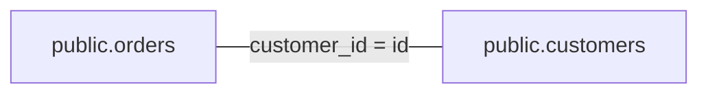
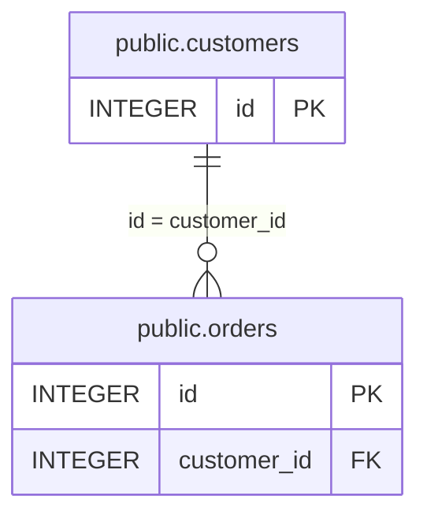

# Diagrams

Two Mermaid views, written to read the same on a light or a dark page: no `%%{init}` line, no `style`,
`classDef`, `linkStyle` or `click`, no colour. Emphasis is carried by shape and grouping, and the reader's page
picks the theme. Neither view calls a model. The design is
[Wave C, section 4](../architecture/wave_c.md#diagrams).

## The answer view

```python
import nl2sql

text = nl2sql.diagram_for(result)      # a QueryResult; a pure function
text = nl2sql.diagram_for(result, dialect_of=engine.datasources.dialect)   # verified SQL in its own dialect
```

A `flowchart LR` of the tables the answer read, taken from each sub-query's plan and nothing else: no row of
the result, and no database. One node per table (`schema.table`, or the table alone when the plan names no
schema), and one edge per join labelled with its columns (`customer_id = id`). A table read twice (a self-join)
is one node.

- **Several datasources** get a `subgraph` each, and where the decomposition joins or compares two sub-queries
  from different datasources, an edge between the subgraphs carries the join keys.
- **A verified query** has no plan. Its SQL is parsed and the tables it reads are listed, unconnected. With
  `dialect_of` (a datasource id to its adapter's dialect, as the `diagram` chat tool passes) the SQL is read the
  way the verified-query checks read it, so `TOP`, `[dbo].[orders]` and backticks work; without it, or for a
  datasource the engine no longer has, in sqlglot's generic dialect. SQL that does not parse gives an empty
  diagram rather than an error.
- **No tables** gives a single node, `No tables`.



## The schema view

```python
engine.datasources.diagram("shop", user_context=me)                    # the whole datasource
engine.datasources.diagram("shop", user_context=me, tables=["orders"]) # orders and its neighbours
```

An `erDiagram` of the live index snapshot, drawn from `engine.datasources.schema`, so it shows exactly the
tables the planner would be given for that caller: a table the caller's roles or policy check deny is left
out, and so is every foreign key and glossary join that names one. **The caller is required**; there is no
default view.

Each table is an entity with a generated id (`e0`, `e1`...) and its `schema.table` name as a quoted label, so
two names that Mermaid would read alike (`order-items` and `order_items`) stay two tables. It lists its primary
and foreign key columns. Each foreign key is a relationship (`e0 ||--o{ e1 : "id = customer_id"`) and each
glossary join the caller may see is one too, with its cardinality. A reference resolves to `schema.table`
exactly; a bare name resolves only if one table has it or, for a foreign key, if the referencing table's own
schema does. Anything else is left unlinked rather than drawn to the wrong table.

- `tables` limits the diagram to those tables and the ones one relationship away. A name that matches no table
  the caller may see is a `ValueError`, so a hidden table and a missing one look the same.
- More than 30 tables are cut to the 30 with the most relationships (the tables you asked for first, then their
  neighbours), and a comment, `%% 41 more tables not shown`, says how many (it names none).



## Safe to show

Table, column and datasource names come from a database or a model, so none is trusted. A label keeps letters,
digits, spaces and `. , : $ = -` and is always quoted; an identifier is ASCII letters, digits and `_` and never
starts with a word Mermaid reads (`style`, `click`, `classDef`, or the key markers `PK`, `FK`, `UK`) or with a digit. A name cannot hold a newline, so it cannot
start a line of its own. The text can be put straight into a Markdown fence or a Mermaid renderer.

## In a conversation

The `diagram` [chat tool](../conversations/tools.md) draws either view as a `mermaid` output. `view` is
`answer` (the default; `turn` and `step` pick the answer, the latest by default) or `schema` (`datasource_id`,
and `tables` if wanted), drawn for the conversation's caller. The model reads the diagram's text, which holds
table names and join columns but no data.
