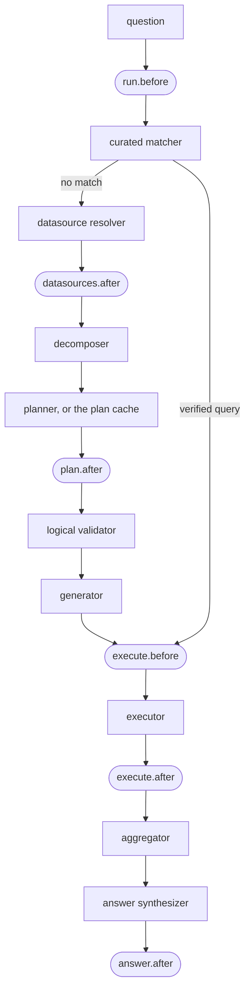

# Hooks

A hook is your code, called at six fixed points of every run. At each point
it may let the run go on, change what the run carries (before the validator
only), stop it, or (at `execute.before`) ask for a person's approval. Hooks
apply to every run: a generated answer and a verified query, from the
Python API, the CLI and `nl2sql-api` alike. None ships built in.

The design is [Wave A, section 6](../architecture/wave_a.md#6-hooks).

## The six points



| Point | When | The hook sees (beyond `question`, `user`, `trace_id`) | It may answer |
| --- | --- | --- | --- |
| `run.before` | Once, before the first step | `datasource_id`, `execute` | `Allow`, `Modify(question=...)`, `Deny` |
| `datasources.after` | The resolver chose its datasources | `datasource_ids` | `Allow`, `Modify(datasource_ids=...)` (a subset only), `Deny` |
| `plan.after` | Per sub-query and attempt, on the planner's or the plan cache's plan | `sub_query`, `plan` | `Allow`, `Modify(plan=...)`, `Deny` |
| `execute.before` | Per sub-query, before the adapter runs the SQL | `datasource_id`, `sql`, `params`, `tables` | `Allow`, `Deny`, `NeedsApproval` |
| `execute.after` | Per sub-query, after it ran | `result`: columns, row count, truncated; never rows | `Allow`, `Deny` |
| `answer.after` | The answer is written, before it is returned; with `answer=False` there is no answer and `final_answer` is `None`, but the point still runs | `final_answer`, `results` (summaries) | `Allow`, `Deny` |

`tables` are `datasource.schema.table`. A field a point does not have is
`None`. The context is frozen and holds copies of the run's plan, caller and
values: a hook that changes one in place changes nothing. A hook changes the
run only through `Modify`.
`ctx.conversation_id` is set when the run is a conversation's turn.

**Modify before the validator, deny only after.** A plan a hook changed is
validated like any other, so a hook can never slip in what the policies or
the validator refuse. `datasources.after` may only remove datasources; the
resolver checks what is left against the caller's role again. After the
validator nothing may change the SQL, the plan or the result.

**The answer sanity checks' probes are not hooked.** After a sub-query runs,
the executor may send small checking queries of its own (does a filter value
exist, did a join repeat rows; see the
[executor's sanity checks](../architecture/nodes/executor_node.md#answer-sanity-checks)).
They run outside `execute.before` and `execute.after`. So when any hook is
attached at `execute.before`, no probe runs at all: SQL a hook gates never has
unseen SQL beside it. `settings.pipeline.sanity_checks: false` turns the checks
off entirely.

**Eval seeding is hooked; `regenerate` is not.** `engine.evals.seed`
([Benchmark your own database](../evals/seeding.md)) runs SQL a model
proposed, so each draft's SQL passes `execute.before` and `execute.after` like
a question's: every hook sees it (an approval hook, a cost guard), and a deny,
a hook failure or a `NeedsApproval` drops the draft (`dropped_hooked`).
`execute.after` gets a summary of the first row only (seeding reads one row
to see that the query returns any), so its `row_count` is a floor and
`truncated` is true. `engine.evals.regenerate` runs SQL a person reviewed and
approved (a suite's gold `sql` and `alt_sql`) and calls no hook.

**The verified path** has no routing and no plan, so only `run.before`,
`execute.before`, `execute.after` and `answer.after` apply. A deny there ends
the run; it does not fall back to the generated path. **A plan-only run**
(`execute=False`) never reaches the `execute.*` points.

## Decisions

- **Order.** Hooks run in the order of the `hooks` list. A `Modify` replaces
  the fields it sets and the next hook sees the result. The first `Deny` (or
  `NeedsApproval`) ends the point; later hooks are not asked.
- **A deny** ends the run with the error `HOOK_DENIED` (never retried), whose
  message is the hook's `reason`. A run a hook ended carries none of its
  data: no answer, no rows, no artifact references, no result manifest.
  The same holds for the run's stored results: the run is marked withheld in
  the results store, so `engine.results.manifest`, `page`, `csv` and `chart`
  and the REST results routes answer `ResultNotFound` (404) for its
  `trace_id`, from `run_query` and `stream_query` alike. The files stay until
  retention purges them, but nothing reads them. A deny, `HOOK_FAILED`,
  `NEEDS_APPROVAL` and `COST_LIMIT_EXCEEDED` all withhold. The run's trace
  still records that it was withheld (the error), without rows. While any hook is attached at `answer.after`, `stream_query` does not
  stream the answer as it is written (no `answer.delta` events), and holds
  the `result.manifest` event until the hooks allowed the answer; on a deny
  it is never sent. The answer arrives whole in `run.finished`. At a per-sub-query point (`plan.after`,
  `execute.before`, `execute.after`), `Deny(reason, scope="sub_query")` drops
  only that sub-query: the run goes on without it and the answer's warnings
  say what went unanswered. A sub-query that feeds a `join` or `compare`
  cannot be dropped alone, so its whole group is dropped. If nothing is left,
  the run ends with `HOOK_DENIED`.
- **Hooks fail closed.** An exception, a return value that is not a
  decision, or a decision the point does not allow (a `Modify` at
  `execute.before`, a `NeedsApproval` at `plan.after`) is a hook error: the
  run ends with `HOOK_FAILED`, whose message names only the hook and the
  point; the exception's text goes to the log and to `hook.decision`, never
  to the caller. With `on_error: open`, an
  exception is logged and counts as `Allow`; a disallowed decision still
  fails, because it is a bug in the hook, not an outage.
- **Approval.** `NeedsApproval` at `execute.before` (on the generated or the
  verified path) ends the run with `status: "needs_approval"`, the error
  `NEEDS_APPROVAL` and an `ApprovalRequest` per pending sub-query in
  `approvals_needed`. Re-running the question as the asker with
  `approvals=[Approval(request=..., by=<the approver>)]` pins what was
  approved and generates the SQL again; the engine accepts the approval
  only if the request is unedited, the question and the asker are this
  run's, the hash of the new SQL matches, and the approver holds one of the
  hook's `approver_roles` (by default `policies.admin_roles`). An accepted
  approval counts as `Allow` (`hook.decision` with `decision: "approved"`
  and the `approver`), and the next hook at the point still runs. A hook
  also sees the run's approvals as `ctx.approvals`. See
  [Query API → Approval](../api/core/query.md#approval).
- **Timeouts** are the hook's own; the pipeline's `timeout_s` bounds the run.
- **Events.** Every hook asked publishes `hook.decision` (`hook`, `point`,
  `decision`, `reason`, `sub_query_id`, `approver`, `seconds`).
- **The plan cache keeps the planner's plan**, never a hook's change of it;
  `plan.after` runs on every cache hit, so a change applies afresh on each
  run and stops the moment the hook config changes.

## Built-in hooks

One hook is built in: `policy.cost`, the [cost rule](policies.md#cost). The
engine builds it from `policies.cost` (or a role's `cost`), not from the
`hooks` list, and puts it first at `execute.before`, ahead of every hook you
configure, so an over-limit query never reaches your hook. Its approvers are
`policies.admin_roles`. Its `Deny` ends the run with `COST_LIMIT_EXCEEDED`
rather than `HOOK_DENIED`, and its `hook.decision` events name `policy.cost`.
Without a `cost` block it is not built, and `execute.before` is as you
configured it.

## Write one

```python
# corp_hooks.py: a hook that keeps the payroll database out of the afternoon.
from datetime import datetime
from typing import ClassVar

from pydantic import BaseModel

from nl2sql.hooks import Allow, Deny, HookContext


class QuietHoursConfig(BaseModel):
    datasource: str                 # the datasource it guards
    from_hour: int = 12             # local time
    to_hour: int = 18


class QuietHours:
    interface_version: ClassVar[int] = 1
    config_model: ClassVar[type] = QuietHoursConfig
    points: ClassVar[frozenset] = frozenset({"execute.before"})

    def __init__(self, cfg: QuietHoursConfig) -> None:
        self.cfg = cfg

    @classmethod
    def from_config(cls, cfg: QuietHoursConfig) -> "QuietHours":
        return cls(cfg)

    def __call__(self, ctx: HookContext):
        busy = self.cfg.from_hour <= datetime.now().hour < self.cfg.to_hour
        if ctx.datasource_id == self.cfg.datasource and busy:
            return Deny(reason=f"{ctx.datasource_id} is closed to questions until "
                               f"{self.cfg.to_hour}:00.", scope="sub_query")
        return Allow()
```

Register it, either in code or as an entry point in your package:

```python
from nl2sql import NL2SQL, Registry

registry = Registry.default()
registry.add_hook("quiet_hours", QuietHours)       # or @registry.hook("quiet_hours")
engine = NL2SQL.from_config(registry=registry)
```

```toml
[project.entry-points."nl2sql.hooks"]
quiet_hours = "corp_hooks:QuietHours"
```

## Configure it

```yaml
# nl2sql.yaml
hooks: { file: hooks.yaml }

# hooks.yaml: a list; order matters
- type: quiet_hours
  points: [execute.before]        # a subset of the hook's own points; all of them by default
  on_error: closed                # closed (the default) | open
  approver_roles: [dba]           # who may approve its NeedsApproval; default policies.admin_roles
  datasource: payroll             # the hook's own keys, checked by its config_model
```

A point the hook does not declare, an unknown `type` or a key its
`config_model` rejects is a `ConfigError` when the engine is built, naming
`hooks[<i>]`. In code, a `HookConfig` or any callable object works:

```python
from nl2sql import Config, HookConfig
from nl2sql.hooks import Allow, Modify

def tag_year(ctx):
    return Modify(question=ctx.question + " (calendar year)") if ctx.point == "run.before" else Allow()

tag_year.points = frozenset({"run.before"})
Config(..., hooks=[HookConfig(type="quiet_hours", datasource="payroll"), tag_year])
```

An object runs at its `points` (all six when it has none), named by its
`name` attribute or its function or class name.

| Kind | Entry point group | Interface | Version | Built-ins |
| --- | --- | --- | --- | --- |
| hook | `nl2sql.hooks` | `nl2sql.hooks.Hook` | 1 | none configurable; `policy.cost` is built in from [`policies.cost`](policies.md#cost) |
