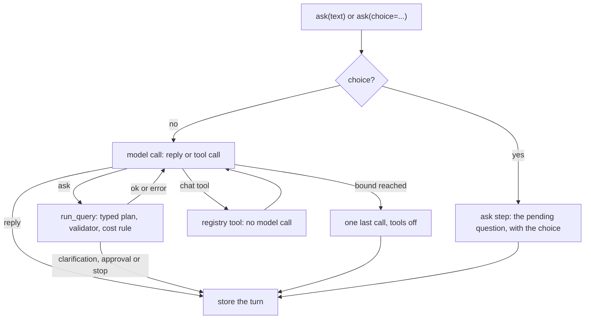

# Conversations

!!! note "Wave C, 0.9"
    `start`, `ask`, `stream`, `retry`, `ask_only`, `tool`, `report`, `get`, `list` and `delete` work, with the
    [chat tools](tools.md) `chart` and `report`. The design is [Wave C, section 3](../architecture/wave_c.md#3-conversation).

A conversation is a chat over the database. The model decides, step by step, whether to answer or to ask the
database a question through the same typed plan and validator as `run_query`. It never writes SQL and never
sees result rows.

```python
conversation = engine.conversations.start(user_context=me)
turn = engine.conversations.ask(conversation.id, "How many customers are there?", user_context=me)
print(turn.reply)                       # the model's closing message
print(turn.steps[0].result.sub_queries[0].sql)   # what ran; the rows are not stored
follow_up = engine.conversations.ask(conversation.id, "and by country?", user_context=me)
```

Every method takes the caller (`user_context`, keyword-only and required). The methods are listed in
[Conversations API](../api/core/conversations.md).

## A turn



- **The model chooses.** Each step is one structured call (`ModelStep`): a `reply`, or one `call` of the `ask`
  tool with a question that stands alone, or of an enabled [chat tool](tools.md) (a chart, a report). A reply
  may carry `offers`: tools it suggests, which run only when a client calls `tool`. The model sees the last `context_turns` turns as one JSON object
  (the questions that ran, each answer's summary, the columns, the datasources and tables read), never rows.
  Everything earlier said, the new message included, reaches it as a JSON string value: text in the history
  cannot pass for an instruction or a section marker.
- **The bound.** At most `max_tool_calls` tool calls per turn, then one more model call with the tools off. A
  turn makes at most `max_tool_calls + 1` model calls. They count against `settings.pipeline.max_llm_calls`
  and `max_cost_usd`; a refusal ends the turn `stopped`.
- **A step the model got wrong** (an unknown tool, a bad argument, an option id that is not pending) is sent
  back with what was wrong. After the parse retries the turn ends `error` with `MODEL_STEP_INVALID`
  (`Turn.error`) and the reply "I could not tell what to do with that. Please ask it as a full question."
- **Each `ask` step is a run of its own**, with its own `trace_id`, events and result pages, and the cost rule,
  scope and hooks of any run. A hook at `run.before` sees `conversation_id`.

## Clarifications and approvals

- A run that ends `needs_clarification` ends the turn and sets `Conversation.pending`. The next turn can pass
  `choice="b"` (an option id; the turn is of kind `choice`, its text the option's label, and no model is
  called) or text the model maps to an option by calling `ask` with `choice`. Either way the pending
  request's own question is re-asked with the choice. Any next turn clears `pending`. A `choice` with nothing
  pending is a `ValueError`.
- A run that ends `needs_approval` ends the turn. An approver acts on each `ApprovalRequest` in
  `turn.steps[i].result.approvals_needed` outside the conversation; the asker then calls
  `retry(conversation_id, user_context=..., approvals=[...])`, which re-runs the last `ask` step's question as
  a turn of kind `retry`, with no model call.
- `ask_only(conversation_id, question, user_context=..., choice=None)` runs just the `ask` tool (a turn of
  kind `tool`, no model call) and returns the full `QueryResult` with its rows. MCP's `ask` will use it.

## Streaming

`stream(...)` takes the same arguments as `ask` and yields the caller-safe run events of each `ask` step
(`run.started` to `run.finished`), `conversation.step` after each step and, last, `conversation.turn` whose
`data["stored"]` is the stored `Turn` as JSON. Ownership and the arguments are checked at the call; a
conversation that is already running a turn raises `ConversationBusy` from the first `next`. Closing the
iterator early cancels the turn and stores nothing.

## Ownership and retention

| Rule | Detail |
|---|---|
| **Owner** | `start` records the caller's `tenant_id` (else the engine's) and `user_id`. Any other caller gets `ConversationNotFound`, as for an id that does not exist. |
| **Roles** | Never stored. Each turn runs with the `user_context` passed to that call, so a role taken away applies at the next turn. |
| **No `user_id`** | Allowed, and owned by "no user": every caller without one in that tenant sees those conversations. Fine for a script, not for a server. |
| **One turn at a time** | A turn holds the state store's lock `conversation:<id>`; a second `ask`, `retry` or `stream` raises `ConversationBusy`. |
| **Limits** | `conversations.max_turns` (50): the next turn, whichever of `ask`, `stream`, `retry` or `ask_only` it is, is a `ValueError` naming `CONVERSATION_TOO_LONG` and the fix, "Start a new conversation." |
| **Results** | A stored step keeps its question, plan, SQL, explanation and summary, never the rows. Read them with `engine.results.page(step.trace_id, ...)` until they are purged. |
| **Retention** | `engine.storage.purge()` deletes conversations last updated more than `conversations.max_age_days` (30; `null` keeps them) ago and reports `conversations` in `retention.purged`. |

## Events

`conversation.started` (from `start`), `conversation.step` (after each step, in the turn's scope, with the
tool, the status and the argument names, never values) and `conversation.turn` (once the turn is stored; it
closes the turn's scope). The turn's `trace_id` carries the loop's own `llm.call`s, and `Turn.usage` holds
their usage.

## Configuration

`conversations:` in `nl2sql.yaml` (`context_turns`, `max_tool_calls`, `max_turns`, `max_age_days`) and the
`conversation` agent in `llm.yaml`; see [Configuration System](../configuration/system.md) and
[LLM](../configuration/llm.md#per-node-models).