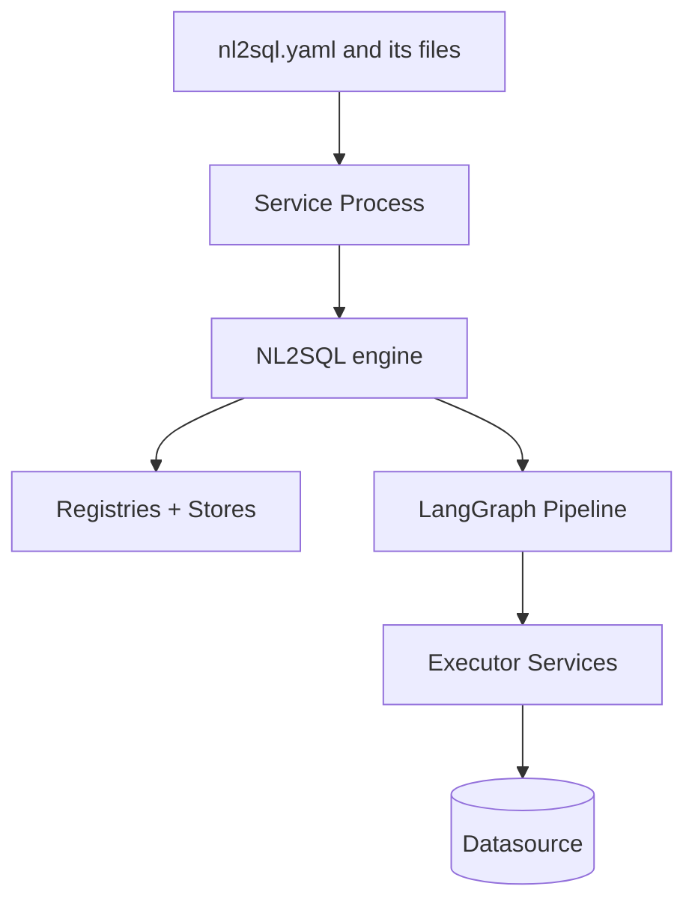

# Deployment Architecture

NL2SQL is a Python engine that you embed in a service of your choice, or run as
`nl2sql-api`. The runtime is a single process that builds one engine from one
config, `nl2sql.yaml`, checks it, and invokes the pipeline per request.

## Runtime process layout

## Deployment inputs

- **The config:** `nl2sql.yaml` and the files it includes (`nl2sql init` writes
  them). The entry point finds it through `NL2SQL_CONFIG`, else
  `./nl2sql.yaml`; the CLI also takes `--config`. See
  [Configuration](../configuration/system.md).
- **The environment:** provider keys (`OPENAI_API_KEY`, `ANTHROPIC_API_KEY`,
  `OPENROUTER_API_KEY`) and any variable the config names as `${env:VAR}`. The
  CLI, `nl2sql-api` and the demo load the `.env` next to `nl2sql.yaml` at
  startup, never overriding a variable that is already set.
- **Adapter packages** installed in the runtime environment.
- **A volume for `storage.path`:** the vector index (`index/`), the state store
  (`state.db`: schema snapshots, the plan cache, feedback), run traces
  (`traces/`) and result files (`results/`).

## Startup

Building the engine never connects. The entry points then call
`engine.check()`: each datasource connects or is reported as failed and left
out of routing, and each agent's key is checked without a model call. A
datasource with `required: true` that cannot connect makes `check()` raise
`EngineNotReady`, and the entry point refuses to start: `nl2sql-api` before it
accepts a request, the CLI before it runs a command, `nl2sql demo` before it
serves the playground.

## Runtime modes

- **Local dev**: `nl2sql init`, local embeddings, `storage.path: .nl2sql`.
- **Production**: a mounted config, `storage.path` on a persistent volume,
  secrets from a secret provider, `required: true` on the datasources the
  service cannot run without, an observability exporter enabled.
- **Hosted demo**: the playground on the shipped sample databases, holding no
  API key of its own; each visitor brings theirs. See
  [Hosted demo](hosted-demo.md).

## Scaling and isolation

- Orchestration runs in-process and can scale horizontally with your service.
- There is no process-level sandbox. The graph runs on a one-worker thread pool inside your service process, so a driver-level crash takes the process down. If you need blast-radius containment, isolate at the deployment boundary — a replica or container you are willing to lose — and let your supervisor restart it. See `../execution/isolation.md`.

## Source references

- The engine and its lifecycle: `packages/nl2sql/src/nl2sql/public_api.py`
- Building the runtime from the config: `packages/nl2sql/src/nl2sql/runtime.py`
- The config models and `load_config`: `packages/nl2sql/src/nl2sql/config/`
