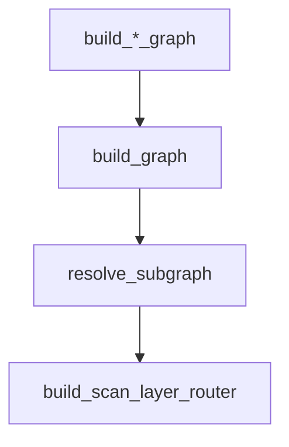

# Development Guide

This guide focuses on **extension points**: adapters, executors, subgraphs, chunking, and planner logic.

## Extension guides

- `extensions/add-adapter.md` for new datasource adapters.
- `extensions/add-chunk-types.md` for new schema chunk types.
- `extensions/extend-planner.md` for planner/AST updates.
- `extensions/add-execution-backend.md` for new executor services.

## The registry

Adapters, LLM providers, embeddings providers, secret providers and stores are all
found by name through `nl2sql.registry.Registry`
([design](../architecture/configuration_v2.md#5-the-registry)). Each kind has an
entry point group, and the built-ins are declared in
`packages/nl2sql/pyproject.toml` in the same groups a plugin uses:

| Kind | Entry point group | Interface | Built-ins |
|---|---|---|---|
| `adapter` | `nl2sql.adapters` | `nl2sql_sdk.DatasourceAdapterProtocol` | `sqlite`, `postgres`, `mysql`, `mssql`, `duckdb` |
| `llm` | `nl2sql.llms` | `nl2sql.llm.providers.LLMProvider` | `openai`, `anthropic`, `openrouter`, `ollama`, made from `PROVIDER_PRESETS` |
| `embeddings` | `nl2sql.embeddings` | `nl2sql.embeddings.EmbeddingsProvider` (version 2: `create` and `describe`) | `local`, `openai`, `openai_compatible` |
| `secrets` | `nl2sql.secrets` | `nl2sql_sdk.SecretProvider` | `env`, `aws`, `azure`, `hashicorp` |
| `store` | `nl2sql.stores` | `nl2sql_sdk.stores` (four interfaces, one per slot) | `chroma`, `sqlite`, `files`, `local` |

- `Registry.default()` lists the installed entry points by name and imports
  none of them. `Registry.empty()` holds nothing.
- `add_adapter`, `add_llm`, `add_embeddings`, `add_secrets` and `add_store`, and the
  decorators `@registry.adapter(name)` and so on, register in code on that
  registry only. A name already present raises unless `replace=True`.
- `names(kind)` lists the names; `load(kind, name)` imports one and checks its
  `interface_version`, finds its `driver_modules` (adapters) or `requires`
  (LLM and embeddings providers) without importing them, and reports a name
  two installed packages declare. A failure is a `RegistryError` that says how
  to fix it, and an unknown name suggests the closest one.

After editing an entry point in `pyproject.toml`, reinstall the package
(`pip install -e packages/nl2sql`): entry points are read from the installed
metadata, not from the source tree.

## Subgraph extension overview

1. Implement a `build_*_graph(ctx)` function that returns a LangGraph runnable.
2. Add it as a node in `build_graph()` and extend `resolve_subgraph()` with the
   capabilities the datasource must declare for it.

## CLI console output

`rich` parses every string handed to `Console.print`, a `Panel` body, a `Tree`
label or a table cell as console markup. Text the CLI did not author — exception
messages, tracebacks, generated SQL, database errors, filesystem paths, LLM
output, query result rows — must therefore never reach those APIs unescaped:

- A closing-tag-shaped sequence (`[/{style}]`, which appears in rich's own
  source and so in tracebacks through it) raises `MarkupError` and hides the
  real error.
- A lowercase opening tag is consumed silently. T-SQL bracket-quoted
  identifiers are the common case: `SELECT * FROM [dbo].[orders]` renders as
  `SELECT * FROM .` unless the SQL is escaped.

Two conventions cover this:

- Interpolating external text into a markup string: wrap it in
  `rich.markup.escape`, so the CLI's own styling still applies.
- Passing external text as a whole cell, label or panel body: wrap it in
  `rich.text.Text`, which is never parsed as markup. `ConsolePresenter.print_sql`
  does this for plain strings; callers wanting styling pass a `Text` themselves.

Tracebacks are printed with `console.print(..., markup=False)`.

## Source references

- Registry: `packages/nl2sql/src/nl2sql/registry.py`
- Subgraph selection: `packages/nl2sql/src/nl2sql/pipeline/graph_utils.py`
- Adapter protocol: `packages/sdk/src/nl2sql_sdk/protocols.py`
- SQL executor: `packages/nl2sql/src/nl2sql/execution/executor/sql_executor.py`
