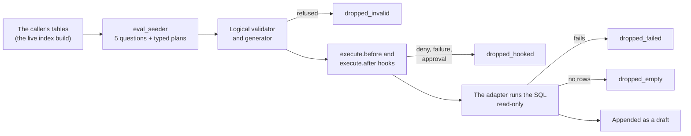

# Benchmark your own database

Chinook's suite measures the engine on Chinook. To measure it on your own
data you need cases for your own schema, and writing forty of them by hand is
the slow part. `engine.evals.seed` drafts them: a model proposes questions,
the engine checks and runs each one, and you review what survives.

```python
from nl2sql import NL2SQL, UserContext, load_config

engine = NL2SQL(load_config("nl2sql.yaml"))
report = engine.evals.seed("sales", count=20, out="evals/sales.yaml",
                           user_context=UserContext(roles=["analyst"]), max_cost_usd=0.50)
print(report.written, report.dropped_invalid, report.stopped_at_cost_cap)
```

```bash
nl2sql eval seed --datasource sales --count 20 --role analyst --max-cost 0.50 --out evals/sales.yaml
```

Every seeded case is a **draft**. A draft never runs in an eval: a person
reads it, fixes it, and approves it ([Drafts](cases.md#drafts)).

## How a case is seeded



1. **The model sees what the caller may read.** The `eval_seeder` agent is
   shown the datasource's live index build exactly as the planner would show
   it to the caller: tables, columns, keys, descriptions, and sample values
   where the datasource collects them (`index.sample_values`). A table the
   caller's role may not read never reaches the model.
2. **It writes questions and plans, never SQL.** Each call asks for five
   questions of mixed difficulty, each with a typed plan in the planner's own
   format. Five keeps one structured answer small enough to parse, and one bad
   plan costs only its batch. Each call goes through parse-and-retry, like
   every structured call.
3. **The engine validates each plan before any SQL exists.** The plan runs
   as a pinned plan under the caller's scope: the `plan.after` hooks, the
   logical validator and the generator, with no model call. A plan the
   validator refuses, a table the role may not read included, is dropped and
   counted. When a `plan.after` hook changes the plan, the draft keeps the
   changed plan: the one that produced its SQL.
4. **The SQL passes the execute hooks.** The SQL is model-proposed, so it
   goes through `execute.before` and `execute.after` exactly as a question's
   SQL does: an approval hook or a cost guard sees it. A deny, a hook failure
   or a `NeedsApproval` drops the case (`dropped_hooked`); nothing is queued
   for approval. `regenerate` is different on purpose: it runs SQL a person
   reviewed and approved, and calls no hook ([Hooks](../configuration/hooks.md)).
5. **The SQL runs read-only.** The generated SQL runs through the
   datasource's adapter: a read-only session, the datasource's timeout, and
   the row limit the generator wrote into the SQL. Only the first row is read
   (`execute_batches(request, 1)` where the adapter streams), which is enough
   to know the query returns rows. A query that fails or returns no rows is
   dropped. No row is kept.
6. **Survivors are appended as drafts.** Each one is written with
   `status: draft`, `origin: seeded`, the question, the engine's SQL, the
   plan, the tables and columns the plan reads, and an `outcome`. A question
   already in the file is skipped and counted as a duplicate. `rows` stay
   empty.

## Who it seeds as

Seeding needs a caller, and it fails closed:

- With no `user_context`, or one with no role, it refuses before anything is
  asked.
- A role whose scope does not reach the datasource, or reaches none of its
  tables, is refused. So is a role the policies do not define.
- `nl2sql eval seed` asks as `--role`, else `policies.default_role`. With
  neither, it exits 2.

The drafts hold only what the caller may read. A draft's `outcome` marks
`allowed` each of the caller's roles whose **own** scope reads every table of
the plan; a role that reads only some of them (a caller's scope is the union
of its roles) gets no entry. Add the outcome for every other role when you
review them.

## What it costs

Seeding is not a question, so the per-question caps in `settings.pipeline` do
not apply. It runs under a budget of its own:

- **A dollar cap, always.** `max_cost_usd`, by default `evals.yaml`'s. With
  neither, seeding refuses to start.
- **A priced model.** The `eval_seeder` agent's model must have a price, in
  `llm.prices` or the engine's dated table ([Prices](../configuration/llm.md#prices));
  otherwise seeding raises `UnknownPriceError` before any call.
- **At most three calls per batch of five,** parse retries included, so a
  model that keeps answering nothing usable stops on its own.
- **A prompt that does not grow with the file.** Each call is told how many
  questions are already written and shown only the newest ten, so it does
  not repeat them.

The budget is checked before each call. When either limit is reached, the
next call is never sent, the drafts so far are written, and the report says
which: `stopped_at_cost_cap` or `stopped_at_call_limit`. The `eval_seeder` agent runs on the top-level `llm`
unless `llm.agents.eval_seeder` names another model
([Agents](../configuration/llm.md)).

## The report

`SeedReport`:

| Field | What it counts |
| --- | --- |
| `path` | The suite file written |
| `written` | Drafts appended |
| `dropped_invalid` | Plans the validator or a `plan.after` hook refused, questions that read as SQL, and the questions of a call whose answer never parsed |
| `dropped_hooked` | SQL an `execute.before` or `execute.after` hook denied, failed on, or asked approval for |
| `dropped_failed` | Queries the database rejected |
| `dropped_empty` | Queries that returned no rows |
| `dropped_duplicate` | Questions already in the file, or proposed twice |
| `stopped_at_cost_cap` | Whether the dollar cap stopped seeding early |
| `stopped_at_call_limit` | Whether the three-calls-per-batch limit stopped it early |
| `usage` | The model calls, tokens and dollars spent |

`nl2sql eval seed` prints the counts and the dollars, exits 2 on a refusal
(no role, an unreadable datasource, no cost cap, an unpriced model, a refused
`--out`) and 3 when the cost cap or the call limit stopped it. Like mode full, it refuses to run
when `CI` is set.

## Where drafts may go

`out` is relative to `nl2sql.yaml`, or absolute. Seeding appends to it and
keeps its leading comment lines; a new file starts with a short header saying
what the file is. Like `feedback export`, seeding never writes into:

- a suite the package ships;
- a suite `evals.yaml` names;
- a file that holds an approved case.

Keep drafts in a file of their own, and move each case into a configured
suite once it is approved.

## Reviewing the drafts

1. Read each question and its SQL. Fix the wording, or the SQL, or delete the
   case.
2. Fill in `tags`, and the outcome for each other role (`allowed`, `refused`
   or `unanswerable`).
3. Set `status: approved` and move the case into a suite `evals.yaml` names.
4. Run `nl2sql eval regenerate` on that suite to write the expected rows.

From then on the case runs in `nl2sql eval run`, and the
[regression gate](index.md#the-regression-gate) holds it.
