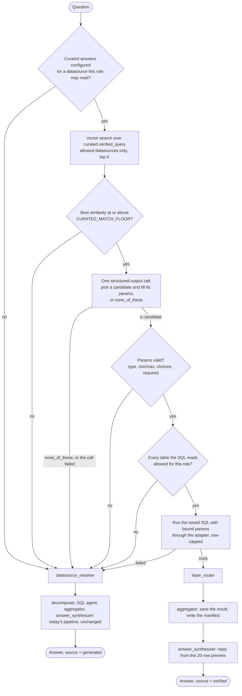

# Curated Answers

How the engine answers a question from a verified query the data team wrote before it asks the model to plan; for operators and contributors.

## Goal

Before the model plans a query, check whether the business has already
provided a trusted answer to the question. If it has, run that answer and say
so. If it has not, run today's pipeline unchanged.

Curated answers come in three kinds:

| Kind | What the data team writes | Where | Available |
| --- | --- | --- | --- |
| **Verified queries** | A SQL query with typed parameters, and the questions it answers | the `curated` section (`curated.yaml`) | Yes |
| **Preferred tables** | Views or tables the planner should reach for first | each datasource's `preferred_tables:` | Yes |
| **Business metrics** | A named expression (`revenue = SUM(...)`) the planner refers to by name | the `curated` section, `metrics:` | Not yet, see [Business metrics](#business-metrics-deferred) |

A thumbs-up on a generated answer becomes a *proposal* for a verified query
in the review queue, which a person reviews and accepts. Nothing writes
`curated.yaml` but a person's accept (see
[The review queue](../configuration/review.md)).

## Who does what

- **The data team** writes the configuration. They know SQL, they keep config
  in git, and they review changes like code. They run
  `nl2sql curated validate` and `nl2sql curated test` in CI.
- **The person asking** never sees the configuration. They ask a question and
  get an answer; when a verified query produced it, the answer is labelled
  *Verified* with the query's id.
- **The engine** loads and validates the file at startup, indexes the
  questions with `nl2sql index`, and matches each question against them at
  run time.

## Configuration

### `curated.yaml`

Since 0.5 the verified queries are the `curated` section of `nl2sql.yaml`,
usually its own file (`curated: { file: curated.yaml }`); see
[Curated Answers](../configuration/curated.md). The models and the checks
that need the datasources are in `nl2sql/config/curated.py`.

The section is optional. When it is absent the feature is off and the
pipeline is exactly the generated one. One section covers every datasource,
keyed by datasource id.

```yaml
datasources:
  chinook:
    verified_queries:
      - id: top_customers_by_revenue
        description: "Customers ranked by invoiced revenue in a calendar year"
        questions:
          - "Who are our top {n} customers by revenue in {year}?"
          - "Best {n} customers in {year}"
        params:
          n:    { type: int, default: 10, min: 1, max: 100 }
          year: { type: int, min: 2000, max: 2100, example: 2012 }
        sql: |
          SELECT c.CustomerId,
                 c.FirstName || ' ' || c.LastName AS customer,
                 c.Country,
                 ROUND(SUM(il.UnitPrice * il.Quantity), 2) AS revenue
          FROM Customer c
          JOIN Invoice i      ON i.CustomerId = c.CustomerId
          JOIN InvoiceLine il ON il.InvoiceId = i.InvoiceId
          WHERE CAST(strftime('%Y', i.InvoiceDate) AS INTEGER) = :year
          GROUP BY c.CustomerId, customer, c.Country
          ORDER BY revenue DESC, c.CustomerId
          LIMIT :n
    metrics:            # designed only; deferred
      - name: revenue
        description: "Invoiced revenue, before refunds"
        expression: "SUM(InvoiceLine.UnitPrice * InvoiceLine.Quantity)"
        table: InvoiceLine
```

The models, all `extra="forbid"` so a misspelt key is an error rather than a
silently ignored one:

- `CuratedFileConfig`: `version: int = 1`, `datasources: Dict[str, CuratedDatasource]`.
- `CuratedDatasource`: `verified_queries: List[VerifiedQuery]`, `metrics: List[MetricDefinition]`
  (parsed and validated so the format is fixed, but not used yet).
- `VerifiedQuery`: `id` (a slug, unique within its datasource), `description`,
  `questions` (at least one), `params: Dict[str, ParamSpec]`, `sql`.
- `ParamSpec`: `type` (`int`, `float`, `string`, `date`), optional `default`,
  `min`/`max` (numbers and dates), `choices` (strings), and `example`.

`example` is the value used to fill a
placeholder before embedding and to run `nl2sql curated test` when a parameter
has no default (`year` above). Without it a required parameter is embedded as
its own name ("... in year").

### Verified queries are SQL

A verified query is written as SQL in the dialect of its datasource, not in
the engine's internal plan format. The data team already has this SQL; asking
them to translate it into `PlanModel` JSON would make the feature unusable.

This does not weaken *the model emits a typed plan, never SQL*: no model wrote
this SQL. A person wrote it, reviewed it and committed it. The model's only
part is to pick a query by id and supply parameter values, and those values
are always **bound parameters** (`:name`, SQLAlchemy's named style, which every
adapter's driver translates), never interpolated into the text. A value cannot
change the shape of the query.

Nor does it break *no dialect-specific SQL outside `nl2sql/adapters/`*. That
rule is about engine code, and `curated.yaml` is data the operator owns, like
`datasources.yaml`. The engine never inspects the SQL by dialect name: it
parses it with sqlglot using whatever `adapter.get_dialect()` returns.

### Preferred tables

Preferred tables are not in `curated.yaml`. They are one optional list on a
datasource in `datasources.yaml`, because they describe the datasource and not
an answer:

```yaml
datasources:
  - id: chinook
    connection: { ... }
    preferred_tables: [v_customer_revenue, v_monthly_sales]
```

`DatasourceConfig` (`nl2sql/datasources/models.py`) gains
`preferred_tables: List[str] = []`. The package never creates a view: the data
team creates them in their own database, and `nl2sql index` picks them up as
it picks up any table (every built-in adapter snapshots views). A name is the bare table name or
`schema.table`, case ignored. One that is not in the indexed schema is a
warning in `nl2sql doctor` and the index status, not an error.

At question time a preferred table is ranked first:

- When the schema is small enough to be passed whole
  (`SCHEMA_RETRIEVAL_FULL_SNAPSHOT_MAX_TABLES`, 15 by default, which covers
  every demo database), the schema retriever lists preferred tables first and
  marks them *preferred* (`"preferred":true`) in the planner's schema block,
  and planner instruction 14 says to plan against a preferred table when it
  answers the question.
- Otherwise `Retriever.retrieve_schema_context()` results are re-ordered so
  any preferred table it found comes first, and a preferred table it missed is
  added when its similarity is within 0.05 (`PREFERRED_MARGIN`) of the least
  similar table picked.

Nothing about access changes: a preferred table the caller's scope denies is
hidden from the planner exactly like any other.

## Validation

The file is checked at three moments, each catching what it can.

**At startup**, `Runtime.from_config` checks the config's `curated`
section after the datasources are built. A broken section fails startup with
a `ConfigError`, as a broken datasource does. These checks need no database and no index:

- the YAML parses and matches the models;
- every datasource key is a configured datasource;
- query ids are unique within a datasource;
- every `{placeholder}` in a question is a declared param, and every declared
  param appears in at least one question;
- the SQL parses with sqlglot in the datasource's dialect, is exactly one
  statement, and is read-only (see [Guards](#the-same-guards-as-generated-sql));
- the `:name` placeholders in the SQL (`exp.Placeholder` nodes) are exactly the
  declared params;
- defaults, examples, `min`/`max` and `choices` agree with the declared type.

A section that includes a file that does not exist (`curated: { file: ... }`)
is a config error, so startup fails rather than turning the feature off: a
typo should not silently turn verified answers off in production. Leaving the
section out turns the feature off.

**`nl2sql curated validate`** runs the startup checks plus the ones that need
the index: every table the SQL reads (`exp.Table` nodes, minus CTE names)
exists in the schema the datasource's live index build was made from
(the snapshot its build pointer names). It prints a report table
and exits non-zero on any error, modelled on `nl2sql policy validate`
(`cli/commands/policy.py`). Like that command it calls a facade class,
`CuratedAPI` (`nl2sql/api/curated_api.py`, exported from `nl2sql`), so the CLI
holds no logic an SDK or REST caller would also need.

**`nl2sql curated test`** runs each verified query once against its database,
with every param at its default or example value, through the same guarded
execution path the pipeline uses, reading at most a few rows. A column renamed
in the database then fails CI instead of failing a user. It runs as the
operator, with no role, as `nl2sql index` does.

## Indexing

`nl2sql index` embeds each phrasing of each verified query as an entry of a
new chunk type, `curated.verified_query`, in the existing vector store. The
model is `VerifiedQueryChunk(BaseChunk)` in `nl2sql/indexing/models.py`, beside
`TableChunk` and the others.

- **Text.** The phrasing with every placeholder filled by its example or
  default (`{n}` → `10`, `{year}` → `2012`), because a raw `{n}` embeds poorly.
  The description is embedded as one more entry of the same query.
- **Metadata.** `{id, type: "curated.verified_query", datasource_id, query_id, schema_version}`,
  and the `build_id` every entry gets. The key is `datasource_id`, the one every other chunk, the
  active-build filter and index health use.
- **Ids.** Deterministic, as `BaseChunk` requires:
  `curated.verified_query:<datasource_id>:<query_id>:<n>`.

The entries must be written **in the same build as the datasource's schema
entries.** A build replaces every entry of its datasource, so curated
entries written on their own would be deleted by the next schema re-index, or
would delete it. `IndexingOrchestrator.index_datasource()` therefore appends
the curated chunks (built by a small `CuratedChunkBuilder`) to the schema
chunks before it writes the build.

Changing `curated.yaml` does **not** need a schema re-index (the index holds the schema
only).
`nl2sql index --refresh` writes a new build per datasource through the
same write, switch and clean-up as any other, except that every entry is
rendered again from the live build's stored snapshot and the entries that did
not change keep their stored vectors (`IndexingOrchestrator.refresh()`, 0.8; it
was `--curated-only` and `refresh_curated()` before): no schema read, no model
call, and only the changed entries (here the verified queries) are embedded.

**Staleness.** The build's pointer also records `curated_hash`, next to
its `build_id`, `schema_version` and `built_at`: a SHA-256 of that
datasource's section of `curated.yaml`, as canonical JSON. `IndexHealth`
(`nl2sql/indexing/health.py`) compares it with the file as it is now and
reports "curated.yaml changed for 'chinook' since it was indexed; run
`nl2sql index --refresh --datasource chinook`". `nl2sql doctor` and the
facade's `engine.index.health()` show it. Only the verified queries are hashed:
metrics are not indexed yet, so editing one asks for nothing.
It is a warning, not a failure: the stale entries still point at queries that
exist, and the matcher re-reads every query from the loaded file, never from
the index. A query id that is in the index but no longer in the file is
skipped. `IndexHealth` gains a `warnings` list for this; `problems` stays the
list that makes `ok` false.

## Matching at question time

### Where the step goes

A new node, `curated_matcher` (`nl2sql/pipeline/nodes/curated_matcher/`),
becomes the graph's entry point, ahead of `datasource_resolver`:



Running it before the resolver, rather than between the resolver and the
decomposer, means a verified answer also skips the resolver's answerability
call: a verified answer costs two model calls (the match and the reply)
instead of four or more. The matcher does the one thing from the resolver it
needs itself: it limits the search to datasources the role may read,
`Scope.reaches_datasource()` for each datasource, before searching, so
*Datasource access is policy-gated* holds on this path too and the model only
ever sees candidates from readable datasources. When the caller pinned a
datasource (`GraphState.datasource_id`), only that one is searched.

When it does not answer, the matcher returns nothing but its own trace record
and the run continues at `datasource_resolver` as if it were not there. When
the run is plan-only (`execute=False`) the matcher is skipped.

The node is added to the graph only when curated
answers are on (a `curated` section with at least one verified query) and the run executes, or pins a supplied
verified query (with `execute=False` the matcher checks it and runs nothing). Otherwise `datasource_resolver` stays the entry
point, so with no curated file the graph, the trace and the answer are exactly
what they were before, rather than gaining a node that does nothing. The
first diamond above is therefore decided once when the graph is built
("configured") and again at run time ("this role may read",
`not_configured`).

On a match, the node fills the state the way a one-sub-query generated run
leaves it, so nothing downstream needs a second code path: a
`DecomposerResponse` with one `SubQuery` (its intent is the question), the
`ExecutionDAG` from `build_execution_dag()`, the `artifact_refs` entry, and a
`SubgraphOutput` with `plan_source="verified"`, the SQL, `row_cap`,
`truncated` and its checks as `ValidationCheck`s. It then routes to
`layer_router`, which finds the scan already done and sends the run to
`aggregator`. The aggregator saves the result and writes the run's manifest
(the 0.3.0 result saving and paging), and `answer_synthesizer` writes the
reply from the preview, as today.

### The steps

1. **Candidates.** `Retriever.retrieve_verified_query_candidates(query, datasource_ids, k)`
   searches entries of type `curated.verified_query` in the live builds of
   the allowed datasources. It is a plain similarity search, not MMR: several
   phrasings of one query are exactly what should match, so the pool is
   fetched at `k × phrasings`, de-duplicated by `(datasource_id, query_id)`
   keeping each query's best cosine similarity, and cut to
   `CURATED_MATCH_TOP_K` (5). The search is recorded with the same record
   `mmr_search()` writes, so the trace and the playground's retrieval view can
   show it. If no allowed datasource has a verified query, there is no search
   and no embedding call.
2. **Floor.** If the best similarity is below `CURATED_MATCH_FLOOR` (0.6), the
   run falls back with no model call.
3. **Choice.** One structured-output call, through the existing
   `structured(llm, schema)` in `nl2sql/llm/wires/`, which every provider and
   keyless replay already support. The prompt presents the candidates like
   tools: a qualified id (`chinook.top_customers_by_revenue`, since ids are
   unique only within a datasource), the description, and each param with its
   type, bounds, choices and default; plus the option `none_of_these`. The
   model is told to pick a candidate only when it answers the whole question
   as asked, and otherwise to pick `none_of_these`. The schema is fixed, so
   its name on the wire is fixed:

    ```python
    class ParamValue(BaseModel):
        name: str
        value: str          # typed and checked by code, step 4

    class VerifiedQueryChoice(BaseModel):
        """Pick the verified query that answers the question, or none_of_these."""
        query_id: str       # a candidate id, or "none_of_these"
        params: List[ParamValue] = Field(default_factory=list)
        reason: str = ""
    ```

    Params are a list of name/value strings rather than a per-query schema so
    that one schema serves every candidate set (a dynamic schema would change
    the tool on the wire from run to run, which replay keys on) and so no
    provider's strict-schema rules about open objects apply. The prompt puts
    the question after a `User Query:` line, a marker `extract_question()` in
    `nl2sql/llm/replay.py` already recognises, so a recording can key this
    call on the question like the decomposer's. The node's model is configured
    like any other step's: `LLM_AGENTS` in `nl2sql/llm/providers.py` gains
    `"curated_matcher": "curatedmatcher"`, and `PIPELINE_STEPS` in
    `nl2sql/pipeline/steps.py` gains the step.

    The model never sees every verified query, only the top K for this
    question, and never sees the SQL.
4. **Params.** Code, not the model, decides whether the values are usable:
   an unknown name, a value that does not parse as the declared type, a
   number or date outside `min`/`max`, a string outside `choices`, or a
   required param (no default) left empty all fall back. A param the model
   left out takes its default.
5. **Access.** Every table the SQL reads (sqlglot `exp.Table` nodes, CTE names
   excluded) must pass `Scope.allows()` with its schema (the datasource's
   default schema when the SQL names none), the scope the logical
   validator and executor already ask. If one does
   not, the run falls back, and the normal pipeline then enforces the policy as it
   always does. The user is not told a verified query exists that they may
   not use.
6. **Run.** The saved SQL runs with the bound params through
   `SqlExecutorService` and the adapter, the result is saved to the artifact
   store, and the run continues at `layer_router` as described above. If
   execution fails, the run falls back with a warning; the failure is in the
   trace for the data team, and `nl2sql curated test` is how they catch it
   before a user does.

Every fallback has a reason code in the matcher's trace record:
`not_configured`, `no_candidates`, `below_floor`, `none_of_these`,
`model_failed`, `unknown_query`, `param_invalid`, `param_missing`,
`policy_denied`, `capability_missing`, `execution_failed`. A fallback is never
an error of the run.

### Worked examples

All on the demo's Chinook database, with the query in [the example above](#curatedyaml).

**(a) A match.** "Who were our top 5 customers in 2012?" as `analyst`.
The best candidate is `top_customers_by_revenue` (the phrasing "Best 10
customers in 2012" is close), above the floor. The model picks it with
`n=5, year=2012`. Both are ints within bounds; `Customer`, `Invoice` and
`InvoiceLine` are allowed for `analyst`. The SQL runs with
`{"year": 2012, "n": 5}` bound and returns Richard Cunningham (25.84),
João Fernandes (24.77), Fernanda Ramos (24.75), Joakim Johansson (24.75) and
Mark Taylor (22.77). The answer carries
`source = {type: "verified", id: "top_customers_by_revenue", params: {n: 5, year: 2012}}`.

**(b) A near miss.** "Top 5 customers by number of tracks bought in 2012."
The same query is the best candidate and clears the floor, but it ranks by
revenue, not by tracks. The model sees the description and picks another
candidate that does rank by tracks if one exists, or `none_of_these`. With
`none_of_these` the run continues at the resolver and the answer is
generated, `source = {type: "generated"}`.

**(c) A missing or out-of-range value.** "Who are our top customers by
revenue?" matches, but `year` has no default and the question gives none: the
model leaves it empty and the run falls back (`param_missing`). Asking the
user "which year?" belongs to conversations. "Top 500
customers in 2012" matches with `n=500`, beyond `max: 100`, and falls back
(`param_invalid`); the generated pipeline then answers it under its own row
limit.

**(d) No access.** The same question as (a), asked as `viewer`, whose policy
allows no `Customer`, `Invoice` or `InvoiceLine`. The candidate is found and
chosen, the access check refuses `Invoice`, the run falls back
(`policy_denied`), and the logical validator refuses the generated plan with
the usual `SECURITY_VIOLATION`. The refusal is the same one `viewer` gets
today.

### v1 limitation: one question, one query

Matching runs once, on the whole question. A question with two parts ("top
customers in 2012 and how many tickets did they open") is either not matched
or matched to `none_of_these`, because the prompt asks for a query that
answers the whole question, so it falls back to the generated pipeline.
Matching each decomposed sub-query against verified queries is a later step.

## The same guards as generated SQL

Verified SQL runs through the guards generated SQL runs through, plus one
generated SQL does not need:

- **Read-only.** Generated SQL is read-only by construction (`PlanModel.query_type`
  is `Literal["READ"]`). Human SQL is checked instead: exactly one statement
  (`sqlglot.parse` returns one), its root is a query (`exp.Query`: a `SELECT`,
  a set operation, or a `WITH` around one), and no node anywhere in the tree
  is a write or DDL (`Insert`, `Update`, `Delete`, `Merge`, `Create`, `Drop`,
  `Alter`, `Command`). This is checked at load and again before running. The
  datasource's own read-only connection (SQLite always opens read-only) and
  database grants stay the backstop, as they are for generated SQL.
- **Policies.** Every table read must be allowed for the asker (step 5 above). A
  view is checked by its own name, as policies name it; what the view reads
  underneath is the database's grant to decide.
- **Row limit.** The row ceiling is the one the generator uses:
  `min(limits.row_limit or RESULT_ROW_LIMIT, RESULT_ROW_LIMIT)`, from the datasource's `limits`. Rather than
  rewrite a person's SQL to add a `LIMIT` (which would mean rendering their
  placeholders back through sqlglot in every dialect), the executor stops
  reading the stream at the ceiling. `ExecutorRequest` gains `max_rows`; the
  executor's `_Stream` stops after that many rows and the result is flagged
  `truncated` exactly as a capped generated result is. A query whose own
  `LIMIT :n` is lower is never cut.
- **Result saving and paging.** The result is written with
  `artifact_store.write_batches()` and the manifest by the aggregator, so
  paging (`engine.results.page`) and CSV export (`engine.results.csv`) work for a
  verified answer as for any other.
- **Time.** The run is inside `run_with_graph()`'s `GLOBAL_TIMEOUT_SEC` like
  every node, and the datasource's `limits.timeout_ms` applies.

## Bound parameters through the adapter

The SDK already has a place for them: `AdapterRequest.parameters`
(`nl2sql_sdk/contracts.py`, "Optional parameter bindings"). But no
adapter reads it. `SqlAlchemyAdapter.execute_sql()` and `execute_batches()`
call `conn.execute(text(sql))` and drop it, and `SqlExecutorService` never
sets it. Sending parameterised SQL to an adapter that ignores the parameters
would fail at best, so it must not be sent at all. The change, inside the
package boundaries:

- **SDK** (pydantic and the standard library only, unchanged in that
  respect): a new capability, `DatasourceCapability.SUPPORTS_BOUND_PARAMETERS`,
  and a docstring on `AdapterRequest.parameters` saying values are bound by
  name to `:name` placeholders and never interpolated.
- **SQLAlchemy base adapter**: `execute()` and `execute_batches()` pass
  `request.parameters` to `conn.execute(text(sql), parameters)` when there are
  any, and `capabilities()` declares the new capability. Every built-in
  adapter (SQLite, Postgres, MySQL, SQL Server, DuckDB) inherits both. With
  no parameters the call is byte-for-byte today's, so generated SQL is
  unaffected.
- **Engine**: `ExecutorRequest` gains `parameters` and `max_rows`;
  `SqlExecutorService.execute()` copies `parameters` into the
  `AdapterRequest`. The matcher checks
  `ds_registry.supports(ds_id, DatasourceCapability.SUPPORTS_BOUND_PARAMETERS)`
  before choosing a query with params, and falls back
  (`capability_missing`) when an adapter cannot bind; it fails closed, as
  `SUPPORTS_SQL` does. A third-party adapter opts in by binding and declaring
  the capability. `nl2sql curated validate` warns about a datasource whose
  adapter cannot bind.

sqlglot parses `:name` as `exp.Placeholder` in the SQLite, Postgres, MySQL,
DuckDB and T-SQL dialects, which is what validation reads the placeholders
from.

## Provenance

Every answer says where it came from:

- `QueryResult` (`nl2sql/api/query_api.py`) gains
  `source: AnswerSource`, `{type: "verified", id, datasource_id, params}` or
  `{type: "generated"}`. The REST API's response model, `QueryResult`,
  subclasses `QueryResult`, so `POST /query` and the final event of `POST /query/stream` carry it with
  no change to `nl2sql-api` beyond its docs.
- `SubQueryResult.plan_source` and `SubgraphOutput.plan_source` gain the
  value `"verified"`, next to `"llm"` and `"cache"`.
- The trace records the matcher as a node: the candidates with their
  similarities, the floor, the model's choice and reason, the params after
  checking, and the fallback reason code if it fell back.
- The playground shows a badge on the answer, "Verified · top_customers_by_revenue",
  with the params on hover. A generated answer shows no badge. Shown
  beside the question, in the shape of the *Recorded run* label rather than
  next to the plan-cache line, which only Debug shows: whether an answer was
  verified matters to every reader. The Plan station, which has no plan to
  show, names the query and its values instead.

## Feedback proposals

A thumbs-up on a generated answer files a `verified_query` proposal in the
review queue. Nothing writes `curated.yaml` but an admin's accept (see
[The review queue](../configuration/review.md)), so `curated.yaml` stays the
single source of truth, in git. Neither the REST API nor the playground writes
it any other way.

## Demo

`nl2sql init --demo` (which `nl2sql demo` runs the first time) writes
`curated.yaml` with six Chinook verified queries (`top_customers_by_revenue`,
`revenue_by_year`, `monthly_revenue`, `sales_by_country`,
`best_selling_genres`, `top_artists_by_tracks_sold`), included by its
`nl2sql.yaml`; `NL2SQL.demo()` builds the same section in code. The queries
are data in `datasets/chinook.py` (`CHINOOK_VERIFIED_QUERIES`), and
`nl2sql index` indexes their questions with the schema, so the hosted Space's
image has them too. No
guided question was added: two of the existing ones ("What is the total
revenue per year?", "Which genre sells the most tracks?") are phrasings of
verified queries, and a new guided question would have no recording.

The keyless demo replays recorded model answers, keyed on the structured-output
name and the question. The matcher's call is a new name
(`VerifiedQueryChoice`), recorded for every guided question since the
recordings in `cli/demo/recordings/chinook.json` were made again for 0.4.0
(`python scripts/record_demo_answers.py`, which needs the owner's key). A
guided question that matches a verified query replays verified, badge and all;
the others replay the model's `none_of_these` and then their generated answer.
A verified run never reaches the decomposer, so `ReplayStore.covered()` counts
a question whose recorded choice picked a query as covered too.

## Settings

| Setting | Default | Meaning |
| --- | --- | --- |
| the `curated` section | absent | Present: curated answers are on. Absent: off. (0.4's `CURATED_CONFIG` and `CURATED_ENABLED`.) |
| `settings.curated.match_floor` | `0.6` | Cosine similarity the best candidate must reach before the model is asked (0.4's `CURATED_MATCH_FLOOR`). |
| `settings.curated.match_top_k` | `5` | Candidates shown to the model (0.4's `CURATED_MATCH_TOP_K`). |

The floor is a similarity in the configured embedding model's space, and
models spread their scores differently. It was calibrated on the local ONNX
model (`all-MiniLM-L6-v2`) with five Chinook verified queries (the example
above, revenue by year, best-selling genre, tracks per artist, revenue by
country) and the best candidate's similarity for 24 questions:

| Questions | Best similarity |
| --- | --- |
| 12 that a verified query answers, reworded | 11 between 0.713 and 0.963; "biggest spenders last year" 0.479, and to the wrong query |
| 6 near misses ("top customers by number of tracks", "albums per artist", "revenue by month") | 0.582 to 0.813 |
| 6 unrelated ("list all playlists", "media types", the weather) | 0.123 to 0.438; "Which tracks have no composer?" 0.681 |

0.6 keeps every match the embeddings can make with a margin above 0.1, and
drops five of six unrelated questions with no model call. Near misses mostly
clear it, as they should: telling a near miss from a match is the model's
choice (`none_of_these`), not the floor's. A question with no phrasing close
to it, like "biggest spenders", is not rescued by any floor; another phrasing
in `curated.yaml` is the fix. Calibration with OpenAI's embeddings is still
open: it needs the owner's key.

## Invariants this touches

No invariant is weakened. These changes are recorded in
[`invariants.md`](invariants.md), each with its enforcement point:

- New: **Verified SQL is human-authored, read-only and parameter-bound.** The
  model picks a verified query by id and supplies values; it never writes or
  edits its SQL, and values are bound, never interpolated. Enforced in the
  curated config model, the read-only check and the matcher.
- **SQL Generation Enforces a Row Limit Cap** extends to verified SQL, through
  the executor's `max_rows`.
- **Datasource Access Is Policy-Gated** gains the matcher as an enforcement
  point.
- [`determinism.md`](determinism.md)'s "the AST is checked ... before any SQL
  exists, on every path" becomes "on every generated path"; a verified path
  has no AST, and its checks are the matcher's.

## Not built yet

### Business metrics (deferred)

The format is fixed (`metrics:` in `curated.yaml`, parsed
and validated), but nothing uses it yet. The sketch:

- Each metric is indexed as the existing, so far unused, `schema.metric`
  chunk (`MetricChunk` in `nl2sql/indexing/models.py`), so schema retrieval
  returns the metrics a sub-query is about.
- The planner refers to a metric by name: a new `Expr` kind `metric` with a
  `metric_name`, which, like `func_name`, is model text, so the logical
  validator must check it against the datasource's metrics before anything
  else reads it.
- The validator also requires the metric's `table` in the plan and allowed for
  the role; the generator parses `expression` with sqlglot in the adapter's
  dialect and splices the expression tree in place of the reference.

This is the hardest part of the feature, which is why it waits. A metric is
an aggregate, so it cannot be nested in another aggregate or used in a
`WHERE`; its table must be joined at the right grain or the sum fans out
across a one-to-many join; and the decomposer already has a `MetricSpec`
(`SubQuery.metrics`) with a different meaning, so the names need sorting out
first. Every rule the generator would need, the validator has to enforce
first, so the planner gets a retry rather than a dead end.

### Also out of scope

- **An MCP server** exposing `ask`, plus one tool per verified query. The typed
  params are already a tool's input schema, so this is close to free once
  verified queries exist.
- **Per-sub-query matching**, so one part of a multi-part question can be
  verified and the rest generated.
- **Asking a follow-up question** for a missing value, instead of falling
  back; that is conversations.
