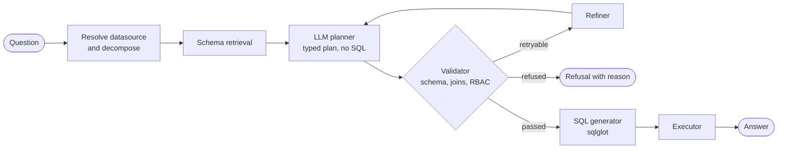
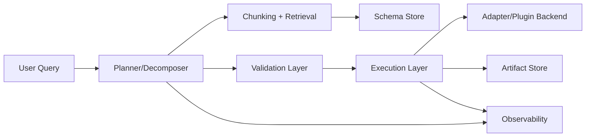
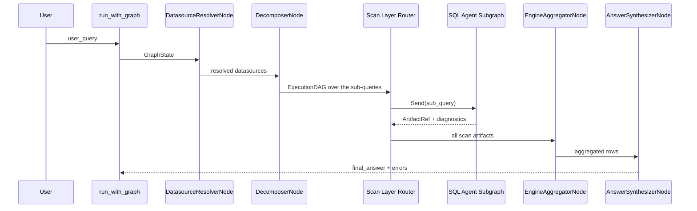

# Architecture Overview

The parts of NL2SQL and how a question moves through them, for anyone new to the code. NL2SQL is a **multi-stage orchestration pipeline** built on LangGraph. A single request flows through control-plane nodes (resolution, decomposition, planning), capability-driven subgraphs (SQL agents), and an aggregation layer. The system is wired by `Runtime`, which instantiates registries, stores, and policy enforcement.

## In brief

- The question is checked for answerability and routed to one of the registered
  databases, then split into sub-queries; the decomposer also builds the
  execution DAG that says which sub-queries can run together and how their
  results combine.
- Each sub-query gets the part of the schema it needs (vector search over an
  index of tables, columns and relationships, or the whole schema when it is
  small).
- The model returns a **typed plan** (a Pydantic `PlanModel`: tables, joins,
  select items, filters), never a SQL string. It may only name a function from
  an allow-list, and it writes date work portably, which each adapter renders
  in its own dialect.
- The **logical validator** resolves every table and column against the schema,
  checks joins against the declared foreign keys, checks every table against
  the caller's role, and builds the query tree the generator would build, so a
  plan whose tables cannot be joined is caught here, where the planner can still
  be asked to fix it. A refused plan never becomes SQL.
- Only a plan that passes reaches the **generator**, which renders SQL
  deterministically with `sqlglot`. The executor runs it and the answer writer
  summarises the rows.
- A retryable validation failure goes back to the planner through a refiner, up
  to `settings.pipeline.retries.max` (default 3). A security refusal is final
  and is never retried.



The full pipeline lists 17 steps (`PIPELINE_STEPS`), seven of them decided by a
model; the web app's Pipeline page shows them all. The first, the curated
matcher, which matches the question to a verified query a data team wrote
([curated answers](../configuration/curated.md)), runs only when curated answers
are configured and hold a verified query. The second, the pinned entry, runs
only when a run is given its plan.

## In brief

- The question is checked for answerability and routed to one of the registered
  databases, then split into sub-queries; the decomposer also builds the
  execution DAG that says which sub-queries can run together and how their
  results combine.
- Each sub-query gets the part of the schema it needs (vector search over an
  index of tables, columns and relationships, or the whole schema when it is
  small).
- The model returns a **typed plan** (a Pydantic `PlanModel`: tables, joins,
  select items, filters), never a SQL string. It may only name a function from
  an allow-list, and it writes date work portably, which each adapter renders
  in its own dialect.
- The **logical validator** resolves every table and column against the schema,
  checks joins against the declared foreign keys, checks every table against
  the caller's role, and builds the query tree the generator would build, so a
  plan whose tables cannot be joined is caught here, where the planner can still
  be asked to fix it. A refused plan never becomes SQL.
- Only a plan that passes reaches the **generator**, which renders SQL
  deterministically with `sqlglot`. The executor runs it and the answer writer
  summarises the rows.
- A retryable validation failure goes back to the planner through a refiner, up
  to `settings.pipeline.retries.max` (default 3). A security refusal is final
  and is never retried.


The full pipeline lists 17 steps (`PIPELINE_STEPS`), seven of them decided by a
model; the web app's Pipeline page shows them all. The first, the curated
matcher, which matches the question to a verified query a data team wrote
([curated answers](../configuration/curated.md)), runs only when curated answers
are configured and hold a verified query. The second, the pinned entry, runs
only when a run is given its plan.

## Key runtime components

- `Runtime` initializes registries, stores, and policy enforcement.
- `build_graph()` compiles the LangGraph control-plane pipeline.
- `run_with_graph()` executes the pipeline with cancellation and timeout.
- `GraphState` is the shared mutable state across pipeline nodes (see `graph_state.md`).

## System topology

```mermaid
flowchart TD
    UserQuery[User Query] --> Runtime[run_with_graph()]
    Runtime --> Graph[build_graph()]
    Graph --> Resolver[DatasourceResolverNode]
    Resolver --> Decomposer[DecomposerNode]
    Decomposer --> Router[Scan Layer Router]
    Router --> Subgraph[SQL Agent Subgraph]
    Subgraph --> Router
    Router --> Aggregator[EngineAggregatorNode]
    Aggregator --> Synthesizer[AnswerSynthesizerNode]

    subgraph Context[Runtime]
        DS[DatasourceRegistry]
        LLM[LLMRegistry]
        VS[IndexStore and Retriever]
        SS[SchemaStore]
        RBAC[RBAC]
        AS[ArtifactStore]
    end
```

## Subsystem architecture



## Major subsystems (and responsibilities)

- **Planner / Decomposer**: `DecomposerNode` produces stable, semantically-scoped sub-queries and, from them, a deterministic `ExecutionDAG`.
- **Schema Store**: `SchemaStore` persists versioned schema snapshots with fingerprints.
- **Chunking + Retrieval**: `SchemaChunkBuilder` produces typed chunks; the `Retriever` provides staged retrieval for routing and planning context, over the index store's live builds.
- **Validation layer**: `LogicalValidatorNode` enforces schema correctness and RBAC.
- **Execution layer**: `ExecutorNode` routes to capability-driven executor services (e.g., SQL executor).
- **Adapter / Plugin backend**: adapters implement `DatasourceAdapter` and are discovered via entry points.
- **Artifact store**: executor results are persisted as Parquet artifacts and referenced by `ArtifactRef`.
- **Observability**: structured logs, and events that observers turn into a log, an audit log and OpenTelemetry metrics and traces.

## End-to-end flow



## Determinism

Determinism guarantees and non-determinism sources are documented in `determinism.md`.

## Source references

- Graph construction: `packages/nl2sql/src/nl2sql/pipeline/graph.py`
- Runtime execution: `packages/nl2sql/src/nl2sql/pipeline/runtime.py`
- Shared state: `packages/nl2sql/src/nl2sql/pipeline/state.py`
- Context initialization: `packages/nl2sql/src/nl2sql/runtime.py`
