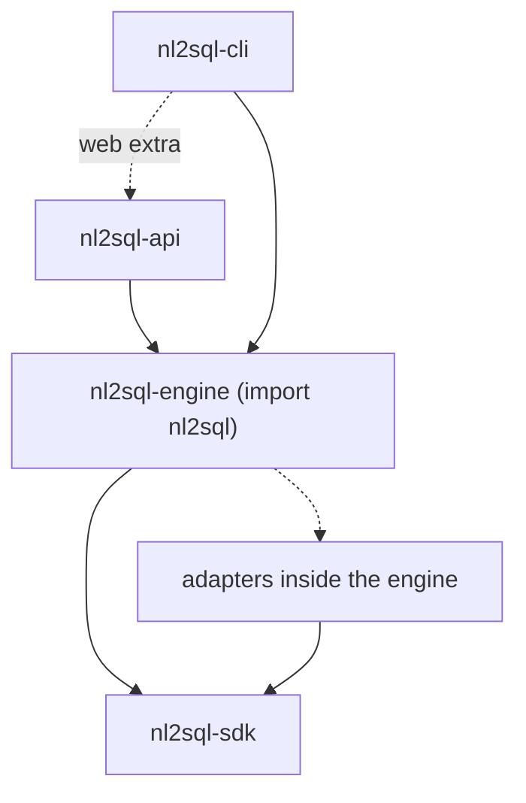

# Packages and Boundaries

The four Python packages, what each may import and why, for contributors who add code and adapter authors who build against the SDK.

## The packages

| Package | Import name | Folder | Role |
| --- | --- | --- | --- |
| `nl2sql-sdk` | `nl2sql_sdk` | `packages/sdk/` | The contract an adapter or plugin compiles against: protocols, policy types, store interfaces |
| `nl2sql-engine` | `nl2sql` | `packages/nl2sql/` | The library: pipeline, indexing, conversations, dashboards, the bundled adapters and the MCP server |
| `nl2sql-api` | `nl2sql_api` | `packages/api/` | The REST API and the web app's server; the built UI ships inside it |
| `nl2sql-cli` | `nl2sql_cli` | `nl2sql-cli/` | The `nl2sql` command and the terminal app (`nl2sql chat`) |

The web app's source lives in `nl2sql-ui/`. It is built to `nl2sql_api/web/static/` and shipped with the API.

The engine reaches adapters only through the `nl2sql.adapters` entry point group; the dotted arrow is that lookup, not an import.

## What each may import

- **The SDK core imports only pydantic and the standard library.** Its extras add more: `nl2sql_sdk.sqlalchemy` (the `sqlalchemy` extra) imports SQLAlchemy and sqlglot, and `nl2sql_sdk.testing` (the `testing` extra) imports pytest and sqlglot. The core imports neither. Whatever the SDK imports, every adapter author inherits.
- **An adapter imports only the SDK, its driver, SQLAlchemy, sqlglot, pydantic and the standard library.** An adapter that imported the engine would close the circle.
- **Nothing outside `nl2sql/adapters/` (and the SDK's SQLAlchemy base) imports an adapter, SQLAlchemy or a database driver.** Adapters are found through the entry points and used through `DatasourceAdapter`, so a datasource this repository has never seen works the same way.
- **The engine and the API never import the CLI, and the engine has no `cli` package.** Knowledge an SDK or REST caller also needs belongs in the engine.
- **The CLI imports only the top-level `nl2sql`.** It never imports `nl2sql_sdk` or `nl2sql_api`. Its one dependency on another package of this project is `nl2sql-engine`, plus `nl2sql-api` as the `web` extra; `nl2sql demo` and `nl2sql serve` start the API as a child process (`python -m nl2sql_api serve`).
- **The REST API, the CLI and the MCP server import only the top-level `nl2sql` facade.** None reaches the runtime behind it (`engine._runtime`). What one of them needs is a facade method every caller can use.
- **Only the storage package imports `chromadb` and `sqlite3`; only the CLI's `chat` package imports `textual`; only the MCP package imports `mcp`.** Each heavy dependency has one door.

## Rules about loading and the environment

- **The runtime never imports `nl2sql.evaluation` or `nl2sql.feedback` at module scope.** Both are opt-in tools; a lazy import inside a function is fine.
- **`import nl2sql` loads no vector store, database driver, `textual` or `opentelemetry`.** The package `__init__` exports through `__getattr__` and the facade imports the runtime in its constructor, so a caller that only needs a name pays nothing.
- **A provider's API-key environment variable is read in `nl2sql/llm/` only.** `PROVIDER_PRESETS` in `nl2sql/llm/registry.py` is the one table.
- **Nothing writes `os.environ`, and it is read only from an allow-list.** Configuration travels in the engine's `Config`, so two engines in one process share nothing. See [Configuration loading](configuration-loading.md).

## Why one-way

A library that names its callers cannot be used without them, and an SDK that grows imports taxes every plugin author. Keeping the arrows pointing from apps to the engine to the SDK means a REST caller, a CLI user and a Python caller see the same behaviour, because they all go through the same facade.

## Where it is enforced

`packages/nl2sql/tests/architecture/test_boundaries.py` walks every source file and fails with a message that names the rule. `packages/nl2sql/tests/architecture/test_hooks_boundary.py` covers the hook points. The full list of rules, with examples, is in [Invariants](invariants.md#package-boundaries-are-one-way).
