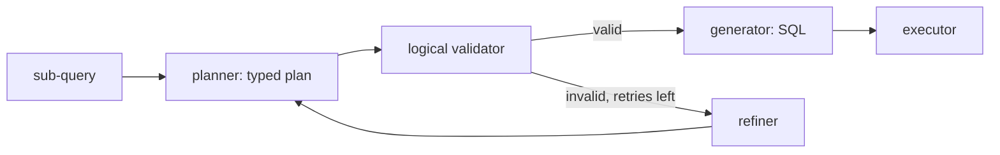

# Plans and SQL

How a question becomes a typed plan and then SQL, and why the model never writes SQL, for contributors changing the planner, the validator, the generator or an adapter.

## The model emits a plan

The planner asks the model for a `PlannerAnswer`: a `PlanModel` plus, for an ambiguous question, up to two alternative readings (`packages/nl2sql/src/nl2sql/pipeline/nodes/ast_planner/schemas.py`). A `PlanModel` is a strict, read-only description of one query:

- `tables` (the first is the `FROM` table) and `joins`, each naming table aliases and a join condition;
- `select_items`, `where`, `group_by`, `having`, `order_by`, `limit` and `offset`;
- expressions (`Expr`) of a fixed set of kinds: `literal`, `column`, `func`, `binary`, `unary` and `case`.

Every model forbids extra fields, and `query_type` can only be `READ`. A plan that does not parse as a `PlanModel` never reaches the validator.

## Why a plan and not SQL

A plan can be checked before any SQL exists. The validator resolves every table and column against the schema, checks joins against the declared foreign keys, checks every table against the caller's role, and refuses what the generator could not render. The same plan renders the same way on every database, so a model never has to know which dialect it is writing for.

## Functions come from an allow-list

A `func` expression carries a `func_name` the model wrote, and it becomes the function's name in the SQL. The validator accepts only a plain identifier from `ALLOWED_FUNCTIONS` (in any case), so nothing else reaches the query through it. The list is in `packages/nl2sql/src/nl2sql/pipeline/nodes/ast_planner/functions.py` and holds read-only scalar and aggregate functions: aggregates, NULL handling, numbers, strings and dates.

Date work is portable. The plan writes `DATE_PART(unit, date)`, an integer, or `DATE_TRUNC(unit, date)`, an ISO date string, with the unit as a string literal. The adapter renders each in its own dialect.

## Validation comes before generation

Anything the generator can reject, the logical validator rejects first. The validator is the last node with a retry edge: a plan it refuses goes through the refiner back to the planner with the reason, up to the retry budget. A check that lived only in the generator would be a dead end instead of a retry. To keep the two in step the validator builds the same query tree the generator would build (it reuses the generator's `SqlVisitor`), so a join the generator cannot attach is caught while the planner can still be asked to fix it.

See [Logical Validator](nodes/logical_validator_node.md) for the checks and [SQL Agent Subgraph](subgraphs/sql_agent.md) for the retry loop.

## The generator renders, the adapter owns the dialect

The generator turns a valid plan into a `sqlglot` expression, adds the row limit and a total row order, and asks the datasource's adapter to render it. It knows no dialect by name.

- `get_dialect()` on the adapter returns a sqlglot dialect name (`postgres`, `tsql`), not SQLAlchemy's. It is passed straight to `sqlglot.Dialect.get_or_raise`.
- An adapter that needs to rewrite what sqlglot emits implements `render_sql(expression)`. The SQLite adapter, for example, rewrites date parts and truncation.
- No dialect name and no dialect-specific SQL appears outside `packages/nl2sql/src/nl2sql/adapters/`, not in a prompt and not in an error message. The plan says what; the adapter says how.

Adding a database means adding an adapter, not editing the planner. See [Add an adapter](../extend/add-adapter.md).

## Where it is enforced

`test_boundaries.py` rejects dialect names and dialect-specific SQL outside the adapters and checks every bundled adapter's `get_dialect()`. The plan rules are listed in [Invariants](invariants.md). The generator's behaviour is in [Generator](nodes/generator_node.md) and the planner's in [AST Planner](nodes/ast_planner_node.md).
