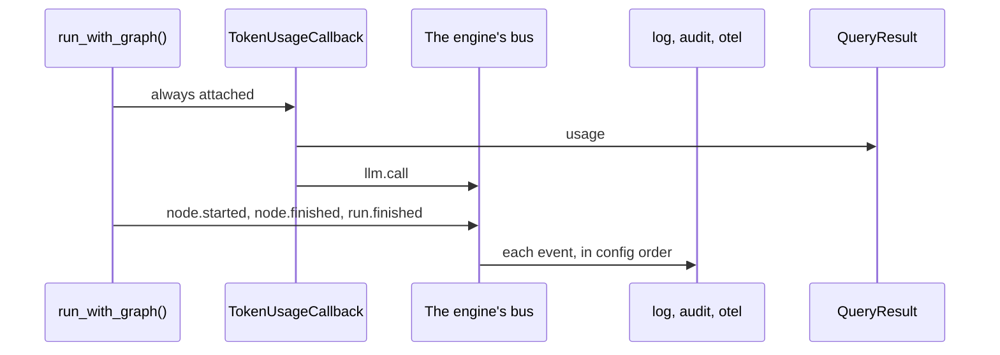

# Observability Stack

NL2SQL provides **structured logging** always, **per-question token and time
telemetry** on every run, and **events** that observers turn into logs, an
**audit log** and **OpenTelemetry metrics and traces**.

- **Every run reports its cost and timings in the result.** `run_with_graph()`
  always attaches `NodeTimingCallback` (wall-clock seconds per node, into
  `QueryResult.timings`) and `TokenUsageCallback` (LLM calls, input / cached /
  output / reasoning tokens and model seconds per node and per question, into
  `QueryResult.usage`). That covers the Python API, the REST API, the CLI and
  the demo playground. See [the query API](../api/core/query.md#usage-tokens-calls-and-model-time).
- **Everything else is an event, and observers decide where it goes.** A run
  publishes its steps (`node.*`), each model call (`llm.call`, from
  `TokenUsageCallback`), each plan cache lookup (`plan_cache.lookup`) and its
  summary (`run.finished`); `engine.llm.replace` publishes `llm.changed`. The
  [observers](../configuration/observers.md) in the `observers` section
  receive them: by default `log` and `audit`.
- **OpenTelemetry is an observer, and an extra.** An `otel` observer (with
  `pip install "nl2sql-engine[otel]"`) records the metrics below and one span
  per run with a child span per step, on providers of its own, exported over
  OTLP (gRPC) or to the console. Without one, nothing exports to OpenTelemetry.
- **The audit log is the `audit` observer's.** JSON lines under
  `<storage.path>/audit/`, one summary line per run plus the denials,
  approvals, limits and changes; 90 days by default, purged by
  `engine.storage.purge()`.

## Telemetry flow

## Metrics

The `otel` observer records:

- `nl2sql.node.duration` (histogram, seconds), attribute `node`, from
  `node.finished`.
- `nl2sql.token.usage` (counter), attributes `node`, `model` and `type`: one
  point per LLM call for each of `input`, `cached_input`, `cache_write_input`,
  `output`, `reasoning` and `total`, from `llm.call`.
- `nl2sql.plan_cache.lookups` (counter), attributes `result` (`hit` or `miss`)
  and `datasource_id`, from `plan_cache.lookup`. The per-question view is
  `QueryResult.usage.plan_cache_hits` and `sub_queries[].plan_source`; see
  [Determinism → The plan cache](../architecture/determinism.md#the-plan-cache-determinism-from-the-architecture).
- `nl2sql.run.cost` (histogram, USD), attribute `status`, from
  `run.finished` when the run was priced.

The 0.6 `datasource_id` attribute on `nl2sql.token.usage` is gone: `llm.call`
does not carry it. Token usage is not kept in a process-wide list; read it
from `QueryResult.usage`.

## Audit logging

The `audit` observer writes `<storage.path>/audit/<date>.jsonl`, one JSON line
per audited event: one summary per run (`run.finished` or `run.failed`: the
user, roles, datasources, tables read, status and source; never rows), and
each `policy.decision`, `hook.decision` that denied, asked for or carried an
approval or failed, `run.limit_reached`, `llm.changed`, `index.swapped`,
`retention.purged` and `schema.drifted`. `llm.changed` names who made the
change and each agent's old and new provider and model, never a key. See
[Observers → audit](../configuration/observers.md#audit).

## Structured logging

The library does not configure logging on import; the application entry point calls `nl2sql.configure_logging` after loading the `.env` next to `nl2sql.yaml`, so a `NL2SQL_LOG_LEVEL` there applies (the REST API does it in its lifespan, the CLI before every command, `nl2sql demo` again once the demo project's `.env` is loaded). JSON lines are chosen with `nl2sql --log-format json` (any command) or `NL2SQL_LOG_FORMAT=json` (any entry point); text is the default. Every question's `RunScope` sets the run's `trace_id` and `tenant_id` in the context `TraceContextFilter` reads, inside the run's worker, so a log line written during a run carries them, on LangGraph's worker threads too.

## Source references

- Observers: `packages/nl2sql/src/nl2sql/observers/` (`log.py`, `audit.py`, `otel.py`)
- Events: `packages/nl2sql/src/nl2sql/events/`
- Token usage: `packages/nl2sql/src/nl2sql/services/callbacks/token_handler.py`
- Logging: `packages/nl2sql/src/nl2sql/common/logger.py`
