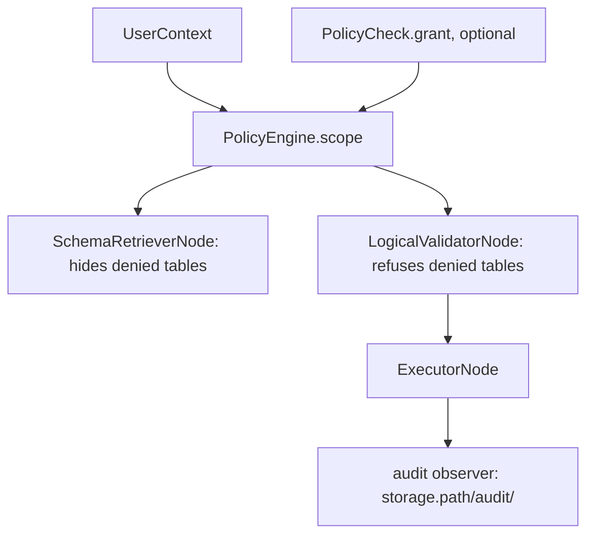

# Security Model

Authorization is enforced at **planning time**, by the logical validator, before
any SQL exists. That is the one security property this engine provides. It is
not authentication, it is not containment, and it is not row- or column-level
security.

## The role is supplied by the caller

There is **no authentication in the query path**; the engine believes the
`UserContext` it is given. The one exception is an [API key](api-keys.md),
which a transport may verify to find that context. Where the role comes from
depends on the client:

- CLI: `nl2sql run --role <id>`, defaulting to `admin`.
- Python API: `UserContext(roles=[...])`, whatever the calling code passes.
- REST API: the `identity.caller` dependency
  (`packages/api/src/nl2sql_api/identity.py`) resolves one `UserContext` from the
  source `api.auth` names: an API key (`api_keys`), the user, tenant and roles
  headers of a proxy that connects from `api.proxy.trusted_from` (`proxy`), one
  role for everyone (`static`) or the local operator (`none`, the default). It
  answers `HTTP 401` when there is no identity, and never reads the request
  body. Headers from a peer outside `trusted_from` are ignored. With
  `auth: none` the request must be made straight to localhost (a connecting peer
  that is not loopback, such as a published container port, a `Host` that is
  not loopback, or an `X-Forwarded-For`, `Forwarded` or `X-Real-IP` header, is a
  `403`, so a same-host proxy or a DNS-rebinding page is not the operator), and
  `nl2sql-api serve` refuses to bind a non-loopback host. The routes that change
  datasources, LLMs or the index also need one of the roles in
  `policies.admin_roles` (default `[admin]`), else `HTTP 403`. See
  [Identity](../api/rest/index.md#identity) and
  [Admin routes](../api/rest/index.md#admin-routes).

- API keys: `engine.api_keys` makes bearer tokens that each carry the user,
  tenant and roles their holder runs as, and `verify(token)` turns a token
  back into that `UserContext`. This is the one place the engine itself
  checks who is asking; MCP over HTTP (`nl2sql mcp --http`) is the first
  transport to use it, and the other clients above still do not. Every
  request there needs a valid key, and runs as that key's user, tenant and
  roles. See [API keys](api-keys.md) and
  [MCP over HTTP](../getting_started/mcp.md#over-http).

- Playground: the page sends the role chosen in "Ask as" with each request
  (`/api/ask`, and `/api/retrieval` for the Retrieval inspector), and the
  server believes it. The inspector shows a role only the entries that role may
  read, but anyone who can reach the playground can ask as any role; it is a
  local demo, off beyond loopback unless `--allow-settings`.

The REST API still does not verify who the caller is. **If you expose this
service, put your own authentication in a proxy in front of it, derive the role
from that, and have the proxy overwrite the role header on every request**;
otherwise any client can send the header itself. An empty `roles` list
denies everything, which is the correct default for an unauthenticated caller.

A role name that is not present in the policy file grants nothing, exactly like
an empty `roles` list. It grants nothing, so the caller is refused with a normal
`SECURITY_VIOLATION`, not a crash: through the pipeline the datasource resolver
refuses first (no datasource is reachable), and the validator on its own refuses
every table with its `policy` check failed. An unknown name listed beside a
known one is ignored, and the known role's permissions still apply.

## Hidden tables and strict refusal

Every access decision asks one `Scope`: what the caller may read in one
datasource, from the roles' allow and deny patterns and, when one is
configured, a policy check's grant (see
[Policies](../configuration/policies.md)). A run builds each datasource's
scope once, so every step decides the same way.

- **Denied tables are hidden from the planner.** The schema retriever
  searches only the tables the scope allows, on both the full-snapshot path and
  the vector-retrieval path, so a denied table's name, columns, keys,
  relationships, statistics and sample values never reach the prompt, the LLM
  provider or the run trace. The answerability judge and the decomposer see
  only the readable table names. A question that needs only denied tables gets
  "no data for that question" from the planner rather than a refusal. (For
  tables the role can read, the prompt carries `sample_values` and, for a
  date, time or numeric column, its `[min, max]` as `range`; the other
  statistics stay in the snapshot.)
- **A plan naming a hidden table is refused.** The logical validator asks the
  same scope for every table in the plan and refuses a denied one with
  `SECURITY_VIOLATION` before any SQL exists. The run ends there.
- **A generic message for the user.** The refusal the caller sees is
  "You do not have permission to see the data this question requires." It names
  no table, because naming one tells an unauthorised user that it exists. The
  table, the role and the rule that denied it are logged as a warning and
  recorded in the error's `details` (`datasource_id`, `table`, `roles`,
  `rule`), which the run trace keeps and the `QueryResult` error summary does
  not carry. The validator's `policy` check is still present with
  `passed: false`, so a UI can show the gate firing.
- **Naming tables is an opt-in.** Set `policies.refusal_names_tables: true` to
  put the role and table in the user-facing message ("Role 'viewer' denied
  access to 'chinook.Customer'."). The demo's config (`nl2sql init --demo`)
  sets it, because showing the refusal is the demo's point.
- **The decision is deterministic code.** Only the scope decides, from the
  policy and the plan's table list. Nothing the model writes (its reasoning, a
  claim that the role is allowed) is read by the policy check, so a crafted
  prompt cannot turn a refusal into an allow.

**Knowledge is data.** The glossary (Wave B) reaches the planner and the
refiner only as JSON values, in the schema block and in `[BUSINESS_CONTEXT]`,
capped per item and per block, and filtered by the caller's scope: an item
naming a denied table, or whose text (or a database comment) mentions one, is
never sent, returned on `knowledge_used` or named in the explanation. The
prompt tells the model the block is reference data, but that is not what the
guarantee rests on: a plan written under any glossary is validated with the
caller's scope like every other, so hostile knowledge cannot widen access. A
paraphrase of a hidden table's name is not caught by the filter; the validator
still refuses a plan on the table. See
[Knowledge Is Data](../architecture/invariants.md#knowledge-is-data-the-validator-and-scope-decide).

This is **table-level** access control. It is not column masking and not
row-level security: a role that may read a table reads every column and every
row of it. A downloaded trace of a *permitted* run holds real rows, and the
playground serves any trace by id with no login, so restricting a trace to the
user who produced it is left to a multi-user deployment.

## Security controls

- **Policies**: the `policies` section of `nl2sql.yaml`, evaluated by
  `PolicyEngine` into a `Scope`. A role allows and denies tables with
  patterns over `datasource.schema.table` (each part a glob, case ignored) —
  nothing finer. There is no column masking and no row-level security.
- **Policy check** (optional): a plugin that asks an outside service (IAM,
  OPA, Cedar) what the caller may read, once per caller and datasource per
  run. Its grant is intersected with the roles, so neither can widen the
  other, and it **fails closed**: an exception denies the datasource for the
  run and is logged with the check's name. See
  [A policy check](../configuration/policies.md#a-policy-check).
- **Logical validation** enforces schema constraints and policy-based table access.
- **Hooks** (optional): your code at six points of every run, on the
  generated and the verified path. A hook may change the question, narrow
  the datasources or change the plan only before the validator, so a changed
  plan is validated (policies included) like any other, and a narrowed list
  of datasources is checked against the role again. After the validator a
  hook may only stop the run. Hooks **fail closed**: an exception denies
  with `HOOK_FAILED` unless that hook is configured `on_error: open`. See
  [Hooks](../configuration/hooks.md). A run a hook ended is **withheld**: its
  returned result is blank and its saved results are unreadable by trace id
  (`engine.results` and the REST results routes raise `ResultNotFound`). Every
  read goes through the run's manifest, which is written only once no hook
  can end the run any more (after `answer.after` allowed, while a hook sits
  there), so a deny cannot be bypassed by paging the run's files, during the
  run or after it. See
  [What withholding guarantees](../configuration/hooks.md#what-withholding-guarantees).
- **Cost rule** (optional, `policies.cost`): the built-in `policy.cost` hook
  asks the database for the rows a query is estimated to read, before it
  runs, and allows it, asks a person to approve it or refuses it
  (`COST_LIMIT_EXCEEDED`, never retried) when it is over the caller's limit.
  It applies on every path that runs a question's SQL (generated, verified, a correction's check), under `allow_all` too, and a failed
  estimate follows the rule's `unknown` action (default `allow`). It limits
  cost, not access. See [Policies → Cost](../configuration/policies.md#cost).
- **Approval** (a hook's `NeedsApproval`): the engine, not the hook, checks
  an `Approval` on the re-run: the request unedited, the same question and
  asker, the hash of the SQL generated again, and an approver holding one
  of the hook's configured roles. An `Approval` is not signed: it is trusted
  as far as the `user_context` the caller passes. Over HTTP the engine keeps the
  requests itself: a `needs_approval` run stores them, an approver holding one of the hook's
  roles grants or denies one by id (`engine.approvals`, `NotAuthorized` otherwise), and the
  asker's re-run names the id; a grant becomes the same `Approval`, so these checks are
  unchanged, and it is reusable for 24 hours (`settings.approvals.max_age_hours`), after
  which it expires and `engine.storage.purge()` deletes it. A denied, unknown, waiting or
  expired id ends the run `APPROVAL_NOT_GRANTED`. See
  [Query API → Approval](../api/core/query.md#approval).
- **Results belong to their asker**: a run's manifest and its trace record who asked,
  `(tenant_id, user_id)`, plus the sorted roles of an anonymous asker, and every read of its rows (`engine.results`, the
  REST and playground results routes, a conversation's report and `chart`
  tool, a dashboard's charts) needs the caller and answers only that asker.
  `engine.traces.get` and `engine.feedback.record` take the caller too: another user's trace is `None` (and
  rating it is `TraceNotFound`); only the in-process operator (`user_context=None`, as `nl2sql trace`) reads any run.
  Another user's or another tenant's trace id is `ResultNotFound` (`HTTP 404`),
  the same as a missing run, so a trace id seen in an event, a trace or a log
  reads nothing; no caller is a `TypeError`, and a manifest that records no
  asker is refused. Callers with no `user_id` are anonymous: their runs are
  bound to the tenant and the same set of roles, so a `viewer` cannot read an
  `admin` run, but anonymous callers with the same roles share results. The
  REST API has no per-user identity yet (its role settings carry roles only,
  and API keys are MCP-only), so REST runs are readable by REST callers of the
  same tenant with the same roles. See
  [Who can read a run](../api/core/results.md#who-can-read-a-run).
- **A supplied plan** (`run_query(plan=...)`) skips planning, not checking:
  its datasource is scope-checked, and the plan passes `plan.after` and the
  logical validator under the caller's role like any other.
- **API keys** (`engine.api_keys`): the token is shown once and only the
  SHA-256 of its 256-bit secret is stored; `verify` compares in constant time
  and answers `None` for a malformed, unknown or revoked token. Managing keys
  needs a `policies.admin_roles` caller, a key's roles must be configured
  roles, and neither an event nor a log line carries the token.
- **MCP over HTTP** (`nl2sql mcp --http`): a missing, malformed, unknown or
  revoked bearer key is a `401` and an audited `mcp.denied` event (the reason
  and, for a revoked key, its id; never the token). Each request carries its own
  caller, so two keys in flight never share an identity. A `Host` or `Origin`
  that `mcp.http.allowed_hosts` and `allowed_origins` do not list is refused
  (DNS-rebinding protection). `mcp.auth: none` runs every request as one
  identity, so it is for loopback only and the server refuses to bind any other
  address with it. The server speaks plain HTTP: put a reverse proxy or a
  tunnel in front for TLS, since a bearer token sent in the clear is readable.
  See [API keys](api-keys.md).
- **Audit logging** records `llm.changed` events only: each `engine.llm.replace`
  (the Python API, `PUT /api/v1/settings/llm`, the playground's model switch),
  with who made it and each agent's old and new model, never a key. Queries
  are not audited. See `../observability/stack.md`.
- **Bounded execution**: a global timeout and a per-run cancellation token cap each run. There is **no process sandbox** — the engine runs in-process (see `../execution/isolation.md`).

## What keeps the SQL read-only

The model never writes SQL. It emits a typed plan whose `query_type` is
`Literal["READ"]` — pydantic rejects anything else before a node sees the plan,
which is the whole enforcement — and the generator renders that plan with
`sqlglot` starting from `exp.select()`. A statement that is not a SELECT therefore cannot be
produced, and free text from the model is never executed.

Below that, the session itself is read-only wherever the database allows it.
There is no setting: the engine never writes, so every built-in adapter makes
each new connection read-only when it can, and declares `ENFORCES_READ_ONLY`
only where it does:

| Adapter | Read-only session | `ENFORCES_READ_ONLY` |
| :--- | :--- | :--- |
| PostgreSQL | `SET default_transaction_read_only = on` | yes |
| MySQL | `SET SESSION TRANSACTION READ ONLY` | yes |
| SQL Server | none: the database has no such session setting | **no** |
| DuckDB | `read_only=True` on the file | yes (not for `:memory:`) |
| SQLite | `mode=ro` | yes |

`engine.check()` warns about each datasource whose adapter does not declare
it ("this adapter cannot make the session read-only"), and still routes to it.
For those, the login is the third guard: on SQL Server, a login whose only role
is `db_datareader` (see [the adapter](../adapters/mssql.md#read-only)). The
executor has no statement-kind or statement-count gate of its own. **Grant the
engine a read-only database user** anyway: a read-only session stops writes,
not reads of tables you did not mean to expose.

## Policy enforcement details

`LogicalValidatorNode` enforces **strict namespacing** through the `Scope`:

- A table is read in a schema: the plan's, or the adapter's default schema.
  An allow of `sales.public.orders` does not allow `sales.audit.orders`.
  Patterns have one part or three; a two-part pattern is rejected when the
  config loads (see [Policies](../configuration/policies.md#patterns)).
- Matching ignores case, so a deny cannot be dodged by `Orders` against
  `orders`.
- Deny beats allow within a role; across roles a table is readable when some
  role allows it and that same role does not deny it.
- If no datasource ID is present, validation fails closed.
- With a policy check, a table must also be allowed, and not denied, by the
  check's grant; a check that failed allows nothing in that datasource.
- An unknown role, or no role, allows nothing and is refused like any denial.
- One `SECURITY_VIOLATION` per forbidden table, with the generic message unless
  `policies.refusal_names_tables` is set, and `details` naming the table, the
  roles and the rule.

## Validation gates

Validation rules are enforced by `LogicalValidatorNode` and documented in `../architecture/invariants.md` and `../architecture/nodes/logical_validator_node.md`.

## Source references

- Policies: `packages/nl2sql/src/nl2sql/policies/` (`scope.py`, `patterns.py`, `check.py`)
- The policy check contract: `packages/sdk/src/nl2sql_sdk/policy.py`
- Validator node: `packages/nl2sql/src/nl2sql/pipeline/nodes/validator/node.py`
- Hiding denied tables: `packages/nl2sql/src/nl2sql/pipeline/nodes/schema_retriever/node.py`
- The audit log: `packages/nl2sql/src/nl2sql/observers/audit.py` (see [Observers](../configuration/observers.md#audit))
