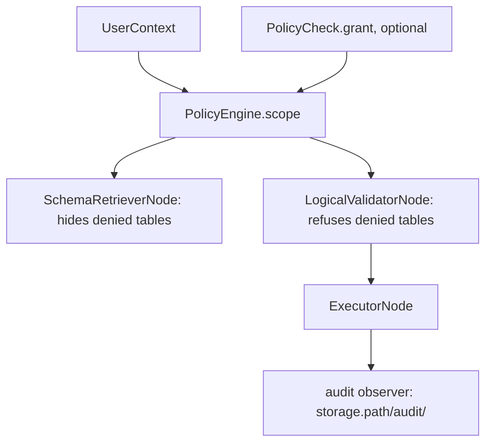

# Security Model

Authorization is enforced at **planning time**, by the logical validator, before
any SQL exists. That is the one security property this engine provides. It is
not authentication, it is not containment, and it is not row- or column-level
security.

## The role is supplied by the caller

There is **no authentication anywhere in this project**. Where the role comes
from depends on the client:

- CLI: `nl2sql run --role <id>`, defaulting to `admin`.
- Python API: `UserContext(roles=[...])`, whatever the calling code passes.
- REST API: the `get_user_context` dependency
  (`packages/api/src/nl2sql_api/auth.py`). It reads a header set by a trusted
  proxy (`api.role_header` in `nl2sql.yaml`) or a static role (`api.role`), and
  answers `HTTP 401` when neither gives one. The body's `user_context` counts
  only with the dev flag `api.trust_body_role: true`, which logs a
  warning at startup. See [Caller role](../api/rest/index.md#caller-role).
  The routes that change datasources, LLMs or the index also need one of the
  roles in `policies.admin_roles` (default `[admin]`), else `HTTP 403`; with no
  role source configured they answer loopback clients only. See
  [Admin routes](../api/rest/index.md#admin-routes).

The REST API still does not verify who the caller is. **If you expose this
service, put your own authentication in a proxy in front of it, derive the role
from that, and have the proxy overwrite the role header on every request**;
otherwise any client can send the header itself. An empty `roles` list
denies everything, which is the correct default for an unauthenticated caller.

A role name that is not present in the policy file grants nothing, exactly like
an empty `roles` list. It grants nothing, so the caller is refused with a normal
`SECURITY_VIOLATION`, not a crash: through the pipeline the datasource resolver
refuses first (no datasource is reachable), and the validator on its own refuses
every table with its `policy` check failed. An unknown name listed beside a
known one is ignored, and the known role's permissions still apply.

## Hidden tables and strict refusal

Every access decision asks one `Scope`: what the caller may read in one
datasource, from the roles' allow and deny patterns and, when one is
configured, a policy check's grant (see
[Policies](../configuration/policies.md)). A run builds each datasource's
scope once, so every step decides the same way.

- **Denied tables are hidden from the planner.** The schema retriever
  searches only the tables the scope allows, on both the full-snapshot path and
  the vector-retrieval path, so a denied table's name, columns, keys,
  relationships, statistics and sample values never reach the prompt, the LLM
  provider or the run trace. The answerability judge and the decomposer see
  only the readable table names. A question that needs only denied tables gets
  "no data for that question" from the planner rather than a refusal. (For
  tables the role can read, the prompt carries `sample_values` and, for a
  date, time or numeric column, its `[min, max]` as `range`; the other
  statistics stay in the snapshot.)
- **A plan naming a hidden table is refused.** The logical validator asks the
  same scope for every table in the plan and refuses a denied one with
  `SECURITY_VIOLATION` before any SQL exists. The run ends there.
- **A generic message for the user.** The refusal the caller sees is
  "You do not have permission to see the data this question requires." It names
  no table, because naming one tells an unauthorised user that it exists. The
  table, the role and the rule that denied it are logged as a warning and
  recorded in the error's `details` (`datasource_id`, `table`, `roles`,
  `rule`), which the run trace keeps and the `QueryResult` error summary does
  not carry. The validator's `policy` check is still present with
  `passed: false`, so a UI can show the gate firing.
- **Naming tables is an opt-in.** Set `policies.refusal_names_tables: true` to
  put the role and table in the user-facing message ("Role 'viewer' denied
  access to 'chinook.Customer'."). The demo's config (`nl2sql init --demo`)
  sets it, because showing the refusal is the demo's point.
- **The decision is deterministic code.** Only the scope decides, from the
  policy and the plan's table list. Nothing the model writes (its reasoning, a
  claim that the role is allowed) is read by the policy check, so a crafted
  prompt cannot turn a refusal into an allow.

This is **table-level** access control. It is not column masking and not
row-level security: a role that may read a table reads every column and every
row of it. A downloaded trace of a *permitted* run holds real rows, and the
playground serves any trace by id with no login, so restricting a trace to the
user who produced it is left to a multi-user deployment.

## Security controls

- **Policies**: the `policies` section of `nl2sql.yaml`, evaluated by
  `PolicyEngine` into a `Scope`. A role allows and denies tables with
  patterns over `datasource.schema.table` (each part a glob, case ignored) —
  nothing finer. There is no column masking and no row-level security.
- **Policy check** (optional): a plugin that asks an outside service (IAM,
  OPA, Cedar) what the caller may read, once per caller and datasource per
  run. Its grant is intersected with the roles, so neither can widen the
  other, and it **fails closed**: an exception denies the datasource for the
  run and is logged with the check's name. See
  [A policy check](../configuration/policies.md#a-policy-check).
- **Logical validation** enforces schema constraints and policy-based table access.
- **Hooks** (optional): your code at six points of every run, on the
  generated and the verified path. A hook may change the question, narrow
  the datasources or change the plan only before the validator, so a changed
  plan is validated (policies included) like any other, and a narrowed list
  of datasources is checked against the role again. After the validator a
  hook may only stop the run. Hooks **fail closed**: an exception denies
  with `HOOK_FAILED` unless that hook is configured `on_error: open`. See
  [Hooks](../configuration/hooks.md).
- **Approval** (a hook's `NeedsApproval`): the engine, not the hook, checks
  an `Approval` on the re-run: the request unedited, the same question and
  asker, the hash of the SQL generated again, and an approver holding one
  of the hook's configured roles. An `Approval` is not signed: it is trusted
  as far as the `user_context` the caller passes. See
  [Query API → Approval](../api/core/query.md#approval).
- **A supplied plan** (`run_query(plan=...)`) skips planning, not checking:
  its datasource is scope-checked, and the plan passes `plan.after` and the
  logical validator under the caller's role like any other.
- **Audit logging** records `llm.changed` events only: each `engine.llm.replace`
  (the Python API, `PUT /api/v1/settings/llm`, the playground's model switch),
  with who made it and each agent's old and new model, never a key. Queries
  are not audited. See `../observability/stack.md`.
- **Bounded execution**: a global timeout and a per-run cancellation token cap each run. There is **no process sandbox** — the engine runs in-process (see `../execution/isolation.md`).

## What keeps the SQL read-only

The model never writes SQL. It emits a typed plan whose `query_type` is
`Literal["READ"]` — pydantic rejects anything else before a node sees the plan,
which is the whole enforcement — and the generator renders that plan with
`sqlglot` starting from `exp.select()`. A statement that is not a SELECT therefore cannot be
produced, and free text from the model is never executed.

Below that, the session itself is read-only wherever the database allows it.
There is no setting: the engine never writes, so every built-in adapter makes
each new connection read-only when it can, and declares `ENFORCES_READ_ONLY`
only where it does:

| Adapter | Read-only session | `ENFORCES_READ_ONLY` |
| :--- | :--- | :--- |
| PostgreSQL | `SET default_transaction_read_only = on` | yes |
| MySQL | `SET SESSION TRANSACTION READ ONLY` | yes |
| SQL Server | none: the database has no such session setting | **no** |
| DuckDB | `read_only=True` on the file | yes (not for `:memory:`) |
| SQLite | `mode=ro` | yes |

`engine.check()` warns about each datasource whose adapter does not declare
it ("this adapter cannot make the session read-only"), and still routes to it.
For those, the login is the third guard: on SQL Server, a login whose only role
is `db_datareader` (see [the adapter](../adapters/mssql.md#read-only)). The
executor has no statement-kind or statement-count gate of its own. **Grant the
engine a read-only database user** anyway: a read-only session stops writes,
not reads of tables you did not mean to expose.

## Policy enforcement details

`LogicalValidatorNode` enforces **strict namespacing** through the `Scope`:

- A table is read in a schema: the plan's, or the adapter's default schema.
  An allow of `sales.public.orders` does not allow `sales.audit.orders`.
  Patterns have one part or three; a two-part pattern is rejected when the
  config loads (see [Policies](../configuration/policies.md#patterns)).
- Matching ignores case, so a deny cannot be dodged by `Orders` against
  `orders`.
- Deny beats allow within a role; across roles a table is readable when some
  role allows it and that same role does not deny it.
- If no datasource ID is present, validation fails closed.
- With a policy check, a table must also be allowed, and not denied, by the
  check's grant; a check that failed allows nothing in that datasource.
- An unknown role, or no role, allows nothing and is refused like any denial.
- One `SECURITY_VIOLATION` per forbidden table, with the generic message unless
  `policies.refusal_names_tables` is set, and `details` naming the table, the
  roles and the rule.

## Validation gates

Validation rules are enforced by `LogicalValidatorNode` and documented in `../architecture/invariants.md` and `../architecture/nodes/logical_validator_node.md`.

## Source references

- Policies: `packages/nl2sql/src/nl2sql/policies/` (`scope.py`, `patterns.py`, `check.py`)
- The policy check contract: `packages/sdk/src/nl2sql_sdk/policy.py`
- Validator node: `packages/nl2sql/src/nl2sql/pipeline/nodes/validator/node.py`
- Hiding denied tables: `packages/nl2sql/src/nl2sql/pipeline/nodes/schema_retriever/node.py`
- The audit log: `packages/nl2sql/src/nl2sql/observers/audit.py` (see [Observers](../configuration/observers.md#audit))
