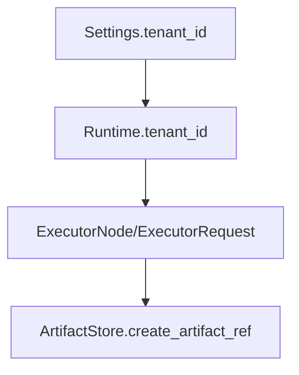

# Multi-Tenant Isolation Model

Multi-tenancy is enforced through **context propagation**, **artifact partitioning**, and **policy filtering**. Tenant identity originates from `Settings.tenant_id` and is passed through execution requests and artifact paths.

## Tenant context propagation



## Storage isolation

Artifacts are persisted under a tenant-partitioned path on every backend, driven by `RESULT_ARTIFACT_PATH_TEMPLATE` (default `<tenant_id>/<request_id>/<sub_query_id>.parquet`):

```
<backend root>/<tenant_id>/<request_id>/<sub_query_id>.parquet
```

This ensures per-tenant isolation for artifacts, and downstream aggregation only reads referenced artifacts from the current request.

Tenant isolation is **not** applied to indexing; the vector store and schema store are global in the current implementation (see `../architecture/indexing.md`).

## Authorization model

`PolicyEngine` turns `UserContext.roles` and the `policies` section of `nl2sql.yaml` into a `Scope` per datasource. The schema retriever hides denied tables from the planner, and the validator enforces the scope at planning time.

## Source references

- Tenant settings: `settings.tenant_id` in `packages/nl2sql/src/nl2sql/config/models.py`
- Context initialization: `packages/nl2sql/src/nl2sql/runtime.py`
- Artifact paths: `packages/nl2sql/src/nl2sql/execution/artifacts/store.py`
- Policies: `packages/nl2sql/src/nl2sql/policies/scope.py`
