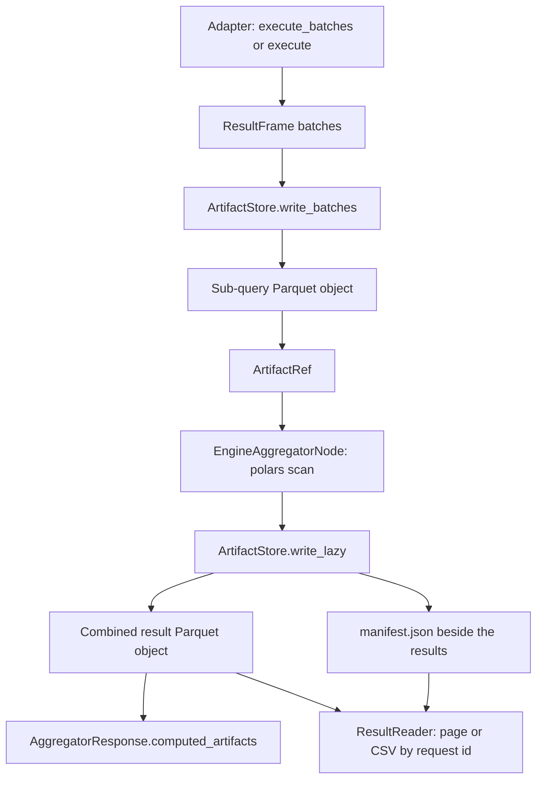

# Artifact Store Architecture

Execution results are persisted as **artifacts**. A single `ArtifactStore` writes Parquet files under the engine's results folder, `<storage.path>/results/`, and emits `ArtifactRef` metadata used by aggregation and downstream consumers. Each sub-query's result is one artifact, and the run's combined result is another, beside them.

Results are local files only. The S3 and ADLS backends, and the `RESULT_ARTIFACT_BACKEND`, `RESULT_ARTIFACT_S3_*` and `RESULT_ARTIFACT_ADLS_*` settings, were removed in 0.5: they were untested and unreachable from the new config. The Phase 2 results-store interface brings remote stores back.

## Storage lifecycle



## Batched writes

A result is written a batch at a time, so a large one is never held whole as Python rows. The executor reads it from the adapter's `execute_batches` when the adapter has one (the SDK's optional `StreamingAdapterProtocol`; every SQLAlchemy adapter does) in batches of `settings.results.fetch_batch_size` rows (default 10,000), and from `execute`, as one batch, when it does not.

`ArtifactStore.write_batches` writes a single batch straight to the artifact, exactly as before. From the second batch on, each batch is written to its own part file in a temporary folder as it arrives, and polars then streams the parts into the artifact (`sink_parquet`), concatenated with `vertical_relaxed` so a column that is empty in one batch and text in the next is text. At most one batch is in memory at a time. If the adapter reports a failure between batches, nothing is written, the parts are removed, and the sub-query fails as it would have from `execute`. `create_artifact_ref(frame, metadata)` is `write_batches([frame], metadata)`.

## The combined result

The aggregator reads each sub-query's artifact as a polars scan (`ArtifactStore.scan_parquet`), so combines and post-combine operations build one lazy plan, and writes each terminal result of the DAG to its own artifact with `ArtifactStore.write_lazy`, which streams the plan into the file and reads the row count and columns back from the file's metadata. It is rendered from the same template as the sub-query artifacts, with `result_<node_id>` as `sub_query_id` and `dag_node_id`, so the default template puts it in the run's folder:

```
<tenant_id>/<request_id>/result_<node_id>.parquet
```

A combined result has no subgraph or schema version of its own: a template that names `<subgraph_name>` or `<schema_version>` gets `aggregator` and `result`. Its `ArtifactRef` (with `sub_query_id` unset) is recorded in `AggregatorResponse.computed_artifacts` under the terminal node's id, and its `row_count` is the whole result's. `AggregatorResponse.terminal_results` holds only the first `settings.results.preview_rows` rows of it, read from the saved file, for the answer model.

## The result manifest

After saving a run's results the aggregator writes a manifest beside them with `ArtifactStore.write_manifest`: which results the run produced, never their rows.

```json
{"request_id": "0f1c...", "results": [
  {"node_id": "combine_g1", "columns": ["genre_name"], "row_count": 25, "truncated": false}]}
```

`truncated` is true when a sub-query upstream of that node in the DAG was cut at its row cap. The same entries are `AggregatorResponse.results` and `QueryResult.result_manifest`.

Its path is the artifact template rendered like a saved result's, with `manifest` as the name and `.json` for `.parquet`, so the default template puts it at:

```
<tenant_id>/<request_id>/manifest.json
```

A template without `<sub_query_id>` or `<dag_node_id>` gets `-manifest` added, as any file of the run would (see *One artifact per sub-query*), so a flat template still gives each run its own manifest.

### Reading a result back

`ResultReader` (`execution/artifacts/results.py`), behind `engine.results` (`manifest`, `page` and `csv`) (see [Query API](../api/core/query.md#reading-a-runs-saved-results)), reads one tenant's results by request id:

1. The request id and the result id must be plain tokens (letters, digits, `_`, `-`; up to 128 characters). Anything else is `ResultNotFound`, before any path is built.
2. The manifest is read from the path rendered for the reader's tenant and that request id (`ArtifactStore.read_manifest`). No file there is `ResultNotFound`, so another tenant's run is not found, not refused.
3. The result id must be a `node_id` the manifest lists. The parquet path is then rendered from the template, exactly as the aggregator wrote it (`ArtifactStore.scan_result`); the manifest never supplies a path.
4. A page is `scan.slice(offset, limit).collect()` on a polars scan, so only that slice is read. A CSV export collects one `CSV_CHUNK_ROWS` (10,000) slice at a time and yields it as CSV text, header first.

## Where the files go

An artifact's path is `<results folder>/<rendered path>`, and its parent folders are created as it is written. For an engine built from a `Config` the results folder is `<storage.path>/results/` (see [Public Facade → Creating an engine](../api/core/public-facade.md#creating-an-engine)), so the default template gives:

```
<storage.path>/results/<tenant_id>/<request_id>/<sub_query_id>.parquet
```

The store is exercised by real read/write round-trip tests (`packages/nl2sql/tests/unit/test_artifact_store.py`).

## ArtifactRef fields

`ArtifactRef` contains:

- `uri`, `backend` (always `local`), `format`
- `row_count`, `columns`, `bytes`
- `content_hash`, `created_at`
- optional `schema_version`
- optional `sub_query_id`, the sub-query whose result this is
- `path_template`, the template actually rendered (see *One artifact per sub-query*)

## Path templating

The path template defines the artifact path relative to the results folder. It defaults to:

```
<tenant_id>/<request_id>/<sub_query_id>.parquet
```

Each `<key>` placeholder is substituted from the metadata the executor passes to `write_batches`. The SQL executor supplies these keys:

- `tenant_id`
- `request_id` (the trace ID, shared by every sub-query of a run)
- `sub_query_id` (the sub-query's id, which is also its scan node's id)
- `dag_node_id` (the same value as `sub_query_id`)
- `subgraph_name`
- `schema_version`

A template referencing any other placeholder raises a `ValueError` naming the placeholder that could not be filled. A path is never written with an unrendered placeholder in it. Adding placeholders therefore requires threading the corresponding metadata through the executor first.

### One artifact per sub-query

A question that decomposes into several sub-queries runs them under one trace ID, often side by side, and each must write its own file. When they shared `<tenant_id>/<request_id>.parquet`, concurrent writes produced one corrupt Parquet file (`AGGREGATOR_FAILED: parquet: File out of specification`), and sequential writes kept only the last sub-query's rows, so a join combined a result with itself and returned a wrong answer with no error.

A template that names neither `<sub_query_id>` nor `<dag_node_id>` is therefore made unique rather than rejected: the store adds `-<sub_query_id>` to the end of the file name, before its extension, so `<tenant_id>/<request_id>.parquet` writes `<tenant_id>/<request_id>-<sub_query_id>.parquet`. The `ArtifactRef` records the template actually rendered in `path_template` and the sub-query in `sub_query_id`. A store used directly, with no `sub_query_id` in its metadata, renders the template as written.

## Tenant-aware paths

Because the default template starts with `<tenant_id>`, artifacts are partitioned per tenant:

```
<results folder>/<tenant_id>/<request_id>/<sub_query_id>.parquet
```

## Source references

- Artifact store: `packages/nl2sql/src/nl2sql/execution/artifacts/store.py`
- Parquet helpers: `packages/nl2sql/src/nl2sql/execution/artifacts/parquet.py`
- Manifest models and the result reader: `packages/nl2sql/src/nl2sql/execution/artifacts/results.py`
- Artifact contracts: `packages/nl2sql/src/nl2sql/execution/contracts.py`
