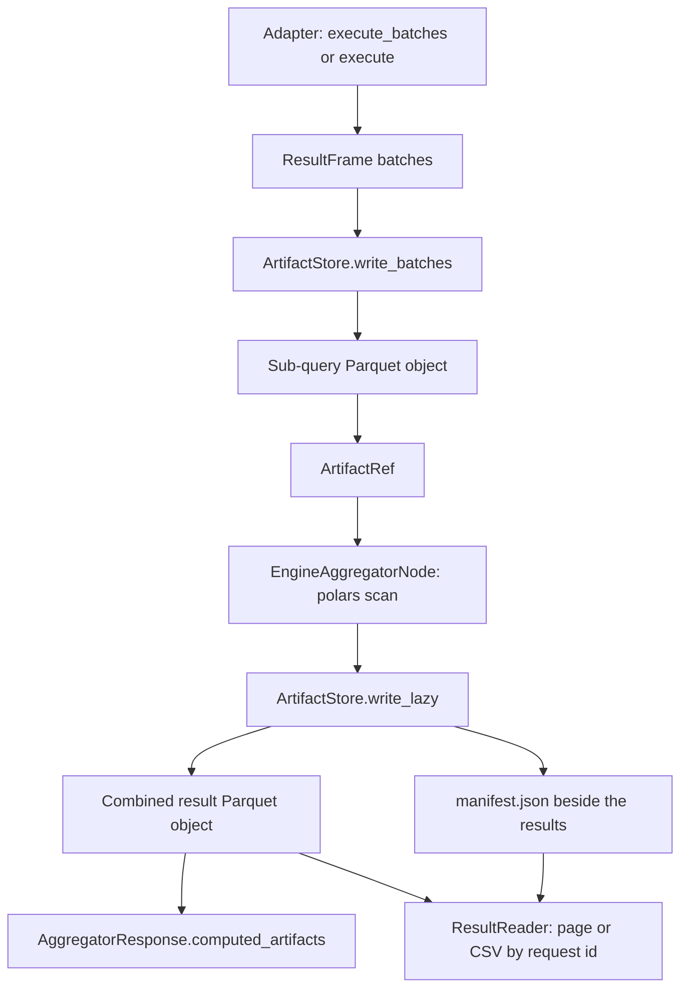

# Artifact Store Architecture

Execution results are persisted as **artifacts**. The engine's `ArtifactStore` writes each result as Parquet, and the run's manifest as JSON, through the **results store** in `storage.results` (a `ResultStore`, see [Storage](../configuration/storage.md)), and emits `ArtifactRef` metadata used by aggregation and downstream consumers. Each sub-query's result is one artifact, and the run's combined result is another, beside them.

The engine makes the bytes; the store only keeps them under a key. The built-in `local` store keeps them as files in `<storage.path>/results/`. There is no built-in S3 or ADLS store: a remote store is four methods (see [A results store of your own](#a-results-store-of-your-own)).

## Storage lifecycle



## Batched writes

A result is written a batch at a time, so a large one is never held whole as Python rows. The executor reads it from the adapter's `execute_batches` when the adapter has one (the SDK's optional `StreamingAdapterProtocol`; every SQLAlchemy adapter does) in batches of `settings.results.fetch_batch_size` rows (default 10,000), and from `execute`, as one batch, when it does not.

`ArtifactStore.write_batches` writes a single batch straight to the artifact, exactly as before. From the second batch on, each batch is written to its own part file in a temporary folder as it arrives, and polars then streams the parts into the artifact (`sink_parquet`), concatenated with `vertical_relaxed` so a column that is empty in one batch and text in the next is text. At most one batch is in memory at a time. If the adapter reports a failure between batches, nothing is written, the parts are removed, and the sub-query fails as it would have from `execute`. `create_artifact_ref(frame, metadata)` is `write_batches([frame], metadata)`.

## The combined result

The aggregator reads each sub-query's artifact as a polars scan (`ArtifactStore.scan_parquet`), so combines and post-combine operations build one lazy plan, and writes each terminal result of the DAG to its own artifact with `ArtifactStore.write_lazy`, which streams the plan into the file and reads the row count and columns back from the file's metadata. It is rendered from the same template as the sub-query artifacts, with `result_<node_id>` as `sub_query_id` and `dag_node_id`, so the default template puts it in the run's folder:

```
<tenant_id>/<request_id>/result_<node_id>.parquet
```

A combined result has no subgraph or schema version of its own: a template that names `<subgraph_name>` or `<schema_version>` gets `aggregator` and `result`. Its `ArtifactRef` (with `sub_query_id` unset) is recorded in `AggregatorResponse.computed_artifacts` under the terminal node's id, and its `row_count` is the whole result's. `AggregatorResponse.terminal_results` holds only the first `settings.results.preview_rows` rows of it, read from the saved file, for the answer model.

## The result manifest

After saving a run's results the aggregator writes a manifest beside them with `ArtifactStore.write_manifest`: which results the run produced, never their rows. While a hook is attached at `answer.after`, it is written later, once those hooks allowed (see *Withheld runs* below).

```json
{"request_id": "0f1c...", "owner": {"tenant_id": "acme", "user_id": "ann", "roles": null}, "results": [
  {"node_id": "combine_g1", "columns": ["genre_name"], "row_count": 25, "truncated": false, "column_kinds": {"genre_name": "text"}}]}
```

`owner` is who asked the run: the caller's `tenant_id` (else the engine's) and `user_id` (`null` for a caller with none), and for a caller with no `user_id` its sorted `roles` (`null` for a named user). Only that caller, or an anonymous caller of that tenant with the same roles, can read the run back.

`column_kinds` is each column's type category, read from the saved parquet file's schema: integer, decimal and float are `number`; date, time and timestamp `temporal`; string `text`; bool `boolean`; anything else `other`.

`truncated` is true when a sub-query upstream of that node in the DAG was cut at its row cap. The same entries are `AggregatorResponse.results` and `QueryResult.result_manifest`.

Its path is the artifact template rendered like a saved result's, with `manifest` as the name and `.json` for `.parquet`, so the default template puts it at:

```
<tenant_id>/<request_id>/manifest.json
```

A template without `<sub_query_id>` or `<dag_node_id>` gets `-manifest` added, as any file of the run would (see *One artifact per sub-query*), so a flat template still gives each run its own manifest.

### Reading a result back

`ResultReader` (`execution/artifacts/results.py`), behind `engine.results` (`manifest`, `page`, `csv` and `chart`) (see [Query API](../api/core/query.md#reading-a-runs-saved-results)), reads, by request id, the results in one tenant folder that one caller (a `ResultOwner`) asked for:

1. The request id and the result id must be plain tokens (letters, digits, `_`, `-`; up to 128 characters). Anything else is `ResultNotFound`, before any path is built.
2. The manifest is read from the key rendered for the reader's tenant and that request id (`ArtifactStore.read_manifest`). No such key in the results store is `ResultNotFound`, so another tenant's run is not found, not refused. The manifest's `owner` (the asker's `tenant_id` and `user_id`, written with it) must be the reader's caller; another caller's run, and a manifest with no `owner`, are `ResultNotFound` too ([Who can read a run](../api/core/results.md#who-can-read-a-run)). A run a hook ended has no manifest, so it is not found either (below).
3. The result id must be a `node_id` the manifest lists. The parquet key is then rendered from the template, exactly as the aggregator wrote it (`ArtifactStore.scan_result`); the manifest never supplies a key.
4. A page is `scan.slice(offset, limit).collect()` on a polars scan, so only that slice is read. A CSV export collects one `CSV_CHUNK_ROWS` (10,000) slice at a time and yields it as CSV text, header first.

### Withheld runs

Every read goes through the manifest (step 2), so a run's results are readable exactly when its manifest exists. A run a hook ended (`HOOK_DENIED`, `HOOK_FAILED`, `NEEDS_APPROVAL`, `COST_LIMIT_EXCEEDED`) never has one:

- While a hook is attached at `answer.after`, the aggregator saves the parquet files but not the manifest. The node that asks `answer.after` (`answer_synthesizer`, or `answer_gate` for a run with no answer) writes it once the hooks allowed (`release_results`). Until then nothing is readable, not even from inside the run; a deny, or a run that crashes first, leaves no manifest. A failed write fails the run.
- Without such a hook, no hook can end the run after the aggregator, which writes the manifest as soon as the results are saved, with no extra write.
- A hook that ends the run at an earlier point ends it before the aggregator runs.

The parquet files are not deleted, because the `ResultStore` protocol has no delete; retention purges them with the rest of the run's folder. Since the manifest is written in the graph, every caller that runs it is covered: `run_query`, `stream_query`, `nl2sql eval` and trace replay. See [What withholding guarantees](../configuration/hooks.md#what-withholding-guarantees).

## Where the files go

An artifact's key is the rendered path template, with `/` between its parts: `<tenant_id>/<request_id>/<sub_query_id>.parquet` by default. That key is the `ArtifactRef`'s `uri`. Each Parquet file is written to a temporary folder first and handed to the results store in 1 MiB chunks (`ResultStore.write`); the manifest is handed over in one piece.

The `local` store keeps a key as a file under its folder, `<storage.path>/results/`, so the default template gives:

```
<storage.path>/results/<tenant_id>/<request_id>/<sub_query_id>.parquet
```

It writes each file to a temporary name and renames it, and refuses a key that is absolute or contains `..`.

Reading goes through `ResultStore.open`. When the store opens a local file, as `local` does, polars scans that file in place, so a page or a CSV slice reads only what it needs. Any other store's stream is read into memory first, because a scan outlives the call that opened it.

The store is exercised by real read/write round-trip tests (`packages/nl2sql/tests/unit/test_artifact_store.py`, `test_trace_result_stores.py`).

## Retention

The `local` store takes `max_age_days` (default 7):

```yaml
# storage.yaml
results: { type: local, max_age_days: 30 }
```

`engine.storage.purge()` deletes every result file last written more than `max_age_days` ago, then the run folders it emptied, and returns how many files went. `nl2sql storage purge` calls it, and `nl2sql-api` calls it at startup and once a day. A result past its age is gone: its page and CSV routes then answer `ResultNotFound`, as for an unknown run.

## A results store of your own

There is no built-in S3 or ADLS store (owner decision 6 in [the Phase 2 design](../architecture/phase2.md#owner-decisions)). A results store is the `ResultStore` protocol from `nl2sql_sdk.stores`: bytes in, bytes out, no Parquet knowledge. A sketch on S3 with `boto3`:

```python
from datetime import datetime
from pathlib import Path
from typing import BinaryIO, ClassVar, Iterable

import boto3
from pydantic import BaseModel, ConfigDict, Field


class S3ResultsConfig(BaseModel):
    model_config = ConfigDict(extra="forbid")
    bucket: str
    prefix: str = "nl2sql/results/"
    max_age_days: int = Field(7, ge=1)


class S3Results:
    interface_version: ClassVar[int] = 4
    slot: ClassVar[str] = "results"
    config_model: ClassVar[type] = S3ResultsConfig

    def __init__(self, cfg: S3ResultsConfig) -> None:
        self.bucket, self.prefix, self.max_age_days = cfg.bucket, cfg.prefix, cfg.max_age_days
        self.s3 = boto3.client("s3")

    @classmethod
    def from_config(cls, cfg: S3ResultsConfig, *, folder: Path) -> "S3Results":
        return cls(cfg)

    def write(self, key: str, chunks: Iterable[bytes]) -> int:
        body = b"".join(chunks)          # or a multipart upload for large results
        self.s3.put_object(Bucket=self.bucket, Key=self.prefix + key, Body=body)
        return len(body)

    def open(self, key: str) -> BinaryIO:
        return self.s3.get_object(Bucket=self.bucket, Key=self.prefix + key)["Body"]

    def exists(self, key: str) -> bool:
        try:
            self.s3.head_object(Bucket=self.bucket, Key=self.prefix + key)
            return True
        except self.s3.exceptions.ClientError:
            return False

    def purge(self, older_than: datetime) -> int:
        deleted = 0
        for page in self.s3.get_paginator("list_objects_v2").paginate(Bucket=self.bucket, Prefix=self.prefix):
            for item in page.get("Contents", []):
                if item["LastModified"] < older_than:
                    self.s3.delete_object(Bucket=self.bucket, Key=item["Key"])
                    deleted += 1
        return deleted
```

Register it (`registry.add_store("s3", S3Results)`, or the `nl2sql.stores` entry point group) and name it: `results: { type: s3, bucket: my-results }`. Or pass an object: `Storage(path=".nl2sql", results=S3Results(...))`. `engine.storage.purge()` purges a store that has a `max_age_days` attribute; one without it is left alone, for a bucket with its own lifecycle rule. A sketch like this one is not tested here; test yours against your bucket.

## ArtifactRef fields

`ArtifactRef` contains:

- `uri`, the result's key in the results store, and `format` (`parquet`)
- `row_count`, `columns`, `bytes`
- `content_hash`, `created_at`
- optional `schema_version`
- optional `sub_query_id`, the sub-query whose result this is
- `path_template`, the template actually rendered (see *One artifact per sub-query*)

## Path templating

The path template defines the artifact path relative to the results folder. It defaults to:

```
<tenant_id>/<request_id>/<sub_query_id>.parquet
```

Each `<key>` placeholder is substituted from the metadata the executor passes to `write_batches`. The SQL executor supplies these keys:

- `tenant_id`
- `request_id` (the trace ID, shared by every sub-query of a run)
- `sub_query_id` (the sub-query's id, which is also its scan node's id)
- `dag_node_id` (the same value as `sub_query_id`)
- `subgraph_name`
- `schema_version`

A template referencing any other placeholder raises a `ValueError` naming the placeholder that could not be filled. A path is never written with an unrendered placeholder in it. Adding placeholders therefore requires threading the corresponding metadata through the executor first.

### One artifact per sub-query

A question that decomposes into several sub-queries runs them under one trace ID, often side by side, and each must write its own file. When they shared `<tenant_id>/<request_id>.parquet`, concurrent writes produced one corrupt Parquet file (`AGGREGATOR_FAILED: parquet: File out of specification`), and sequential writes kept only the last sub-query's rows, so a join combined a result with itself and returned a wrong answer with no error.

A template that names neither `<sub_query_id>` nor `<dag_node_id>` is therefore made unique rather than rejected: the store adds `-<sub_query_id>` to the end of the file name, before its extension, so `<tenant_id>/<request_id>.parquet` writes `<tenant_id>/<request_id>-<sub_query_id>.parquet`. The `ArtifactRef` records the template actually rendered in `path_template` and the sub-query in `sub_query_id`. A store used directly, with no `sub_query_id` in its metadata, renders the template as written.

## Tenant-aware paths

Because the default template starts with `<tenant_id>`, artifacts are partitioned per tenant:

```
<results folder>/<tenant_id>/<request_id>/<sub_query_id>.parquet
```

## Source references

- Artifact store: `packages/nl2sql/src/nl2sql/execution/artifacts/store.py`
- The `local` results store: `packages/nl2sql/src/nl2sql/storage/local.py`
- The `ResultStore` protocol: `packages/sdk/src/nl2sql_sdk/stores.py`
- Parquet helpers: `packages/nl2sql/src/nl2sql/execution/artifacts/parquet.py`
- Manifest models and the result reader: `packages/nl2sql/src/nl2sql/execution/artifacts/results.py`
- Artifact contracts: `packages/nl2sql/src/nl2sql/execution/contracts.py`
